# 049：原始与基线策略梯度方法 🎯

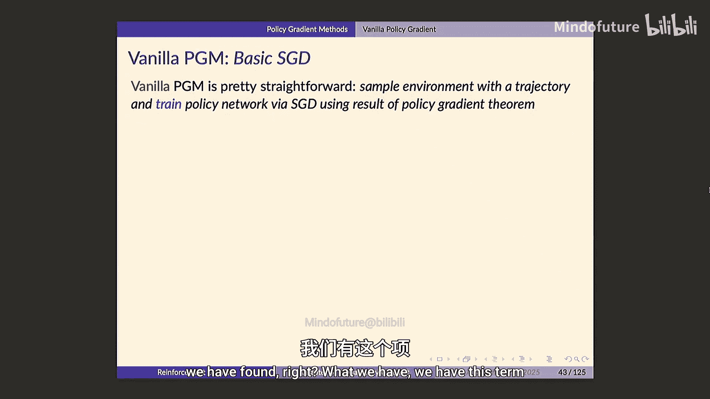

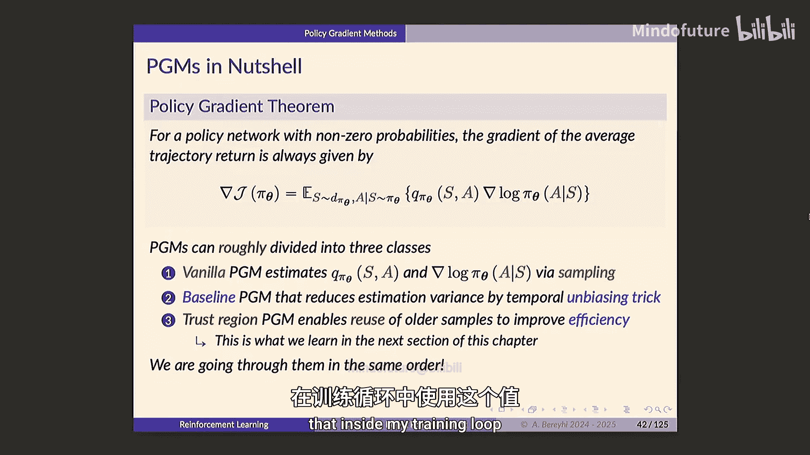

在本节课中，我们将要学习策略梯度方法的核心思想，特别是原始的“香草”策略梯度方法及其一个重要的改进版本——引入基线的策略梯度方法。我们将探讨如何直接从策略网络中计算梯度，以及如何通过引入基线来稳定训练过程。

## 原始策略梯度方法 🧠

上一节我们介绍了策略梯度定理，它为我们提供了优化策略网络的理论基础。本节中我们来看看如何将其付诸实践。

最直接的方法就是使用我们找到的梯度估计器进行基本的随机梯度下降。这就是原始的“香草”策略梯度方法。

我们拥有的梯度项是期望值：**E[Q(s, a) * ∇ log π(a|s; θ)]**。这个期望项就是策略梯度向上的估计器。我们可以通过采样来估计它。

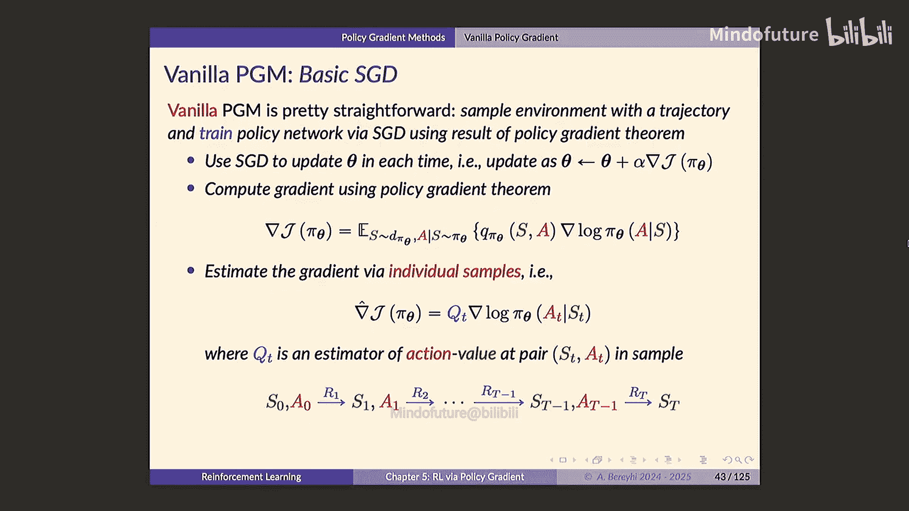

具体操作流程如下：
1.  从某个初始状态开始。
2.  使用当前的策略网络与环境交互，执行动作，获得新的状态和奖励。
3.  重复此过程，直到回合结束，得到一条包含状态、动作和奖励的轨迹。
4.  对于轨迹中的每一个时间步，我们可以计算该点的Q值估计和策略对数似然的梯度，然后用它们的乘积来更新策略网络的参数。

以下是实现这一过程的关键步骤：

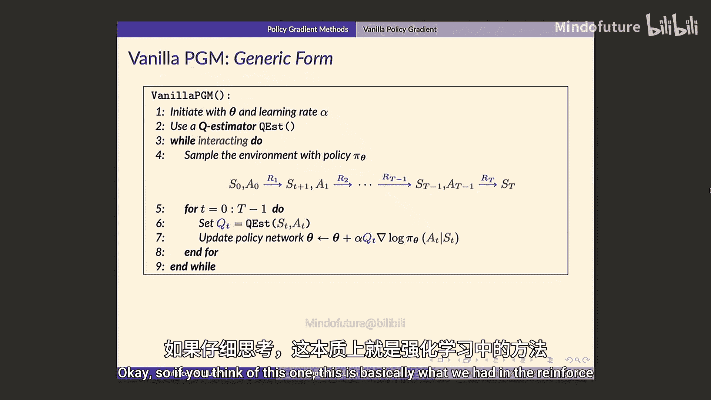

**1. 估计Q值**
对于轨迹中在时间t的状态`S_t`和动作`A_t`，其Q值`Q(S_t, A_t)`的一个简单估计是“样本回报”，即从该时间点开始到回合结束所获得的累计奖励之和。我们可以通过多次采样并取平均来获得更好的估计，但在实践中，我们常常像批大小为1的随机梯度下降一样，只使用一个样本。

**2. 计算策略对数似然梯度**
我们有一个策略网络`π(a|s; θ)`。给定一个状态`s`，它输出一个动作`a`的概率分布。我们需要计算`log π(a|s; θ)`关于参数`θ`的梯度。

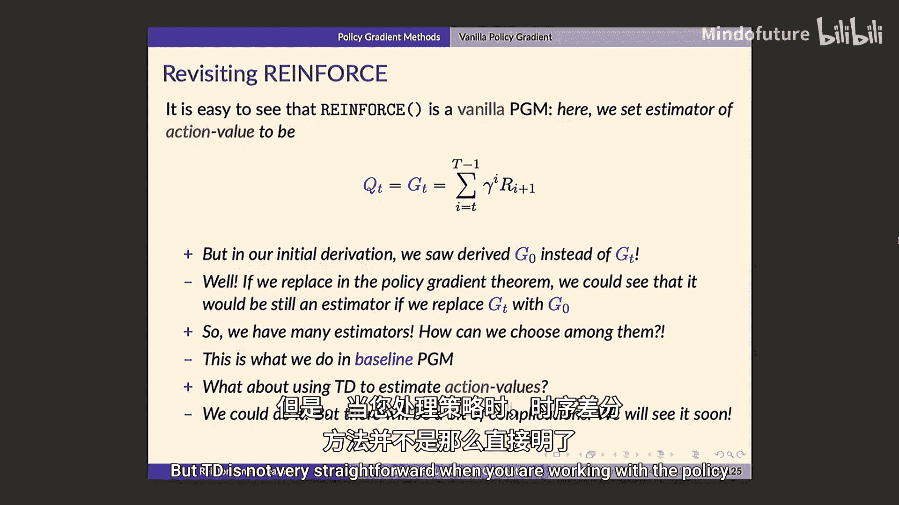

以高斯策略为例，假设策略输出动作的均值`μ`由神经网络`f_θ(s)`计算，方差固定。那么策略的概率密度为：
`π(a|s; θ) = (1/√(2π)) * exp(-(a - f_θ(s))^2 / 2)`

其对数似然为：
`log π(a|s; θ) = constant - (a - f_θ(s))^2 / 2`

关于参数`θ`的梯度为：
`∇ log π(a|s; θ) = (a - f_θ(s)) * ∇ f_θ(s)`

我们可以通过标准的反向传播算法来计算`∇ f_θ(s)`。

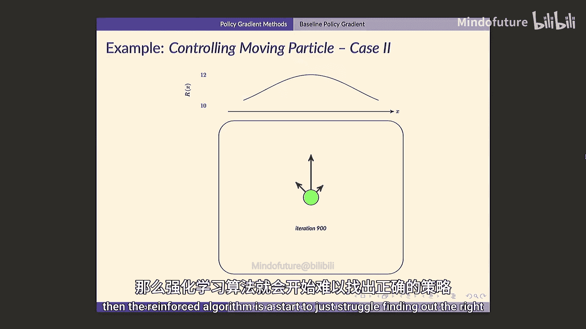

**3. 参数更新**
综合以上两点，在时间t，我们使用以下公式更新策略参数`θ`：
`θ ← θ + α * (样本回报 G_t) * ∇ log π(A_t|S_t; θ)`

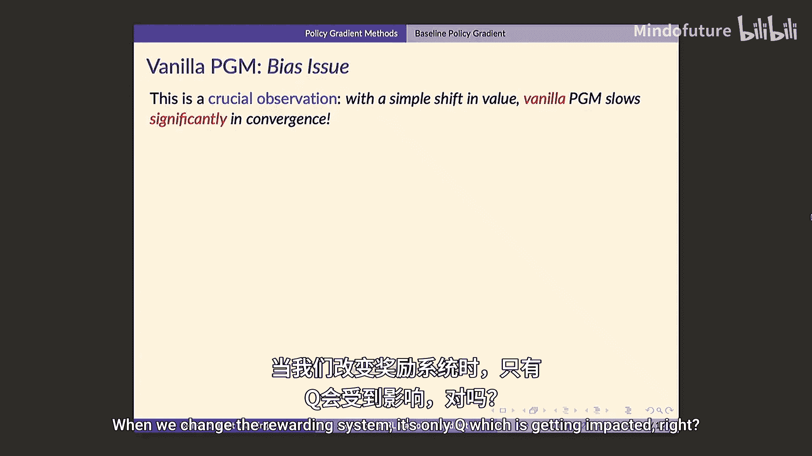

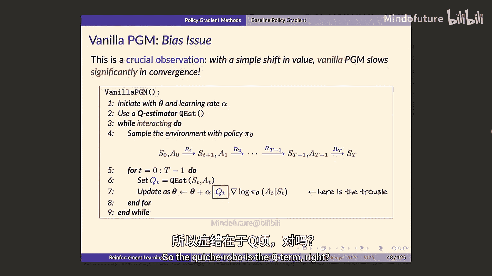

其中`α`是学习率。这就是著名的REINFORCE算法。它本质上是策略梯度定理的一个具体实现，其中使用蒙特卡洛方法（样本回报`G_t`）来估计`Q(S_t, A_t)`。

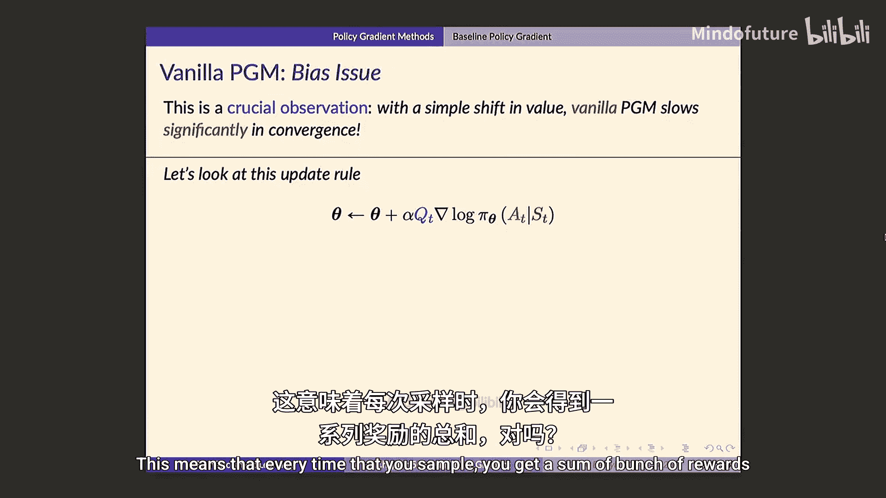

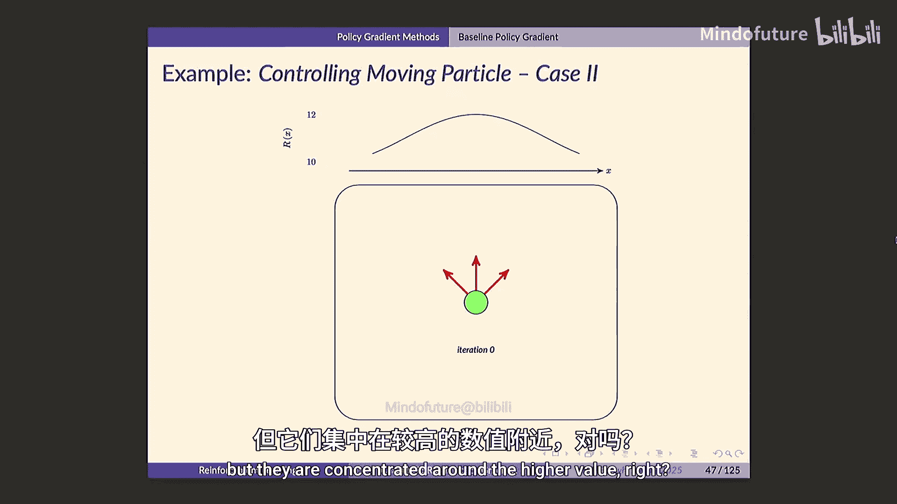

## 原始方法的问题与基线的引入 ⚖️

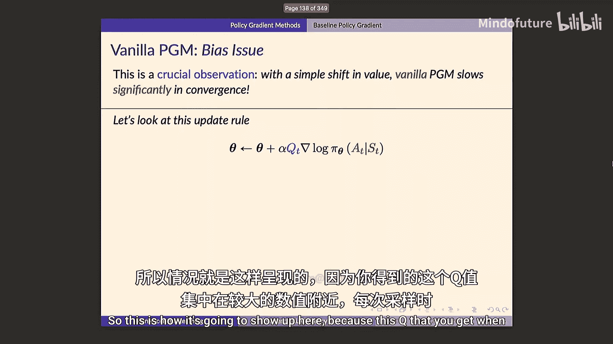

虽然REINFORCE算法在概念上很直观，但在实践中可能会遇到不稳定的问题。一个关键原因是`Q`值估计的尺度。

考虑一个简单的环境：一个粒子需要垂直向上移动。奖励函数设计为：在中心x=0时奖励为+1，在边缘x=±1时奖励为-1。使用REINFORCE算法，策略能较快地学会一直向上移动。

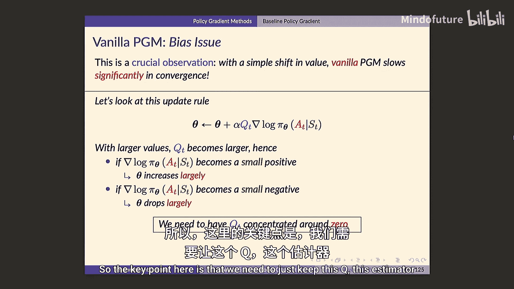

然而，如果我们仅仅将奖励函数平移（例如，中心奖励变为+12，边缘奖励变为+10），虽然最优策略不变（因为相对关系没变），但REINFORCE算法的收敛速度会显著变慢，变得不稳定。

**问题根源**在于更新公式中的`Q`值项。当奖励值整体很大时，`Q`值的估计也会很大。这会导致梯度更新步长过大，使得参数`θ`发生剧烈变化。由于策略网络参数`θ`的微小变化可能导致策略（进而导致价值）的巨大改变，这种不稳定性被放大了。

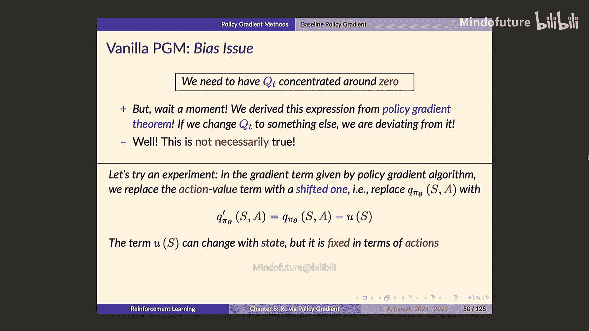

**解决方案**：引入基线。我们希望`Q`值的估计能围绕0附近，以稳定训练。一个自然的想法是使用一个“基线”函数`b(s)`来中心化`Q`值。即，我们将更新规则改为：
`θ ← θ + α * (Q(s, a) - b(s)) * ∇ log π(a|s; θ)`

关键问题是：减去一个基线`b(s)`会改变梯度的期望值吗？答案是不会，只要基线`b(s)`不依赖于动作`a`（它可以依赖于状态`s`）。

**证明**：
原始的梯度是`E[Q(s, a) * ∇ log π(a|s; θ)]`。
使用基线后的梯度是`E[(Q(s, a) - b(s)) * ∇ log π(a|s; θ)]`。
将后者展开：
`= E[Q(s, a) * ∇ log π(a|s; θ)] - E[b(s) * ∇ log π(a|s; θ)]`
我们只需证明第二项`E[b(s) * ∇ log π(a|s; θ)] = 0`。
由于`b(s)`不依赖于`a`，可以提到关于动作的期望外面：
`= E_s [ b(s) * E_{a~π}[∇ log π(a|s; θ)] ]`
而`E_{a~π}[∇ log π(a|s; θ)]`本身等于0（这是对数似然梯度的一个重要性质，其期望值为零）。因此整个第二项为0。

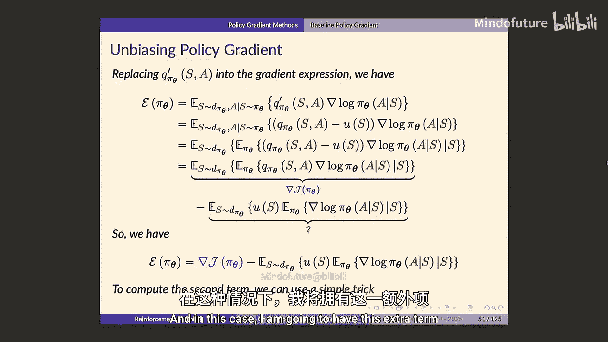

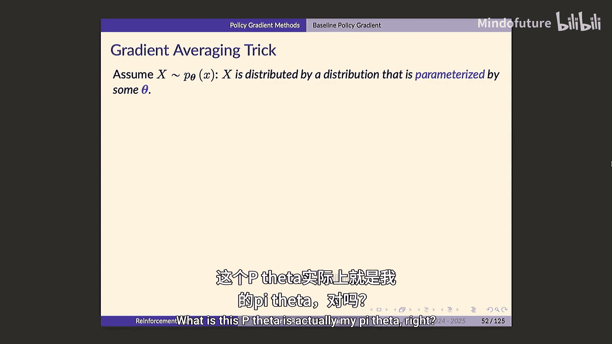

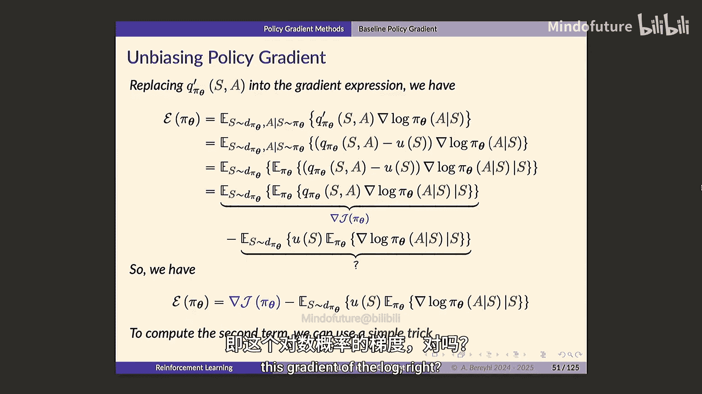

所以，**引入与动作无关的基线不会改变策略梯度的期望值**。这意味着我们可以自由地选择基线来减少方差、稳定训练，而不会引入偏差。

## 优势函数：最优基线选择 🏆

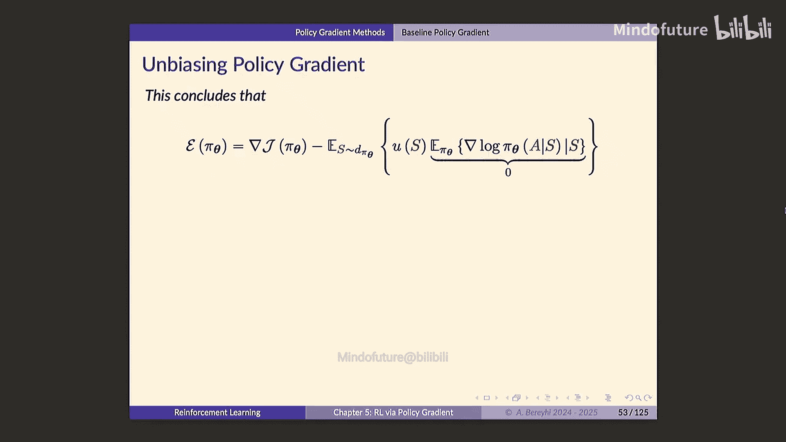

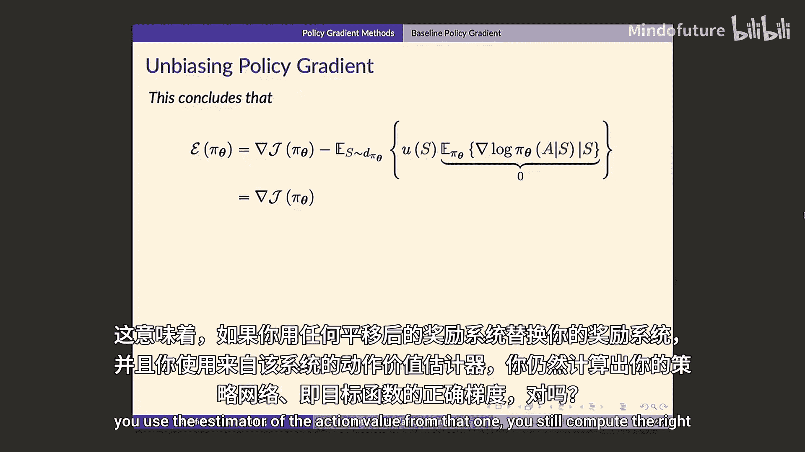

既然基线可以任意选择，一个自然的问题是：什么是最优的基线？理论上，能最小化梯度估计方差的最优基线是状态价值函数`V(s)`。

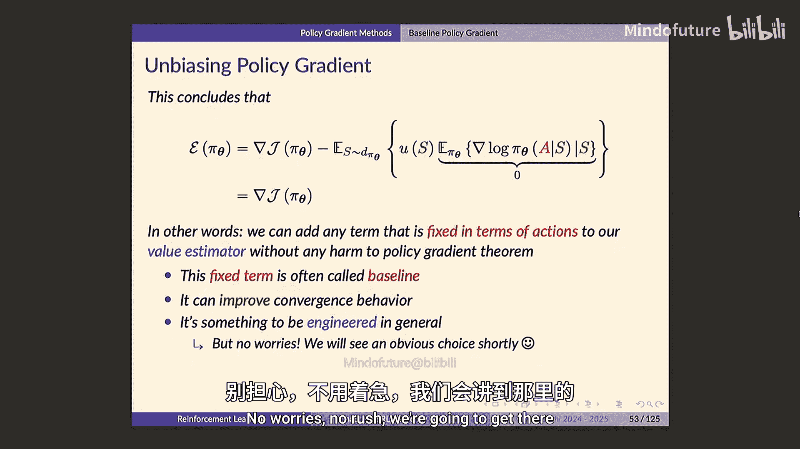

`V(s)`是在状态`s`下，遵循当前策略所能获得的期望回报。`Q(s, a)`则是在状态`s`下执行特定动作`a`后的期望回报。它们的差值：
`A(s, a) = Q(s, a) - V(s)`
被称为**优势函数**。

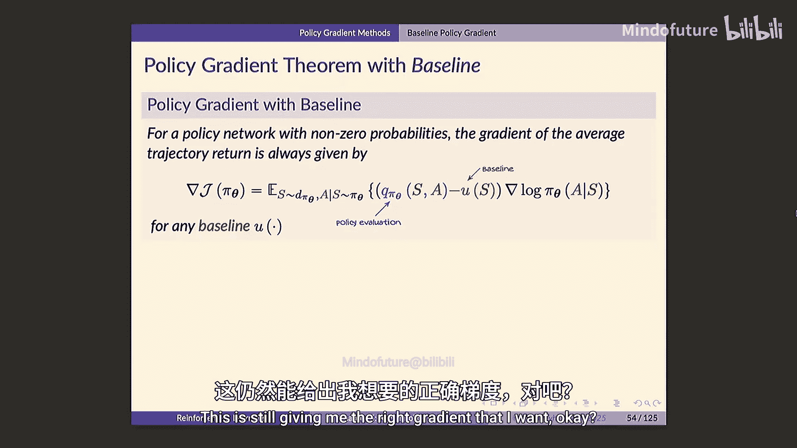

优势函数`A(s, a)`衡量了在状态`s`下，采取动作`a`相对于平均表现（`V(s)`）有多好。
*   如果`A(s, a) > 0`，说明动作`a`优于平均。
*   如果`A(s, a) < 0`，说明动作`a`劣于平均。
*   对所有可能的动作`a`，其优势函数的期望值（按策略加权）为0。

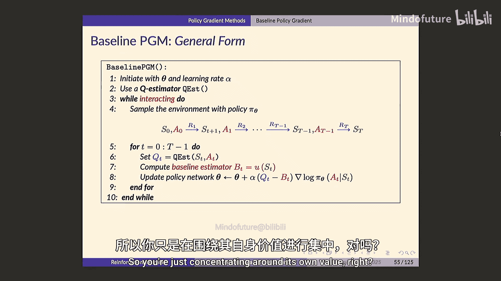

因此，使用优势函数作为更新信号的策略梯度方法被称为**优势演员-评论家**方法。更新规则变为：
`θ ← θ + α * A(s, a) * ∇ log π(a|s; θ)`

优势函数`A(s, a)`本身可以通过`Q`和`V`估计，也可以利用贝尔曼方程进行近似。例如，使用时序差分误差`δ_t = r_t + γV(s_{t+1}) - V(s_t)`作为`A(s_t, a_t)`的估计，这只需要一个价值网络来估计`V(s)`，而无需显式估计`Q(s, a)`。这为后续更高效的算法（如A2C, A3C）奠定了基础。

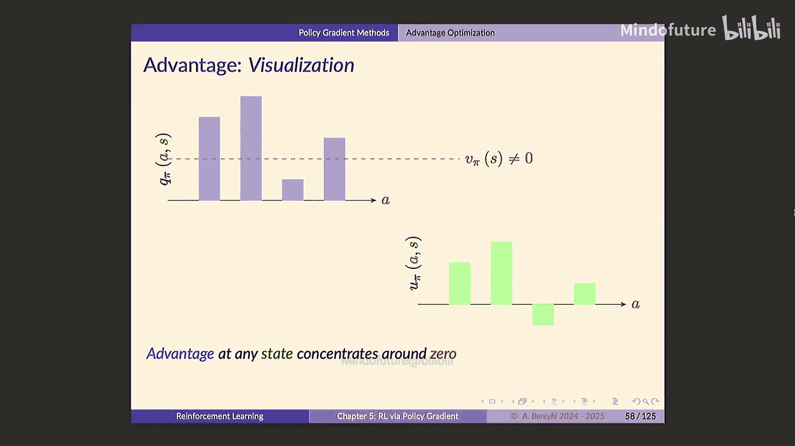

## 总结 📚

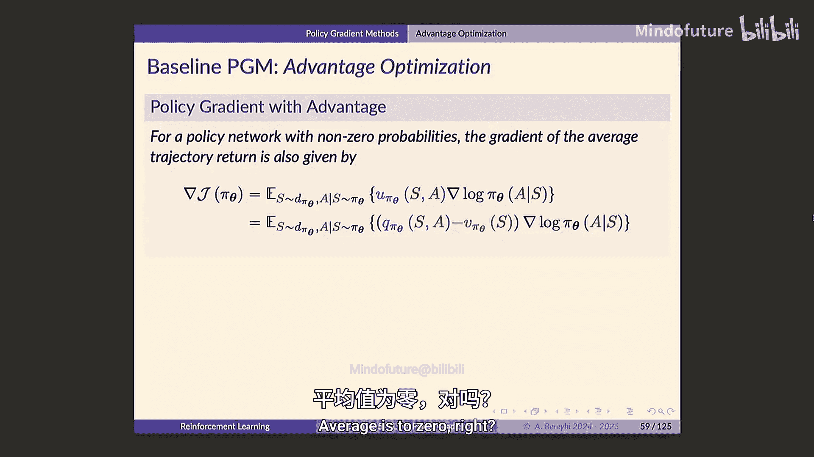

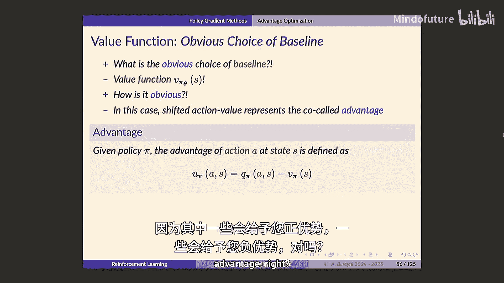

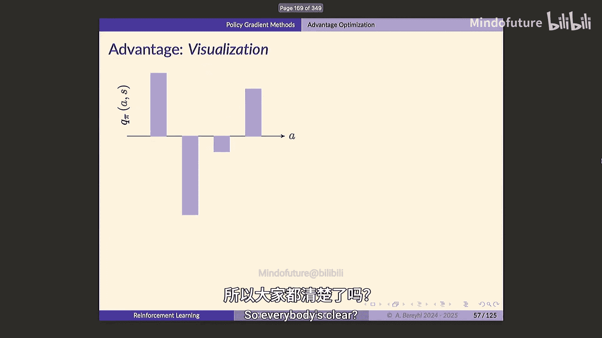

本节课中我们一起学习了策略梯度方法从原始形式到引入基线的演进过程。
1.  **原始策略梯度（如REINFORCE）**：直接使用样本回报估计`Q`值，乘以策略对数似然梯度来更新参数。简单直观，但估计方差高，训练不稳定。
2.  **基线策略梯度**：通过在`Q`值估计中减去一个与动作无关的基线函数`b(s)`，可以在不引入偏差的前提下，有效降低梯度估计的方差，从而稳定训练过程。
3.  **优势函数**：选择状态价值函数`V(s)`作为基线是最优选择之一。由此得到的优势函数`A(s, a) = Q(s, a) - V(s)`，能更清晰地指示动作的相对好坏，是许多现代策略梯度算法（如优势演员-评论家）的核心。

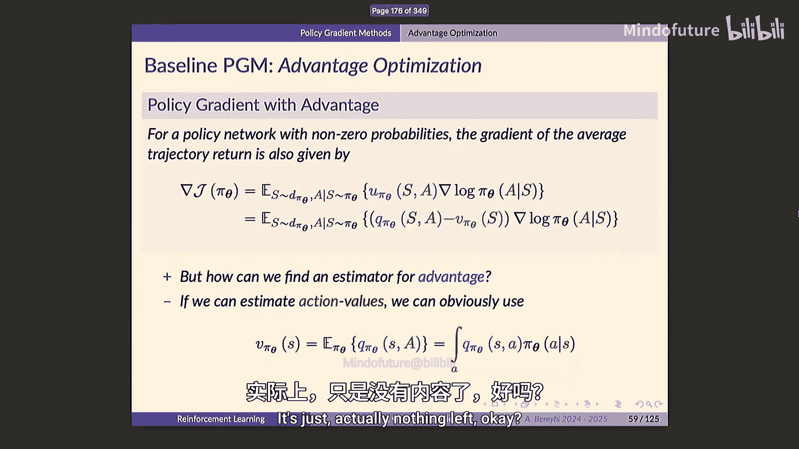

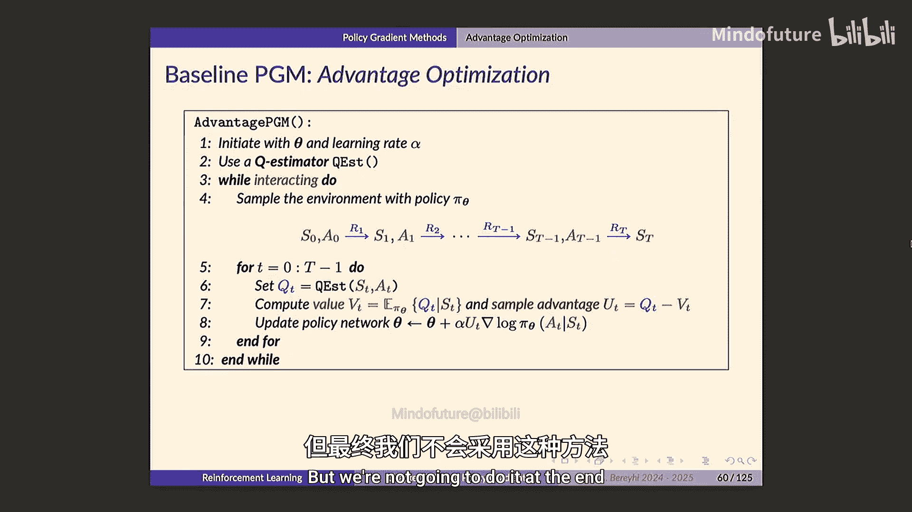

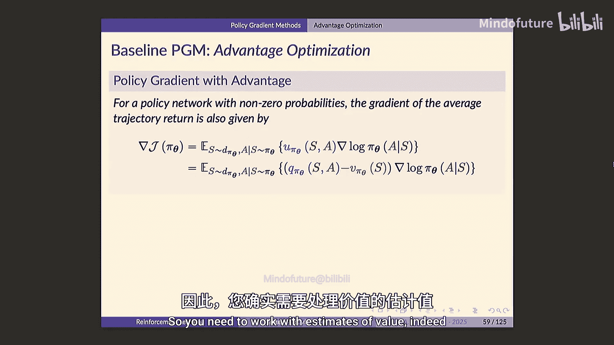

理解基线的作用和优势函数的概念，是掌握高级策略优化算法的重要一步。