# 050：策略梯度作为序列代理优化

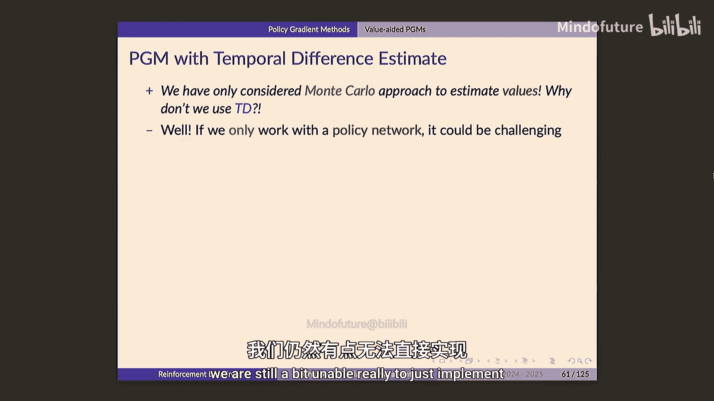

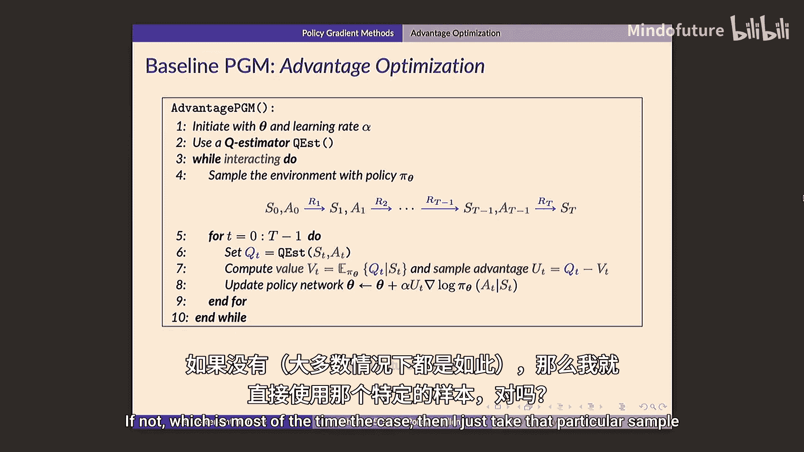

在本节课中，我们将深入探讨策略梯度方法（PGM）在实际应用中遇到的挑战，特别是其样本效率低下的问题。我们将学习如何通过构建“代理函数”来重新理解策略梯度更新，并探索如何利用重要度采样来改进算法，最终引出更稳定、更高效的Actor-Critic方法。

## 策略梯度方法的实践挑战

上一节我们介绍了策略梯度定理的基本形式。本节中我们来看看在实际实现策略梯度方法时，我们会遇到哪些具体问题。

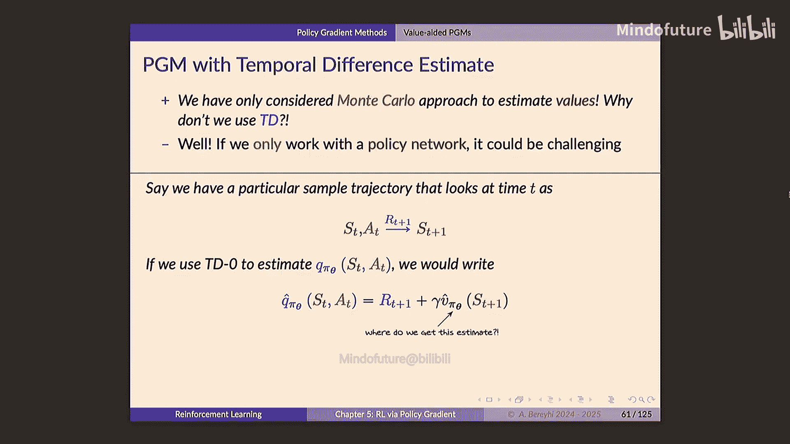

核心的挑战在于，我们无法直接获得真实的动作价值函数 \( Q^{\pi}(s, a) \)。在纯粹的策略网络方法中，我们没有一个独立的价值网络来评估状态或动作的价值。

因此，在实践中，我们只能依赖从环境中采样得到的轨迹回报来估计 \( Q \) 值。对于一个给定的状态-动作对 \( (s_t, a_t) \)，我们收集其后的累积奖励作为该样本的回报估计：

\[
\hat{Q}(s_t, a_t) = \sum_{k=t}^{T} \gamma^{k-t} r_k
\]

这是一种蒙特卡洛估计。如果我们能多次采样到同一个 \( (s_t, a_t) \) 对，我们可以对回报取平均以获得更好的估计。但大多数情况下，我们只能使用单一样本回报，这导致了高方差。

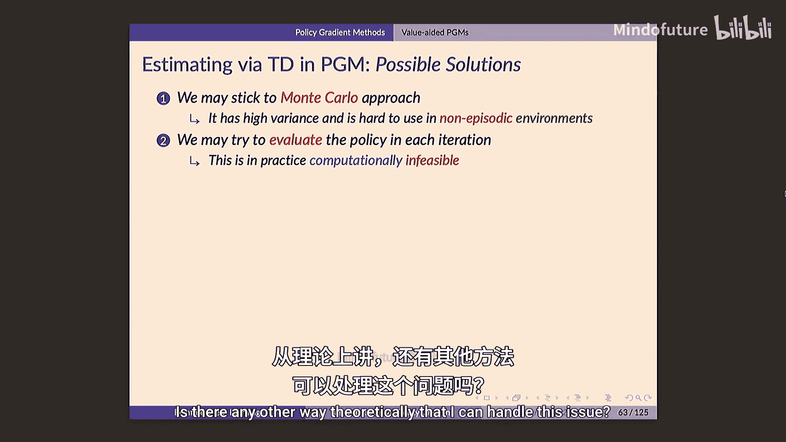

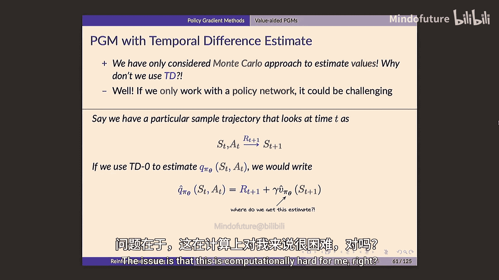

你可能会问，为什么我们不使用时序差分（TD）方法？如果我们只考虑策略网络，使用TD方法会受到限制。

原因在于，TD更新依赖于贝尔曼方程：

\[
Q(s_t, a_t) = r_t + \gamma V(s_{t+1})
\]

要计算当前状态动作对的 \( Q \) 值，我们需要知道下一个状态 \( s_{t+1} \) 的价值 \( V(s_{t+1}) \)。在基于价值网络的方法中，我们有一个价值网络来提供这个值。但在纯粹的策略梯度方法中，我们没有这样的价值网络。我们无法将一个随机状态输入网络并获得其价值估计。

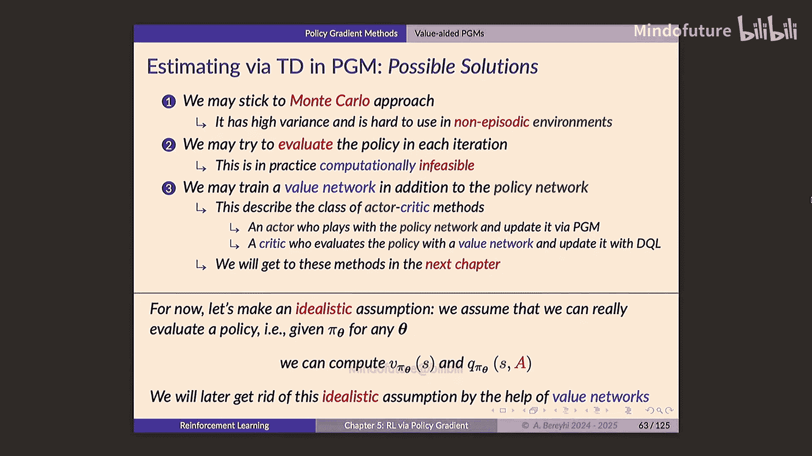

因此，如果我们只想使用策略网络，而不想使用价值网络，蒙特卡洛估计是唯一可行的选择，尽管它效率不高。

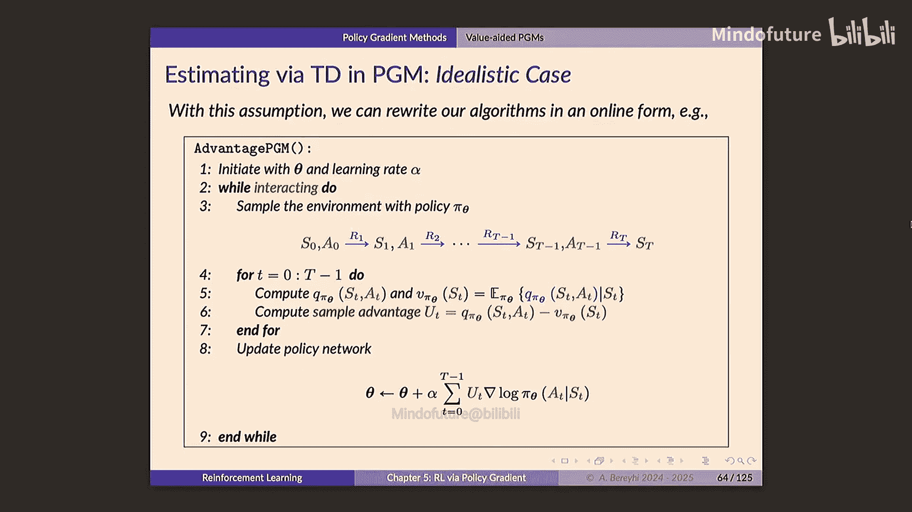

## 从纯粹策略梯度到Actor-Critic

所以，我们无法在纯粹的策略网络设置中高效地处理价值估计问题。这就是为什么在实践中，你几乎看不到纯粹的深度策略梯度方法。取而代之的是Actor-Critic方法。

以下是Actor-Critic方法的核心思想：

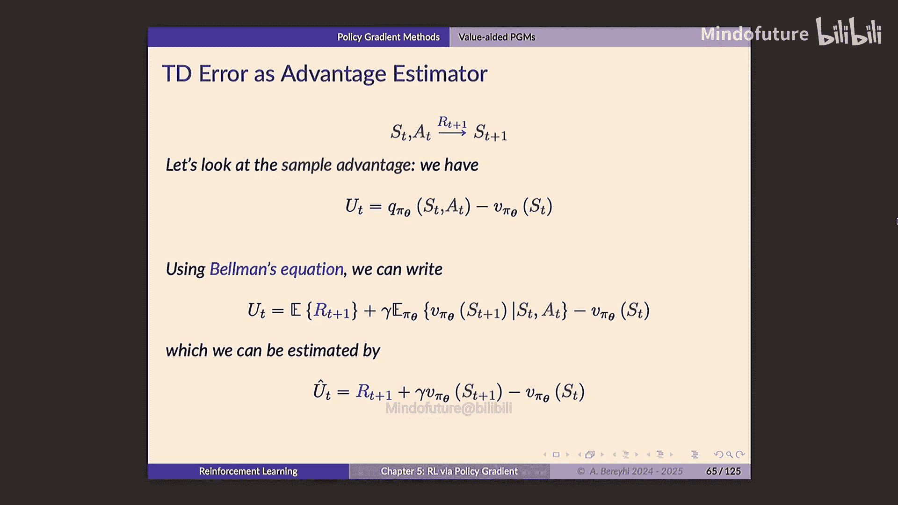

*   你拥有一个策略网络 \( \pi_\theta \)（Actor），负责生成动作。
*   你拥有另一个价值网络 \( V_\phi \)（Critic），负责评估当前策略下状态或动作的价值。
*   每次更新策略（Actor）后，你也会更新价值网络（Critic）。
*   你希望这个价值网络能够准确评估当前迭代中的策略。
*   然后，你可以使用这个价值网络来估计所有需要的 \( V \) 和 \( Q \) 值。

这个价值网络就是“评论家”（Critic），它负责评判“演员”（Actor，即策略）的动作好坏。我们将在后续章节详细讨论这种方法。

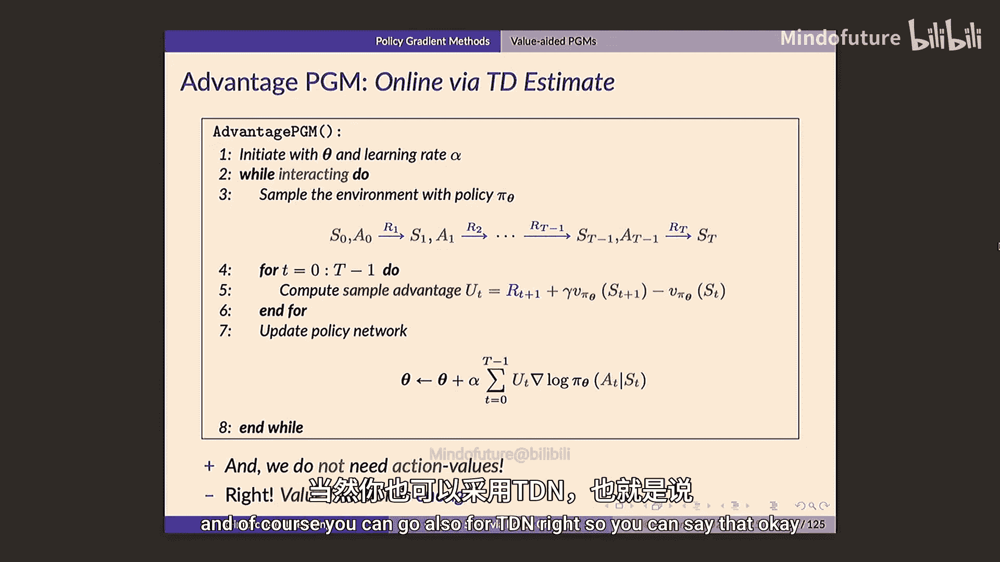

从现在开始，为了简化推导，我将假设我们拥有一个可以完美评估策略价值函数的“神谕”（例如，一个强大的价值网络）。这意味着，当我写下 \( V^{\pi}(s) \) 或 \( Q^{\pi}(s, a) \) 时，我假设它们是可以被准确计算或估计的。

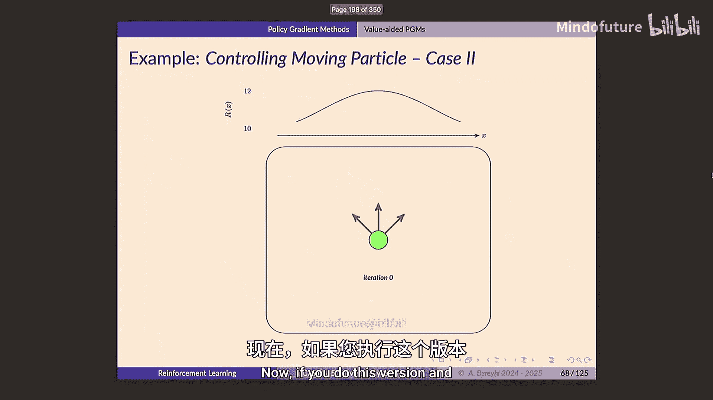

## 优势函数策略梯度

基于以上假设，我现在给出一个更实用的策略梯度版本——优势函数策略梯度。这个版本在论文和实际实现中经常出现。

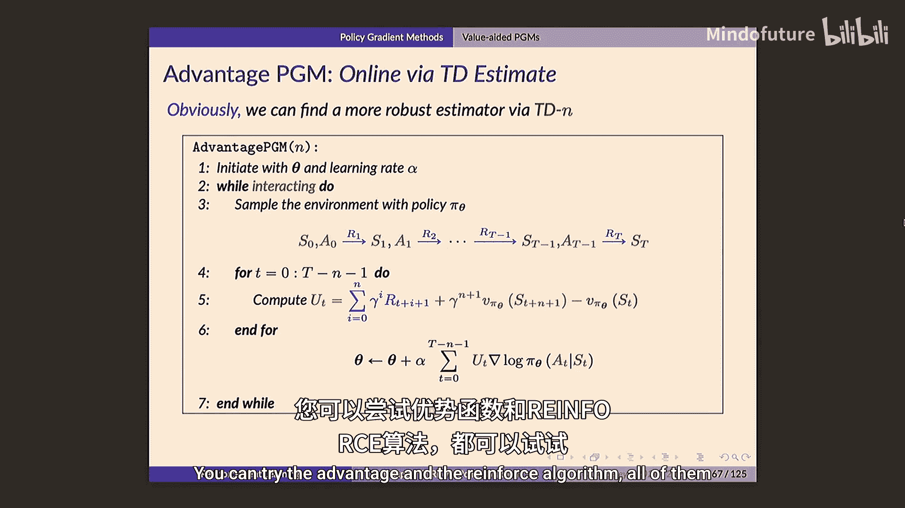

其更新公式如下：

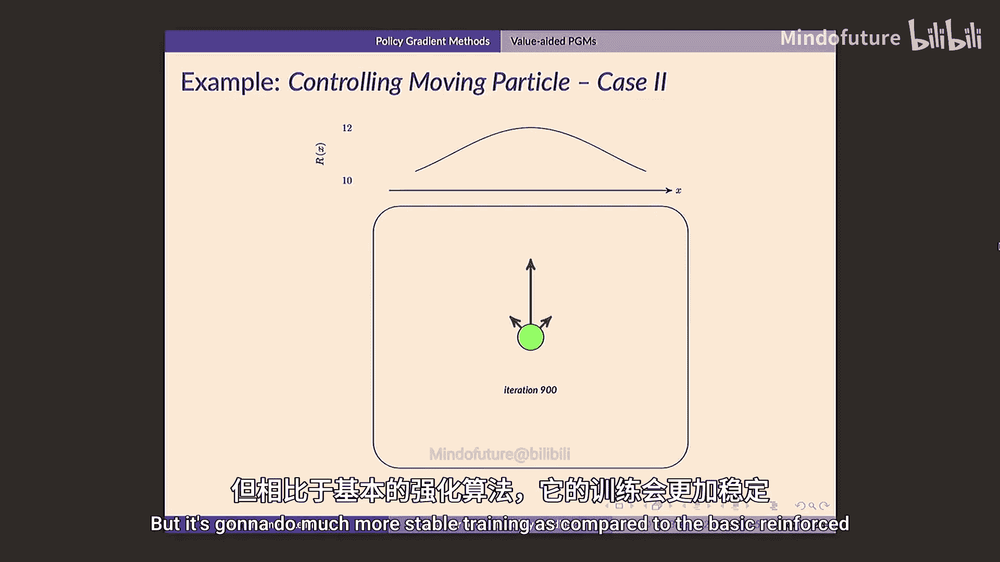

\[
\theta_{k+1} = \theta_k + \alpha \mathbb{E}_{s \sim d^{\pi_{\theta_k}}, a \sim \pi_{\theta_k}} \left[ A^{\pi_{\theta_k}}(s, a) \nabla_\theta \log \pi_\theta(a|s) \bigg|_{\theta=\theta_k} \right]
\]

其中，优势函数 \( A^{\pi}(s, a) = Q^{\pi}(s, a) - V^{\pi}(s) \)。

具体操作步骤如下：

1.  收集样本轨迹和回报。
2.  评估当前策略 \( \pi_{\theta_k} \) 在特定状态 \( s \) 和动作 \( a \) 下的价值 \( V^{\pi_{\theta_k}}(s) \) 和动作价值 \( Q^{\pi_{\theta_k}}(s, a) \)。
3.  计算样本优势 \( \hat{A}(s, a) = \hat{Q}(s, a) - V^{\pi_{\theta_k}}(s) \)。
4.  使用这个优势估计来更新策略参数。

## 优势函数与时序差分的关系

有趣的是，优势函数与我们之前在表格型RL中使用的时序差分（TD）误差紧密相关。

让我们用贝尔曼方程来看这个关系。根据贝尔曼方程，\( Q \) 值可以表示为：

\[
Q^{\pi}(s_t, a_t) = r_t + \gamma V^{\pi}(s_{t+1})
\]

那么，样本优势估计可以写为：

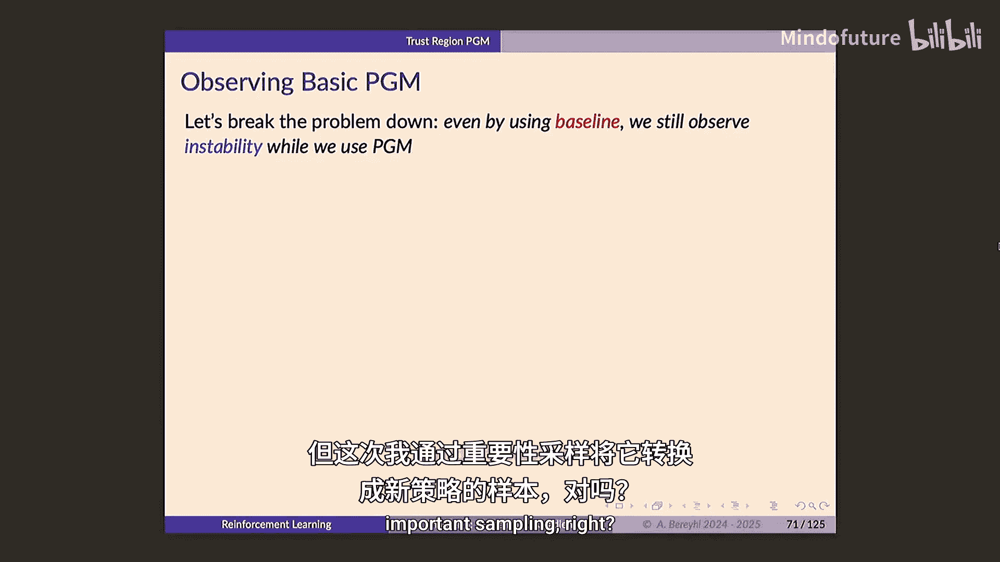

\[
\hat{A}(s_t, a_t) = \hat{Q}(s_t, a_t) - V^{\pi}(s_t) \approx (r_t + \gamma V^{\pi}(s_{t+1})) - V^{\pi}(s_t)
\]

这看起来熟悉吗？这正是我们在TD(0)学习中用于更新价值估计的TD误差：

\[
\delta_t = r_t + \gamma V(s_{t+1}) - V(s_t)
\]

因此，我们其实一直在不知不觉中使用着优势函数的概念。TD误差衡量了当前估计与基于下一步观察的更好估计之间的差异，这与优势函数的思想一致。

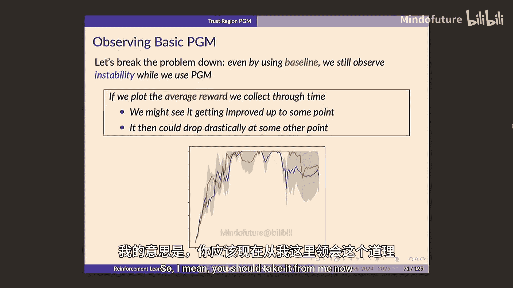

我们可以进一步将TD(0)推广到TD(n)，使用多步回报来估计优势：

\[
\hat{A}^{(n)}(s_t, a_t) = \left( \sum_{i=0}^{n-1} \gamma^i r_{t+i} \right) + \gamma^n V^{\pi}(s_{t+n}) - V^{\pi}(s_t)
\]

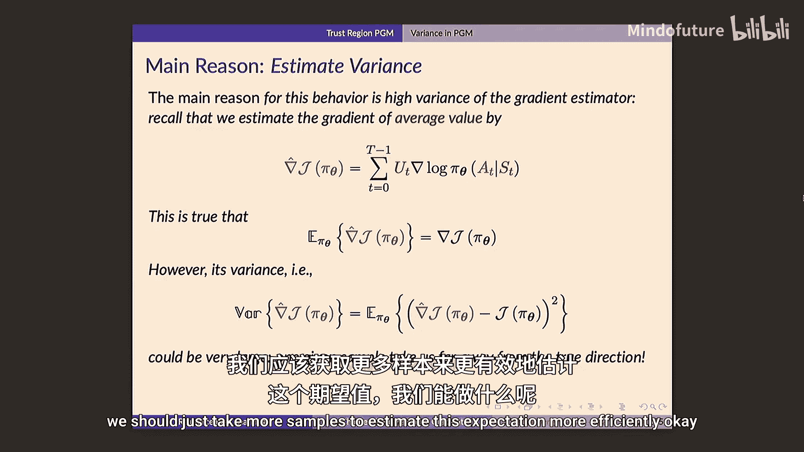

这带来了偏差-方差的权衡：TD(n)估计通常偏差更大但方差更小，而蒙特卡洛估计（可看作TD(∞)）偏差小但方差大。

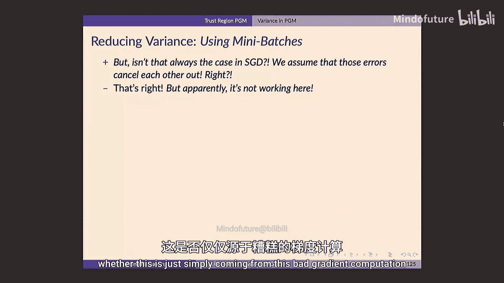

## 策略梯度方法的根本问题：样本效率与稳定性

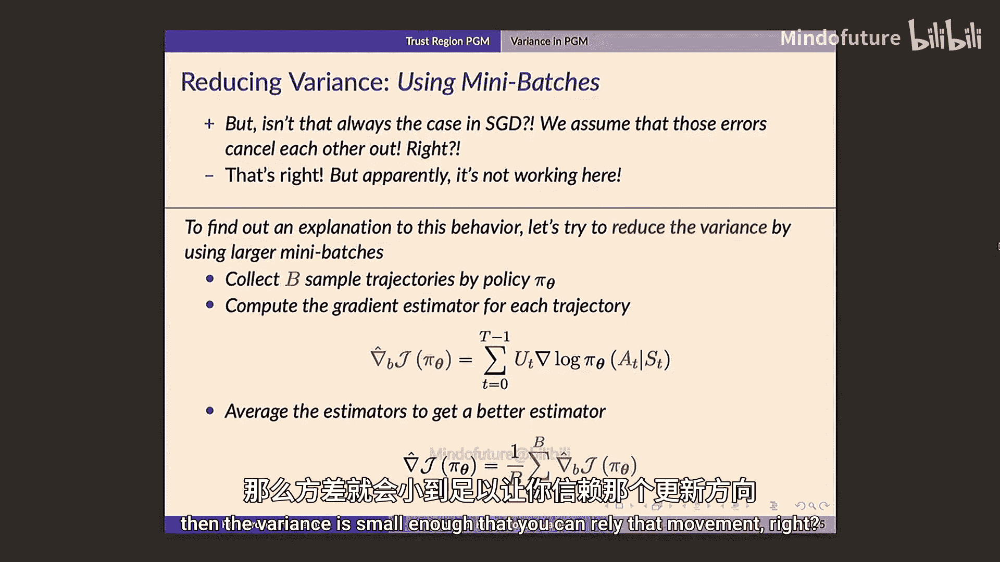

现在，我们进入策略梯度方法更有趣的部分，也是其核心挑战所在：信任区域问题。

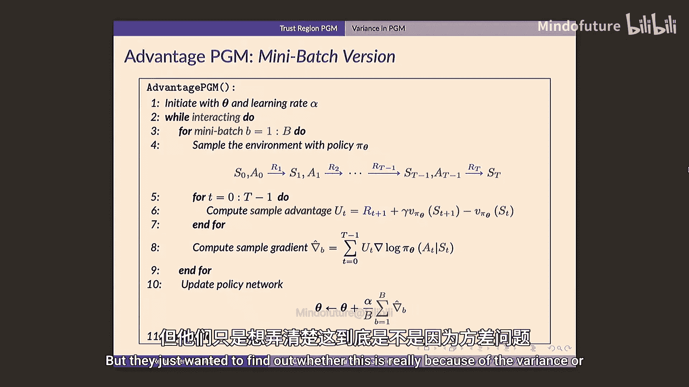

人们发现，策略梯度方法本质上是样本低效的。为什么呢？

因为在一个典型的PGM中：
1.  你用当前策略 \( \pi_{\theta_k} \) 采样环境，得到轨迹。
2.  你用这些轨迹计算梯度，更新策略得到 \( \pi_{\theta_{k+1}} \)。
3.  然后你**丢弃**这些样本。
4.  你用**新的**策略 \( \pi_{\theta_{k+1}} \) 重新采样，重复上述过程。

你无法重复使用旧策略采样的样本，因为新策略已经改变了。这与DQN不同，DQN通过经验回放池可以重复利用旧经验，因为Q学习本质上是离策略的。

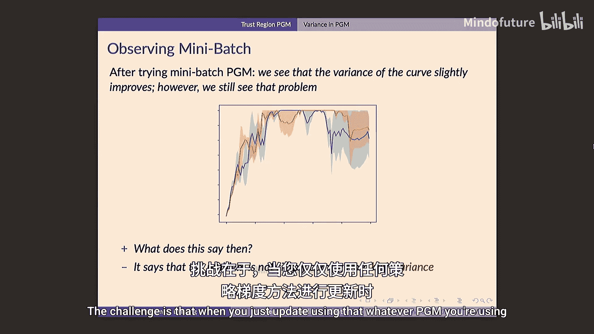

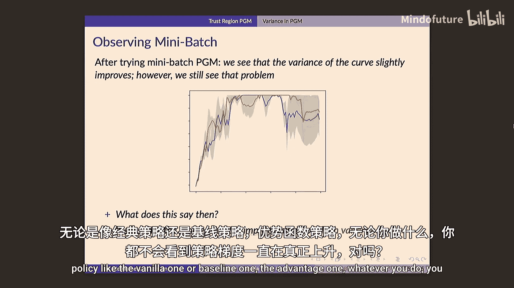

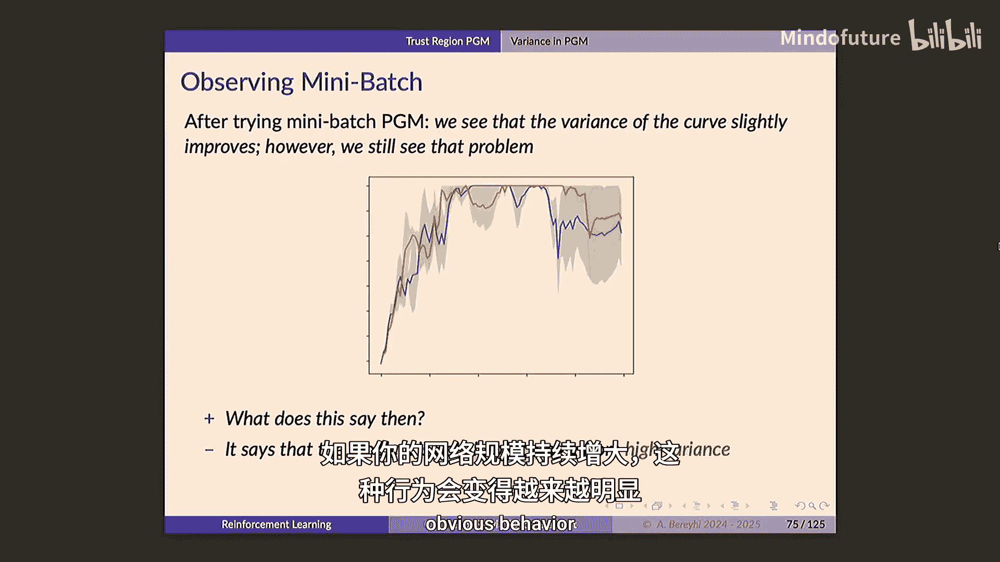

一个自然的想法是：我们能否也让PGM变得离策略？即，我们使用旧策略 \( \pi_{\text{old}} \) 采样的轨迹，通过**重要度采样**来估计新策略 \( \pi_{\text{new}} \) 下的梯度。

重要度采样回顾：如果我们想计算关于分布 \( q(x) \) 的期望 \( \mathbb{E}_{x \sim q}[f(x)] \)，但我们只能从分布 \( p(x) \) 采样，那么我们可以这样做：

\[
\mathbb{E}_{x \sim q}[f(x)] = \mathbb{E}_{x \sim p}\left[ f(x) \frac{q(x)}{p(x)} \right]
\]

在策略梯度中，\( p \) 是行为策略（旧策略），\( q \) 是目标策略（新策略）。我们似乎可以计算新旧策略的概率比 \( \frac{\pi_{\text{new}}(a|s)}{\pi_{\text{old}}(a|s)} \)，并用它来修正旧样本。

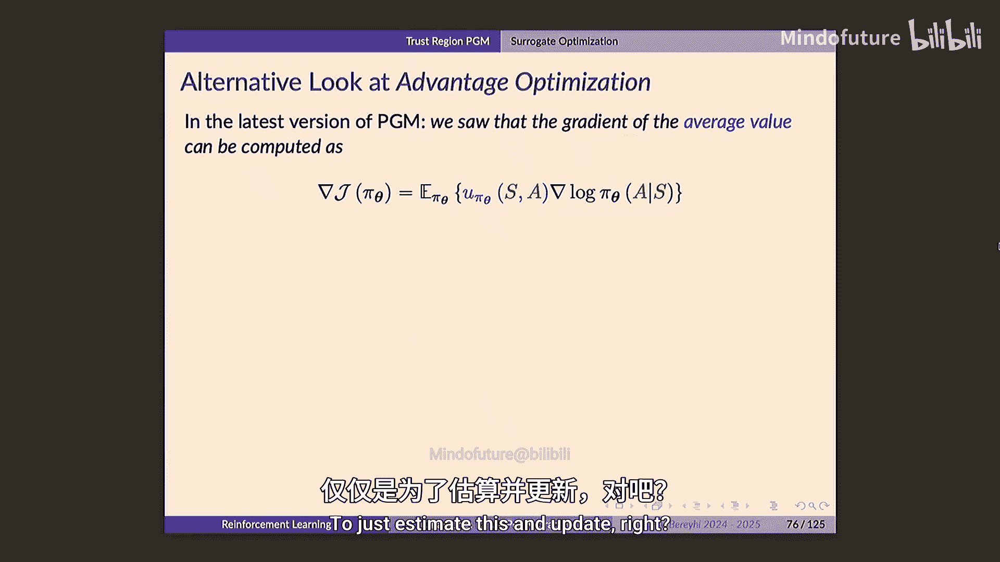

然而，当人们天真地实现这个想法时，算法并不稳定。一个典型的现象是：策略在训练中会取得不错的性能，然后突然崩溃，性能急剧下降，并且难以恢复。

为什么会出现这种情况？可能的原因有：
*   **梯度估计方差过高**：单样本估计的噪声太大，导致更新方向错误。
*   **学习率设置不当**：步长太大可能导致策略“跳”到一个很差的区域。
*   **重要度采样权重不稳定**：当新旧策略差异变大时，重要性权重 \( \frac{\pi_{\text{new}}}{\pi_{\text{old}}} \) 可能变得极大或极小，导致梯度估计数值不稳定。

人们首先尝试通过**小批量**样本来降低方差。即，每次更新时，采集 \( B \) 条独立轨迹，计算每条轨迹的梯度，然后取平均：

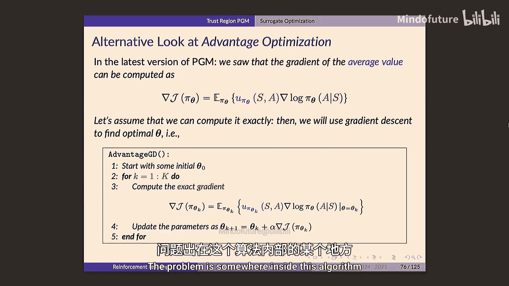

\[
\hat{g} = \frac{1}{B} \sum_{i=1}^{B} \hat{g}_i
\]

理论上，方差会降低为原来的 \( 1/B \)。但实验发现，虽然抖动有所减少，策略性能突然崩溃的根本问题并未解决。这表明问题不仅仅源于梯度估计的方差。

## 代理函数优化：一种新的视角

我们需要更深入地理解策略梯度更新背后的动态。一种强大的方法是**代理函数优化**。

让我们暂时忘记估计问题，假设我们可以精确计算目标函数 \( J(\pi_\theta) = \mathbb{E}_{s \sim d^{\pi_\theta}}[V^{\pi_\theta}(s)] \) 的梯度。

在参数 \( \theta_k \) 处，精确的梯度是：

\[
\nabla_\theta J(\pi_\theta) \bigg|_{\theta=\theta_k} = \mathbb{E}_{s \sim d^{\pi_{\theta_k}}, a \sim \pi_{\theta_k}} \left[ A^{\pi_{\theta_k}}(s, a) \nabla_\theta \log \pi_\theta(a|s) \bigg|_{\theta=\theta_k} \right]
\]

现在，我们构造一个**代理函数** \( L_k(\pi_\theta) \)：

\[
L_k(\pi_\theta) = J(\pi_{\theta_k}) + \mathbb{E}_{s \sim d^{\pi_{\theta_k}}, a \sim \pi_{\theta_k}} \left[ \frac{\pi_\theta(a|s)}{\pi_{\theta_k}(a|s)} A^{\pi_{\theta_k}}(s, a) \right]
\]

注意这个函数的特点：
*   它是关于新参数 \( \theta \) 的函数。
*   但它依赖于当前的参数 \( \theta_k \)（体现在采样分布、优势函数和分母的策略中）。
*   在 \( \theta = \theta_k \) 这一点，代理函数的值 \( L_k(\pi_{\theta_k}) = J(\pi_{\theta_k}) \)。
*   **关键性质**：在 \( \theta = \theta_k \) 这一点，代理函数 \( L_k \) 的梯度与原始目标函数 \( J \) 的梯度**完全相同**。

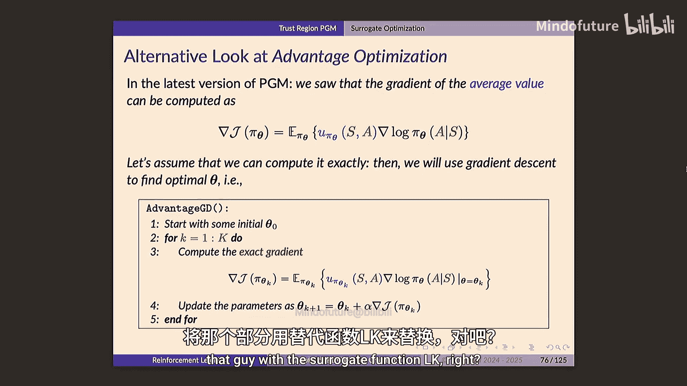

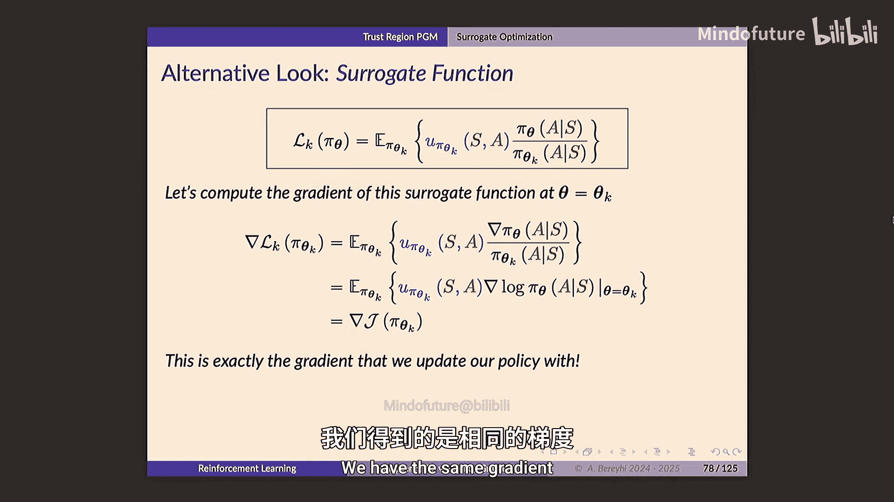

让我们验证一下。计算 \( L_k \) 在 \( \theta \) 处的梯度：

\[
\nabla_\theta L_k(\pi_\theta) = \mathbb{E}_{s \sim d^{\pi_{\theta_k}}, a \sim \pi_{\theta_k}} \left[ \frac{\nabla_\theta \pi_\theta(a|s)}{\pi_{\theta_k}(a|s)} A^{\pi_{\theta_k}}(s, a) \right]
\]

现在，在 \( \theta = \theta_k \) 处求值：

\[
\nabla_\theta L_k(\pi_\theta) \bigg|_{\theta=\theta_k} = \mathbb{E}_{s \sim d^{\pi_{\theta_k}}, a \sim \pi_{\theta_k}} \left[ \frac{\nabla_\theta \pi_\theta(a|s) \big|_{\theta=\theta_k}}{\pi_{\theta_k}(a|s)} A^{\pi_{\theta_k}}(s, a) \right]
\]

由于 \( \frac{\nabla_\theta \pi_\theta}{\pi_\theta} = \nabla_\theta \log \pi_\theta \)，上式正好等于 \( \nabla_\theta J(\pi_\theta) \big|_{\theta=\theta_k} \)。

## 从梯度上升到最大化代理函数

这个性质非常有用。它意味着，在 \( \theta_k \) 这一点，沿着 \( L_k \) 的梯度方向走，与沿着 \( J \) 的梯度方向走是一样的。

但我们可以做得更好。与其只沿着梯度方向走一小步（需要精心调整学习率），不如直接**最大化这个代理函数** \( L_k \)，将最大值点作为下一个参数 \( \theta_{k+1} \)：

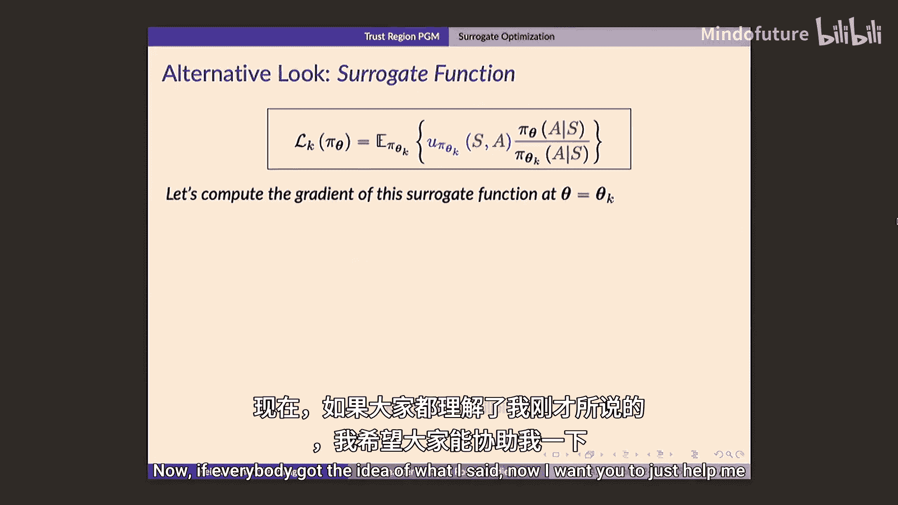

\[
\theta_{k+1} = \arg\max_\theta L_k(\pi_\theta)
\]

这种思想称为**最大化-最小化算法** 的一种形式。其直观理解是：
1.  在当前点 \( \theta_k \)，我们构造一个“代理”函数 \( L_k \)，它在 \( \theta_k \) 处与原始函数 \( J \) 相切（梯度相同），并且通常是 \( J \) 的一个下界或局部近似。
2.  原始函数 \( J \) 可能非常复杂、非凸。但代理函数 \( L_k \) 可能更容易优化（例如，是凹函数）。
3.  我们找到 \( L_k \) 的最大值点 \( \theta_{k+1} \)。
4.  在 \( \theta_{k+1} \) 处，我们构造新的代理函数 \( L_{k+1} \)，重复过程。

这就像在陡峭崎岖的山坡（\( J \)）上，每一步都先构建一个平滑的小土坡（\( L_k \)），然后跳到这个小土坡的顶部，以此稳步向上，避免了在原始地形上因步长不当而滑落或徘徊。

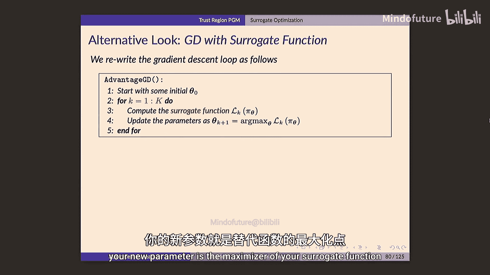

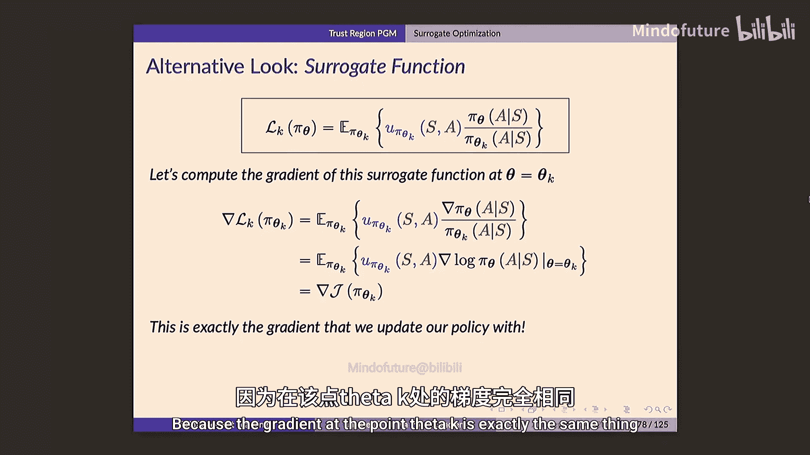

这种方法的一个显著优点是**消除了对学习率调参的依赖**。更新步长由代理函数本身的形状决定。

更重要的是，理论上这能保证单调改进：因为 \( \theta_{k+1} \) 是 \( L_k \) 的最大值，所以 \( L_k(\pi_{\theta_{k+1}}) \geq L_k(\pi_{\theta_k}) = J(\pi_{\theta_k}) \)。虽然这不能直接保证 \( J(\pi_{\theta_{k+1}}) \geq J(\pi_{\theta_k}) \)，但如果代理函数是 \( J \) 的一个合理的下界，那么单调改进是可以实现的。这为解决策略梯度方法中的性能崩溃问题提供了思路。

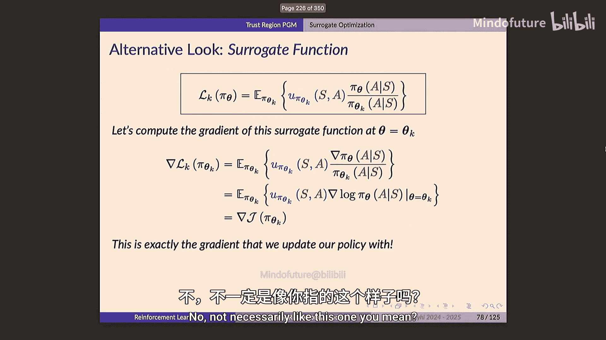

## 总结

本节课中，我们一起学习了策略梯度方法从理论到实践所面临的核心挑战。

我们首先分析了纯粹策略网络在估计动作价值时的局限性，这引出了对Actor-Critic方法的需求。接着，我们探讨了优势函数策略梯度，并揭示了其与时序差分误差的内在联系。

然后，我们深入探讨了策略梯度方法样本效率低下的根本原因，以及尝试使用重要度采样进行离策略学习时所遇到的稳定性问题。最后，我们引入了一种强大的新视角——代理函数优化。通过构造一个在当前位置与原始目标函数具有相同梯度的代理函数，并转而最大化这个代理函数，我们有望获得更稳定、更单调的策略改进，并摆脱对学习率调参的依赖。

这种代理函数的思路是理解后续高级策略优化算法（如TRPO、PPO）的基础。在下一讲中，我们将正式介绍Actor-Critic框架，看看如何将价值估计（Critic）与策略优化（Actor）结合起来，构建更实用的强化学习算法。