# 051：信任区域与自然策略梯度方法 🧠

在本节课中，我们将要学习策略梯度方法中的一个核心挑战——高方差问题，并探讨如何通过引入“信任区域”的概念以及“自然策略梯度”方法来稳定和优化策略更新过程。

## 概述

上一节我们介绍了通过优化替代函数来避免手动设置学习率的方法。本节中，我们来看看这个替代函数本身，并深入分析它为何会导致策略梯度方法不稳定。

## 替代函数与重要性采样

我们使用的替代函数形式如下：

**公式：** `L(θ) = E_{s, a ~ π_{θ_k}} [ (π_θ(a|s) / π_{θ_k}(a|s)) * A^{π_{θ_k}}(s, a) ]`

这个表达式本质上是一个**重要性采样**的论证。我们使用当前策略 `π_{θ_k}` 收集的优势函数样本，然后通过重要性采样来估计新策略 `π_θ` 下的期望优势。

**核心问题**：策略梯度方法（即使计算了正确的梯度）在每次迭代中，都是在用重要性采样来估计新策略下的期望优势。由于我们还没有得到新策略，我们只能用当前策略进行采样。这本身是合理的，但问题在于由此引入的方差。

## 重要性采样中的方差问题

为了理解方差的来源，让我们回顾重要性采样的数学原理。

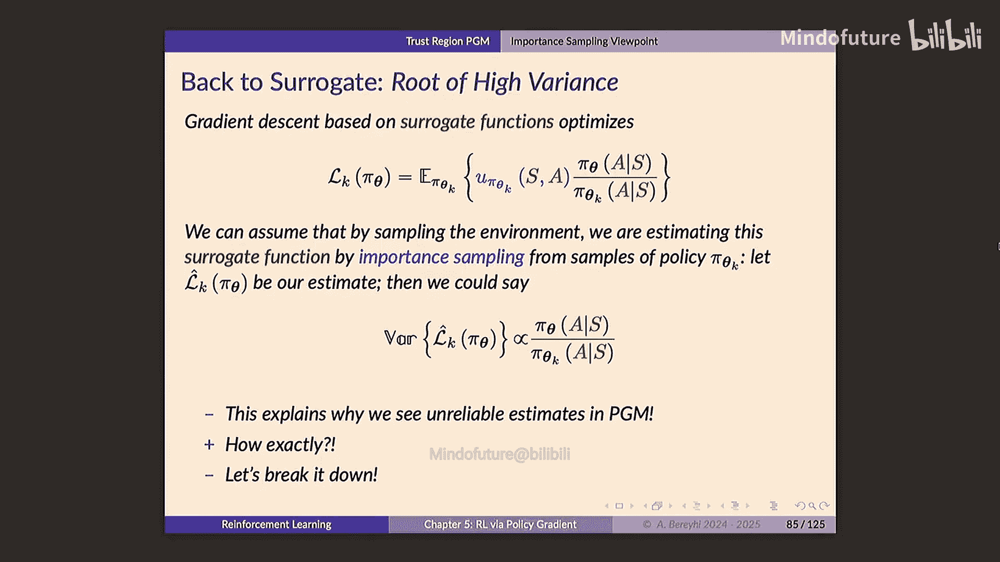

假设我们想计算随机变量 `X` 在目标分布 `Q` 下的期望 `μ`。如果我们只有来自分布 `P` 的样本，可以使用重要性采样估计：
**公式：** `E_{x~Q}[X] = E_{x~P}[X * (Q(x)/P(x))]`

虽然这个估计是无偏的（期望值正确），但其方差发生了变化。`X` 在 `Q` 下的原始方差为 `σ^2`。而使用重要性采样估计量的方差为：
**公式：** `Var_{x~P}[X * (Q/P)] = E_{x~Q}[X^2 * (Q/P)] - μ^2`

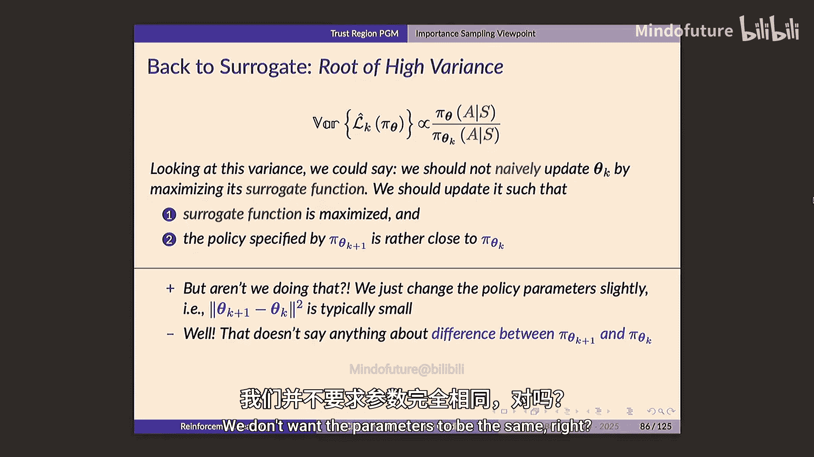

**关键点**：这个新方差取决于重要性权重 `Q(x)/P(x)` 的比率。如果 `P` 和 `Q` 非常相似，比率接近1，方差也相似。但是，如果对于某些 `x`，`Q(x)` 很大而 `P(x)` 很小，比率会变得极大，从而导致估计量的方差爆炸性增长。**增加采样数量并不能解决这个根本性的高方差问题**，因为方差本身的性质已经改变了。

回到我们的策略更新问题。我们正在用重要性采样估计新策略 `π_θ` 的期望优势，但采样用的是旧策略 `π_{θ_k}`。如果新旧策略差异很大，重要性权重 `π_θ(a|s) / π_{θ_k}(a|s)` 可能会在某些状态-动作对上变得极大，导致梯度估计的方差非常高。这就是策略梯度方法不稳定、容易“跑偏”的根本原因之一。

## 信任区域的概念

认识到上述问题后，一个自然的想法是：在更新策略时，我们应该确保新策略 `π_θ` 不会与旧策略 `π_{θ_k}` 相差太远。这样，重要性权重就不会过大，从而控制住方差。

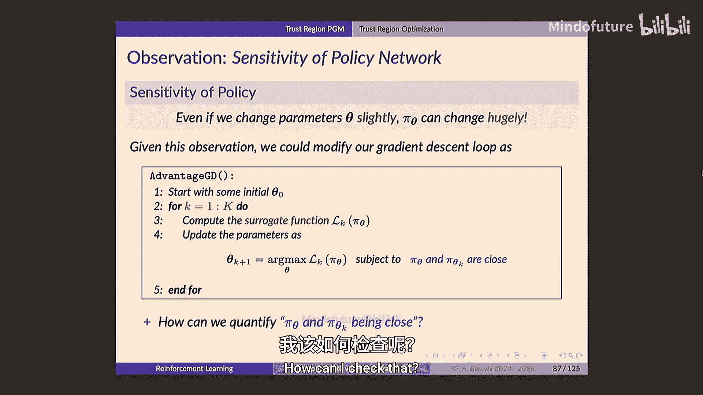

这个“策略不能变化太大”的区域，就称为**信任区域**。我们的优化目标变为：在信任区域内，寻找能最大化替代函数的新策略参数。

你可能会问，如果使用非常小的学习率，参数 `θ` 的变化不是也很小吗？问题在于，**参数空间的微小变化并不等同于策略分布的微小变化**。神经网络是一个复杂函数，微调一个权重可能导致策略输出发生剧变。实验表明，训练中经常出现策略性能在稳步提升后突然崩溃的情况，这正是因为某个关键权重的小幅更新使策略跳出了信任区域。

## 用KL散度定义信任区域

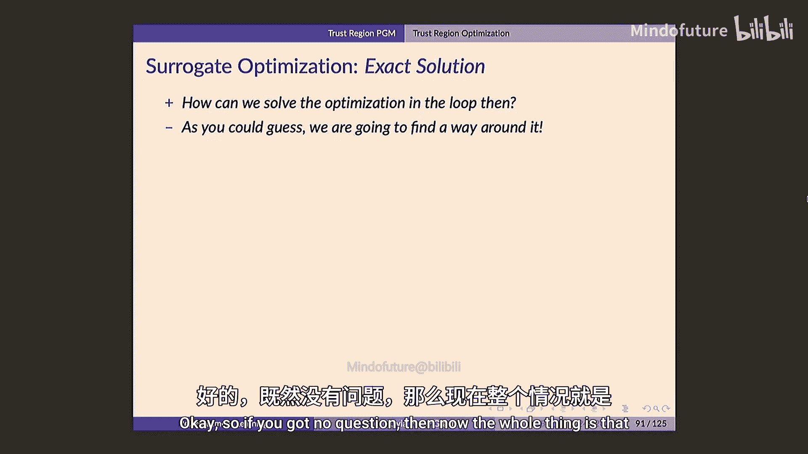

我们需要一种方式来量化两个策略分布的“差异”。一个常用的度量是KL散度。

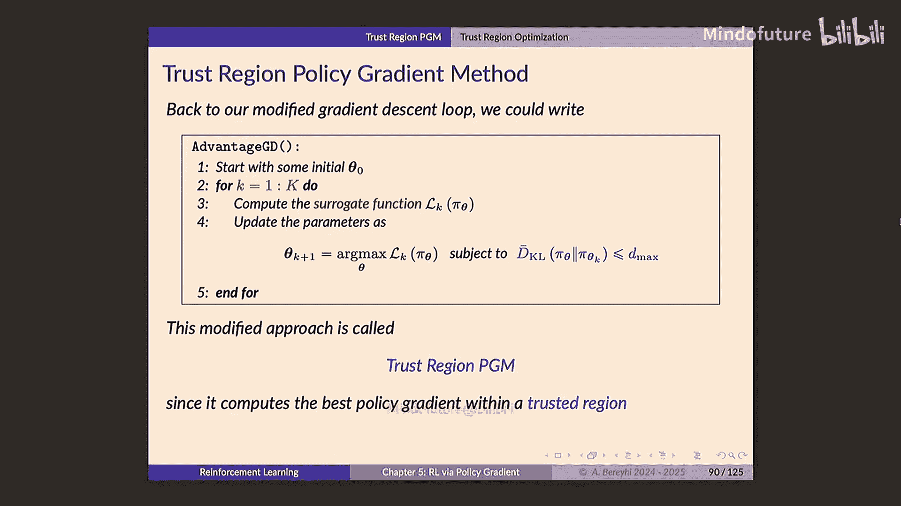

两个策略 `π_θ` 和 `π_{θ_k}` 之间的KL散度定义为：
**公式：** `D_KL(π_θ || π_{θ_k}) = E_{s~ρ, a~π_θ} [ log(π_θ(a|s) / π_{θ_k}(a|s)) ]`

KL散度总是非负的，且当两个分布相同时为零。但它不是对称的（不是严格的距离）。

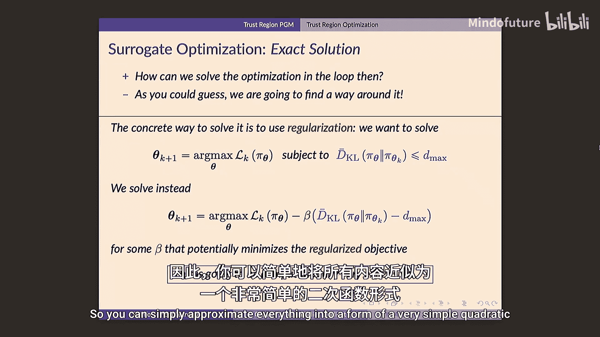

现在，我们可以将带信任区域的策略优化问题形式化：
**目标：** 最大化替代函数 `L(θ)`
**约束：** `D_KL(π_θ || π_{θ_k}) ≤ δ`
其中 `δ` 是一个小的阈值，定义了信任区域的大小。

## 自然策略梯度

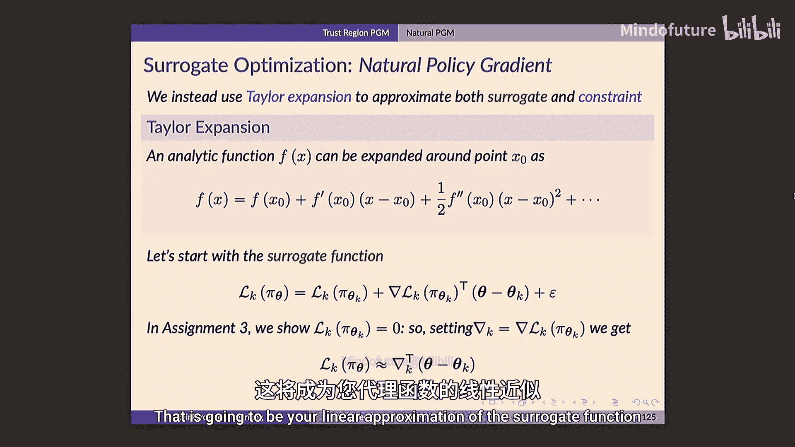

上述是一个带约束的优化问题。我们可以使用拉格朗日乘子法将其转化为无约束问题：
**公式：** `max_θ L(θ) - β * D_KL(π_θ || π_{θ_k})`
其中 `β` 是一个系数。

直接求解这个问题非常困难，因为 `L(θ)` 和 `D_KL` 都是关于神经网络参数 `θ` 的复杂函数。一个实用的方法是使用局部近似。

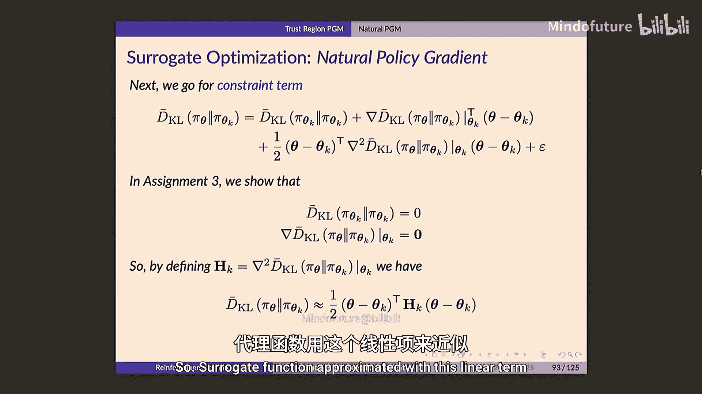

1.  **对替代函数进行一阶泰勒展开**：在 `θ_k` 处展开，可以证明其零阶项为零。因此，近似为线性函数：
    **公式：** `L(θ) ≈ g_k^T (θ - θ_k)`
    其中 `g_k = ∇_θ L(θ)|_{θ=θ_k}` 就是在 `θ_k` 处的策略梯度。

2.  **对KL散度进行二阶泰勒展开**：在 `θ_k` 处展开。可以证明其零阶项和一阶项均为零。因此，近似为二次型：
    **公式：** `D_KL(π_θ || π_{θ_k}) ≈ 1/2 * (θ - θ_k)^T H_k (θ - θ_k)`
    其中 `H_k` 是KL散度在 `θ_k` 处的海森矩阵（二阶导数矩阵）。

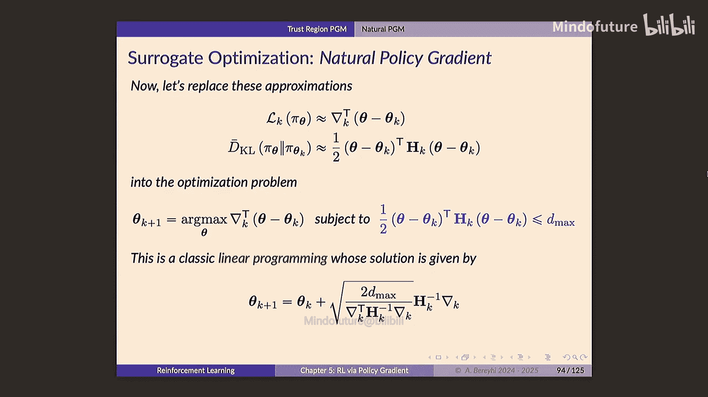

将这两个近似代入优化问题，我们得到：
**目标：** 最大化 `g_k^T (θ - θ_k)`
**约束：** `1/2 * (θ - θ_k)^T H_k (θ - θ_k) ≤ δ`

这是一个线性目标函数加上一个二次约束的优化问题（凸优化），可以解析求解。其解给出了参数更新公式：
**公式：** `θ_{k+1} = θ_k + sqrt(2δ / (g_k^T H_k^{-1} g_k)) * H_k^{-1} g_k`

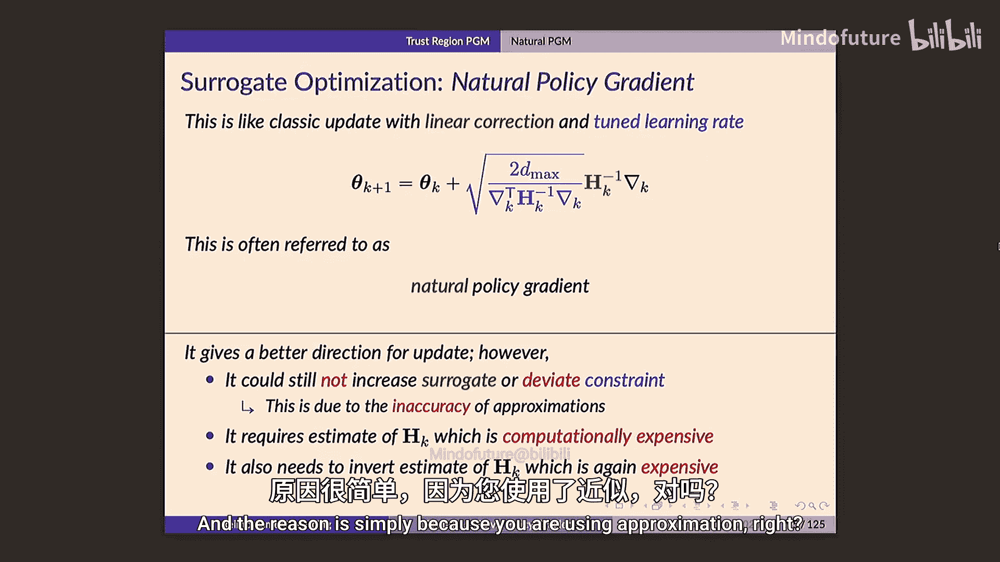

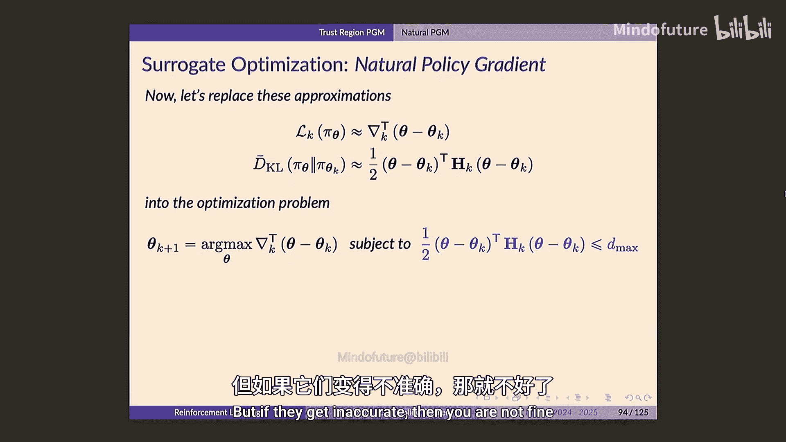

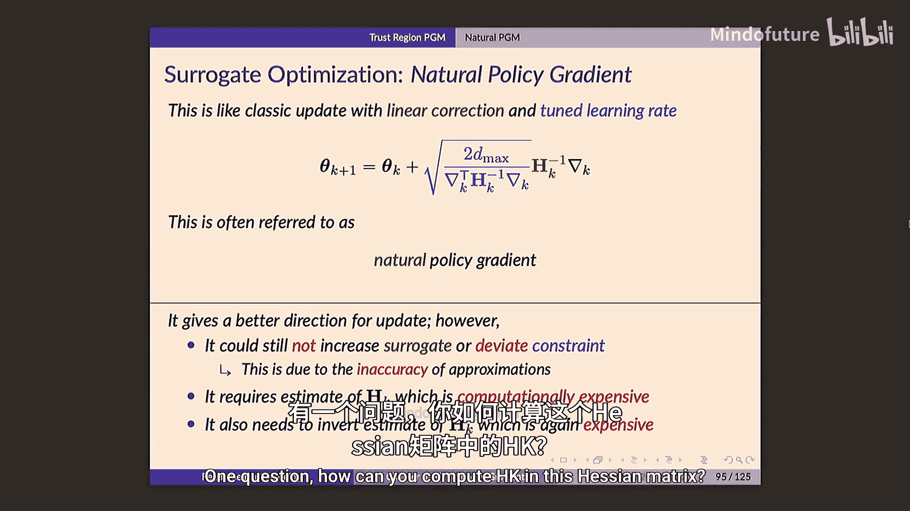

这个更新方向 `H_k^{-1} g_k` 被称为**自然梯度**。与普通梯度 `g_k` 相比，自然梯度通过乘以海森矩阵的逆 `H_k^{-1}` 对更新方向进行了修正。这个修正考虑了参数空间的曲率，确保在分布空间（由KL散度度量）中，我们沿着最速上升方向移动，同时步长受到信任区域 `δ` 的限制。这种方法被称为**自然策略梯度**。

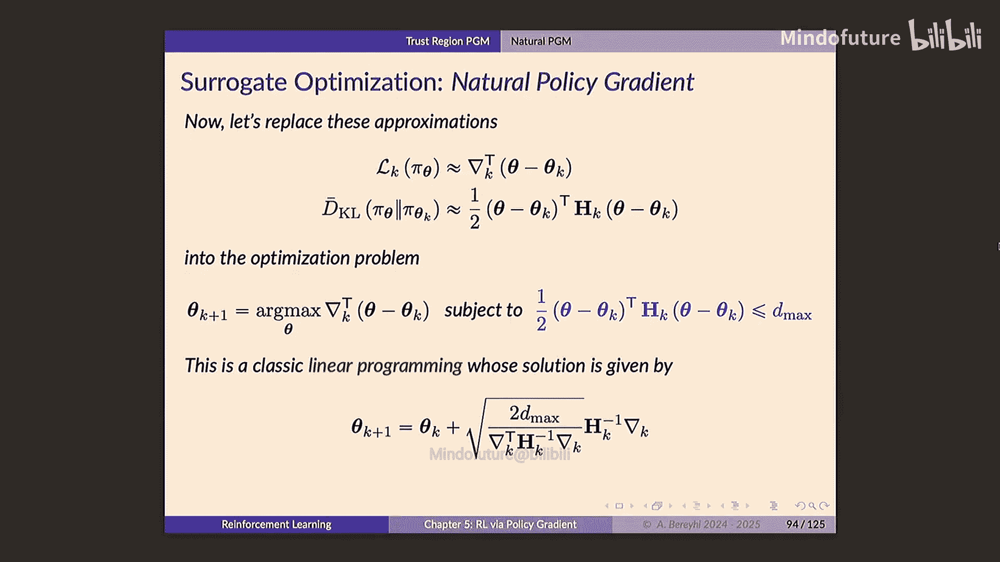

## 挑战与小结

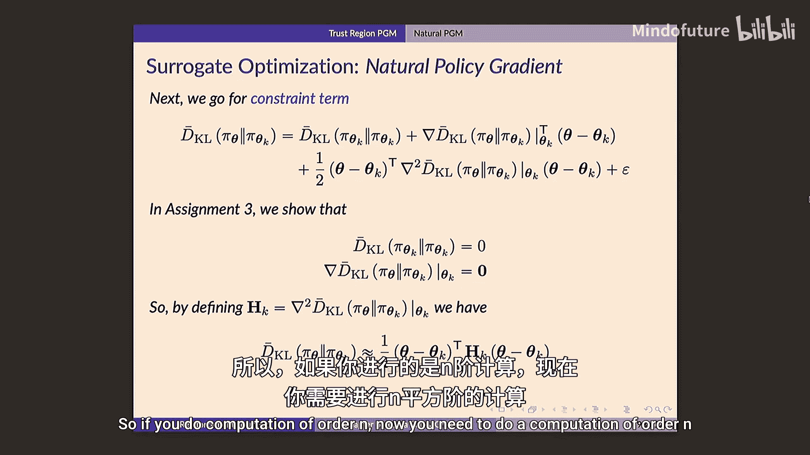

本节课中我们一起学习了策略梯度不稳定的深层原因以及自然策略梯度的解决方案。

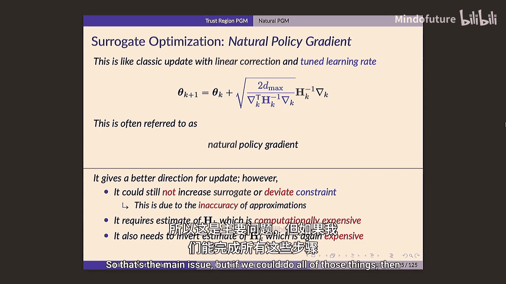

**主要挑战**：
1.  **计算复杂度**：计算和求逆海森矩阵 `H_k` 的计算成本非常高，对于大型神经网络几乎不可行。
2.  **近似误差**：我们使用泰勒展开进行近似。如果实际更新步长较大，这些近似可能不准确，导致更新后策略仍然可能超出信任区域。

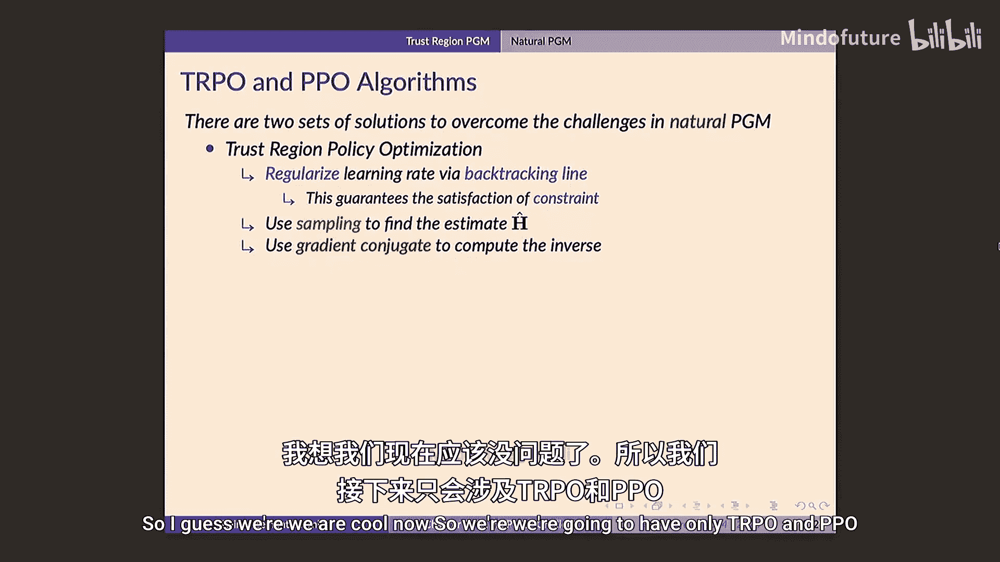

**核心思想总结**：
- 策略梯度方法的不稳定性源于其重要性采样的本质，当新旧策略差异大时，梯度估计方差会爆炸。
- **信任区域**方法通过约束新旧策略的差异（用KL散度度量）来控制方差，稳定训练。
- **自然策略梯度**是解决带信任区域约束优化问题的一种近似方法，它通过预条件矩阵（海森逆）调整梯度方向，使其在分布空间而非参数空间中最优。

自然策略梯度奠定了理论基础，但直接应用它计算成本太高。在接下来的课程中，我们将看到像TRPO和PPO这样的算法，它们以更高效、更实用的方式实现了信任区域的思想。