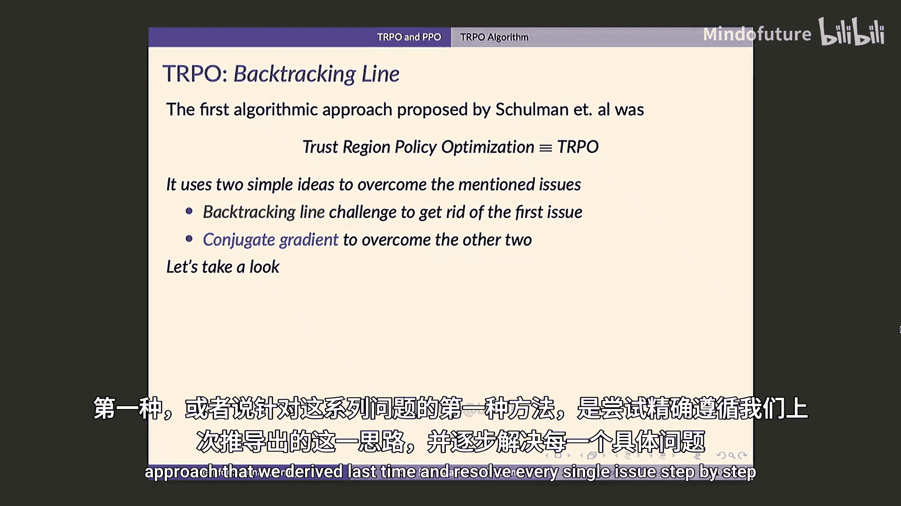
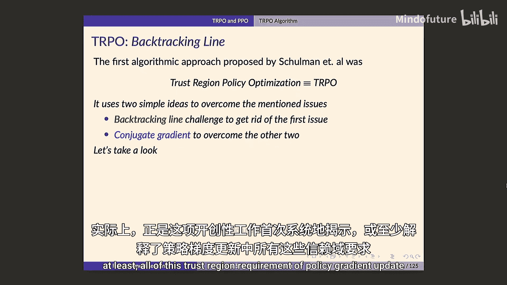
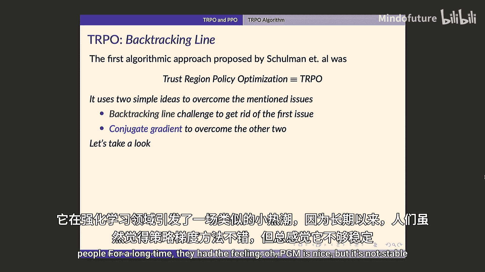
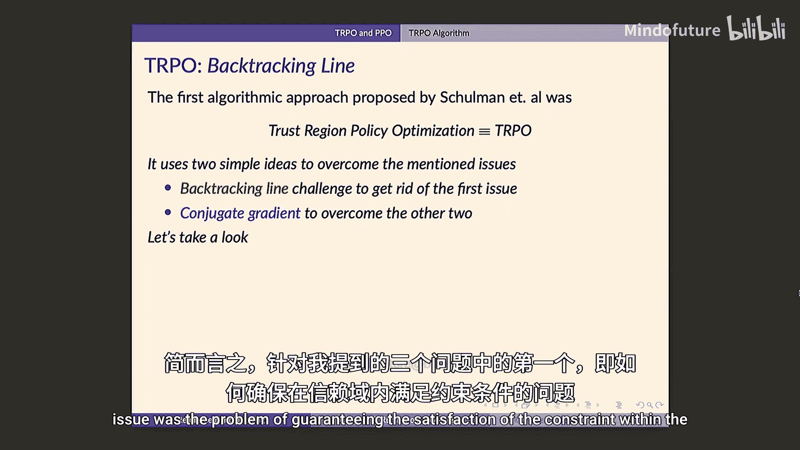
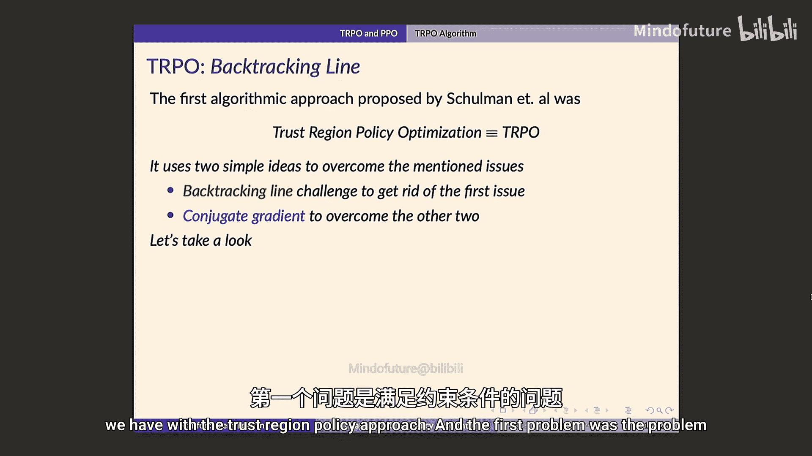
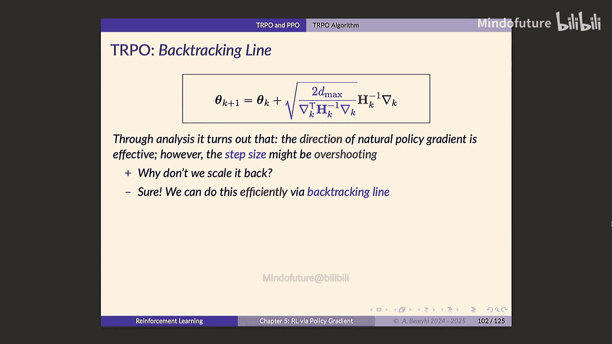
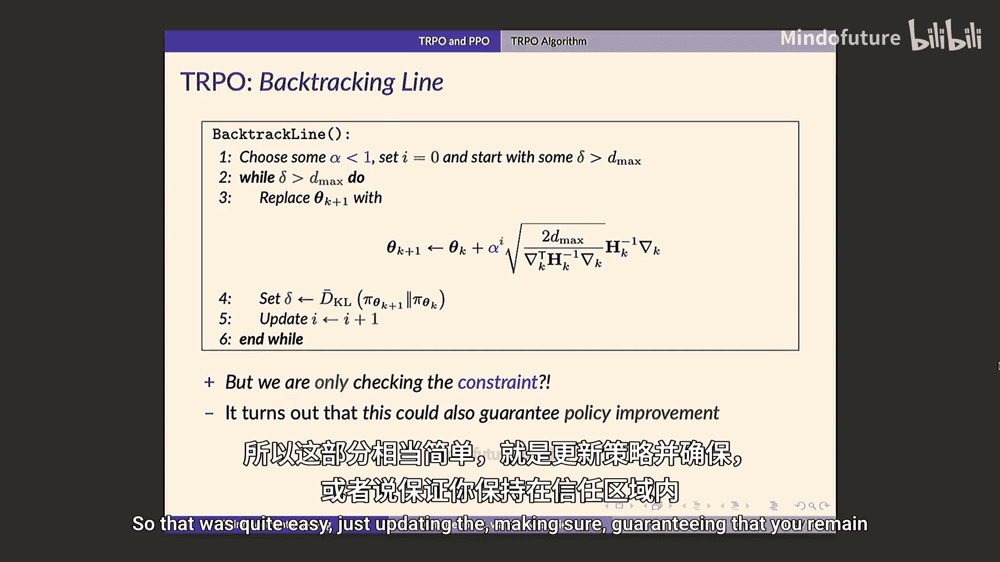
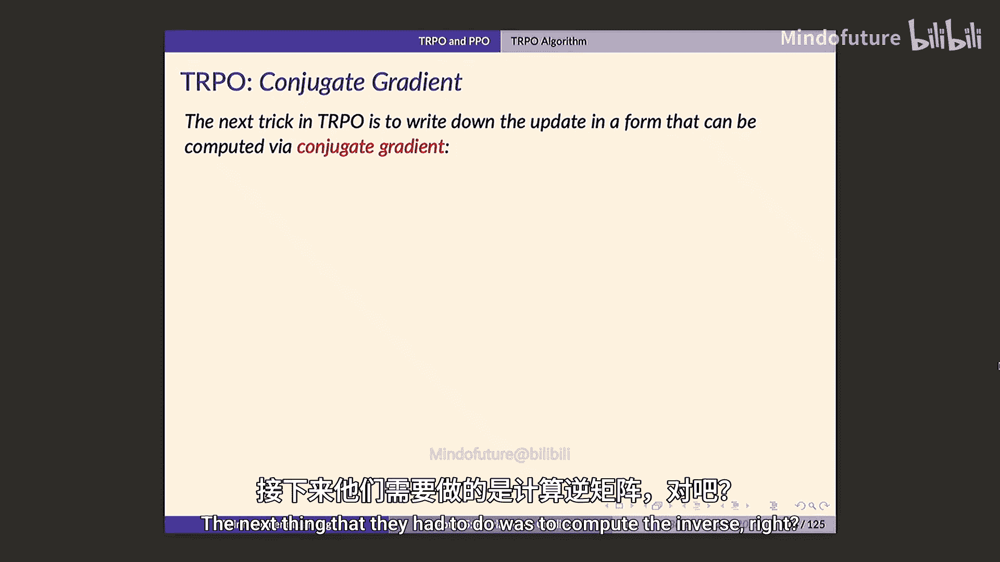
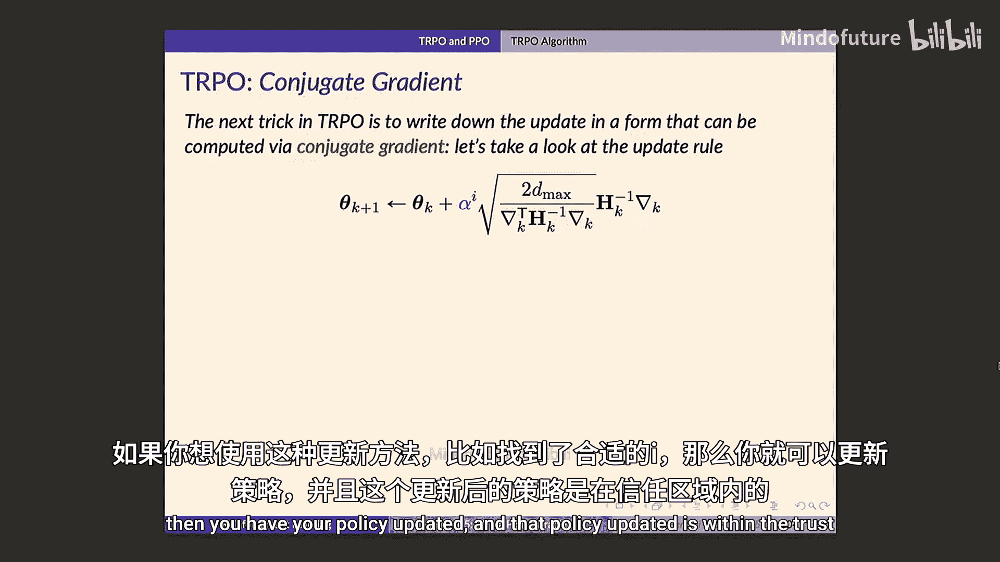
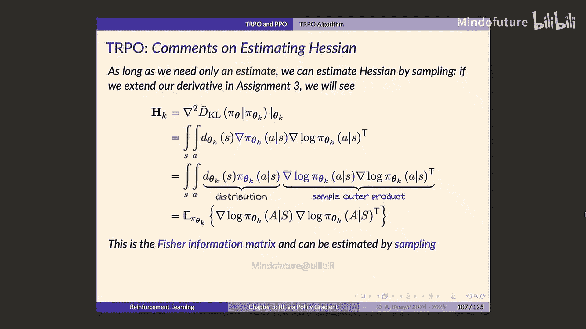

# 052：TRPO算法 🧠

在本节课中，我们将学习信任区域策略优化算法。该算法旨在解决策略梯度方法中的稳定性问题，确保策略更新既有效又安全。

---

## 概述

策略梯度方法的一个核心挑战是更新可能不稳定。自然策略梯度方法虽然提供了更新方向，但无法保证新策略的性能一定提升，也无法保证新策略与旧策略的差异在可接受的“信任区域”内。此外，直接计算更新所需的二阶信息（海森矩阵及其逆矩阵）在计算上非常昂贵。TRPO算法通过一系列技巧，巧妙地解决了这三个主要挑战。

---

## 挑战一：约束满足性问题 🎯

上一节我们介绍了自然策略梯度的更新公式。然而，这种近似解法存在两个主要问题。

首先，更新后的新策略参数可能无法满足我们设定的约束。这意味着更新可能导致两种不良后果：
1.  新策略的性能可能比旧策略更差。
2.  新策略可能偏离旧策略太远，超出了我们设定的最大容忍度（即“信任区域”）。

问题的根源在于，我们求解的是一个基于泰勒展开的近似问题，而非精确解。因此，即使按照该方向更新，也无法保证满足约束条件。

---

## 挑战二：海森矩阵的计算问题 ⚙️

第二个挑战是计算海森矩阵本身。对于一个深度策略网络（例如ResNet-50，参数数量级为 `10^7`），计算其二阶导数（海森矩阵）需要 `10^14` 量级的计算，这相当于进行两层反向传播，计算负担极重。在深度学习中，我们通常避免直接进行二阶优化。

---

## 挑战三：海森矩阵的求逆问题 🔄

即使我们设法计算出了海森矩阵 `H`，更新规则还需要其逆矩阵 `H^{-1}`。对于高维模型，传统的矩阵求逆算法复杂度至少是 `O(n^2)` 甚至 `O(n^3)`，这同样是计算上无法承受的。

---

## TRPO的解决方案 🛠️

TRPO算法旨在逐步解决上述三个问题。紧随其后的PPO算法则采用了更简单高效的方法，但理解TRPO是理解这一系列方法的基础。本节我们先从TRPO开始。

### 1. 通过回溯线搜索保证约束

第一个问题是确保更新后的策略参数满足信任区域约束。TRPO的解决方案是**回溯线搜索**。

其核心思想是：自然策略梯度给出的更新方向 `d` 很可能是正确的，但步长可能过大。因此，我们可以沿着这个方向按比例缩小步长，直到满足约束。

具体步骤如下：
1.  从完整的自然梯度更新步长开始（缩放因子 `α^0 = 1`）。
2.  计算新策略 `π_{θ_{k+1}}` 与旧策略 `π_{θ_k}` 之间的KL散度 `D_KL`。
3.  如果 `D_KL` 超过了预设的最大容忍度 `δ_max`，则将步长缩放因子乘以 `α`（`α < 1`），即尝试 `α^1`, `α^2` ... 的步长。
4.  重复步骤2-3，直到找到满足 `D_KL ≤ δ_max` 的步长。

**关键点**：TRPO论文证明，只要更新方向保持在自然梯度方向（即使缩放后），并且满足KL散度约束，就几乎可以保证策略性能得到改进。因此，算法只需检查KL散度约束，而无需额外检查性能是否提升。

### 2. 通过共轭梯度法避免矩阵求逆

第二个和第三个问题涉及海森矩阵的求逆。TRPO通过数学变换，将问题转化为求解一个线性方程组，从而避免直接求逆。

回顾更新公式中的关键项：
`更新方向 = (H^{-1} * ∇_θ J) / sqrt( (∇_θ J)^T H^{-1} (∇_θ J) )`

我们令 `y = H^{-1} * ∇_θ J`。则分子就是 `y`。分母可以重写为：
`(∇_θ J)^T H^{-1} (∇_θ J) = (∇_θ J)^T H^{-1} H H^{-1} (∇_θ J) = y^T H y`

因此，整个更新可以仅用 `y` 和 `H` 表示，完全绕过了 `H^{-1}`。

那么如何求 `y`？由定义 `y = H^{-1} * ∇_θ J`，等价于求解线性方程组：
`H * y = ∇_θ J`

这是一个关于 `y` 的线性系统。我们可以使用**共轭梯度法**来高效求解此方程，而无需显式计算 `H^{-1}`。共轭梯度法是一种迭代算法，特别适合求解大规模、稀疏的正定线性系统，其计算复杂度远低于直接求逆。

### 3. 通过费舍尔信息矩阵估计海森矩阵

最后，我们需要高效地获得海森矩阵 `H` 本身。TRPO利用了KL散度约束中 `H` 的一个特殊性质：在参数 `θ_k` 处，`H` 恰好等于策略的**费舍尔信息矩阵**。

费舍尔信息矩阵 `F` 可以表示为策略对数梯度与其自身外积的期望：
`F = E_{s~d^{π_θ}, a~π_θ(·|s)} [ ∇_θ log π_θ(a|s) * (∇_θ log π_θ(a|s))^T ]`

这正是一个协方差矩阵的形式。更重要的是，我们可以通过**采样**来估计它：
1.  从当前策略 `π_θ` 采样多个状态-动作对 `(s, a)`。
2.  对每个样本，计算策略网络的对数梯度 `∇_θ log π_θ(a|s)`。
3.  计算该梯度向量的外积 `gg^T`。
4.  对所有样本的外积结果取平均，即得到海森矩阵 `H` 的估计值 `Ĥ`。

这种方法的美妙之处在于，我们只需要进行**一次**标准的反向传播来计算梯度 `g`，然后进行简单的向量外积和平均操作，即可估计出二阶信息，完全避免了复杂的二阶导数计算。

---

## TRPO算法流程 📋

以下是TRPO算法的具体步骤：

1.  **收集样本**：使用当前策略 `π_{θ_k}` 与环境交互，收集一个批次（minibatch）的轨迹数据。
2.  **估计优势函数**：对于轨迹中的每个时间步 `t`，使用价值函数估计器 `V_φ(s)`（例如另一个神经网络）来计算优势估计 `Â_t`。常用公式为：
    `Â_t = r_t + γ * V_φ(s_{t+1}) - V_φ(s_t)`
3.  **计算策略梯度估计**：利用策略梯度定理，计算目标函数梯度的采样估计：
    `∇_θ J ≈ (1/N) Σ_t (Â_t * ∇_θ log π_θ(a_t|s_t))`
4.  **估计费舍尔信息矩阵**：使用同一批样本，计算海森矩阵的估计值：
    `Ĥ ≈ (1/N) Σ_t [ ∇_θ log π_θ(a_t|s_t) * (∇_θ log π_θ(a_t|s_t))^T ]`
5.  **求解更新方向**：使用共轭梯度法求解线性方程组 `Ĥ * y = ∇_θ J`，得到 `y`。
6.  **回溯线搜索**：
    *   初始化缩放指数 `i = 0`。
    *   计算候选参数 `θ' = θ_k + α^i * y / sqrt(y^T Ĥ y)`。
    *   计算新旧策略的KL散度 `D_KL(π_{θ_k} || π_{θ'})`。
    *   若 `D_KL > δ_max`，则令 `i = i + 1` 并重复此步骤；否则，接受 `θ'` 为本次更新的结果 `θ_{k+1}`。
7.  **循环**：将 `θ_{k+1}` 作为新的策略参数，返回步骤1，重复整个过程。

---

## 总结

本节课我们一起学习了TRPO算法。该算法通过三个关键技术，系统性地解决了自然策略梯度方法的实践难题：
1.  **回溯线搜索**：保证了每次更新都停留在信任区域内。
2.  **共轭梯度法**：避免了计算海森矩阵逆矩阵的巨大开销。
3.  **费舍尔信息矩阵估计**：通过采样和一次反向传播高效地估计了海森矩阵。

尽管TRPO在理论上很优雅，但其实现仍然相对复杂，计算量较大。这促使了后续更简洁高效的PPO算法的出现。理解TRPO为我们掌握现代策略优化方法奠定了坚实的基础。