# 053：PPO算法

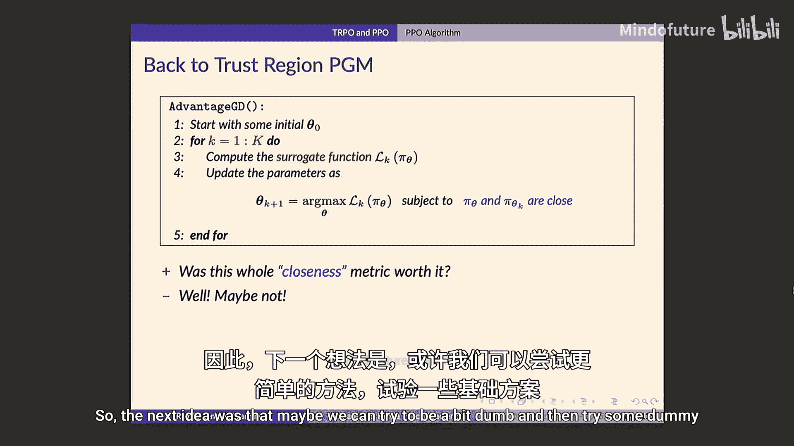

在本节课中，我们将要学习近端策略优化算法。这是一种在信任区域框架下，通过一种更简单、更高效的方式来优化策略梯度的方法。

上一节我们介绍了基于KL散度的信任区域策略优化方法。本节中我们来看看一种更直观、计算更简单的替代方案——近端策略优化。

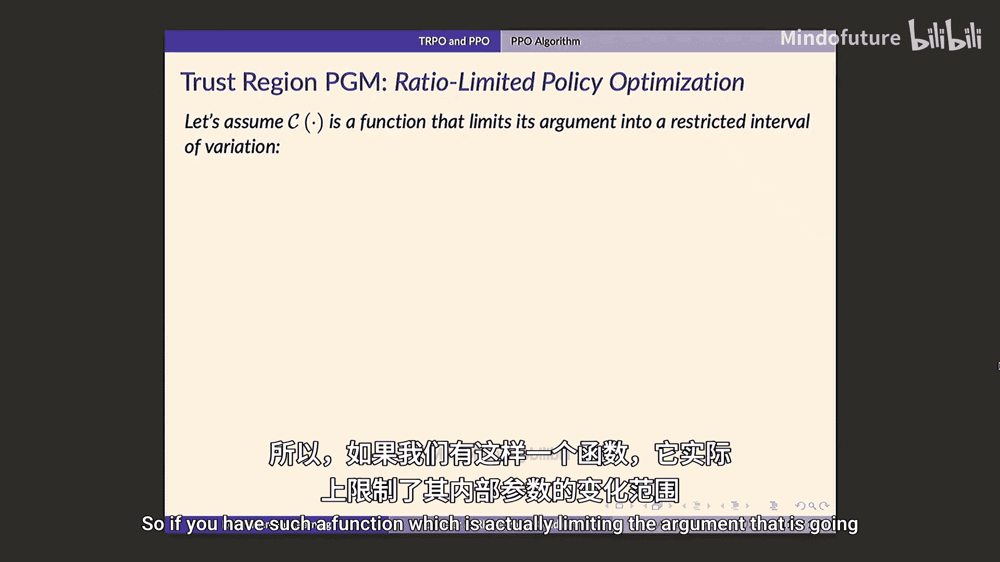

## 核心思想回顾

策略梯度方法的核心是，我们从参数为 θ 的策略网络 π_θ 开始，计算一个替代函数，并沿着该函数的梯度方向更新参数。理想情况下，我们希望直接最大化这个替代函数来找到新的参数点。

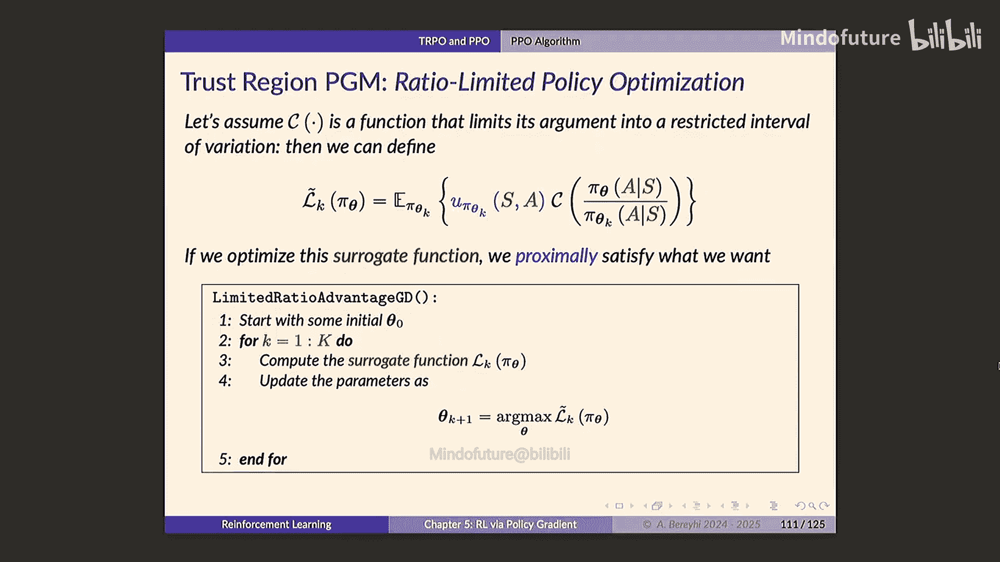

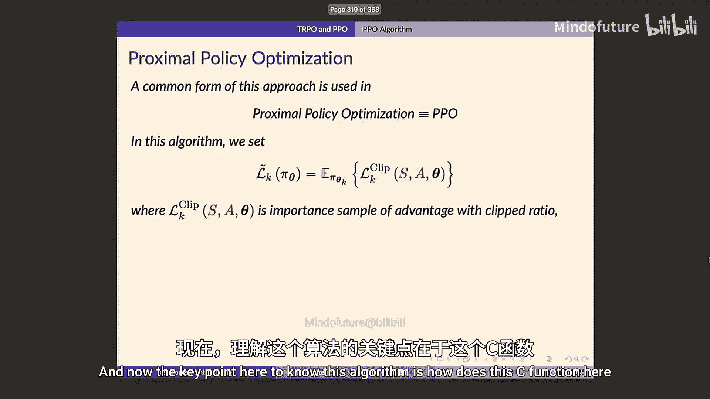

然而，直接最大化可能导致策略更新过大，即使参数 θ 的变化很小，策略分布 π_θ 也可能发生剧烈变化。因此，我们需要一个约束，确保更新后的新策略 π_θ 与旧策略 π_θk 足够接近。之前我们使用KL散度来衡量这种接近程度。

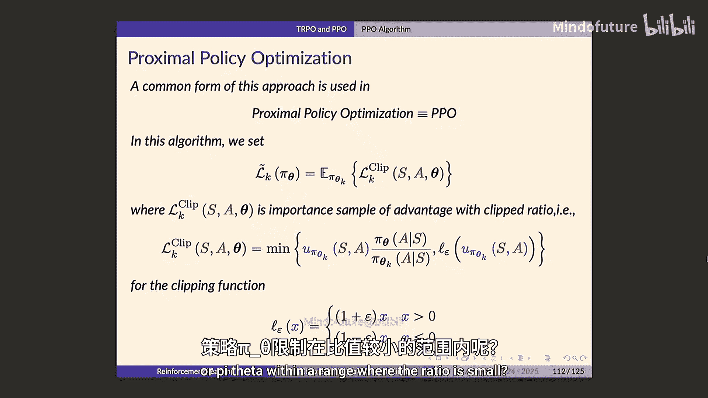

但KL散度的计算引入了复杂性。PPO提出一个更简单的问题：我们能否不直接约束策略分布，而是约束重要性采样中的比率项，从而间接地将策略保持在信任区域内？

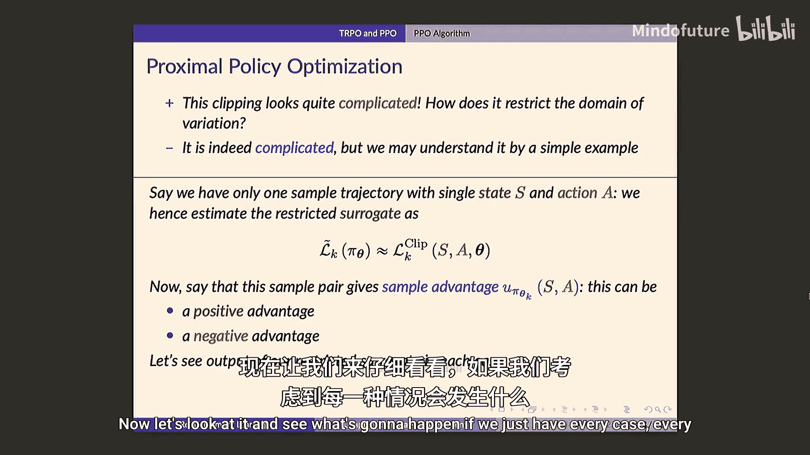

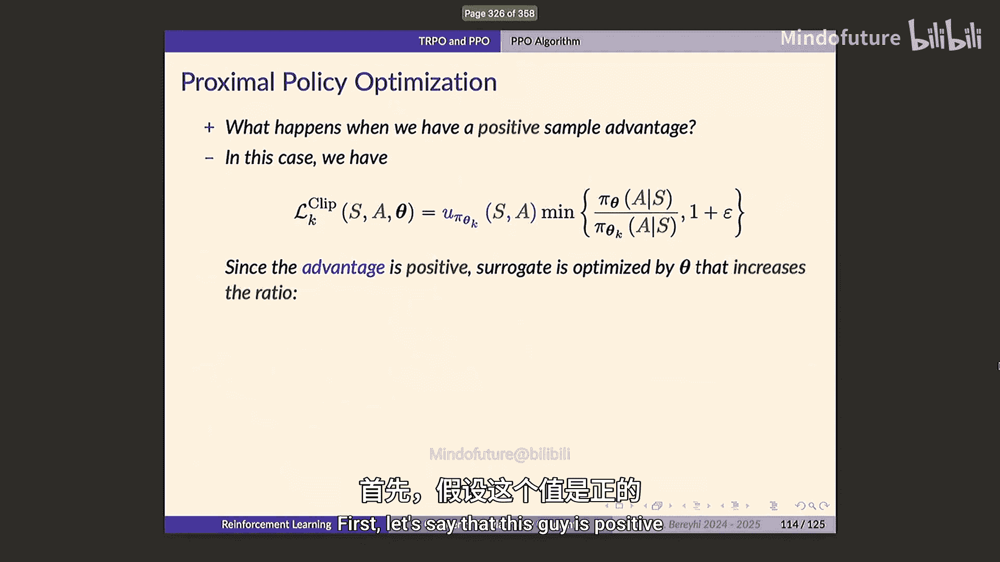

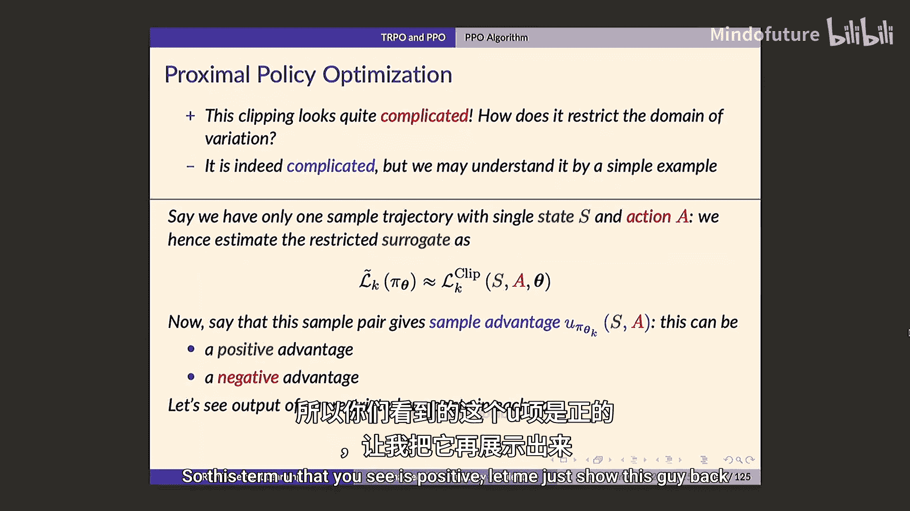

## 重要性采样与方差问题

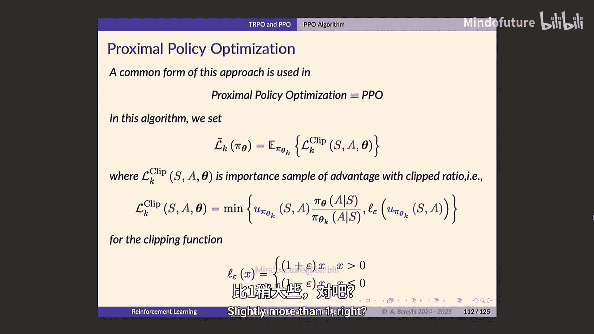

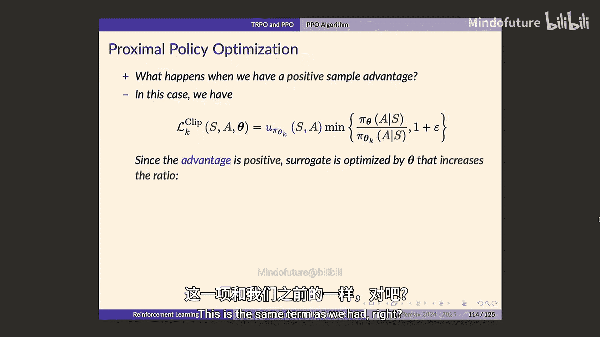

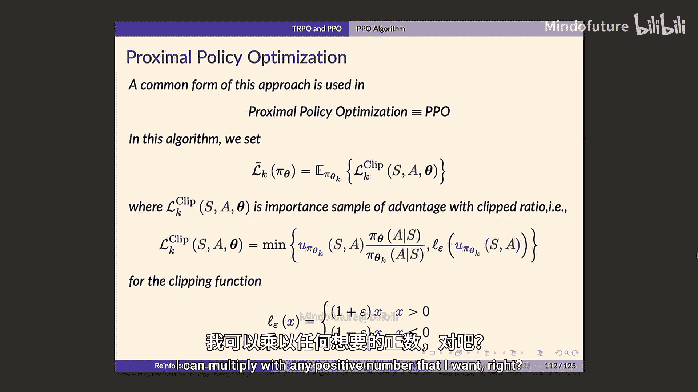

替代函数的核心是重要性采样表达式：
`L(θ) = E[ A * (π_θ(a|s) / π_θk(a|s)) ]`
其中 A 是在旧策略 π_θk 下采样得到的优势函数。这个表达式用于估计新策略 π_θ 下的优势期望。

这个估计的方差与重要性权重 `r(θ) = π_θ(a|s) / π_θk(a|s)` 成正比。如果新旧策略差异很大，这个比率可能非常大或非常小，从而导致估计方差巨大，影响学习稳定性。因此，我们希望保持这个比率接近1。

## PPO的解决方案：比率裁剪

PPO的核心思想是，不直接约束策略分布，而是通过一个裁剪函数来限制重要性权重比率 `r(θ)` 的变化范围，从而间接控制策略更新幅度，并降低方差。

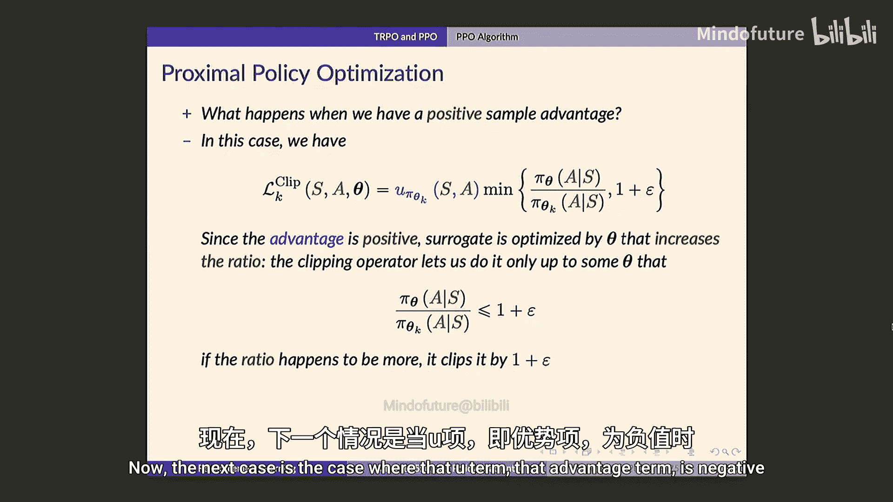

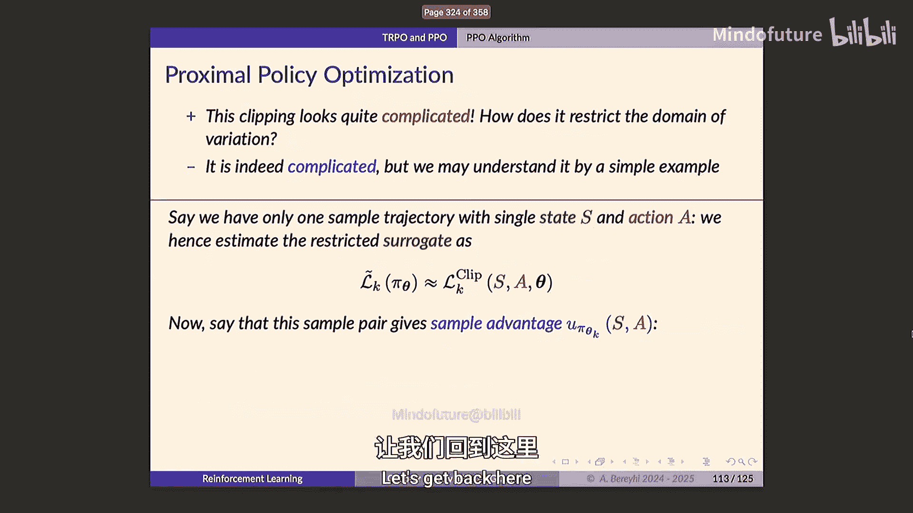

我们定义一个新的、受限制的替代目标函数：
`L_clip(θ) = E[ min( r(θ) * A, clip(r(θ), 1-ε, 1+ε) * A ) ]`
其中 `clip(r(θ), 1-ε, 1+ε)` 函数将比率 `r(θ)` 限制在区间 `[1-ε, 1+ε]` 内，ε 是一个很小的超参数（例如0.1或0.2）。

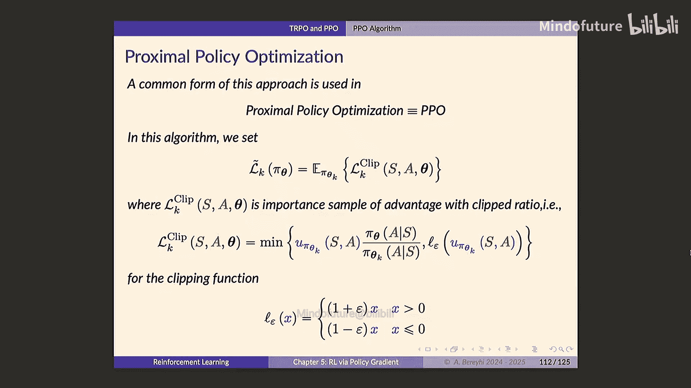

然后，我们通过最大化这个裁剪后的目标函数 `L_clip(θ)` 来更新策略参数 θ。这个最大化过程会隐式地促使比率 `r(θ)` 保持在一个合理的范围内，从而将策略更新限制在信任区域内。

## 裁剪机制的工作原理

为了理解裁剪如何工作，我们分两种情况分析，并假设优势函数 A 是已知的常数。

**情况一：优势 A > 0**
当动作具有正优势时，我们希望增加其概率，即比率 `r(θ) > 1`。
*   原始项为 `r(θ) * A`。
*   裁剪项为 `clip(r(θ), 1-ε, 1+ε) * A`。由于 A>0，且 `r(θ)` 倾向于大于1，裁剪项上限为 `(1+ε) * A`。
目标函数取两者中的最小值。如果 `r(θ)` 增长到超过 `(1+ε)`，那么裁剪项 `(1+ε)*A` 会更小，成为最小值。优化过程会因此阻止 `r(θ)` 无限制地增大，将其有效限制在 `1+ε` 附近。

**情况二：优势 A < 0**
当动作具有负优势时，我们希望减少其概率，即比率 `r(θ) < 1`。
*   原始项为 `r(θ) * A`（注意 A 为负）。
*   裁剪项为 `clip(r(θ), 1-ε, 1+ε) * A`。由于 A<0，且 `r(θ)` 倾向于小于1，裁剪项下限为 `(1-ε) * A`。
目标函数取两者中的最小值。对于负数，数值更小意味着其绝对值更大（例如-3 < -2）。如果 `r(θ)` 减小到低于 `(1-ε)`，那么裁剪项 `(1-ε)*A`（一个绝对值更大的负数）会更小，成为最小值。优化过程因此会阻止 `r(θ)` 无限制地减小，将其有效限制在 `1-ε` 附近。

**为何也要限制比率不过小？**
因为策略是一个概率分布，总和为1。如果一个动作的概率比率变得极小，那么其他某些动作的概率比率必然会变得极大，这同样会导致高方差。裁剪机制通过同时限制比率的上下界，确保了策略的整体变化是温和的。

## PPO算法流程

以下是PPO算法（使用裁剪目标）的基本步骤：

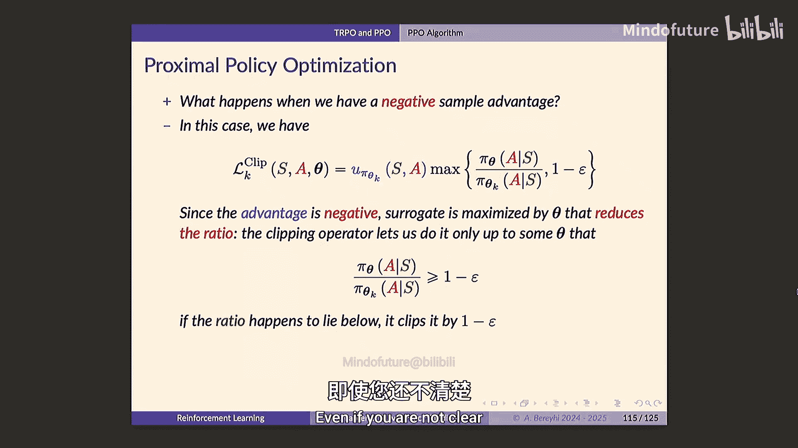

1.  使用当前策略 π_θ 与环境交互，收集一批轨迹数据。
2.  基于收集的数据，计算每个状态-动作对的优势函数估计值 A。
3.  对多个epoch（例如3-10次）执行以下操作：
    *   从数据中随机采样一个mini-batch。
    *   对mini-batch中的样本，计算裁剪后的目标函数 `L_clip(θ)`。
    *   通过梯度上升（或最小化 `-L_clip(θ)`）更新策略参数 θ。
4.  丢弃旧数据，用更新后的策略重新采样新数据，回到步骤1。

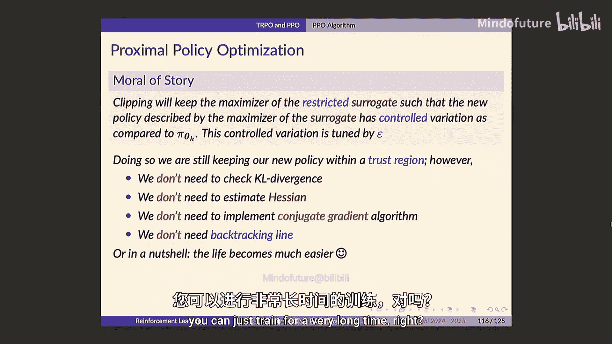

## 与经验回放的结合

与完全异策略的DQN不同，策略梯度方法本质上是同策略的。然而，由于PPO将策略更新限制在信任区域内，新旧策略差异不大，因此可以有限地重复利用旧数据。

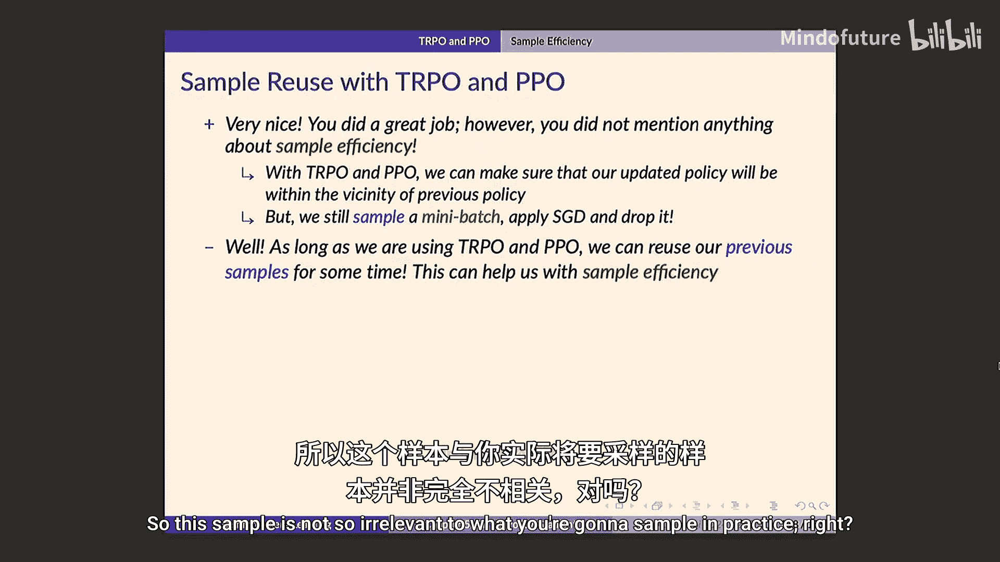

在实践中，我们常采用以下方式提高数据效率：
*   用当前策略收集一个较大的批次数据存入缓冲区。
*   从这个缓冲区中多次采样mini-batch（进行多个epoch）来更新策略。
*   经过一定次数的更新后，策略已相对旧数据有了一定优化，此时清空缓冲区，用最新策略重新收集数据。

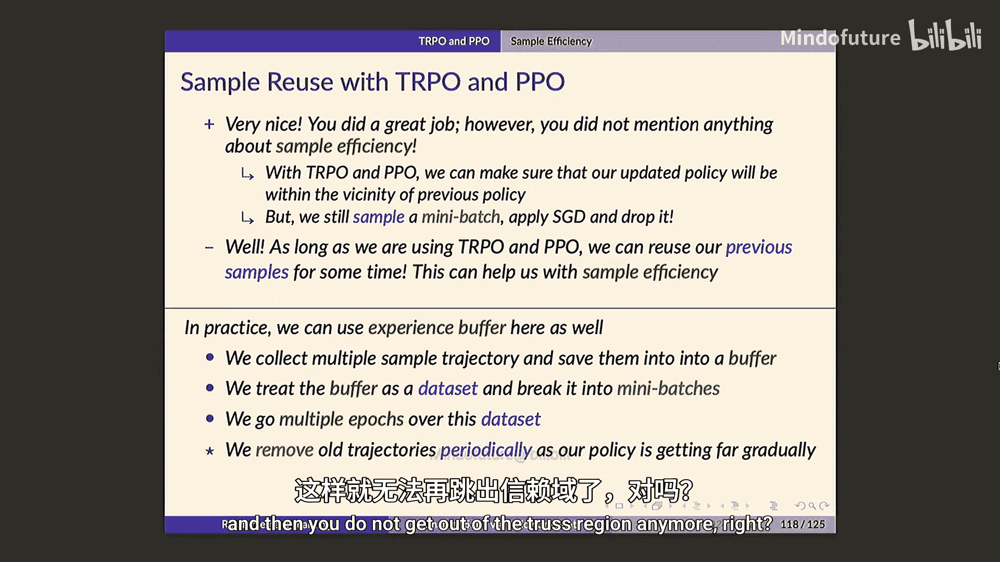

这实现了有限的“样本重用”，但请注意，它无法像DQN那样重复利用非常陈旧的经验。

## PPO vs TRPO

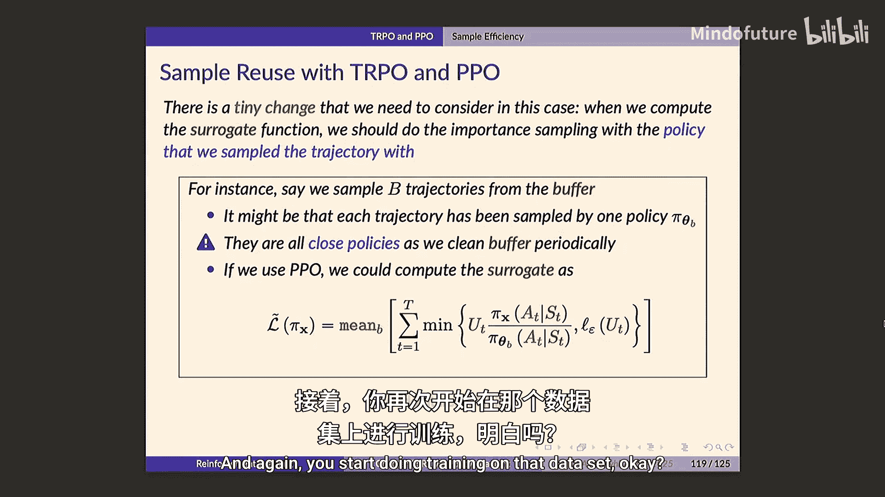

*   **TRPO**：使用KL散度作为硬约束，理论上更严谨，能保证单调改进，但计算复杂（需要计算二阶信息，进行共轭梯度求解）。
*   **PPO**：使用比率裁剪作为软约束（体现在目标函数中），是一种启发式但非常有效的方法。它更简单、计算效率更高，易于实现，虽然理论保证不如TRPO，但在实践中通常能取得相似甚至更好的性能，因此成为当前主流的策略梯度算法。

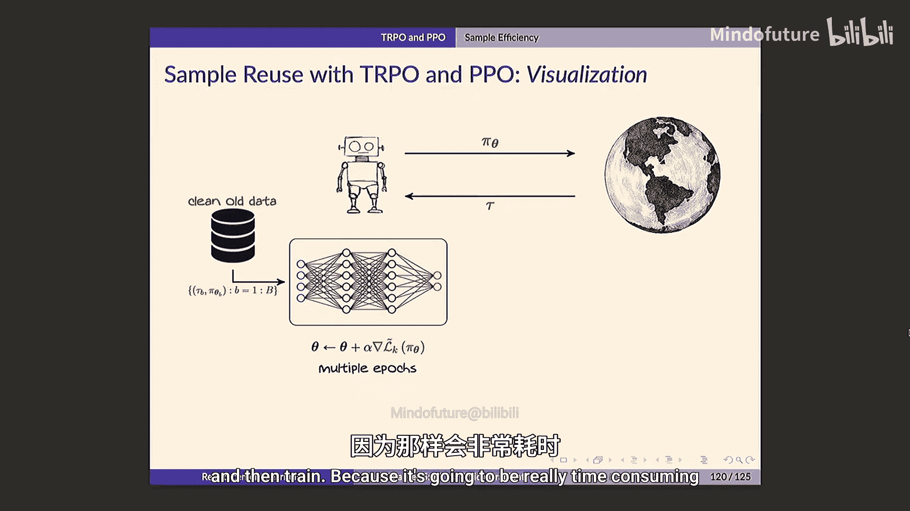

## 总结

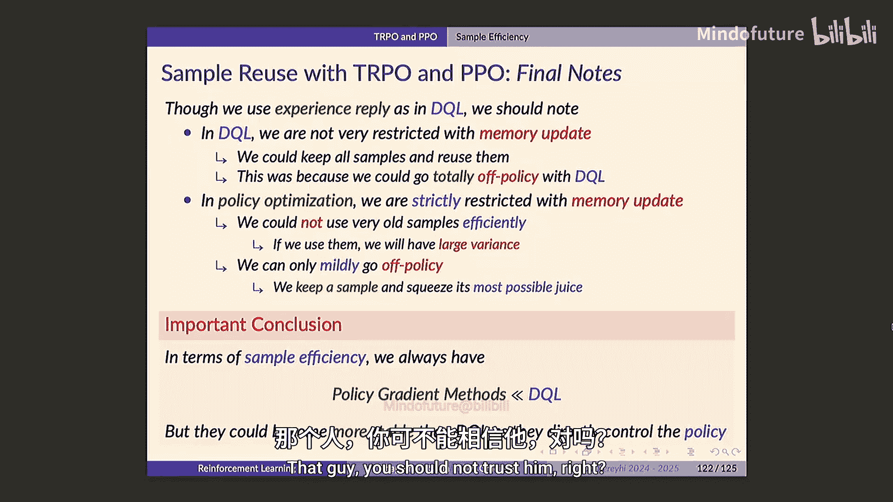

本节课中我们一起学习了近端策略优化算法。PPO通过裁剪重要性采样比率，巧妙地构造了一个新的目标函数，从而将策略更新限制在信任区域内。这种方法避免了复杂的KL散度计算和约束优化，实现简单、计算高效，同时保持了良好的学习稳定性。尽管其样本效率仍无法与纯粹的异策略Q学习相比，但通过有限的经验重用，PPO在实践中的综合表现非常出色，成为强化学习领域应用最广泛的算法之一。