# 054：TRPO与PPO的演员-评论家实现 🎭

在本节课中，我们将学习如何将价值网络整合到TRPO和PPO算法中，构建演员-评论家架构。我们将重点讨论实现中的关键细节，特别是重要性采样在更新过程中的作用。

## 概述

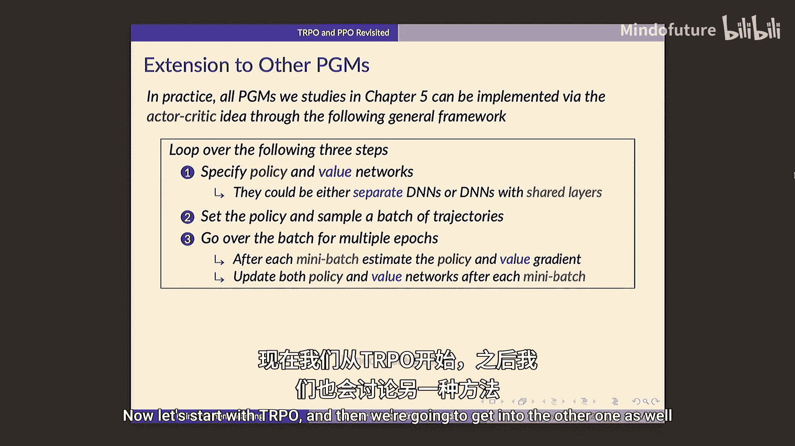

上一节我们介绍了TRPO和PPO的基本原理。本节中，我们将探讨如何为这些算法添加一个价值网络，从而形成演员-评论家架构。我们将看到，实现过程与之前类似，但需要特别注意如何利用采样数据来同时更新策略网络和价值网络。

## 演员-评论家架构

我们可以使用一个单独的网络作为价值网络，也可以将其整合到策略网络中，形成一个共享架构。这是可行的。然后，我们使用策略对环境进行采样，获得一批轨迹数据。接着，利用这批数据，通过小批量随机梯度下降法同时更新价值网络和策略网络。

现在，让我们从TRPO开始，然后也会讨论PPO。

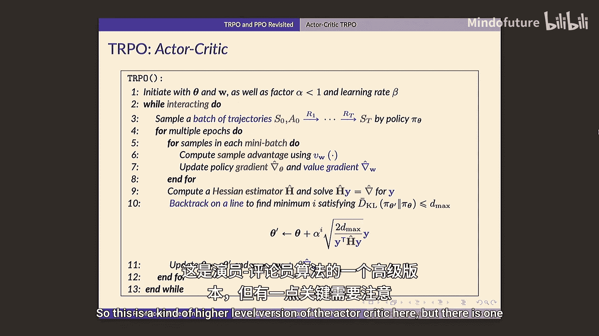

## TRPO的演员-评论家实现

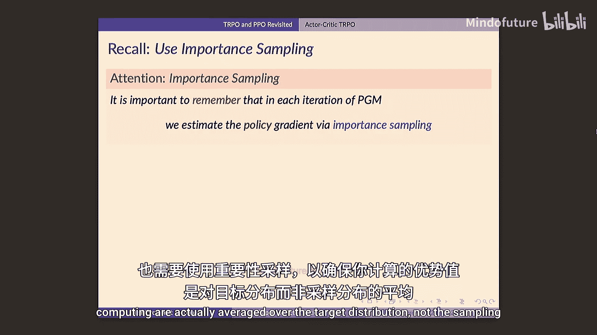

这是我们上次讨论过的TRPO算法。我们要做的是采样轨迹，可能进行多个周期的训练。我们讨论过，我们将用策略网络采样一个完整的批次，然后对其运行多个周期。

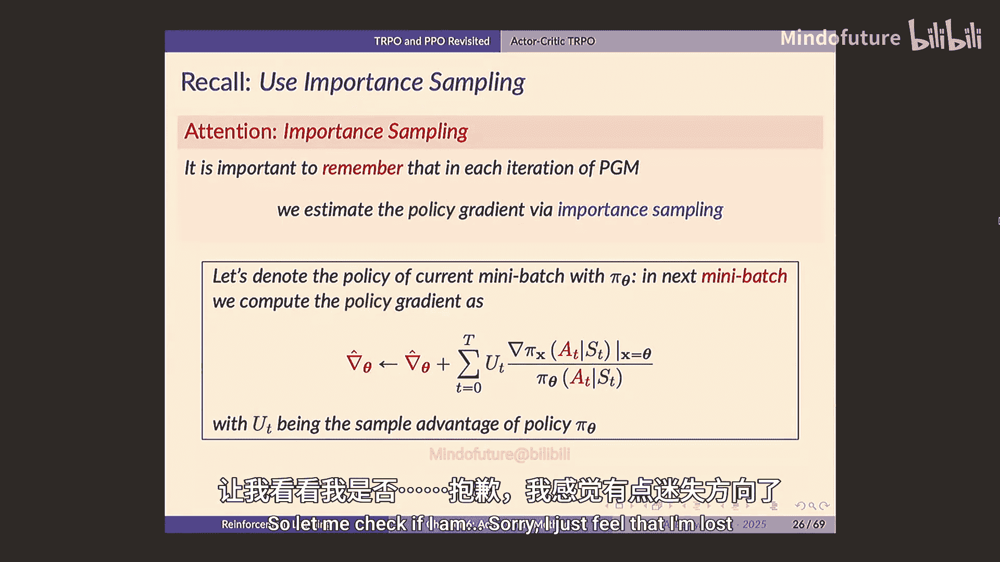

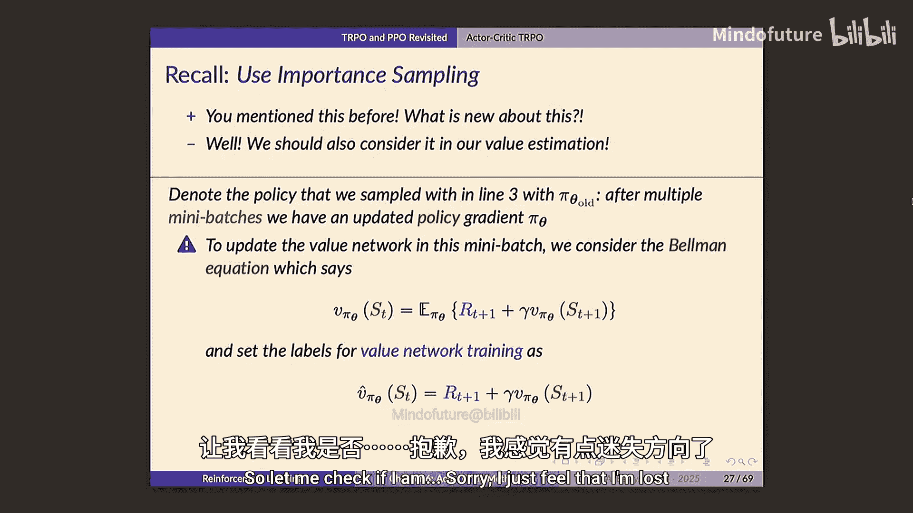

每次处理一条轨迹或一个小批量时，我们需要计算优势函数。现在，我们有了价值网络，所以可以使用它来估计优势。利用这些优势，我们可以计算梯度。

以下是TRPO演员-评论家算法的高级步骤：

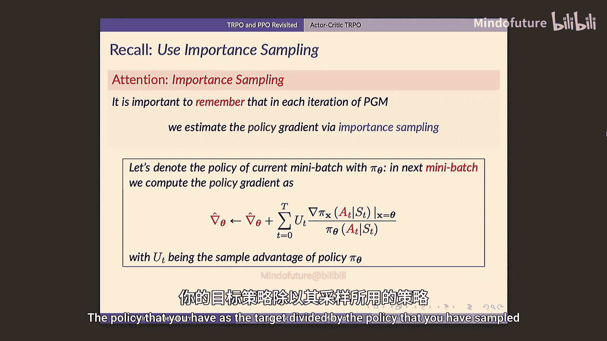

1.  使用当前策略网络采样一批轨迹。
2.  对于多个训练周期：
    *   从批次中取一个迷你批次。
    *   使用价值网络计算优势估计。
    *   计算策略梯度。
    *   计算价值网络的梯度。
3.  像标准TRPO一样处理策略梯度：估计海森矩阵，使用共轭梯度法找到更新向量，并在信任域内更新策略参数。
4.  使用随机梯度下降法更新价值网络。

这样，我们就更新了策略网络。在这个算法中，我们基本上只是添加了价值网络。额外需要做的是计算价值网络的梯度。

在算法第7行，你使用策略梯度定理计算策略梯度。然后，你可以使用相同的优势函数计算价值网络的梯度。通过反向传播，你得到价值网络的梯度样本。完成所有计算后，你用之前的SGD方法更新策略网络和价值网络。

这是一种更高级的演员-评论家实现，但有一个关键点需要注意，尤其是在实践中通过采样批次进行训练时。

## 重要性采样的关键作用

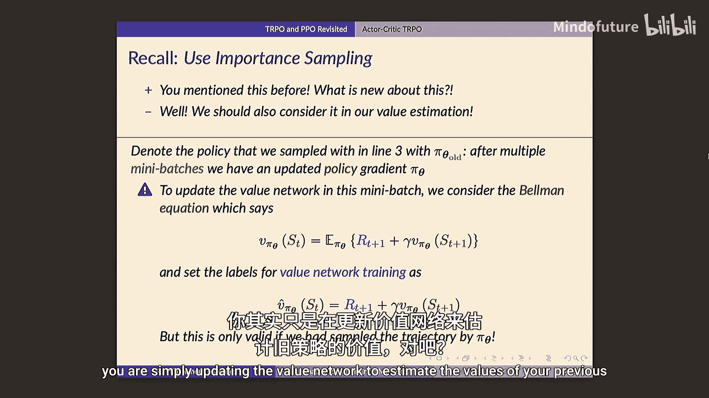

关键点在于，当计算价值网络和策略网络的梯度时，你需要使用重要性采样来确保你计算的优势实际上是基于目标分布的平均，而不是采样分布。

如果你记得上次我们讨论的内容，我告诉过你会得到这样的项。这是策略网络的指示函数，还不是价值网络。我们之前已经做过这个。当你做TRPO或PPO时，我们总是使用这个项来更新梯度，我告诉过你这个项实际上是重要性采样版本的梯度：目标策略除以采样策略。

我想指出的关键点是，在进行价值估计时，你也应该做同样的事情。

这意味着什么？假设我有旧的策略网络 π_θ_old。我用这个策略网络采样了完整的一批样本，并想用这些样本来更新我的价值网络和策略网络。

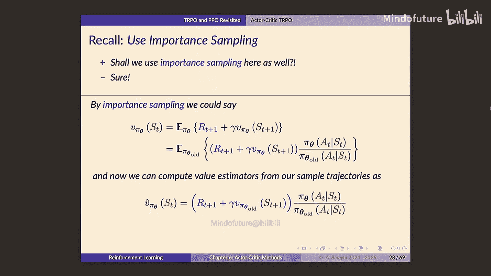

每次更新后，我都会得到一个新策略。当我更新策略网络时，策略网络的参数在变化，这意味着我应该专注于估计这个新策略的价值。但如果我想使用最初采样并放入批次的相同样本，那么我得到的只是旧策略的样本。

因此，我应该注意，我应该保留重要性采样项，以便将数据集中已有的任何样本转换为新更新策略的样本。

这意味着，如果你想更新你的价值网络，你将专注于估计你的策略 π_θ 的价值网络，而那个价值是，例如，TD表达式的期望，是在你正在执行的策略下的期望。你取这个的一个样本作为估计量，但这应该是这个量的估计量。

如果你已经有一个迷你批次，即你在更新前用旧策略采样的一批样本，那么这些样本并不是 π_θ 的样本，它们是 π_θ_old 的样本。

因此，如果你直接使用它们来更新价值网络，你只是在更新价值网络以估计旧策略的价值，而不是当前策略。

这里的技巧是什么？基本上，你只需要在价值估计上也使用重要性采样。确保将这些样本转换为新策略的样本。

我该怎么做？可以说，我想估计新策略下的这个期望，但我有旧策略的样本。如果我想做重要性采样，我有和之前一样的项，但我会乘以密度的比率。

每次更新策略时，你都有一个新策略网络。你得到那个策略网络，除以你采样批次时的密度，这是重要性采样的论点，并且你每次都将其乘以你的样本。

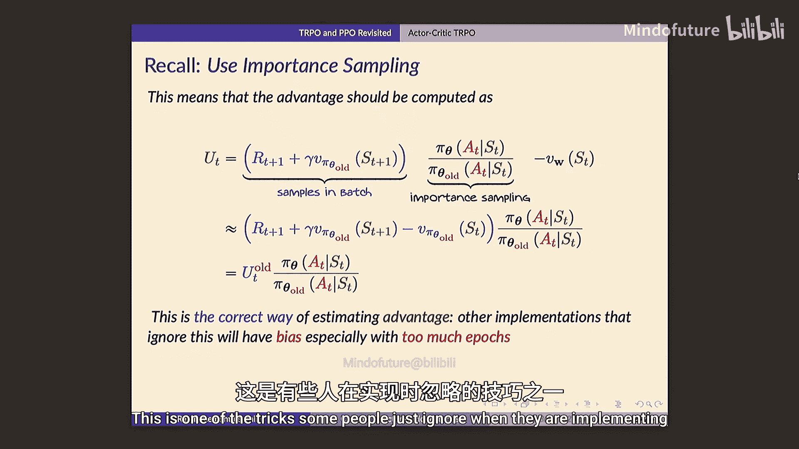

大家清楚了吗？所以，当你想要更新价值网络时，你将使用的样本将是这个。如果你做基本的TD学习，你不再有这个分数，这是你拥有的样本，但这是旧策略的样本。当你用这个样本来训练你的价值网络时，这仅仅意味着你在训练你的价值网络来预测旧策略的价值，但你不想这样，因为你想用这个价值网络来计算当前策略的优势并以此更新。所以你也需要这个重要性采样参数。

## 优势函数的计算

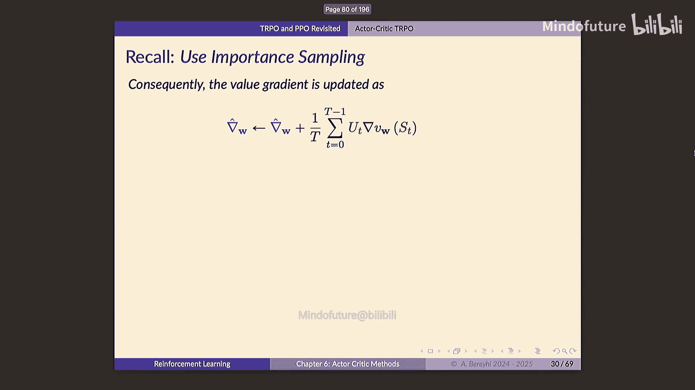

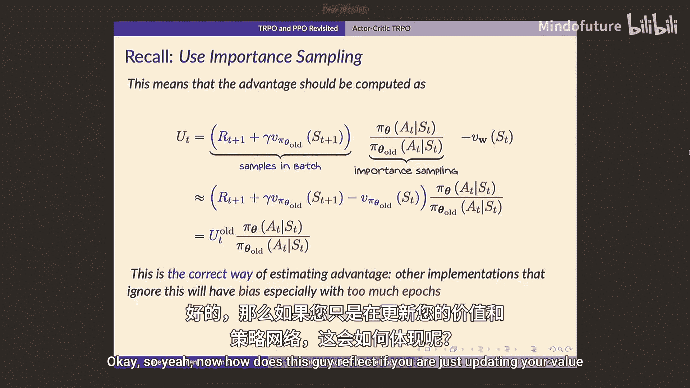

好的。所以，这将是你计算优势函数的方式。优势函数将是你拥有的任何样本乘以重要性采样参数，再减去你在该特定阶段拥有的价值。这个重要性采样参数只是为了确保你没有偏离更新后的策略。

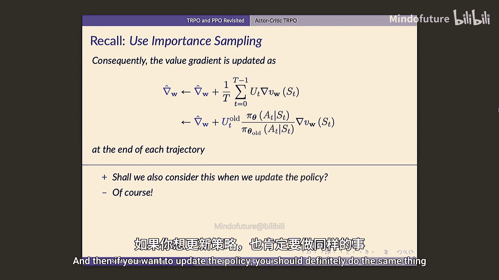

有时人们简单地写成这种形式，但这并不完全正确，因为我的意思是，你不能说这个量恰好等于这个乘以这个比率。这里没有涉及实际的动作。所以你需要用状态的边际分布来采样，但那样做太复杂了。这就是为什么人们做这种近似。

基本上，他们从批次内的样本中获得优势，然后将整个结果乘以比率。这大致可行，虽然不是100%准确，但会有效果。作为一个工程师，只要它有效就行。这是一个很好的近似，但你不能说这是一个非常精确的近似，因为第二个项的重要性采样参数很难解析地写出来，因为它依赖于时间 t 的状态，而你从某个随机状态开始，用你的策略随机执行，并且策略实际上也在变化，这是一个超级复杂的事情。

你可以直接忽略它。这就是你需要将旧批次中的优势转换为新批次或新更新策略的优势的方法。然后，当你更新价值网络和策略网络时，你需要使用这个量，而不是之前的量，不是绿色的 U，而是这个，而绿色的 U 总是可以转换的。

## 实践中的注意事项

如果你不这样做，并且你使用小批次，只在一个批次上运行几个周期，然后丢弃它们并更新，你可能看不到明显的差异。有时，没有重要性采样参数也能收敛。但是，如果你增加运行的周期数，因为你的策略网络开始进入某种稳定状态，比如离开之前的区域进入新区域，那么你就会看到差异。在这种情况下，差异会变得明显。

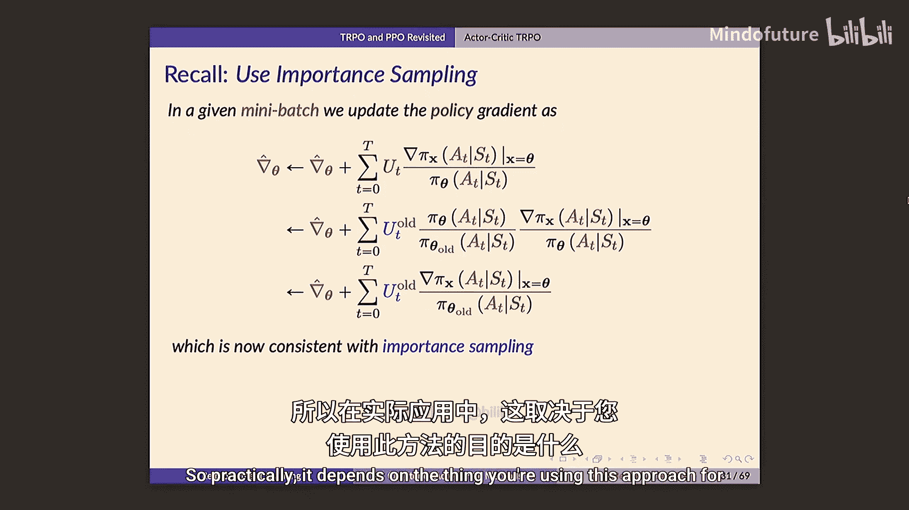

或者，如果你使用更大的批次，比如你说我没有时间每两个周期采样一次，我要取一个大批次，在上面训练足够多的次数，然后再进行下一批轨迹采样，那么你通常会看到非常显著的差异。

现在，这是正确的做法。一些基础的实现没有这样做。如果我没记错的话，OpenAI 提供的实现包含了它。但如果你没有看到它，并不意味着你不需要它，可能只是忘记做了。这是一个技巧。有些人在实现时直接忽略了。

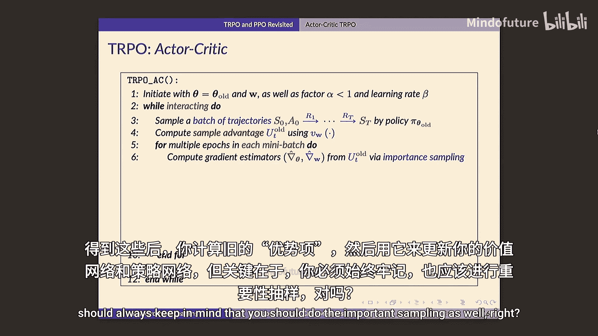

## 价值网络与策略网络的更新

好的，那么这如何反映在你更新价值网络和策略网络上呢？对于策略网络，我想我们上次讨论过，是同样的事情。对于价值网络，如果你想更新你的价值网络，你将使用那些优势样本作为你需要用其更新梯度或计算梯度的误差项样本。然后，你应该简单地用这个重要性采样参数替换它。

大家清楚了吗？关于价值梯度就是这样。然后，如果你想更新策略，你肯定应该做同样的事情。正如我所说，我们上次做过。我们可以再做一次，让一切更清楚。

如果你正在更新你的策略，你使用的是策略梯度方法。策略梯度理论意味着梯度将是对数似然梯度的平均值。这是对数似然的梯度。你这里有的是你的优势函数。

现在我应该做的是，我应该用重要性采样参数替换那个绿色的 U。这意味着我应该这样做。但现在，因为你计算的是对数似然 π_θ 的梯度，分子 π_θ 将与这里的分母抵消，然后你最终只会剩下这个。所以，你可以使用旧的优势函数。你唯一需要知道的是，你应该如何规范化你的策略梯度，你应该用用于采样的那个来规范化，而不是你现在拥有的那个。这不是什么大问题。

大家清楚了吗？现在，再次强调，这个，如果我不是100%确定，但如果我没记错，我见过一些非常知名的基线实现没有这样做，并且没有做非常复杂的影响。但如果你想100%精确，这是你应该考虑的事情。

这个与重要性采样是一致的。如果你只是简单地获取旧的蓝色优势，然后像这样使用它——我见过一些人这样做：他们有旧的优势，所以在第一行，他们用蓝色优势代替绿色优势，然后他们在这里保留 π_θ。通常因为你没有超出信任区域，这不会产生重大影响，但它在数学上是不正确的。我只能说这些。所以在实践中，这取决于你使用这种方法的目的。

## TRPO 演员-评论家算法总结

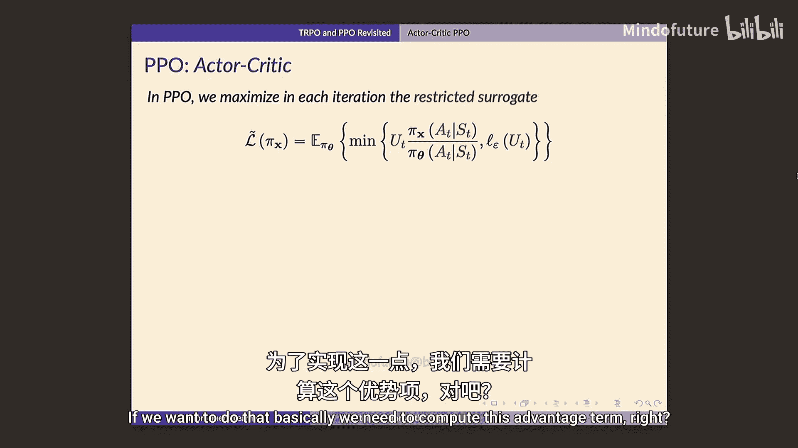

好的，所以这就是TRPO的演员-评论家版本，包含了所有的重要性采样内容。当你有一条轨迹时，你可以计算旧的优势，因为你的轨迹是由旧策略采样的。你得到那个，计算你的旧优势项，然后用它来更新你的价值网络和策略网络。但关键点是，你应该始终记住，你也应该进行重要性采样。你得到这个优势，使用重要性采样参数将其计算为绿色的新优势，现在你将估计你需要的梯度，之后，你只需进行基本的TRPO。一旦完成，你就更新你的策略网络，也更新你的价值网络，就这样。

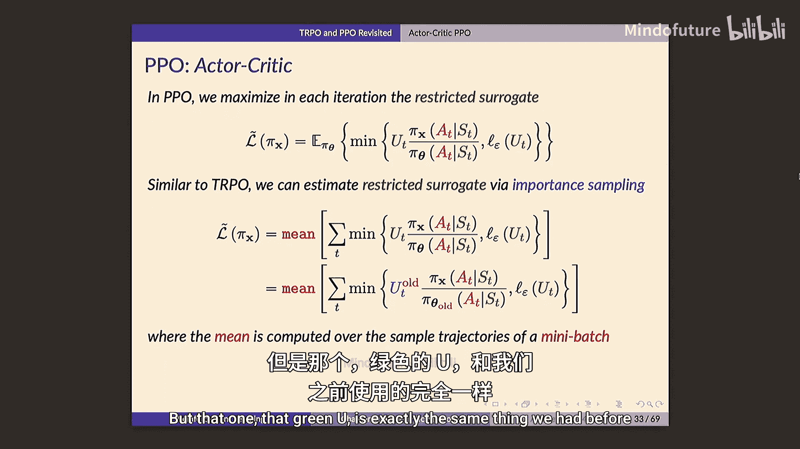

你通常对一批轨迹这样做。所以你对一个批次运行几个周期。一旦完成，你就更新你的策略。这就是我上次告诉你的经典实现方式：获取你的策略，收集整批样本，对其运行多个周期，每个迷你批次，你从缓冲区已有的数据中取一个迷你批次。只要你进行了重要性采样，就不会有问题。但一旦完成，比如10或20个周期后，你就丢弃所有东西，更新策略进行采样，然后再次采样。

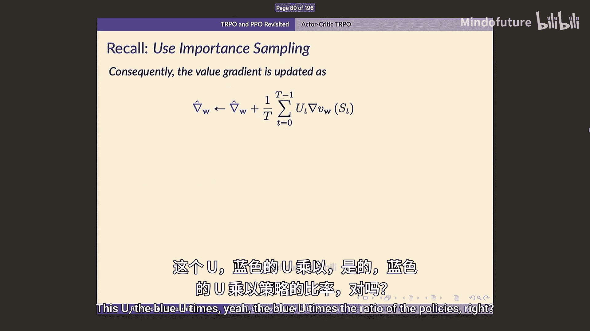

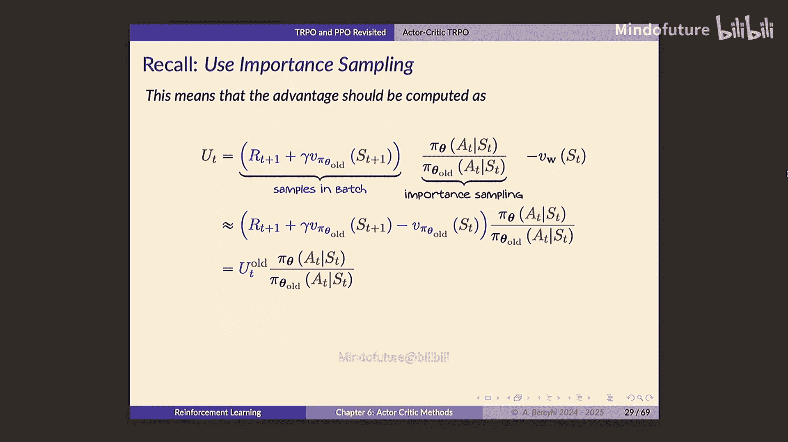

## PPO 的演员-评论家实现

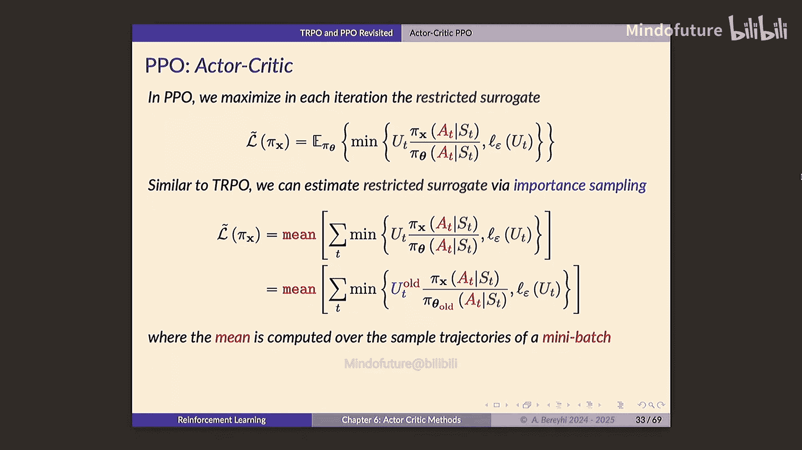

大家清楚了吗？哦，有一件事，为什么我这里写的是 π_θ_old 到 π_θ，应该是反过来，对吧？是的，抱歉。别那样做，当然，你可以回到原始点。抱歉，第11行。这只是个笔误。正如你所猜到的，我试图检查这个，因为原始版本充满了笔误，每个人都问那是什么，哦，一个笔误，又一个笔误。我检查了这么多次，我还是漏掉了这个。

现在你也可以对PPO做同样的事情。对于PPO，你可以再次做。现在，价值网络在哪里出现？同样的事情，当你想计算你的替代函数时，你需要优势函数，对于那个优势函数，你需要知道价值，所以你可以使用你的价值网络来估计那些优势。一旦你这样做，你就把它放在这里。只需进行重要性采样。就这样，然后像以前一样做所有事情。没有任何变化。这里唯一的区别是，当你想计算你的优势项时，使用你的策略网络，你也使用相同的优势来计算策略网络的梯度，抱歉，是价值网络的梯度。然后你就更新。

每个修改都清楚了吗？所以那个，那个是我们讨论过的受限替代函数。这 somehow 实现了对估计优势的裁剪。如果它过多地超过1，那么它将被限制在 1+ε；如果过多地低于1，那么比率将被限制在 1-ε。通过这样做，我们确保不会超出信任区域。基本上，我们需要计算这个优势项，然后你可以简单地用你的价值网络替换那个优势。你应该始终记住的一点是，你也应该在这里保留重要性采样参数。

所以你看到的那个绿色 U 实际上是蓝色 U 乘以重要性采样参数。但在这种情况下，如果你写下重要性采样，将是 π_θ 除以 π_θ_old 乘以 π_θ 除以 π_θ_old？等等，应该是 π_θ(a|s) / π_θ_old(a|s)。所以那些 π_θ 会抵消吗？实际上不会完全抵消，因为分子是新策略的概率，分母是旧策略的概率，用于对动作进行加权。在替代函数中，比率 r_t(θ) = π_θ(a_t|s_t) / π_θ_old(a_t|s_t) 会与优势函数相乘。

大家清楚了吗？所以第二个，绿色优势，是一样的。我唯一没有把它放在这里的原因，是我不想让它成为一个巨大的表达式。但那个绿色 U 和我们之前有的完全一样，是这个量，对吧？或者它是？对，这个 U，蓝色 U 乘以策略的比率，是同一个东西。所以你同意，当前优势总是你数据中已有的旧优势乘以那个重要性采样参数。

所以，这是你唯一需要记住的事情。所以你有你的优势乘以重要性采样作为你的估计量。然后，你以这种形式计算你的替代函数，然后你在这个量上执行PPO。采样一个批次，获取你的旧优势。之后，你使用重要性采样计算价值网络的梯度，你也可以直接对这个量应用梯度来计算替代函数的梯度。然后，这个，唯一可微的是分子中的 π_θ，这是一个正弦函数？不，是策略概率。所以你计算这个量。这是策略网络的更新，你计算这个量。这是价值网络的更新，然后你继续这样下去。

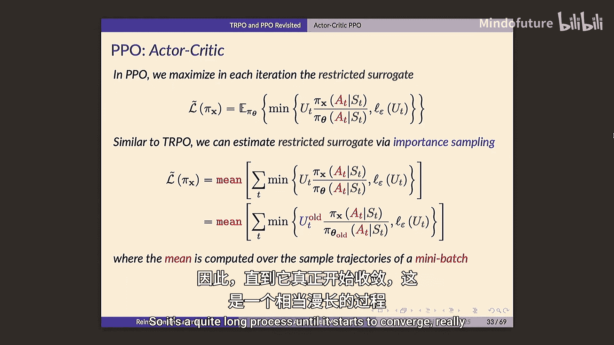

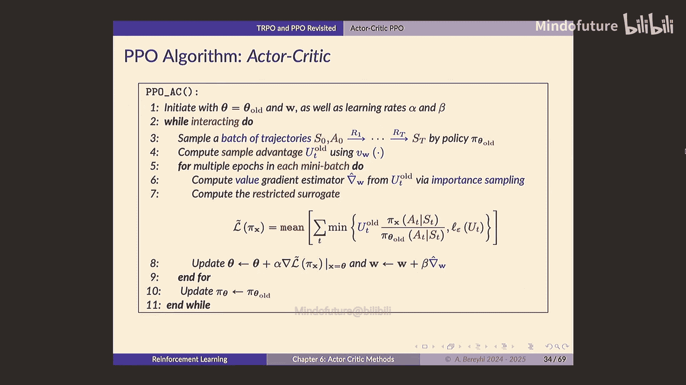

## 分布式演员-评论家

现在，我想按下一个按钮。现在，你认为我在下一页左边还有笔误吗？让我们看看，是的，我仍然有笔误，对吧？因为这家伙从未触发我大脑中的信号，我大脑中的那个权重 somehow 丢失了。

好的。有问题吗？好的，请讲。

当然，这里。问题是，当这个比率不一定大于1时，它取决于你正在做的动作。当优势大于0时，这家伙会大于1，我想它会小于1？如果优势是正的，那么直观上，这会大于一。问题是，既然我们…… 对。

我的意思是，在最初的几十个周期里，确实什么都不会发生。首先，你还没有…… 哦，在这个意义上，是的，当然。信任区域只有在你有一定程度的收敛时才有意义。当你没有收敛时，你不在乎。所以，一旦你的策略网络 somehow 捕捉到了一些东西，然后你开始看到我告诉你的那种行为，因为它 somehow 需要你的策略理解这个动作能给我带来正的优势，这意味着我应该做那个动作，但要能够理解，必须首先从数据中捕捉到那个模式，这需要一些时间。但对于最初的阶段，它永远不会做任何事情，所以这是一个相当长的过程，直到它真正开始收敛。

没有问题。

好的，如果没有问题，那么让我给你这最后一部分。这最后一部分是关于分布式演员-评论家的。什么是分布式演员-评论家？当你做演员-评论家时，你也有这个选项，可以 somehow 拥有多个演员。这些演员基本上，例如，在最简单的形式中，实际上是相同的策略网络，但它们 somehow 采样环境的不同部分，然后它们可以并行执行。

你有一个策略网络在环境的一部分，比如你的环境是一个巨大的空间，一个策略网络的一个副本就在这里采样，另一个在那里采样，另一个在另一个地方采样，依此类推。你将拥有多个策略网络的副本，每一个都是一个演员，只在环境的一部分中行动。

现在它们能做什么？它们可以在那里采样一批轨迹，然后计算该点的梯度，它们可以与一个服务器共享这个梯度和所有那些轨迹。那个服务器可以获取那些梯度来更新策略网络。

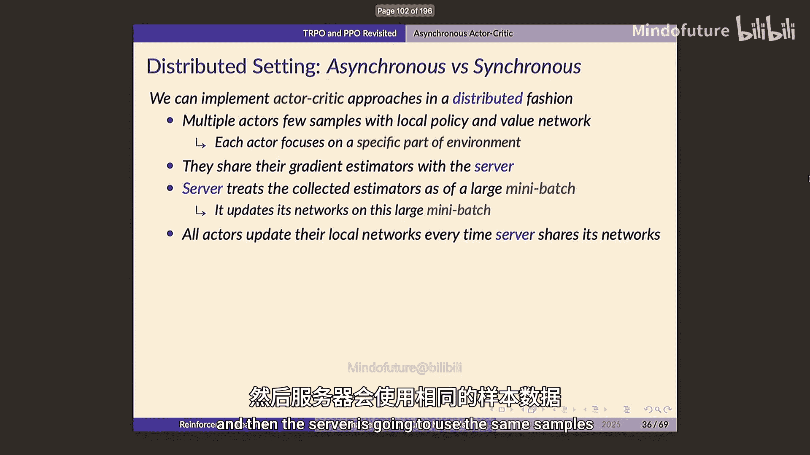

所以你可以说，那些梯度是环境内不同区域的梯度样本。现在，如果我对它们全部取平均，现在它是一个更好的估计量。这就是它能做的。它也可以获取你在整个环境中获得的所有那些轨迹，然后用它们来更新价值网络，这同样更高效，因为与一个演员在一个特定区域行动相比，你的样本在环境中分布得更好。

在这种情况下，你将拥有更好的样本，对价值网络和策略网络更可靠的更新。服务器，即全局神经网络，在经过几轮更新后要做的事情，是将那个策略网络分发给每个演员。它说，无论你有什么，都扔掉，复制这个，因为这是现在的好策略，然后用这个继续行动。

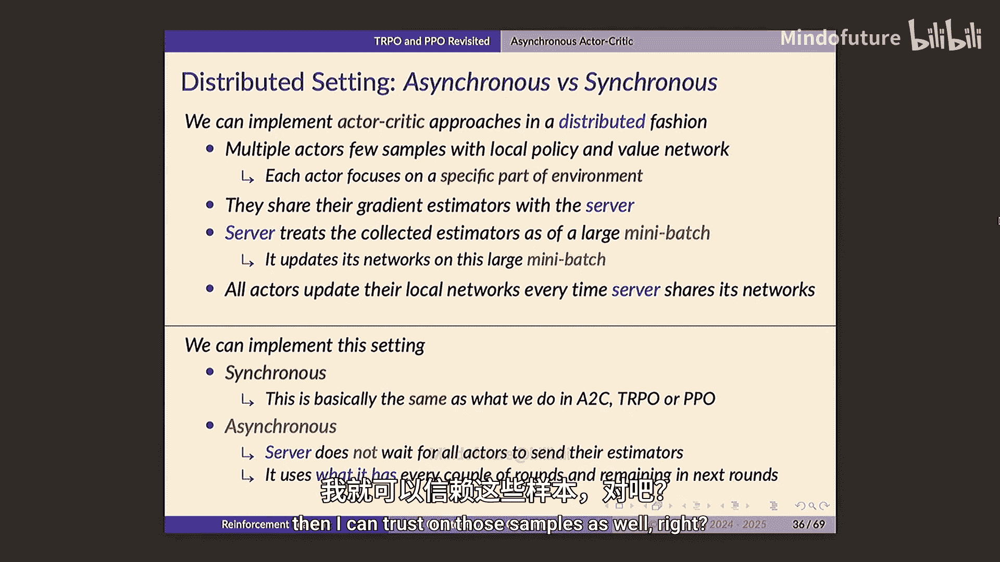

这就是你通常做分布式演员-评论家的方式。你可以有不同的版本。你可以有异步和同步版本。同步版本正是我告诉你的那个。所以你同意，是的，只需采样、更新、给我一些东西。我要更新，然后我会把我的更新参数给你，你复制，继续下去。这是你可以做的一件事。

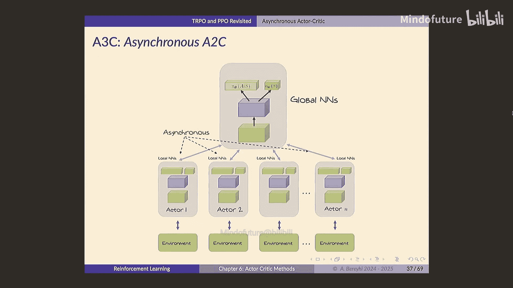

所以，这基本上是分布式版本。然后，服务器将使用相同的样本，但样本是从不同地方收集的。现在你可以做同步的，每个人都使用相同的模型进行采样，他们等待服务器或全局模型更新他们，然后他们继续采样。你也可以实现异步版本，异步在应用中可能更高效，例如，你有不同的连接，或者你给予不同区域不同的重要性。

这可能更高效，但没有什么特别的技巧发生。唯一的是，我可以说，大家继续，用一轮更新你们的策略，我不在乎。只需给我你们的样本，我将在某个时候更新，我会给你们一些回报，然后他们会给我样本，这些样本并非全部都是用相同分布采样的。但只要它们没有完全超出信任区域，我也可以信任那些样本。所以你也可以做异步。

这里的关键区别在于，你与本地演员的连接或通信不会像每次更新都在搜索轮次那样进行。你只是偶尔给他们信息，或者你甚至可能决定让这个演员更频繁地获得更新，另一个演员获得更新的频率较低。你也可以这样做。没什么大不了的。

## A3C 算法

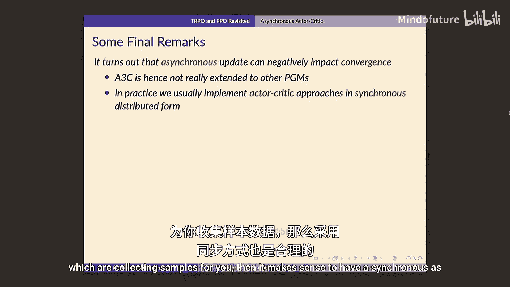

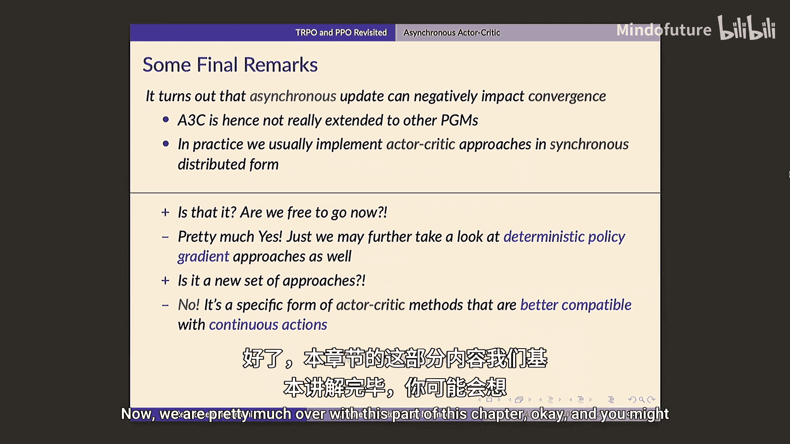

现在，A3C 是异步优势演员-评论家。如果你做我之前展示的同样的事情，带基线的演员-评论家，但以异步方式做，那就是A3C。你可以找到很多其他名字，A2C 等等，它们都在做同样的事情。

这里有几个要点，所以，我认为关于异步，当你做异步时，可能更难收敛，这是有道理的，因为你实际上并没有每次都给每个人更新策略，但通常当我们试图减少计算负载时，我们更关注同步版本，因为它们与原始的集中式版本没有什么不同。唯一的区别是你只是在进行分布式计算，这给了你更多的并行处理能力。但正如我所说，在实践中，如果你有像传感器这样的东西为你收集样本，那么拥有异步也是有意义的。

现在，我们这部分内容差不多讲完了。好的，你可能想知道你是否可以走了，你将要摆脱我，我下次只讲确定性策略梯度，因为我不能在15分钟内讲完，而且我不想在开始讲故事时占用你太多时间，但重点是，是的，我可以做到。我想我也可以下次做总结。

所以，如果你同意，我们就稍微快进一点，然后在那天结束所有内容。只是给你一个概念，我们将要讨论什么，我们在这部分课程中有什么，这个简单的修改，我们做的PPO和TRPO将适用于你拥有的大多数应用，所以这是一种可靠的算法，你可以使用它。这里的重点是，有时在某些应用中，你发现最好不要使用一个作为随机分布的策略网络来从中采样策略，而是希望有一个确定性策略。就像你不在乎策略可能是随机的，你只想说，每当我看到一个状态，我确切地知道我想做什么动作。

现在，什么样的应用这有意义？例如，当你有一个连续的动作空间，并且你真正寻找的是来自动作精确性的奖励时。如果我有一个物体，我想拿起它，那么这个手臂有一个连续的动作空间，然后如果你做PPO，这意味着什么？这意味着在它所在的每一个状态，它将随机决定去哪里。现在重点是，当你从这里开始时，它可以去任何地方，但逐渐地，当你越来越接近目标时，它将缩小其概率体积，我现在这样移动的概率体积非常高，我做任何其他事情的概率体积将越来越小，然后逐渐地，我将采取这个动作。

但这意味着，如果你真的在实践中部署它，你会看到类似这样的东西。因为它仍然在这里，我有一点点机会四处移动。现在你做什么？你通常先训练它，然后当你想使用PPO或在实践中部署它时，你会说，好吧，每次不要从分布中采样，只看具有最大密度的动作，并采取那个动作，这将消除这个。这将使它像这样。

现在，你能做什么？你可以从一开始就说，好吧，如果我最终要这样做，为什么我不开始训练这个家伙做确定性策略呢？所以在每一个点，不要从分布中采样，只做具有最高概率的动作，然后我扔掉所有概率性的东西。所以最后这部分，计算概率性，我直接计算动作。这就是我们称之为确定性策略方法的东西，基本上是策略方法。

但关键是，你的策略总是指示函数，那个动作。现在如果你这样做，你基本上可以做和以前一样的事情，但你并不真的需要走我们在策略梯度方法中走过的路，实际上你可以简单地使用 Q-learning。为什么？如果你记得我们在第4章末尾所做的，我告诉过你，如果我们有一个连续的动作空间，并且我有一个神经网络，它能够查看我的状态并告诉我什么是最优动作，那么我仍然可以做 Q-learning。所以我下次将为你完成这个想法，这不会非常复杂，因为它基本上是带有额外确定性策略的 Q-learning，但在机器人技术的某些应用中，人们仍然使用它。正如我所说，好处是，我的意思是，它可能不如PPO或那些真正使用策略网络的算法那么好，但关键点是，它将帮助你摆脱那些你不希望发生但有一点点机会的可能动作。

如果你在做手术，你甚至不希望有一点点机会把针放错地方，你不希望那样。所以你可以这样想。我们将讨论它。第一部分在周五。最后一部分将只是对我们所拥有的一切进行总结。

## 总结

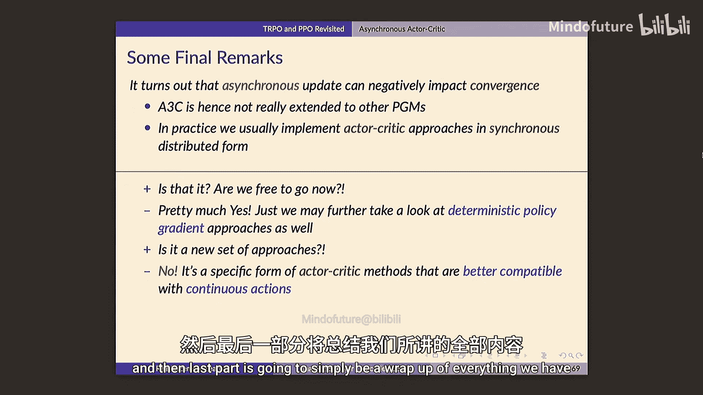

本节课中，我们一起学习了如何将价值网络整合到TRPO和PPO框架中，构建完整的演员-评论家算法。我们深入探讨了重要性采样在同时更新策略网络和价值网络时的关键作用，这是确保算法正确估计当前策略价值的关键。我们还简要介绍了分布式演员-评论家架构，如A3C，它通过并行采样提高效率。最后，我们预告了下一讲将探讨的确定性策略梯度方法，该方法适用于需要精确控制、避免随机动作的连续控制任务。