# 055：演员-评论家方法 🎭🤖

在本节课中，我们将要学习强化学习中的演员-评论家方法。这是一种结合了基于价值和基于策略的方法的混合框架，它使用一个策略网络（演员）来生成动作，并使用一个价值网络（评论家）来评估这些动作的好坏，从而更高效地指导策略更新。

上一章我们探讨了一个非常实际的问题。现在，在这一部分，我们首先将讨论策略梯度方法，但这次我们将使用一种有用的价值估计来进行更新。然后，本章的第二部分，我们将讨论确定性策略梯度方法，它与之前的方法有所不同。

## 强化学习方法概览

在最初，我们曾将强化学习方法大致分为两类。一类是基于价值的方法，另一类是基于策略的方法。

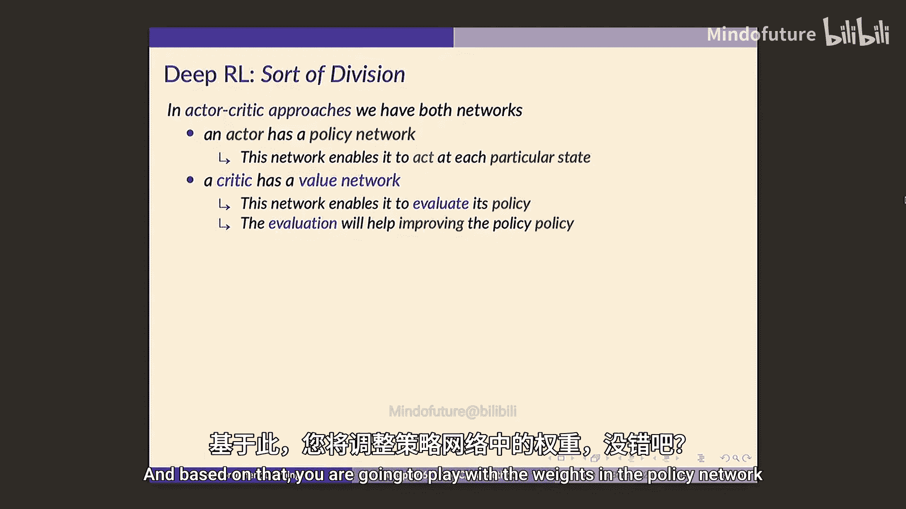

在基于价值的方法中，我们直接处理状态价值或动作价值函数。最著名的例子是Sarsa和Q学习。当我们使用函数近似（如神经网络）来实现它们时，就进入了深度强化学习的领域。

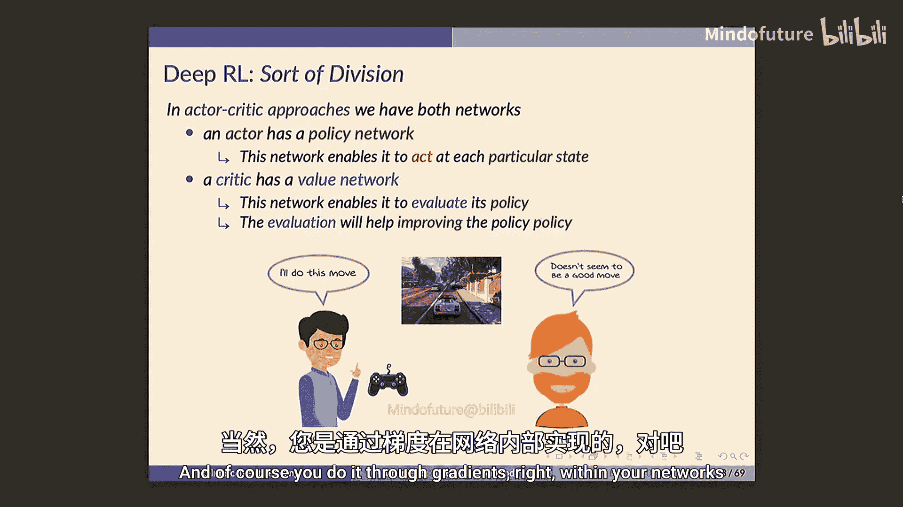

另一方面，基于策略的方法直接处理策略本身。最实用、最核心的方法包括TRPO和PPO，它们直接更新深度策略网络。

而当我们谈论演员-评论家方法时，我们讨论的是两者的混合。你有一个负责价值估计的价值网络（评论家），和一个负责更新策略的策略网络（演员）。

## 为什么叫“演员-评论家”？

人们称之为“演员-评论家”是为了让概念更生动。策略网络本质上就是“演员”。它观察当前状态，并根据策略网络采样得到一个动作，因此它是在“表演”。

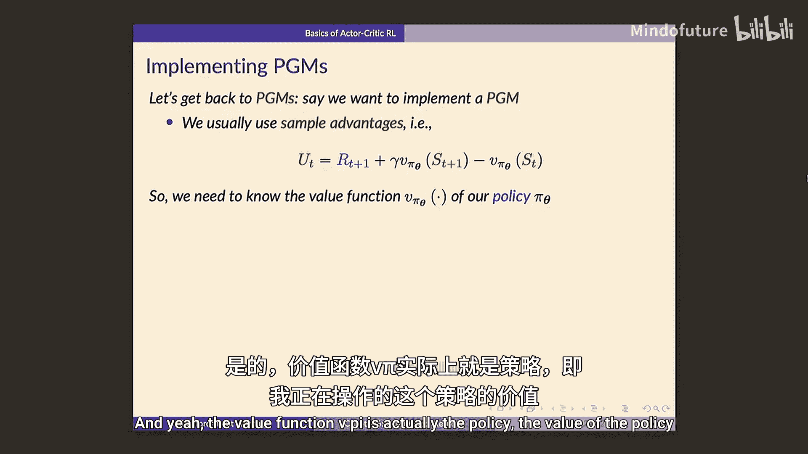

当它执行动作后，需要知道这个动作的价值以更新自己的策略。这时，“评论家”（价值网络）就登场了。它像一个专家，观察演员的行为并给出评价（价值估计）。基于这个反馈（例如，优势函数），演员调整其策略网络的参数，增加好动作的概率，减少坏动作的概率。

直观上，就像是一个演员在表演，旁边有一位评论家不断给出反馈，指导演员如何改进。

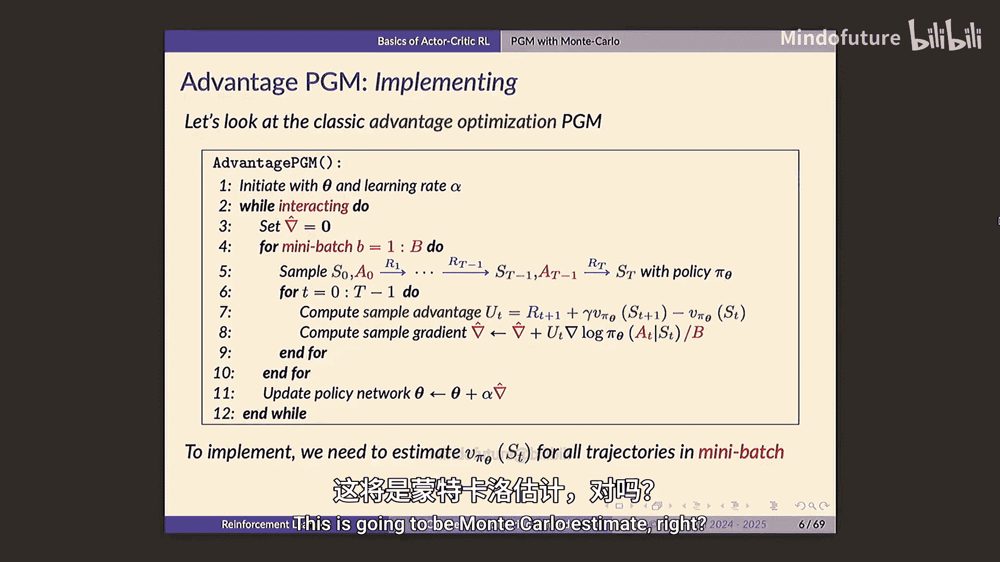

## 策略梯度方法与演员-评论家的关系

对于许多人来说，策略梯度方法和演员-评论家是等同的。从实践角度看，这有一定道理，因为要实现策略梯度方法，你最终需要知道优势函数，这通常需要一个价值网络来估计。

然而，严格来说，策略梯度方法并不必然是演员-评论家。例如，REINFORCE算法是一种纯策略梯度方法，它通过蒙特卡洛采样来估计回报，而不使用专门的价值网络。但在实际问题中，纯蒙特卡洛估计往往效率低下，因此引入价值网络进行估计的演员-评论家方法更为实用和有效。

## 实现演员-评论家方法

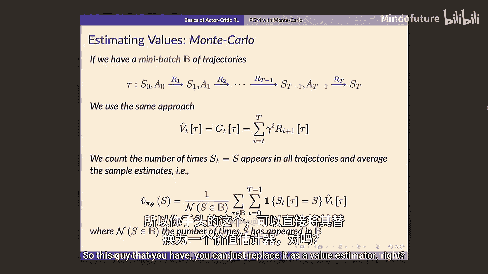

到目前为止，在讨论策略梯度时，我们总是提到需要价值函数 V^π_θ，但从未具体说明如何计算它。现在，我们将一步步实现它。

在策略梯度方法中，无论实现哪种变体（如带基线的、TRPO、PPO），我们最终都需要优势项 A^π_θ(s_t, a_t)。其计算公式为：
`A^π_θ(s_t, a_t) = r_t + γ * V^π_θ(s_{t+1}) - V^π_θ(s_t)`

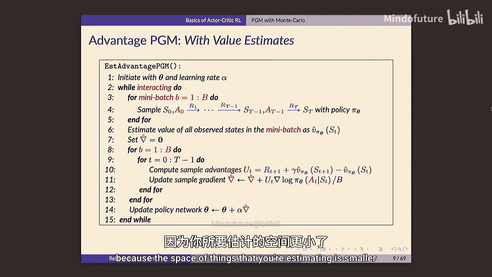

这里的关键在于，我们需要价值函数 V^π_θ。由于我们的策略 π_θ 在每次迭代后都会更新，其对应的价值函数也会随之改变。因此，我们不能离线训练一个价值网络然后一直使用它。我们必须在线地、与策略网络同步地训练价值网络，让它始终能准确评估当前策略的价值。

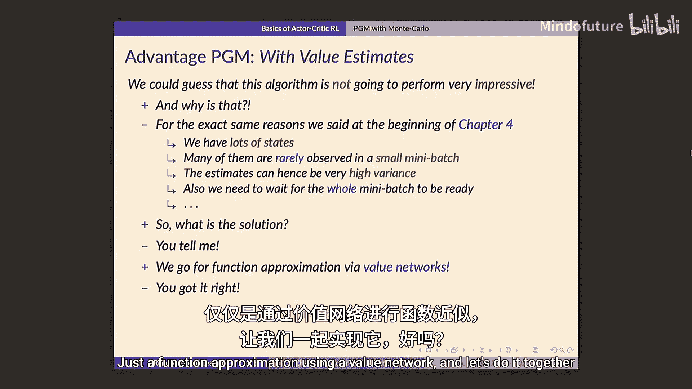

### 从蒙特卡洛估计开始

如果我们想高效地计算优势函数，一个起点是考虑使用小批量的轨迹。基于这些轨迹，我们可以尝试估计价值。虽然这不会很高效，但它能为我们提供用于训练价值网络的“标签”。

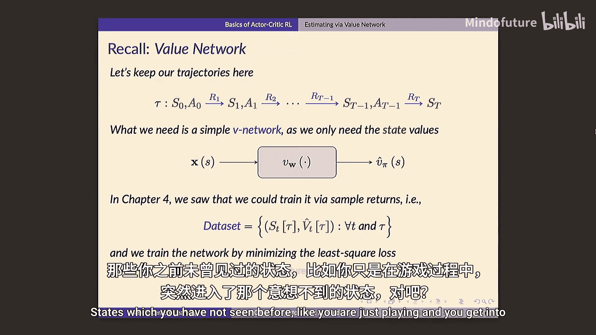

对于单条轨迹，我们可以使用蒙特卡洛方法来估计某个状态 s_t 的价值：
1.  遍历轨迹。
2.  记录每次访问状态 s_t 时获得的后续累积回报（样本回报）。
3.  对这些样本回报求平均，得到 V^π_θ(s_t) 的蒙特卡洛估计。

如果我们有一个小批量的轨迹，可以将这个想法扩展：在每个轨迹内进行平均，然后再对所有轨迹的平均值进行平均。

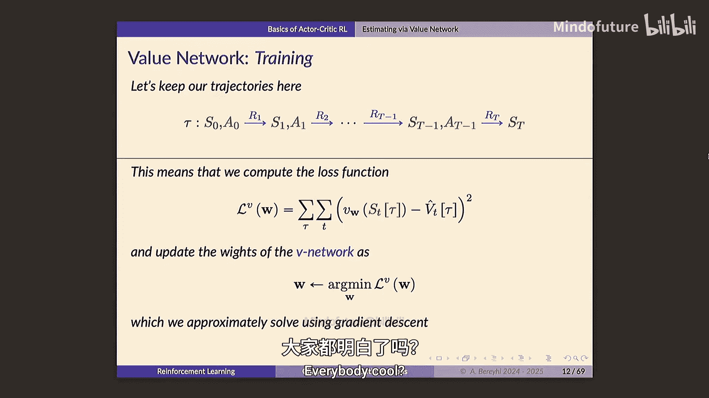

这样，我们就得到了一个价值估计器 `V_est`。我们可以用它来代替真实的 V^π_θ(s_t)，从而计算优势函数。

然而，这种方法在实践中通常行不通，因为状态空间可能非常庞大，我们无法在有限的样本中看到足够多次的每个状态。因此，我们需要引入函数近似——价值网络。

### 引入价值网络

我们需要的是 V 网络，而不是 Q 网络，因为优势函数的计算只依赖于状态价值。

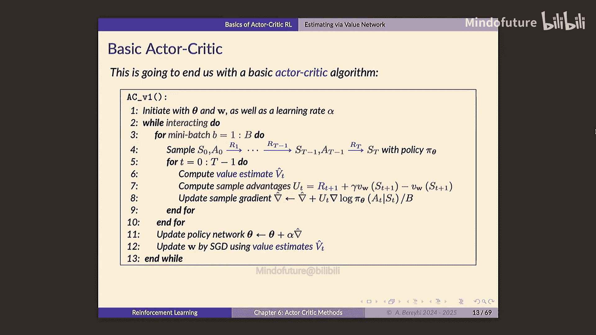

这个价值网络接收状态表示（例如坐标）作为输入，输出该状态的估计价值。我们需要在线训练它，使其与当前策略保持同步。

训练数据来自于我们收集的轨迹样本。对于轨迹中的每个状态 s_t，其对应的标签就是该状态的样本回报 `G_t`（从 s_t 开始到轨迹结束的累积折扣奖励）。我们的目标是让价值网络的输出 `V_θ(s_t)` 尽可能接近这个标签 `G_t`。

因此，价值网络的损失函数可以定义为均方误差：
`L(θ) = Σ_t (V_θ(s_t) - G_t)^2`

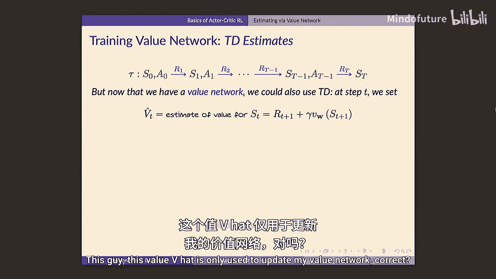

我们通过随机梯度下降来最小化这个损失，从而更新价值网络的参数 θ。

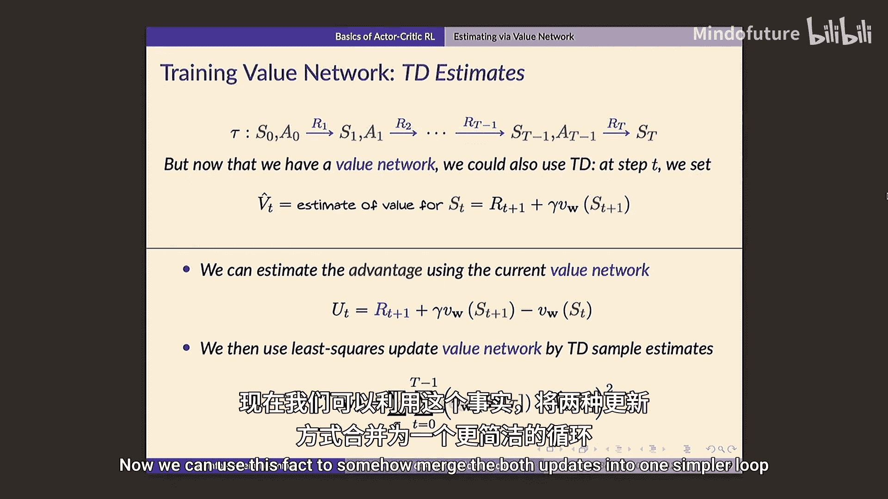

### 合并更新：关键观察

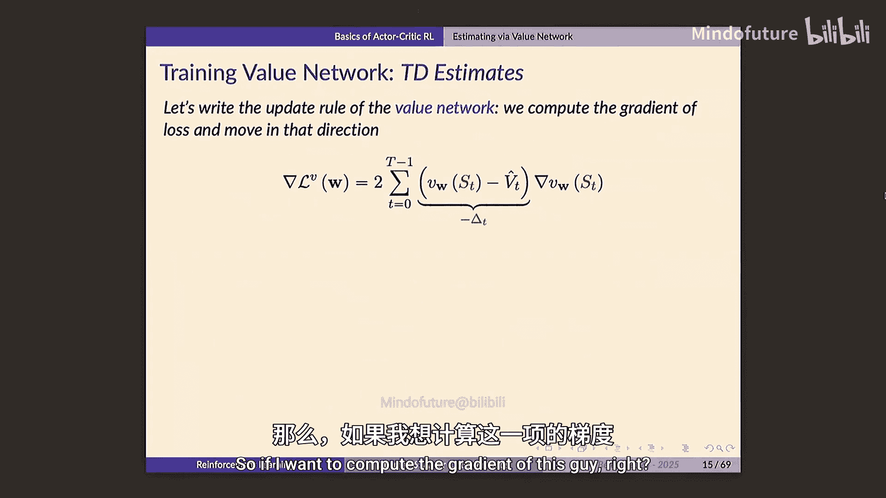

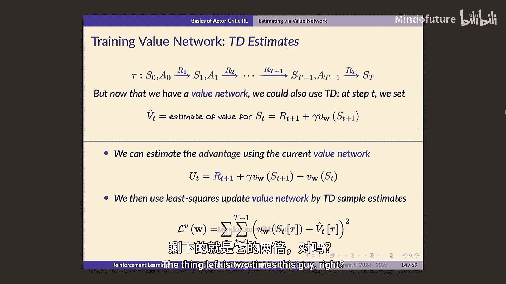

现在，我们有一个重要的观察可以简化并合并策略网络和价值网络的更新流程。

我们计算优势函数时使用的 `r_t + γ * V_θ(s_{t+1})`，正是时序差分（TD）估计器对 `V_θ(s_t)` 的估计。我们记这个估计为 `V_target`。

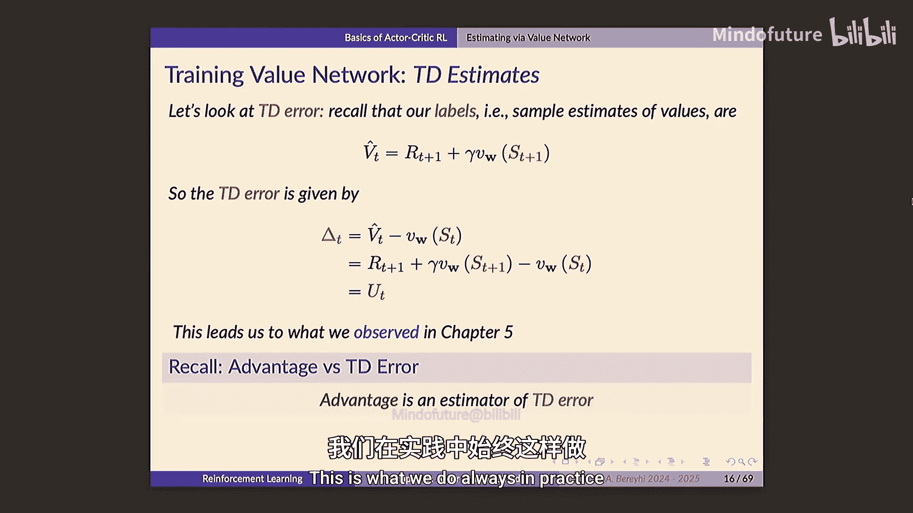

那么，优势函数就变成了：
`A_t = V_target - V_θ(s_t)`

同时，价值网络的损失函数梯度中，也包含了 `(V_target - V_θ(s_t))` 这一项（即 TD 误差 δ_t）。

因此，**优势函数 A_t 本质上就是价值网络更新所需的 TD 误差 δ_t 的一个估计**。这是一个非常关键的观察，它允许我们将两个更新过程合并。

### 优势演员-评论家算法

基于以上观察，我们可以得到最基本的演员-评论家算法——优势演员-评论家。

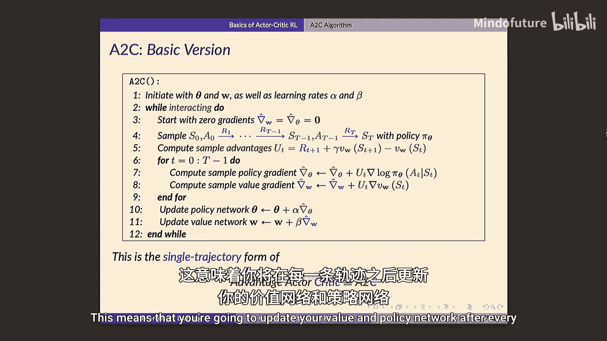

算法流程如下：
1.  使用当前策略 π_θ 采样一条轨迹（或一个小批量轨迹）。
2.  对于轨迹中的每个时间步 t：
    *   计算 TD 目标：`V_target = r_t + γ * V_θ(s_{t+1})`
    *   计算优势估计：`A_t = V_target - V_θ(s_t)`
    *   计算策略梯度：`∇_θ J(θ) 的样本 ≈ A_t * ∇_θ log π_θ(a_t | s_t)`
    *   计算价值网络梯度：`∇_θ L(θ) 的样本 ≈ A_t * ∇_θ V_θ(s_t)` （忽略常数因子）
3.  聚合整个轨迹（或小批量）的策略梯度和价值网络梯度。
4.  使用两个可能不同的学习率，同时更新策略网络参数 θ 和价值网络参数 θ_v。

这种在线、逐步更新的方式可能不稳定，因为更新频率太快。更稳定的做法是使用小批量版本：收集一批完整的轨迹，计算所有时间步的优势和梯度，然后进行平均后再更新网络参数。

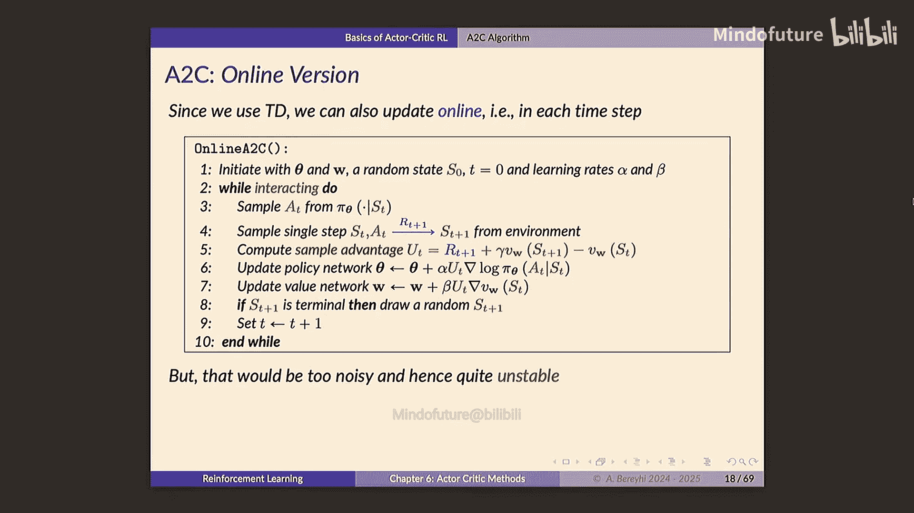

### 共享网络架构

另一个在实践中常用的想法是使用共享网络。其核心思想是，最优策略与最优价值函数是紧密相关的，因此可以使用一个共享主干网络来提取特征，然后分成两个“头”：一个输出策略（动作概率分布），另一个输出状态价值。

这样，我们只有一个神经网络，其参数同时被策略损失和价值损失所影响。

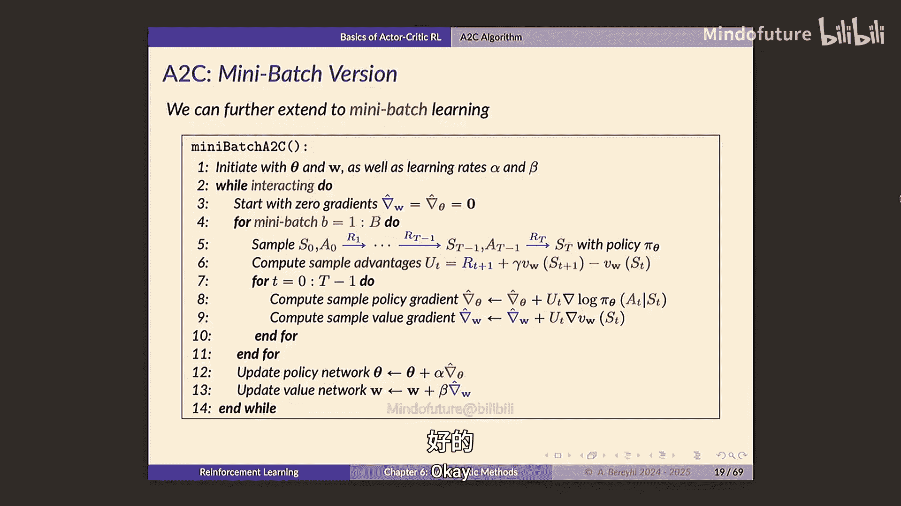

为了训练这个共享网络，我们需要定义一个组合损失函数：
`L_total = L_policy + c * L_value`
其中，`L_policy` 是策略梯度目标（通常取负号以进行最小化），`L_value` 是价值网络的均方误差损失，`c` 是一个需要调整的系数，用于平衡两个损失的数量级。

在计算梯度时，我们进行反向传播，梯度会在共享层合并，然后分别流向策略头和价值头。最终的参数更新会同时优化策略和价值估计。

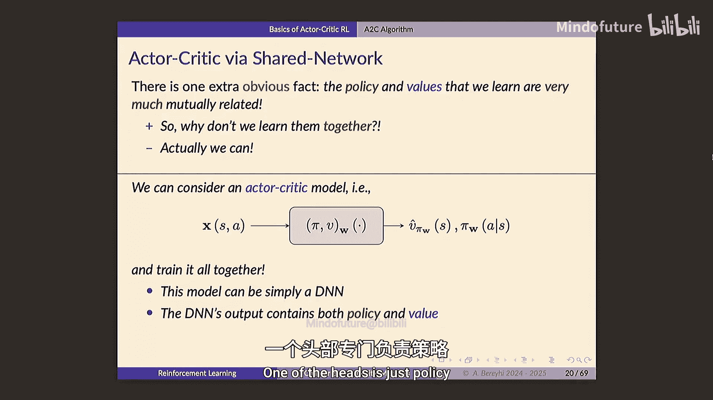

## 总结

本节课中，我们一起学习了强化学习中的演员-评论家方法。

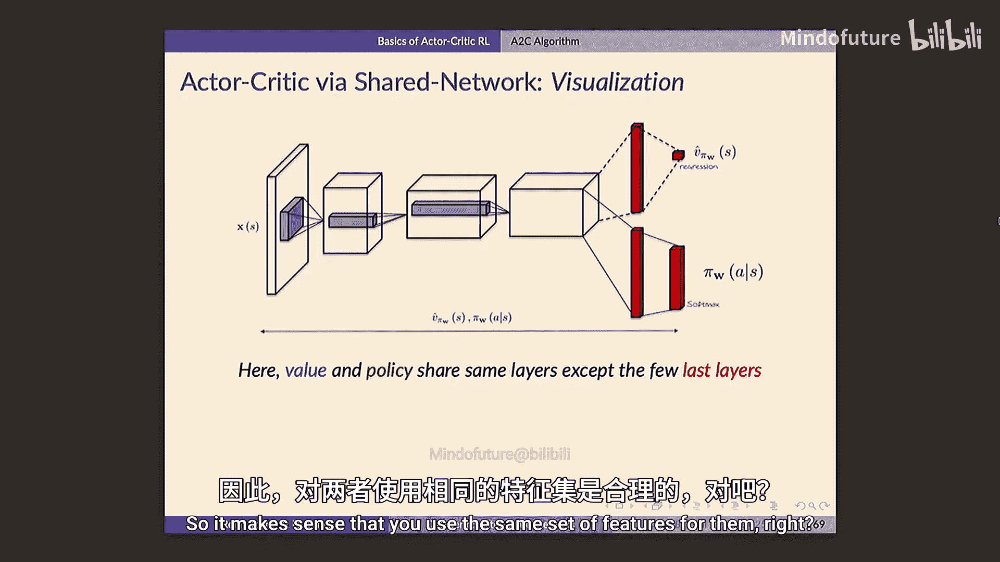

我们首先回顾了基于价值和基于策略的两类方法，并解释了演员-评论家如何将它们结合起来：策略网络作为“演员”负责行动，价值网络作为“评论家”负责评估。

我们深入探讨了实现演员-评论家的必要性，因为纯策略梯度方法依赖的价值估计在实践中需要高效的近似。我们介绍了从蒙特卡洛估计到引入价值网络的过程，并强调了必须在线训练价值网络以匹配不断变化的策略。

最关键的是，我们发现了优势函数 `A_t` 与价值网络更新的 TD 误差 `δ_t` 之间的等价关系。基于这一观察，我们推导出了优势演员-评论家算法的核心步骤，该算法能高效地同步更新策略和价值网络。

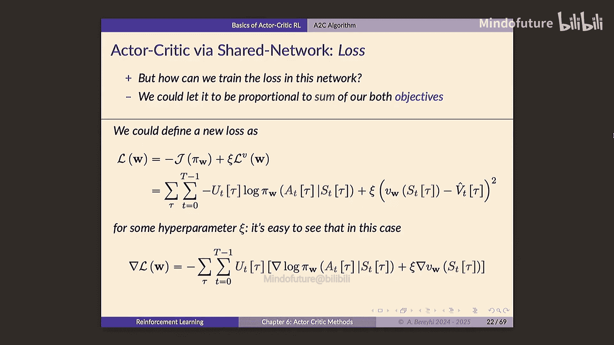

最后，我们简要介绍了共享网络架构，它通过一个网络同时学习策略和价值，可以简化模型并可能提升学习稳定性。

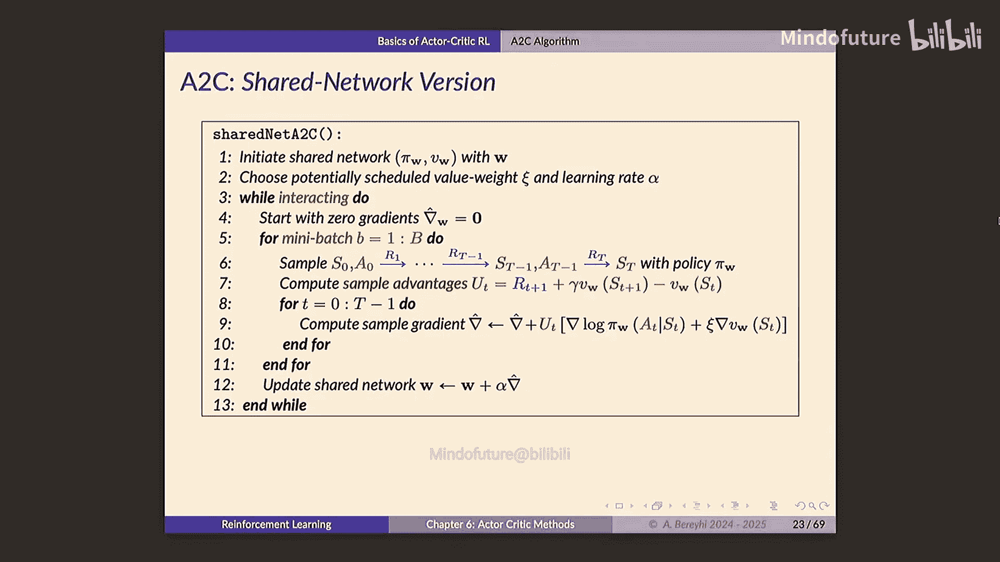

演员-评论家框架是许多现代深度强化学习算法（如A3C, A2C）的基础，理解它对于掌握前沿的RL技术至关重要。