# 056：柔性演员-评论家方法简介 🎭

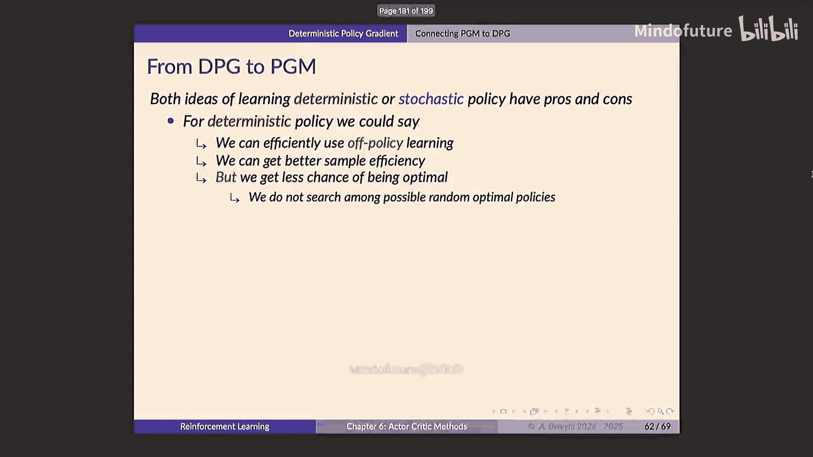

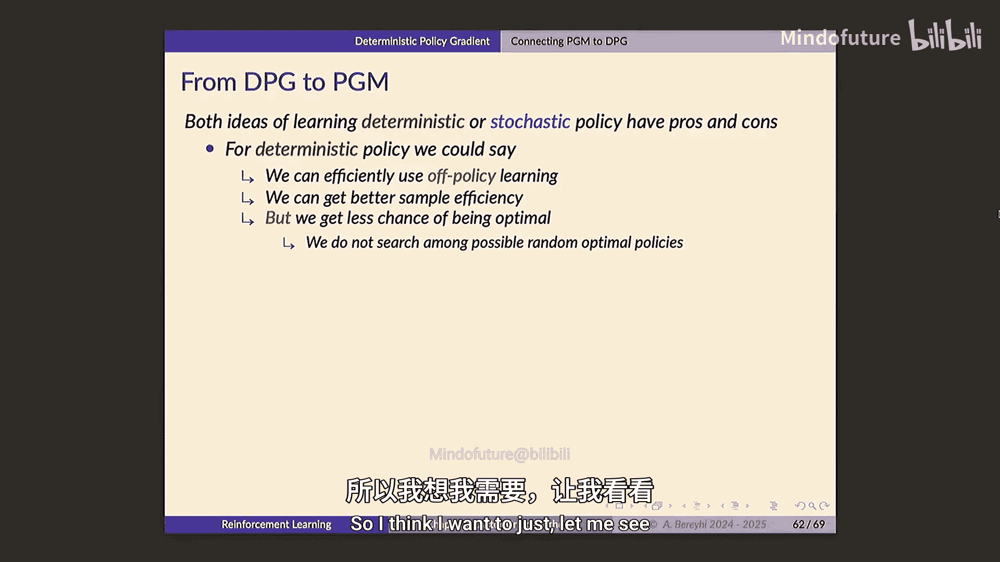

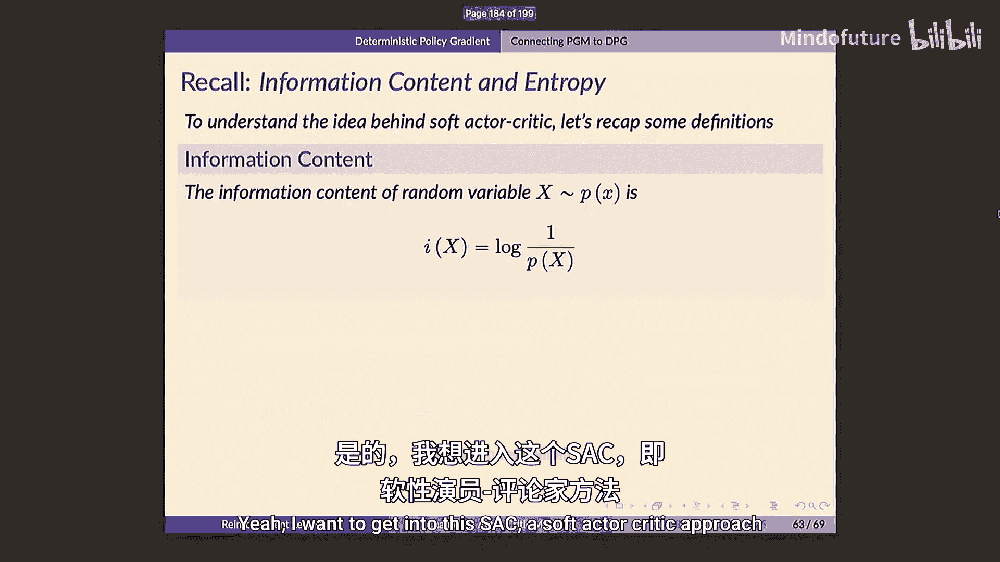

在本节课中，我们将要学习一种介于确定性策略和随机性策略之间的强化学习方法——柔性演员-评论家方法。我们将探讨其核心思想，即如何在保持全局确定性的同时，引入局部随机性以促进探索。

---

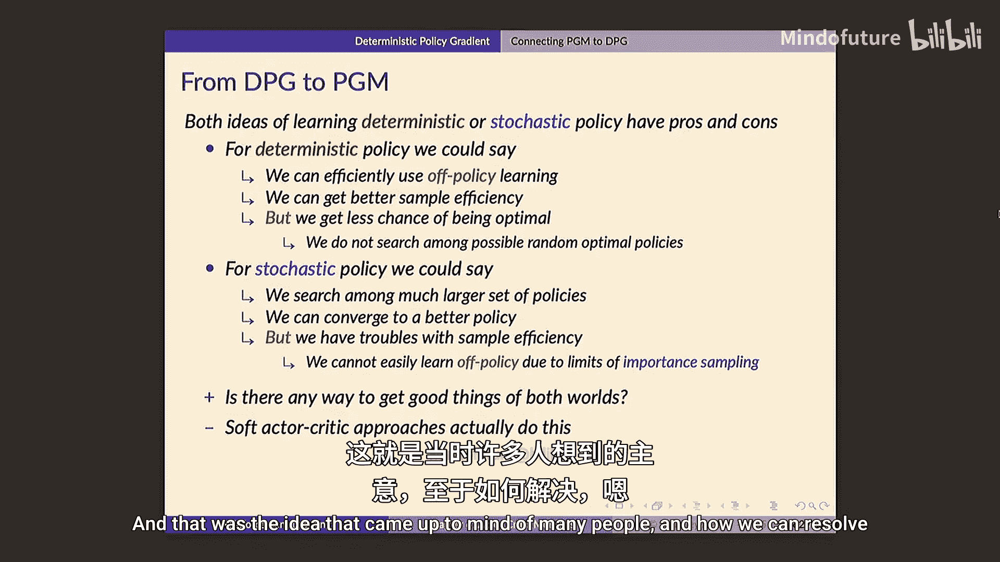

## 背景与动机

上一节我们介绍了基于策略网络的两种主要思想：随机策略的策略梯度方法和确定性策略方法。本节中我们来看看如何在这两种方法之间找到平衡。

确定性策略在给定状态下会输出一个最优动作。随机策略则会输出一个动作的概率分布。人们开始思考，是否存在一种介于两者之间的、更优的实践方法。

一个合理的想法是：智能体应该在全局上保持确定性，但在局部上保持一定的随机性。例如，从教室到门口，我大致知道方向（全局确定性），但在行走过程中，我可能会因为看到楼梯或障碍物而局部调整路径（局部随机性）。我们希望强化学习策略也能实现类似的效果：对“应该做什么动作”有一个确定性的想法，但在执行时，为动作注入一点随机性。

## 信息论基础：熵

为了理解如何实现上述想法，我们需要一点信息论的基础知识，特别是“熵”的概念。熵衡量了一个随机过程的不确定性或信息量。

对于一个随机变量X，其某个具体取值x的**信息量**定义为：
`I(x) = log(1 / P(x))`
其中`P(x)`是事件x发生的概率。概率越小的事件，发生时带来的信息量越大。

**熵**则是所有可能取值的信息量的期望值，它衡量了整个随机过程的平均信息量或不确定性：
`H(X) = E[I(x)] = - Σ P(x) * log(P(x))`

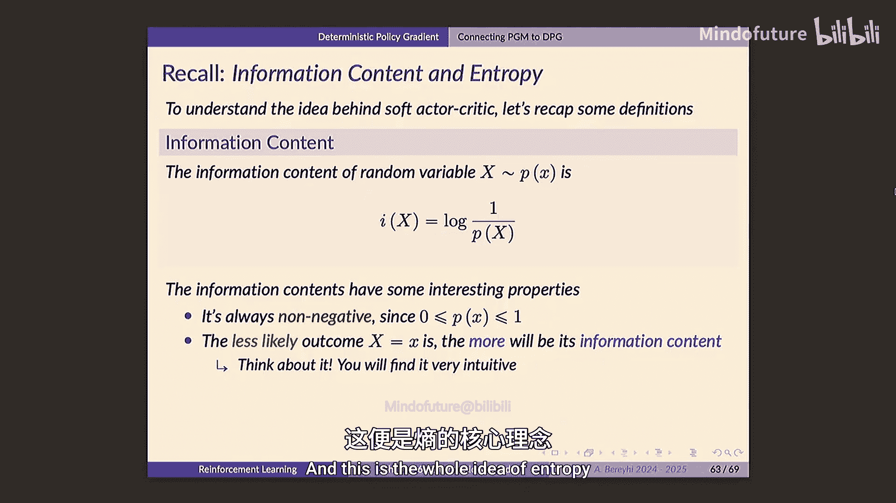

熵的性质：
*   当随机过程是确定性的（某个事件概率为1，其他为0），熵为0。
*   当概率分布越均匀（如均匀分布），随机性越大，熵值也越高。

在策略的语境下，我们可以将策略π(a|s)看作一个随机过程（给定状态s，输出动作a的分布）。该策略的熵`H(π(·|s))`就衡量了在状态s下选择动作的随机性程度。

## 柔性演员-评论家方法的核心

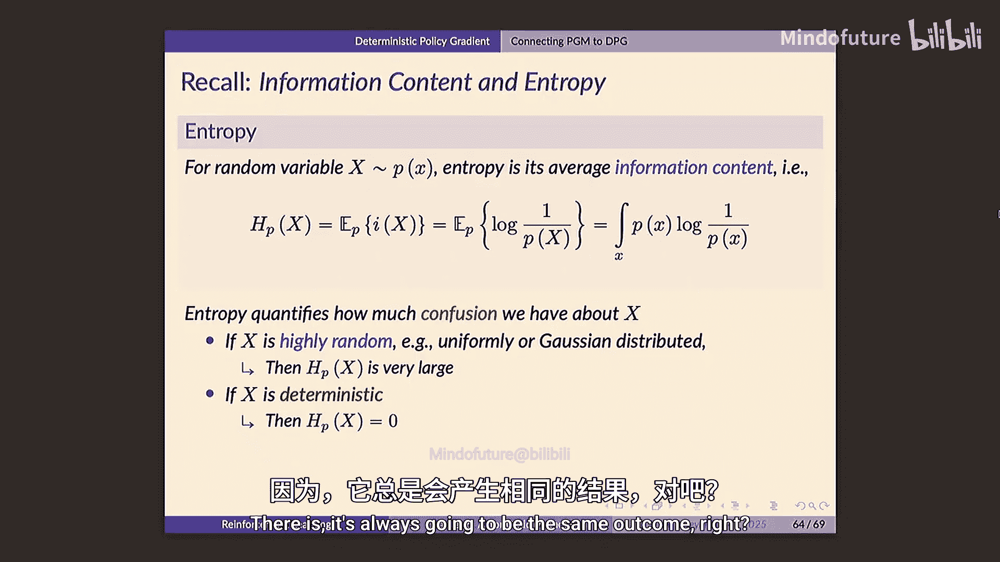

基于熵的概念，人们提出了修改奖励机制的方法，以将策略的随机性（探索）直接纳入优化目标。

他们重新定义了奖励函数，在环境给出的即时奖励`r_t`基础上，增加了一项策略熵的加权：
`r_t^{soft} = r_t + α * H(π(·|s_t))`
其中，`α`是一个温度参数，用于控制熵奖励的重要性。

这个新奖励`r_t^{soft}`就是**柔性奖励**。相应地，价值函数也基于这个新的奖励序列来定义：
`V^{soft}(s) = E[ Σ γ^t * (r_t + α * H(π(·|s_t))) ]`
`Q^{soft}(s, a) = E[ r_t + γ * (α * H(π(·|s_{t+1})) + V^{soft}(s_{t+1})) ]`

这种方法被称为**柔性演员-评论家**，因为在其价值函数中，不仅包含了环境奖励，还包含了策略本身的不确定性（“柔性”部分）。

## 方法优势与直观理解

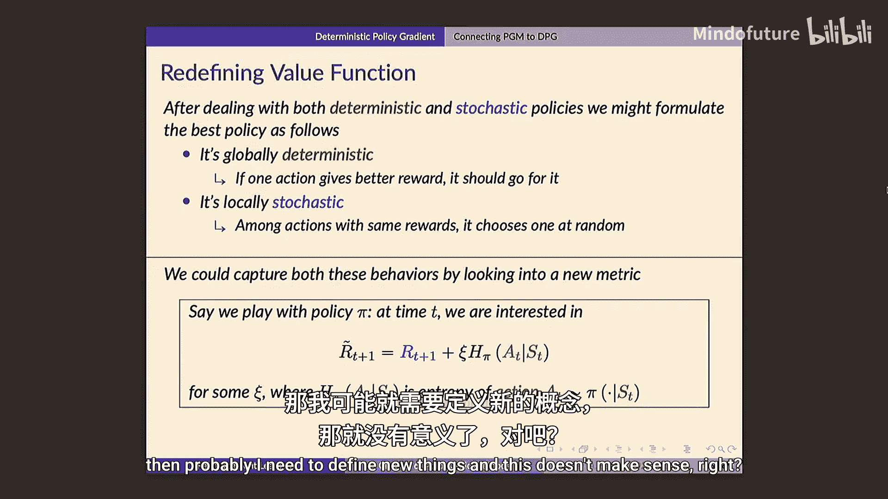

这种设计巧妙地融合了两种策略的优点：
1.  **最大化即时奖励**：这驱使策略趋向确定性，选择当前看来能获得最高未来回报的动作。
2.  **最大化策略熵**：这驱使策略在给定状态下，让动作分布更均匀，增加随机性以探索更多可能性。

智能体在每一步都试图平衡“利用”（通过第一项）和“探索”（通过第二项）。在多个动作能带来相似回报的情况下，智能体会倾向于选择那个具有更高熵（即更随机）的动作分布。这实现了我们最初的目标：在追求全局最优回报（确定性导向）的同时，在局部保持充分的随机性以进行探索。

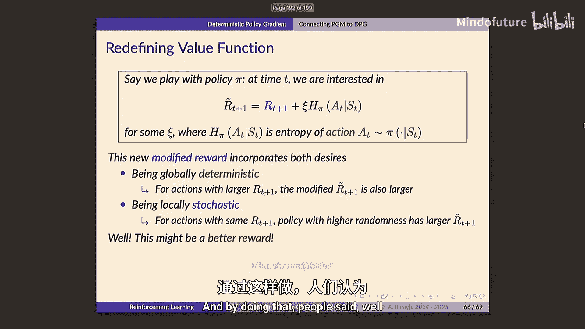

## 实践建议与总结

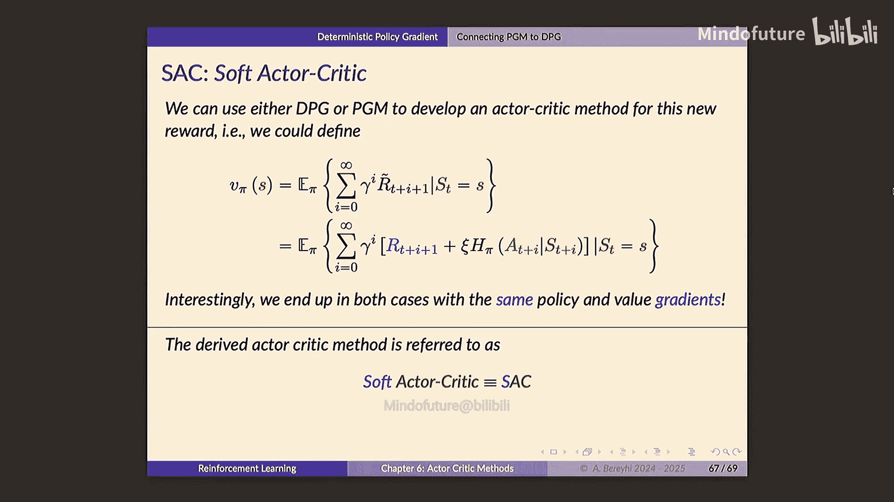

以下是关于不同策略梯度方法选型的一些经验法则：

*   如果你的任务**样本效率受限**或**动作空间是连续的**，那么将**确定性策略梯度**作为首选是一个好选择。
*   如果你的任务是**离散动作空间**，或者你对样本效率要求不高，那么像**PPO或TRPO**这类基于随机策略的方法可能更合适。
*   在实际项目中，你很可能需要一个评论家（价值函数），因此单独使用深度Q学习可能不够，除非是像电脑游戏这样能大量生成样本的环境。

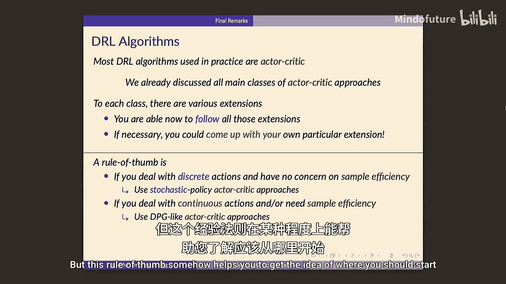

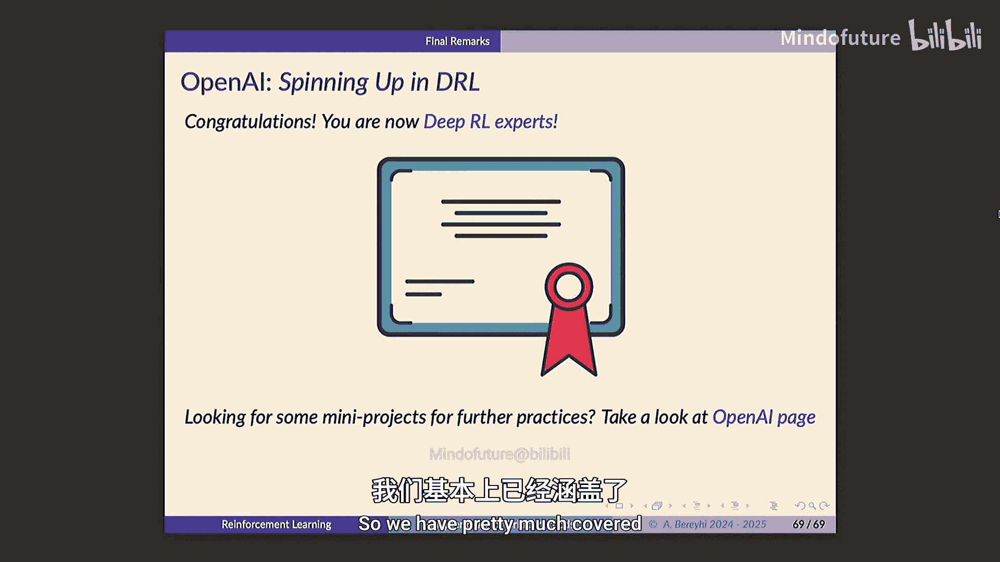

本节课中我们一起学习了柔性演员-评论家方法的基本思想。它通过将策略的熵作为额外奖励引入优化目标，优雅地平衡了强化学习中的探索与利用矛盾。虽然我们未深入其背后的理论推导，但理解其核心概念——即追求高回报的同时也追求高策略熵——已为我们提供了一种强大的算法设计视角。