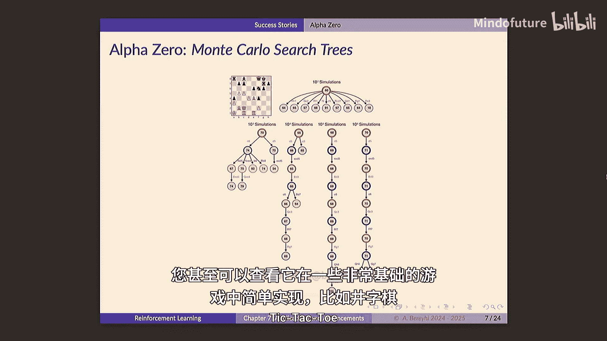
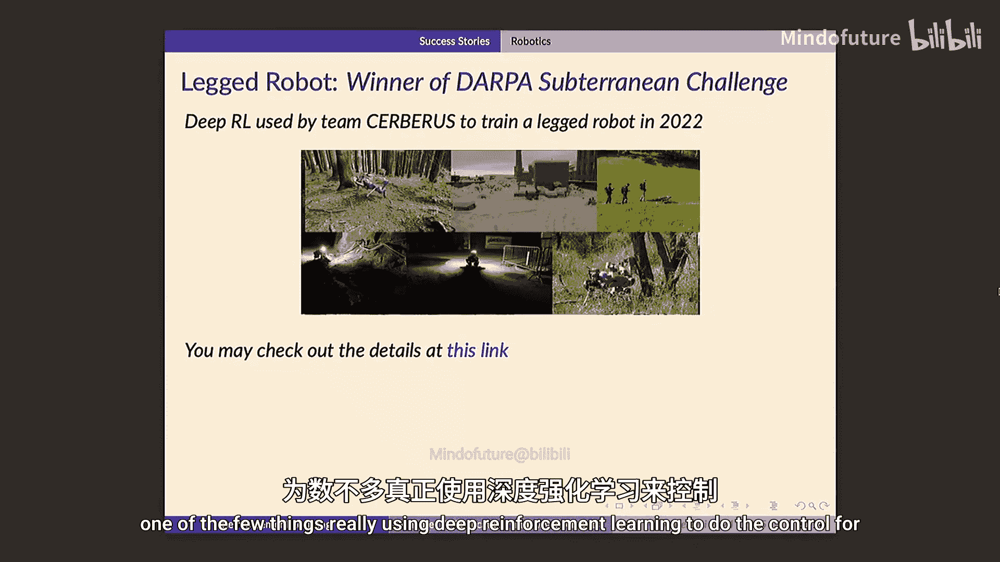
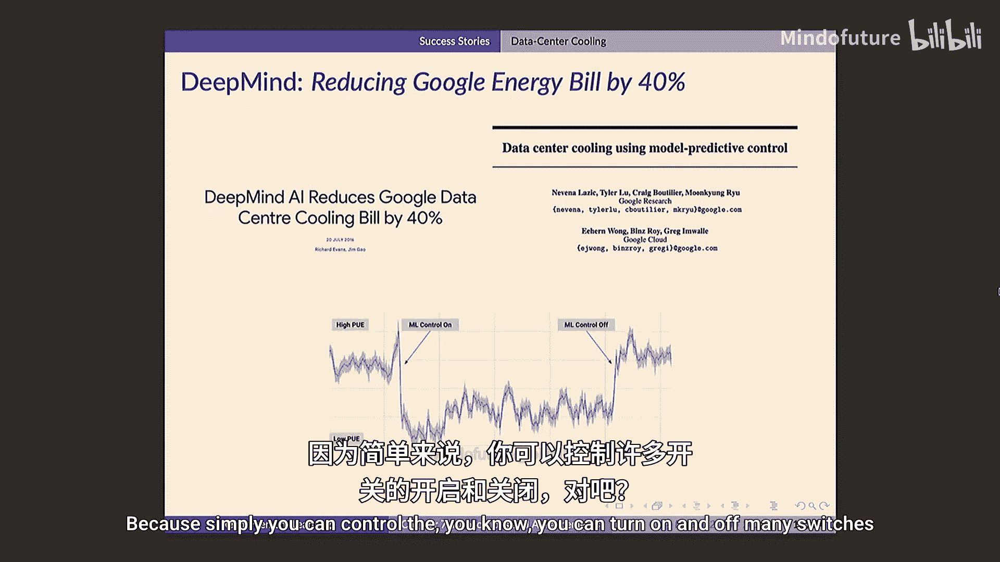
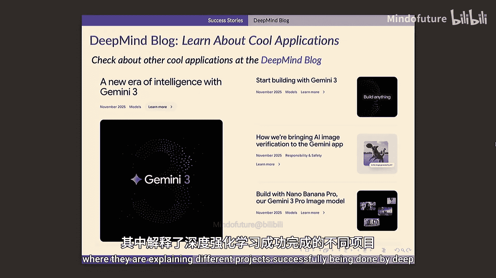
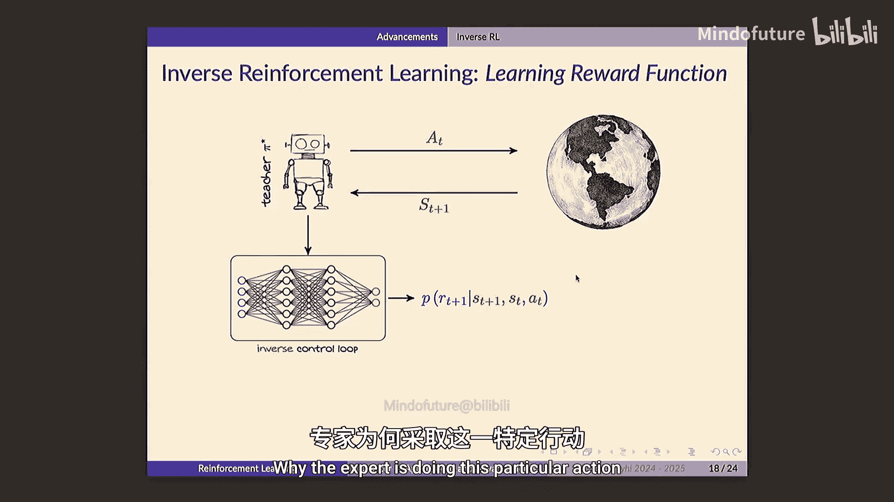

# 058：历史回顾与前沿应用 🚀

在本节课中，我们将回顾强化学习的发展历史，并探讨其在现实世界中的前沿应用与当前面临的挑战。我们将从早期的理论基础开始，一直讲到当今最先进的算法和实际案例。

## 强化学习发展简史 📜

上一节我们介绍了强化学习的核心算法。本节中，我们来看看这门学科是如何发展至今的。

强化学习本身虽然被称为一种“学习”，但其早期研究更多地与随机过程和统计学文献相关。动态规划的概念由理查德·贝尔曼在20世纪50年代提出。到了60年代，出现了无模型方法，研究人员尝试提出一些蒙特卡洛方法来对环境进行估计，此时人们无法获得完整的马尔可夫决策过程模型。

理查德·萨顿在70年代提出了时间差分的思想，他是引入时间差分方法的关键人物。此后，这一领域在很长一段时间内未被深入探索。主要原因是当时人们主要考虑表格化方法，从那个角度来看，其能力相当有限。

在此期间，萨顿和威廉姆斯等人进行了大量开发工作，但他们始终专注于线性模型。原因显而易见，当时深度网络并不流行，并且在强化学习中训练深度网络要困难得多。

深度Q学习的概念在2013年被引入，当时DeepMind团队开始研究它。此后，强化学习领域迎来了爆发式增长，涌现出大量方法和研究成果。TRPO和PPO算法在2015年左右由OpenAI团队提出。OpenAI随后致力于在不同领域推广强化学习的应用。

## 两大研究机构的竞争与合作 🤝

OpenAI关注的一个关键领域是使用强化学习来微调或训练语言模型，这很合理，因为他们专注于语言模型。而DeepMind最初是一个独立的研究小组，后来被谷歌收购，他们更感兴趣的是将深度强化学习应用于控制等领域。这两大机构之间存在竞争。

以下是关于DeepMind的关键时间线：
*   **2010年**：DeepMind团队成立，开始研究深度强化学习。
*   **2013年**：在《自然》杂志上发表深度Q网络论文，这是一个突破。
*   **2015年**：AlphaGo被推出，这是一个能够下围棋的程序。
*   **2017年**：推出AlphaGo Zero，这是一个仅训练24小时就能击败围棋世界冠军的程序，其能力后来扩展到包括国际象棋在内的多种棋类游戏。

这些成果的主要作者大卫·西尔弗也有自己的在线讲座。OpenAI在2018年左右开始崭露头角，他们对使用强化学习训练语言模型感兴趣，因此更专注于策略梯度方法，如PPO和TRPO。在某些时候，这两大机构也开始合作。

## 深度强化学习的成功应用案例 🏆

上一节我们回顾了历史，本节中我们来看看深度强化学习取得的一些标志性成功。

AlphaZero并不纯粹使用强化学习，它内部仍然结合了树搜索。传统的游戏引擎主要依赖树搜索，但搜索完整的游戏树在计算上是不可行的。强化学习的关键贡献在于显著减少了所需的搜索量。

除了游戏，深度强化学习在其他领域也有成功应用：
*   **机器人控制**：例如DARPA挑战赛中的腿式机器人，使用深度强化学习进行运动控制。
*   **工业控制**：例如，DeepMind曾使用深度强化学习为谷歌数据中心的冷却系统编写控制算法，显著降低了能耗。

## 当前挑战与扩展话题 🧩

尽管取得了成功，深度强化学习在应用范围上仍然有些局限，不像深度学习那样广泛。主要原因是样本效率问题。从环境中收集样本，并在深度Q学习中构建标签，这些标签在初期质量很差，需要大量样本才能达到可接受的水平。如果与环境交互采样受到限制，就会限制我们能做的事情。

此外，还有一些在研究中经常出现的问题值得了解：
*   **稀疏奖励问题**：许多问题（如围棋、自动驾驶）的奖励信号非常稀疏，智能体需要完成很长的轨迹才能获得一次奖励。
*   **奖励塑形**：一种解决方案是修改奖励函数，在轨迹中间添加额外的奖励信号，以引导智能体更快学习。
*   **模仿学习**：另一种思路是模仿专家行为。最简单的方法是行为克隆，这本质上是一个监督学习问题，即让智能体的策略网络尽可能复制专家的动作。这可以作为强化学习训练的一个良好起点。
*   **逆强化学习**：当拥有专家策略但不知道其背后的奖励函数时，逆强化学习试图从专家的行为轨迹中推断出潜在的奖励函数。

## 总结 📝

本节课中，我们一起学习了强化学习从动态规划、时间差分的理论基础，到深度Q网络、策略梯度等现代算法的发展历程。我们回顾了DeepMind和OpenAI两大机构在推动领域发展中的关键贡献，并探讨了AlphaGo、机器人控制、能耗优化等成功应用案例。最后，我们也指出了当前面临的样本效率、稀疏奖励等挑战，并简要介绍了奖励塑形、模仿学习和逆强化学习等扩展方向。强化学习仍在快速发展中，并在解决复杂序列决策问题上展现出巨大潜力。