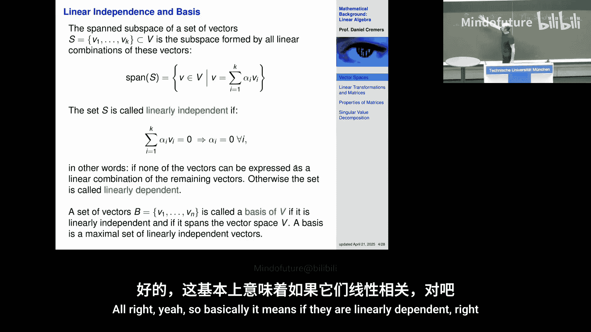
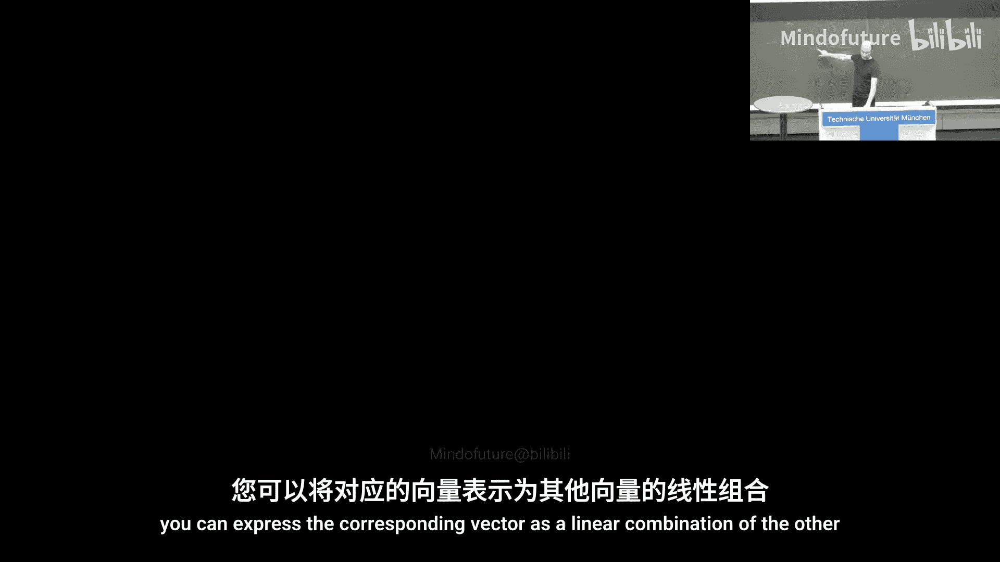
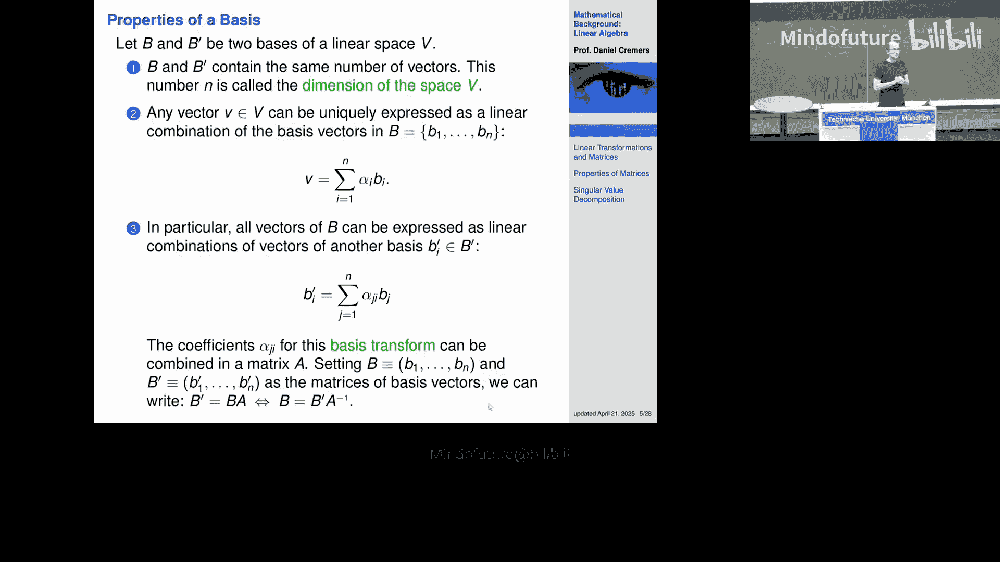
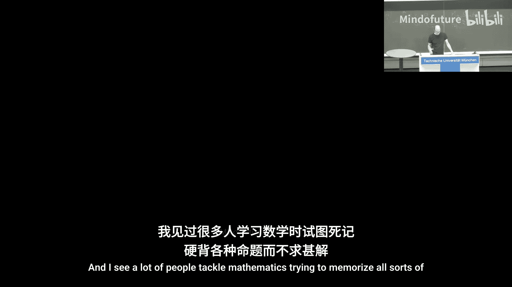
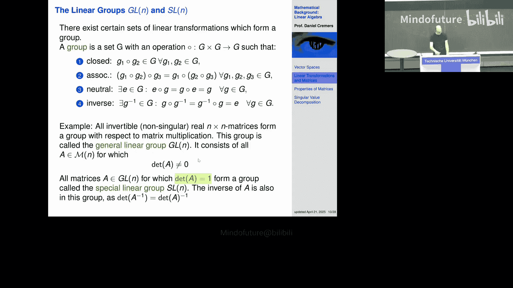

# 002：数学背景 - 线性代数（第一部分）📐

在本节课中，我们将学习多视角几何课程所需的数学基础，重点是线性代数。线性代数是理解3D计算机视觉和许多其他科学领域的核心工具。我们将从向量空间的基本概念开始，逐步深入到线性变换和矩阵群。

## 概述

线性代数为我们提供了一套强大的工具，用于描述和处理线性空间中的对象和变换。在3D计算机视觉中，我们经常需要处理从图像中重建三维世界的问题，这本质上涉及大量的矩阵运算和线性变换。因此，扎实的线性代数基础至关重要。

## 向量空间与子空间

上一节我们介绍了课程的整体目标，本节中我们来看看线性代数的基石——向量空间。

一个集合 **V** 被称为在实数域 **R** 上的**线性空间**或**向量空间**，如果它满足以下条件：
*   对向量加法封闭：对于任意 **u, v ∈ V**，有 **u + v ∈ V**。
*   对标量乘法封闭：对于任意 **α ∈ R** 和 **v ∈ V**，有 **αv ∈ V**。
*   关于加法构成一个**阿贝尔群**（交换群），即存在零向量，且每个向量都有逆元。
*   标量乘法满足结合律和分配律。

一个常见的例子是 **R³**（三维空间）。在该空间中，你可以将两个向量相加，或用一个实数缩放一个向量，结果仍然是一个三维向量。

**子空间**是向量空间的一个子集，但它本身也必须是一个向量空间。这意味着它对加法和标量乘法也必须是封闭的。例如，在 **R³** 中，任何通过原点的平面都是一个子空间。如果平面不通过原点，则它不包含零向量，因此不是一个子空间。

## 线性无关、张成空间与基

理解了向量空间的结构后，我们需要一种有效的方式来描述其中的向量。这引出了线性无关和基的概念。





给定一组向量 **S = {v₁, v₂, ..., vₖ}**，它们的**张成空间**是所有可能的线性组合构成的集合：
**span(S) = { α₁v₁ + α₂v₂ + ... + αₖvₖ | αᵢ ∈ R }**

这组向量被称为**线性无关**的，如果方程 **α₁v₁ + α₂v₂ + ... + αₖvₖ = 0** 的唯一解是所有系数 **αᵢ = 0**。直观上，线性相关意味着集合中至少有一个向量是“冗余”的，它可以表示为其他向量的线性组合。例如，如果 **αⱼ ≠ 0**，那么向量 **vⱼ** 可以表示为：
**vⱼ = - (1/αⱼ) Σ_{i≠j} αᵢ vᵢ**

**基**是向量空间的一个特殊集合，它需要满足两个条件：
1.  线性无关。
2.  能够张成整个向量空间（即 `span(基) = V`）。

基也可以被定义为**极大线性无关组**，即无法再添加任何向量而保持线性无关的集合。向量空间的**维数**定义为基中向量的数量。例如，**R³** 的维数是3，一组可能的基（称为标准基）是：
**e₁ = (1, 0, 0)^T, e₂ = (0, 1, 0)^T, e₃ = (0, 0, 1)^T**

基的一个重要性质是，向量空间中的**每一个向量都可以唯一地**表示为基向量的线性组合。如果我们有两组不同的基 **B** 和 **B'**，那么存在一个唯一的、可逆的**基变换矩阵 A**，使得：
**B' = B A**
这意味着新基中的每个向量都可以表示为旧基向量的线性组合，其系数构成了矩阵 **A** 的列。

## 内积、范数与度量





在向量空间中定义了基之后，我们还可以引入度量长度和角度的工具，即内积。

向量空间 **V** 上的一个**内积**（或点积）是一个映射 **<·, ·> : V × V → R**，它满足以下性质：
1.  **线性**： ** = α + β**
2.  **对称性**： ** = **
3.  **正定性**： ** ≥ 0**，且 ** = 0** 当且仅当 **v = 0**

在 **Rⁿ** 中，最常见的**标准内积**定义为：对于 **x = (x₁, ..., xₙ)^T**, **y = (y₁, ..., yₙ)^T**，
** = x₁y₁ + x₂y₂ + ... + xₙyₙ**

由内积可以诱导出向量的**范数**（长度）：
**||v|| = √**
以及向量间的**距离**（度量）：
**d(v, w) = ||v - w||**
这种由内积诱导出度量的空间称为**希尔伯特空间**。标准内积诱导的范数称为**L2范数**或**欧几里得范数**。

如果两个向量的内积为零，** = 0**，则称它们**正交**。

当我们进行基变换 **B' = B A** 时，标准内积在新基下的坐标表示会发生变化。如果 **x = B x_coord**, **y = B y_coord**，且 **x_coord' = A⁻¹ x_coord**, **y_coord' = A⁻¹ y_coord**，那么内积可以写为：
** = (x_coord')^T (A^T A) y_coord'**
矩阵 **A^T A** 定义了在新坐标下的**诱导内积**。

## 克罗内克积与向量化

在处理矩阵运算时，有两个有用的符号工具。

**克罗内克积** 适用于任意两个矩阵。设 **A** 是 **m×n** 矩阵，**B** 是 **p×q** 矩阵，它们的克罗内克积 **A ⊗ B** 是一个 **mp×nq** 的分块矩阵：
```
A ⊗ B = [ a₁₁B  a₁₂B ... a₁ₙB
          a₂₁B  a₂₂B ... a₂ₙB
          ...   ...  ... ...
          aₘ₁B  aₘ₂B ... aₘₙB ]
```

**向量化** 操作 `vec(A)` 是将矩阵 **A** 的所有列依次堆叠起来，形成一个长列向量。例如，若 **A = [a₁, a₂, ..., aₙ]**，则 `vec(A) = (a₁^T, a₂^T, ..., aₙ^T)^T`。

这两个操作有时可以简化表达式。例如，一个双线性形式 **u^T A v** 可以重写为向量内积：
**u^T A v = (v ⊗ u)^T vec(A)**

## 线性变换与矩阵表示

线性代数的核心是研究线性变换。一个从向量空间 **V** 到 **W** 的映射 **L: V → W** 称为**线性变换**，如果它满足：
1.  **L(u + v) = L(u) + L(v)** （保持加法）
2.  **L(αv) = α L(v)** （保持标量乘法）

线性变换有一个关键性质：它完全由它对**基向量**的作用所决定。设 **{v₁, ..., vₙ}** 是 **V** 的一组基，那么对于任意向量 **x = Σ αᵢ vᵢ**，有：
**L(x) = L(Σ αᵢ vᵢ) = Σ αᵢ L(vᵢ)**
因此，只要我们知道了 **L(v₁), ..., L(vₙ)**，就知道了整个变换。

如果我们为 **V** 和 **W** 分别选定基（例如标准基），那么每个 **L(vᵢ)** 在 **W** 的基下可以表示为一个坐标向量。将这些坐标向量作为列，就得到了线性变换 **L** 的**矩阵表示 A**。此时，变换运算就等价于矩阵乘法：
**L(x) = A x**
所有从 **Rⁿ** 到 **Rᵐ** 的线性变换构成的集合，等同于所有 **m×n** 实矩阵的集合，记作 **M(m, n)**。

## 矩阵群：GL(n) 与 SL(n)

当矩阵是方阵（**n×n**）时，我们不仅可以做加法和标量乘法，还可以做矩阵乘法。这带来了更丰富的代数结构。

一个**群**是一个集合 **G** 配上一个二元运算（如乘法），满足：
1.  **封闭性**： 对于任意 **g₁, g₂ ∈ G**，有 **g₁ g₂ ∈ G**。
2.  **结合律**： **(g₁ g₂) g₃ = g₁ (g₂ g₃)**。
3.  **单位元存在**： 存在 **e ∈ G**，使得对任意 **g ∈ G**，有 **e g = g e = g**。
4.  **逆元存在**： 对任意 **g ∈ G**，存在 **g⁻¹ ∈ G**，使得 **g g⁻¹ = g⁻¹ g = e**。

在矩阵中，所有**可逆**的 **n×n** 实矩阵（即行列式非零的矩阵）关于矩阵乘法构成一个群，称为**一般线性群**，记作 **GL(n)** 或 **GL(n, R)**。

进一步，所有行列式为1的 **n×n** 可逆实矩阵也构成一个群，称为**特殊线性群**，记作 **SL(n)**。它是 **GL(n)** 的一个子群，因为两个行列式为1的矩阵相乘，其行列式仍为1；可逆矩阵的逆的行列式也为1。

## 总结



本节课我们一起回顾了线性代数的核心基础。我们首先定义了**向量空间**和**子空间**，然后引入了**线性无关**、**张成空间**和**基**的概念，这些是描述向量空间结构的工具。接着，我们通过**内积**定义了向量的长度、角度和距离，从而得到了度量空间。我们还介绍了**克罗内克积**和**向量化**这两个有用的矩阵操作符号。最后，我们探讨了**线性变换**的实质及其与**矩阵**的一一对应关系，并了解了由可逆矩阵构成的**一般线性群 GL(n)** 和**特殊线性群 SL(n)**。这些概念是理解后续多视角几何中复杂模型和算法的基石。