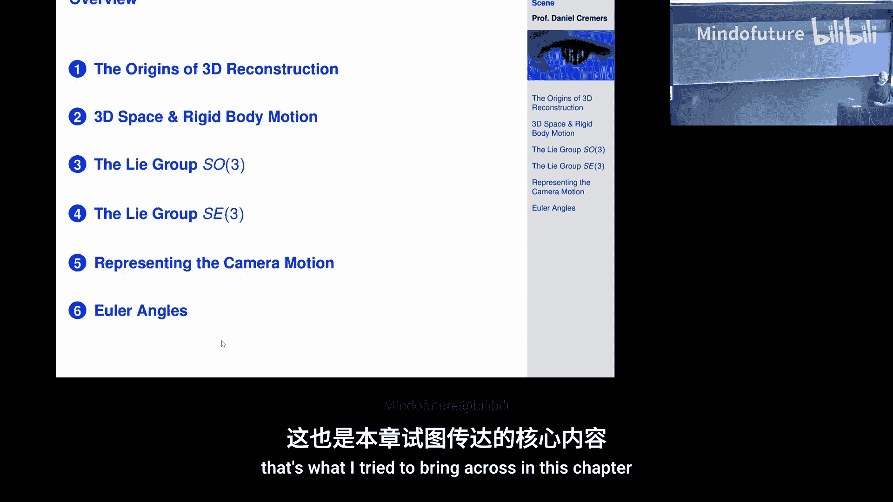
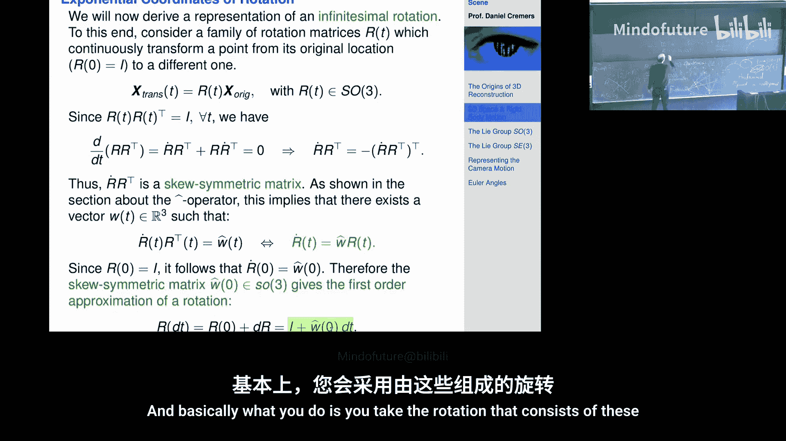
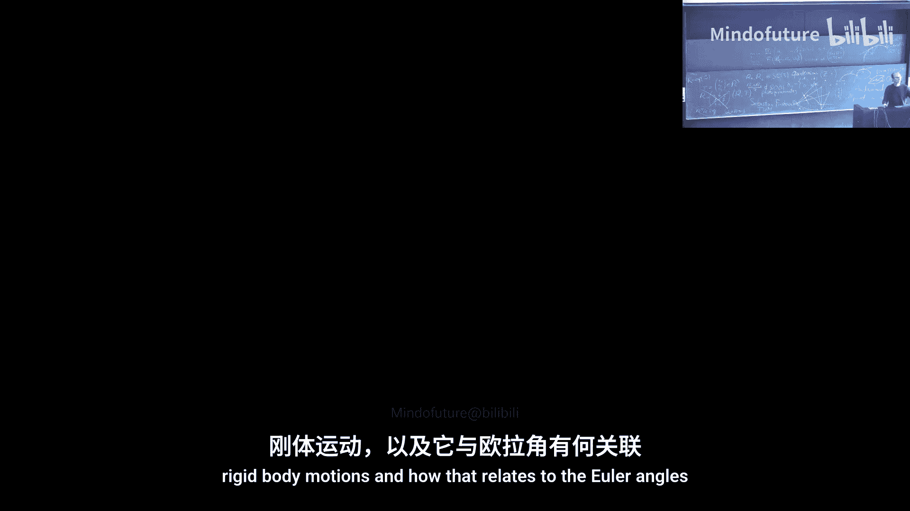

# 004：表示动态场景（第1部分）




在本节课中，我们将要学习如何从移动的相机中重建三维世界。首先，我们需要解决一个核心挑战：如何用数学方法表示相机的运动。这是计算机视觉中的一个基本问题，因为相机在观察世界时总是在移动。本节课我们将从线性代数的基础知识出发，深入探讨如何对相机的运动进行建模。

## 历史背景与问题定义

上一节我们回顾了线性代数的基础知识，本节中我们来看看三维重建问题的历史背景和数学定义。

从图像中重建世界是一个历史悠久的目标。早在计算机出现之前，古希腊人（约公元前400年）就开始研究透视投影。到了文艺复兴时期，透视投影的研究催生了射影几何学这一领域。

从数学上讲，从图像进行三维重建通常被视为一个“不适定问题”。这个概念由数学家哈达玛提出。一个“适定问题”需要满足三个条件：
1.  解存在。
2.  解唯一。
3.  解对输入数据的微小扰动是稳定的。

如果其中任何一个条件不满足，问题就是“不适定的”。三维重建通常是不适定的，因为仅凭稀疏的图像集，通常存在无限多种可能的三维结构都能产生相同的图像。因此，为了获得有意义的重建结果，我们通常需要引入额外的假设（例如，在所有可能的重建中，哪一个是最有可能的）。

三维重建的几何关系研究基于两个核心变换，我们将在后续章节中分别讨论：
1.  **相机运动**：使用欧几里得运动或刚体运动（即 SE(3) 群）的概念建模。
2.  **透视投影**：描述三维点如何投影到二维图像平面（例如针孔相机模型）。

一个里程碑式的成果是奥地利数学家埃贡·克劳尔在1913年的证明：如果已知**五个点**在两个图像中的对应关系，就可以重建出相机的运动（旋转和平移）以及这五个点的三维位置，尽管解可能不唯一（存在有限多个解）。这个成果远在计算机出现之前。

## 刚体运动

现在，让我们更具体地探讨相机（或任何刚体）的运动。这种运动被称为**刚体运动**。

刚体运动是一种保持物体“刚性”的变换。这意味着它必须保持点之间的距离、向量之间的角度以及体积不变。更正式地说，刚体运动是一个映射 **g: R³ → R³**，它满足以下两个条件：
1.  **保持长度**：对于任意向量 **v**，有 `||g(v)|| = ||v||`。
2.  **保持叉积**：对于任意向量 **u**, **v**，有 `g(u × v) = g(u) × g(v)`。

从这些条件可以推导出，刚体运动也必然保持点积（从而保持角度）和混合积（从而保持体积）。

一个关键的结论是：**任何满足上述条件的刚体运动，其形式必然是旋转和平移的组合**。也就是说，对于三维空间中的点 **x**，刚体运动可以表示为：
`g(x) = R * x + t`
其中 **R** 是一个 3x3 的**旋转矩阵**（属于 SO(3) 群），**t** 是一个 3x1 的**平移向量**。

平移部分（**t**）很简单，只有三个自由度。而旋转部分（**R**）则复杂得多。一个 3x3 矩阵有 9 个参数，但它们必须满足严格的约束：`RᵀR = I`（正交性）且 `det(R) = +1`。这些是非线性约束，在优化问题中很难直接处理。因此，我们需要寻找更好的旋转表示方法。

## 李群与李代数

为了解决旋转矩阵的参数化问题，我们引入**李群**和**李代数**的概念。这是由挪威数学家索菲斯·李提出的强大数学工具。

**李群** 是一个同时是光滑流形的群，其群运算（乘法和求逆）是光滑映射。简单理解，李群是一种连续的、可以平滑变化的群。**SO(3)**（所有 3x3 旋转矩阵的集合）就是一个典型的李群。

**李代数** 是与李群相关联的线性空间，它是李群在单位元处的**切空间**。对于 SO(3) 群，其李代数记为 **so(3)**，它由所有 3x3 的**反对称矩阵**组成。
一个反对称矩阵 **W** 满足 `Wᵀ = -W`，其形式如下：
```
W = [  0, -w₃,  w₂]
    [ w₃,   0, -w₁]
    [ -w₂, w₁,   0]
```
它实际上只由三个参数 `(w₁, w₂, w₃)` 决定。我们可以定义一个“帽”算子 `(·)^` 将向量映射为反对称矩阵：
`w = (w₁, w₂, w₃)ᵀ  →  ŵ` （即上面的矩阵）。

那么，李代数 so(3) 和李群 SO(3) 之间有什么联系呢？考虑一个随时间变化的旋转矩阵 **R(t)**，且 **R(0) = I**。由于 `R(t)R(t)ᵀ = I`，对时间求导可得：
`Ṙ(t)R(t)ᵀ + R(t)Ṙ(t)ᵀ = 0`
由此可以推导出一个重要的微分方程：
`Ṙ(t) = ŵ(t) * R(t)`
其中 `ŵ(t)` 是一个反对称矩阵。在初始时刻 `t=0`，有 `Ṙ(0) = ŵ`。这意味着，**旋转矩阵的瞬时变化率由一个反对称矩阵（即李代数 so(3) 中的元素）给出**。

这个微分方程的解可以用矩阵指数来表示：
`R(t) = exp(ŵ * t)`
这里，`exp()` 是矩阵指数函数。这个公式建立了从李代数（反对称矩阵 **ŵ**）到李群（旋转矩阵 **R**）的映射，称为**指数映射**。

反之，从旋转矩阵 **R** 也可以找到对应的反对称矩阵 **ŵ**，使得 `R = exp(ŵ)`。这个逆过程称为**对数映射**，记为 `ŵ = log(R)`。需要注意的是，对数映射不唯一，因为旋转 `2π` 的整数倍会回到相同的旋转矩阵。

## 罗德里格斯公式

在实际计算中，我们不需要用无穷级数去计算矩阵指数。对于 so(3) 中的元素，有一个封闭形式的解，称为**罗德里格斯旋转公式**。

设有一个反对称矩阵 **ŵ**，其对应的向量为 **w**，令 `θ = ||w||` 为旋转角度，`v = w/θ` 为单位化的旋转轴向量（对应的反对称矩阵为 **v̂**）。那么，指数映射可以精确地计算为：
`R = exp(ŵ) = I + sin(θ) * v̂ + (1 - cos(θ)) * v̂²`
这个公式非常高效，允许我们直接用三个参数 `(w₁, w₂, w₃)` 生成一个合法的旋转矩阵，而无需担心正交性等约束。

## 参数化与优化的优势

使用李代数 so(3) 来表示旋转在优化问题中具有巨大优势：

*   **无约束优化**：旋转矩阵的 9 个参数有 6 个非线性约束。而李代数的 3 个参数 `(w₁, w₂, w₃)` 是**完全自由**的，没有任何约束。我们可以在这三个参数上自由地进行优化。
*   **计算简便**：通过罗德里格斯公式，可以轻松地从这三个参数计算出对应的旋转矩阵 `R = exp(ŵ)`，该矩阵自动满足所有旋转矩阵的性质。
*   **物理意义清晰**：参数 `w` 的模长代表旋转角度，方向代表旋转轴。

因此，在实践中的标准做法是：**在优化时，将旋转表示为李代数 so(3) 中的三个无约束参数，通过指数映射获得旋转矩阵用于计算损失函数，从而将复杂的带约束优化问题转化为简单的无约束优化问题。**

## 总结





本节课中我们一起学习了如何为动态场景（特别是相机运动）建立数学模型。我们从三维重建的历史和不适定性问题入手，明确了刚体运动的定义及其旋转-平移的表示形式。为了有效处理旋转矩阵的复杂约束，我们引入了李群 SO(3) 和李代数 so(3) 的核心概念。李代数是李群在单位元处的切空间，由反对称矩阵构成，它通过指数映射 `exp(ŵ)` 与旋转矩阵相关联，并通过罗德里格斯公式实现高效计算。这种表示法的最大优势在于，它将旋转参数化为三个无约束的自由度，极大地简化了后续基于相机运动进行三维重建的优化过程。在下一节中，我们将把这一框架扩展到完整的刚体运动（即包含平移的 SE(3) 群），并探讨其与欧拉角的关系。