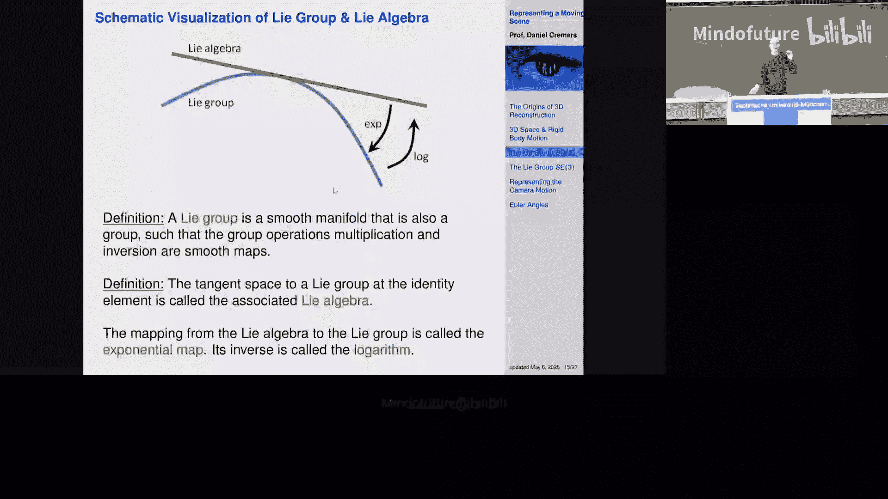
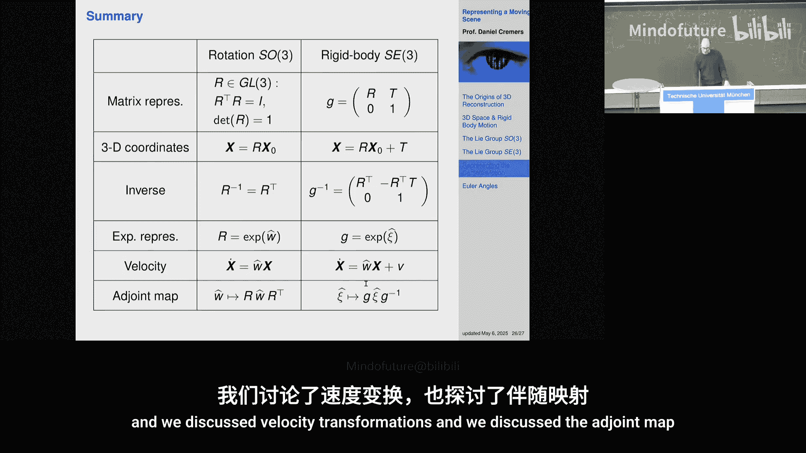
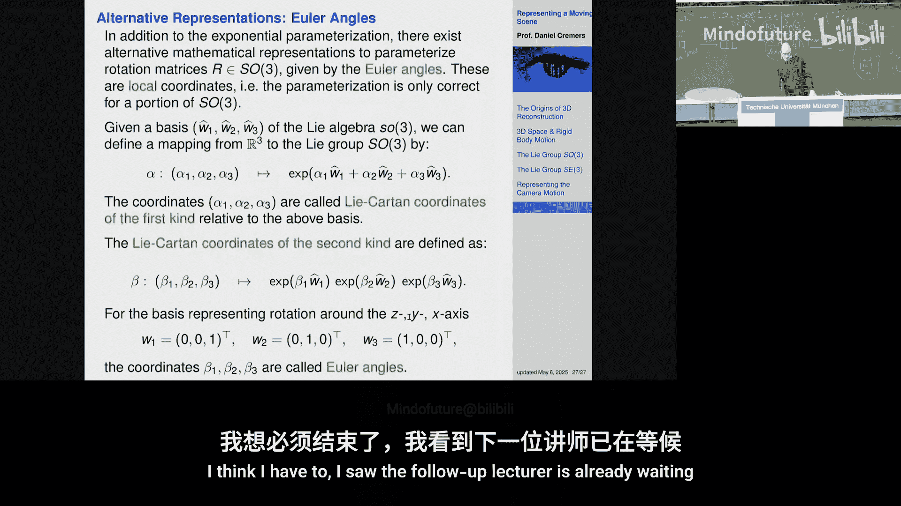
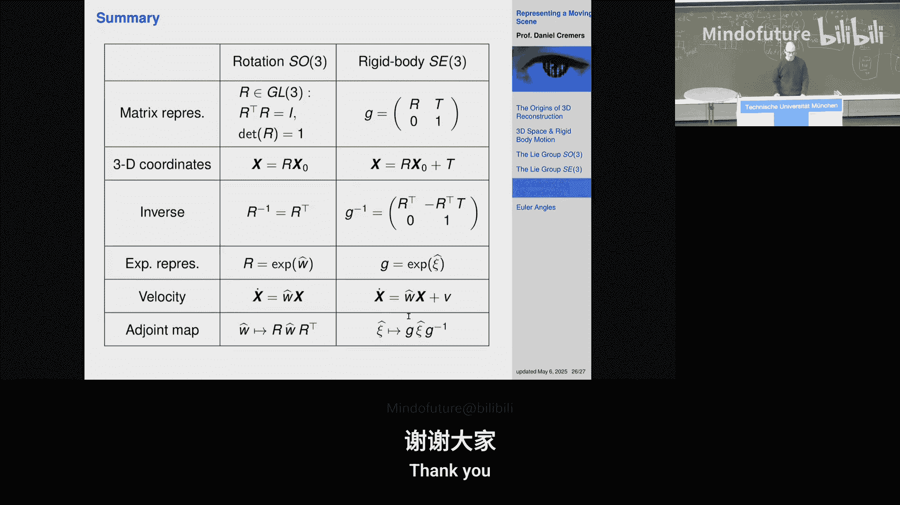

# 005：表示动态场景（第2部分） 👁️



在本节课中，我们将继续学习如何使用李群和李代数来优雅地表示动态场景，特别是刚体运动。我们将从回顾旋转的李群（SO(3)）和李代数（so(3)）开始，然后将其扩展到包含平移的刚体运动群（SE(3)）及其对应的李代数（se(3)）。我们将学习如何通过指数映射将李代数中的元素（称为“扭转”）映射回李群中的刚体运动，并探讨其在相机运动和坐标变换中的应用。

---

## 回顾：旋转的李群与李代数

上一节我们介绍了李群是一个同时是光滑流形的群，例如旋转群SO(3)。它不是线性的，这意味着两个群元素之间的“中间值”不一定是群元素。为了参数化这种非线性空间，我们考虑群在单位元处的切空间，即李代数。

对于旋转群SO(3)，其李代数so(3)是所有3x3反对称矩阵构成的空间。这个空间是三维的。我们通过指数映射将李代数中的元素映射回李群：
`R = exp(Ŵ)`
其中 `Ŵ` 是一个反对称矩阵。这保证了结果 `R` 自动满足正交性（`RᵀR = I`）和行列式为1的约束，从而将带约束的优化问题转化为无约束问题。

指数运算可以通过罗德里格斯公式以闭式解计算：
`exp(Ŵ) = I + sinθ * (Ŵ/θ) + (1 - cosθ) * (Ŵ/θ)²`
其中 `θ = ||W||`，`W` 是 `Ŵ` 对应的三维向量。这避免了计算无穷级数。

---

## 扩展到刚体运动：SE(3) 与 se(3)

本节中，我们来看看如何将上述概念扩展到同时包含旋转和平移的刚体运动。

刚体运动群SE(3)是一个六维李群（三个旋转自由度，三个平移自由度）。其元素可以用齐次坐标下的4x4矩阵表示：
```
    [ R   t ]
G = [       ]
    [ 0   1 ]
```
其中 `R` 是3x3旋转矩阵，`t` 是3维平移向量。

与SO(3)类似，SE(3)也有对应的李代数，称为se(3)。为了找到它，我们考虑一个随时间参数化的刚体运动族 `G(t)`，并计算 `Ġ G⁻¹`。通过推导（类似于对旋转约束求导），我们可以得到：
`Ġ G⁻¹ = ξ̂`
其中 `ξ̂` 是一个具有特定结构的4x4矩阵：
```
        [ Ŵ   v ]
ξ̂ = [         ]
        [ 0   0 ]
```
这里，`Ŵ` 是一个3x3反对称矩阵（来自so(3)），`v` 是一个3维向量。这个矩阵 `ξ̂` 被称为**扭转**。

`ξ̂` 来源于一个六维向量 `ξ = [v, W]ᵀ`，其中 `W` 是角速度向量（描述旋转变化），`v` 是线速度向量（描述平移变化）。`ξ̂` 构成了SE(3)在单位元处的切空间，即李代数se(3)。

---

## 指数映射：从 se(3) 到 SE(3)

与旋转的情况完全类似，我们可以建立从李代数se(3)到李群SE(3)的映射。

我们得到了一个微分方程：`Ġ = ξ̂ G`，其初始条件为 `G(0) = I`。这个方程的唯一解由指数映射给出：
`G = exp(ξ̂)`
这意味着，通过对一个扭转矩阵进行指数运算，我们可以得到对应的刚体运动矩阵。

幸运的是，这个指数运算也有闭式解（证明较长，此处给出结果）：
```
exp(ξ̂) = [ exp(Ŵ)   V v ]
         [                ]
         [   0        1   ]
```
其中：
*   `exp(Ŵ)` 是旋转部分，可用罗德里格斯公式计算。
*   `V` 是一个3x3矩阵，其表达式为 `V = I + ((1 - cosθ)/θ²) Ŵ + ((θ - sinθ)/θ³) Ŵ²`。

这个映射是满射的，意味着对于任何刚体运动 `G ∈ SE(3)`，都存在一个扭转 `ξ̂ ∈ se(3)` 使得 `G = exp(ξ̂)`。其逆映射称为对数映射。与旋转一样，这个映射也不是唯一的（例如，旋转360度的倍数对应相同的刚体运动）。

---

## 应用：表示相机与场景运动

现在，我们来看看如何利用刚体运动表示动态场景，例如移动的相机或物体。

### 坐标变换

假设我们有一个世界点 `X₀`（在世界坐标系中）。一个运动的相机在不同时刻 `t` 观测这个点，该点在相机坐标系中的坐标 `X_t` 由刚体运动给出：
`X_t = G(t) X₀` （在齐次坐标下）
或等价于：
`x_t = R(t) x₀ + t(t)` （在三维坐标下）
其中 `x` 表示三维坐标。

使用齐次坐标和4x4矩阵表示的优势在于，连续的变换可以通过简单的矩阵乘法实现。例如，从时刻 `t1` 到 `t2` 再到 `t3` 的变换为：
`X_{t3} = G_{t3,t2} * X_{t2} = G_{t3,t2} * G_{t2,t1} * X_{t1} = G_{t3,t1} * X_{t1}`
因此有 `G_{t3,t1} = G_{t3,t2} * G_{t2,t1}`。这比分开处理旋转和平移要简洁得多。

逆变换也很简单：`G_{t1,t2} = (G_{t2,t1})⁻¹`。

### 速度变换

考虑一个固定的世界点被运动的相机观测。该点在相机坐标系中的坐标变化率为：
`Ẋ = Ġ X₀`
代入 `X₀ = G⁻¹ X`，我们得到：
`Ẋ = Ġ G⁻¹ X`
而 `Ġ G⁻¹` 正是我们之前定义的扭转 `ξ̂`。因此，观测到的速度可以简洁地写为：
`Ẋ = ξ̂ X`
在三维坐标下，这等价于：
`ẋ = Ŵ x + v`
这个公式描述了由于相机运动（由 `ξ̂` 表示）导致的静态点在图像中表现出的速度场。

### 伴随映射

最后，我们简要介绍一个在文献中常见的概念：伴随映射。

假设有两个坐标系，它们之间通过一个固定的刚体运动 `G` 相关联。如果一个点在第一个坐标系中的速度由扭转 `ξ̂` 描述（即 `ẋ = ξ̂ x`），那么该点在第二个坐标系中的速度则为：
`ẏ = G ξ̂ G⁻¹ y`
这个变换 `ξ̂ → G ξ̂ G⁻¹` 被称为**伴随映射**。它描述了当观察坐标系发生变化时，速度的扭转表示如何相应地变换。

---

## 总结

本节课中我们一起学习了：

1.  **核心概念回顾**：李群（如SO(3)）是光滑流形，其李代数（如so(3)）是单位元处的切空间。指数映射 `exp` 和对数映射 `log` 在它们之间建立联系。
2.  **刚体运动的李群SE(3)**：用4x4齐次矩阵表示旋转和平移，形成一个六维李群。
3.  **对应的李代数se(3)**：由称为“扭转”的4x4矩阵构成，形式为 `[Ŵ, v; 0, 0]`，其中 `Ŵ` 来自so(3)，`v` 是三维向量。它代表了瞬时旋转和平移（角速度和线速度）。
4.  **指数映射的闭式解**：`exp(ξ̂)` 可以直接计算，无需无穷级数，其中旋转部分用罗德里格斯公式。
5.  **应用**：
    *   使用 `G(t)` 表示相机或物体的运动轨迹。
    *   坐标变换通过矩阵乘法简洁完成：`X_new = G * X_old`。
    *   静态点因相机运动而产生的观测速度：`ẋ = Ŵ x + v`。
    *   伴随映射 `ξ̂ → G ξ̂ G⁻¹` 描述了速度表示在不同坐标系间的变换。







通过使用李代数表示，我们将刚体运动的估计问题转化为对无约束的六维参数向量 `ξ` 的优化问题，这在实践中非常有效。