# 006：透视投影

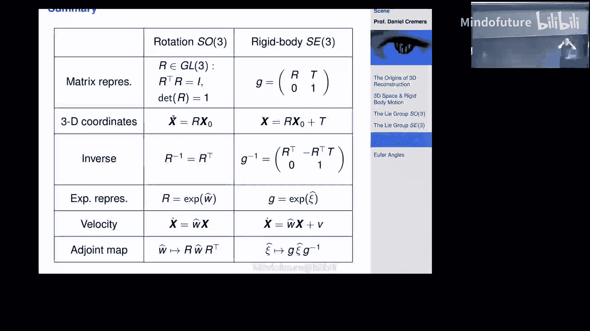

在本节课中，我们将要学习透视投影的基本原理。这是图像形成过程的第二个核心要素，它描述了三维世界中的点如何被映射到二维相机屏幕上。我们将从历史背景入手，探讨其数学模型，并介绍相关的核心概念，如相机参数、径向畸变以及前像与共像。

## 历史背景与艺术中的透视

上一节我们介绍了刚体运动，本节中我们来看看相机如何观察世界。透视投影的研究已有数千年历史。早在公元前4世纪，欧几里得等人就已开始研究图像形成的几何原理。在庞贝古城的壁画和镶嵌画中，也能找到部分正确的透视投影实例。

然而，随着罗马帝国的衰落，许多古代知识一度失传。直到文艺复兴时期，艺术家们才重新发现了透视法则。例如，阿尔贝蒂于1435年撰写的《论绘画》阐述了透视投影的规律。艺术家们如布鲁内莱斯基、多纳泰罗、达·芬奇等，深入研究了光线与物质的相互作用以及透视原理，创作出极具真实感的作品。

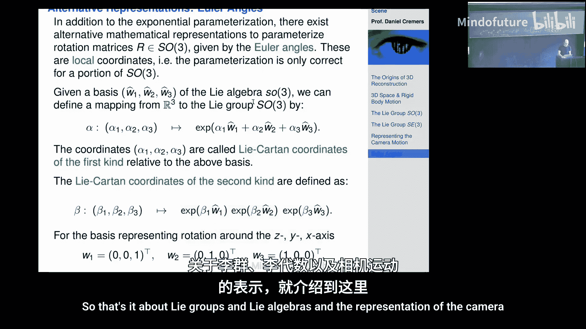

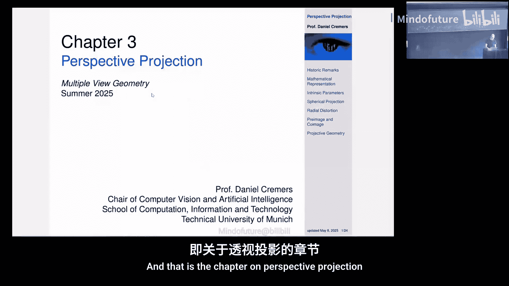

透视投影在艺术中不仅用于创造真实感，有时也被用于制造视觉错觉，例如荷兰艺术家M.C.埃舍尔的作品，就巧妙地运用并超越了透视法则的极限。

## 透视投影的数学模型

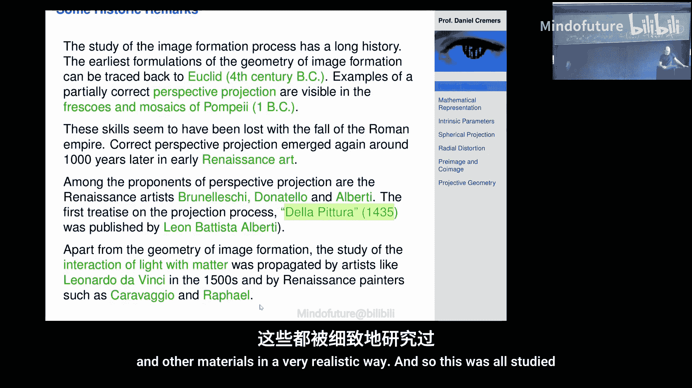

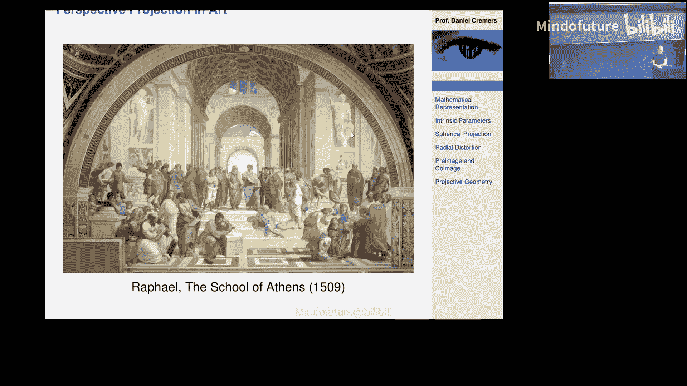

现在，我们从艺术转向机器，探讨如何用数学建模透视投影。最简单的模型是**针孔相机模型**。

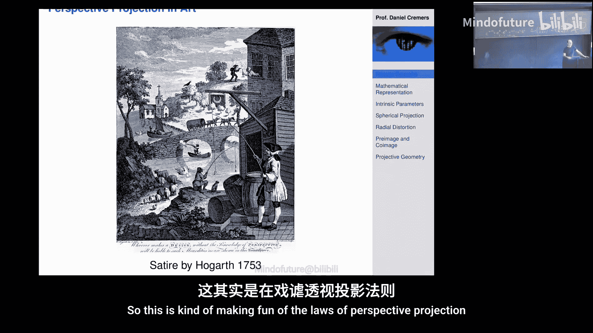

在针孔相机中，光线通过一个小孔（投影中心）投射到后面的成像平面上。对于一个三维空间点 **X = (X, Y, Z)^T**，其在成像平面上的投影点 **x** 的坐标为：
```
x = f * X / Z
y = f * Y / Z
```
其中，**f** 是焦距，即投影中心到成像平面的距离。在实际相机中，成像平面位于投影中心后方，因此公式中会有一个负号，但为简化，我们通常假设成像平面前置。

这个投影方程是非线性的，因为涉及除以 Z 坐标。为了在计算中方便处理，我们引入**齐次坐标**。

我们将三维点表示为齐次坐标 **X̃ = (X, Y, Z, 1)^T**。那么，投影过程可以写成一个看似线性的形式：
```
λ * x̃ = K * Π₀ * G * X̃₀
```
其中：
*   **λ** 是一个比例因子，实际上就是该点的 Z 坐标值。
*   **G** 是一个 4x4 矩阵，表示将世界坐标系下的点变换到相机坐标系下的刚体运动（外参）。
*   **Π₀** 是标准投影矩阵 `[I | 0]`，用于去掉齐次坐标的最后一维。
*   **K** 是相机**内参矩阵**，包含焦距、像素缩放等因素。

因此，完整的投影矩阵 **Π** 可以写为 **Π = K * Π₀ * G**。尽管方程形式是线性的，但关键的**非线性**隐藏在比例因子 λ 中，因为它依赖于三维点的深度 Z。

## 相机参数：内参与外参

相机参数分为**内参**和**外参**。

*   **外参**：描述相机在世界中的位置和朝向，即刚体运动 **G**，包含旋转 **R** 和平移 **t**。
*   **内参**：描述相机内部的成像特性，即矩阵 **K**。

内参矩阵 **K** 的一般形式如下：
```
K = [ α_x,   s,   o_x;
       0,  α_y,   o_y;
       0,    0,     1 ]
```
以下是各参数的含义：
*   **α_x = f * s_x** 和 **α_y = f * s_y**：分别表示 x 和 y 方向上的焦距（以像素为单位）。它们的比值 **α_x / α_y** 称为图像的**宽高比**。
*   **o_x, o_y**：**主点**的坐标（以像素为单位），即光轴与成像平面的交点。通常位于图像中心附近。
*   **s**：**倾斜因子**，用于描述像素非矩形时的畸变，对于标准矩形像素，其值应为 0。

在实际应用中，尤其是处理网络下载的图片或视频时，我们可能不知道这些内参，这就需要通过算法从图像本身进行估计，这是一个具有挑战性的研究问题。

## 透镜畸变与校正

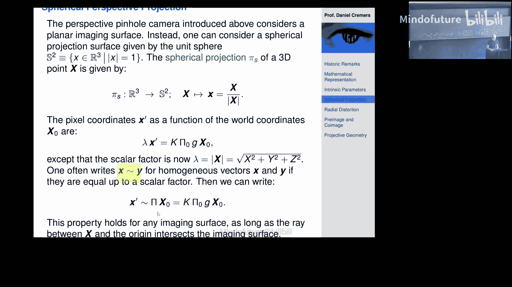

真实的相机使用透镜而非针孔，这引入了光学畸变，最常见的是**径向畸变**。在使用广角或鱼眼镜头时，直线在图像中会呈现弯曲。

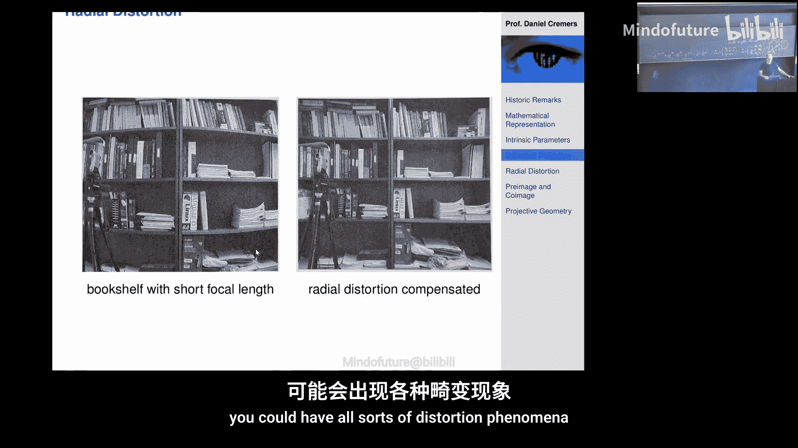

径向畸变可以用模型来校正。假设观测到的畸变点坐标为 **(x_d, y_d)**，其到畸变中心（通常假设为主点）的距离为 **r = sqrt(x_d² + y_d²)**。校正后的坐标 **(x_u, y_u)** 可以通过以下模型计算：
```
x_u = x_d * (1 + a₁ * r² + a₂ * r⁴ + ...)
y_u = y_d * (1 + a₁ * r² + a₂ * r⁴ + ...)
```
参数 **a₁, a₂, ...** 描述了畸变的程度。要确定这些参数，通常需要已知一些对应点（例如，使用棋盘格标定板），然后通过**最小二乘法**拟合求解。这是一个线性拟合问题，因为待求参数在方程中是线性的。

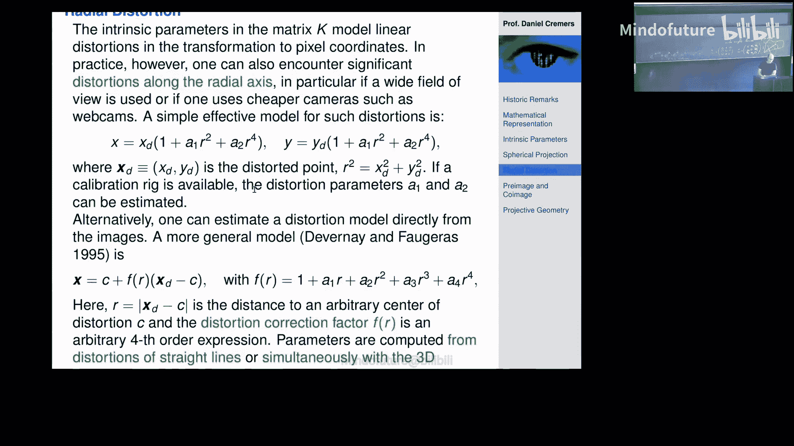

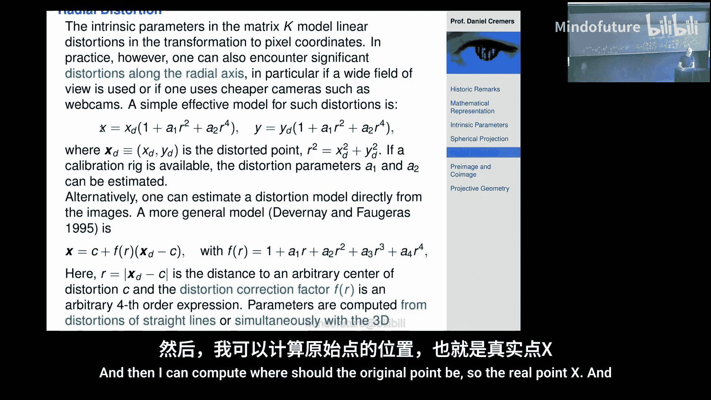

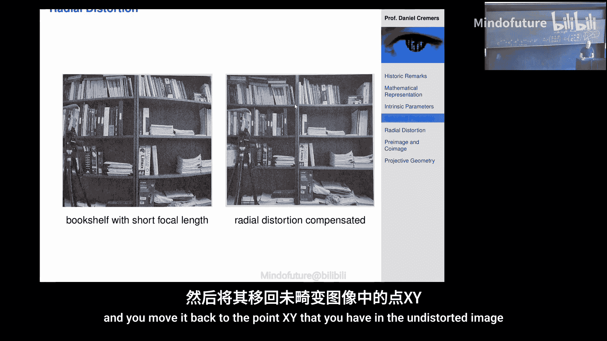

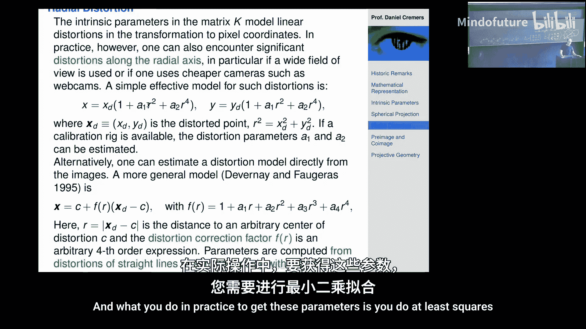

更先进的算法可以尝试在没有标定板的情况下，通过假设图像中的直线应该是直的这一先验知识，同时进行三维重建和畸变校正。

## 前像与共像

透视投影是一个“多对一”的映射，我们失去了深度信息。因此，图像中的一个点可以对应三维空间中一整条射线上的所有点。这个概念引出了**前像**的定义。

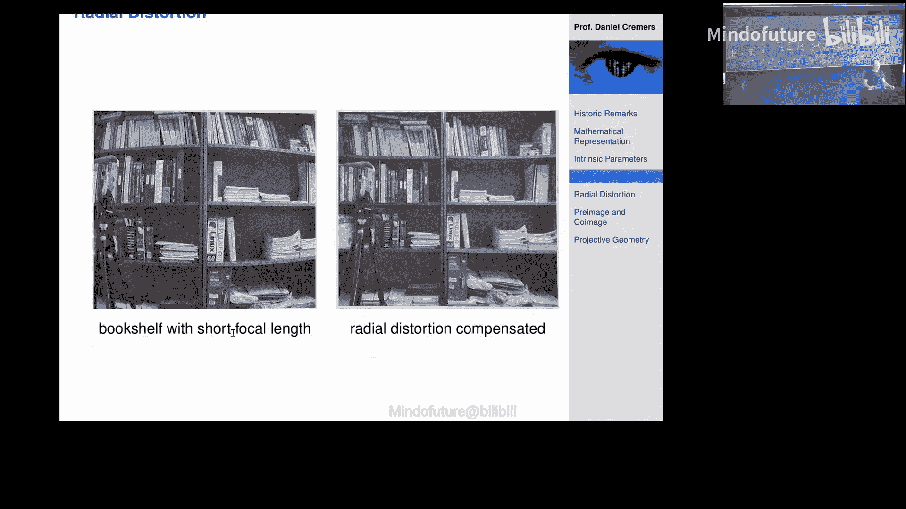

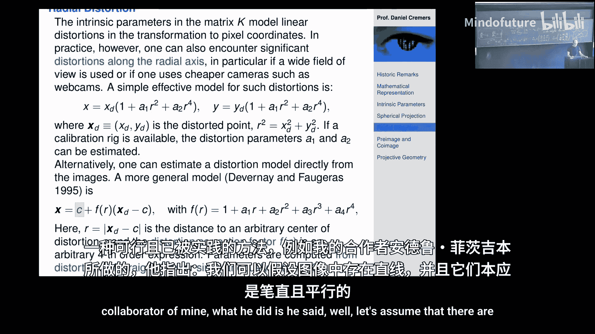

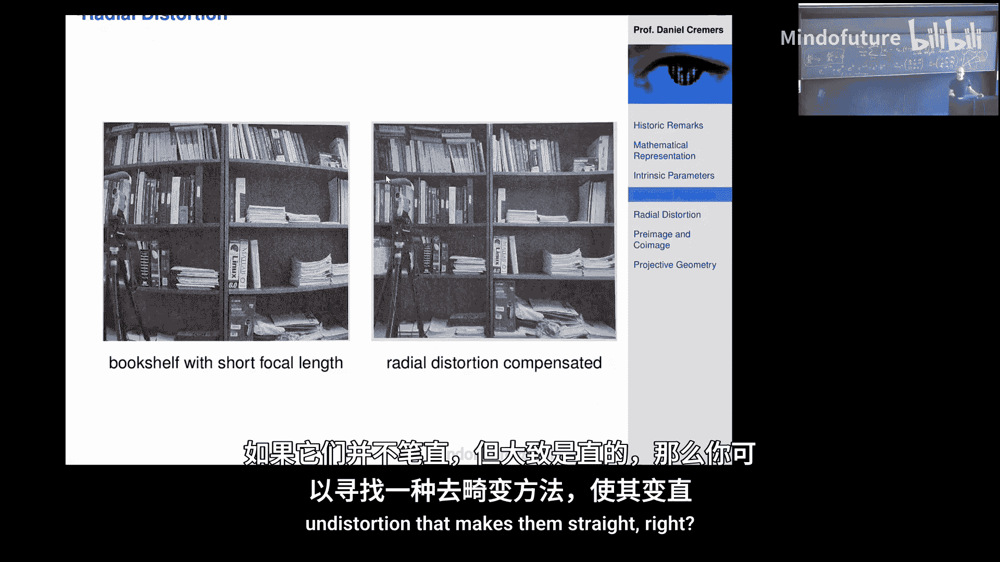

以下是相关概念的定义：
*   **点的前像**：给定图像中的一个点 **x**，其**前像**是所有能投影到该点的三维点的集合。在针孔模型中，这条线就是连接投影中心与该图像点的射线。
*   **线的共像**：给定图像中的一条线 **l**（在齐次坐标下表示为三维向量），其**前像**是一个平面，该平面由投影中心和图像线 **l** 所张成。这个平面的法向量 **l** 被称为该图像线的**共像**。

前像和共像是互补的概念。对于图像点 **x**，其前像是射线，共像是垂直于该射线的平面（由 **x̂** 的行向量张成）。对于图像线 **l**，其前像是平面，共像是该平面的法线 **l**。

它们之所以有用，是因为在从多视图进行三维重建时，我们可以将来自不同视角的同一点（或线）的前像（或共像）相交，从而确定其在三维空间中的位置。

## 投影几何简介

我们一直使用齐次坐标，最初是为了将刚体运动 `Rx + t` 表示为单一的矩阵乘法 `GX̃`，以简化计算和 notation。但这背后连接着数学领域——**投影几何**。

在投影几何中，一个 n 维投影空间 **P^n** 被定义为向量空间 **R^{n+1}** 中所有穿过原点的一维子空间（即直线）的集合。

例如，一个三维空间点 **(X, Y, Z)** 可以用齐次坐标 **(X, Y, Z, 1)** 表示，这等价于 **R^4** 中穿过原点和该坐标点的一条直线。直线上的所有点 **(λX, λY, λZ, λ)** 都代表同一个三维点。因此，我们关心的是直线的方向，而不是其在直线上的具体位置。

投影空间有两种常见的参数化方式：一种是使用球面（但将对跖点视为同一点），另一种是使用平面加一个“无穷远”的圆。投影几何为处理透视投影和齐次坐标提供了一个强大而统一的数学框架。

## 总结

本节课中我们一起学习了透视投影的核心内容。我们从历史背景和艺术应用入手，建立了针孔相机模型，并推导了其数学公式。我们详细介绍了相机的内参与外参，以及如何处理真实相机中的径向畸变。接着，我们引入了前像和共像这两个重要概念，它们是多视图几何中三维重建的基础。最后，我们简要探讨了齐次坐标背后的投影几何原理，理解了为何将三维点表示为四维空间中的直线。

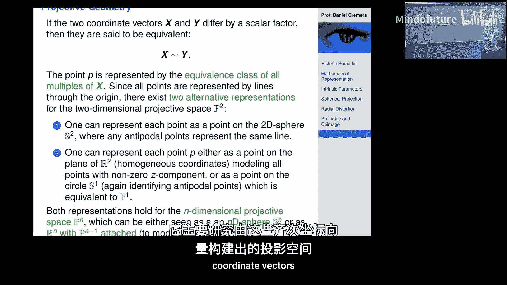

透视投影是将三维世界映射到二维图像的关键步骤，理解它是后续学习多视图几何、立体视觉和三维重建的基石。