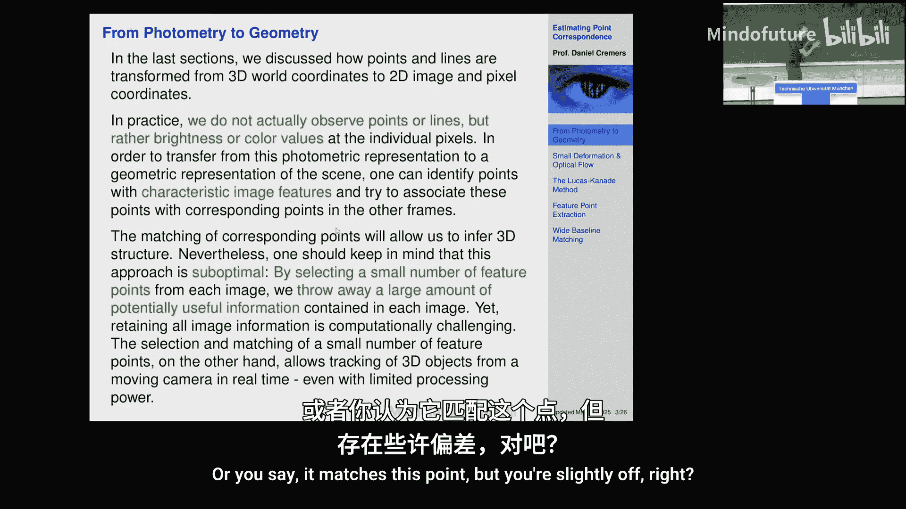
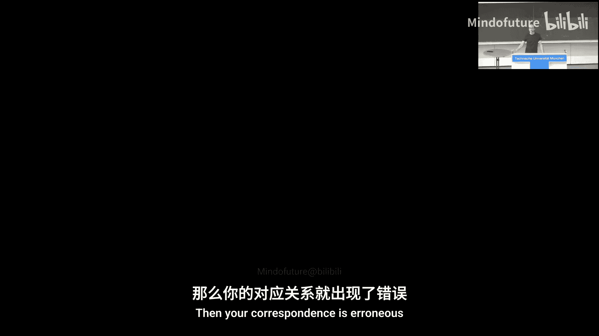
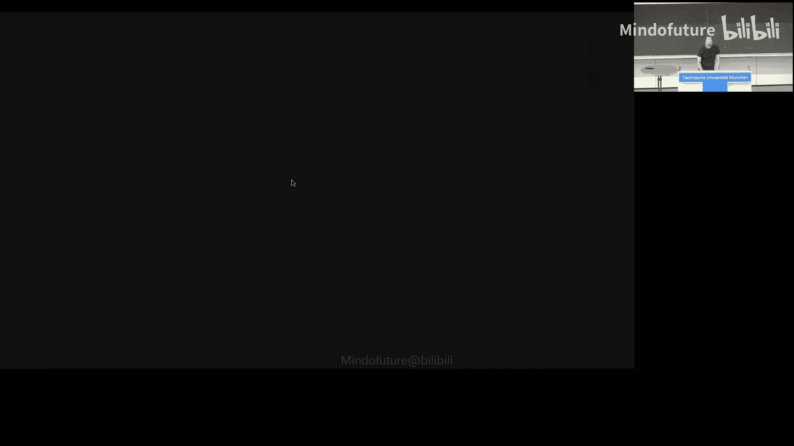
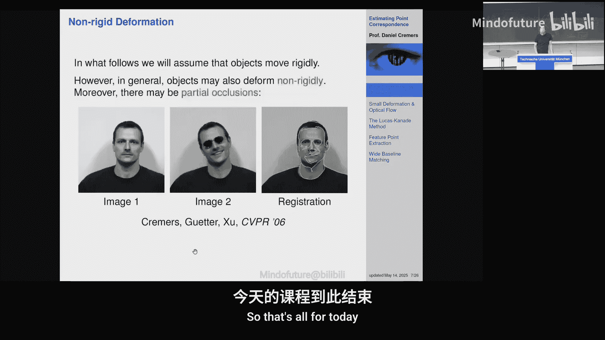

# 007：估计点对应关系（第一部分） 🎯

在本节课中，我们将要学习三维重建中的一个核心挑战：如何估计两张图像中对应点的关系。我们将从整体问题框架出发，理解点对应关系的重要性，并介绍解决此问题的经典方法及其背后的基本假设。

---

## 三维重建与点对应关系

上一章我们学习了如何从三维世界映射到二维图像。本节中我们来看看三维重建的完整流程。

三维重建的核心思想是：我们有一个三维世界，以及从不同视角观察这个世界的图像。当相机移动（发生旋转和平移）后，我们会在新的图像中看到相同的三维点。重建的关键在于，单张图像无法告诉我们物体离相机有多远。但通过从不同角度观察同一结构（即“运动恢复结构”问题），一旦我们知道这些点在两张图像中的位置以及相机的刚体运动，我们就可以通过三角化这些视线来确定三维结构在空间中的位置。

这个想法看似简单，但实现起来却充满挑战。其中最大的挑战之一就是**对应关系问题**：给定两张图像，如何确定一张图像中的某个点对应于另一张图像中的哪个点？

---

## 对应关系问题的挑战

为什么这是一个难题？如今的图像有数百万像素，任何一个像素都可能与另一张图像中的任何像素对应。人类可以轻松识别（例如，看到一个教堂塔楼，移动后依然能认出它），但对机器而言却并非易事。

这个问题的核心在于，相机记录的是**光度信息**（亮度、颜色值），而我们需要的却是**几何信息**（三维点）。因此，我们需要从光度信息转换到几何信息。

以下是解决此问题的传统流程步骤：
1.  **识别特征点**：在图像中找出具有显著特征的像素点。
2.  **确定对应关系**：在不同图像间匹配这些特征点。
3.  **进行重建**：利用匹配好的点来恢复相机运动和三维结构。

这个经典流程虽然有效，但存在局限性。将问题分解为多个步骤通常会导致**次优解**。原因在于：
*   **信息丢失**：只使用了图像中一部分点的信息。
*   **错误传播**：在对应关系步骤中产生的错误（如匹配错误或位置偏差）会直接影响后续的重建结果，且无法从原始数据中恢复。

尽管如此，这种分步方法在工程上易于处理，并且在计算资源有限（如80年代的计算机或如今的移动设备）时，为了追求实时性，它仍然被广泛使用。

---

## 对应关系问题的类型

在估计对应关系时，我们通常区分两种情况：

1.  **小位移/小变形**：假设相机移动很小，对应点只在邻域内寻找。这使得问题相对简单，并且有高效的算法（如Lucas-Kanade方法）。这在实时应用中（如增强现实、无人机导航）很常见，因为帧率很高，相邻帧间的位移很小。
2.  **宽基线/大位移**：图像拍摄视角差异很大（例如相差90度），对应点可能出现在图像的任何位置。这使得问题非常困难，因为存在大量潜在的匹配候选点，并且可能遇到重复结构或非朗伯表面（如金属、玻璃）的干扰。

这两种情况具有互补性：小位移场景追求**速度**，宽基线场景则允许投入更多**计算时间**来寻找可靠的对应关系。本节课我们将重点讨论**小位移**这一相对简单的情况。

---

## 从三维到二维的投影关系

为了形式化地分析问题，我们引入上一章的符号。设三维空间点为 **X**。它在第一张图像上的投影为 **x₁**，在第二张图像上的投影为 **x₂**。

设该点到第一个相机中心的距离为 **λ₁(X)**，到第二个相机中心的距离为 **λ₂(X)**。在齐次坐标下，存在如下关系：

**X = λ₁ * x₁**

将点 **X** 转换到第二个相机坐标系下，需要经过旋转 **R** 和平移 **t**，然后投影得到 **x₂**：

**x₂ = (1 / λ₂) * [R | t] * X = (1 / λ₂) * [R | t] * (λ₁ * x₁)**

由此可见，**x₂** 与 **x₁** 通过一个函数 **H** 相关联，该函数包含了未知的相机运动（R, t）和深度信息（λ₁, λ₂）。在估计对应关系时，我们需要对这个函数 **H** 进行建模或近似。

---

## 运动模型与光流

在小位移假设下，我们可以对图像中点位移（即**光流**）进行简单建模。光流指的是点在图像平面上的**表观运动**，它是三维运动在二维图像上的投影，并不完全等同于真实的三维运动。

常用的位移模型有：
*   **平移模型**：`u(x) = b`。仅有两个自由度（x和y方向的平移）。
*   **仿射模型**：`u(x) = S * [x, y]ᵀ + b`。其中S是一个2x2矩阵，b是平移向量，共有六个自由度。这可以看作是函数 **H** 在局部的一种线性近似。

选择合适的模型有助于我们更准确地估计点与点之间的对应关系。

---

## Lucas-Kanade 方法简介

接下来，我们介绍解决小位移对应关系问题的经典算法——Lucas-Kanade方法（1981年提出）。其核心基于两个假设：

1.  **亮度恒定假设**：同一个三维点在图像序列中移动时，其亮度保持不变。即 `I(x(t), t) = constant`。
2.  **局部运动一致假设**：在一个小窗口 `W(x)` 内，所有点具有相同的运动速度（光流向量）**v**。

基于这两个假设，可以构建一个关于光流向量 **v** 的损失函数，并通过最小化该函数来求解 **v**。Lucas-Kanade方法及其扩展（如KLT跟踪器）至今仍是计算机视觉中最流行、应用最广泛的算法之一，用于在视频中跟踪点的运动。

尽管该领域的研究已超过40年，但光流估计仍然是一个活跃的研究方向。经典方法为我们奠定了基础，而现代方法（如基于深度学习的方法）正在不断推动性能的边界。

---

本节课中我们一起学习了三维重建中点对应关系问题的核心地位与主要挑战，区分了小位移与宽基线两种不同场景，并介绍了用于解决小位移问题的经典Lucas-Kanade方法及其基本思想。在接下来的课程中，我们将深入该方法的具体数学原理和实现细节。