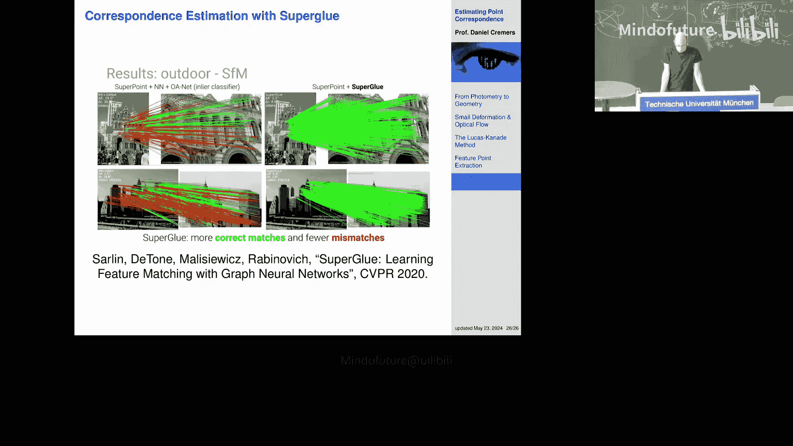

# 008：估计点对应关系（第二部分）

在本节课中，我们将继续学习如何估计图像间的点对应关系，即光流估计。我们将从经典方法入手，理解其核心假设与推导，并简要了解现代基于深度学习的方法如何发展。

## 光流估计简介

上一节我们介绍了点对应关系的基本概念。本节中，我们来看看如何具体计算图像间的运动，即光流估计。

光流估计的目标是：给定两幅图像，找出第一幅图像中的某个像素点在第二幅图像中的对应位置。这不仅针对单个像素，而是希望为图像中的许多点（甚至是所有像素）找到对应关系。

根据计算范围，方法可分为两类：
*   **稀疏光流**：仅为图像中一组稀疏的特征点计算对应关系。
*   **稠密光流**：为图像中的每一个像素计算对应关系。这通常更具挑战性，但随着GPU并行计算的发展，已能实现实时处理。

## 经典方法：Lucas-Kanade 算法

要理解现代方法，回溯经典算法的根源非常有帮助。Lucas-Kanade (1981) 和 Horn-Schunck (1981) 是光流领域两个开创性的工作。其中，Lucas-Kanade 方法为稀疏点估计运动，其推导基于两个核心假设，非常直观。

### 核心假设

该方法建立在两个基本假设之上：

1.  **亮度恒常性**：一个物体在运动过程中，其外观（亮度或颜色）保持不变。用公式表示，对于运动轨迹上的点 **x(t)**，其亮度 I 满足：
    `I(x(t), t) = 常数`
    对此式求关于时间 t 的全导数，并令其为零，得到光流基本约束方程：
    `∇I(x, t) · v + I_t(x, t) = 0`
    其中，`∇I` 是图像的空间梯度，`I_t` 是时间导数，**v** = `dx/dt` 是我们要求解的速度（光流）向量。这个方程表明，我们只能观测到速度 **v** 在图像梯度方向上的投影分量。

2.  **局部运动一致性**：在一个小的图像窗口（例如一个以点 **x** 为中心的方块）内，所有像素具有相同的运动速度 **v**。

### 构建与求解

基于以上假设，我们可以为窗口内的所有像素建立约束方程。由于噪声存在，这些方程通常不能精确满足，因此我们通过最小化一个损失函数来求解最优的 **v**。

损失函数定义为窗口内所有像素约束方程误差的平方和：
`E(v) = ∑[∇I(x') · v + I_t(x')]²`，对窗口内所有 **x'** 求和。

这是一个关于 **v** 的二次函数。为了找到使 `E(v)` 最小的 **v**，我们对其求导并令导数为零：
`dE/dv = 0`

这导出了一个线性方程组：
`M * v = -q`
其中，`M = ∑[∇I ∇Iᵀ]` 是一个2x2矩阵（结构张量），`q = ∑[2 I_t ∇I]` 是一个2维向量。

最终，光流向量可通过求解该线性系统得到：
`v = -M⁻¹ * q`

### 重要讨论：可求解性

上述求解过程要求矩阵 **M** 可逆（即行列式不为零）。**M** 的可逆性取决于图像窗口内的纹理结构：
*   在**平坦区域**（梯度为零），**M** 是零矩阵，无法求解。
*   在**边缘区域**（梯度只有一个方向），**M** 秩为1，不可逆，只能求解沿边缘法线方向的运动（孔径问题）。
*   在**角点区域**（梯度在多个方向上变化），**M** 是满秩的，可以稳定地求解出完整的二维运动向量。

因此，Lucas-Kanade 方法天然地倾向于在图像中纹理丰富的角点区域提供可靠的光流估计。

### 算法扩展：KLT特征跟踪器

Lucas-Kanade 方法被扩展为著名的 **KLT (Kanade-Lucas-Tomasi) 特征跟踪器**。其工作流程如下：

1.  在图像中寻找适合跟踪的点（即 **M** 矩阵行列式值大的点，通常是角点）。
2.  对每个特征点，使用上述方法计算其到下一帧的光流 **v**。
3.  将该点位置加上 **v**，作为下一帧的初始位置。
4.  重复步骤2-3，形成特征点的运动轨迹。
5.  当某个点的 **M** 矩阵行列式过小（跟踪失败）时，丢弃该轨迹，并可能在新帧中检测新的特征点。

这种方法能够高效、实时地跟踪稀疏特征点的运动轨迹。

## 从特征点到特征检测器

Lucas-Kanade 方法中用于判断点是否“可跟踪”的 **M** 矩阵（结构张量），直接催生了早期的**特征点检测器**。

通过计算每个像素点的 **M** 矩阵，并检查其行列式（或更复杂的函数，如 Harris 角点检测中的 `行列式 - κ * (迹)²`），我们可以快速找到图像中的“兴趣点”（通常是角点或纹理密集区域）。这类检测器在深度学习时代之前，是物体识别、图像匹配等任务的基础。

以下是经典特征检测器的发展脉络：
*   **Förstner 检测器 (1984/87)**：基于结构张量。
*   **Harris & Stephens 检测器 (1988)**：提出了更稳定的角点响应函数。
*   **SIFT (2004)**：引入了基于尺度的特征描述子。
*   **现代方法**：通常使用神经网络来同时检测特征点并计算其描述子。

## 宽基线匹配的挑战

Lucas-Kanade 方法适用于**小基线**情况（即相邻帧间运动很小）。当图像间视角或时间间隔很大时，会面临**宽基线匹配**的挑战：
1.  **搜索空间巨大**：对应点可能出现在图像任何位置。
2.  **遮挡**：一幅图像中的区域可能在另一幅中不可见。
3.  **外观变化**：光照、视角变化导致亮度恒常性假设严重失效。
4.  **累积漂移**：在KLT等增量跟踪方法中，误差会随时间累积。

### 应对策略

为了应对这些挑战，需要更强大的方法：

1.  **更复杂的运动模型**：使用仿射或投影变换模型，而不仅仅是平移。
    `v(x') = S(x') * p`
    其中 **p** 是参数向量，`S(x')` 是依赖于位置的矩阵。求解思路与基础Lucas-Kanade类似，但参数更多。

2.  **更鲁棒的相似性度量**：放弃严格的亮度恒常，使用对光照变化不敏感的度量。例如**归一化互相关 (NCC)**：
    `NCC(patch1, patch2) = ( (patch1 - μ1) · (patch2 - μ2) ) / (||patch1 - μ1|| * ||patch2 - μ2|| )`
    它通过减去均值消除亮度偏移，通过归一化消除亮度缩放，本质是计算两个向量间的余弦相似度。

## 现代方法：基于学习的光流与匹配

传统优化方法虽经典，但当前最先进的光流和特征匹配技术已主要基于深度学习。

*   **FlowNet (2015)**：首个用于光流估计的卷积神经网络，开启了端到端学习光流的时代。
*   **SuperGlue (2020)**：一个强大的图像匹配网络。它首先用神经网络检测特征点和描述子，然后构建一个图模型，利用**图神经网络 (GNN)** 和**最优传输**理论来求解全局一致的点对应关系。最优传输能确保匹配的整体合理性（如一对多匹配），从而在宽基线、大视角变化下也能获得非常精确的对应结果。

这些学习方法通过海量数据训练，能够隐式地建模复杂的表观变化和几何变形，性能远超传统方法。

## 总结

本节课我们一起学习了点对应关系估计的核心方法。
*   我们从经典的 **Lucas-Kanade 光流法**入手，理解了其基于**亮度恒常**和**局部运动一致**假设的推导过程，以及它如何自然地引向**特征点跟踪 (KLT)** 和**角点检测**。
*   我们探讨了从**小基线**到**宽基线**匹配时面临的挑战，以及相应的解决思路，如使用更复杂的运动模型和归一化互相关等鲁棒度量。
*   最后，我们了解到，当前该领域的前沿已转向**基于深度学习的方法**，如 FlowNet 和 SuperGlue，它们通过数据驱动的方式，在复杂场景下实现了更精准、更鲁棒的点对应关系估计。

光流与图像匹配是计算机视觉的基石问题，历经数十年发展依然活跃，不断有新的算法推动其性能边界。理解经典方法的原理，是掌握现代技术的重要基础。