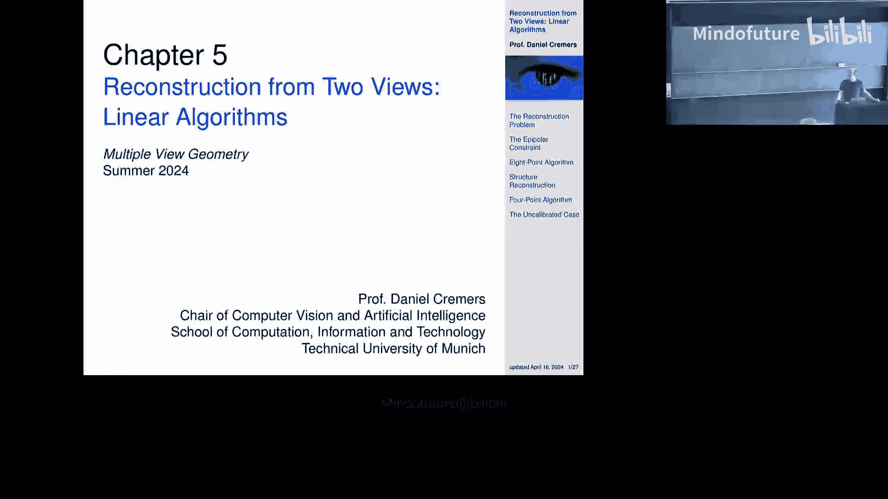
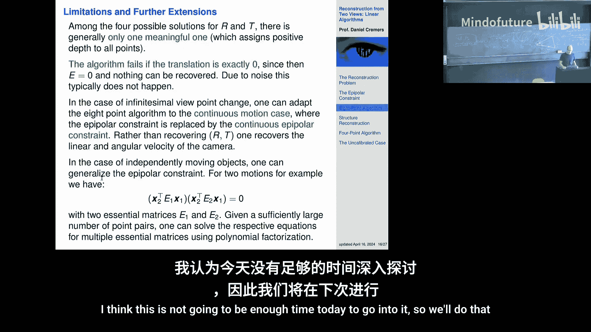

# 009：基于双视图的重建-线性算法（第1部分）

在本节课中，我们将要学习如何从两张图像中重建三维结构和相机运动。我们将从问题定义开始，逐步推导出核心的极几何约束，并最终介绍著名的八点算法。本节课的重点是线性算法，这意味着我们可以使用线性代数技术来求解问题。

## 概述与问题定义

上一章我们讨论了对应点估计。本章我们将进入双视图重建。

线性算法意味着我们可以部署线性代数技术来解决我们感兴趣的问题。与之互补的非线性优化技术则需要更复杂的迭代数值求解器。本章讨论线性算法，因为它奠定了极几何的基础，尽管这些算法在实际应用中可能不是最优选择，但其理论原理非常重要。

我们的问题是：给定一个静态场景的两张图像（由同一相机从不同位置拍摄），并且已知相机的内参，我们的目标是估计场景的三维点位置以及相机在两视图之间的相对运动（旋转和平移）。

这是一个经典的“先有鸡还是先有蛋”问题，在三维计算机视觉中常被称为“运动与结构”或“运动恢复结构”问题。如果我们已知相机运动，那么通过简单的三角化（即反向投影两条射线并求交点）就能得到三维点。然而，在实际中，对应点估计存在噪声，使得问题变得复杂。

## 极几何基础

在深入算法之前，我们需要引入极几何的概念和符号。

考虑两个相机中心 O1 和 O2，以及一个三维点 X。该点在两个图像平面上的投影分别是 x1 和 x2。
*   **极点**：连接两个相机中心的直线与各自图像平面的交点，记为 e1 和 e2。
*   **极线**：在图像中，连接极点 e 与像点 x 的直线。对于一个像点 x1，其在另一幅图像中的对应点 x2 必然位于对应的极线上。
*   **极平面**：由两个相机中心和三维点 X 所确定的平面。

极几何的核心价值在于，它为对应点的搜索提供了约束：我们只需在极线上搜索，而非整幅图像。

## 极约束的推导

我们的目标是从投影方程中推导出一个不包含三维坐标 X 的约束，即极约束。

我们从投影方程开始：
`λ1 * x1 = X` (在相机1坐标系下)
`λ2 * x2 = R * X + t` (在相机2坐标系下)
其中 λ1, λ2 是深度，R 和 t 是相机1到相机2的旋转和平移。

1.  将第一个方程代入第二个，消去 X：
    `λ2 * x2 = R * (λ1 * x1) + t`
    `λ2 * x2 = λ1 * R * x1 + t`

2.  两边同时左乘反对称矩阵 `[t]×` (该矩阵等价于与 t 做叉乘)：
    `λ2 * [t]× * x2 = λ1 * [t]× * R * x1 + [t]× * t`
    由于 `[t]× * t = t × t = 0`，右边第二项消失：
    `λ2 * [t]× * x2 = λ1 * [t]× * R * x1`

3.  再左乘 `x2ᵀ`：
    `λ2 * x2ᵀ * [t]× * x2 = λ1 * x2ᵀ * [t]× * R * x1`
    观察左边：`[t]× * x2` 是向量 `t × x2`，该向量与 x2 正交。因此它与 x2 的点积为 0：
    `0 = λ1 * x2ᵀ * [t]× * R * x1`

4.  由于 λ1 ≠ 0，我们可以得到最终的**极约束方程**：
    `x2ᵀ * E * x1 = 0`
    其中 `E = [t]× * R` 被称为**本质矩阵**。

这个约束的美妙之处在于，它只包含了二维像点坐标 (x1, x2) 和相机运动参数 (通过 E)，而完全消除了三维坐标和深度信息。它是一个关于 x1, x2 和 E 的双线性方程。

从几何角度看，这个约束意味着向量 `t`、`R*x1` 和 `x2` 是共面的（它们的标量三重积为零），这正对应了三个点（两个相机中心和一个三维点）必须共面的事实。

## 本质矩阵的性质

本质矩阵 `E = [t]× * R` 具有特殊的结构，不是任意 3x3 矩阵都能成为本质矩阵。

**定理 (Huang & Faugeras)**：一个非零的 3x3 矩阵 E 是本质矩阵，当且仅当它的奇异值分解 (SVD) 具有两个相等的奇异值，且第三个奇异值为零。即：
`SVD(E) = U * diag(σ, σ, 0) * Vᵀ`

这是因为 `[t]×` 的秩为 2，导致 E 的秩也为 2。

另一个重要定理是，我们可以从本质矩阵 E 中恢复出相机的旋转 R 和平移 t（相差一个尺度因子）。

给定 E 的 SVD：`E = U * diag(1, 1, 0) * Vᵀ`（我们通常将 E 归一化，使得两个非零奇异值为 1），那么存在两种可能的 R 和 t 的组合：
`[t]× = U * Rz(±π/2) * diag(1, 1, 0) * Uᵀ`
`R = U * Rz(±π/2)ᵀ * Vᵀ`
其中 `Rz(θ)` 是绕 Z 轴旋转 θ 角度的矩阵。这总共会产生**四种**可能的 (R, t) 解。我们需要通过三角化并检查深度值（应为正数）来选出唯一正确的解。

## 八点算法

现在，我们利用极约束来求解相机运动。对于一对对应点，我们有一个方程 `x2ᵀ * E * x1 = 0`。E 有 9 个未知数（虽然只有 5 个自由度，但我们先将其视为 9 个未知数）。

我们可以将这个双线性形式重写为线性形式。将矩阵 E 按列堆叠成一个 9 维向量 `e`，并定义向量 `a = x1 ⊗ x2`（克罗内克积，即 `[x1*x2, x1*y2, x1*z2, y1*x2, ...]ᵀ`）。那么极约束可以写为：
`aᵀ * e = 0`

如果我们有 N 对对应点，我们可以构建一个矩阵 `χ`，其每一行是向量 `aᵀ`：
`χ * e = 0`
其中 `χ` 是一个 N x 9 的矩阵。

我们的目标是找到满足上述方程的非零向量 `e`。为了使解唯一（相差一个尺度因子），矩阵 `χ` 的零空间需要是一维的。这就要求 `χ` 的秩为 8。因此，我们至少需要 8 对对应点（在非退化配置下）。这就是**八点算法**名称的由来。

**八点算法步骤**：
1.  **构建并求解**：给定至少 8 对对应点，构建矩阵 `χ`。计算 `χ` 的 SVD：`χ = U_χ * Σ_χ * V_χᵀ`。解 `e` 是 `V_χ` 的最后一列（对应最小奇异值的右奇异向量）。将其重构为 3x3 矩阵 `E`。
2.  **投影到本质矩阵空间**：第一步得到的 `E` 通常不满足本质矩阵的奇异值性质。我们将其投影到本质矩阵空间：计算 `E` 的 SVD：`E = U * diag(σ1, σ2, σ3) * Vᵀ`，其中 σ1 ≥ σ2 ≥ σ3。然后，我们将其替换为最接近的本质矩阵：`E‘ = U * diag((σ1+σ2)/2, (σ1+σ2)/2, 0) * Vᵀ`。通常我们进一步归一化，得到 `E_norm = U * diag(1, 1, 0) * Vᵀ`。
3.  **恢复姿态**：从归一化的本质矩阵 `E_norm` 中，利用前述定理恢复出四种可能的 (R, t) 组合。
4.  **选择正确解**：对每个可能的 (R, t)，对若干点进行三角化，检查其深度值 λ 是否为正。选择那个能使大多数点具有正深度的解。

八点算法由 Longuet-Higgins 提出，是一个优雅的闭式解。然而，它对噪声和错误对应点非常敏感。

## 关于点数量的讨论

八点算法需要至少 8 个点。一个经典的理论（Kruppa, 1913）指出，实际上只需要 **5 个点**就可以确定相机运动，因为本质矩阵只有 5 个自由度。利用这个约束（例如，要求 `det(E) = 0`），可以设计出五点算法，但求解过程涉及更复杂的数学（如解一个多项式方程），会得到多个可能解。在实际的鲁棒估计中（如结合 RANSAC），使用更少的点有助于减少错误匹配的影响。

八点算法在纯旋转（`t = 0`）的情况下会失败，因为此时 `E` 为零矩阵，无法恢复任何信息。这也符合直觉：没有平移（视差），就无法估计深度。

## 总结与展望

本节课我们一起学习了双视图重建的基础。我们首先定义了从对应点恢复运动和结构的问题。然后，我们推导了核心的极几何约束，它巧妙地分离了二维观测和相机运动。接着，我们介绍了本质矩阵及其性质。最后，我们详细讲解了经典的线性解法——八点算法，它通过求解一个线性系统来估计本质矩阵，进而恢复相机姿态。

八点算法是理解双视图几何的基石。然而，它假设了完美的对应关系，在实际应用中常需与鲁棒估计方法（如下节课将提到的 RANSAC）结合使用。此外，我们提到还存在需要更少点数的非线性算法（如五点算法）。

在下节课中，我们将讨论如何从已知的相机运动进行三角化，以恢复三维点云结构，并探讨如何处理噪声和异常值。