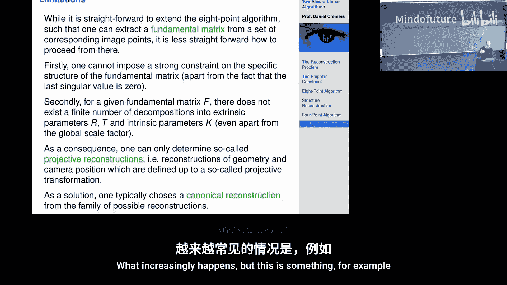
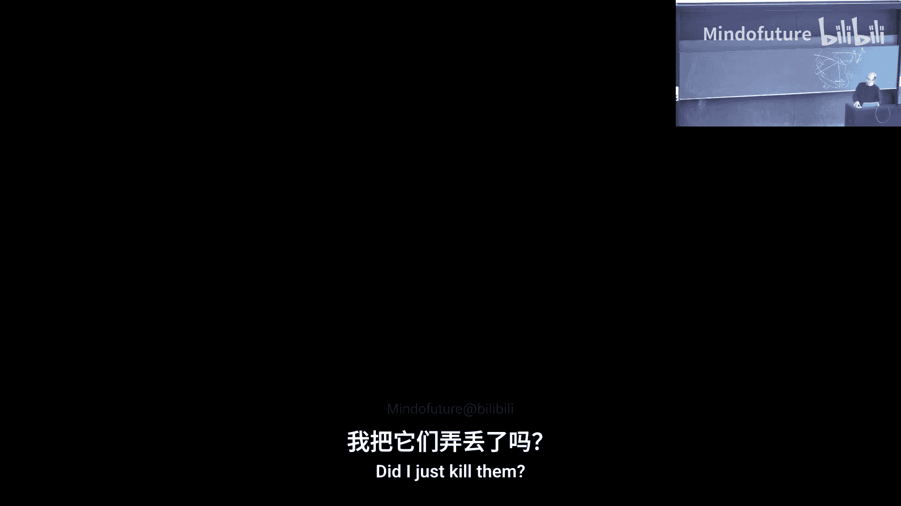
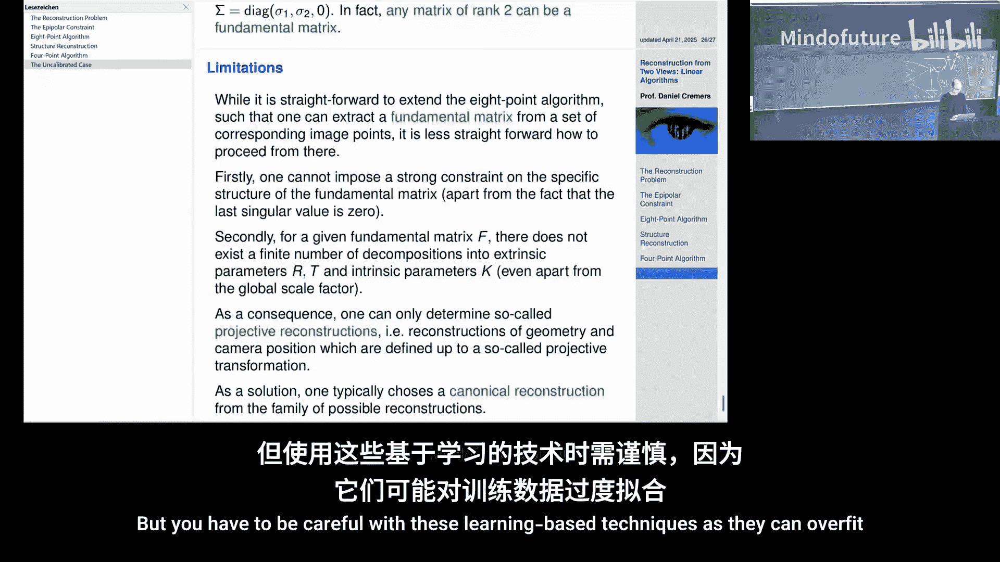

# 010：基于双视图的重建-线性算法（第二部分）

在本节课中，我们将继续学习如何从两张图像（双视图）中重建三维场景和相机运动。我们将深入探讨核心的极线约束，并学习如何利用线性代数方法，通过著名的八点算法和四点算法来求解相机参数和三维结构。

上一节我们介绍了从多张图像重建三维世界的基本思想。本节中，我们来看看如何将复杂的投影方程简化为一个关键的约束条件，并利用它来设计线性求解算法。

## 极线约束与本质矩阵

我们观察一个三维点 **X** 在两个图像上的投影 **x₁** 和 **x₂**。投影方程涉及未知的三维坐标 **X**、相机间的刚体运动（旋转 **R** 和平移 **t**）以及深度值 λ₁ 和 λ₂。直接求解这些方程非常困难。

通过巧妙的代数推导，我们可以消去三维坐标 **X** 和深度参数 λ，得到一个仅包含二维图像坐标和相机运动参数的约束，即**极线约束**：

**x₂ᵀ E x₁ = 0**

其中，**E = [t]× R** 被称为**本质矩阵**，`[t]×` 是由平移向量 **t** 构成的反对称矩阵。

这个约束的几何意义是：平移向量 **t**、以及从两个相机中心指向像点 **x₁** 和 **x₂** 的射线，这三个向量共面（它们张成的体积为零）。这意味着两条射线必然在三维空间中相交于某点。

## 八点算法

虽然极线约束包含了相机运动信息，但它本身是非线性的。为了求解，我们将其改写为线性形式。

对于一对匹配点，我们可以将方程 **x₂ᵀ E x₁ = 0** 重写为两个向量的内积：
**aᵀ e = 0**
其中，向量 **a** 由 **x₁** 和 **x₂** 的坐标乘积构成（一个9维向量），向量 **e** 是将本质矩阵 **E** 的9个元素按行堆叠而成的列向量。

以下是构建线性方程组的步骤：
1.  收集至少8对匹配点。
2.  对于每一对点，计算其对应的9维向量 **aᵢ**。
3.  将所有 **aᵢᵀ** 堆叠起来，形成一个 **n × 9** 的矩阵 **A**（当 n ≥ 8 时）。
4.  我们得到线性方程组：**A e = 0**。

我们的目标是求解非零向量 **e**（零解无意义）。这等价于寻找矩阵 **A** 的零空间。理论上，如果数据无噪声且匹配点不在一个退化的三维结构上（如一个平面），**A** 的秩应为8，其零空间是一维的。

在实际中，由于图像测量总存在噪声，**A** 通常是满秩的。此时，我们通过**奇异值分解**来求解：
1.  对矩阵 **A** 进行 SVD 分解：`A = U Σ Vᵀ`。
2.  取 **V** 的最后一列（对应最小奇异值的右奇异向量），将其重构为3x3矩阵 **E**。
3.  由于噪声，得到的 **E** 可能不满足本质矩阵的性质（两个非零奇异值相等，第三个为零）。因此，我们需要将其**投影到本质矩阵空间**：
    *   对 **E** 进行 SVD：`E = U Σ Vᵀ`，其中 `Σ = diag(σ₁, σ₂, σ₃)` 且 σ₁ ≥ σ₂ ≥ σ₃。
    *   用 `Σ‘ = diag((σ₁+σ₂)/2, (σ₁+σ₂)/2, 0)` 替换 `Σ`。
    *   得到投影后的本质矩阵：`E‘ = U Σ’ Vᵀ`。

从本质矩阵 **E‘** 中，我们可以恢复出相机的旋转 **R** 和平移 **t**（存在四种可能的解）。通过后续的三角化，检查哪个解能产生所有点的**正深度值**，即可确定唯一正确的运动。

## 三维结构重建

在通过八点算法得到相机运动 (**R**, **t**) 后，我们可以重建三维点的位置。

对于每一对匹配点 (**x₁**, **x₂**)，我们回到投影方程：
**λ₂ x₂ = R (λ₁ x₁) + γ t**
其中，我们引入了一个尺度因子 γ，因为平移 **t** 的模长和整个场景的尺度是无法从图像中确定的（尺度模糊性）。

为了求解深度 λ₁ 和尺度 γ，我们再次利用线性代数。对上述方程两边同时左乘 `[x₂]×`（即与 **x₂** 做叉积的矩阵），消去 λ₂，得到：
**λ₁ [x₂]× R x₁ + γ [x₂]× t = 0**

对于 n 对点，我们可以构建一个大型线性方程组：
**M λ = 0**
其中，向量 **λ** 包含了所有 n 个点的深度 λ₁ 和全局尺度 γ，矩阵 **M** 是已知的（由图像坐标和已求得的 **R**, **t** 构成）。

同样，通过对矩阵 **M** 进行奇异值分解，取对应最小奇异值的右奇异向量，即可求解出 **λ**。最后，我们可以将尺度固定（例如，令 γ = 1），从而得到以相机基线长度为单位的完整三维场景重建。

## 退化情况与四点算法

八点算法在点都位于一个三维平面上时会失效（退化情况）。然而，如果事先知道场景是平面的，我们可以利用这个先验知识，使用更高效的**四点算法**。

对于一个三维平面，其上的点满足：**nᵀ X = d**，其中 **n** 是法向量，d 是到原点的距离。可以推导出，两个视图中的像点坐标通过一个**单应性矩阵 H** 相关联：
**λ₂ x₂ = H λ₁ x₁**，其中 **H = R + (1/d) t nᵀ**

类似于极线约束，我们可以从方程中消去深度，得到关于单应性矩阵 **H** 的约束：
**[x₂]× H x₁ = 0**

将其线性化后，每个点对能为求解 **H** 提供两个独立的约束。因此，理论上只需要**4个点对**即可求解这个3x3的矩阵（共9个参数，但有一个尺度自由度）。求解过程与八点算法类似：
1.  构建线性方程组。
2.  通过SVD求最小奇异值对应的向量，得到 **H**。
3.  从 **H** 中可以分解出 **R**, **t/d** 和 **n**（同样存在尺度模糊性）。

单应性矩阵在平面场景的识别、图像拼接等应用中非常强大。

## 未标定重建与基础矩阵

上述所有讨论都假设相机已标定（即内参矩阵 **K** 已知）。如果相机未标定，我们只能得到像素坐标 **x‘**，它与归一化坐标 **x** 的关系是 **x‘ = K x**。

此时，极线约束变为：
**x‘₂ᵀ F x‘₁ = 0**
其中，**F = K⁻ᵀ E K⁻¹ = K⁻ᵀ [t]× R K⁻¹** 被称为**基础矩阵**。

我们可以使用与八点算法完全相同的线性方法来估计基础矩阵 **F**。然而，与本质矩阵不同，基础矩阵除了秩为2（最小奇异值为0）之外，没有其他特殊的奇异值约束。从基础矩阵 **F** 中无法唯一地分解出旋转和平移，只能得到一个**射影重建**族，即重建出的三维结构可能相差一个任意的3D射影变换。要得到度量重建，需要额外的约束或信息。

本节课中我们一起学习了双视图重建的核心线性算法。我们首先从投影方程推导出了极线约束和本质矩阵，然后介绍了著名的八点算法，用于从匹配点中线性估计相机运动。接着，我们学习了如何利用求得的运动参数，再次通过线性方法三角化出三维场景结构。我们还探讨了平面场景下的退化问题及其解决方案——四点算法，最后简要介绍了在相机未标定情况下使用基础矩阵进行重建的挑战。这些线性方法是多视角几何的基石，虽然对噪声敏感，但其思想的优美和清晰为更鲁棒的非线性优化方法奠定了基础。