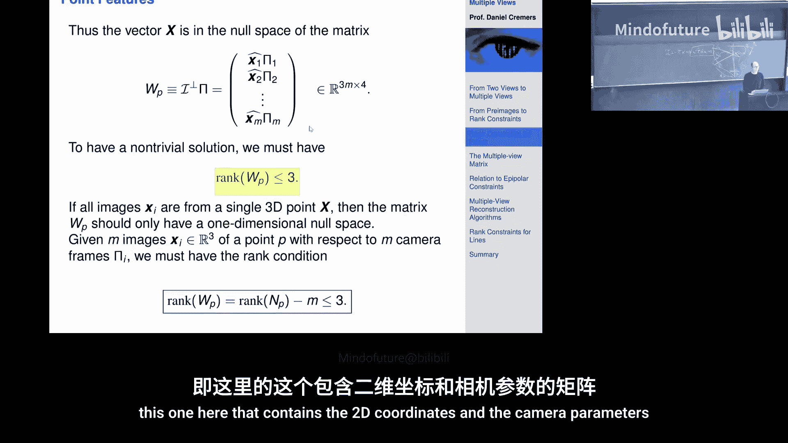

# 011：基于多视图的重建（第一部分）🚀


在本节课中，我们将开始学习第6章的内容：基于多视图的重建。我们将从两视图的几何约束扩展到三视图及更多视图，探讨如何利用多个视角的观测来获得更稳健、更一致的三维重建结果。

## 从两视图到多视图的动机 🔍

上一节我们介绍了双视图下的对极几何约束。本节中我们来看看，当同一个三维点被三个或更多相机观测时，情况会发生什么变化。

我们有一个三维点，被多个相机观测到，其投影点坐标分别为 **x1**、**x2**、**x3** 等。


多视角几何是三维计算机视觉领域的核心。一个关键问题是：仅使用两两视图之间的约束是否足够？答案是否定的。强制所有两两视图之间的一致性，并不能保证所有视图整体上的一致性。

以下是两个直观的例子：


在这些例子中，虽然每对相机（如相机1和2、2和3、1和3）的视线都能相交于某点，但这些交点并不是同一个三维点。这说明，仅强制执行两两视图的约束，无法保证所有视图观测到的是同一个三维点。

因此，我们需要一种能够直接强制多视图一致性的方法。这不仅能带来理论上的完备性，在实践中也能使重建结果更鲁棒、更稳定。

## 多视图几何的研究背景 📚

三视图一致性问题传统上通过**三焦张量**来解决，它由Hartley等人在上世纪90年代提出，是基础矩阵在多视图下的推广。

*   基础矩阵描述了两个二维坐标之间的**双线性**约束：**x2^T F x1 = 0**。
*   三焦张量则描述了同一个三维点在三个图像中的二维坐标之间的**三线性**约束。

这个张量本身不依赖于三维场景结构，而只依赖于相机之间的运动（旋转和平移）。这个领域在80年代和90年代非常活跃，并总结在多本经典著作中。


在本课程中，我们将采用一种基于线性代数的方法，避免使用复杂的张量代数，使其更易于理解。

## 利用“原像”概念进行重建 💡

我们将使用“原像”这一核心概念来推导多视图约束。回忆一下，一个图像点的原像是所有能投影为该图像点的三维点的集合，在几何上是一条射线（对于透视相机）。

如果我们从多个视角观测同一个三维点，那么该点在所有视图中的原像的交集，就是该三维点的位置。因此，计算原像并求交，本质上就是三维重建。


对于点特征，其投影方程可以写为：
`λ_i * x_i = K_i * [R_i | t_i] * X`
其中，`λ_i` 是深度，`K_i` 是内参，`[R_i | t_i]` 是外参（刚体运动），`X` 是世界坐标系下的三维点。

为了书写简洁，我们引入一个紧凑的符号 `π_i`，它包含了第 `i` 个视图的完整投影过程（内参和刚体运动）。这样，投影方程可以简写为：
`λ_i * x_i = π_i(X)`


## 推导多视图矩阵秩约束 🧮

我们的目标是像推导对极约束一样，从投影方程中消去三维结构（`X`）和深度（`λ_i`），得到一个只包含二维观测（`x_i`）和相机参数（`π_i`）的约束。

假设有 `m` 个视图观测到同一个点 `X`，我们可以将所有视图的投影方程堆叠起来：

```
[ π_1 ]         [ x_1     ]   [ λ_1 ]
[ π_2 ] * X  =  [ x_2     ] * [ λ_2 ]
[ ... ]         [   ...   ]   [ ... ]
[ π_m ]         [ x_m     ]   [ λ_m ]
```

将其重写为齐次形式：
`N(P) * [X^T, -λ_1, -λ_2, ..., -λ_m]^T = 0`
其中，矩阵 `N(P)` 的构造如下：
`N(P) = [ π_1, x_1, 0, ..., 0; π_2, 0, x_2, ..., 0; ... ; π_m, 0, 0, ..., x_m ]`

这个方程意味着向量 `[X^T, -λ^T]^T` 位于矩阵 `N(P)` 的零空间中。因此，`N(P)` 这个 `3m x (m+4)` 的矩阵不可能是满秩的（满秩为 `m+4`），其秩最多为 `m+3`。

**这就是多视图下的秩约束**。通过强制这个矩阵秩亏，我们得到了一个仅关联相机参数和二维观测的约束条件，成功消去了三维点坐标 `X` 和深度 `λ_i`。这是对极约束在多视图下的直接推广。

## 简化约束：构造矩阵 W(P) ⚙️

上述约束涉及一个较大的矩阵。我们可以进一步简化，引入反对称矩阵 `x_i^`（即 `x_i` 的叉乘矩阵）。由于 `x_i^ * x_i = 0`，我们可以用块对角矩阵 `Î = diag(x_1^, ..., x_m^)` 左乘原始的投影方程：

`Î * [π_1; ...; π_m] * X = Î * [x_1*λ_1; ...; x_m*λ_m] = 0`

定义矩阵 `W(P) = Î * P`，其中 `P = [π_1^T, ..., π_m^T]^T`。那么上式变为：
`W(P) * X = 0`

这意味着三维点 `X` 位于 `W(P)` 的零空间中。`W(P)` 是一个 `3m x 4` 的矩阵。在一般情况下，它的秩为4，零空间维度为0。但是，如果存在一个非零的 `X` 满足所有视图的投影，那么 `W(P)` 的零空间就必须是非平凡的，因此其秩最多为3。


**因此，多视图一致性等价于强制矩阵 `W(P)` 的秩至多为3**。这个 `3m x 4` 的矩阵 `W(P)` 包含了所有相机的参数 `π_i` 和所有二维观测 `x_i`，其秩约束为我们提供了所需的多视图几何关系。

## 总结 📝

本节课中我们一起学习了多视图重建的数学基础。

1.  我们首先认识到，仅使用两两视图之间的约束不足以保证所有视图的整体一致性。
2.  我们回顾了利用“原像”交集进行重建的核心思想。
3.  通过将多视图投影方程转化为齐次形式，我们推导出了关键的**矩阵秩约束**：`rank(N(P)) ≤ m+3`。
4.  通过引入反对称矩阵进行简化，我们得到了更紧凑的等价形式：`rank(W(P)) ≤ 3`。



这个秩约束 `rank(W(P)) ≤ 3` 是多视角几何中一个非常强大的工具。它将相机运动参数和多个二维观测联系在一个简洁的线性代数框架内，是后续进行多视图运动估计和三维重建的基石。在下一节中，我们将探讨如何利用这个约束来实际求解相机运动。