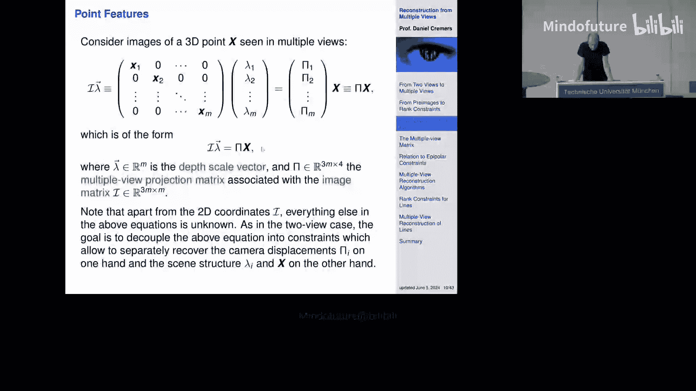
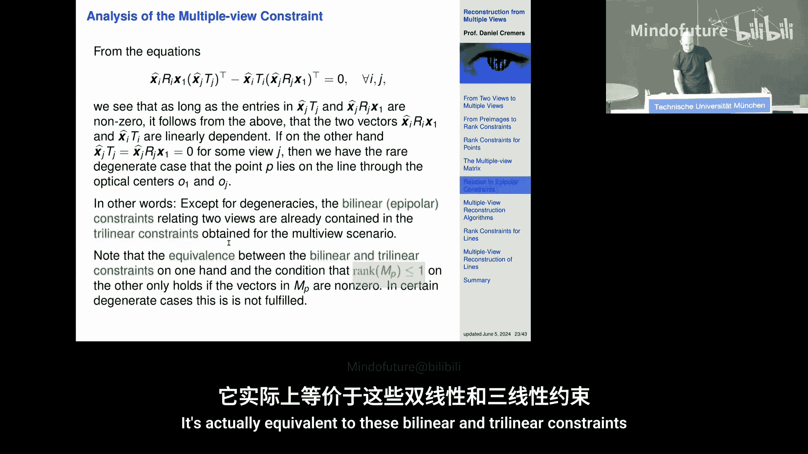
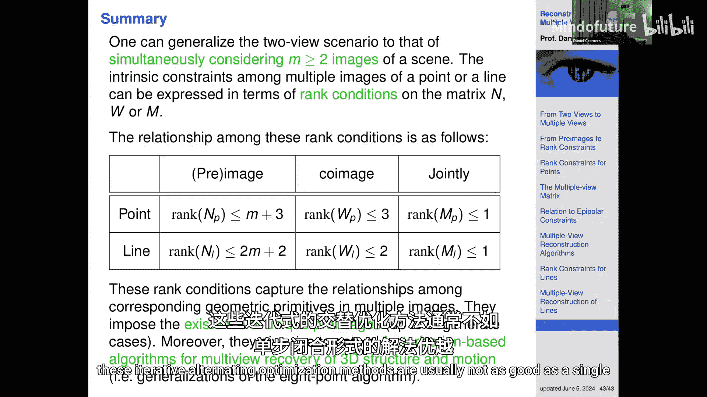

# 012：基于多视图的重建（第2部分） 🎥



在本节课中，我们将要学习如何将双视图的极线几何约束推广到多视图场景。我们将推导出当同一个三维点被多个相机观测时，这些二维观测点与相机运动之间必须满足的约束条件。这些约束可以表述为矩阵的秩条件，并最终引导我们理解三线性约束，它比成对的极线约束更强，能确保三维重建的唯一性。

---

## 从双视图到多视图的扩展 📈

上一节我们介绍了双视图下的极线约束和八点算法。本节中，我们来看看如何将这些概念扩展到有M个视图观测同一个三维点X的情况。

观测方程可以写为：
```
λ_i * x_i = Π_i * X,  对于 i = 1, ..., M
```
其中：
*   `x_i` 是第i个视图中的二维观测点（齐次坐标）。
*   `λ_i` 是该点到第i个相机的未知深度。
*   `Π_i` 是第i个相机的投影矩阵。
*   `X` 是未知的三维点。

我们可以将这个方程组重写为一个更紧凑的矩阵形式。将所有方程堆叠起来，并重新排列项，我们得到一个形如 `N_Π * u = 0` 的方程，其中 `u` 是一个包含所有深度 `λ_i` 和三维点 `X` 坐标的向量。

这个方程的关键在于，向量 `u` 位于矩阵 `N_Π` 的零空间中。由于 `u` 是非零向量（包含深度信息），这意味着矩阵 `N_Π` 不可能是满秩的。

---

## 多视图矩阵的秩约束 🔢

矩阵 `N_Π` 的维度是 `3M 行 x (M+4) 列`。它的最大可能秩是 `M+4`。

然而，由于存在非零解 `u`，该矩阵的秩必须小于 `M+4`。具体来说：
*   如果秩等于 `M+4`：零空间只有零向量，意味着没有满足所有观测的三维点，**无解**。
*   如果秩等于 `M+3`：存在一个一维的零空间（解 `u` 可被缩放），意味着存在一个**唯一**的三维重建（在尺度意义下）。
*   如果秩小于 `M+3`：零空间维度大于1，意味着存在**多个可能**的三维重建，解不唯一。

因此，为了得到唯一的三维重建，我们要求相机运动和二维观测必须使得矩阵 `N_Π` 的秩**恰好为 `M+3`**。这就是多视图情况下的基本秩约束，它类似于双视图中的极线约束。

---

## 推导更紧凑的约束矩阵

为了进一步分析，我们可以通过定义一个包含所有反对称矩阵 `x_i_hat` 的块对角矩阵 `I_⊥`，来消去方程中的深度变量 `λ_i`。将 `I_⊥` 左乘到原始方程上，我们得到一个新的方程：
```
W_Π * X = 0
```
其中 `W_Π = I_⊥ * Π` 是一个 `3M x 4` 的矩阵。

现在，约束变成了：三维点 `X` 位于矩阵 `W_Π` 的零空间中。为了使 `X` 唯一（在尺度意义下），`W_Π` 的秩必须**至多为3**（因为满秩4意味着只有零解）。

通过选择第一个相机坐标系作为世界坐标系（即 `Π_1 = [I | 0]`），并巧妙地右乘一个满秩矩阵，我们可以将 `W_Π` 的秩约束转化为一个更小矩阵 `M_P` 的秩约束。

这个关键的矩阵 `M_P` 是一个 `3(M-1) x 2` 的矩阵，其两列如下：
*   第一列包含项：`x_i_hat * R_i * x_1`
*   第二列包含项：`x_i_hat * t_i`

其中 `i` 从2到M。

最终的结论是：**矩阵 `W_Π` 的秩 ≤ 3 等价于矩阵 `M_P` 的秩 ≤ 1**。

---



## 多视图约束的几何与代数解释

矩阵 `M_P` 只有两列。它的秩有三种可能：
*   **秩 = 2**：两列线性无关。这意味着不存在一个三维点能同时满足所有M个视图的投影方程，即**无重建**。
*   **秩 = 1**：两列线性相关。这意味着存在一个标量 `λ_1`（恰好是点X到第一个相机的深度的倒数），使得两列成比例。这对应着**存在唯一重建**（在尺度意义下）。
*   **秩 = 0**：矩阵为零矩阵。这是一种退化情况，对应着**存在重建但不唯一**。

当秩为1时，线性相关条件 `M_P * [λ_1, 1]^T = 0` 可以写为对每个视图 `i`：
```
x_i_hat * (R_i * x_1) * λ_1 + x_i_hat * t_i = 0
```

---

### 与极线约束的联系

让我们看看这个多视图约束如何包含双视图极线约束。对于第 `i` 个视图，上述方程要求向量 `x_i_hat * t_i` 和 `x_i_hat * (R_i * x_1)` 线性相关（成比例）。

这等价于说向量 `t_i`（平移）、`R_i * x_1`（第一个像点在第二个相机系下的方向）和 `x_i` 本身是**共面**的。而这正是第一个相机与第 `i` 个相机之间的**极线约束**的几何表述：
```
x_i^T * (t_i_hat * R_i) * x_1 = 0
```

因此，多视图矩阵 `M_P` 的秩为1的条件，**隐含了**第一个相机与每一个其他相机之间的**所有成对极线约束**。

---

### 更强的约束：三线性约束

然而，多视图约束包含的信息比所有成对的极线约束之和还要多。关键点在于，秩为1要求**存在同一个标量 `λ_1`**，使得所有 `M-1` 个方程同时成立。而成对的极线约束只要求每个方程各自存在一个（可能不同的）比例因子。

利用线性代数中关于两列矩阵秩的性质，秩 ≤ 1 的条件等价于一组**三线性约束**。对于任意两个不同的视图 `i` 和 `j`（`i, j > 1`），必须满足：
```
( x_i_hat * R_i * x_1 ) * ( x_j_hat * t_j )^T - ( x_i_hat * t_i ) * ( x_j_hat * R_j * x_1 )^T = 0
```
这个约束同时涉及了**三个视图**（视图1、i、j）的观测和运动参数。

**重要结论**：多视图秩约束等价于对所有可能的三元组视图施加三线性约束。这意味着，考虑三个视图就能获得多视图情况的全部约束力，考虑更多视图不会增加新的独立约束。

---

## 退化情况与唯一性

三线性约束比成对极线约束更强，能排除一些极线约束无法处理的退化情况，从而保证重建的唯一性。

以下是两种退化情况：
1.  **三点共面**：如果三个相机的光心与三维点X位于同一平面（称为三焦平面），则满足所有成对极线约束，但可能不存在唯一的交点（预像不唯一）。三线性约束可以排除此情况。
2.  **光心共线**：如果所有相机光心沿一条直线运动（如高速公路上的汽车），观测路边的点时，成对极线约束也无法保证唯一重建。三线性约束同样可以处理此情况，除非点也恰好位于光心的连线上（这是完全退化的）。

因此，在**非退化**情况下，满足三线性约束能确保从三个或更多视图观测一个点，可以**唯一地**确定其三维位置。

---

## 多视图重建算法思路

类似于从极线约束推导出八点算法，我们也可以从多视图约束出发，设计多视图下的结构和运动恢复算法。

假设我们有 `N` 个三维点 `P_j`，每个点在 `M` 个视图中的观测为 `x_{ij}`。对于每个点 `j`，我们都有之前推导的方程：
```
x_{ij}_hat * (R_i * x_{1j}) * α_j + x_{ij}_hat * t_i = 0
```
其中 `α_j = 1 / λ_{1j}` 是点 `j` 到第一个相机深度的倒数。

由此可以构思一个**交替优化算法**：
1.  **已知结构（α_j）**：对于每个相机 `i`（i>1），上述方程关于运动参数 `R_i, t_i` 是线性的。我们可以为所有 `N` 个点构建一个线性方程组，并通过**奇异值分解（SVD）** 求最小二乘解，来估计 `R_i, t_i`。这至少需要6个点。
2.  **已知运动（R_i, t_i）**：对于每个点 `j`，上述方程关于 `α_j` 是线性的。我们可以利用所有 `M` 个视图的观测，通过最小二乘法直接求解 `α_j`。

**算法流程**：
*   **初始化**：可以使用八点算法处理前两个视图，得到初始的三维点深度估计（即 `α_j` 的初始值）。
*   **交替迭代**：固定 `α_j`，用SVD求解所有相机运动；固定相机运动，用最小二乘求解所有 `α_j`。重复直至收敛。

需要注意的是，与闭式解的八点算法不同，这是一个迭代算法。此外，像八点算法一样，这种基于SVD的“谱方法”对观测噪声比较敏感，通常假设数据无噪声。在实际应用中，更鲁棒的方法是后续章节会介绍的**光束法平差**。

---

## 线特征的多视图重建

对于空间直线在多视图中的观测，可以推导出完全平行的理论。观测直线会带来其普吕克坐标的约束，最终也能导出一个多视图矩阵 `M_L`，并得到其秩必须 ≤ 1 的约束。

同样地，这个秩约束等价于一组三线性约束，涉及三个视图中的直线观测。对于直线，仅凭两个视图的约束非常弱（两个平面的交总是存在一条线），而三视图的三线性约束能确保三条视线平面相交于**同一条**空间直线，从而实现唯一重建。

---

## 总结 📝

本节课中我们一起学习了多视图几何的核心约束。

1.  **核心思想**：将双视图极线约束推广到多视图。通过分析多视图投影方程，我们推导出，存在唯一三维重建的充要条件是一个特定构造的矩阵 `M_P` 的秩必须为1。
2.  **约束形式**：秩约束等价于两组约束：
    *   **隐含**了所有与第一视图相关的成对**极线约束**。
    *   **显式**地要求所有可能的三元组视图满足**三线性约束**。三线性约束更强，能保证在更多情况下重建的唯一性。
3.  **算法启示**：基于此约束，可以设计交替优化算法来估计多视图的运动和结构，但这是一种对噪声敏感的迭代方法，而非闭式解。
4.  **特征扩展**：类似的理论框架也适用于空间直线等多视图重建。



多视图秩约束为我们理解多个图像间的几何一致性提供了坚实的基础，是连接双视图几何与真正多视图三维重建（如SFM、SLAM）的重要桥梁。