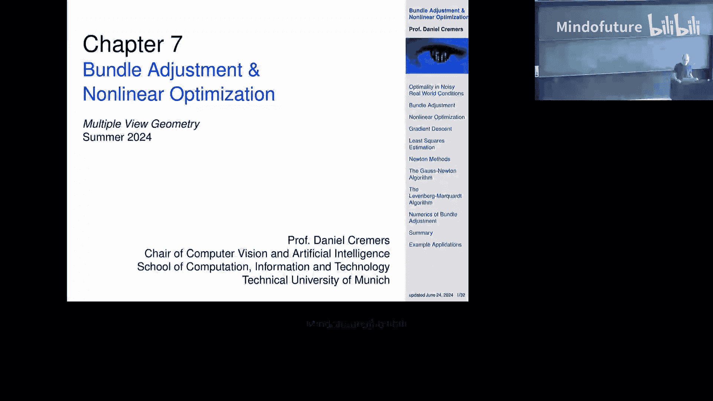
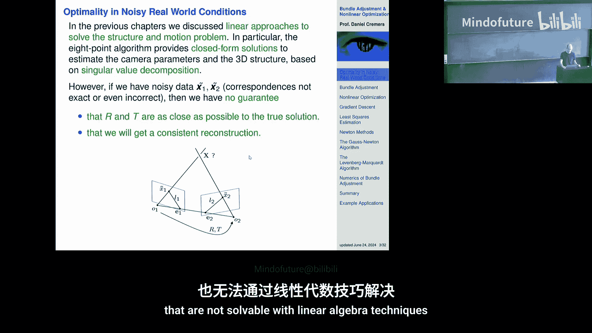
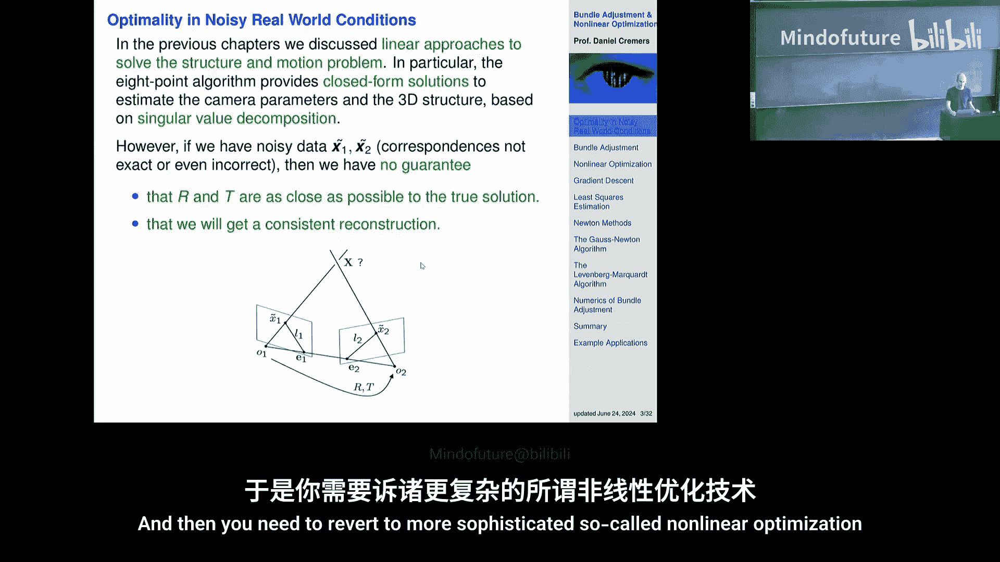
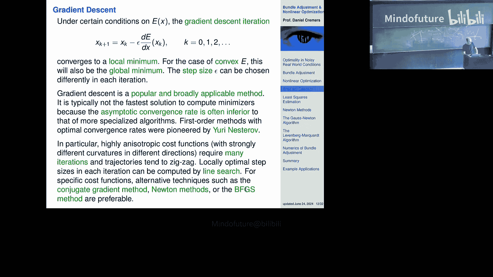

# 013：捆绑调整与非线性优化 - 第1部分

在本节课中，我们将要学习一种解决相机三维重建问题的更实用方法——捆绑调整。我们将探讨如何通过建立并最小化一个损失函数，来同时估计相机运动和三维结构，并处理观测数据中的噪声和不确定性。

上一章我们以多视角几何的内容结束，这部分内容技术性较强且较为紧凑。现在，我们将进入第7章：捆绑调整。捆绑调整是一种解决相机三维重建问题的方法，在某些方面比我们之前讨论的八点算法及其多视角扩展更为实用。本章篇幅较长，并且相比往年授课内容，我进行了一些修订，特别是加入了关于捆绑调整数值计算方面的一些最新进展。

## 动机：为何需要捆绑调整？

在之前的章节中，我们讨论了解决结构与运动问题的线性方法，特别是**八点算法**。该算法利用**奇异值分解**这一线性代数技术，提供了一个闭式解来同时估计相机运动和三维结构。

其核心思想是：我们观测到两幅图像中的**八个对应点**，然后尝试从这些对应观测中恢复相机运动和三维结构。关键挑战在于，我们做了一个非常强的假设——我们恰好看到了八个对应点。我们之前讨论过估计对应关系本身的挑战，并指出这并非易事，存在光流算法来计算这种成对对应关系。

但随之而来的问题是：如果一开始的对应关系在某种程度上并不完美，该怎么办？实际上，我们可以区分几种不完美的情况：
*   首先，如果你观察的是具有重复结构的东西，比如这里的墙壁、天花板上的瓷砖或棋盘格图案，那么你有可能找到一个点并能精确定位它，但你分配为对应点的可能是错误的那个。因为你看到的不是同一块瓷砖，而是旁边的一块。这可以看作是一种**错误匹配**。
*   另一种情况是，你找到了正确的点，但定位并不精确。这可能发生在图像中纹理较少的区域（如地板），在这些区域找到一个点并在另一幅图像中重复找到它非常困难，因此你可能会略有偏差。

那么问题来了：如果在八点算法中使用的对应点对集合受到了扰动而不精确，会发生什么？用符号表示，我们可以说我们有真实的点 `x1` 和 `x2`，但我们实际观测到的是带噪声的数据 `x1_tilde` 和 `x2_tilde`。它们并不精确地位于应有的位置，而是略有偏差。它们可能不精确，甚至可能是错误的。

在八点算法中，我们面临的问题是：旋转和平移的解可能无法尽可能接近正确解，并且重建结果可能不一致。因此，问题是：我们如何确保即使在有噪声的条件下，这些重建方法仍然有效？要解决这个问题，你需要更明确地对噪声进行建模。但一旦这样做，你就会得到无法用最小二乘法或线性代数技术求解的损失函数，这时就需要转向更复杂的**非线性优化技术**。

在本章中，我们将首先介绍捆绑调整这一框架，它允许考虑观测中的噪声和不确定性。然后，一旦建立了这个损失函数，我们将讨论非线性优化技术，包括梯度下降、最小二乘估计、牛顿法、高斯-牛顿法、列文伯格-马夸特算法等大量用于求解损失函数的数值算法。这些算法非常重要，因为它们是许多当前最先进重建方法的核心。之后，我们将回到捆绑调整问题，讨论如何将这些技术应用于捆绑调整，并进行总结，最后展示这些捆绑调整技术在实际图像中的应用。

## 应对噪声的统计方法

如前所述，我们在上一章讨论的线性方法（特别是八点算法）非常优雅，因为它们为问题提供了最优解。我们可以闭式求解，可以说，如果你计算与最小奇异值相关的特征向量，就能得到解，这被称为**闭式解**。这类方法通常很好，因为你不需要近似，可以直接计算精确解。

但问题是，你计算的解是针对一个并非真正“正确”的代价函数。这是计算机视觉中的一个普遍问题，不仅在三维重建中，在许多其他领域也是如此。你基本上面临两种选择：要么找到可以精确求解但可能并非你想解决的问题；要么找到你想解决但无法获得精确解的问题。这是一个常见的困境，我们必须在可以闭式求解的问题和我们真正想解决的问题之间做出妥协。

换句话说，你可以尝试解决你真正想解决的原始问题，但只能找到近似解；或者你可以找到一个与你想要的损失函数相似但不完全相同的损失函数，并找到它的精确解。这里存在一种权衡：如果我们近似损失函数，我们可以找到精确解；如果我们不想近似损失函数，就必须计算近似解。

因此，这里的核心挑战是确保方法在嘈杂的真实世界条件下仍然有效。像八点算法这样的谱解法通常不考虑噪声和不确定性，这种现象实际上远不止于三维重建领域。事实上，在很多不同问题的报告和演示中，都有人提倡谱解法，声称将问题以某种方式表述后，解就是最大或最小特征值对应的特征向量。这是一种非常常见的解决问题策略，但它几乎总是忽略了不确定性和噪声。

你可以考虑这些因素，并且存在许多框架允许你这样做。如果你对此有更深入的阅读兴趣，有所谓的**贝叶斯公式**、**最大后验估计**等方法。我不想过多深入细节，但它们都建立在19世纪牧师托马斯·贝叶斯提出的所谓贝叶斯公式之上，这是非常古老的思想。

他的思想是：给定这些带噪声的二维坐标观测值 `x_tilde`，希望估计或最大化具有真实二维坐标 `x` 和相机运动 `R`、`T` 的概率。也就是说，**在给定这些噪声观测的情况下，找到正确的二维坐标和正确的相机运动**。然后，你可以基于所谓的贝叶斯公式重新表述这个问题，即最大化两个概率的乘积：一个是在给定真实观测和相机运动的情况下观测值的似然概率，另一个是二维坐标和相机运动的先验概率。

这有点复杂，因为如果要应用它，你必须对旋转、平移和二维坐标的空间建立先验概率模型。这并不容易，因为正如我们之前讨论的，旋转存在于一个流形中，即刚体运动的流形（旋转和平移）。人们可以尝试处理这个问题，并在这些空间上对这些概率分布进行建模，这是一种方法。

但如果你假设这里的似然是**高斯分布**的，即观测点围绕真实二维点呈高斯分布，那么这种方法会导致一个如下形式的优化问题：最小化观测二维坐标与真实坐标之间的二次差异。其中，`pi(Xj)` 是三维点 `Xj` 在第一幅图像中的透视投影，`pi(R, T, Xj)` 是点 `Xj` 在第二幅图像中的投影（需要先进行旋转和平移）。这些是通过将三维点投影到图像中得到的二维坐标，而 `s` 函数表示它们应该接近我观测到的位置。

这是与八点算法的关键区别。在这里，我们明确地有一个代价函数，它表示模型预测的二维点应该接近测量到的二维点。它们不必完全相同，但应该在一定范围内，并通过这里的二次损失来衡量。因此，我们有一个损失函数，它表示：我有一个三维点，将其投影到成对的图像中，然后说在第一幅图像和第二幅图像中观测到的二维坐标应该接近，在最小二乘意义上接近。因此，你最小化的是观测二维坐标 `x_tilde` 与投影的三维坐标（相对于相机1或相机2）之间的所谓**投影误差**或**重投影误差**。

如前所述，`pi(R, T, Xj)` 基本上意味着 `pi(R * Xj + T)`，这是投影到第二幅图像。目前这是针对两幅图像的损失函数，这被称为**捆绑调整**。我稍后会谈到捆绑调整的历史，它实际上是一个相当古老的方法，直到几个月前我才知道这种捆绑调整方法至少有110年的历史，比计算机的出现要早得多。人们可能会好奇为什么在计算机出现之前人们就研究这个，我稍后会讲到。

这是针对两幅图像的损失函数：这是投影到第一幅图像，这是投影到第二幅图像。你可以看到一个损失函数，它告诉你这些端点的投影与两幅图像中的匹配程度，它们与二维观测的一致性如何。因此，我们现在要做的是：找到相机的旋转和平移，并找到你的端点（三维点 `X1` 到 `XN`）的三维位置，使得这些点投影到这些图像中与我们所拥有的二维观测一致。

这是针对两幅图像的情况，并且很容易推广。你可以看到这是对端点的求和，有两个残差测量与投影到两幅图像的差异。你可以通过求和从1到M（所有图像）来推广到M幅图像。对所有图像求和，然后对你的端点求和，然后说 `x_tilde_ij` 是点 `j` 在图像 `i` 中观测到的二维坐标，它应该与点 `X` 在图像 `i` 中的旋转、平移和投影 `pi` 一致，然后使用二次惩罚来衡量这种差异。

这里有一个小方面使其在实践中更适用：如果你有端点并在图像中观测它们，显然你通常不会在每个图像中都看到每个点。当你移动相机时，你会在一段时间内看到一定数量的点，每个点将在一定数量的相机中被观测到。你可以在损失函数中通过变量 `theta_ij` 来考虑这一点，如果点 `j` 在图像 `i` 中可见，则 `theta_ij` 为1，否则为0。问题显然是你如何知道一个点是否可见？一种方法是，如果你有一组图像，你可以手动确定点是否在图像中；或者你必须通过对应关系估计算法来估计这一点，如果你没有找到对应的伙伴，那么你只需将此变量设为零。但在实践中，你可能也想与所有其他参数一起估计这些变量，但有一个注意事项：如果你将这个变量 `theta` 放入损失函数（即未知数中）并估计它，显然你不希望算法将所有点的 `theta` 都设为零，因为那样整个损失函数将变为零。所以你必须以某种方式强制规定一定数量的点实际上是可见的，否则这将无法工作。但原则上，这就是损失函数。因此，你可以联合估计所有图像的所有旋转和平移，以及从1到n的所有点。

就像在八点算法中一样，我们试图估计相机运动和三维结构，并且能够先解耦估计相机运动，再估计三维结构。在这里，我们也估计相机运动和三维结构，但它是在一个单一的优化问题中。实际上并不容易解耦，甚至不可能在这里分离结构和运动。我们必须小心一点。现在，我们进入了一个人们主要使用深度网络来解决问题的时代，我发现这种通过最小化损失函数来确定解决方案的方法变得不那么常见了，因此学生们通常不太熟悉最小化损失函数或能量的概念。这个想法确实是建立这个损失函数，然后计算参数（旋转、平移和三维坐标），使这个损失变小。

一旦你这样做，任何部署优化技术的人都需要问一个关键问题（这被称为优化技术，因为你建立了一个损失函数，然后说你的未知数是使这个损失最小化的参数）：**损失函数是凸的吗？** 因为如果损失函数是凸的，那么你可以找到最优解。如果你的损失函数不是凸的并且有很多局部最小值，那么就困难得多。我认为凸损失函数是这样的：凸的。所以这里是你的解空间，这里是你的损失（通常称为 `E` 表示能量）。如果这是凸的，那么最优解可以被找到，你只需从任何地方开始，基本上就是滚下山坡，这可以在机器中建模，然后你可以找到成本最低的配置。

但如果你的损失函数不是凸的，那么实际上就不那么容易找到这个最优解了。困难在于，通常解空间不像这张图片中那样是一维的，而是有很多维度。如果我们想计算最小值，当然，在一维中，你可以直接采样这个损失函数并评估它，直到找到一个点，至少在某个离散化程度上，你可以说，我将尝试所有这些解，然后取成本最低的那个。如果你对整个空间采样足够精细，在一维中你可以做到。但在高维中，这种所谓的**完全搜索策略**不再有效。

那么维度是多少？有两件事你需要问自己：首先，我解决的问题的维度是多少？其次，问题是凸的吗？这基本上是因为如果只是一维，那么你不在乎，你可以进行完全搜索；如果是二维，仍然可以；三维，也许也可以。但在某个点上，它开始变得棘手。这里的维度是多少？让我们看看。这是我们的损失函数。旋转和平移。这是六个参数，对吧？三个用于旋转，三个用于平移。所以未知数的数量等于每个相机的旋转和平移的六个参数，我们有 `M` 个相机，所以乘以 `M`。加上，然后我们有三维坐标，那是一个三维向量乘以大 `N` 个点。因此，如果你有成千上万个点或数百万个点以及成千上万个相机，这就是一个大问题。而且，不幸的是，它不是凸的。

如果我们看这个损失函数，有两个缺点。首先，我们有很多未知数。其次，损失函数不是凸的。它看起来是凸的，因为你这里有一个二次项。正如你所知，二次项看起来像那样。这是一个函数，本质上是 `s` 的平方。二次项是好的，但需要注意的是，它并不真正是二次的。你知道，在外表上是二次的，因为你这里有平方，但在这个残差内部。这以高度非线性的方式依赖于旋转、平移和三维坐标。这里有刚体运动，有透视投影。我们讨论过的所有东西都包含在这里。因此，如果你将其绘制为未知数的函数，它不再是凸的。这是一个大问题。

在某种程度上，这就是人们开发线性八点算法的原因，因为它规避了这个问题。它将一切都表述为一个特征值问题，然后你就完成了。一步到位，很简单。这里，它很棘手。但问题是，正如我提到的，这个八点算法并不最小化正确的损失函数。它不最小化这个特定的损失。所以我们必须研究如何最小化这种损失函数。

但在我们这样做之前，也许让我提一下，有不同的方法来参数化这个问题。这是一种方式，在某种意义上是最明显的方式：你有三维坐标，你有相机运动，你有这个二次差异。我们也可以采取一个稍微不同的观点。我们也可以说，与其估计三维坐标，我将在第一幅图像中参数化所有东西，并估计图像1中的二维坐标。所以我们有这个问题，我们在两幅或更多图像中观察这个世界，然后与其存储三维坐标大 `X`，我们也可以存储，比如说 `x`。我必须确保索引位置正确。

之前我们讨论的是三维坐标 `Xj`。你也可以有图像1中的二维坐标，然后用这个深度 `lambda_1j` 来缩放它们。那么，大 `Xj` 就等于 `lambda_1j * xj`。然后，真实的二维坐标应该接近图像1中测量到的坐标。我通过取这个点大 `X`（即 `lambda` 乘以小 `x`），旋转、平移，然后透视投影，得到图像2中的对应点。因此，我现在做的是取这个小 `x_j`，在这里缩放它，然后投影到另一个图像中。然后它应该匹配二维观测，或者在相同的最小二乘意义上接近。所以，正如你所看到的，这确实是完全相同的损失函数：两个残差测量点在图像1和图像2中的差异，只是不是从这里开始，而是从这里开始，然后我寻找二维点和未知的深度。

这是一种替代方案，至于它是否更容易或更困难是另一个问题。但正如你所看到的，我们也可以用这种方式表达它。对于两幅图像的情况，显然对于M幅图像的情况也类似。另一件我们可以做的事情是，我们可以基本上说，我们有测量到的二维坐标和真实的坐标，对于所有图像 `i`（从1到2，在两幅图像的情况下）和所有点，这些应该在最小二乘意义上一致，然后我们知道这些二维坐标满足**极线约束**。所以这里是对所有点 `j` 从1到 `n` 的极线约束。然后我们说，此外，如果我们用齐次坐标表示它们，图像1和图像2中的点的第三个分量应该是1。

这是参数化它的另一种方式。这里的不同之处在于，我们有一个损失函数，然后受限于一组约束。在优化中，通常你可以指定一个损失函数，并指定某些约束，这被称为**约束优化问题**。这里你有一个**无约束损失函数**。原则上，是无约束的，但如果你仔细观察，你会发现我们正在对旋转和平移进行优化。问题是你如何表示它们。如果你将 `R` 表示为一个3x3矩阵，那么它也必须满足约束，它必须在 `SO(3)` 中，对吧？因此，根据你如何参数化 `R`，这也会成为一个约束优化问题。

所以你可以看到有不同的方式，我向你展示这些是因为根据你阅读的论文，有时他们会这样介绍捆绑调整，有时针对M幅图像像这样，但有时也像那样，但本质上都是同一件事。这是一个很好的问题：哪种表示更可取？我必须说我最喜欢最下面这个。因为它最简单。因为我不是从2D开始，然后到3D，再回到2D，而是直接用它我关心的参数来表述：我想知道三维点，所以我把它们放在这里；我想知道相机运动，然后我有这个相当紧凑的损失函数。

然后，我通常不太喜欢约束优化，无约束优化问题通常更容易处理，你只需有你的参数，它们可以取任何值，你不必担心它们是否会离开可行配置的空间。所以你可以这样做：无论哪里有 `R`，你都会插入这个李代数编码，基本上将所有 `R` 写成这个反对称3x3矩阵 `w_hat` 的指数，然后将你的旋转的三个自由度参数放入这个反对称矩阵 `w_hat` 中，然后将其插入到损失函数中 `R` 出现的任何地方。这样你就得到了一个完全无约束的问题，每个相机的旋转有三个自由度，平移有三个自由度，每个点的三维坐标有三个参数。然后这是一个完全无约束的问题。然后你必须找出部署哪种算法来解决它。

所以那将是我的偏好。那么你有了一个损失函数，比如说最下面这个，对吧？问题是我现在如何估计这些未知数？这把我们带到了一个非常普遍的领域……哦，等一下。在我进入非线性优化之前，我确实想提一下捆绑调整的历史，因为它很有趣，因为它很悠久，而且令人惊讶的是，它与慕尼黑工业大学紧密相连，因为你会发现很多这方面的研究实际上大约100年前就在慕尼黑工业大学开创了。所以我们很大程度上是追随我们祖先的脚步。

捆绑调整这一领域或主题出现在传统上称为**摄影测量学**和**大地测量学**的领域。为了给你更多信息，摄影测量学（Photogrammetry）中，“photo”是照片，“grammetry”意味着你测量某些东西，即从照片中测量某些度量数量。事实上，这一切始于人们将相机放在飞机上，飞越这里的阿尔卑斯山，并尝试询问：我们能否使用这些照片从图像中重建阿尔卑斯山的三维结构？因为如果我们能做到，那将省去很多麻烦，你不必亲自去大自然中用尺子之类的东西测量。一百年前，你如何获得世界地形图？那时没有激光扫描仪，但你有照片，所以问题出现了：我们能否利用这些照片来了解我们生活的世界？大地测量学是关于测量我们生活的世界的。

至今，慕尼黑工业大学仍有摄影测量学和大地测量学的教席。所以从一开始，这就是慕尼黑工业大学的核心。事实上，慕尼黑工业大学的创始人，我直到最近才意识到，他是一位地质学家，他创建了慕尼黑工业大学，所以当他创立我们的大学时，他显然已经考虑到了这个挑战。

捆绑调整方法的思想是，你试图估计点的三维坐标和相机运动。通常是刚体运动，但你也可以估计内参校准参数，比如径向畸变等许多我们讨论过的东西。你可以把它们全部放入同一个损失函数中，并一起估计所有参数。我们看到，你可以用概率分布对这些不确定性、噪声进行建模，零均值高斯噪声是最常见的假设，这给出了我们看到的二次损失函数。在某种意义上，这里我有一个残差的平方。

为什么它被称为捆绑调整？在德语中是“Bündelausgleich”。人们使用的这个术语的想法是，你有一束光线击中你的相机图像，你尝试调整它们，使它们与某些东西一致。所以你有从这里和这里来的光束，它们应该匹配正在被观测的一些三维点，你同时优化刚体运动和这些点的正确位置，使得二维观测一致。这被称为捆绑调整。

通常我们会看到，为了推断三维位置和相机运动而出现的这些优化问题是**非凸的**，并且它们是用所谓的**非线性最小二乘**方法解决的。有一篇经常被引用的综述论文，来自1999年，其中一些作者仍然活跃在社区中，比如Bill Triggs、Richard Hartley、Andrew Fitzgibbon。例如，我相信Richard Hartley上周就在CVPR，不过我不太确定。

以下是开创这些工作的一些人。首先，我提到了慕尼黑工业大学的创始人Karl Max von Bauernfeind。他不仅是慕尼黑工业大学的创始人，还是一位大地测量学家。所以他对测量地球相关的事物感兴趣，并且他坚信，这也是创建慕尼黑工业大学的核心，他相信将工程师和数学家聚集在一起实际解决这类问题。因为你需要工程师来了解现实世界的挑战，并可能以优化问题的形式表述它，但然后你可能需要应用数学家来展示如何实际最优地解决这些问题。

然后是Eduard Dolezal，他在1910年在离这里不远的维也纳创立了国际摄影测量与遥感学会。所以110多年前，人们就在摄影测量学领域工作，并创建了第一个国际学会，这通常真正显示了某个主题的重要性。

然后有一个人被认为是解析摄影测量的先驱，一位名叫Sebastian Finsterwalder的研究员。他发展了从特征点估计相机方向的思想。它被称为解析摄影测量，因为人们没有计算机，对吧？我们说的是100年前。所以他们实际上建立了这些损失函数，并尝试用纸和笔解析地计算，通常需要很多年才能从一组图像中重建出某些东西。Sebastian Finsterwalder曾是慕尼黑工业大学这里的教授。同样，下面的Otto von Gruber，他开发了解决这些非线性最小二乘问题的技术。他也曾是慕尼黑工业大学的教授。然后是叫做Reer的人，他提倡使用向量代数、代数和射影几何。

还有一个叫Helmut Schmid的人。他不在慕尼黑工业大学，但我想在苏黎世联邦理工学院。他在1945年第二次世界大战后去了美国。所以捆绑调整的整个历史与20世纪的历史紧密相连。他在战后移民了。与一群火箭科学家一起，他们从德国去了美国。在那里，他们与一个名叫Duane Brown的人合作，并将这些在欧洲开发的非线性最小二乘技术部署在他们那个时代最大的计算机上，时间在1952年到1955年之间，地点在弹道研究实验室。

事实上，当我开始研究捆绑调整时，我在维基百科上读到，通常，你可能也认为维基百科什么都知道，它会告诉你一切的起源。嗯，结果既是也不是。但当我开始查阅维基百科时，大多数资料只是说，哦，捆绑调整是在20世纪50年代发展起来的。这就是我在社区里多年来听到的：捆绑调整方法是在20世纪50年代发展起来的。如果你深入研究，人们会说，哦，是一个名叫Duane Brown的人发明的。然后你下载Duane Brown的论文阅读，他会以某种方式说，嗯，这一切在20世纪50年代之前就已经发展起来了。但“到20世纪50年代”与“在20世纪50年代”不同，对吧？然后我开始深入研究。你知道，我发现资料往往很肤浅，不幸的是，人们经常写关于某事的论文，但并不真正披露这些想法的来源。但我认为追踪想法出现的地方很重要。

这就是为什么我深入研究，并发现了所有这些先驱者，他们实际上为后来Duane Brown和Helmut Schmid所采纳并在他们时代的超级计算机上部署的工作奠定了基础。以下是其中一些先驱者。正如我所说，这是Helmut Schmid和Duane Brown，他们是首先在计算机上部署这些技术的团队。但这些非线性最小二乘方法的基础实际上是由像Sebastian Finsterwalder和Otto von Gruber这样的人奠定的，他们都是慕尼黑工业大学的教授。关于它的历史就讲这么多。你知道，在计算机视觉中我们很少追溯这么远的历史。但在这里，故事开始于计算机出现之前很久。

现在我们有了这个非线性最小二乘估计问题，即捆绑调整问题，我们如何解决它？有很多文献关于它，这里只是几本书，如果你决定对它更感兴趣的话。有许多数值技术来解决优化问题，这些是经典教科书，比如Bertsekas的《非线性规划》、Nocedal和Wright的《数值优化》或Luenberger的《线性与非线性规划》。

问题是，并非只有一种算法能做所有事情。嗯，有一种算法能做很多事情，但不是所有事情——**梯度下降算法**。谁听说过梯度下降？哦，每个人。很好，因为你知道，当你训练神经网络时，你应用的核心也是梯度下降，对吧？这是优化的标准主力。你可能会问，如果你有梯度下降，为什么还需要其他方法？嗯，梯度下降的好消息是它总是有效，如果你的损失函数是可微的。所以如果你能计算梯度，你就可以应用梯度下降，它会让你下坡。你可以从这里开始，你会到达这个点，你知道这不是正确的解，但这是一个还不错的解，对吧？所以梯度下降总是有效，但通常不是最快的算法。

所以在优化中，你关心两件事：一是你想要最优解，而不仅仅是局部最优，最好是全局最优；其次，你想要快速得到它们。因为，你知道，你不想永远等待机器计算出解。对于这两点，梯度下降通常不一定是首选方法。所以梯度下降通常是你不知道更好的方法时的选择，这有点像你总是从它开始的普通算法。一旦你对正在优化的损失函数有了更多了解，你就会转向更有针对性的算法，这可能是牛顿法、高斯-牛顿算法或其变体列文伯格-马夸特算法。还有更多优化算法，但为了简单起见，我将重点介绍这些，因为它们都以某种形式相关。即使其他算法，也有所谓的非光滑优化技术，可以应用于不可微问题，但最终它们都包含梯度下降的元素。所以梯度下降是优化的典型方法。

## 梯度下降法

以下是它的工作原理，我会保持简短，因为显然你们都听说过这种技术。它旨在计算一个通常是非凸的代价函数的局部最小值，它所做的是迭代地向下走，直到损失不再进一步减少。你想朝着损失下降最快的方向前进。所以，如果这些是等损失线，你想下山。这很像如果你在阿尔卑斯山徒步旅行，你想到达山谷底部，最快（但不一定最好）的方式是直走。可能会在半路上出事，所以如果你在多洛米蒂山，不要尝试梯度下降，你知道的。但如果你的目标是最快下山，那么是的，当然，你可能在下山时就没命了，但会很快。

那么它在数学上是如何工作的呢？这是我经常注意到的一点：人们有直观的理解，但往往没有数学表达式来形式化这个过程。你有一个损失函数 `E`，你有未知数 `x`（假设只是一个，或者如这里所示可以是n维的），你想找到一个向量 `x` 使得 `E` 最小化。所以你从一个初始 `x` 开始，并引入一个时间 `t`。这里，最初在时间0，你从某个初始解 `x0` 开始，例如在这个例子中，你从 `x0 = 2` 开始。然后你有一个这种形式的微分方程，它说 `x` 随时间的变化由能量的负梯度给出：`dx/dt = -dE/dx`。

这个随时间的变化 `dx/dt`，你实际上可以近似为 `x` 在时间 `t+1` 减去 `x` 在时间 `t`。如果你代入这个并解出 `x` 在时间 `t+1` 或这里写的 `k+1`，那么你得到 `x_{k+1} = x_k - ε * dE/dx`，这里的 `ε` 是一个步长。所以它基本上是说：取旧的估计值，减去 `ε` 乘以 `dE/dx`，这个 `ε` 在神经网络中通常称为**学习率**，或一般称为**步长**。这就是思想。然后你可以迭代它，它基本上会让你下山。然后你可以问，我如何选择步长 `ε`？这本身是一门艺术。

这是梯度下降的更新方程。所以从 `x0` 开始，你迭代地估计 `x1`, `x2`, `x3`, `x4`，并持续迭代这个方程。你可以在每次迭代中选择不同的步长。如果损失函数是凸的，就像这个例子中一样，这最终会让你达到最优解。

如前所述，梯度下降很流行，它是一种广泛适用的方法，但通常不是计算最小化器的最快解决方案。你可以研究算法的收敛速度。我认为这个领域的领先先驱之一，我也曾见过一次，是Yurii Nesterov，他研究了所谓**一阶方法**的收敛速度。“一阶”意味着使用损失函数一阶导数（如这里的梯度）的方法。如果你使用二阶导数，这些被称为牛顿法，然后你谈论二阶方法。但这些基于梯度的方法被称为一阶方法，有大量关于一阶优化方法的文献，然后你可以研究不同的收敛速度，即用相应方法达到最优解的速度，而梯度下降通常不是最快的。

此外，如果你的损失函数是高度各向异性的，并且你有一个，比如说，看起来像这样的能量景观（这些是弯曲的等能量线），那么如果你做梯度下降，也许你的最小值在这里，但如果你从这里开始，它会先进入这个山谷，然后沿着这个山谷走很多步，几乎要花永远才能到达那里。这是所谓的“之字形”现象。所以人们在不同背景下对此进行了大量研究，即梯度下降在其普通形式下可能需要很多次迭代。

有更聪明的技术，例如，像**线搜索**这样的技术。如果你不知道如何选择 `ε`，你可以说：好的，我从迭代 `x_k` 开始。这是我的 `x_k`。然后梯度说最小值应该在这个方向的某个地方。假设这是负的能量梯度，那么我可以做的是，与其采取一个特定的 `ε`，我可以进行完全搜索，正如我在一维中提到过的，完全搜索很快。我只是沿着这个方向尝试所有可能的解。这被称为线搜索，原因很明显，因为你沿着这条线搜索。所以你可以进行带线搜索的梯度下降，那可能会快得多，因为你不是在那个方向上采取启发式步长，而是采取该方向上的最优步长。

但还有很多其他损失优化技术，例如，所谓的**共轭梯度法**是一个流行的候选方法，你总是试图在每次迭代中找到彼此正交的方向；还有牛顿法，正如我提到的，这些是二阶方法；另一个流行的方法是BFGS方法。因此，根据你正在处理的损失函数，不同的算法可能更合适。

本节课中我们一起学习了捆绑调整的基本概念及其重要性，它通过建立考虑噪声的损失函数来改进三维重建。我们探讨了该损失函数的多种参数化形式，并回顾了其悠久的历史渊源。最后，我们介绍了解决此类非线性优化问题的基本方法——梯度下降法，并指出了其优缺点，为后续学习更高效的优化算法奠定了基础。