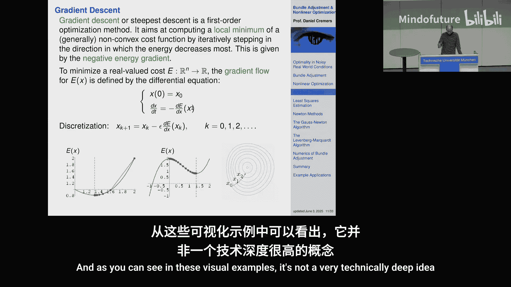
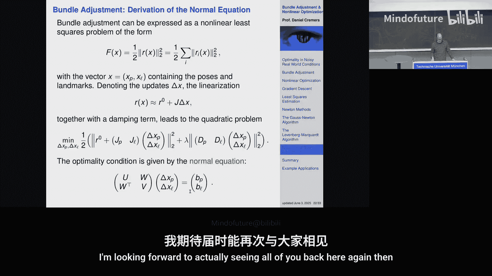

# 014：捆绑调整-非线性优化（第二部分）

在本节课中，我们将继续学习捆绑调整，并深入探讨用于解决非线性最小二乘问题的几种核心优化算法。我们将从简单的线性最小二乘问题出发，逐步介绍梯度下降、牛顿法、高斯-牛顿法以及莱文贝格-马夸特算法，并理解它们如何应用于像捆绑调整这样的复杂问题。

## 从梯度下降到更高效的方法

上一节我们介绍了梯度下降法，它是一种通过迭代地向梯度反方向移动来寻找函数最小值的通用方法。然而，对于许多实际问题，损失函数并非凸函数，这意味着可能存在多个局部极小值，梯度下降法可能只会收敛到其中一个。

本节中，我们将关注具有特定结构的损失函数，并探索更高效的优化算法。

## 线性最小二乘估计：一个基础案例

以下是线性最小二乘估计的基本概念。假设我们有一个线性模型，其中输入向量 **b** 与输出向量 **a** 的关系由参数向量 **x** 描述，并附加了高斯噪声 **η**：

**a = bᵀx + η**

通常，我们假设噪声 **η** 服从均值为零、协方差矩阵为 **Σ** 的高斯分布。为了简化，我们常假设 **Σ** 是对角矩阵，即 **Σ = σ²I**。

通过最大似然估计来求解未知参数 **x**，等价于最小化一个二次损失函数，即普通最小二乘问题：

**minₓ ||a - Bx||²**

其中，**B** 是由所有输入向量 **b** 组成的矩阵。

当考虑更一般的噪声协方差矩阵 **Σ** 时，问题变为广义最小二乘：

**minₓ (a - Bx)ᵀ Σ⁻¹ (a - Bx)**

如果协方差矩阵 **Σ** 是对角矩阵，则称为加权最小二乘问题，其对角元素（权重）为 **σᵢ⁻²**。

## 迭代重加权最小二乘法

有时，权重本身依赖于解 **x**。一个重要的例子是鲁棒估计，其损失函数不是平方误差，而是绝对误差：

**minₓ Σᵢ |aᵢ - fᵢ(x)|**

这可以改写为一个加权最小二乘问题，其中权重 **wᵢ(x) = 1 / |aᵢ - fᵢ(x)|**。由于权重依赖于 **x**，我们可以采用迭代求解策略：

1.  固定当前迭代的权重 **wᵢ(xᵗ)**。
2.  求解加权最小二乘问题以更新 **xᵗ⁺¹**。
3.  用新的 **x** 重新计算权重。

这种方法称为迭代重加权最小二乘法。虽然它在实践中效果很好，但需要注意的是，由于问题整体通常是非凸的，算法只能保证找到局部最优解。

## 非线性最小二乘与捆绑调整

现在，我们来看更一般的形式：非线性最小二乘估计。其目标是：

**minₓ Σᵢ rᵢ(x)²**

其中，**rᵢ(x)** 是依赖于参数 **x** 的残差函数。这正是捆绑调整问题的形式：**rᵢⱼ(x)** 表示第 **j** 个三维点在第 **i** 个相机视图中的投影位置与观测到的图像位置之间的差异。

通过将导数设为零，我们得到最优性条件：

**Σᵢ rᵢ(x) * (∂rᵢ(x)/∂xⱼ) = 0, 对于所有 j**

由于这个方程通常无法直接解析求解，我们需要迭代算法。

## 牛顿法：利用二阶信息

牛顿法的核心思想是：在当前位置 **xᵗ**，用二阶泰勒展开（抛物线）来局部近似损失函数 **E(x)**：

**E(x) ≈ E(xᵗ) + gᵀ(x - xᵗ) + ½ (x - xᵗ)ᵀ H (x - xᵗ)**

其中，**g** 是梯度向量，**H** 是海森矩阵（二阶导数矩阵）。然后，我们直接跳到这个抛物线的极小值点，该点可通过求解线性方程组得到：

**xᵗ⁺¹ = xᵗ - H⁻¹ g**

与梯度下降法 **xᵗ⁺¹ = xᵗ - ε g** 相比，牛顿法用海森矩阵的逆 **H⁻¹** 替代了固定步长 **ε**，实现了自适应的、通常更快的收敛。然而，牛顿法需要计算并求逆海森矩阵，这在问题规模很大时计算代价高昂，并且要求海森矩阵正定才能保证更新方向正确。

## 高斯-牛顿法：针对最小二乘的简化

对于非线性最小二乘这一特殊形式，我们可以推导出一个更实用的算法：高斯-牛顿法。它是对牛顿法的近似。

回顾我们的损失函数 **E(x) = Σᵢ rᵢ(x)²**。其梯度和海森矩阵为：
*   梯度 **g = 2 Jᵀ r**，其中 **J** 是残差 **r** 对参数 **x** 的雅可比矩阵。
*   海森矩阵 **H = 2(JᵀJ + Σᵢ rᵢ ∇²rᵢ)**。

高斯-牛顿法的关键**近似**是忽略海森矩阵中涉及残差二阶导数 **∇²rᵢ** 的项。这基于两种合理假设：
1.  在最优解附近，残差 **rᵢ** 很小，使得该项可忽略。
2.  残差函数 **rᵢ(x)** 接近线性，其二阶导数本身接近零。

在此近似下，海森矩阵变为 **H ≈ 2 JᵀJ**。代入牛顿法的更新公式，得到高斯-牛顿法的更新规则：

**xᵗ⁺¹ = xᵗ - (JᵀJ)⁻¹ Jᵀ r**

高斯-牛顿法的**优势**在于：
*   只需计算残差的一阶导数（雅可比矩阵 **J**），无需计算二阶导数。
*   近似的海森矩阵 **JᵀJ** 总是半正定的，这保证了更新方向的合理性。

## 莱文贝格-马夸特算法：自适应混合策略

莱文贝格-马夸特算法可以看作高斯-牛顿法与梯度下降法之间的一个自适应混合。它在高斯-牛顿法的更新公式中引入了一个阻尼因子 **λ**：

**xᵗ⁺¹ = xᵗ - (JᵀJ + λ I)⁻¹ Jᵀ r**

**算法行为分析**：
*   当 **λ → 0** 时，更新规则退化为高斯-牛顿法。
*   当 **λ → ∞** 时，矩阵 **JᵀJ** 的影响可以忽略，更新规则近似为梯度下降法，步长为 **1/λ**。

**策略**：在优化开始时，使用较大的 **λ** 值（更像梯度下降），以确保在远离最优解的区域稳定下降。随着迭代接近收敛，逐渐减小 **λ** 值（更像高斯-牛顿），以加速收敛。

马夸特进一步提出了一种改进，将阻尼项改为 **λ * diag(JᵀJ)**，即使用 **JᵀJ** 对角线元素的比例进行阻尼。这使得算法在损失函数呈各向异性（例如狭长的山谷状）时能更有效地调整不同参数方向上的步长，从而加快收敛。

## 总结与展望

本节课中我们一起学习了非线性优化的核心算法。我们从基础的线性与加权最小二乘出发，探讨了牛顿法如何利用二阶信息实现快速收敛，并针对非线性最小二乘问题推导出了更实用、只需一阶导数的**高斯-牛顿法**。最后，我们介绍了**莱文贝格-马夸特算法**，它通过自适应地混合高斯-牛顿法和梯度下降法的优点，成为解决像捆绑调整这类实际问题的强大且鲁棒的工具。

下一节，我们将具体讨论如何将这些算法应用于捆绑调整问题，并处理其大规模、稀疏的特性。