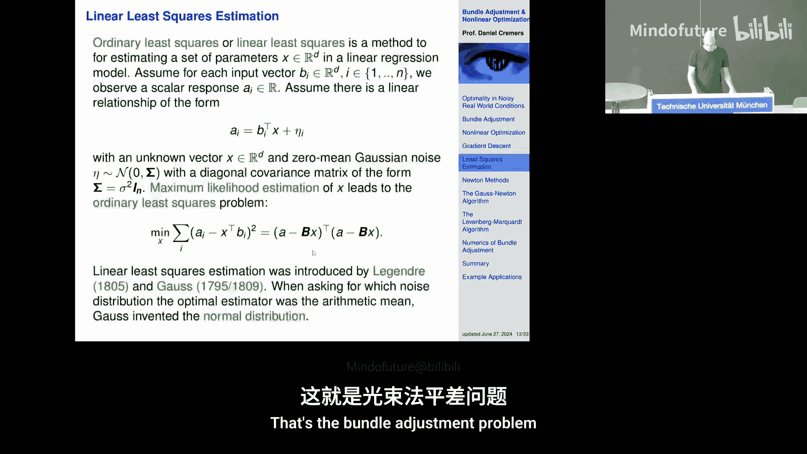
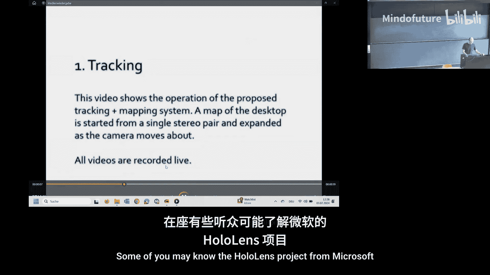
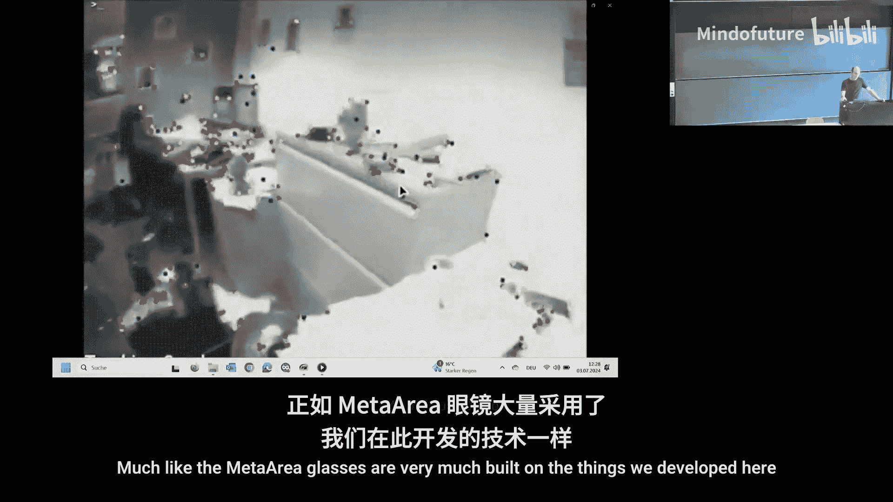
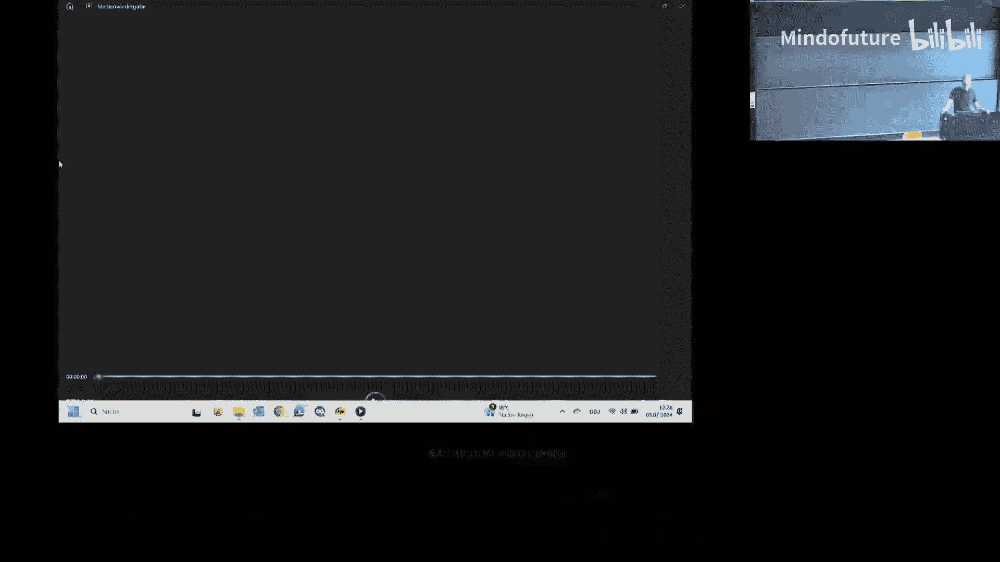
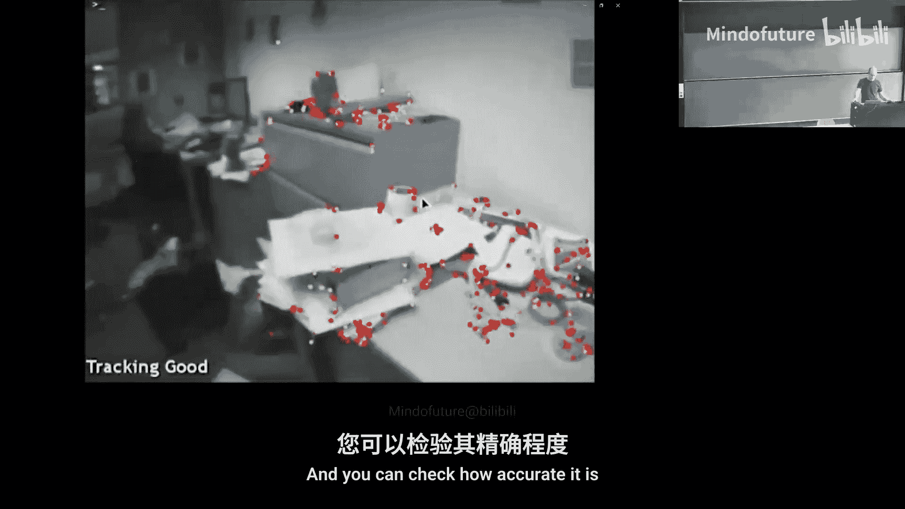
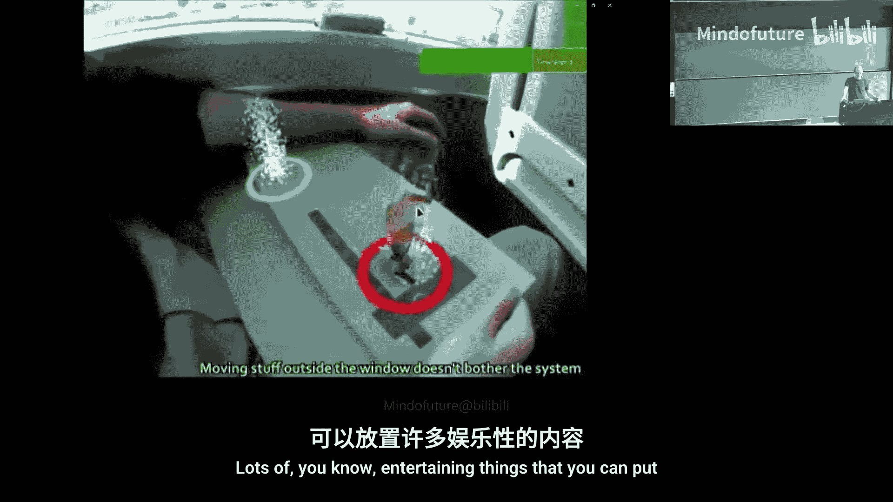
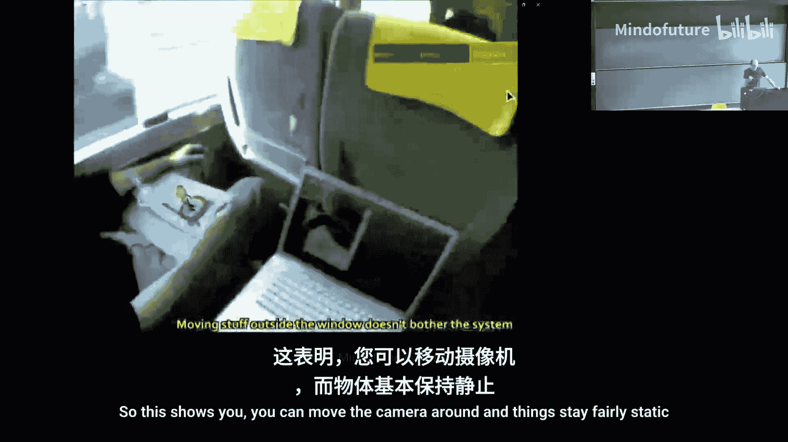
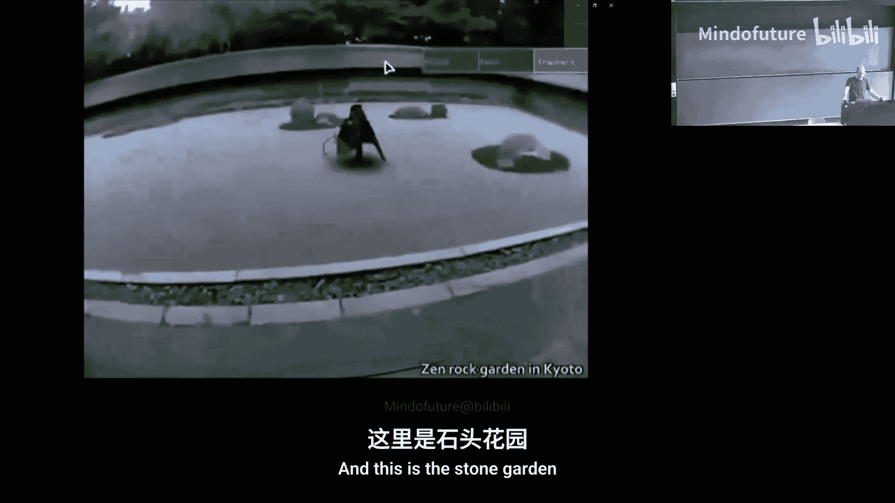
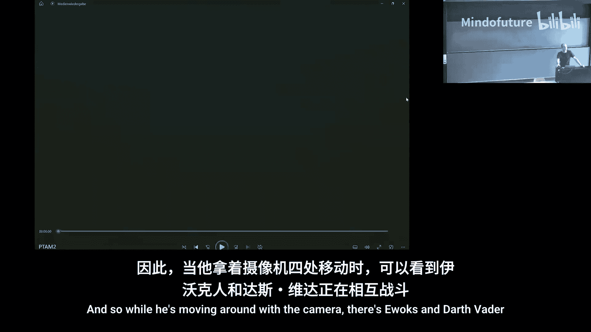
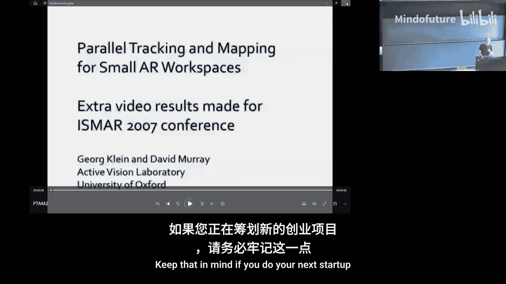

# 015：捆绑调整-非线性优化 第3部分 👨‍🏫

在本节课中，我们将学习捆绑调整问题的数值求解方法。我们将深入探讨如何通过非线性最小二乘优化，联合估计相机运动和三维结构，并介绍一种名为“幂捆绑调整”的新型高效求解算法。

---

## 概述

捆绑调整的核心思想是通过最小化一个损失函数，来联合优化相机运动参数和三维场景结构。这是一个典型的非线性最小二乘问题，因为观测到的投影点与根据相机参数和三维点计算出的投影点之间的残差，与未知参数（相机位姿、三维点坐标）之间的关系是非线性的。

上一节我们介绍了捆绑调整的基本数学模型，本节中我们来看看如何高效地求解这个大规模非线性优化问题。

---

## 损失函数与问题规模

捆绑调整的损失函数定义如下：

其中：
*   `m` 是图像数量。
*   `n` 是三维点的数量。
*   `θ_ij` 是一个指示变量，如果第 `j` 个点在图像 `i` 中可见则为1，否则为0。
*   `x_ij` 是在图像 `i` 中观测到的第 `j` 个点的二维坐标。
*   `π(·)` 是透视投影函数。
*   `R_i`, `t_i` 是第 `i` 个相机的旋转和平移参数。
*   `X_j` 是第 `j` 个三维点的坐标。

我们需要估计的参数总数是 `6m + 3n`（每个相机6个参数，每个三维点3个参数）。观测值的数量最多可达 `m * n`。随着图像和点数的增加，观测值的数量增长快于未知参数的数量，这有助于更好地约束重建问题。

---

## 非线性最小二乘求解算法

由于残差 `r` 是参数的非线性函数，我们面临的是一个非线性最小二乘问题，其一般形式为：
`min Σ || r(x) ||²`

对于这类问题，高斯-牛顿法及其变种是常用且强大的求解工具。

### 高斯-牛顿法

牛顿法通过在当前估计点拟合一个二次曲面（抛物面），并直接跳到该抛物面的最小值来进行更新，更新公式为：
`x_new = x_old - H⁻¹ * ∇f`
其中 `H` 是海森矩阵（二阶导数矩阵），`∇f` 是梯度。

对于我们的平方和损失函数，精确的海森矩阵计算涉及两项：
`H = JᵀJ + Σ (r * ∂²r/∂x²)`
其中 `J` 是残差对参数的雅可比矩阵（一阶导数）。

高斯-牛顿法的核心思想是忽略上述公式中的第二项（即残差乘以二阶导数的和）。这个近似在残差较小或接近线性时是合理的。因此，我们用 `JᵀJ` 来近似海森矩阵 `H`。

这样，高斯-牛顿法的更新步骤变为：
`x_new = x_old - (JᵀJ)⁻¹ * (Jᵀr)`
这既利用了二阶信息（近似海森），又只需计算一阶导数（雅可比矩阵），在计算上比完整的牛顿法更高效。

### 莱文贝格-马夸特算法

高斯-牛顿法在远离最优解或近似海森矩阵 `JᵀJ` 病态时可能不稳定。莱文贝格-马夸特算法通过引入阻尼项来改进它。

其更新公式为：
`x_new = x_old - (JᵀJ + λI)⁻¹ * (Jᵀr)`
或更一般的形式：
`x_new = x_old - (JᵀJ + λ diag(JᵀJ))⁻¹ * (Jᵀr)`

*   **阻尼参数 `λ`**：控制更新步长。
    *   当 `λ` 很大时，`(JᵀJ + λI)⁻¹ ≈ (1/λ)I`，算法类似于小步长的梯度下降法，适合在初始阶段或远离解时使用。
    *   当 `λ` 很小时，算法接近高斯-牛顿法，在接近解时能快速收敛。
*   **各向异性阻尼**：使用 `diag(JᵀJ)` 可以根据不同参数方向的曲率进行自适应阻尼，在平坦方向迈大步，在陡峭方向迈小步。

选择高斯-牛顿、莱文贝格还是马夸特变体，取决于具体问题。有时简单的高斯-牛顿法效果也很好。

---

## 捆绑调整的特定结构与舒尔补

将捆绑调整的未知参数向量 `x` 分为相机位姿参数 `x_p` 和路标点参数 `x_l`。通过线性化残差，并加入阻尼项，我们得到一个关于参数增量 `Δx = [Δx_p; Δx_l]` 的二次损失函数，最小化它导出一个线性方程组，称为**正规方程**：

`[ U   W ] [ Δx_p ] = [ b_p ]`
`[ Wᵀ V ] [ Δx_l ]   [ b_l ]`

其中：
*   `U` 与相机-相机参数相关，规模较小 (`6m x 6m`)。
*   `V` 与路标点-路标点参数相关，规模巨大 (`3n x 3n`)。
*   `W` 表示相机与路标点参数之间的耦合。

由于三维点通常不会出现在所有图像中，矩阵 `V` 具有**块对角结构**，这意味着非零元素仅出现在主对角线附近的块中，这使得 `V` 的求逆非常高效。

直接求解这个庞大的系统矩阵是不现实的。这里的关键技巧是使用**舒尔补**进行消元。通过线性代数变换，我们可以将原方程等价地转换为：

`[ S   0 ] [ Δx_p ] = [ b_p - W V⁻¹ b_l ]`
`[ Wᵀ V ] [ Δx_l ]   [         b_l       ]`

其中 `S = U - W V⁻¹ Wᵀ` 称为舒尔补矩阵。

这个变换的美妙之处在于产生了零块矩阵。现在我们可以分两步高效求解：
1.  **求解简化相机系统**：`S * Δx_p = b_p - W V⁻¹ b_l`
    这是一个只涉及相机参数增量 `Δx_p` 的方程，规模大大减小。
2.  **回代求解路标点**：`Δx_l = V⁻¹ (b_l - Wᵀ Δx_p)`
    由于 `V` 是块对角矩阵，其求逆和乘法运算都非常快。

因此，捆绑调整的计算瓶颈就变成了求解**简化相机系统** `S * Δx_p = ...`。

---

## 幂捆绑调整：一种新型高效求解器

传统上，简化相机系统使用共轭梯度等迭代法求解。然而，一种名为**幂捆绑调整**的新方法显著提升了求解效率。

该方法的核心是利用**矩阵的几何级数（幂级数）** 来近似舒尔补矩阵 `S` 的逆。

回顾一下，对于标量 `r` (|r| < 1)，有：
`1 / (1 - r) = Σ_{i=0}^{∞} rⁱ`

这个性质可以推广到矩阵。如果矩阵 `M` 的谱半径（最大特征值模）小于1，那么：
`(I - M)⁻¹ ≈ Σ_{i=0}^{k} Mⁱ`，当 `k` 足够大时近似程度很高。

在我们的问题中，舒尔补矩阵 `S` 可以写成 `S = U (I - M)` 的形式，其中 `M = U⁻¹ W V⁻¹ Wᵀ`。因此，`S⁻¹` 可以近似为：
`S⁻¹ ≈ ( Σ_{i=0}^{k} Mⁱ ) * U⁻¹`

**这种方法的巨大优势在于：**
*   **无需矩阵求逆**：只需要进行矩阵乘法运算。现代计算硬件（如GPU）对矩阵乘法有极高的优化。
*   **内存效率高**：可以原地进行矩阵运算，无需存储庞大的稠密矩阵。
*   **速度快、精度好**：通过选择适当的截断阶数 `k`，可以在速度和精度之间取得良好平衡。

实验表明，幂捆绑调整在广泛使用的基准数据集上，相比传统方法（如平方根捆绑调整、Cholesky求解器）具有显著优势：
*   **速度更快**：在达到相同优化精度时，耗时显著减少。
*   **精度更高**：在相同时间内，能达到更低的损失函数值。
*   **内存占用更少**：内存消耗可比最快竞争者少5倍，比通用求解器少2倍，这对于处理超大规模问题至关重要。

*性能对比图显示，幂捆绑调整（橙色、蓝色曲线）在大多数精度要求下都优于传统方法。*

---

## 应用实例

捆绑调整技术是许多现代计算机视觉应用的核心。

### 从网络照片集进行三维重建
研究人员提出了一种方法，通过输入搜索词（如“巴黎圣母院”），自动从互联网收集相关照片，经过严格的图像筛选（剔除颜色不一致、无相机参数等信息或内容不相关的图片），然后使用捆绑调整等技术，重建出地标建筑物的三维点云模型。这证明了仅从网络图像即可重建世界的能力。

### 并行跟踪与建图
PTAM 是一个里程碑式的工作，它首次在移动设备上实现了实时的相机跟踪和场景地图构建。该系统通过并行线程处理跟踪（估计当前相机位姿）和建图（优化三维点云和关键帧位姿），为增强现实应用奠定了基础。基于此，可以稳定地将虚拟物体叠加到实时视频流中。

这些技术也直接推动了如微软HoloLens等消费级增强现实设备的发展。

---

## 总结

本节课中我们一起学习了捆绑调整的数值求解全流程：
1.  我们首先回顾了捆绑调整的非线性最小二乘问题形式。
2.  接着，介绍了求解此类问题的高斯-牛顿法及莱文贝格-马夸特阻尼算法。
3.  然后，深入分析了捆绑调整问题特有的稀疏块矩阵结构，并利用舒尔补技巧将大规模问题分解为更易求解的简化相机系统和路标点更新两步。
4.  最后，我们重点介绍了一种前沿的高效求解器——**幂捆绑调整**。它利用矩阵幂级数近似求逆，避免了传统直接求逆法的计算和内存瓶颈，从而实现了更快、更准、更省内存的优化，为处理超大规模三维重建问题提供了强有力的工具。

捆绑调整作为联合优化结构和运动的核心技术，历经百年发展，至今仍是研究热点，并持续推动着三维视觉、机器人、增强现实等领域的进步。