# 017：视觉SLAM的直接方法回顾 🎥

在本节课中，我们将回顾视觉SLAM（同时定位与建图）中的直接方法。我们将探讨其核心思想、发展历程、关键算法以及当前面临的挑战。

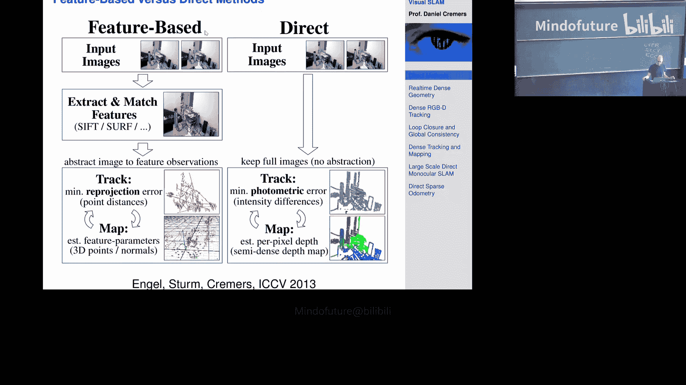

上一节我们介绍了多视角几何的基础概念，本节中我们来看看如何绕过特征点提取，直接从图像像素亮度值进行三维重建。

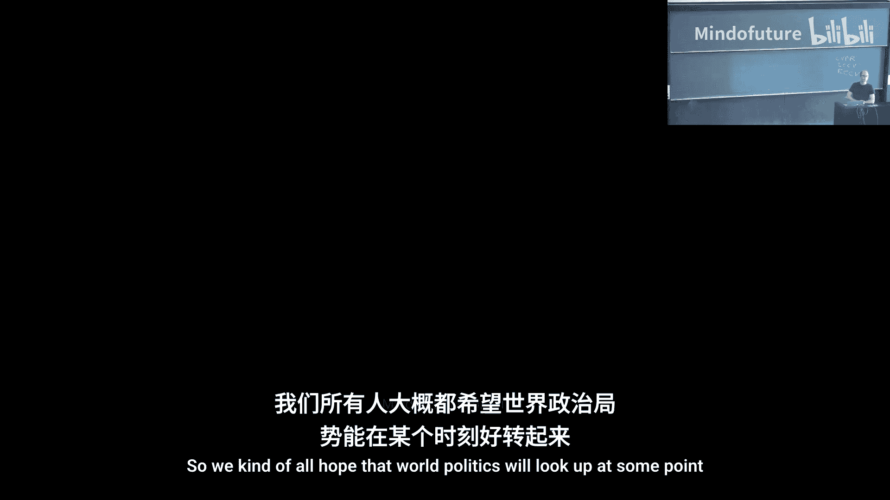

## 概述：从数据到模型

直接方法的核心思想非常简单：**直接从原始传感器数据（即相机获取的亮度值）出发，重建相机运动和三维结构**。这与传统的特征点方法形成对比。

传统方法（如光束法平差）的流程是：提取特征点 -> 建立点对应关系 -> 匹配 -> 计算重投影误差并最小化。直接方法则避免了第一步的抽象，其关键驱动力是**光度一致性**或**颜色一致性**。

换句话说，我们希望找到一个数据模型（描述世界如何通过相机运动投影为图像），使得该模型能够最好地解释观测到的数据。这本质上是**概率推断和贝叶斯推断**的思路：在给定数据（即传感器亮度值）的情况下，寻找最可能的世界解释。

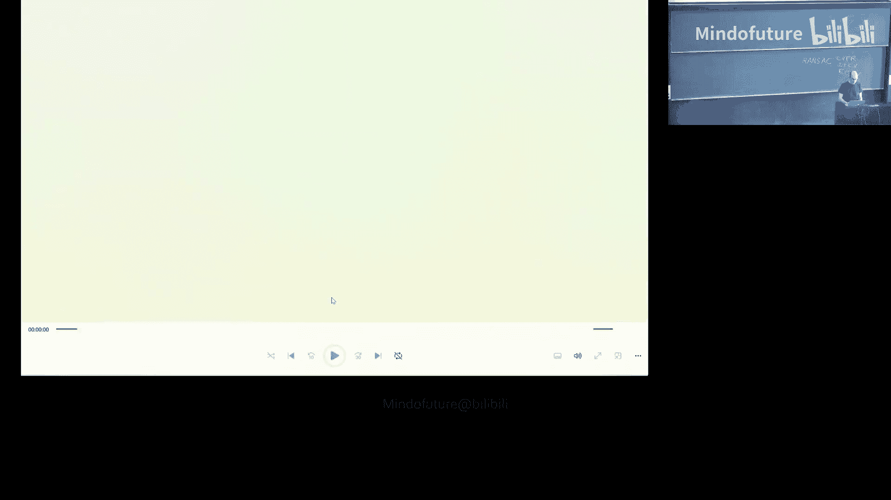

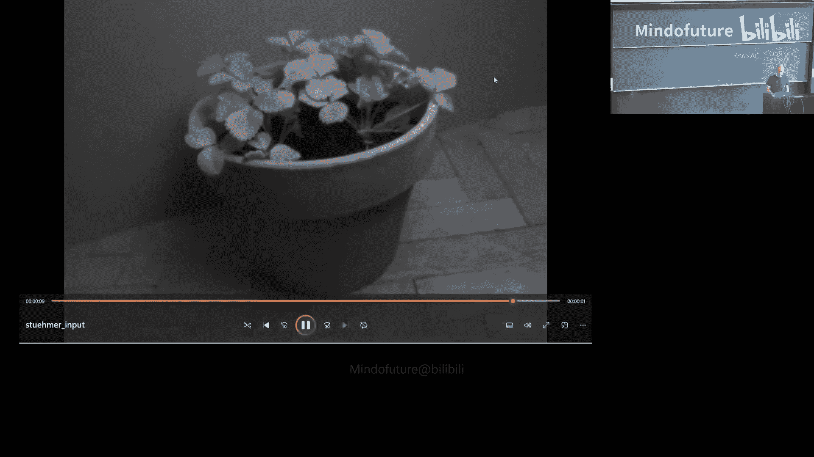

## 核心思想：光度一致性

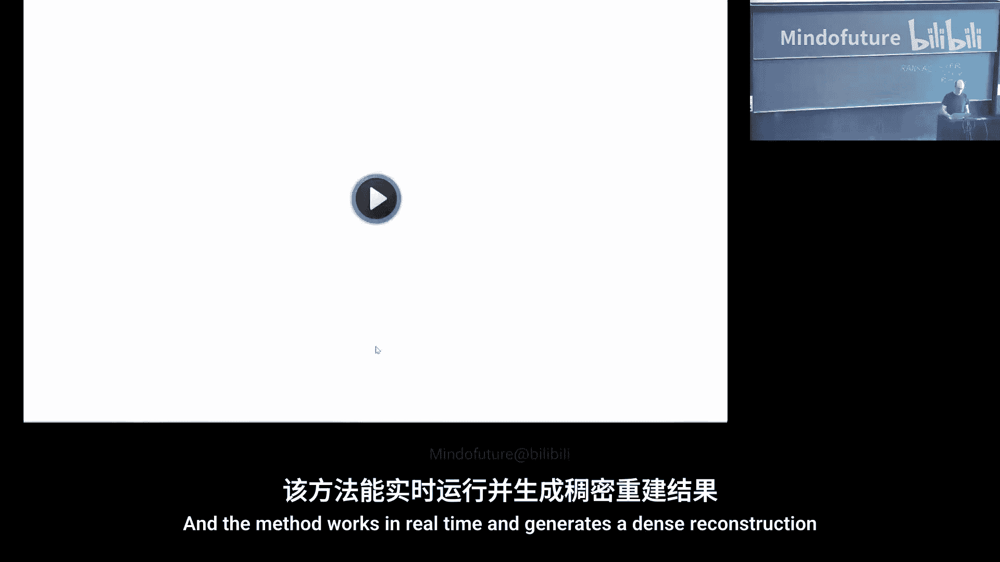

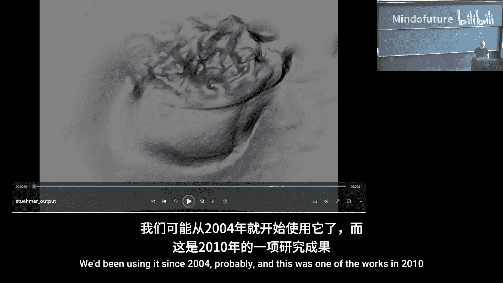

直接方法基于一个基本假设：一个三维点在所有观测到它的图像中，其颜色或亮度应该是一致的。

以下是其数学表述的核心：

对于一个参考图像 `I1` 中的像素点 `x`（齐次坐标），其强度为 `I1(x)`。该点对应的三维点可通过逆深度 `h(x)` 得到：`X = h(x) * x`。将该三维点通过第 `i` 个相机位姿的刚体变换 `G_i` 和透视投影 `π` 映射到图像 `I_i` 中，得到投影点 `x' = π(G_i * (h(x) * x))`。那么，光度一致性要求：

`I1(x) ≈ Ii(x')`

我们的目标是找到所有像素的逆深度图 `h(x)` 和所有相机位姿 `G_i`，使得所有对应点之间的光度差异总和最小。

## 早期工作：实时稠密重建

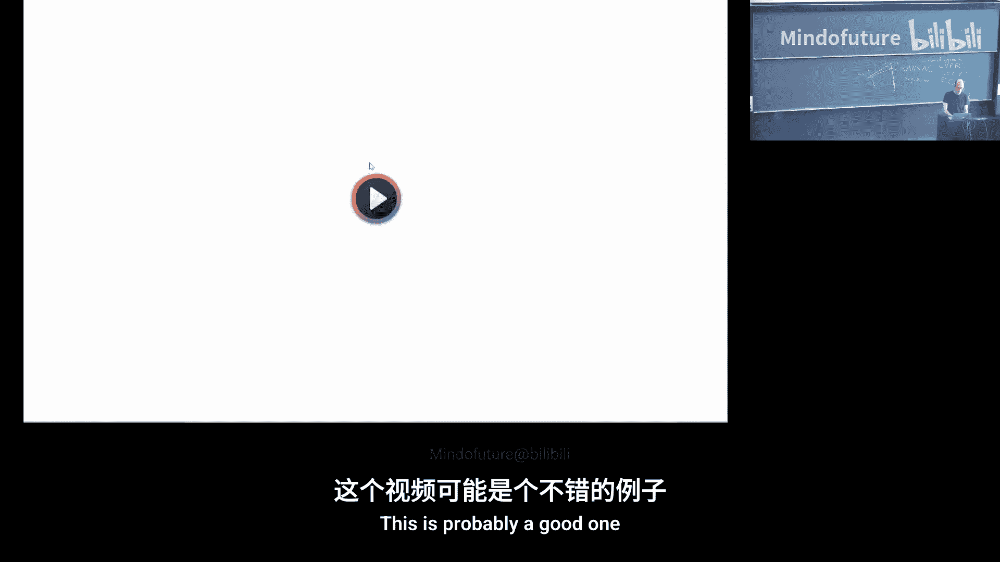

以下是早期直接方法的一个里程碑式工作。

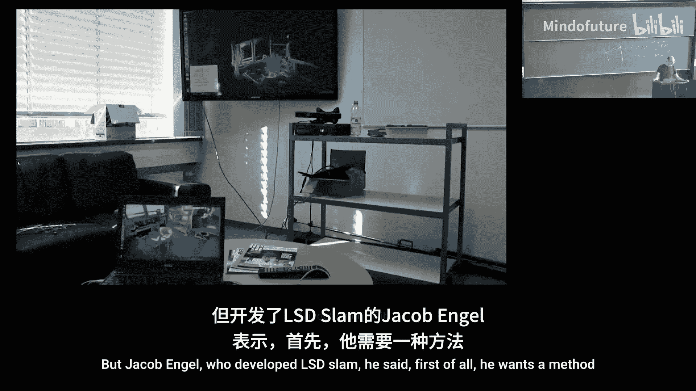

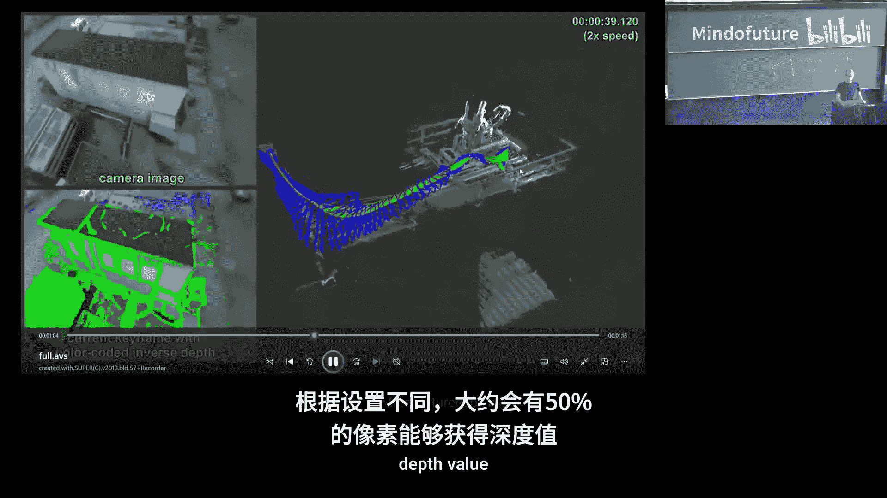

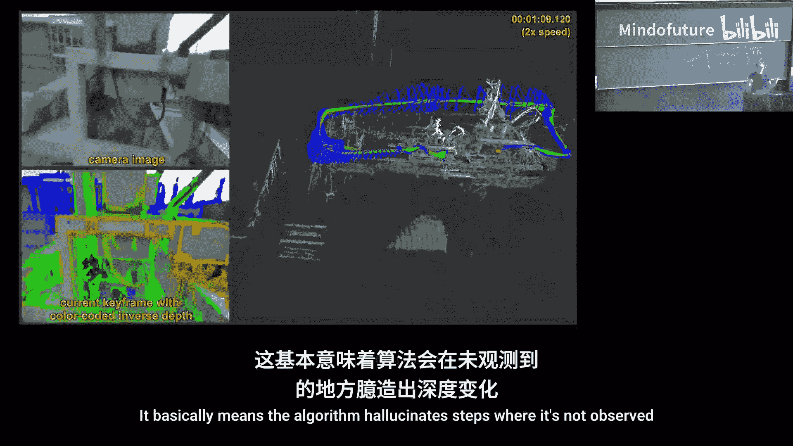

*   **实时稠密几何 (2010)**: 这是首个已知的能够从手持相机进行**实时稠密重建**的方法。它直接在GPU上运行，优化整个稠密深度图。
    *   **方法**：为图像中**每一个像素** `x` 估计其逆深度 `h(x)`。
    *   **优化目标**：最小化所有像素在所有图像中的光度误差之和。
    *   **正则化**：引入空间平滑正则项，使深度图在相邻像素间变化平缓，类似于在场景表面覆盖一层“肥皂膜”。这在缺乏纹理的区域（如白墙）能产生合理的填充效果。
    *   **性质**：这是一种**变分方法**，通过设置关于 `h` 的损失函数并求解其最小化问题来得到深度图。

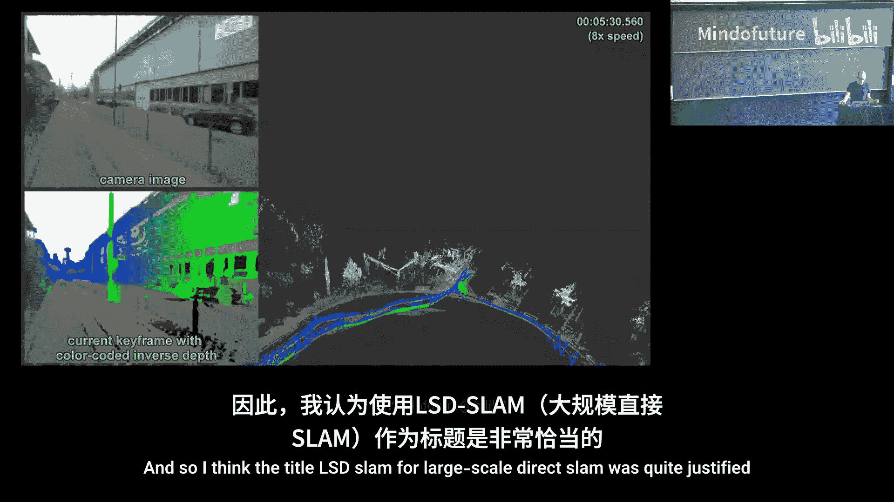

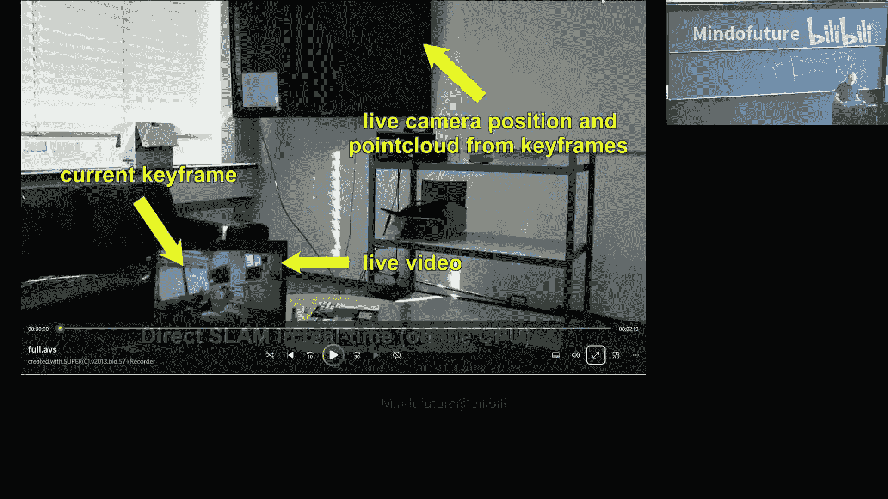

## 重要发展：LSD-SLAM 与 DSO

直接方法随后朝着大规模、实时、联合优化的方向发展。

*   **LSD-SLAM (大规模直接法SLAM)**:
    *   **创新点**：首次实现了使用单个灰度相机进行**大规模、实时**的同步定位与地图构建。
    *   **特点**：在CPU上实时运行，生成**半稠密**地图（约50%的像素有深度值）。它避免在无纹理区域“幻想”深度值，只在梯度明显的区域估计深度。
    *   **优化方式**：采用交替优化策略，轮流估计深度图和相机运动。

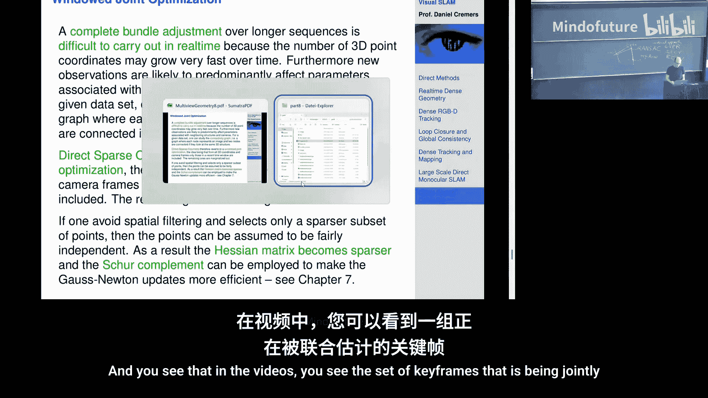

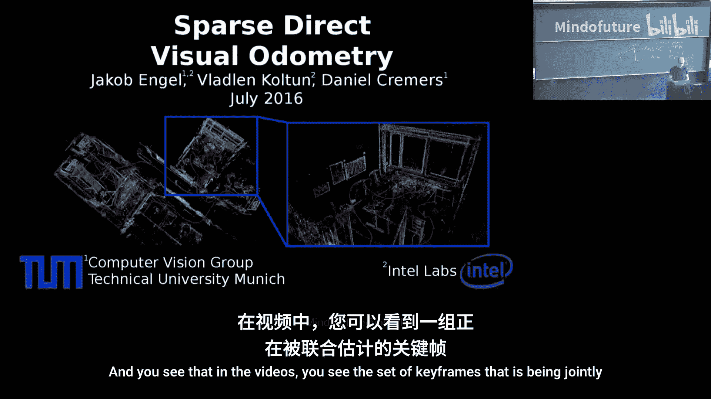

*   **DSO (直接稀疏里程计)**:
    *   **改进一：光度校准**：精确建模相机传感器特性（如光圈变化、渐晕效应），从假设“亮度恒定”推进到假设“辐照度恒定”，从而得到更精确的模型。
    *   **改进二：联合优化**：采用类似光束法平差的高斯-牛顿框架，**联合优化**相机位姿和三维点（逆深度），而不是交替优化。
    *   **策略**：使用**滑动窗口优化**，只联合优化最近的一系列关键帧，在保证精度的同时满足实时性要求。
    *   **性能**：在精度和鲁棒性上显著超越LSD-SLAM和当时流行的ORB-SLAM等方法，尤其对动态物体更鲁棒。

## 现实挑战与当前研究方向

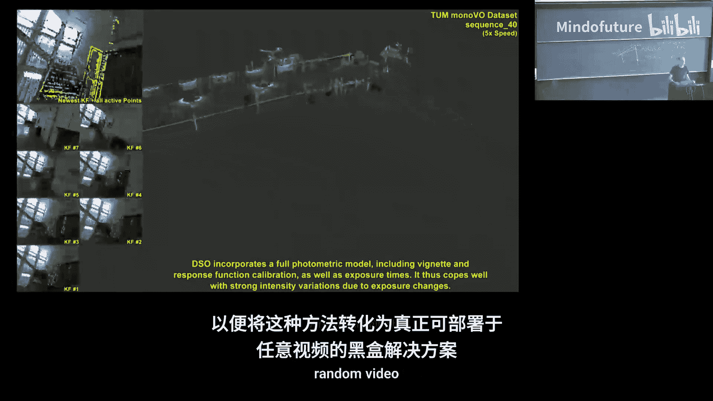

尽管直接方法性能优异，但在实际部署中仍面临挑战，这也是当前的研究热点。

以下是直接方法在实际应用中遇到的主要问题。

1.  **相机标定需求**：DSO等方法需要事先进行**光度校准**，而普通用户往往希望即插即用。
2.  **全局快门 vs. 滚动快门**：大多数消费级相机（如智能手机）使用**滚动快门**，图像每行曝光时间不同，在相机运动时会导致图像扭曲。传统特征点法通过最小化几何（重投影）误差对此有一定容忍度，而直接法处理原始亮度值，受其影响更大。
3.  **视频压缩**：许多相机输出的是压缩后的视频，而非原始亮度数据，这会影响基于原始亮度的算法精度。

当前，计算机视觉领域，特别是3D视觉和SLAM，正经历着深度学习带来的变革。一个核心挑战是：

**如何将神经网络应用于SLAM问题？**

虽然深度学习在物体识别、光流、深度估计等任务上取得了巨大成功，但构建**纯粹基于学习的、性能超越经典方法的SLAM系统**仍是尚未完全攻克的难题。目前的研究集中在利用深度学习增强SLAM系统，并朝着完全学习化的方向发展。

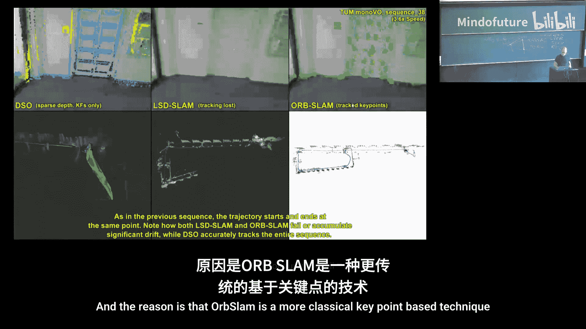

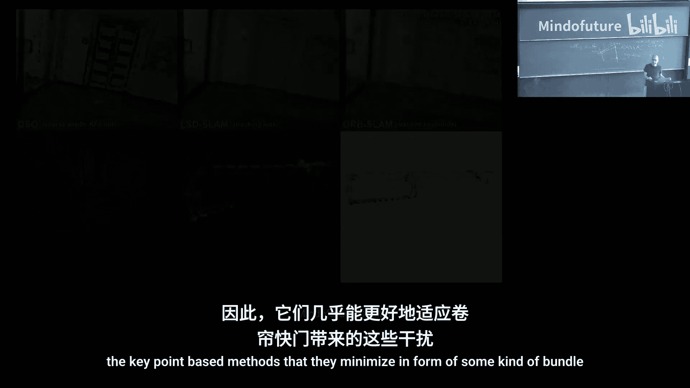

## 总结

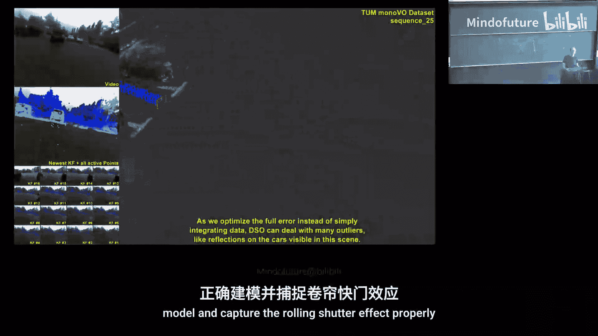

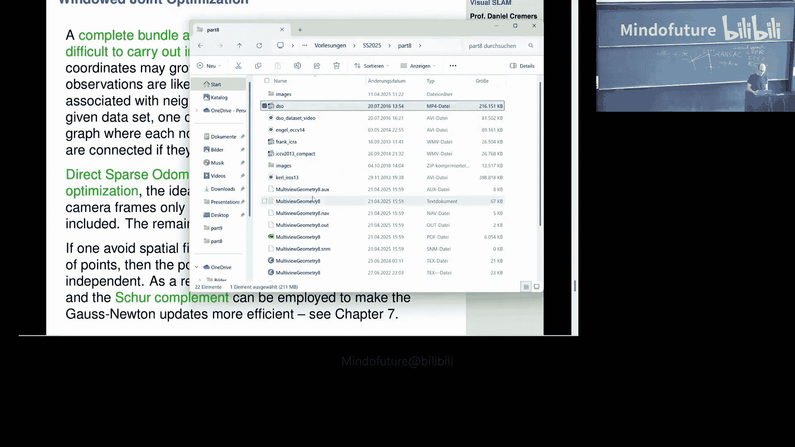

本节课中我们一起回顾了视觉SLAM中的直接方法。我们从其核心思想——**光度一致性**出发，了解了它如何绕过特征提取，直接从像素亮度重建三维世界。我们回顾了从早期实时稠密重建，到LSD-SLAM实现大规模实时半稠密建图，再到DSO通过光度校准和联合优化实现高精度的演进历程。最后，我们探讨了直接方法在实际部署中面临的挑战（如标定、滚动快门）以及当前结合深度学习的研究趋势。直接方法因其紧密联系数据本质的特性，仍然是三维视觉领域中一个强大且活跃的研究方向。