# 018：变分多视图重建（第一部分）🚀

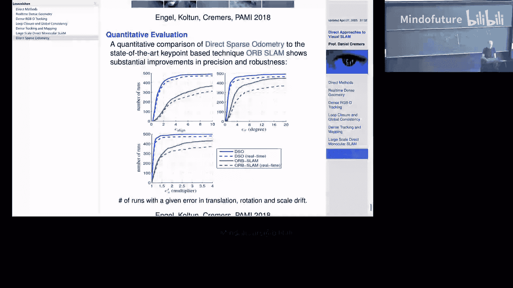

在本节课中，我们将要学习变分方法在多视图三维重建中的应用。我们将探讨如何将三维重建问题表述为一个在无限维空间（即所有可能表面的空间）中的能量最小化问题，并介绍不同的表面表示方法及其优缺点。

---

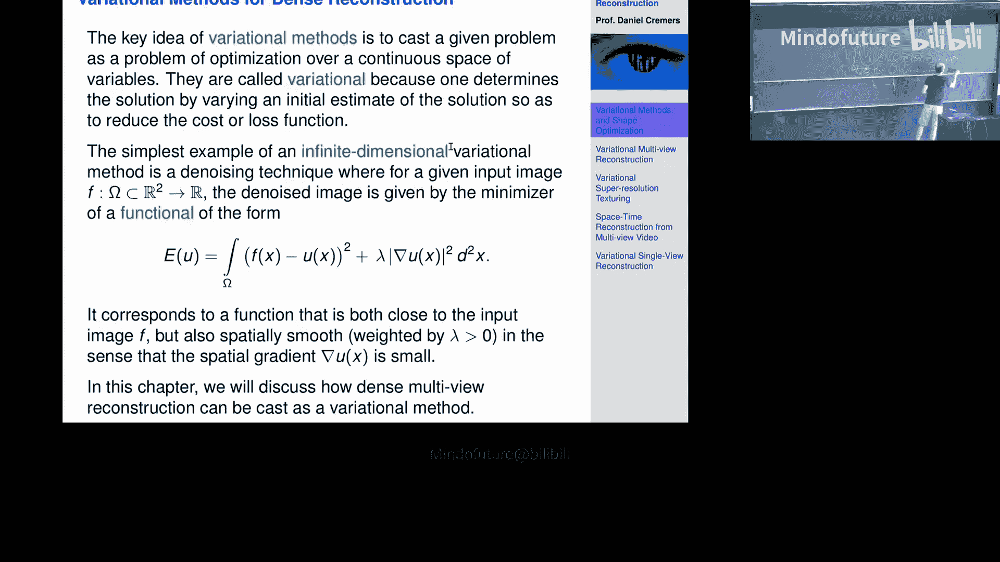

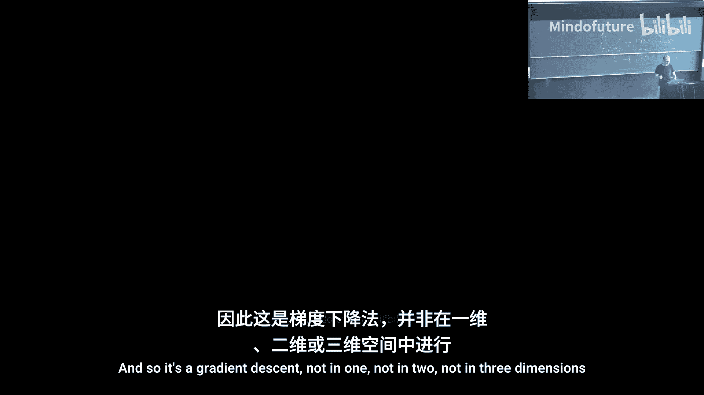

## 变分方法简介

上一节我们介绍了稀疏重建方法（如光束法平差）。本节中我们来看看如何实现**密集重建**，即推断出整个三维世界的稠密结构。

变分方法的核心思想是：我们希望找到一个表面 **S** 来表示场景中的物体。为此，我们为所有可能的表面定义一个**能量函数**或**损失函数** **E(S)**。然后，我们的目标是在所有可想象的表面空间中，找到使该能量最小的那个表面。

这个过程之所以被称为“变分”，是因为我们从一个初始表面 **S_init** 开始，然后通过**无穷小地变化**这个表面，沿着梯度下降的方向，逐步降低能量，最终找到最优表面。这与我们在数值优化和光束法平差中学到的梯度下降原理相同。

关键区别在于，这里的优化空间是**无限维**的。表面上的每个点都可以独立移动，因此存在无限多个自由度。这是一个**无限维优化问题**。

## 形状优化与表面表示

当我们把三维重建视为变分问题时，首要问题是：**如何表示表面 S？** 选择何种数学表示至关重要，这个领域被称为**形状优化**。

形状优化在数学中是一个广泛的领域，不仅用于三维重建，还用于飞机机翼、汽车外形等工业设计，旨在找到满足特定物理属性（如稳定性、空气动力学）的最优形状。

以下是选择表面表示时需要考虑的两个关键属性：
*   **紧凑性**：表示形状所需的内存大小。
*   **计算效率**：基于该表示，优化问题是否可解。

不幸的是，没有一种表示方法在所有方面都是最优的。不同的表示各有优劣。

## 显式与隐式表示

所有表面表示方法大致可分为两类：**显式表示**和**隐式表示**。

### 显式表示

显式表示直接存储构成表面的点。常见的例子包括多边形网格或样条曲面。

样条曲面（如B样条）使用一组**控制点** **C_i** 和固定的**基函数** **B_i** 来定义表面。表面上的点由控制点与基函数的线性组合给出：

**公式：S(u, v) = Σ_i Σ_j C_ij * B_i(u) * B_j(v)**

其中 **(u, v)** 是二维参数坐标。

显式表示的优点是**非常紧凑**。例如，一条复杂曲线可能仅由十几个控制点（几十个变量）就能精确表示。通过移动控制点，可以平滑地变形整个表面。历史上，样条正是为了优化汽车外形而被发明的。

然而，显式表示存在一些缺点：
1.  **难以处理拓扑变化**：一个样条曲面具有固定的拓扑结构（如球面、环面）。如果物体在变形过程中需要分裂或合并（例如，从球体变成两个分离的物体），用样条表示会非常困难。
2.  **参数化不唯一**：同一个几何形状可以有多种不同的控制点配置来表示，这给形状比较和识别带来了困难。

### 隐式表示

隐式表示不直接存储表面点，而是对表面所处的整个**环境空间**进行标记。主要有两种流行的方法：

1.  **指示函数**：为空间中的每个体素（或点）分配一个标签。例如，定义函数 **U(x)**，在物体内部 **U(x)=1**，在外部 **U(x)=0**。表面即位于 **0** 和 **1** 之间的边界处。
2.  **有符号距离函数**：为空间中的每个点存储其到最近表面点的距离。在物体内部距离为正，外部为负。表面位于距离为零的等值面上。

隐式表示具有显著优势：
*   **拓扑无关性**：可以轻松表示具有任意数量孔洞的物体，并能自然地处理拓扑变化（分裂、合并）。
*   **表示唯一性**：对于给定的形状，其指示函数或有符号距离函数是唯一的。
*   **可能实现凸优化**：当能量函数基于隐式表示构建时，优化问题有时可以转化为凸问题，从而保证找到全局最优解。

隐式表示的主要缺点是**内存消耗大**，因为它需要标记整个空间。但可以通过**八叉树**等自适应数据结构来缓解——只在表面附近进行精细划分，在远离表面的均匀区域使用粗划分，从而高效管理内存。

## 基于光一致性的变分重建

现在，我们来看看如何将多视图重建构建为一个形状优化问题。核心思想是利用**光一致性**。

假设相机已标定。对于三维空间中的任意点 **x**，我们可以将其投影到所有图像中。如果 **x** 位于物体表面上，那么它在所有图像中的颜色（或图像块）应该是一致的。如果 **x** 在物体内部或外部，不同视角看到的颜色很可能不同。

因此，我们可以为每个三维点 **x** 计算一个**光一致性函数 ρ(x)**，其值在 **0** 到 **1** 之间。**ρ(x)** 值低表示颜色一致（可能位于表面），值高表示不一致。

一个直观的想法是：寻找一个表面 **S**，使得其上的光一致性总和最小（即表面尽可能通过颜色一致的点）：

**最小化：∫_{S} ρ(x) dA**

然而，这个简单的公式存在一个严重问题：**收缩偏差**。因为 **ρ(x)** 非负，通过缩小表面积（甚至缩小到空集）总能降低总能量。因此，该能量的全局最优解是空表面，这显然不是我们想要的。

## 加入轮廓一致性约束

为了解决收缩问题，我们必须利用从图像中获得的另一个强约束：**轮廓一致性**。

在每个图像中，我们可以分割出物体的轮廓（前景区域）。正确的三维表面 **S** 投影到每个图像上时，必须完全覆盖该图像的轮廓区域，并且不能投影到轮廓外的区域。

因此，我们将重建问题表述为一个**带约束的优化问题**：

**最小化：∫_{S} ρ(x) dA**
**约束条件：对于每个图像 i，投影 Π_i(S) = 轮廓区域 S_i**

这个约束确保了重建表面不是空的，并且与所有观测到的轮廓一致。

## 基于指示函数的凸优化公式

为了实现高效的优化，我们采用隐式表示中的**指示函数 U(x)**。可以证明，上述优化问题可以重新表述为：

**最小化：∫_{Ω} ρ(x) ||∇U(x)|| d³x**
**约束条件：**
1.  **线性轮廓约束**（对于每个图像像素射线）：
    *   若像素在轮廓内：∫_{射线} U(x) ds ≥ 1
    *   若像素在轮廓外：∫_{射线} U(x) ds = 0
2.  **U(x) ∈ [0, 1]** （允许模糊隶属度时，这是一个凸约束）

这里的关键在于：
*   **∫ ρ(x) ||∇U(x)|| d³x** 项是**全变分**，它精确地等价于加权表面积 ∫_{S} ρ(x) dA，并且是凸函数。
*   轮廓约束是**线性约束**，也是凸的。
*   因此，整个优化问题是一个**凸优化问题**，我们可以计算出**全局最优解**。

这种方法能够产生非常精确且细节丰富的重建结果，因为它既利用了光一致性，又通过轮廓约束防止了表面收缩，保留了精细结构。

## 超分辨率纹理映射

在获得几何表面后，我们还需要为其赋予颜色（纹理）。简单的做法是从图像中投影颜色并平均，但这会导致纹理模糊。

我们可以再次利用变分方法进行**超分辨率纹理重建**。其思想是寻找一个高分辨率、清晰的纹理 **T**，使得该纹理在经过模拟相机成像过程（模糊和下采样）后，与所有观测图像匹配。这可以表述为另一个凸优化问题：

**最小化：Σ_i || B ∘ T ∘ Π_i^{-1} - I_i ||² + λ ∫ ||∇T|| **

其中 **B** 是模糊和下采样算子，**I_i** 是第 i 张输入图像，**λ** 是一个小的正则化权重。通过求解这个问题，我们可以从多张低分辨率输入图像中，复原出远超单张图像分辨率的清晰纹理。

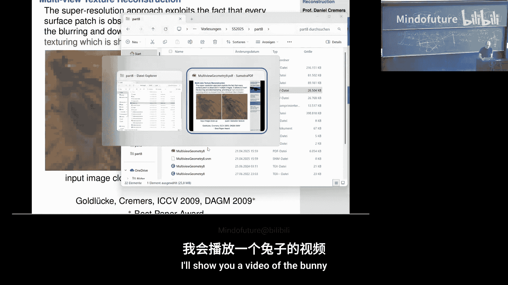

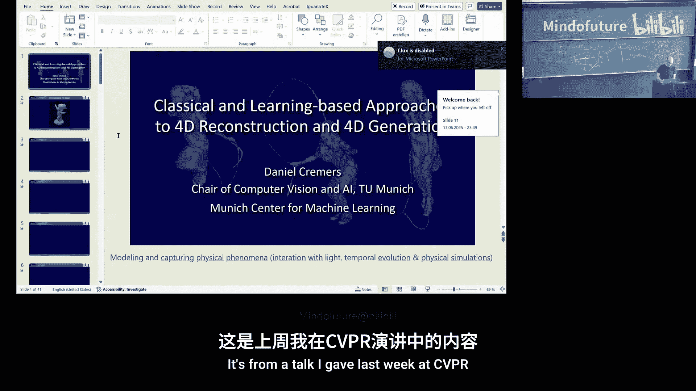

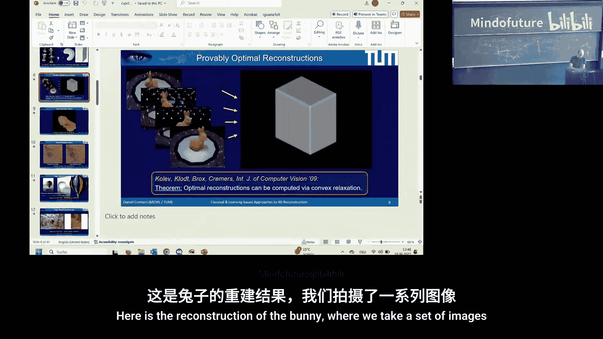

---

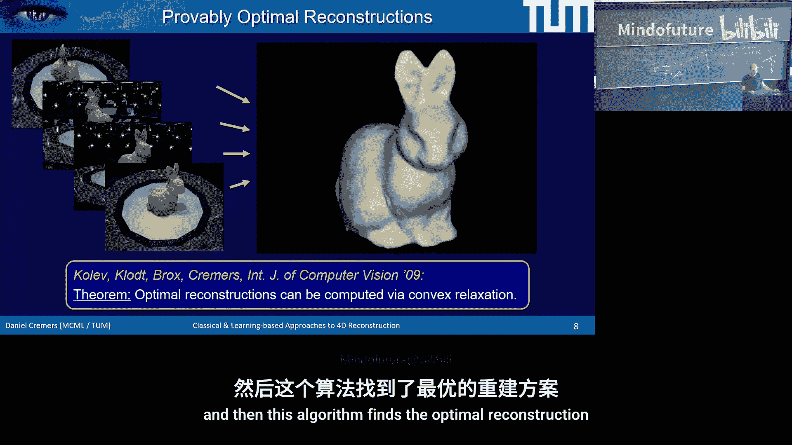

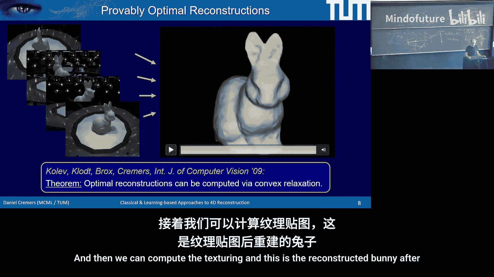

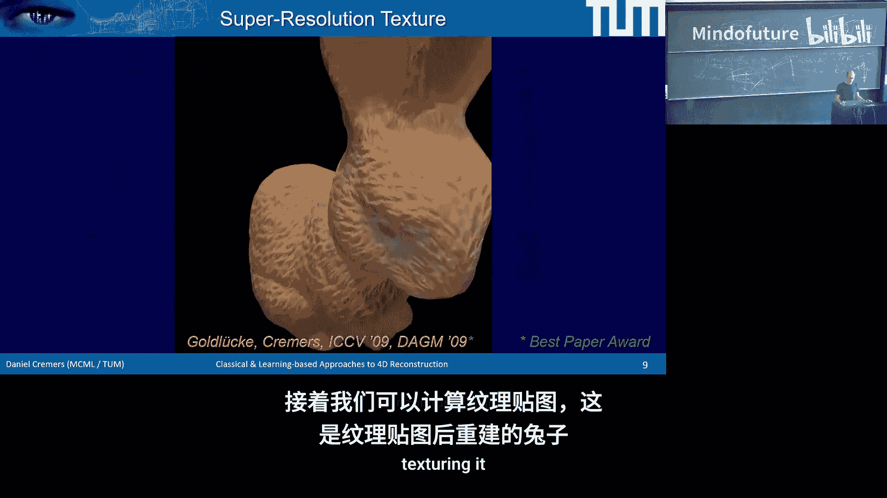

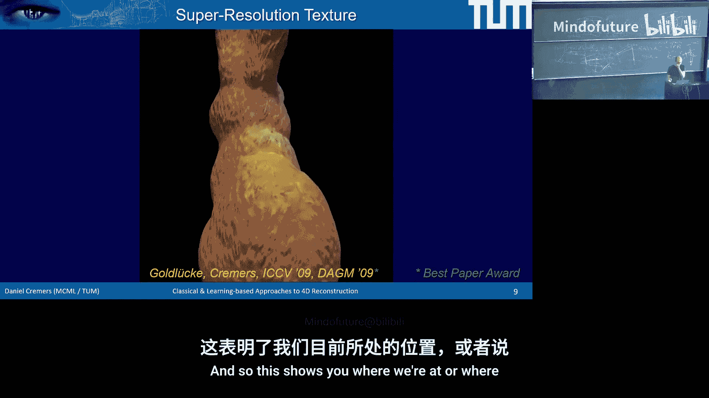

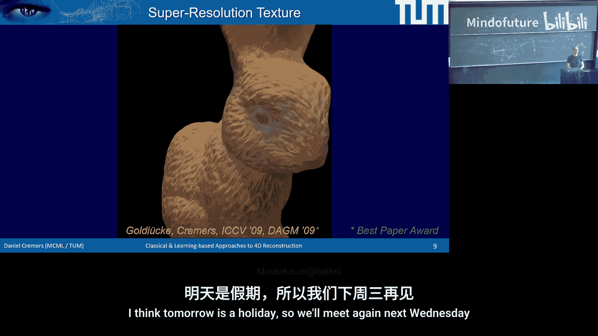

本节课中我们一起学习了变分多视图重建的基本框架。我们了解到，通过将重建问题转化为在无限维表面空间中的能量最小化问题，并巧妙地将轮廓约束与光一致性结合，可以构建出可求解凸优化问题，从而获得精确且稠密的三维重建结果。同时，基于变分思想的纹理映射方法还能实现超分辨率纹理恢复，获得极其逼真的三维模型。