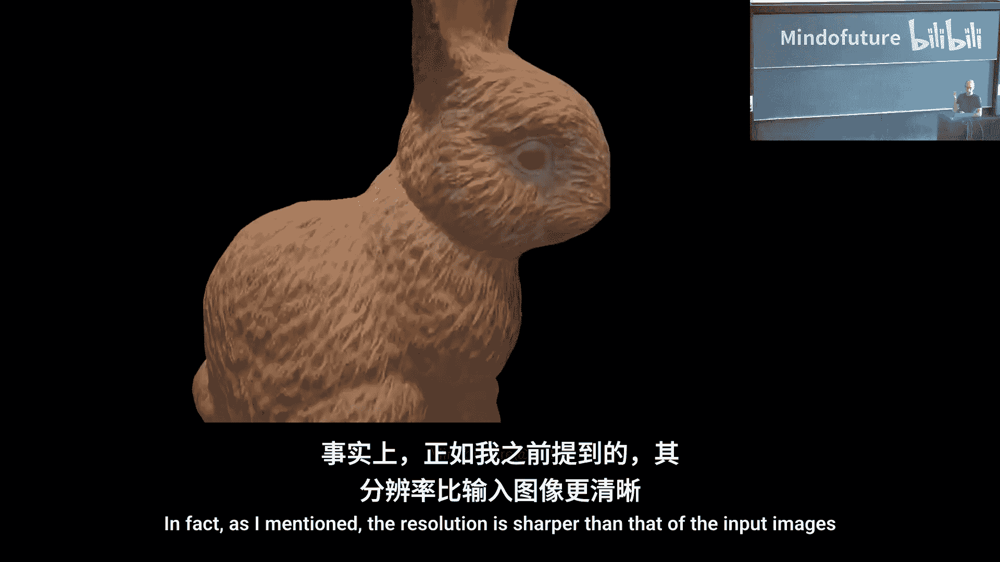
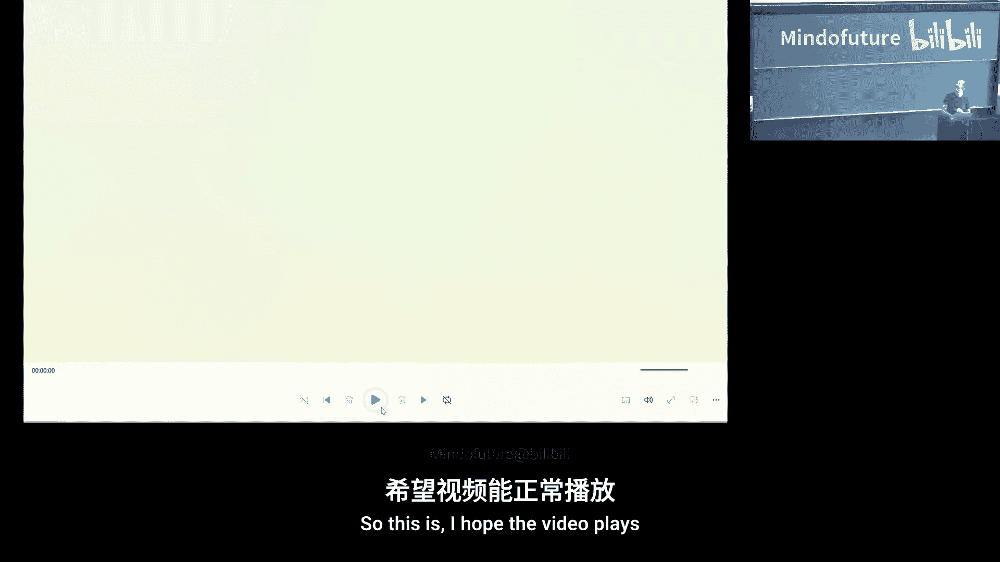
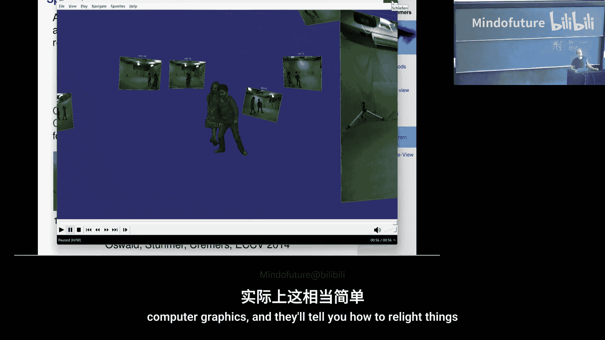
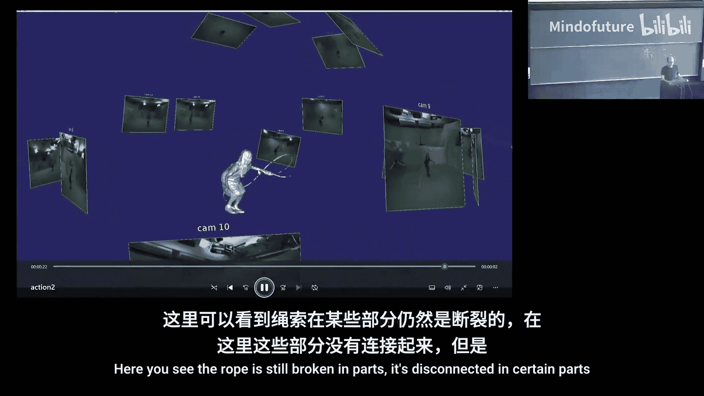
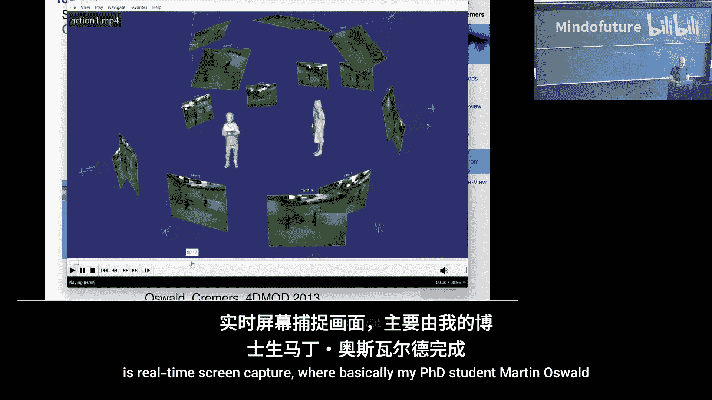
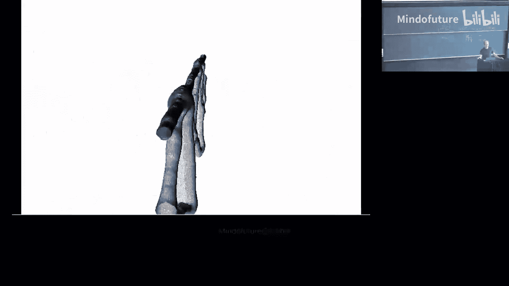
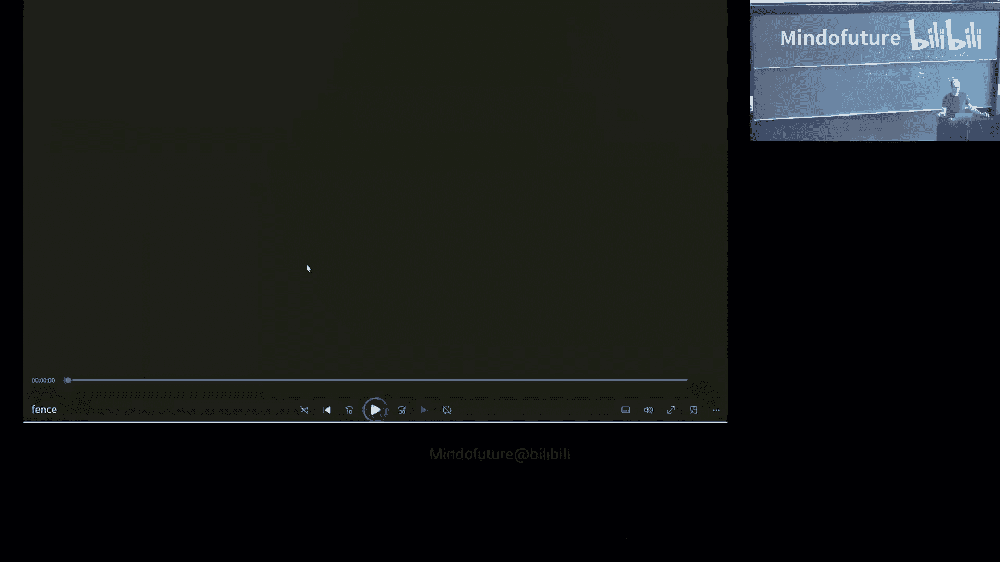
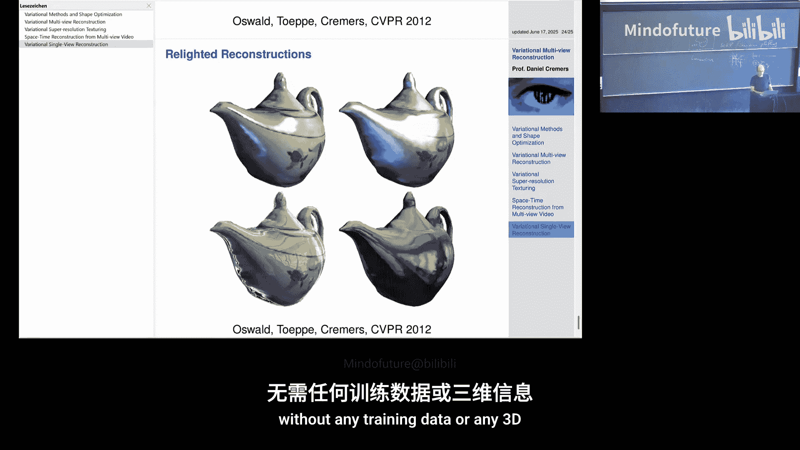

# 019：变分多视图重建（第二部分）🎥




在本节课中，我们将继续学习变分多视图重建。上一节我们介绍了变分方法的基本思想及其在三维重建中的应用。本节中，我们将深入探讨其在超分辨率纹理、动态动作捕捉以及单视图三维重建等具体场景下的应用与效果。

## 超分辨率纹理重建

上一节结束时，我们展示了超分辨率纹理重建的结果。以下是其核心原理的解释。


输入图像中的每个像素值，实际上是场景中一个小区域（patch）内颜色值的平均值。我们可以用一个网格来理解这个过程。



当从不同视角观察同一场景时，投影的网格会发生偏移。这意味着同一个三维点会出现在不同图像的不同像素网格中。







因此，我们获得了同一个三维点在不同图像中的多个“平均颜色”测量值。通过收集大量这样的测量值，我们可以建立一个线性方程组来反推出原始的高分辨率颜色信息。

**核心公式**：
设我们关心的原始高分辨率颜色值为 `X_i`，在图像中测量到的平均颜色值为 `Y_i`。`Y_i` 是 `X_i` 及其邻域 `N(i)` 内其他颜色值的平均：
`Y_i = (1 / |N(i)|) * Σ_{j in N(i)} X_j`
通过从多个不同视角获得大量 `Y_i` 的观测，我们可以求解出 `X_i`。

这种方法之所以有效，是因为同一个三维点的颜色信息被多次观测，每次都以略微不同的“平均”形式出现，从而提供了足够的信息来消除模糊性。

## 动态动作的三维重建

接下来，我们看看如何将变分方法应用于动态场景的三维重建。

使用激光或结构光扫描仪获取静态物体的精确几何是有效的，但对于动态物体则非常耗时。相比之下，多相机同步拍摄可以捕捉随时间变化的动作。


通过同步的多视角视频，我们可以重建出随时间变化的三维动作模型，并将颜色纹理投影回模型表面。这种技术常被称为“自由视点电视”。

以下是该方法的一些应用实例：
*   **视频会议**：未来的3D视频会议系统可以使用多个摄像头重建通话者的三维模型，并根据观看者的视线位置实时渲染对应视角，创造“隔窗相望”的沉浸感。
*   **体育分析**：例如，在体操或足球运动中，通过三维重建可以精确分析运动员的肢体动作和关节位置，用于技术纠正和战术分析。
*   **自由视点电视与沉浸式体验**：观众可以在播放过程中自由选择观看视角，仿佛置身于场景之中，极大地增强了沉浸感。




**技术细节与挑战**：
*   **时间一致性**：对于每一时间步，我们独立进行三维重建，但会引入轻微的时序平滑约束，例如要求体素（voxel）的占用状态在相邻帧之间不应变化过大。
*   **朗伯体假设**：该方法的核心假设是场景满足朗伯反射，即物体表面颜色不随视角改变。这对于大多数自然物体成立，但对于镜面反射强烈的物体（如光滑的球体），重建质量会下降。
*   **轮廓提取**：准确从图像中提取前景轮廓（ silhouette ）是关键挑战之一。即使在绿幕环境下，光线反射等因素也会使轮廓提取变得复杂。需要快速、自动化的算法来处理海量的图像数据。

## 基于单张图像的三维重建

现在，我们探讨一个更极端的场景：仅从单张图像进行三维重建。这展示了变分方法在特定约束下的强大能力。

问题定义：给定一张单个物体的图像（例如下图中的石拱门）及其轮廓，能否重建出其三维模型？仅凭单视图，物体的厚度信息是未知的，因此问题本身是不适定的。


**解决方案——“吹气球”模型**：
我们可以想象在物体轮廓内放置一个气球并向内吹气。气球会膨胀并贴合轮廓，形成一个三维表面。这个表面有一个自然属性：在给定体积下，其表面积最小（就像真实的气球一样）。我们将此表述为一个变分优化问题。

**数学模型**：
我们需要找到一个三维表面 `S`，使其满足以下条件：
1.  **表面积最小化**：这对应于最小化表面的总面积。
2.  **体积约束**：表面所包围的体积等于用户指定的参数 `V0`（即“吹入的空气量”）。
3.  **轮廓一致性**：将表面 `S` 投影到图像平面上，必须与输入的物体轮廓 `S0` 完全匹配。

使用二值指示函数 `u(x)`（在物体内部为1，外部为0）来表示三维空间 occupancy。那么：
*   表面积可以表示为函数 `u` 的**全变分（Total Variation）**：`TV(u) = ∫ |∇u| dx`。对于二值函数，该积分恰好等于表面的面积。
*   体积约束为：`∫ u(x) dx = V0`。
*   轮廓约束为：`Π(u) = S0`，其中 `Π` 是投影算子。

因此，优化问题为：
```
min_u TV(u)
s.t. ∫ u(x) dx = V0
     Π(u) = S0
```

**实现与效果**：
通过高效的数值方法，可以在几分之一秒内求解此优化问题，并允许用户交互式地调整体积参数 `V0`。






以下是该方法的一些结果展示：
*   对于拱门、茶壶、甲虫等物体，仅从单张图像就能生成视觉上合理的三维模型，并能渲染出新颖视角。
*   重建出的模型遵循“最小表面”原则：在轮廓狭窄处体积小，在轮廓宽大处体积膨胀，这与许多自然物体的形态相符。
*   获得三维模型后，可以进一步改变其材质属性（如金属、光泽等），进行虚拟渲染。

**方法特点与局限**：
*   **无需学习**：该方法不依赖任何训练数据集，完全基于几何和物理原理（最小表面）。
*   **适用性**：适用于形状接近“膨胀体”或自然紧凑的物体。对于具有尖锐棱角的人造物体（如老式汽车），重建效果可能不理想。
*   **交互需求**：通常需要用户简单交互（如涂鸦）来提供前景/背景线索，以提取精确的物体轮廓。

## 总结



本节课中，我们一起深入学习了变分多视图重建技术的几个高级应用。我们首先解释了超分辨率纹理重建如何通过多视角下的平均颜色观测来反推高分辨率细节。接着，探讨了如何将重建技术应用于动态动作捕捉，以实现自由视点电视、体育分析和沉浸式通信等应用，并讨论了其中的朗伯体假设和轮廓提取挑战。最后，我们展示了一个巧妙的变分方法应用——仅从单张图像出发，通过“最小表面”模型重建出视觉合理的三维形状，这体现了变分方法在强先验约束下解决不适定问题的强大能力。这些内容表明，三维重建领域依然充满活力，结合几何原理与优化方法，能够不断产生创新且实用的解决方案。