# 020：多视图重建的最新进展（第一部分） 📸

在本节课中，我们将探讨基于相机的三维重建和从图像中获取三维信息领域的最新进展。本章有两个主要目标：首先，展示该领域正在发生的许多令人兴奋的事情；其次，指出一些可能对您完成毕业论文（例如硕士论文）有价值的潜在研究方向。因此，我决定在本课程中前所未有地引入大量最新发展，一方面概述正在发生的研究进展，另一方面邀请我的多位学生准备简短的研究报告，以突出他们自己的研究，并宣传可能与之相关的硕士论文课题。

上一节我们介绍了课程的目标和结构，本节中我们来看看一个核心的研究领域：视觉SLAM（即时定位与地图构建）。

## 视觉SLAM与传感器融合

我讨论过SLAM、运动恢复结构（SfM）和视觉SLAM。其中一个工作是LSD-SLAM。我也讨论过直接稀疏里程计（DSO）。

直接稀疏里程计这类方法能够以高精度实时恢复相机的运动和世界的三维结构。

现在，我们可以对这些系统进行多方面的优化。这里展示的只是一个现成的灰度相机系统。但显然，一旦进入机器人、自动驾驶汽车或自主无人机等应用领域（这是我们几十年来一直在做的），我们可能希望集成更多传感器。

例如，在我上一家初创公司Artisense，我们开发了多传感器系统。这些系统通常包含两个同步、时间戳对齐且经过校准的相机，板上还有惯性测量单元（IMU），甚至可能包含GPS信息。然后，所有这些信息被收集起来，我们可以创建运行在板载设备或云端的空间AI实时算法来处理这些数据。显然，如果接入更多传感器，就能同时提升这些系统的精度和鲁棒性。

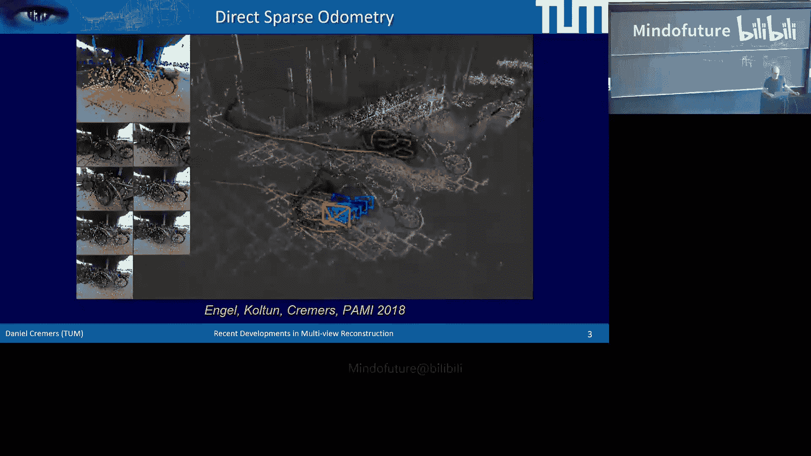

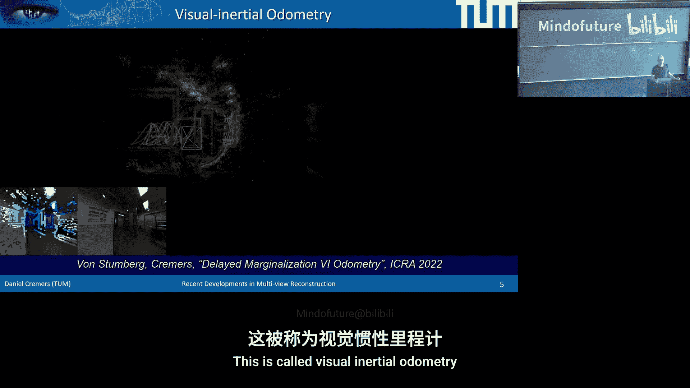

## 视觉惯性里程计（VIO）

以下是一个例子，由我团队的Lucas Fontomberg开发，称为DMVIO。它解决了使用IMU跟踪相机的问题，类似于智能手机上的配置：一个相机和一个惯性测量单元。

惯性测量单元类似于人类耳朵里的前庭系统，它能告诉你关于方向和加速度的信息。这个系统就是导致有人在车里晕车呕吐的原因（就像我小时候和我儿子现在会经历的那样）。为什么会发生这种情况？这很有趣。当你坐在车后座看书，然后车子开动（比如开往罗马市中心），有些人就会开始感到恶心。大约一半的人会有这种反应。在我的家庭里，我儿子会吐，我女儿不会。我一直想知道原因。有一天，有人向我解释了：人类有多个感官来感知世界，在这个例子中，主要是眼睛告诉你如何运动，前庭系统测量加速度并告诉你如何运动。如果这两个感官的输入不匹配（比如你在看书，眼睛告诉你没有动，但前庭系统感觉到了车的运动），感官就会失调。感官失调的一种情况是当我们吃了有毒的东西时。从进化角度看，当感官失调时，本能的反射是将毒物呕吐出体外。因此，在行驶的车里呕吐的人，在进化上可能更接近他们的祖先。但作为人类，我们利用所有感官在空间中定位自己。那么，我们能否用类似智能手机上配备的相机和IMU的系统做同样的事情呢？这被称为视觉惯性里程计。

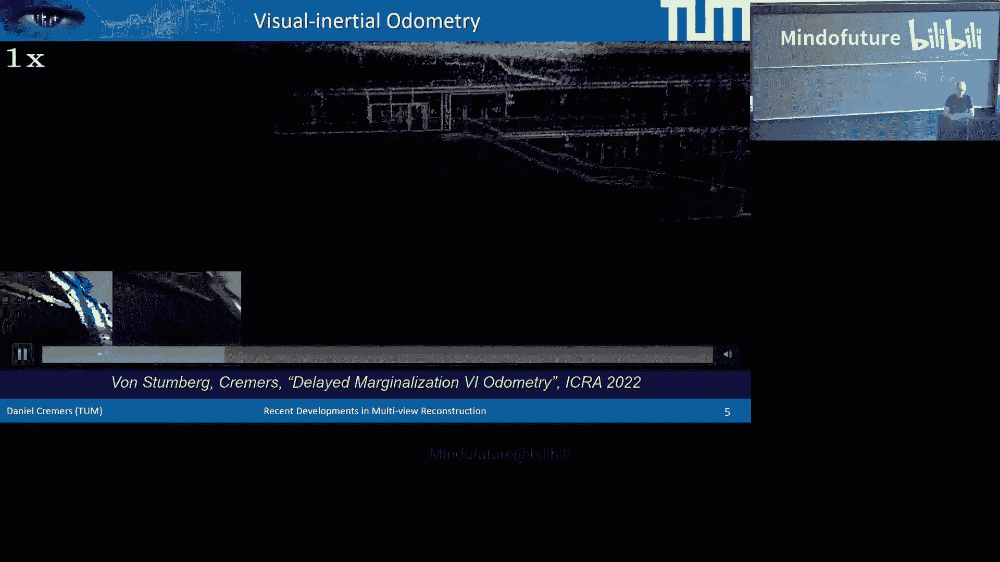

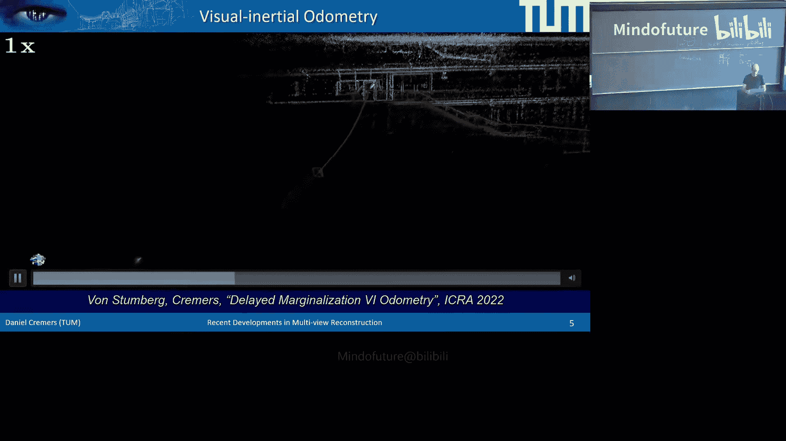

Lucas开发的方法在这里进行了演示。他在二楼行走，上到三楼。

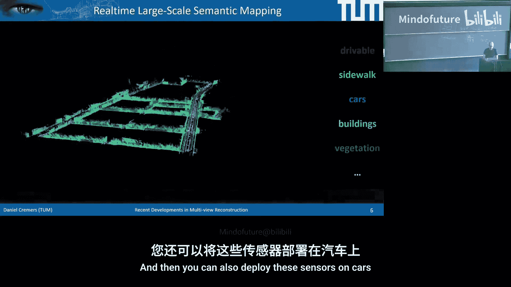

然后他进入楼梯间。我们经常在楼梯间评估算法，在楼梯间里，中途光线很暗，视觉上结构很少，因为墙壁很光滑。尽管如此，这个系统仍能以前所未有的精度进行跟踪。在我们评估时，没有其他方法能做到他所做的。你可以看到他下了三层楼，又上了三层楼，回到他来的走廊，几乎没有漂移，非常精确，轨迹完全对齐。

这个系统实时运行，并且在室内、车上都能工作。视觉惯性系统非常有用，因为它是即插即用的。传感器方面非常小巧，只需要一个相机和一个IMU，非常轻便、小巧、廉价。你可以把它安装在任何地方，它就能跟踪并高精度地绘制三维世界。

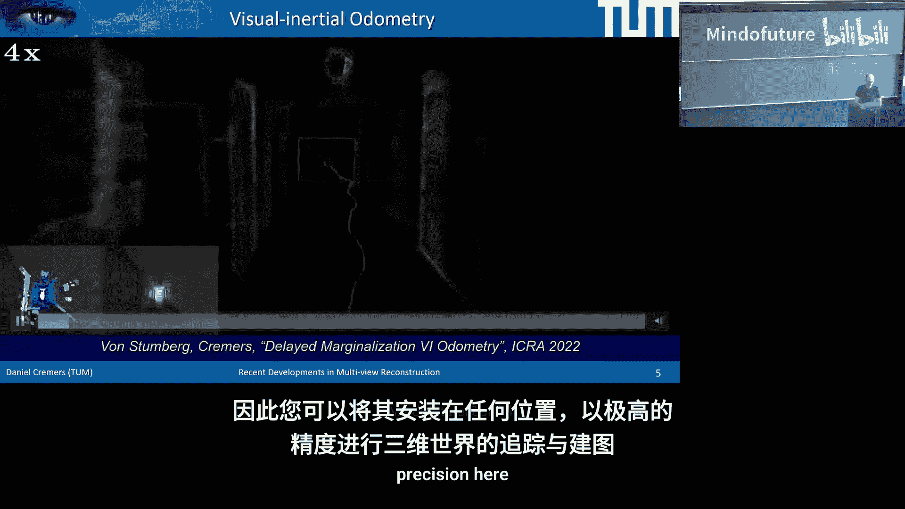

现在你可以在一个全新的层面上玩增强现实游戏了。

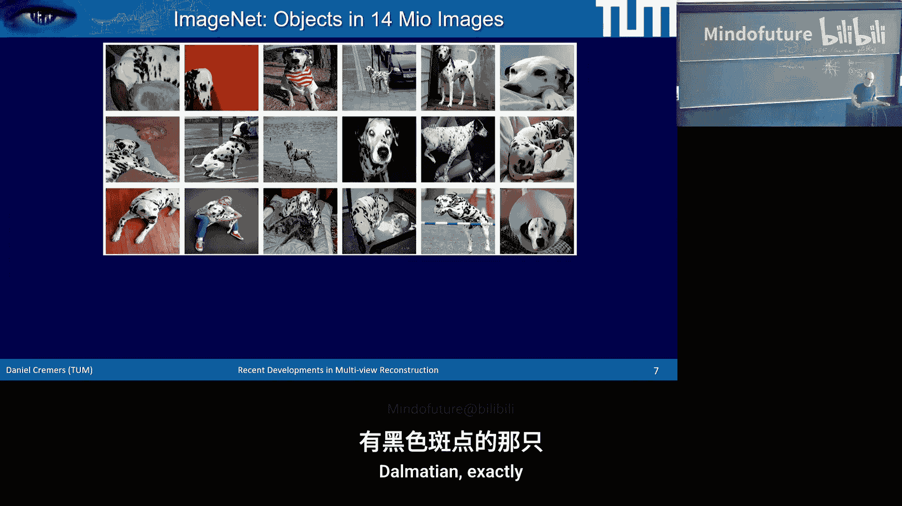

我们还可以将这些传感器部署在汽车上，并广泛进行了测试。在这个项目中，我们将其部署在整个车队上，行驶了大约8000公里，绘制了整个广阔世界及其语义信息。你在这里看到的是可行驶区域、人行道、汽车、建筑物、植被等。我们可以利用在云端运行的神经网络来处理所有这些数据的语义信息。

这非常有用，因为你可以用非常廉价的基于相机的传感器实时绘制三维世界。

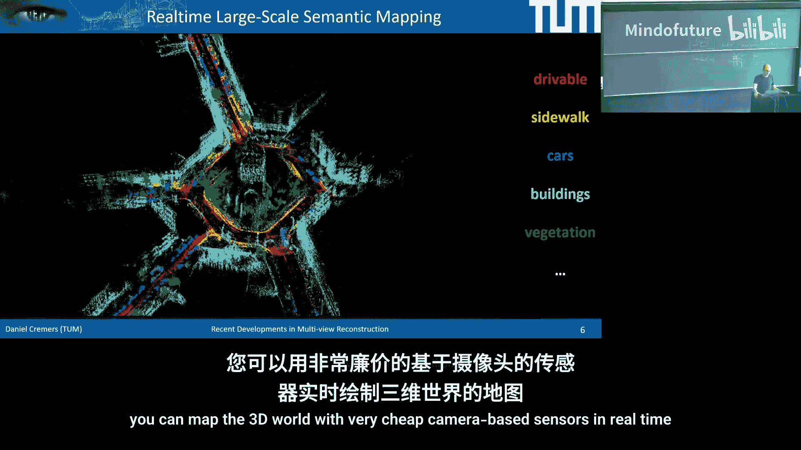

你不需要激光雷达传感器，只需要安装相机进行绘制。你可以提取语义信息，这对于自动驾驶很重要，因为你需要知道可行驶区域在哪里、人行道在哪里、潜在的行人、骑自行车的人等在哪里。我们可以提取所有这些信息，而且现在的神经网络非常擅长从图像中提取语义信息。我们在这里做的是标记我们通过这些图像看到的三维世界，而不仅仅是图像。

我认为我们在这个项目中更进一步，做了真正应该做的事情。计算机视觉在很长一段时间里都局限于处理图像。但事实是，在大多数应用中，我们并不关心图像本身，我们关心的是相机背后或前方的世界。这正是我们在这里能得到的：我们可以从语义上理解三维世界。而实现这一点的关键就是SLAM。

关于位置精度评估的问题：我们一直关注的是跟踪相机位置的精度。另一个问题是，我们恢复的三维世界有多精确？我认为精度稍低一些，但应该说足够精确以实现自动驾驶。精度应该在厘米级范围内。但如果你想要超精确的表面结构，那么激光雷达可能仍然更精确，因为它能提供毫米级精度。然而问题是，如果你想避开道路上的障碍物，你真的需要毫米级精度吗？一两厘米的精度难道不够吗？我认为我们目前的精度水平已经足够支持驾驶了。因此，我们在这里开发的许多实时语义建图技术都是为了推进自动驾驶技术。

## 神经网络革命

接下来，我们谈谈神经网络。我在课堂上没有过多涉及神经网络，但它们在过去的13年里彻底改变了计算机视觉。

这一切始于我的同事斯坦福大学的李飞飞和她的学生发布的一个名为ImageNet的数据集。这个数据集包含数百万张不同物体的图像，其中大多数物体是人类熟悉的，比如这张图。你可能认出这个物体是什么。总有一个主导物体，有人知道吗？这里的**主导物体**是什么？一只狗。哪只狗？这很重要，因为有不同的犬种。斑点狗，没错。

就是身上有黑点的那个。那这个呢？有人认出这是什么类别的物体吗？那是海星，对吧？不是狗，是某种植物。哪一个？有人知道吗？斐济果，是的，就叫这个名字。它是一种水果，但在德国我长大的时候不常见，现在可以买到。因此，如果你在树上看到它们（实际上可能不是树，是灌木丛之类的），大多数人只在超市的盒子里见过，通常不会在树上看到。所以，人类在这方面 notoriously 并不擅长。因此，当被要求对图像中的物体进行分类时，人类也难免会犯错，至少普通人是这样。

长期以来，人们提出了这个挑战：你能设计一个算法来识别图像中的物体吗？算法和人类都只能从有限数量的类别中选择。在2011年，最好的算法在某些数据集上会犯26个错误，而普通人类平均只犯5个错误。这是机器性能和人类性能之间的巨大差距，也是计算机视觉领域最大的谜团之一：我们能否达到人类水平的性能？

现在，如果你看看整个人工智能的历史，几十年来，人类一直试图构建表现出某种智能的机器。你可以从下棋之类的事情开始，但人类并非为下棋而进化。我们不是生来就会下棋，任何学过下棋的人都知道，这需要多年大量的练习。相比之下，用眼睛识别事物是我们与生俱来的能力。经过数千年的进化，我们被训练用眼睛理解周围的世界。为什么？因为你能越早发现面前的狮子，你就活得越久。这是一种非常强大的进化驱动力，驱使人们识别世界中的事物，甚至是伪装的事物。因此，对我来说，这才是真正的智能。我们需要以某种方式超越这种用感官理解世界的能力。因此，我认为计算机视觉是人工智能的核心，比其他任何东西都重要。为什么？因为对人类来说，视觉是主导感官。哺乳动物大脑的50%基本上在不断处理视觉信息。你的一半大脑皮层都在处理视觉信息处理。这告诉你两件事：首先，它很重要，否则我们不会把一半的脑力用在这个挑战上；其次，它并不容易，否则我们只需要5个神经元就能搞定。但识别事物、理解世界、感知事物是困难的，而重现这种能力正是计算机视觉。所以这是核心挑战之一。

在2011年，整个社区觉得我们永远无法接近人类水平的性能。然后，几乎神奇的事情发生了。Alex Krizhevsky和Jeff Hinton及其合作者提出应用深度神经网络。神经网络已经存在多年，并经过不断完善。在90年代末，我来自物理学背景，想做一些能影响世界的事情。所以在1997年完成物理学硕士后，我转向了神经网络。我对这个主题非常着迷，觉得它超级令人兴奋，因为它能重现人类认知和感知等能力。我记得在1997年给Jeff Hinton发了一封电子邮件，说：“亲爱的Hinton教授，我想攻读神经网络的博士学位，您需要人手吗？”他没有回复我的邮件。我知道这个事实，因为那时候我每天不会收到成百上千封邮件。也许我应该坚持并发送后续邮件。我给该领域的其他人发了邮件，有些人回复了，他们说：“年轻人，你看起来很有才华，为什么想进入一个完全死寂的领域？”我很震惊。那是1997年，确实是人工智能的冬天，也许是第二个或第三个冬天，取决于你怎么算。我非常失望，因为我确实相信深度网络和神经网络（当时还不深），我相信神经网络的这种方法。所以实际上我没有听劝，还是进入了神经网络领域，但不是和Jeff Hinton一起。

这是Jeff Hinton团队的一项工作，他们展示了深度网络的能力。你可能知道它们的工作原理：图像信息从左侧输入，然后通过不同的滤波和池化步骤逐层处理，最后在右侧得到分类输出。其思想是，你可以通过监督或某种自监督方式训练权重，使其达到最佳分类效果。最初，这些网络是为分类而设计的。你看，这个后来被称为AlexNet（以第一作者Alex Krizhevsky命名）的网络，将性能从26%的错误率大幅提升到16.4%。于是，我的整个社区都转向了神经网络，认为这是一种似乎很有前景的新形式主义。

因此，在接下来的几年里，人们设计了越来越深、越来越复杂的架构，使得在2015-16年左右，我们甚至能够在人类为进化而设计的任务上超越人类。所以对我来说，这张幻灯片标志着人工智能的真正突破：能够在人类为进化而设计的挑战上击败人类，而不是像下棋这样的人工挑战。当然，这并不是故事的结束，因为除了看到狮子，人类还能做更多的事情：他们能预测狮子下一步会做什么、它会如何移动等等，并且能预测最佳的生存反应。因此，人类拥有许多至今机器所不具备的技能，所以仍有改进的空间。但至少在识别物体这个特定挑战上，我们设法击败了人类。

话虽如此，不知为何，我从未觉得检测图像中的物体这件事很吸引人。我不太关心图像中是飞机、猫还是狗，这个挑战从来不是我的兴趣所在。我关心的是，在2012年那篇论文之后，我和我的团队以及世界上许多其他人开始研究的是：我们还能用神经网络做什么？我们能解决哪些其他挑战？

例如，在2015年（我们大约在2014年开始研究深度网络的多种应用），我们展示了可以用神经网络进行光流估计。我相信这是最早用深度网络做光流的工作，所以我们毫不意外地称之为FlowNet。今天几乎任何光流算法都可以追溯到那篇FlowNet论文。

我们进一步展示了其他问题也可以用深度网络解决。这应该说明，不是我们的工作，但我们也有其他工作表明可以用深度网络做立体视觉和场景流等。这是我剑桥大学的同事Robert T. Chipolla的工作，叫做SegNet，用于图像分割。也是在2015年出现。所以所有这些低层图像分析任务，如分割、光流估计、立体视觉等，我们都展示了可以用深度网络解决。我们还展示了像这个蛋白质结构预测的问题（也是2016年），可以用深度网络来预测蛋白质结构。

如果你关注新闻，就会知道这项工作最近获得了诺贝尔奖。令我们沮丧的是，AlphaFold团队从未引用我们的工作，尽管我们早了两年。

回到本课程的主题，出现的一个问题是：我能利用深度网络进行三维重建吗？在某种程度上，可以说在计算机视觉领域，直到今年，三维重建一直是传统方法的圣杯。

已经有基于学习的方法出现。这些是基于学习的方法的例子，大约在2017-18年开始出现，用于即时定位与地图构建。

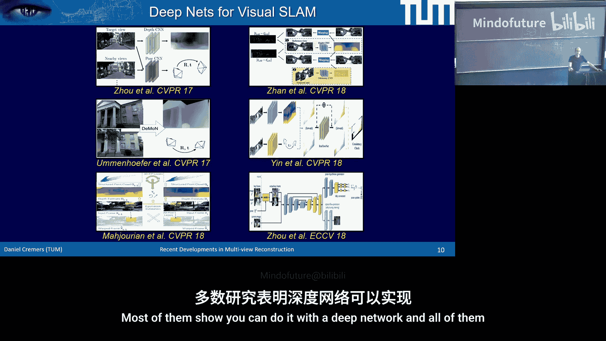

它们大多数表明可以用深度网络来做，但都没有展现出最先进的性能。所以你可以做，但无法获得比我们已有的方法（如我的团队和其他团队开发的LSD-SLAM和DSO等SLAM方法）更好的性能。传统方法更好：它们更快，不需要训练数据，并且具有更高的精度、准确性和鲁棒性。

基于学习的方法为什么不如传统方法，这有点难以解释，但在某种程度上，将视频中的一组图像扔进某个黑盒深度网络，并希望它能神奇地给出轨迹和三维世界，可能期望过高了。也许它需要太多的训练数据，因为它可能需要所有种类的三维世界、所有种类的相机、所有种类的运动组合的训练数据，这种多样性太大了。也许数百万张图像都不足以训练它，我不知道。所以，在某种程度上，挑战在于适当地约束问题，并部署深度网络，使其真正超越基线方法。

这正是我们在这项工作中着手做的事情。这项工作建立在可以预测深度的神经网络之上。事实证明，这是2017年Krizhevsky本人及其合作者的一个例子：给定单张图像，可以预测深度。现在你会说，这怎么可能？原则上，我怎么知道物体有多远？它们可能在任意距离。但实际上，显然，当你在特定场景（如自动驾驶）中训练时，你知道汽车、物体、路灯等，它们都以特定的大小出现。所以我知道，即使对人类来说，如果我问你那辆车有多远，你也能告诉我。也许不是厘米级的精确，因为人类对数字从来都不擅长，但你可以说大约10米左右。所以，我可以训练一个神经网络来做完全相同的事情。我可以用监督方式训练它，或者像我们在这系列论文中所做的那样，用自监督方式训练。这是如何工作的？我们假设汽车中有一个立体相机系统。这意味着我们可以说，找到一个场景的深度，使得如果我将颜色投影到世界中，再投影回另一个相机，我应该得到颜色一致性。就像在SfM方法中一样，这种亮度或颜色一致性可以用来以自监督方式训练深度预测。这意味着我们不需要真实值（ground truth），也就是说，我们不必携带激光雷达扫描仪来告诉我们实际距离是多少。我们可以使用立体设置，这意味着它是廉价的。立体相机很便宜，你只需把它们安装在汽车上，可以连续行驶数天，创造无限量的训练数据。

因此，总的来说，我认为当今科学界的关键挑战是开发不需要真实值的自监督学习技术。正如你所见，我们的深度网络预测出非常清晰的深度，远优于基线方法。然后我们更进一步，将这些深度预测输入到SLAM方法中。所以我们有一个像DSO或LSD-SLAM这样的优化方法，然后将所有这些预测输入到SLAM流程中。更具体地说，给定两个连续图像 I_t 和 I_{t+1}，我们训练一个神经网络来预测每张图像的深度，预测两帧之间的相对相机运动（位姿预测），我们还训练一个网络来预测不确定性。然后我们将所有这些预测输入到SLAM流程中。更具体地说，我们预测深度，预测相对相机运动（T代表相机在两帧之间的平移和旋转），一旦我们可以基于这个刚体运动进行相机对齐，我们就可以扭曲这两张图像并对齐亮度值。然后我们可以得到一个用于训练系统的残差，这是自监督的。这基本上是说，一旦我将图像投影到世界中，再投影回另一个相机，这些图像的颜色应该一致。我可以测量颜色差异或亮度差异，这就是我用来训练这些网络的残差。

一旦你对真实的相机这样做，它实际上并不奏效，因为真实的相机有光圈变化。所以同一张图像，一旦被扭曲，亮度就会非常不同。正如你在这里看到的，这是同一张图像，对人类来说看起来一样，但如果你比较实际的亮度值，它们非常不同，因为光圈改变了。但好的是，你也可以训练一个网络来预测整个图像的仿射亮度校正（强度的偏移和缩放），使其与另一张图像最一致。好的是，你可以训练网络来预测这两个参数，以模拟这种校正。然后你就有了可以用于训练DepthNet和PoseNet的一致亮度作为残差。

这对于朗伯世界（Lambertian world）有效。但正如我提到的，真实世界并不总是朗伯的，因为我们有闪亮的金属结构、镜面反射、玻璃窗等。整个人类世界有大量非朗伯结构。然后你必须问自己，在这一点上我能做什么？有不同的方法可以尝试：你可以尝试模拟世界的反射特性（BRDFs），可以尝试推断材料参数来模拟光线通过窗户的传输、衍射等光学现象，你可以尝试反转这个过程，从图像中重建三维世界和材料属性。我们在某种程度上尝试过，可以使其工作，但无法实时进行，因为模拟光传输的物理过程是一个非常复杂的现象，实时建模这些我认为是不可行的。

那么，我们能做什么呢？事实是，我们想跟踪相机，不关心周围事物的反射特性，我们只关心跟踪相机。所以我们可以训练一个神经网络来告诉我们哪些区域的亮度被保留，哪些区域没有。事实证明，你可以训练一个网络，对于测试图像，你得到的是这里看到的：汽车上的金属结构和窗户会亮起来，其他部分则较暗。这基本上告诉系统，你应该依赖较暗的区域来进行亮度一致性检查。所以你要做的是，通过所谓的异方差不确定性（sigma）来降低残差的权重。显然，如果你只这样做，那么它会降低所有像素的权重，因为这样会使成本降低。所以你需要一个正则化项，这都基于高斯假设，然后你会有log(sigma)项，基本上是说，你不能只是降低每个像素的权重，否则该项会变得很大。最终，你得到了一个自监督学习方法，它可以告诉你深度、相机运动、仿射亮度校正和不确定性。它只是告诉你哪些区域是朗伯的，哪些不是。

所以问题是：深度预测与深度相机或立体视觉相比如何？出人意料地好。目前社区存在分歧。有些人说深度预测不是很好，应该预测法线信息或相对深度（例如，哪个点更近，而不给出绝对深度）。显然，如果我输入一个乐高世界的相同图像，而网络是在真实世界（物体在10米外）上训练的，那么它不会给出正确的深度。所以在某种程度上，你可以预期这些系统只做它们被训练做的事情。如果你在自动驾驶场景的道路上训练，它会学习所见不同物体的大小。但如果你把这个系统带到森林里，那里有各种大小的树叶，你可能不知道，同样的叶子可能有不同的大小。那么，它们可能不会工作得很好。它们仍然出人意料地有效，但没那么好。简而言之，它们是否工作良好，取决于观察者的角度。但我最近看到我的同事说，深度相机已经过时了，因为我可以拿一个普通相机，在上面运行深度预测网络，就能得到类似的东西。我认为在某些场景下它们确实过时了。在自动驾驶世界，我认为这个问题已经解决了。我们可以做深度预测，我们通过我们的工作和其他工作展示了这一点。如果你想要能为完全随机环境（森林、丛林）提供深度的东西，那就是另一回事了。换句话说，能否预测深度取决于应用场景。如果是一个受限的世界（自动驾驶就是一个非常受限的世界），甚至世界的几何结构对于每张图像来说深度几乎相同。为什么？因为道路往往是平坦的，所以我可以不看图像就告诉你深度。不开玩笑，我们和其他人都展示过，如果你训练一个深度预测网络，要超越一个超级简单的方法（取所有训练数据，只平均深度，然后预测这个平均值）并不容易。它会给你道路，给你两侧，所以它会给你一个相当好的深度预测，除了实际停在路上的汽车，其他一切都很好。令人惊讶的是，用神经网络击败这个基线并不容易。

当事情开始时。所以这个自动驾驶世界，你看，深度总是相同的，除了几米的来回变化。正如我所说，所有这些预测，你以自监督方式训练，一旦运行，它会预测相对相机运动，预测深度。现在，这个方法的关键来了：我们不完全信任这些预测，但我们把它们作为先验使用。我们说，找到一个相机运动和三维世界的重建，使得对于每一帧，尽可能与深度网络的预测一致。所以我们把这些预测输入到损失函数中。因此，我们有一个基于亮度一致性的经典SLAM算法在运行，然后我们在损失函数中有一些项，说一切都应该与深度网络的预测兼容。

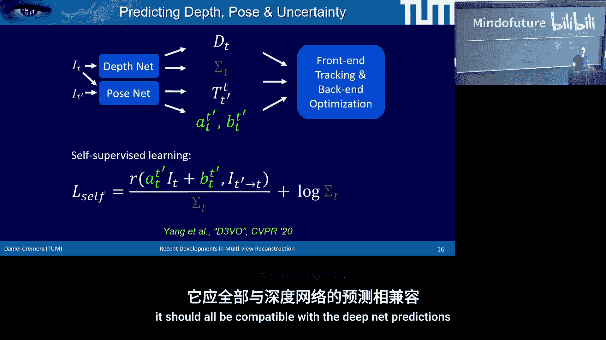

这大大提高了精度和鲁棒性。你在这里看到的是其中一个方法，仅使用一个单目相机，没有立体视觉，没有GPS，没有IMU，只有一个灰度相机。正如你所见，仅用一个单目相机，我们就可以绕街区行驶。这是一个我们以前从未见过的世界，来自测试集。

你可以看到，与标准的单目SLAM算法（会产生尺度漂移）相比，这里几乎没有漂移，轨迹几乎完美对齐。

因此，在发表时，这项工作是迄今为止世界上最精确的单目SLAM系统，一个深度学习增强的经典SLAM系统。我相信，经常有人问我，结合两个世界最佳之处的技术和方法有光明的未来：从经典方法中汲取所能，从基于学习的方法中引入所能。

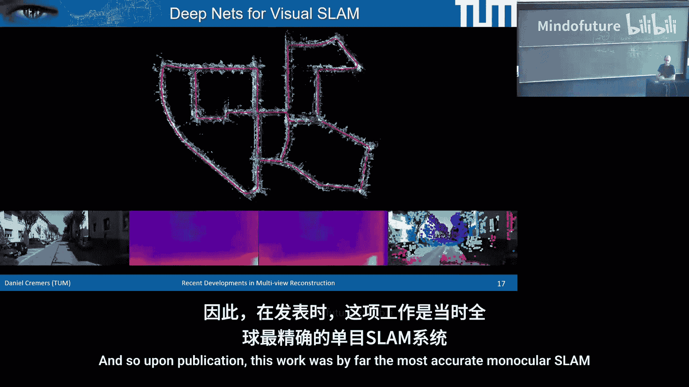

例如，我在多视角几何课上一直说，你无法从一个相机估计世界的尺度。我告诉过你们，对吧？在浴缸里，你可以拍摄泰坦尼克号，它看起来相当真实，因为一切都是尺度模糊的。那实际上并不正确。如果你知道你正在行驶的世界，你可以从一个移动的单目相机确定世界的尺度。然后神经网络可以进行深度预测。即使一个预测不好，但平均整个序列，它们会聚合成非常精确的东西。所以这里没有尺度漂移。深度网络预测带来的巨大好处是，深度预测是以米为单位的度量预测，它们进入并固定了尺度。随着时间的推移，所以这里没有发生尺度漂移。我们定量评估了它，毫不奇怪地发现它效果非常好，无论是与ORB-SLAM等经典方法相比，还是与Stereo DSO等立体方法相比，这个单目方法仍然优于它们。

所以，使用一个相机加一个神经网络，比使用两个相机但没有网络更好。所以所有这些论文的普遍信息是，深度网络可以补偿缺失的传感器信息，它们可以“幻觉”出其他传感器本应测量的东西。事实上，这就是为什么我们发表的第一篇方法称为DVSO（深度虚拟立体里程计）。本质上，我们用立体视觉训练它，系统被训练来“幻觉”第二个相机。当你应用它时，它只会“幻觉”出第二个相机并给你深度。

所以这解决了自动驾驶中最大的问题之一：自动驾驶技术的认证对每个在该领域的人来说都是一个臭名昭著的挑战。你能证明它是安全的吗？有两种方法来证明系统是安全的。一种方法是，你以某种方式预先保证深度预测的误差总是在2厘米以内。我相信这种认证对于当今的机器学习和AI算法（尤其是深度网络这种在某种程度上是黑盒的系统）是不可能的。但还有第二种方法来认证它们，这非常实用且有效：你让它们运行数英里，展示它们实际犯了多少错误。然后你希望在尽可能广泛的应用范围内进行测试。特别是，你希望自动驾驶不仅在美国西海岸（据我的经验，那里总是蓝天、阳光明媚，道路足够宽，交通非常规范），还要在像罗马、西西里、孟买或北京这样的地方展示其功能，据我的经验，那里的交通要混乱得多，并且可能有你在美国道路上见不到的障碍物，尤其是在中国，我见过有趣的车辆，比如自行车上堆满东西。如果你的网络从未见过这样的结构，它可能会非常困惑。所以这种认证正在进行中，这是可以做到的。你可能还想开车穿过森林，确保它仍然有效。所以这都是可以解决的。我们自己也在不同的街道、城镇、环境（包括森林或人造世界）中进行了大量评估，表明它仍然有效。但通常，与任何深度学习方法一样，对我来说，基于学习的方法最大的缺点是，当你远离训练集时，它们的性能会下降。这是可以预期的自然现象。但当你远离训练集时，性能下降的速度取决于你如何形式化方法。例如，这个方法性能下降非常平缓，为什么？因为它内置了经典的SLAM流程，深度网络的预测不被视为真实值，它们作为约束输入。如果它们对于几帧图像不正确，这不会损害性能。有一个整体的全局优化确保结果是最优的。因此，这个方法在远离训练数据时性能下降非常平缓。我认为，这通常是混合方法的优点：一旦你遇到所谓的领域偏移或超出训练数据领域，它们通常仍然有效。

现在，正如你所见，这一切都基于深度预测。这让我有点困惑，我建议我的学生：让我们做深度预测，并将其输入到SLAM流程中，然后这个成果就出来了，它可以非常精确地跟踪相机。

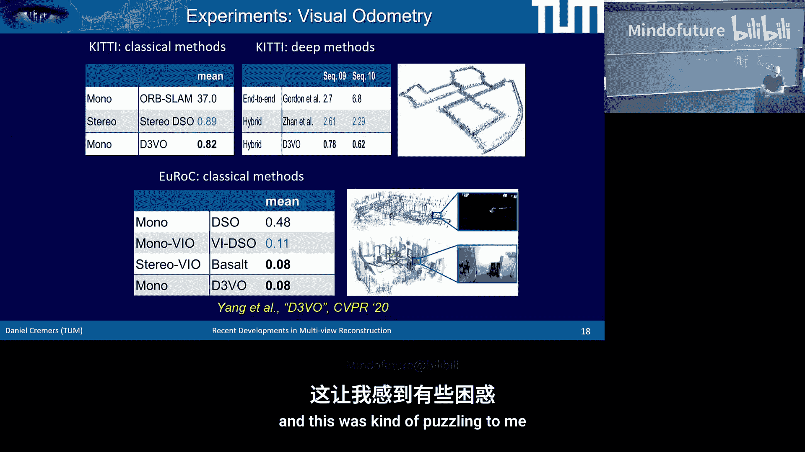

但世界不是稠密的，是稀疏的。然后我说，等等，网络的深度预测是稠密的，你不能从中构建出稠密的世界吗？

嗯，我认为为了跟踪相机，他只关注了最精确的点。但在某种程度上。

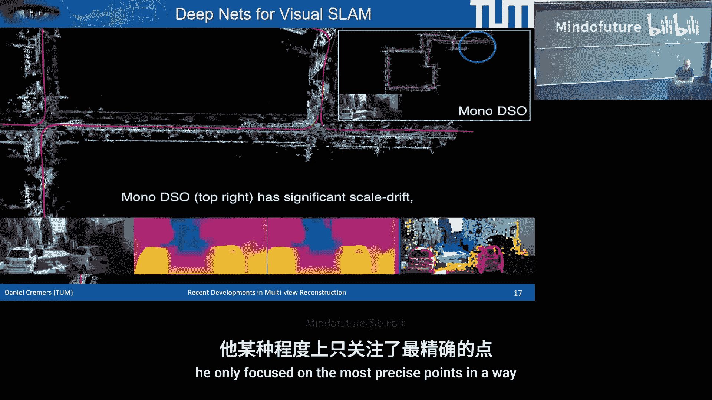

然后我们更进一步，这是Felix Wiba及其合作者的后续工作，我们更专注于深度预测。我们说，获取所有深度预测，并将它们聚合成一个稠密的三维世界，因为我想看看我们能否从一个移动的单目相机重建稠密世界？这是一个非常经典的计算机视觉挑战。一旦你在这些自动驾驶场景中这样做，有汽车在行驶，一旦你预测了它们的深度，但随着时间的推移它们会移动，那么如果你随着时间的推移聚合这些深度预测，你会将移动的障碍物“涂抹”在世界中，你可以想象，看起来真的很酷。我喜欢这些被涂抹的移动汽车。但我的学生们不喜欢，他们说我们不想要任何被涂抹的障碍物。所以他们在其中添加了一个模块，一个所谓的掩码模块。这个掩码模块旨在基于亮度不一致性过滤掉物体。所以我们使用多帧之间的亮度一致性来预测深度，然后我们使用相同的亮度一致性来说，如果深度与我们估计的相机运动不一致，那么很可能是因为某个物体移动了。因为那样颜色就不一样了。所以我可以基于相机运动扭曲所有图像，然后亮度应该一致；如果不一致，那么可能物体移动了，我们可以将其输入到一个掩码模块中，该模块识别移动物体的区域，这些区域被过滤掉，所以移动物体从重建中被过滤掉了。然后我们得到最终的深度模块，它只预测静态世界的深度，而不是移动世界的深度。

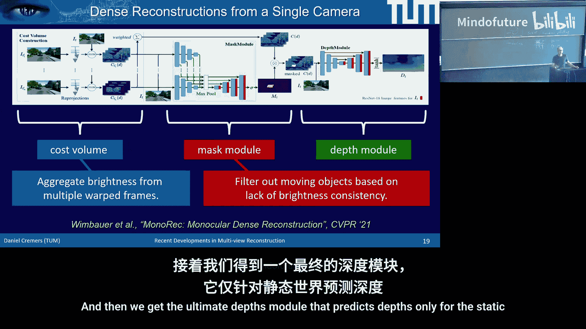

因此，我们得到了一种称为MonoRec（单目稠密重建）的技术。正如你所见，我们可以恢复一个相当令人满意的三维世界，仅从一个移动的单目相机行驶通过世界重建而来。

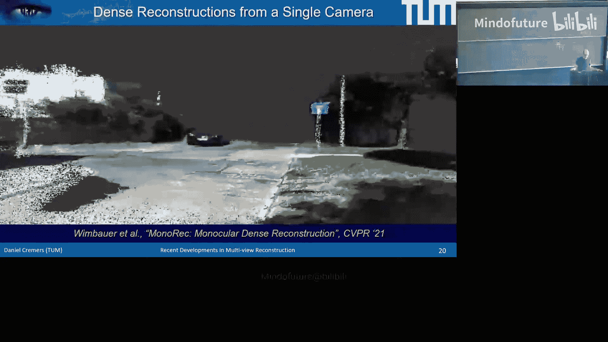

这里你可以再次问，这个重建有多精确？我认为它不如激光雷达点云精确，但点云要稠密得多。它是一个彩色点云，所以我们实际上可以识别物体，这在激光雷达点云中要困难得多，在那里你看到点但不知道在看什么。

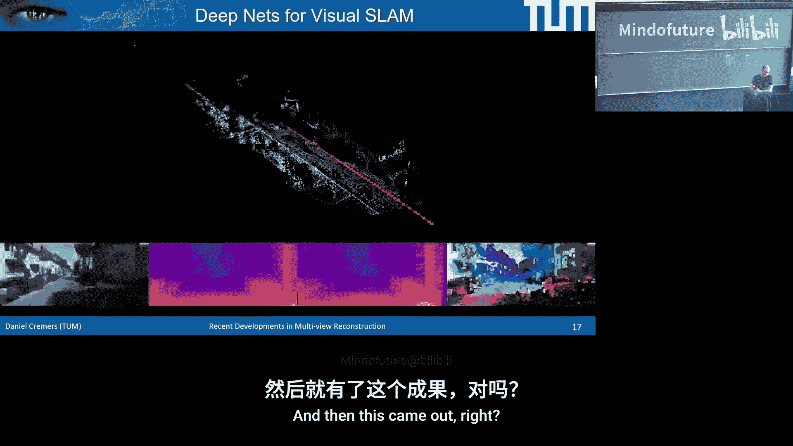

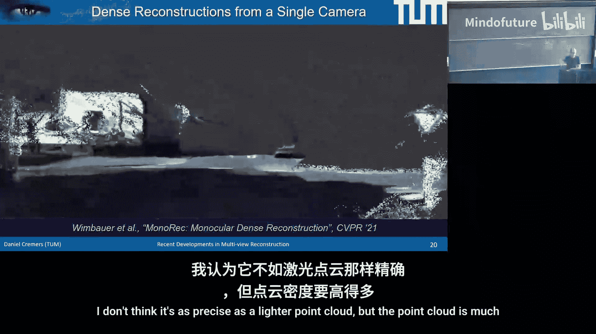

如果你有一个停车标志，你可以用激光雷达扫描它，但你永远读不到上面写的是什么，因为你需要颜色才能做到。而这里我们得到了所有东西的彩色重建。

精度可能不如激光雷达点云，但我想说，足以进行避障、路径规划以及安全驾驶所需的一切。你可以看到，重建的视觉效果还不是完全稠密的，这是因为深度是从一个视角预测的，当你从不同视角看时，会有这些离散化伪影，所以最终有点稀疏。

一旦你有了三维相机运动，有更好的方法来创建新视角，我提到过其中之一是NeRF（神经辐射场）。这是五年前由Ben Mildenhall及其合作者发表的工作，在社区引起了巨大轰动，我认为部分原因是它能够生成非常美观的新视角。它通常需要大约100张物体的视图。它假设你有相机位置，人们常常忘记这一点。我经常被问到，你为什么做三维重建，为什么不做NeRF？嗯，NeRF使用三维重建，它们需要某种前端算法来告诉它们相机在哪里。所以NeRF真正设计的是在有了相机位置后创建新视角。它训练一个神经网络来预测，对于给定的体素和给定的观察方向，如果你看它，你应该在那里看到什么颜色。所以它试图拟合所谓的辐射场。它训练一个多层感知机来从体素和观察角度预测颜色。由于它使用了观察角度，它实际上也可以建模非朗伯物体，即我所看到的颜色取决于我看某个盒子的角度。所有这些都可以从大量示例中训练。我可以拟合一个神经网络来做这个预测，然后我可以拍摄很多像这样的物体图像。

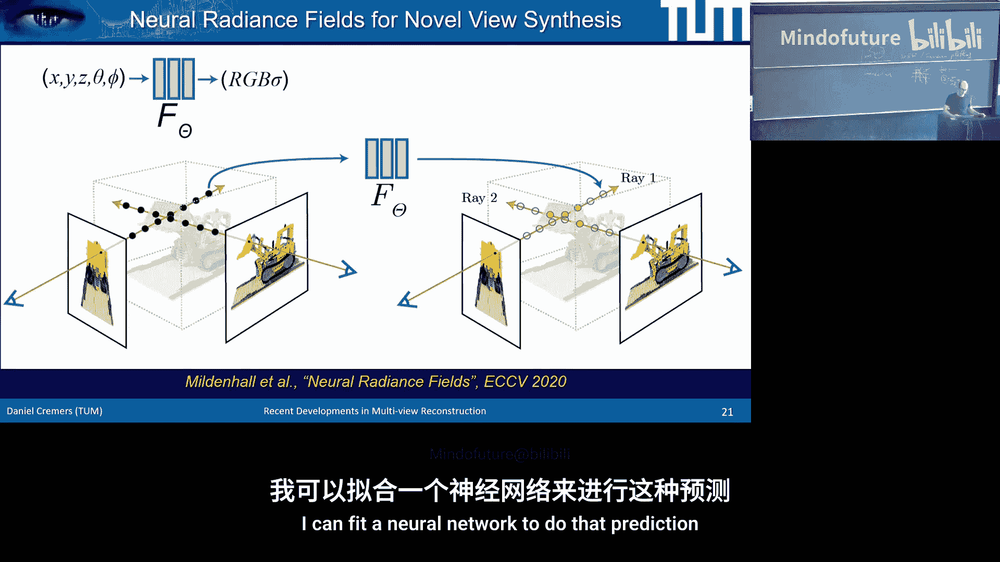

然后，你可以看到如何得到非常好的重建。他们通过虚拟移动相机来可视化它。

但你看，这需要数百帧。相比之下，正如我提到的，我展示的跳绳女孩的例子只用了16个相机。我认为NeRF不能用这么少的相机工作，你真的需要更多相机。这是神经辐射场的一个大缺点。此外，它们创建新视角，并不显示实际的表面几何形状。首先没有显式的表面几何形状，它实际上模拟光线沿射线的传播，以及通过沿辐射场积分你会期望看到什么颜色。然后你训练一个神经网络，使用大量训练数据来预测从给定视点看给定体素的颜色。

这是2019年Vincent Ititzman的工作，他实际上是我的一个本科生，做了基础工作，现在是MIT的教授。这就是神经辐射场。这篇论文的论点是展示他们可以做得更好。

但你可以看到，在比较中，有一整套人们提出的神经方法，如神经体积等。

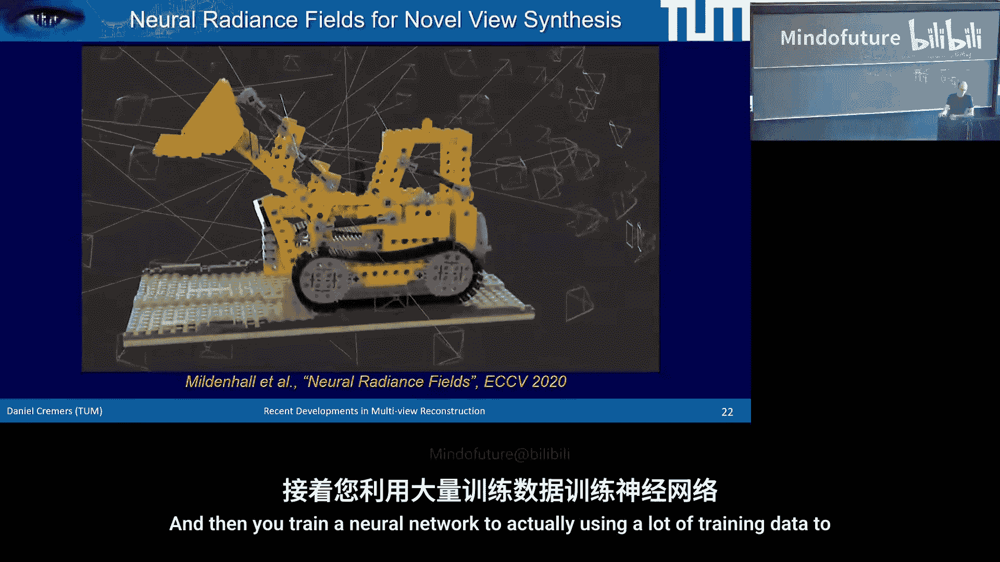

来解决这个挑战。现在，NeRF的一个关键缺点是它们是针对每个实例训练的。所以你有一个物体，你拍摄100张图像，然后训练一个神经网络来预测从给定角度看给定体素会看到什么颜色。它做了一种非常巧妙的光场空间插值。但关键问题是，这个神经网络是针对每个场景训练的，它学到的任何东西都不能应用到新场景。这意味着如果你有一个带有新图像的新物体，你必须从头开始训练一个新的NeRF。所以，尽管它是一种基于学习的方法，但不像经典意义上的学习，从示例中学习一些东西然后应用到新设置。不，你必须这样做，所以它实际上只是拟合函数来估计这个光场。

而你可以做的，也是我们在这项名为“Behind the Scenes”的工作中着手做的，是训练一种以自我为中心视角的密度场，并以一种能推广到新环境的方式训练它。所以这种方式的工作原理，有点受神经辐射场的启发，我们也使用这些射线，并尝试估计沿射线的密度（材料密度）。但这种方法的好处是，它以自监督方式在训练数据上训练，可以应用到新的测试数据，然后你可以从单张图像预测三维世界。所以它是单视图重建，我们使用密度场，我们可以训练它。我们如何训练？我们使用视频中的连续图像来确定不同位置的颜色，并确定能预测这张图像的密度。一旦我们应用它，我们可以应用到一张新图像，它会预测密度，这意味着对于这条射线上的每个像素，它不仅告诉我们物体在什么距离（那将是深度预测），还预测物体在哪里结束。这是我们人类可以做到的：如果我看到一辆车，我不仅能告诉你车有多远，还能告诉你车有多大，因为我以前见过车。如果你能看到车后面，这就是为什么我们称之为“Behind the Scenes”。在训练数据中，你可以从经验中学习物体通常有多大。

因此，结果是，这只是逐帧应用这个方法。在顶部，你看到输入图像，总是只有一张图像。在底部，你看到预测。你看到它显示了物体在哪里结束，相比之下，深度预测网络看不到物体的结束。我们的方法可以看到结束。这是MonoDepth，它显示物体在哪里，但每条射线只有一个深度，而我们对于射线有整个密度。

一旦我们对这个密度进行二值化阈值处理，我们可以给出这些三维重建，即使在完全90度的视角下，你也能看到一个相当令人满意的、可能有点过度重建的世界。一旦你有了密度，你可以像在NeRF中一样，进行新视角合成，然后从不同的视点得到非常令人满意的新视角。然后你可以问，这仅在自动驾驶上有效吗？答案是否定的。所以我们也可以展示它在其他随机环境（室内或室外环境）上有效，我们可以做密度预测，得到三维，并生成新视角。

也许你明天会听到更多关于这个的内容，根据计划，你可以更进一步，做所谓的语义场景补全。所以你可以拿一张彩色图像，以及来自深度预测网络或激光雷达扫描仪的深度（无所谓），然后你可以补全场景。这意味着你从单张图像得到一个语义场。这就是想法：只有图像和深度，你得到一种三维语义分解。在我们的案例中，关键创新是我们可以仅用2D损失来训练它，所以我们不需要3D语义的真实值。

然后我们可以生成语义标记的三维世界，全部从单张图像和深度计算而来。

在这里你可以看到可行驶区域、汽车等。它更准确。这是真实值，你可以看到我们实际上有更好的重建，甚至比真实值或许多其他网络更好。通常，训练数据的一个问题是，我们世界中的真实值几乎从来都不完美。我们经常看到，我们的重建实际上比被认为是给定问题真实值的东西更准确。

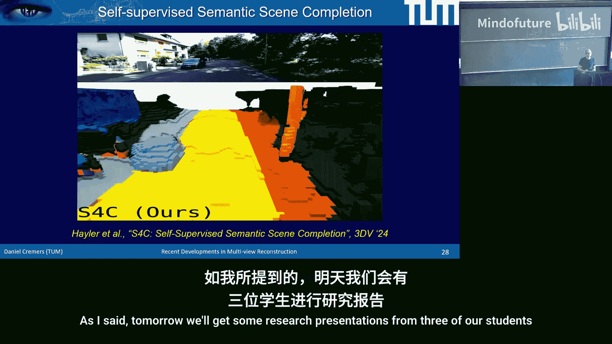

好了，考虑到时间，我今天就讲到这里。正如我所说，明天我们将有三位学生的研究报告，他们将介绍他们目前正在做的工作。非常感谢。顺便说一下，下周三没有课，因为下周三我正在组织慕尼黑AI日，这是慕尼黑机器学习中心（我负责运行）组织的年度AI活动。所以我们全天都有很多演讲和主题演讲，所以下周三没有课，明天我们将有研究报告。

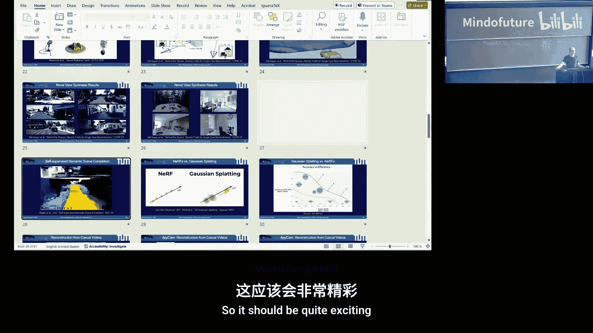

![](img/6ce81af182b0b845b