# UBC《机器学习和数据挖掘｜CPSC 340 Machine Learning and Data Mining 2012》中英字幕 p01 -01-undergraduate machine learning 1_ Introduction to machine learning.zh_en -BV1pJ2ABFEFg_p1-

Please don't ruin it for the rest。So what I'm showing you here is a video with two images and I'm switching between the two images。

 they're basically the same image， but one part of the image is changing。

Between the two and don't point to it you'll say it loud because you'll ruin it for the rest。嗯。

How many people can see the difference between the two images？

It's about1/20th of the images changing in front of your eyes。

One20s of the image and it's something that aplans need in order to fly。Oh。Okay， more people start。

 so with the clue help， not everyone has seen it yet。If I say engine。Most people should see it。Right。

Airplane engine， I can now point to it to make it easier。And as you can see。Over here。In one image。

 the engine is there and the other one it is。

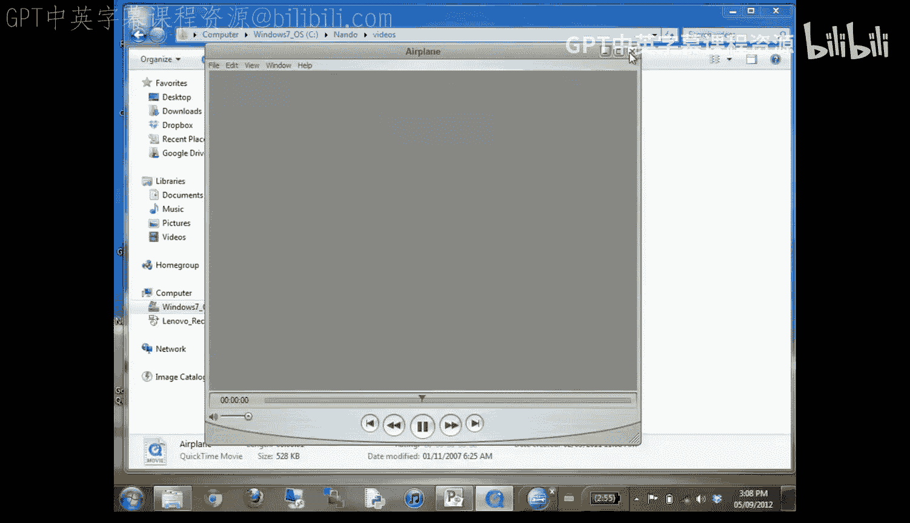

And you might think that this is just a trick in that your attention is being distracted and you're not being able to actually see the engine because there's other things in the image that are distracting it。

And indeed that is what a lot of people do that's essentially change blindness The next video will illustrate that the problem is much bigger and we'll also illustrate why you should close your laptops during this lecture。

So I'm going to just basically click on this。And I will let to。嗯。Followed instructions。

All right， so what changed？A sign。Okay。What else changed？A person disappeared。Got darker。

That's a good one。You're the first person。I think three years that haveve been using this。

 that's not just that。 a whole building changed。Okay。

 note there's so the few things that were pointed out as signs。Not that this story is now green。

 something weird， the wrough iron here is broken。And there's a door up there。

 what's the door doing updates it for people to walk out and jump off the balcony？

And this building is pink。Let's click somewhere and see what the original was。

This whole building changed， there was a person here， someone noticed a sign changing。

 there were windows with iron， the door was brown not green and many other things changed because just some of them。

A lot of people think that achieve when I do that， when I do this。

 I'm going to play this again one more time。

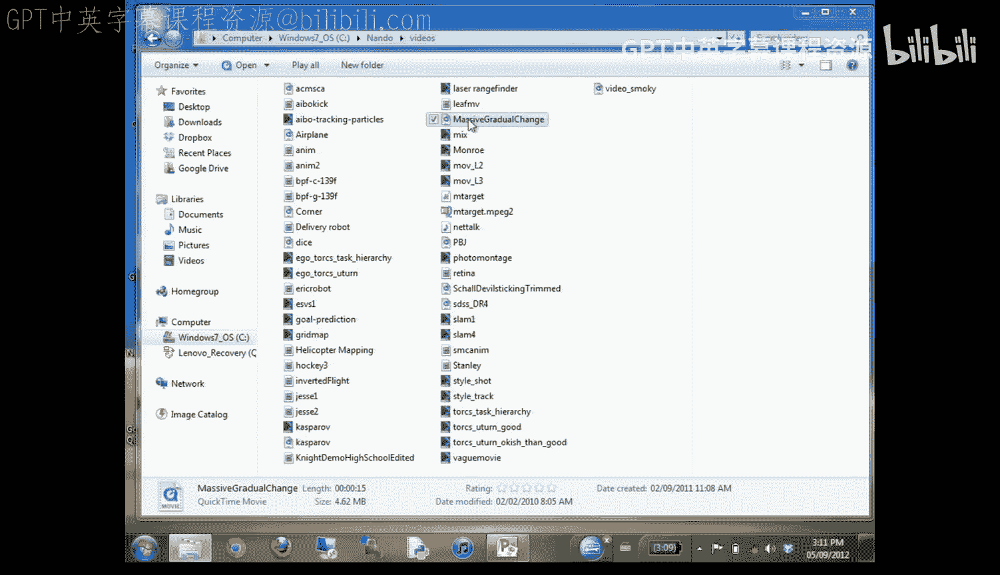

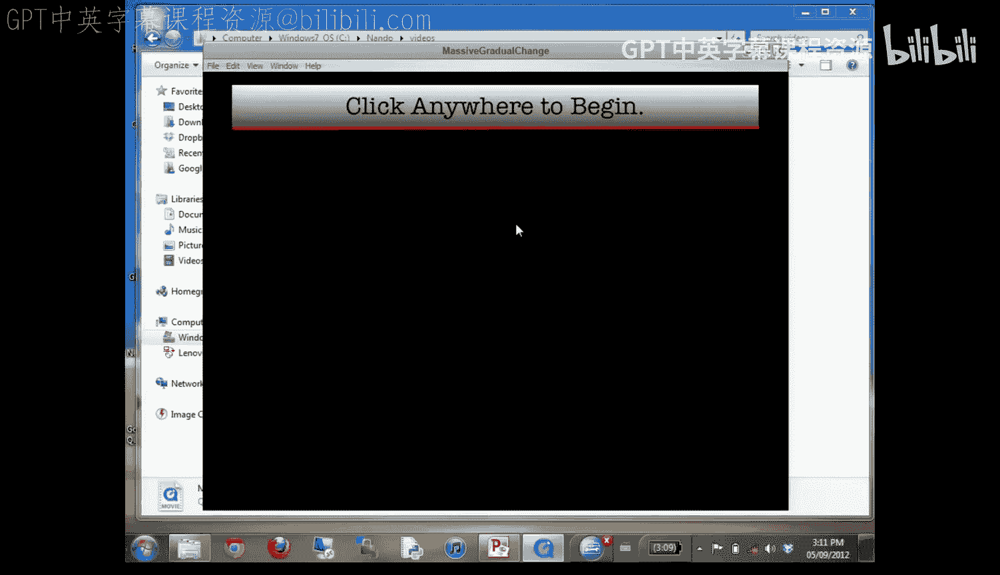

And if you look at the building， you can see the building changing now， if you focus on it。

 you'll see that it's changing， but the problem is you're too focus on the building seeing a change and you're not seeing the changes that are happening elsewhere。

Okay。No matter how much you believe you can attend and do two things at the same time， you can't。

 so you have your laptop there， don't fool yourselves that you can keep a conversation with your friends and attend to this lecture because you can't。

You're wasting your time。In the visual system is just like that。So what's going on？

We have this belief that we have an image of the world in our heads， that we're seeing this all。😔。

But we're not， as I've already proven to you with the last two videos。

 it's an illusion that you're seeing at all， but you're really not seeing at all。Moreover。

 the reason in the last experiment why you don't see it all is because there's a limited buffer。

There's a limited visual buffer， you can， per second you see in higher resolution something that's the size of your thumbnail at this distance。

 and you see it about three or four times。That's all you see。

The rest is a confabulation of your mind。And let me show you。A video that actually shows what you。

This is now using an eye tracker， so these days it's very cheap to get eye trackers。

 and so we can actually look at what someone is。using a night tracker with a camera and also monitoring where the retina is。

 we actually can tell what the person is looking at in a scene and so when you're home and you're making yourself a peanut butter sandwich。

This is essentially what you're looking at， you might think that you're seeing the whole scene。

 but you're just using your eyes as legss to complete a task。No， you read the labels。

Your eye pays attention to the edge of the jar and the hand grip because that's what you care about。

 You don't want the peanut party to come off and you don't want to drop this thing。

So your eyes are being used for motor control。I hope you all had lunch。完な。P。

 when this individual pours water。We'll pay attention to the edge of the glass because that's all that you care about。

 you don't go in to spill water。And so on。And。Seen as a retinal image。

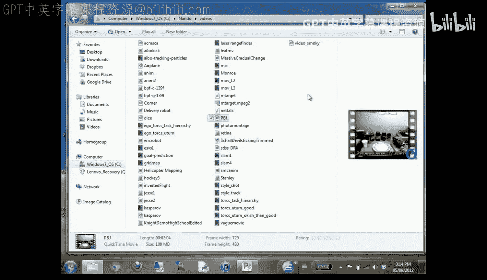

Here is another demo。

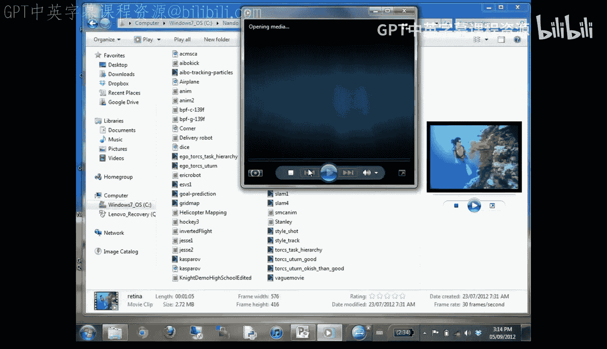

That sort of shows。Again，Whether they've monitored a subject looking at an image。

And this is essentially the phoviations。And this is really what you see。 something in high。

 You have this huge hole in the middle called the blind spot。

Just prove that you're not seeing it at all because there's a huge blind spot there that your brain is filling it。

 you wouldn't know that it exists。

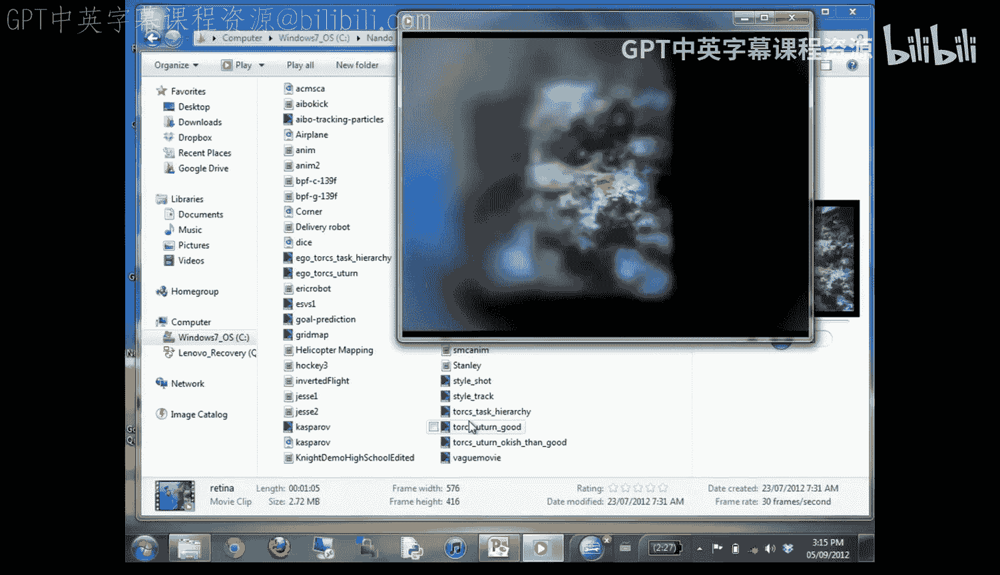

P are amazing。All right， why am I showing you all this。

 not just to make you feel a sense of bewilderment in the world and it。

 but it's just to show you that you don't know how you see。Now comes the question。

 if we don't know how we see。😔，How can we tell machines to see？この部。

And so the whole idea of programming with ifs and fors and all these constructs comes to the ground。

Because you don't know how to tell a machine to see。

Instead we're going to take a different approach and that's the machine learning approach。

Where instead of。Giving an algorithm， giving a machine instructions on how to see。

We're going to just present it with examples and let it figure out what it is to see。

And I'll be more concrete about that。So。Now， it seems extremely daunting。嗯。To be able to see。

I will now ask you the following。Which of these images looks more like a jumping spider， you know。

 the little jumping spiders that go around in the garden and jump， you get them all over the place。

And I'm going to have people doing hands up to see you how good you are at recognizing a jumping spider。

 So you get to only vote for one of these。 So how many people think this is the best sort of。

Image of a jumping spider。Anyone for one， one person， for this guy， how many people。

 let me record the votes， oops are left a pan。How many people for this one we have about。One， two。

 three， four， five， six， seven， eight， nine。This guy。But six， this guy。3。This guy here， we have one。

 two， three， four， five， this guy。We have one， two， three， four， five， six， seven， eight，9，10，11。

 so this guy's winning for some reason。This guy。Four， five， six， and what about this guy？

Most people think that's a jumping spider， okay， so those guys is one。 So now let's see。

So your prediction of what a jumping spider is agrees with the prediction of a male jumping spider。

So when a male's jumping spider was presented different pictures of a female jumping spider in a mating procedure。

 this was the one that caused aroususe。该。Now this is not to just。

 this is actually intended to belittle than you indeed， to belittle us humans。

 because even a little jump spider is capable of seeing and understanding something that would be extremely hard for us to again code with an algorithm in a machine。

That's a little jumping spider， it has amazing eyes， has a long focal lenss， it has 360 view。

 very much like the Google Car that you see driving around。you。

This is sort of the experiment where it's able to recognize not only are the spiders。

 but it recognizes images as spiders caricatures。extremelyt hard thing to do。

And this is how beautiful the learning process of evolution is that this is not a jumping spider。

 but a moth that has learned through the ages to pretend that it's a jumping spider so that the other jumping spiders don't attack。

Evolution is just a truly beautiful thing。And it's a learning process that takes over many years。

So even small creatures， the point being that even small creatures are capable of doing。

 you know it just a few thousand neurons are capable of doing things that we're not capable of doing。

 and that's because they've learned， they've learned either through evolution， trial and error。

 or as well see with humans we learned through a stage of growing up。Okay， so this lecture。

The main intent of this lecture is to first motivate the topic why we need learning。嗯。

And I will then give you some definitions of。What we mean by machine learning。

 what we mean by learning。I will talk about the big data phenomenon。

 which is something that's happening right now， and it's one of the reasons why machine learning has become so popular。

I'll talk about neural systems and motivation for designing machine learning systems。

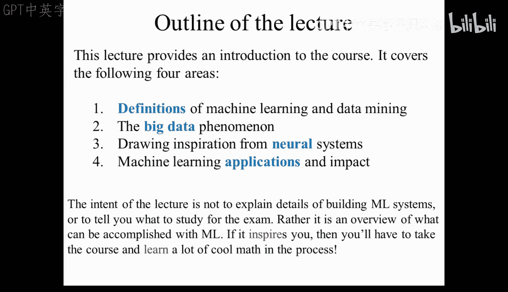

And。And then finally， whoops， sorry about that， finally。

 I will talk about some applications of machine learning。

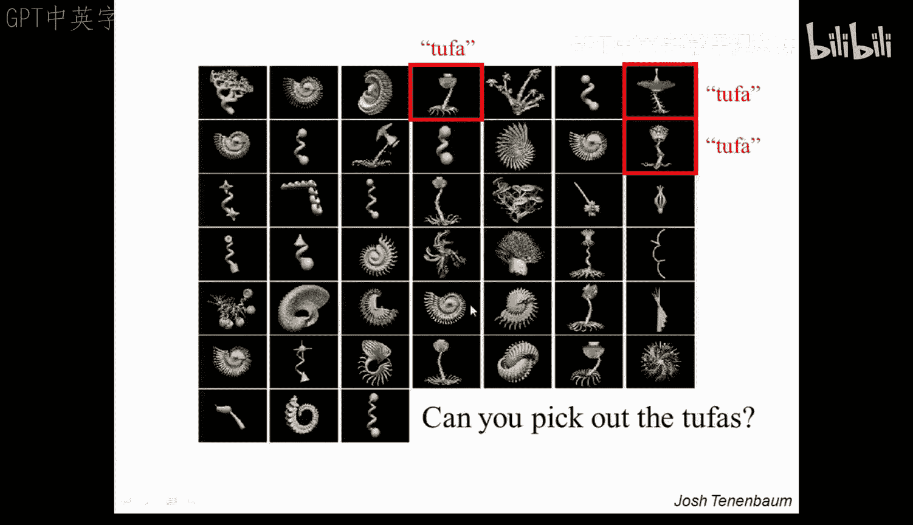

And there's many， many applications， machine learning is one of the most popular things。

 I hope that will transpire over today and Friday。And I will just cover a few。Now。Everything。

This week is going to be like， wow， and if it's not wow， this is the wrong course for you。Com。

If it's wow， then there's a warning。This is a math course。对。The way if you go to Google。

 if you go to Microsoft。And you walked through the halls。

 I took a bunch of pictures actually that I wanted to put in the slide to prove to you， but sadly。

 and it was hard to take pictures in Google but still managed to get some。

 but I was on a dock the other day and I was taking a picture of a jelly face and my dog pulled in。

My cell phone ended at the bottom of the ocean。😔，And I didn't back up。

So but I will swear to you that those holes are full of boards with math。

The same kind of math that we're going to learn in this course now the math is not hard and I will revise it all from the beginning。

 but there will be the first few lectures will all be about revision of probability。

 there'll be revision of linear algebra and so on， unlike earlier courses。

 first year and second year courses， you'll see how the math directly applies to the world and how we use math to do very cool stuff。

 but the language of machine learning is mathematics。Now。It's。It's like any other language。

 if you prepare to learn it and do cool stuff in the process it will be really enjoyable and I welcome you to the course。

 if you're the kind of person that goes to China and you hate being in China because you have to learn Mandarin。

 then this course is not for you either。Okay， so we want people that are excited about learning。

And provided you're excited about learning， we'll do our best to teach you to constantly。

Okay。One more example。Over here， there's a bunch of images。And。

And I have highlighted three of the images I'm called which are tuFs， so here's a tufer。

 and another tufa and a third tufa。Okay， so now how many people think that this is also a twofer？

How many people think。This is a tu far。On person， good。What about thisca？This guy。Okay， we split。

Conclusion。Actually' to ask a question first， can someone tell me what a two phase is？

NowSome can probably voice what a two phase。You're all so good at telling what a tooth is and what a toothpa is not。

And you were very convinced， except for the one guy that stood up against it not being a to her。

这个 force式。ItKin of looks like a fossil。😔，So we're starting to get an explanation。

 what else is that about a Tla？We can have a fairly long stem and a little thing at the top。Okay。

 fairly long stem and a thing at the top。 Now we're starting to get into it。

 People are starting to try， okay， what makes tupa be a tubper。ly。

 it looks like a flt with re system， a stalk in the front。Okay。

 so now we're making comparisons to other things we already know in our database in our head to be able to tell what our twopa。

嗯。Now。Humans are very good just from a few examples at learning。

What something is and God knows what a tooth face， the tooth face is some imaginary thing that there's the pictures。

The point is we're very good at learning what a troA is。

But we don't learn by describing all the details of what a took is。

We do certainly use a similarity of one thing to the other to be able to tell where a two is。

 and we just do this what we call the inive leap。Of learning， no machine is capable of doing this。

Now key to this in the process of we also learning features。

 you sort of expect a toolver to have like a stem to have little legs to have something at the top based on the three examples。

Automatically， we are learning features that describe or properties that describe what are two phase。

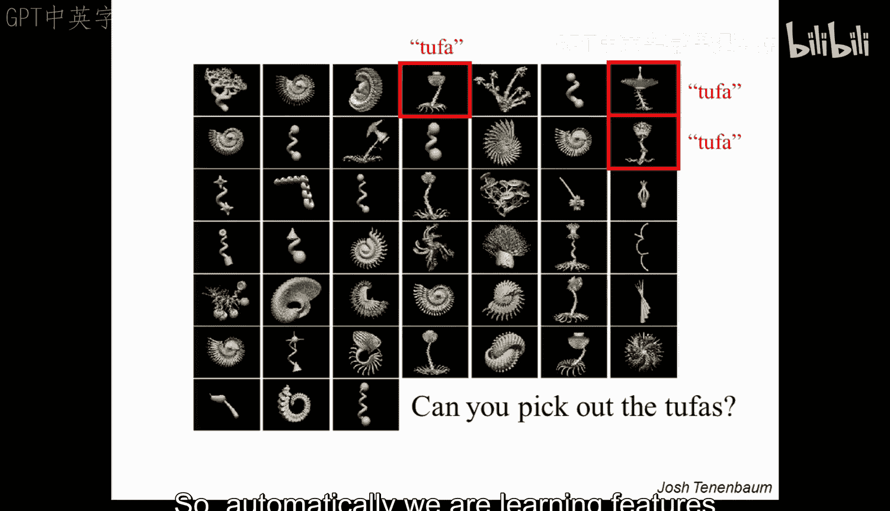

That's one view of learning， one view of learning， and it's all about extracting features that allows us to classify things into groups。

嗯。A more general sort of AIish view of learning is as the one that Herbert Simon proposed。

 like think of an agent， and this agent here is a robot。

 but the agent could be the little spider that we've seen before。

 the agent interacts with environment by acting upon the environment。

And it makes perceptions from an environment， so it sees， adhere hears， it feels， and so on。Now。

This agent has some goals。And as this agent interacts with environment， the agent wants to do better。

The agent wants to find better food， the agent wants to find better mates and so on as it interacts with the environment and learning is about using the each interaction with the environment each experience as an opportunity to adapt your brain so that you can do better in the next time you encounter a similar task。

So indeed， what you're trying to do is you're trying to look at the problem。

And you're trying to extract all like in our case， the two first。

 you're trying to extract features automatically， we do not know what those features are。

 This is all happening subconsciously in our case， as we saw when we're doing vision。

We're going to inspect what these features are a bit more when I show you some of the videos of what measurements we have in neuroscience。

But we're trying to extract these features and they are hopefully features that will allow us to do predictive tasks。

 for example， we might want to extract the feature fine and pause so that when we go hiking and we see big fines and pauses we know that that feature means run or。

Do whatever you do。Whether it's a lion or a cougarer or bear。

Let's look at some more examples of predictive tasks and these are actually examples that are driving machine learning sort big time these days。

 energy demand protection， so soon every household will have special meters that will know。

You know what how you're using your electricity every day and if they do know this。

 then they also know how to best allocate energy I mean， like for example。

 it's silly to have a generator sending a lot of power。

And to Vancouver at a particular time when it would be much cheap if you just switched to your washing machine。

Five times later so if you have a huge search that means that they have to switch on more equipment。

 but if you just went five minutes later， energy would be say1。1バックス cheaper。

And so as we need to become much more efficient with our energy usage， being able to predict。

 or another example would be you take measurements of the weather outside and you have measurements of the number of people in this room because you can just put a camera with a counter at the door。

Based on that， you would adjust the temperature of this room automatically。

So you could predict what the temperature will be based on previous years the number of people that were here with temperature and where the wind is blowing。

 and so we would have a much more efficient system to use energy， so that's very popular right now。

You might want to predict the sales of a particular shirt if you're a company like Lulu Lemon。嗯。

Netflix， the movie recommender， a lot of people vote one star three stars for some movies。

 but most people have not seen all the movies in Netflix and so there's a lot of missing information because people haven't rated all of the movies and so you need to fill in that missing information so that's a common application of machine learning。

Netflix， in fact， gave a price for a million dollars a few years ago to researchers to improve their machine learning system。

Machine learning is also useful for。If you have a model of what's normal。

 you can use that model to detect deviations from normality。

And that's very important in the numerous applications。

 like if you do environmental monitoring and you want to detect anything that's abnormal because that might indicate。

 well， you will have a lot of dead fish and there won't be any sound sushi for the next five years。

I actually have done consulting projects and what about that？

Or if you're into the whole surveillance， thing you might want to detect in truth this coming to your business。

嗯。If you're interested in this green guy at the bottom there and the HIV virus。

 you might want to detect when it mutates so that you can provide。This object with the right drug。

Classifying it's another big application of machine learning。

 the reason why you can just use your credit card so quickly these things is because there's a big algorithm that the moment you put in your credit card。

 it automatically classifies you into a risk level。And if you're not in a risky situation。

 you're fine if you are。Because of whatever past record or because you're similar to some people created a problem。

 then that will classify as no credit。So the reason why credit cards work so efficiently and so fast is because the decision on how to classify whether they should give you credit or not is done automatically by an algorithm these days。

 so it's a machine learning idea。Cl diagnosis in any sort of sort of medical diagnosis as we're go in the future。

 machines are better at a lot of diagnosis and prognosis than doctors。Ranking。嗯。

Google hires a lot of people in machine learning because personalization in Google is all about machine learning。

 personalization， by way it just means learning。You're learning what the people like and giving them more of that。

Summarization， which is like imagine you go to a website it has。16，000 reviews for this movie。

 you're going to read a 16，000 reviews， you just want to know what's the gist of it and machine learning ideas can be used to do that。

And ultimately， decision making， as we'll see in the course， especially toward the end of the course。

 there very good machine learning techniques to enable robots and other agents to make decisions。

And decisions could be。Decisions as you might think of。

 not just like getting married or not getting married， big decisions， but simple decisions like。

 what should the value of this parameter be so that my compiler ranks faster？

And if you can do that tuning automatically， you might say。A lot of energy from Microsoft， I mean。

 remember these companies actually built their。They put a service next to power stations。😔。

Googles consumes a lot of energy。If you can improve their computation a little bit。

 you're saving a lot of energy for the world。Oh， on the new summarization side was a product that was developed by people nowhere in this class。

They sold it to CNN。

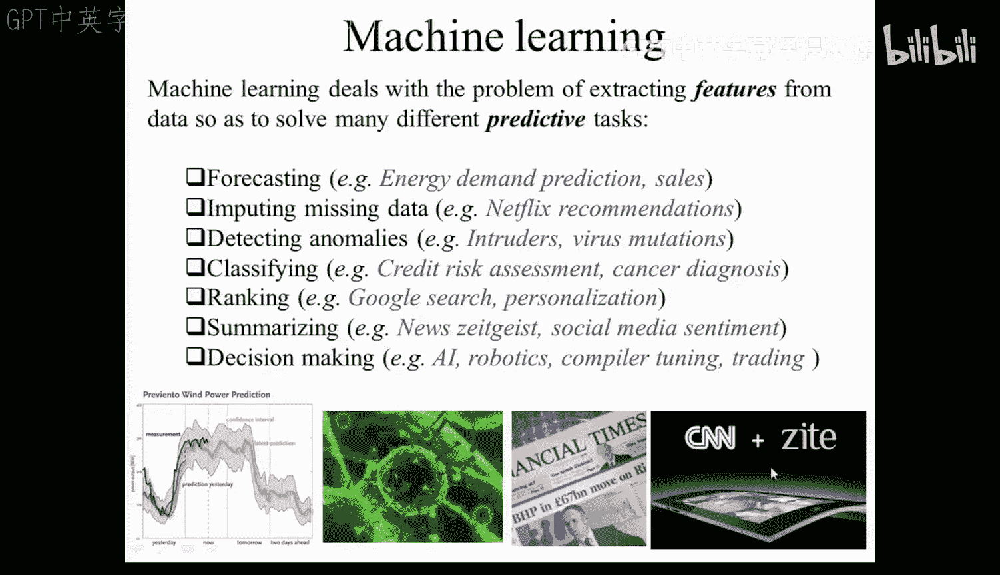

Okay。Why would we want to use machine learning， okay because machine learning is not a thing that you should use it all the time。

 but it makes sense in a few domains。Now you want to give you need machine learning。

In a few situations， the first is suppose that you send the robot to Mars。

Now the problem is you can't have a human controlling that rope。

Because it takes about half an hour to send a turn left signal。

Okay so this robot will have to learn to automatically if it gets stuck on a rock， turn back。

 turn left， try again and learn to navigate if it relied on a human controlling it by remote control。

 it would never accomplish it does， so if you're enable autonomous systems that can work beyond where humans can control them。

 we need automation， so we need machine learning。嗯。

Learning is also useful as I'm motivated in the beginning of the class in applications where we can't justify define how we do things like seeing or hearing or feeling any sort type of perception。

 language， we don't understand how we speak。Sometimes solutions change over time and they keep changing。

And because they keep changing over time， I like if I'm learning someone's preferences， you know。

 a person's preferences change throughout their lives， eye conscious hard code a system for them。

I need to have a system that will adapt。And provide。Assistance later on as this person develops。

 either developing through a interest if you're in social media or developing through a disease in the case of an intensive care system。

Biometrics， personalization。Everyone， if you want to build a system that recognizes your。Your finger。

Print。Then you don't want to code a separate system for each person because that would take。

At a year each， what day each would take6，7 billion。Thanks。And of course。

 some problems are just too huge。With millions of ads being。

 you know there's millions of web pages out there， billions of ads。

 and you're trying to decide where to put in millions of。I billions of people using internet now。

 you have to decide where to put this ad on what page for what person to maximize the revenue， okay。

 we live in a consumerist society and this is one of the greatest problems of our time。

 how to deliver the right ad to the right person at the right time。

You couldn't rely on humans to do this， Yahoo processes millions of these per second。

So that's when we use machine learning。And actually， let me actually stop here。

What other examples have you seen of machine learning in your lives that have in factor you apps？い選し。

Collor in Google search。Search for a color。And then what doesn it give you？因为这个是。It like cars。

That's true， so Google already does a lot of image processing to be able to use that to give you sort of semantically similar things。

まいの？嗯哼m。😊，That's a very cool application， like University of Washington have an amazing app where they use combination of learning GPS to figure out where people are going in cities when the signal gets lost。

There's lots of hands， let's start。And learn areas， learn your music does you what you like。Panddora。

 brilliant example of personalization。Actually Pandora the way it works， they use a human。

And they use actually 20 humans， 20 musicians， every time they get a new song。

 one of the 20 people annotates。The song Oh no no， that's still。

 I just talked to the Pandora person a few weeks ago， they still annotated with by hand。

And so that part is。They haven't figured out how to do that with machine learning。De Mark。

 machine learning' is a new thing， you guys are lock it because you're at the beginning of the curve。

嗯。But the rest of the system is automatic， you' right， the recommendation part is pretty smart。13。

There's another guitar out there。Stble upon they even if they dot have machine learning。

 I wouldn't be surprised that they do。应该我收。so much learning in Gmail。C card fraud。

 a very common example， high frequency trading， high frequency trading。

 it trading these days machines， some of the algorithms we're going to see in the course。Sorry。

Amazon， yes， brilliant example of her recommended system one of the oldest。Netflix is Act CDN。过生。

Mediaalace do servers near a certain city when they know that they gave of droneones on Sundays it pushes Game of Thrrons to the servers around the server city。

Awesome show， by the way。Yeah， that's really smart how even things that we don't see。

 so that's a good example because there's things that we don't see， but they're already there。Next。

Thatmar go that。Oh， yes， so Boston， I think wass involved with that。Yess。

I haven't seen an aism but they long doctors。now starting。Give some sort。て个の解し。

There's certainly a lot of medical diagnostic and stuff going on。ID Wason。IBM Swanson。So。

The stock market， yeah。Mmhm。Target advertising。Yeah。Okay。います。When your plane is landing。

 you have to hope that it's a machine that's landing it， not a human。😔。

Algorithms are very good at issu better than humans not doing that sort of thing。嗯哼。Sensing paces。

 that's a good example， each of your cameras now has like a face detection， even the iPhone。

There's a panor panorama。App。Basically recognizes which。Yeah， that's a great application。

 actually the panorama one with like photo stitch or what's the other one。Yeah。

 so one of the as is called photot and the other one is called autin。

The technology was developed here at2 BCC。Facebook look at a security that finds betters。So。

People who stop other people or children so they find them and they're point the police。

 I'm glad to're hear though because。I'll take one more。Aific intelligence in our games。Games。

 there's a lot of learning going into games these days。So you guys are quite aware of。

 it's really getting into most of the things that we use， Mach learning is built in。

Into a lot of our profit。It's becoming recently very popular。

There's lots of new startups with people trying to make something out of machine learning。

 the big companies invest a lot of money machine learning companies like Google。

 like Microsoft and so on。嗯。And。Academically， it's also of great interest because some of us want to ultimately understand what is intelligence and learning seems to be。

In the core of answering that question。Or certainly one of the central pieces。Okay。

 so learning has become popular also because of increases in computation increases in hardware performance and equipment。

 and one of the big improvements has not just been computer speed。

 but it's actually our ability to store and manage data。

These days you can buy terabyte hard drive quite easily from London drugs and we take that for granted。

 but the whole Library of Congress in the United States is only 20 terabytes that huge building with all those folks now we can just put it in a little。

Thing of that size。嗯。Phund calls， if you record often calls about 323 paraytes。

The state of world of Warcraft is a petabyte。Avatar is one petabyte to render it and to put it in context。

 Google processes about one petabyte of data per hour。YouTe video is what's very expensive so we go。

So for next year， there'll be probably 18 xabytes just in video traffic。

And that kind of tells you that the future is video and being able to understand video and for that unique machine learning is sort of important。

Google certainly invests a lot of money and we'll see some of that products in a few slides。

Now here is some remarks by Aon Healliy， Etanoric and Fernando Braretor。

 these are sort of big Google managers。嗯。And one of them was saying that in 1967。

 when he was doing his PhD， the largest data set for natural language processing was about 1 million wordsts that was regarded。

You know， 40 years ago， I was consumer to be huge。1 minute more。By 2006。

 this has gone up by 10 to the6。😔，This is not just growing when it' growing。😔。

That's an exponential increase in what we can do。😔，And what we can store。😔。

And the type of data that we can manage。There's really amazing systems， Amazon Dynamo， the Google Ts。

 there's lots of new systems that are coming up out there。

 cloud systems that allow us to just manipulate huge amounts of data very easily。

 so we finally are at the stage。Where。We can do all these amazing applications that we couldn't in the past just because we don't have to date。

For people in language there's been two big success stories。

 the first one is speech recognition and the second one is machine translation， speech recognition。

 you get to seriesri so you know how well it works and you know how lay it is as well。嗯。

The nice advantage about speech recognition is that you say I don't know。

 Siri help me here and if Siri doesn't understand you， you correct it now every time you correct it。

You're giving Google more data。A sorry apple。嗯。And that data will be used to improve。

OkaySo the companies and Google does this and all companies do that。

 they've learned how to bootstrap the whole process because every time you correct。

 you get more data with more data， the systems get better。

This is something we'll actually see with mathematics in a few weeks。

Machine translation is also one of those things where machine translates for you and if you don't like to translation you can correct and every time you correct Google translation for Google translation gets better and Google translation is an amazing product you know I go to web pages and foreign language is asked for translation andvoa I get a translation it's really cool it makes a lot of foreign pages accessible to me all of a sudden。

The key to get these things to work， as the Google guys point out。

 is that you need lots of data and in this case memorization that is just being able to record everything。

Every new example， every correction is a good strategy。Now。

 to show you the power of data in a different setting。

 Alyyasha efforts at TU has this cute example where he takes an image and then he cuts the thing that he doesn't like。

And the photo that he took on his holiday。And。Then he has a huge database of other images。

That are similar to this image that match at some semantic level。

And then he starts picking pixels from these images to reconstruct the rest。Of this image。

And this is what he gets。So it's pretty neat， so he's able to complete the scene with something that looks very plaus。

 but this is only when his database includes。Millions or possibly billion of other images。

If you just have a few， it doesn't work。Now。It's also not all about data。😔。

Let's first see what Google would say， please these three people from Google。

They say they've already solved the problem， the sociological problem of getting people to give them data basically。

And we love to give our data away， we don't care about privacy。

 we don't care about the fact that every time we don't load an app that app is sucking a lot of context。

 etc ceter， and we're unaware of it mostly and none of us reads the 60 pages and presses， okay。

 we just agree。And give our data away， we give each of our queries away。

 we give all our data that data gets traded out there。

So companies have been very good at sucking our data， privacycy is a huge issue。

 the future of computing。And there's new initiatives and to watch that space， privacy is big。Now。

 they claim that they've solved the technological problem of aggregating and indexing all content they as in Google。

 they have done a pretty good job and they continue working toward doing a good job。

 I don't think they've solved it。嗯。And they mentioned that the problem is understanding。Okay。

 so the Google search engine does not understand what the web pages say。For example。

They're moving toward having bad understanding， but they don't have。嗯。Now。

 by increasing the data set is not going to help with that understanding， either。Because。

Quite often you have a fact that's reported on the web and it's reported the wrong way。

Someone tells a lie and that lie gets propagated through many blogs。

Manyy pages and all of a sudden it becomes truth， but if you really think a bit about it and do an experiment to check it。

 you realize that it's not true so popularity alone， when I say data helps。

 don't interpret that as better just by growing a lie。

You'll be able to learn something better Popular alone is not a good signal。

 So one example is citation matching。So citation matching is when you write a book or a paper。

 you cite other people。And if you look at citations。

 often they have time puts in there and Google has not been able to fix that problem。

 And the reason is because。Typically what academics do is they don't really read a paper。

 they just grab the citation from another paper and they in this。Errrrowors into citation propagate。

And so you get like 200 people using the wrong citation and three or four that use the right citation。

But if you just go by popularity， the right citation sort of dies。And for that。

 we need understanding so database technology being able to manage data process data is not enough。

Ultimately， we want to understand what is being said， and for that we actually need。

The type of data mining and machine learning algorithms that we'll discuss in the course。So。

That basically concludes the first part of the introduction。In the second part of the introduction。

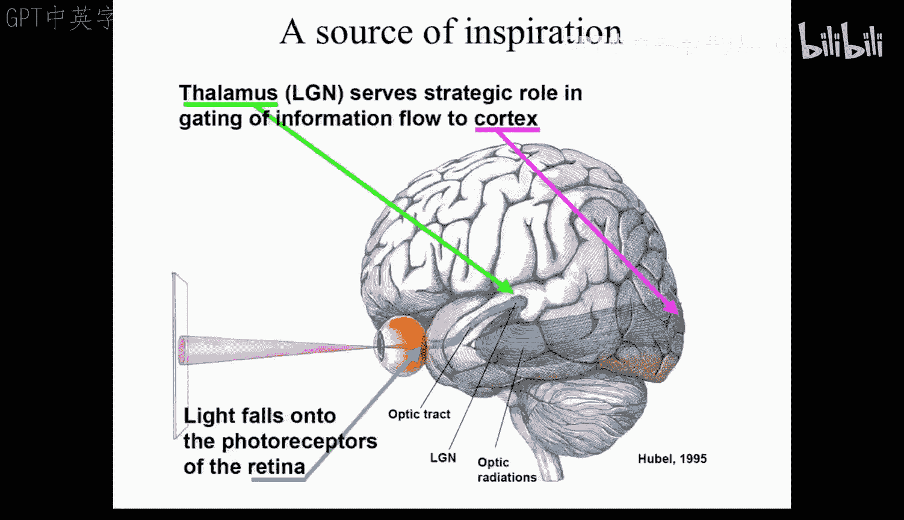