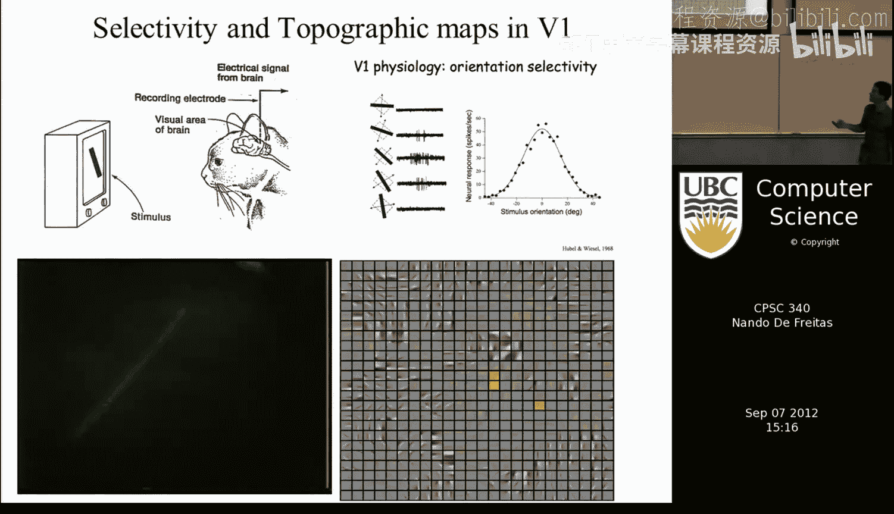
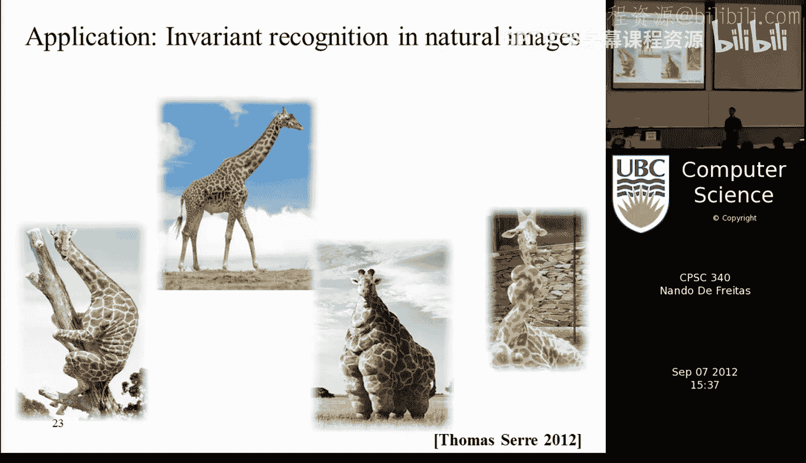
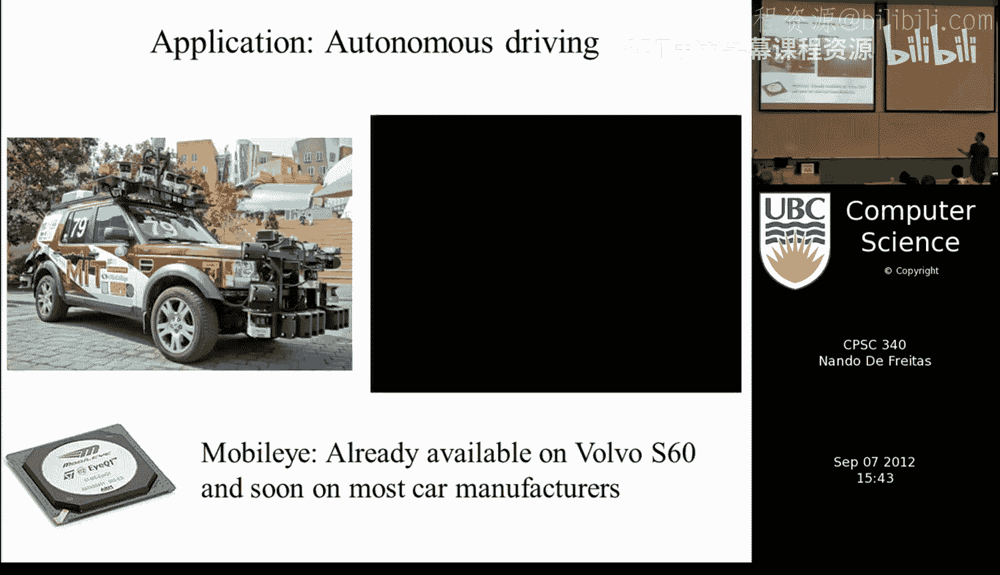
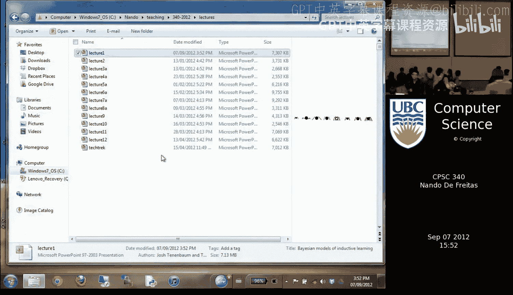
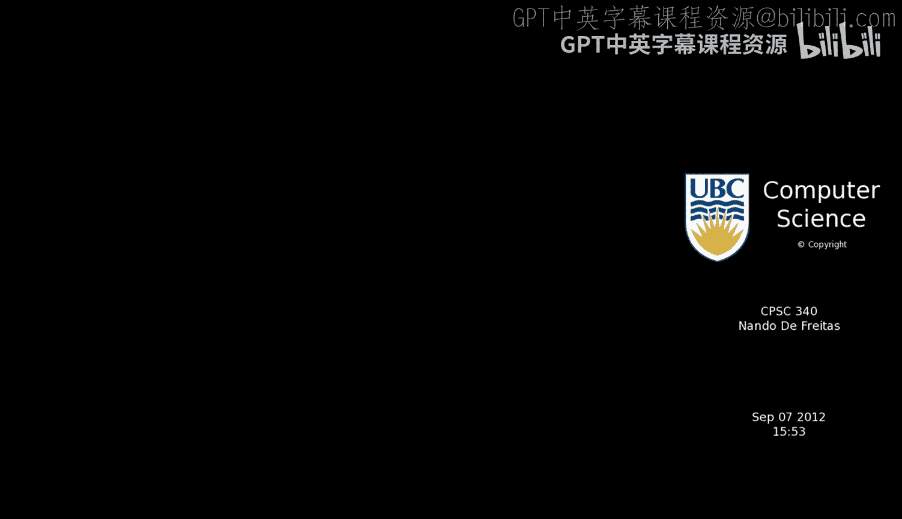

# UBC《机器学习和数据挖掘｜CPSC 340 Machine Learning and Data Mining 2012》中英字幕 p02 -02-undergraduate machine learning 2_ Introduction to machine learning 2.zh_en -BV1pJ2ABFEFg_p2-

さ。你可。M not work practice。We overall words。是码不是你。Yeah。Yeah。是的吗？Yeah。Yeah。Could know seeba。我。I。はい。Yeah。

there is。I。在家。think I time。Yeah。Yeah。す。I like。They' love some。Yeah。It's really like。

It was good for the summer。Yeah。あ。I a cycle across my space。I。对。Oh yeah， I don't care about what。

成国人去。嘛。To that。Oh give it a shot like remember。시도。I。Yeah。Yeah。Is bo done。

I liked it the then I got order class。And。She totally Well back one。

I made it for morning pulling of opinion my。I don't。那。Well，'re not wh anymore hold on。そ。

Its like a pre person to the。being smart。 Oh， how is me being worse Internet at ship。我不知道男同们说很。I I。

So in the last class， we learned that。It's sometimes very hard。To telecomputer。What something is。

 So it's very hard to program a computer。 And one example was this。

It's very hard to tell a computer what a tufa is。Something as simple as this is actually quite hard。

But on the other hand， it's easy to tell a computer， here's a bunch of too firsts。

Now you should know what a two phase here is。An example。 and a label。

And it's possible to get a computer to then learn。诶。What something is。

If we are able to solve problems like computer vision and perception。And understanding language。

 this is the way to go。We will now as because。Not capable of looking inside our heads。

And the things that we think are hard， like logic。They're actually quite easy。 It turns out。

 after years centuries of investigation， that's what we've learned that the。

The simplest problems like walking。😔，And seeing are the hardest。

 It's no surprise that a third of your brain is dedicated to just that simple thing， C。Now， today。

 I will show more examples of this of where you， you capitalize on data to the well we saw。

We saw two examples where there's a lot of data， one is speech recognition because。People often。

Produce a lot of data so there exists in the world a lot of data that's like sound waves。

In files and the words that is being said in the file。

 so there's a lot of this label data so that makes it very easy for us to learn to train a speech recognizer。

Some of you， when you download the Microsoft software for speech recognition。

 would have found out that it askeds you to read a few sentences。And if you read a few sentences。

 it gets better。And essentially what's happening there is you're providing this with supervision。

It basicallyically sort of the program is smart， it gives you the labels and then you give it the data that goes with the labels by speaking。

And the advantage of doing that。For each individual specifically is that we all have very funny accents like me。

And so if you can， actually。Teach the computer your funny accent。

 the computer will be much better at understanding。How you do， the key to， in fact。

 successful speech recognition will be that when you correct Siri because as you correct Siri。

 Siri will get better and speech recognition will be a solved problem。Not too far in the future。

Google is certainly pumping a lot of money into it and so it's Microsoft and I'm going to tell you a little bit about what their actual approaches are at present。

 I visited both groups over the summer and to gain a bit of insight into what they're doing。嗯。

The other problem is machine translation and again， for example， in the Canadian Parliament。

 every time something gets signed in French， it gets translated to English and vice versa。

Probably even more so given the last election。😔，And so that just has left us with a lot of data in two languages。

 So we've labeled what goes with what。 And so we can use that data to train。A translation。

Luists for many years tried to come up with very sophisticated models that would tell you how to go from say Mandarin to Hindu or in any other languages。

 and that actually turned out to be very hard to get right。

And then people come with these extremely simple machine learning ideas。

 some of which you'll see in this course， and it's possible to build a very good speech recognition system。

Just by relying on the data and building the system bottom up as opposed to trying to engineer the system。

And translation is actually extremely important。😊，A thing to do in business。嗯。

Many companies in downtown， So company Xs。嗯。Let's think of one， let's say Lulu Lemon or Erritia。

 clothing companies in Vancouver， where do they get their materials， some come from Turkey。

 some come from Portugal， some come from India， where is the labor done in terms of stitching yourritier clothes？

Anyone can guess that one？China。Now， imagine。Llu Lammon， a rich employee sitting on their desk。

Has to send emails to okay we need those textiles from India。

 email someone in India what about that dude in Portugal， Gonzalo。

 Si or whatever and oh wait there's a problem with this factory in China so we're going to have to reroute this ship to go to this other city instead of that city to get the clothes on Now the problem with this is that that person probably only speaks one or two languages and is dealing with people that speak。

You know，I dealing with four different countries。And the only thing that saves these people and allows commerce to happen is the fact that there's automatic translation software。

And companies rely heavily on it。 And， you know， a lot of e-commerce has made possible thanks to that。

 So you've been。What seem to be simple applications actually have a huge profound impact in our world。

Okay， so today I wanted to talk a bit about two things。

The first is about the brain inspiration behind。Because a lot of the algorithms we're going to look at late and like Nen networkpers and so on。

 we're sort of inspired by our。Desire to understand the brain， to understand mind。😔。

And that's certainly what drives me to stay as a professor。

 to work as a professor because I get to do research on that as opposed to tripling my salary and working for Google。

So there is a true desire to understand ultimately if you understand your brain， you understand。

A lot about yourself and the world and how you perceive it。So I love those illusion that。

Theyll allow me to introspect and to get an idea of how my head might be working。😔，嗯。

And looking into the brain and doing some experiments， either whether it's FMRI。

 so typically there'll be three kinds of experiments， these days we can get FMRI。

 which is sort of coarse， but nonetheless can help us see a few things。

 understand a few things about the brain， the other thing we do is we experiment with animals and you'll see some pictures of what gets done。

Experimenting with humans is not allowed， it used to be done。

 and a lot was learned by experimenting with humans。诶。And。

Even experimenting with animals iss of the dodgy。And then the other thing we're going to see is。Oops。

Spickking about。The other thing that we use to understand more about the brain is we look at patients that have。

They're not just different。Whether they're different in a way， there is an enhancement。

Or whether they're different in a way that is a shortcoming， so people with schizophrenia。

 people with different anousesias， different mental disorders or enhancements。

Are often the subject of a lot of these experiments。

But let me tell you a little bit about what we know。

 and I'll tell you about one particular experiment that tells a lot。

Tells us a lot about how we can build machines that can see。

And this is essentially the line of fort that was followed by。A lot of researchers。

 mostly in Canada and that led eventually to a publication the summer of Google in the front page of the New York Times。

 so who saw a cat picture。Google Catt thing， Google learns to recognize cat in YouTube。

This thing was huge to hit all the news， it was front page of the New York Times。So， its like。

Big achievement of AI。So here is what they did。 let's start by understanding， okay。

 so some background， you have your eye。And you have photoreceptors in your eye。

 and then those photoreceptors get connected， you， they just have fibers that go through you know。

 basically two optic nerves that actually cross and project to the back。

To give you an idea of the image resolution， there is 1 million fibers going through here。

So roughly1 thousand by thousand image， that's what goes through。It stocks much bigger here。

 but then it gets reduced， and then it actually increases here。Just kind of strange。

 So it actually raifies。Into a lot of。啊。More neurons to represent image。

The image gets represented in a decoded fashion。What I mean by a decod fashion is that if you have。嗯。

If you have an image that is， let's say。There guy here。

This will be represented as an image that consists of。This plus。One times， maybe this plus one times。

Does。Plus。You know， zero times this plus zero times。Blas and saw。So。

Do you have an image in your visual field？It's just like hang your mama's face。

That's the first thing you usually pay attention to in your life。

And then you're breaking that image into parts。And each neuron is taking care of one of these parts。

And how do we know that we do that here in this area， thanks to the following experiment？

So Huber and beel a few decades ago， put an electrode on a cat， and by the way， Huber and besel。

I strongly recommend you Google it and watch the videos online。 There's a lot of。

There's a lot of very good stuff in YouTube about public libities。

So you can see the original experiments there in great detail。

You implant an electrode to measure the firing pattern upon neuro。

And then this is what they found when they were showing a graating。To a account。

When this grating happened to be at a particular orientation， at a particular angle， this neuron。

 so essentially this is the firing of a neuron。This neuro started firing like crazy at a certain angle。

 but as you move away from that angle， the neuron stops firing。So。

You have a neuron that will only fire with it。W it hes vertical。

Or called vertical or horizontal and so on image， so neurons are selected to little parts of the image。

So neurons， in fact。Are there's a neuron that fires when it sees this。

 There's a another neuron that fires when it sees this。 When you see those happy face。

 you would have 1，2，3 neurons firing。But these other neurons wouldn't be fine。 So that's sort of。

At the very coarse level， what's going on？😔，And so each neuron is essentially one of these different little images。

 neuron that fires with the blue， one with the yellow and so on。

Actually， the， the sound is not project it。 but let me use my microphone。

Just something nearre inspiring。And the fire， when the light coincides with those three dots。

 if the grating is perpendicular to the orientation of the blocks。The neuron doesn't fire。

 don't need fires when it flip sides。It's very cool to watch the whole video。

 I recommend you go to YouTube， and see the rest。😊。

We also know that are neurons that fire depending on your location。

 right now there is a neuron that's telling me what I am in the world and where I'm oriented。

I know what I am and what I'm love because。Of certain。quiing pattern。Again。

 how do we know that we put electrodes in the brain of a rat， like you see here in this lab rat。

And then the rat walks around the maze， as you can see randomly。

 and then there's a neuron that only fires every time the rat goes into one of these periodic。Places。

S nearest fire folk。in particular locations and by doing the sort of thing that you're able to do to knowing which direction you're going and where you are。

 and in fact， if you close your eyes， you could just fire these neurons and you could plan your way to kids in your head。

That's correct， yeah。你些日可。You see that the neuron is dedicated to this function。And does it change。

 is it function off？Experience or how do you， how does that。The brain is fascinating。

If you lose those neurons， so first it typically is not just one neuron coding。

 you have several neurons coding the same thing and you would want several because。

Every time you do this and you kill some neurons。You help yourself。Some neurons。

 so just like theyre coding for parts， as we will see as you go up in a hierarchy。

 you could get a neuron that fires this like famous paper called the hollowabberry neuron。

 a neuron that fires when you see a picture of hollowlaber。

 but you would want replication of that neuron because otherwise。If you that here and dies。

 you'll stop seeing Hallibbar。And neurons tend to die more than they're born。

 and they die at a very fast rate， neurons are dying right now in your heads。And I can't remember。

 but it's actually staggering the number of em die Excise helps with a thing。

Getting neurons born in the hippocoms。If you go drinking downtown， you certainly kill a lot of。

Is herbelella。So。It is also true， and this is now part of the hypothesis so for learning。That if。嗯。

If as subject， for example， loses sight。And then there's this beautiful experiment where you take a block with pins。

That sort of press so that the depth of the pin is the same as the depth of the 3D field in front of you。

 and youll implant that in the tongue。Then。That even though you don't have a signal going from your eyes。

 that part of the brain will get recruited to deal with the signal coming here so those subjects learn to see you again。

So the brain requireswis itself so that subjects can see again。😔，Byy， you know。

 just buy how much depends price on their time。This depends on H。

So also children are far more adaptable than adults。

And the sort of highly interesting experiment that comes from Hubble and Visel is this is kind of cruel。

 I try not to say in clp but with you Oxford。So you take one kitty。And。Yeah。

 just don't ever tell my wife about this experiment， you cover my eye of the kids from you。Actually。

 there is bit of a flow in this experiment。I just sort of in now when the kitty is born。

 but I think that might be too late。Because even when they're in the womb， they already light。

But somehow does work。Okay， don't quote me on this one because I can't remember the details right。

 but I think the argument is you cover one eye。And then they only see with one eye and of course the brain has two hemispheres and so the two optic nerves cross to each of the back。

 and so you'll see that in one side so for the eye that is not comfort。The receptor fields。

 the special receptorcept fields， the corerecept fields。

 basically neurons that are selective to different orientations， they will form。

Whereas for there they are， you won't see that， you won't see that organization。

 which shows that you really are adapting and learning。

So evolution gives us a lot of things when we're born， we can move hands， we can do a lot of stuff。

 so a lot of stuff has been encoded through evolution。

 which I just see as another long term learning process。啊。But as we。But as we start live。

 the brain has to be very adaptable， has to reconfigure itself。There were two more。

And also with the kitties。Which they put in em box with。Lines in it。Oh。Networks。

 and they found out that afterwards， the cat has more neuronss， which。V。

Forral nights in the environment， so it says that neurons are adapting。Yeah， that's correct。

 Thank you for reminding me of that experiment。 And you put kitties on boxes that have vertical。

 I think it was fair well kitty's ferrets， cute animals and boxes with vertical bars and you put some in boxes with horizontal bars。

 And that's all they see。 And then you see that they will have。😊，For more of one。

 depending on the environment in which they grow， they'll have different brains。

I was wondering these ground firing。The focus of attention。Yes， yeah， definitely。

So if you're not paying attention to something， your neurons will not fire。So whatever。

Sttauff that you're using to commit thoughts to。Memory。

 if you're not paying attention to the teacher，' not going to get it， then the neurons are not fine。

Okay， another thing that's very important about how brains work that is very different than a classical computer。

 and it's essential to learn this to see how to build machine learning algorithms。

And it's the fact that things are memory is associated。What do I mean by that？Can。

I need a volunteer that will tell me their phone number， who's a good sport？

Quickly so that they can't get。even， eight， two， three， five， zero， two， four。Say it backward。2，4，3。

快。Okay， so thank you。Now。Would that be an issue with a normal computer to say it backward or forward？

No， because randomized Miami doesn't work like our memory， we store patterns。

So if I tell you to remember， if you have to remember objects separately。

 it's very hard to remember long list of objects。But if instead you see all those objects together forming a composition。

 it's a lot easier to remember。W。We remember patterns。

 so our memory is more like this picture is saying where we know patterns。

 these patterns might be occluded， like so it might be occluded by these clouds here。

But even though there is these clouds， we are able to retrieve the right object。

 the plane in this case。Okay， so now here's very quick。

I'm going to go over this very quickly now because this is something we will be in the course。

 so this is sort of a teas of things to come。😔，We do try to build models。

 which we call neural networks that try to emulate how。we do this sort of thing。

 extract the little patterns of the world and so here is this is very similar to what I had before。

 it's an image and let's assume it's a black and white image and a black and white image that is just four by four pixel。

And let's assume that each of these circles here is a neuro。And this neuron fires every time it sees。

A vertical bar on the left， this neuron fires for a diagonal bar。

 so for this particular image there is one vertical bar， so the image fire。

 so there's a one whereas for this unit，There's no diagonal bar。

 so this unit doesn't fire and then this unit fires because of this and so on。

 so you get the idea so each unit is looking is firing for only one part of the image。Okay。

 so like one urine in fires when I see his eyebrow brows and one for the hair。

 one for the Thirt and so on。Now。Typically for images those first neurons tend to look more like this。

 so this is the image in the input that will make this unit fire if there's a little bit of white on the right of my visual field。

 a particular neuron will start going tick tick tick tick tick tick tick。Every time it encounters it。

So now comes an interesting thing you can do。 And this is sort of。

Very new stuff a few years ago started in Toronto with Jeff。啊， so。

What you' have tried to do using techniques that we'll learn about in of course。He created a network。

And this is essentially we can think of this as a network because you can think of these as nodes。

And you can think of each pixel of the image as a node， and the edge is connecting each。

Each pixel to each of the circles is essentially forming a graph。Sort of a bipartite graph two sides。

And so he summarizes it just like this， instead of drawing all those edges。

 he just basically says there is 2，000 of these neurons。

And those 2000 neurons are looking at a patch of an image。Okay， because remember。

 the size of the damage image that we actually see， it's kind of small。好。咁咩咩。没。

And using the magic of learning that we were going to learn about in this course。

 you end up learning the values of the connections。And essentially the values of connections。

 as we see in this picture， encode these， whether they're red or white or yellow。

 encode when this neuron gets to fire。We will learn。Those guys， and if you do train this network。

By showing it many images， you end up with something that looks like this。And then Jeff。

Had the idea of。Why don't we take the stuff that's out of here and feed it to another network？

And it's trained do separately。So then he goes and he trains this one and he's like， well。

 let's do it again。And now let's look at these weights and see what they look like。

And then actually this comes from a different experiment Hongl。Then he says， oh， we're getting part。

 eyes， mouths， things like that。And then you train more。

 and this is not done with just one image is done， the training is done with many， many， many images。

 thousands of images。And then right at the top， you start getting these。Nrr。Now you cannot put。

 in a way， because you're training these one by one， you can put them all together， right。

 because these 2000 happen to be the same as these2000 and so that's what I've done here。

And so what Jeff did there as an experiment was， let's assume that I have this image if I multiply each pixel by these weights。

And I get the firing of the neurons， and I pass it through this and get the firing of100 neurons and keep doing it and then invert。

The process， will I get back to face？😔，And you don't get the face perfectly， but you get this face。

Now， what's really cool about this？How many bits do we need to code for。To code for that face。他隔代理。

If he knew these 30 numbers。Now you can forget about everything else if you need these 30 numbers and you have this neural network which you've learned through a lot of time。

By changing these 30 numbers， you can generate different faces。Okay。

 so this is coding a face in just。30 numbers， pretty good image compression。

We will learn in the course that instead of going through this very long roundabout process。

 what we might do is we might just construct a network that looks like this， very big network。

And then we will learn a technique that will just basically say， when I see this input。

 I want to see it as an output。So now we don't have supervision anymore。

 we don't have like the French English in translation。

 but basically you're saying that when I see this image。😔，And it goes into my head。

 and if I close my eyes， I should still be able to see that image。Ca if I don't see it。

 like suppose I close my eyes， oh， I'm seeing like this unicorn floating。And then open my eyes， oh。

 I don't see the unicorn floating， so I better start learning。

 that's not the world land of calculate。And eventually。

 when my image of the world matches the image of the world。I have learned。

And that's what learning is about here， iss about making sure that the input is the same as the output。

And you're training this via bottle line。 This is what Google has been doing。

And they use this because they want to learn every time you upload a video on YouTube。

 they want to automatically extract what is the video about。Okay， so that's the future。

 the real cool work is going to be more and more intelligence in applications and YouTube because that is where there's lots of data。

Look， why would I care about doing that， Facebook would love to look at your pictures and know who you hang out with and know which clothes you're wearing because they would know which clothes to try to sell to you。

For example。Okay， so that's now we get to the Google。

 and I got these slides from a friend Marel Runzata。 And so Google， indeed， what they did is they。

They trained such a network。Which basically they show an image and they say。

 I want you to output the same image。That thing is called an autoing， sort of autoing codes itself。

There's no superficion， but essentially the world is my superficion。And by the way。

 that's related to some mental diseases。Because when some people start seeing aliens and the CIA is after them。

It not's because the brain is being coded to do things like that。

 we all suffer to some extent of schizophrenia。😔，And if you。When they see the alien there。

 they truly see it because there's no way of them knowing whether that image is being generated from their brain。

 whether it's coming from them。😔，And we already know that we've really not seen this， weon saying。

Parts of it。Most of it is imagined。And so they exploit to this and they tried to train it and then they just do millions of images。

Possibly billions， I can't remember， there were billions of parameters。

The double leaves there's billions of these。Huge network， so they have to distribute them。

Across 16000 core。Like massive up。trainingraining。嗯。And。And essentially what they。

Found is by after doing this。Some of those neurons in those third neurons in the bottlene。

 they become sensitive to only a few signals， so there was a neuron that would fire for these images。

 for example。So if you show this。Network， neural network。A bunch of things。

 random things from YouTube， you will learn。To so faces。

You we learn that faces is an important thing to pay attention in YouTube。

 and then the other thing that it learned it was important was kitties。Im no surprise that。

Although somethings kind of like a fake of face， but not fight to face。嗯。

And this is sort of the view of this neuron， anything that looks like this sort of scary。

Phase will make that near fire。And the same idea of having a network can be applied in video where you could have a sequence of gazes where you're just looking in there there。

And you try to reconstruct the whole thing。Picture of the scary faces probably。Begin with， right？嗯。

Okay， what baby is。So then it's more like。Ba too， okay。

Babies too quickly are able to identify their mother。So that's one part of vision that is very quick。

They're able to track fingers slowly。Very slowly， like they contract a finger fast。

 they tend to focus on the edges。And I believe that this is my own conjecture with they're just learning those ages。

嗯。It's long times as I read about developmental vision。within two weeks， three weeks。

 most of it gets developed。It's amazing， although these receptive fields would go on to like six years。

All right， so let's go into applications and I'm going to show you a few applications。

 so the learning approach， learning is good because you can't tell a computer what a giraff is right。

 you'll agree that this is a giffe but try telling a computer how to code that。

Or this guy or that guy so instead what we do is we just go to YouTube we get lots of crazy images of giraffe like this and we tell a computer that's a giraffe and then using the magic of machine learning that we will learn in this course。

 which will require that we learn a little bit of math， but that math will be easy。

We will be able to sort of learn to do this。

Now。What we've seen so far often is we have a lot of data， like for translation。

 or we can try to reproduce the same thing， but let's assume you want to build a face detector。Now。

 a few years ago， I was on a consulting trip to Japan and was working on with the company there and they were trying to build face detectors as a car company and they want to know where you're looking and because they want to know whether your eyes are blinking and stamp or you're not falling asleep and whether you're checking your blind spot and all that。

And one of my friends think of Scottish descent was there。

 so I tried it and it worked beautifully and knew where my face was。

And then he tried it and it completely failed。And we like Pol Baffle because it works with all the engineers in Japan。

 it works with me， and then we look at Jesie， Jesse has blonde eyebrows。And that's why。

 and that's what happens when you're trying to code。😔，The things by hand。

You don't think of all the cases。😔，These days， what we do is we create a huge database of faces。😊，嗯。

We outsource the labeling of these faces。So someone just basically crops faces and says this are the faces of face。

 and sadly enough in the world there's enough cheap labor to do this。

And once you have this huge database of faces， you can tell the system these are faces and then machine learning should be enough to be able to then do this。

 to detect what a face is， and that's essentially the approach that made this possible。Now。

 all of you probably here have a camera of some sort。

 I would say 90% of you do at this point in time。And most of post cameras have it is。

 certainly if you have an iPhone。We would like to build cars that don't run over pedestrian。😔，嗯。

And the reason I would like to do that is because in the United States alone last year and the year before and the year before and the year before。

 every year， 40000 people die。I think of the population of UBC， I add a few more thousand people。

 and that's the number of people that die every year。In the US alone。In India。

 when I checked the figure last time， it was 100 and。13000。However。

 you normalize this because these are huge numbers。

Driving is barbaric and we should not drive because we're not capable oh and by the way。

 it's mostly pedestrians who die。And。And yes， you usually the the drivers are young people。嗯嗯。

We would regardless， we would like to move to having automated cars because the right thing is that if you go out and you had one glass of wine。

 well you never drank and that glass of wine was enough to make a tipsy。

 you should just press that button or you should just say， Siri， drive me home。

Maybe press a button because your voice probably。If you that funnk。

And so that's the only responsibility you have to have is or maybe before you even have that drink。

 make sure that that car's been set to drive the on more to。

Now that car has to see that's the biggest problem， pressing a pedal。

 turning a whale thats easy because have relatively okay control problems。

 but getting that car to see and understand what it's seeing is hard， like I said。

 third of our brain is still dedicated to seeing it can't be an easy thing because it would be wasteful。

Because the brain is the organ in the body that consumes the most energy。

 so it'd be absolutely wasteful to have a third of that structure。Wasting so much energy。

It's that big because it's that hard to see。This is what some companies do and they collect lots of images of pedestrians or of the back of tracks as we'll see。

 and so the cars learn just the same as with cameras。

 they learn to detect these objects and they're able to drive automatically and just yesterday I learned actually from in one of my colleagues here but now you Google's actually got a license and soon we will have these automatic cars in the street。

I'm looking forward to one of them。 So as you can see， here's a product。 This is Mo I。

 a company that's working with many carbon manufacturers。

 and this technology is already available on。This particular brand of car？And。You know。

 this car basically as it drives on the highway， knows what the lanes are。

 it knows what the backs of the cars are， even has three models for the cars and this is wonderful because next time we need to drive on the highway。

 we will switch automatic and you have the freedom of a car without。Oh。就为被告。破三。拿了什么玩？

Okay， so those were applications in vision and。Another application that's sort of interesting is just the text。

 the web， and that's what the money is because the web is full of text and text we know how to do things。

With the first text application of sort of big impact was Google。

And which you learn about all about Google just by doing that homework exercise。

 so make sure you go to the tutorials， the TAs will be there。

 they will be going through the exercise with you， they will cover that。

 you know go over all the Python so and if you have trouble installing it。

 the TAs will help you with installing but hopefully they'll have time to actually go over the material。

And so it's an exercise about learning Python， and in the process you learn about how to implement a search engine。

I think I'll take some time to go a little bit over into tu class。Now。And by the way。

 in terms of programming that's the most intensive homework of the year， so we're starting high。

 I'm going to try to bring that down in terms of work。

 but in the reason why it has to be that way supposed to。

There is a sort of a step of learning Python in the course， but Python is very widely used。

 it's a script language， so it's not as hard as ja or anything like that， so it's very easy to use。

And it's very good for web applications if you want to build like。

I don't know a startup doing some sort of text mining or webage that learns to the preferences of what movies people like or what shoes people like or which kitty is rated at the highest you would want to know buying。

And。What， what you can do with machine learning， you can actually take words and you can project words to。

What I'm going to call semantic spaces and later in the course wheel we're actually going to do those exercises。

 we're going to get to implement this where we know how words are related to each other。

It makes sure that I'm not going over time。哦。They I'm not going to go into the which language is better。

 They're both good languages。Just to can。Figure out if youre if you know Python and you know you're your Java and you know。

 you're in good shape and see。Python is a good language。One more。For machine learning is a good one。

And it's free。So。One of the things we care about in text， for example。

 is we want to know relations about things。How is one thing related to another thing。

 So these days we're able to automatically extract from the web and what we call entities which are the things that exist。

 Think of them as Wikiped titles， every Wikipedia title is a thing that exists that we talk about。

But of course this Wikipedia is small， it's only 2 million where this is not even the size of the population of the planet。

 so there's a lot more things we talk about than the things that exist in Wikipedia。

And so when you want to do text mining and you have to go to the real web and deal with billions of。

Entities as opposed to just millions。And what you also want to learn is relations between entities。

 because it might be more interesting to know that this restaurant is related to this other restaurant because the had ties data there。

And it's cheaper。Okay， so you want to learn the better them。I don't know。

 Beach is better than Ragali， or something like that。

And features more expensive than rang go and stuff like that。

And so using very similar machine learning techniques to the neural networks that you see。

 several researchers have been working on this problem of like for example。

 given to an entity people， that's the input so this is now an example of what can be done if the input is people。

 and if you give it a relation like a verb， for example， built destroyed。

 this is what the model predicts。Okay， so if you're trying to build products for people on the web。

And if you see something and a relation， you can predict what the other something will be。

It could be something crazy， it could be something useful， but certainly text mining。

 understanding what web pages are saying is one of sort of the big hot things and millions of startups doing machine learning and text mining news recommendation。

 my own students like I mentioned they sold a company to CN from many millions of dollars and many more have similar companies。

 so machine learning is cutting。嗯。In the bubble right now。

Another sort of common application of machine learning where people use the same auto encoders the same neural network ideas is in speech where you have a sound wave。

You do some very simple preprocessing。And to the sound wave。

 you convert it to a signal where you can see its frequency content over time frames。

And then you just feed this into a neural network and you just learn it。And then it outputs。

The sequence of words。And that's essentially what Google is doing。

They're train these neural networks using all their data that people have been providing for speech recognition。

 Microsoft is doing the same thing。Huge mass of neural network so you need to know how to distribute the computation。

 how to distribute the data。But provided you to that， well， you're able to。

Come up with very good speech recognition， which is just getting better every day because the more data we give them the。

The easier to get。So。These are the sort of things that you can。

Go and do once you know machine learning， or at least。

These are the things that when you see it them on the media， you will understand how it's done。

But if you play with Connect， how does Connect know that my hand is here and that I'm standing like this。

 it's because Connect actually uses again millions of training data of all the human poses and it just learns。

😔，啊。From that data。What your pose is based on their depth account。

It's the most sold consumer electronic out there。And this is essentially an application of machine learning。

So there's all sorts of code applications， you take the course， you will be able to learn。

The technology behind。And dogs。As yours。It keeps learning。

So that's the key thing that this is what makes Google great。

And a lot of because some companies understood。That they had to keep learning that every time you get a customer interaction。

 it's a chance to learn。That's why the suck of your data。

It's not just because they liked inbed your privacy。

 but because indeed they can provide a better service if they keep taking your date。All right， guys。

 have a good weekend。 I'll take care。知道我现在还。Yeah。Yeah。Yeah。しで。Yeah。Yeah。Yeah。

Oh， we going。I near crazy person。I。Yeah。Okay。也是在在。ち。你今咩送唔系。Yeah got get。

And I'm sorry Ill think here then white。です。そし。你稍的个。I。I like。你说是这个。We skills students。他们这个走。

The problemss of solve。

What buy。