# UBC《机器学习和数据挖掘｜CPSC 340 Machine Learning and Data Mining 2012》中英字幕 p03 -03-undergraduate machine learning 3_ Basic probability.zh_en -BV1pJ2ABFEFg_p3-

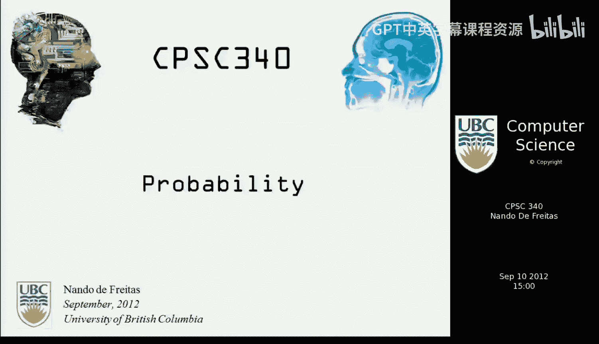

关事。So。回来了。I was really cool。

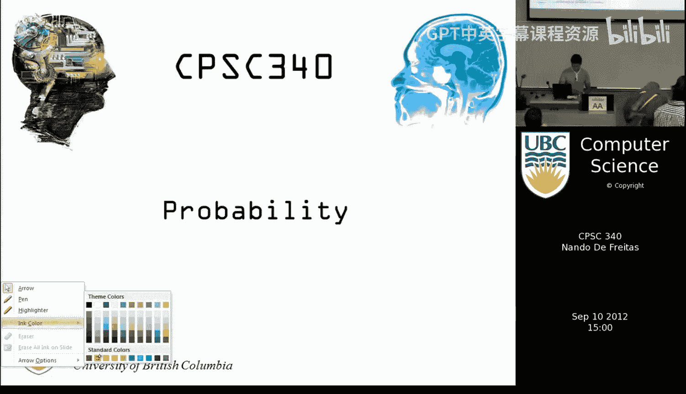

之前看过去年。So let's all get settled because we're about to start。

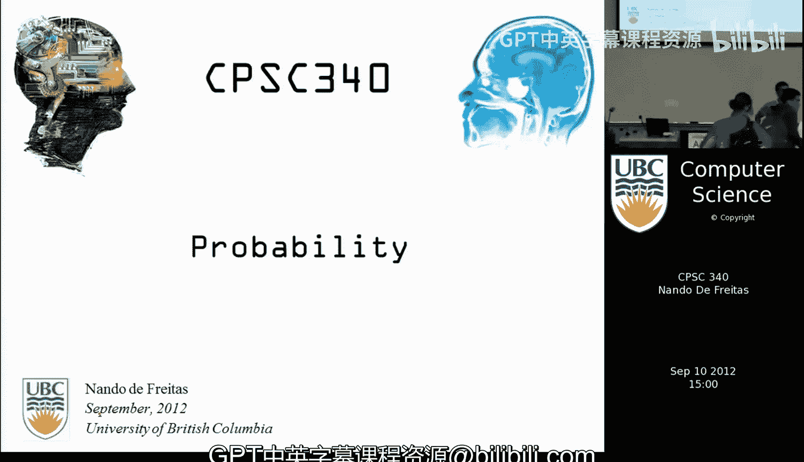

And okay， so。Today's class begins the revision of the sort of basic mathematical concepts that I think everyone has to have in order to be able to do machine learning。

 so today we'll talk about probability and in particular we'll be talking about two very important operations of probability。

 conditioning and marginalization I will define these and we'll try a few examples and these are extremely extremely important。

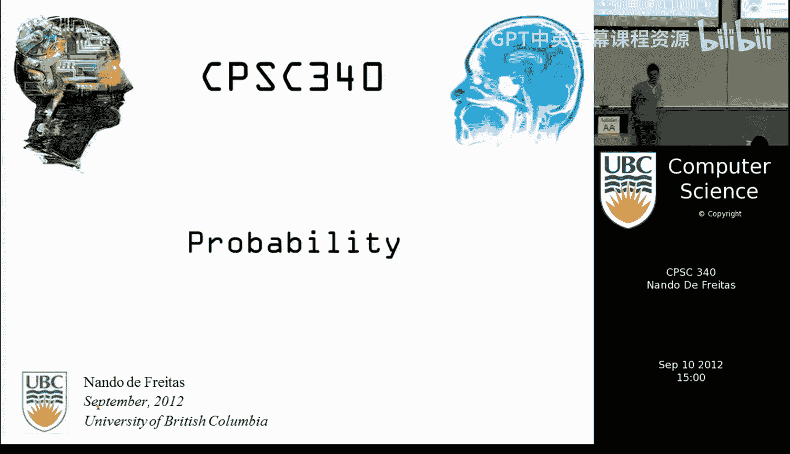

All of the heavy machine learning algorithms for natural language processing， for translation。

 for ranking web pages， for doing speech recognition。

They all rely on these two very basic operations， marginalization and conditioning。Okay。

 so they're very important。

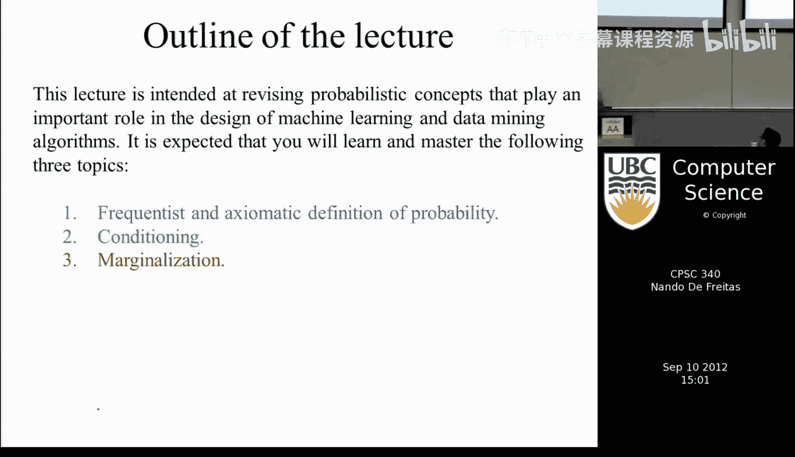

Before we talk about marginalization conditioning， let's start from scratch。

And let's begin by understanding what probability is。 we use the term all the time。

 but it's good to know。What it is。And what it is not。啊。

Let's start by asking you a question if I chose a coin。What's the probability that will be heads？

Anyone。我。must surface like aha，50%。Ah， is it the faircoi？

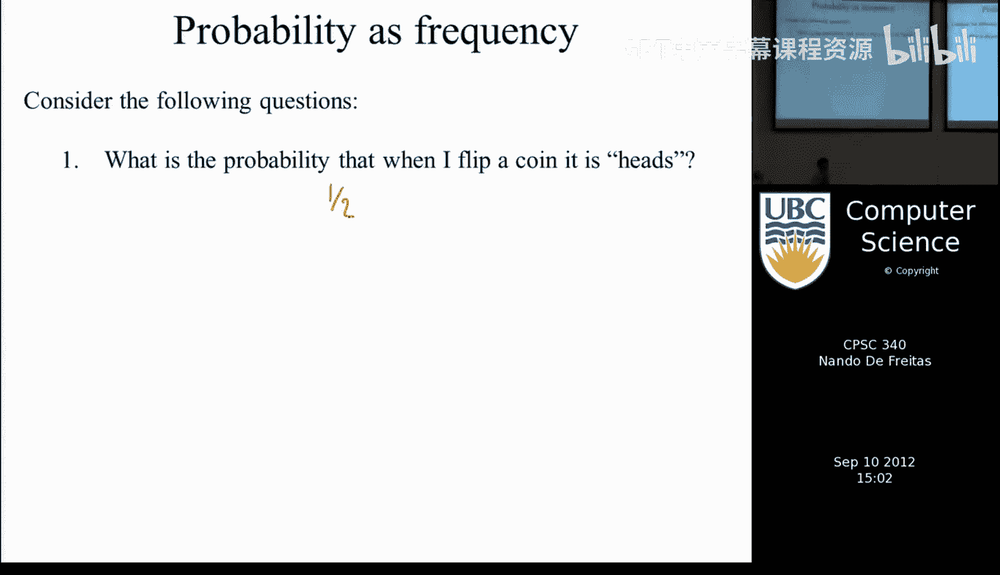

Why would you expect it to be a okay， so the next question then is。

 why would you expect it to be a half？😔，政治が。結婚い線で。Okay。

 so you've flipped the coin many times and if you start doing it。😔。

Assuming that it's an unbiased coin。Rabbin put lead on one side。嗯。

You probably get tails half of the time。There我 some hands up。

I pretty much was thinking the same thing other than that there's only two possibilities and so you're going to get one of the two and if it's unbiased。

 then it's going to be happy。Well， approximately half those like that。

Tiny little chance to got the on end。But some of you， yeah， you're also thinking not just frequency。

 but you're thinking about this question of being biased。And that's take us。

So let's write that frequency。Now， that take us to another question。

What's the probability that the lion'sscape bridge will collapse before the end of the term？

Partardon I don't know。 has happened。It hasn't happened before， so we just can't deal with this。

 does not compete。😔，Yeah。I their history。now， for real guys。

 what's the chances that that bridge will collapse before the end of this term。

 Well let's start with you。005， let's start recording these probabilities。Let's write quantum here。0。

005。0。If I thought like you guys， I probably would never drive part over that bridge。Yeah。😊。

I more on the zero side。王审致。look at how many。我知道。So what's being pointed out here is you would take all the bridges that have been built。

😔，And we check how the time of duration until they fell， but now the question to you is。

 where all this bridge is the same， has there ever been a bridge that looks exactly like the Lions gate built before It because you cant no bridge is exactly？

no breach was。Okay。SoExactly。So you can take a set of。Conditions that apply。

Let's say least squares are in a situation where you can't get an exact answer to you approximate。

Apply those conditions to the landscape。 And you see， this is a chance。这事实是嘛。Okay， so let's say。

 what would those conditions be？啊。See probably the same surroundings。So on the Pacific Rim。

 so there's a powerful idea of。materialter that is built， the load that it's under and the。Weer。诶稍啲先。

Ex， so we're starting to hear about what you often call domain knowledge knowledge about the problem。

 we're talking about the materials of the bridge， we're talking about the geographical place of the bridge and so on。

 so to talk about probability we don't just rely on frequency。You're relying on something else。

 you're relying on domain knowledge。And more often and not just rely on domain knowledge。But。

We also learned something from this exercise。Probbilability is a subjective thing。

Every person here well not everyone， but people had different views of what was the probability of a bridge collapsing there was a question here I was going to mention that。

Landscape bridge collapsing。整星啊。Well it's a discrete value， it it's either up or it's down。

It can collapse on any given。A bunch of things you can make cops like a big。

Clapps like a pin missing。And it's。To figure out the probability。

You clouds and you have to somewhere all of those possible lines。Possibility。

 so I'd say it's impossible。C。Colaaping。It does or it doesn't。It not be might be impossible。

 but you say it 0。005。That's why yes， that's a subject of view and that guess is an informed was an informed guess。

 it wasn't a crazy guess， It wouldn't have been to put survive。That body of water。

 the landscape state of the original second arrows and the second。

And one of those three bridges fell down so must be one。We started learning interesting stuff。

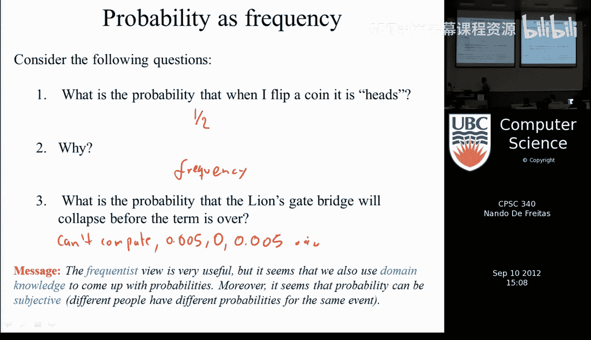

All right。So view this frequentest view of probability is getting us a bit into trouble。

It's the one that we learn in school to us a coin many times。

 but when you start asking questions involving the word probability。

 for which we can answer quite reasonably， you know what's a probability？of me， I don't know。

 having a heart attack before the end of this lecture is something that's pretty cor something that doesn't happen。

 I can ask any question like that what is the probability that I will fall pregnant before the end of this lecture and we can answer that question without having to look at frequencies of events？

Now， let's consider the following setting。There's going to be a wall。

 this wall is of size one by one and here I have three walls because I'm going to do three examples so think of this as the origin00。

 this is11， so this would be 10， this is 01， so it's a wall each side is of size1。

And I'm going to break this wall in half。And draw a bunch of。Create a shaded region。So。

You blindfolded， the wall is this whole thing in front of you and you have to throw a dart。

 sort of turn you around and then you throw a dart at the wall okay。😔。

Or imagine that the wall sort of surrounds you like a cylinder。Now。

 what's the probability that that dart will hit the shaded area？2号。Let's now。Alright。

 I'll try to shout now。out of some。あるかい。Let's assume now， that I。I put a circle。

Let's assume that that's a circleervic inside。Yes。I'll take your questions soon。

What's the probability？That you will。Hit that circle that you'll hit to shade that area。系。辉。拜拜。

So the raius is a half and it's pi times raius squared， so it's5 by4。There was a question。You say。

 how do you say so apologize one out there。 How do you know if you。

tiny dog that's ready in the shade area， you get all of。谢谢留言。You never specified it late。いたし。

T square。Yeah， let's assume that the distribution is equal。 So the set is。You're in a room。

Like think the square is， so let's imagine that this is the set。

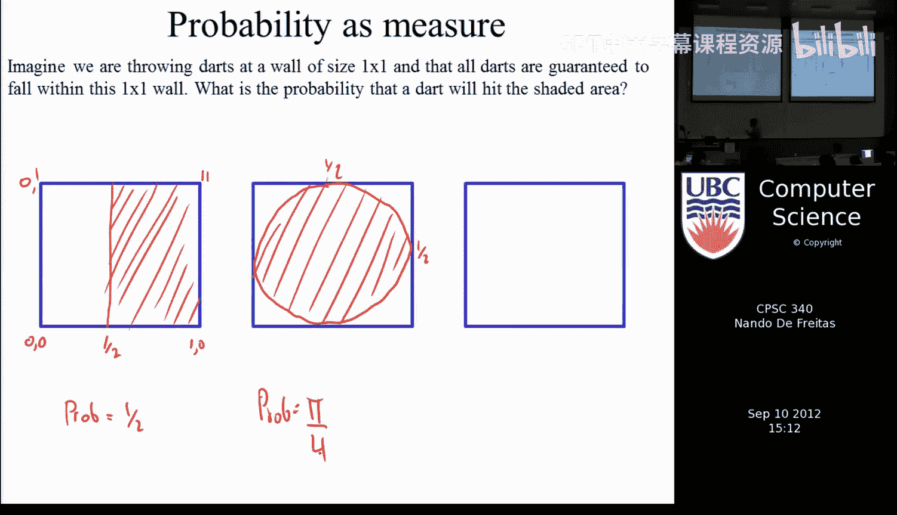

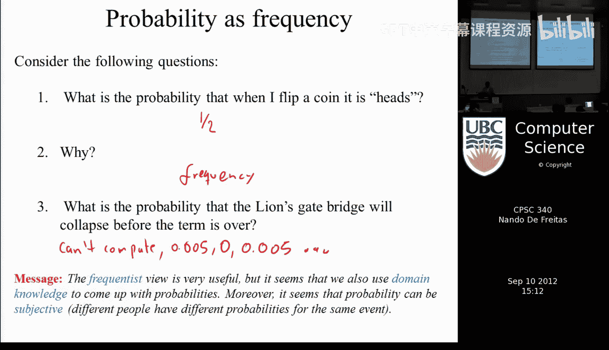

我认得是候。嗯。But that' you blindfold themselves to this room。And this room has area 1 by one。

And so you turn around and then。AndLet's to me could through。

You make it really nice with the insider sphere。So there's equal probability。三打。いあ。

Let's make this a bit more interesting。So our intuitions so far are right。Now， let's。他40的发布。

What's approval of now that you will hit the shade of area？t do on a biol area at the school。

And how do we compute the area of the shaded region？W curve integration。

Let me take integration first。How does integration work？It's the good all you know， we usually break。

In integration， we break the area into small regions。And then what we do is we would compute。

The number of red boxes。Busees that are in the area。If I identify find the number of boxes。

That's essentially integration。So some all the red boxes， you divide by the number of boxes。Now how。

Big or tiny。 can these boxes big。You want them to be as small as possible。Okay you need to get。

You don't want to show up。With these situations。You know， the box that's。Neither it white nor red。

 but it's hot to。その？By making the boxes very tiny， we'll be able to。あて思で。

There's a different way of doing this。因为ね。That's correct out uniform。修業米ム。That's correct。

 The alternative is you just keep throwing darts and then you come how many darts fell inside the area divided by the total number of darts that you。

And that gives you a good answer to mentor。That's called a Monte Carlo method。Okay。

 so whoop I wrote the。だたら週。啱。I'll clean the slides before put them on mine probability in conclusion is a measure。

It's a way of measuring chance。In the setup， that's what probability came up to be， the areas。

And in the areas in this case， you note that chance， what is the chance of hitting circle。

 what is the chance of hitting this area， so probability is just what allows us to measure chance。

Or to measure certainty。How certain are we that we going to hit the shaded area or equivalently how uncertain are we in what we're doing？

So。A lot of things that we do in life have to deal with uncertainty。

And unless we have the tools to handle uncertainty。

 we're incapable of being able to understand how minds work or be able to build intelligent machines。

And that's why we actually pay attention to probability because it just gives us a way of measuring。

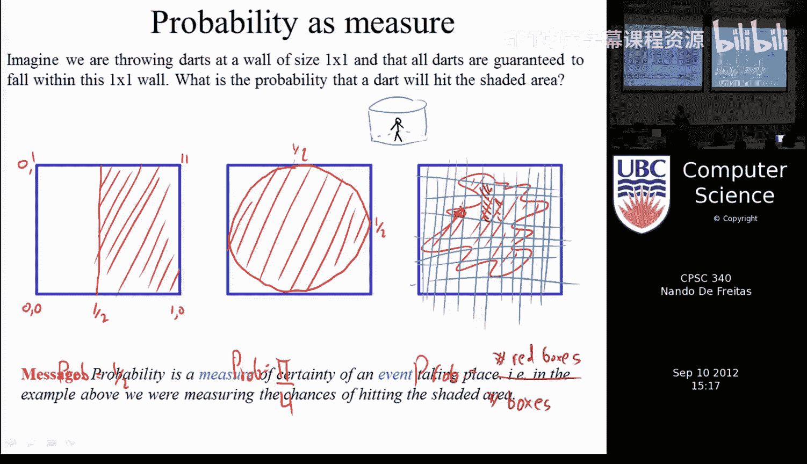

エ人の利ったんですか。Okay， so formally think of provo as a study of uncertainty。Chahars。Now in probability。

 we talk about。How comes。And outcomes are the possible things that can happen。

We say that those outcomes are events of a sample space。maticticians often like to do。

Hic has a sample space。a die， this sample space has six possibilities。でか。duck if you have a toy。

 then allmic is either head or tennis。Thats on个 for。在。I make up for a coin。And。Take。

Cancer has put possible things to。分他。We need to make a distinction between outcomes and events。

The outcomes are all the part the faces of the dye。

 where you might be interested in something other than just being able to talk about all the faces of the dye。

 you might be for end。For instance， interested in event， even。Which corresponds to the phase is 2，4。

And 6。哇。5。Or the event。Great。我。Which is a subset of the set。In this case， weve have five and six。

So we can consider all the possible events。And if you do a little bit of algebra。

 you'll see those to the states possible。对。To each event， we can assign a probability， for example。

 the probability of even。Is a good how。风节个。Greater than。中国。Exl。So that's essentially just。

Part of this lecture is about setting up the life which and a notation right。

 so that when I talk about events， we know what we're talking about。Temperature， what is temperature？

你。就每这都啲。Msure可。What is temperature physically？Of kinetic energy。Can I take energy to your watch？

All hotels in park。Now think of all of these park fieldss， these billions of parks in this room。

Those are all there。Elements of hoomic。And then you take an average of many of those guys。

And that gives you a variable that you care about， and that's separate。That's the variable。

Even it's a variable on it' a variable。Though we talk about。But they're always based。

All these possible configurations called。这是。Temperature is 25 degrees when that molecule over there is hitting down the molecule and this one is lying over there and so on。

 I however do not want to describe what in each of these billions of molecules is doing in this room。

 I just want to be able to tell you 25 degrees and that's why I need to consider subset。

 which are like events。And temperature being one of us。I'll make this more precise a bit later。

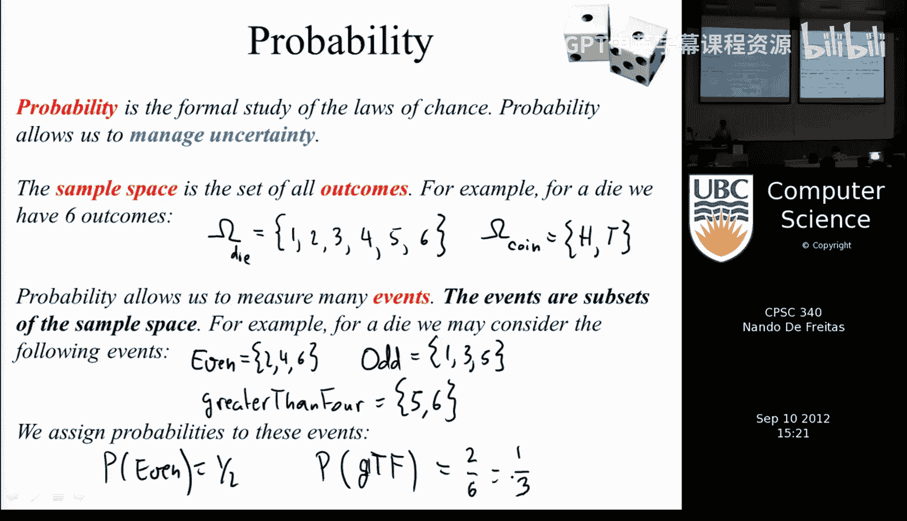

这歌子。Now， probability。Once we have to define what an event is。And we can know。

And having understood probil is just a way of measuring。

We can now lay down two axioms from these axioms， everything else falls。

So this is the only stop you would have to。可い。We're going to introduce。The following notation。

Ha there with the bar is the null event。It has。P quality。So like if I throw a die。

 what's the probability that it will be nineta zero or sorry， N1，2，3，4，5 or six is zero。

 it has to be one of them。And then we're going to talk about mega。Which we've already talked about。

 which is everything， one， two， three， four， five， or six。

So the probability that's going to be one of those。When I throw the dye。

 it's for sure one because it has to be one of those。Unless the die kind。Baalls in our corner。

 but we're not the dust。Okay， and so。Sort of thing that you've probably learned before。

 probabilities are measured between zero and1。The other thing is if you have several events happening。

Let's assume that this is our wall omega。Okay， so this is the whole wall。

And let's break our wall into sections。Then we。Let's call them a one， a two， a3。And then，4。

Then we know that the probability of omega， the probability of the dark will hit that full space is one。

And that's the same as the probability。In this case， omega is just equal to。

I used the symbol to the not the set union。A two。Which would be the same as the probability of U painting。

Each of these shaped。So this is sort of very easy to believe。 It follows from our our。

Diagramm before if the whole wall。If you had to hit the whole wall for sure。

 then in if the probability of the shaded area was a half。

 the probability of the non shaded area also was a half and so a half was half， if you want。

And the proive the circle was pi over4。The square minus the circle is just one minus p over4。

 so again again to probability sum， so it's a very sort of basics。The accents are very。

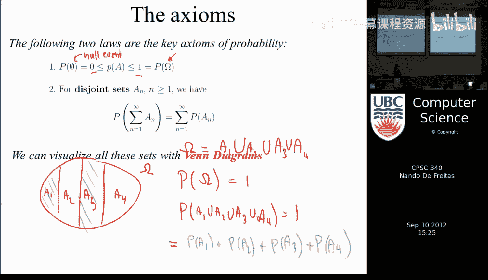

Now kind of the things that we can do with the oxs？So the first thing to。

Is that supply assumed that these events were separate。

So in this big。Whi we call a bandn diagram， A1 and A2， they don't intersect each other。

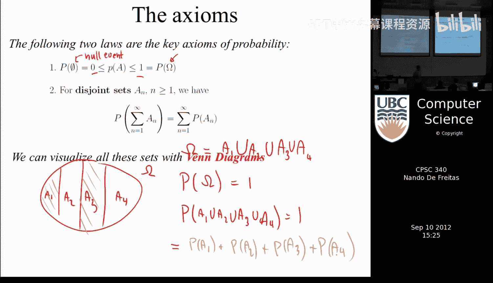

But now we can consider a situation where two events do intersect。So in particular。

 imagine that you have。An event a。B。And in this case， there's an intersection between them。

Now the problem with this is that when you throw that dart。

And assume that dark guard ends up falling here。You're counting it twice。

 you're counting it as a egg falling inside a green area。

 and you count counted as falling inside a red area。So A or B is the envelope of this。

And intersection。Is given by A and B。And since we fall。Since the intersection is counted twice。

 we need to subtract。All right。Hands up， who's seen this before。

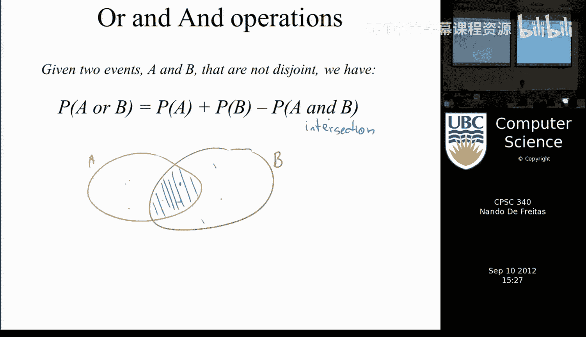

你 haven't这直。We all have the foresis for this。So。Now getting to the interesting stuff conditioning。

The idea of conditioning is where we want to know what happens to something。Given that。

 something else has happened。So in particular， I want to know what's the probability of a supposing that I've already observed B。

Very important。

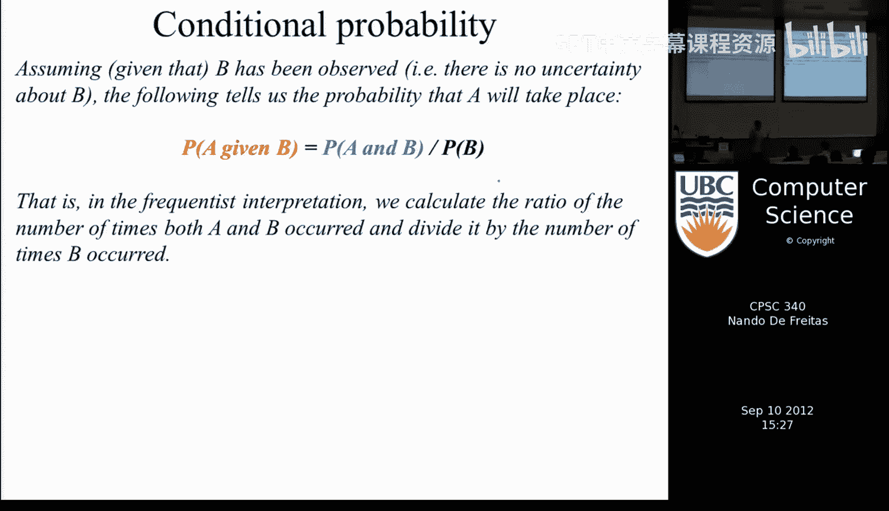

If I've seen B。I do not need probability to talk about B。😡，Okay， I look at him and like。

If you ask if the question is what's the probability that he's male？There should be one。

 I'm looking at him at all the informations being well， not all the informations been given to me。

 but I'm assuming。そ。Once something is observed， there is no uncertainty about it。

Probabil is only needed because we hardly observe most things， okay。

 same as that problem that we had in vision that we started with for motivationve。

You only see a few things。The rest。You have to guess and you guess them with probability。Okay。

 so given the supposing， you know， B， what are the chances of A？

One natural way to deal with answering this question is just count the number of times it has happened。

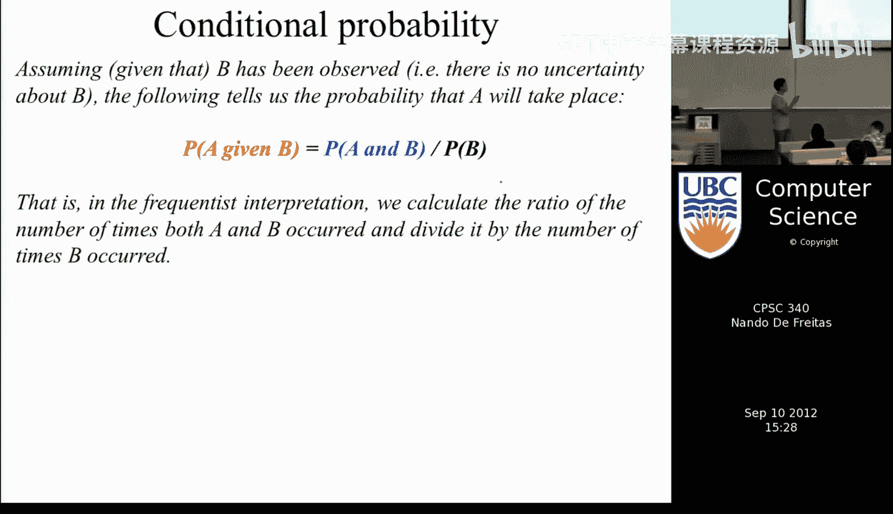

And the number of times A and B have happened and divide them， for example。

 what's the probability that it rains when it is cloudy？

So you just check the number of times it's cloudy。And you check the number of times that it's cloudy and it rains。

One by the other， and that gives you the probability that will write given that it's blocked。

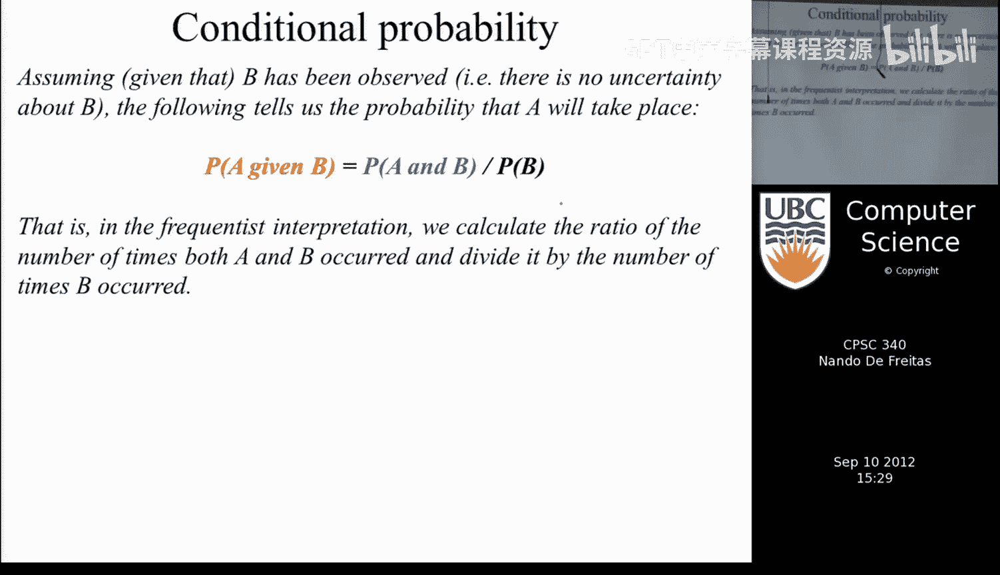

So that's a simple interpretation。

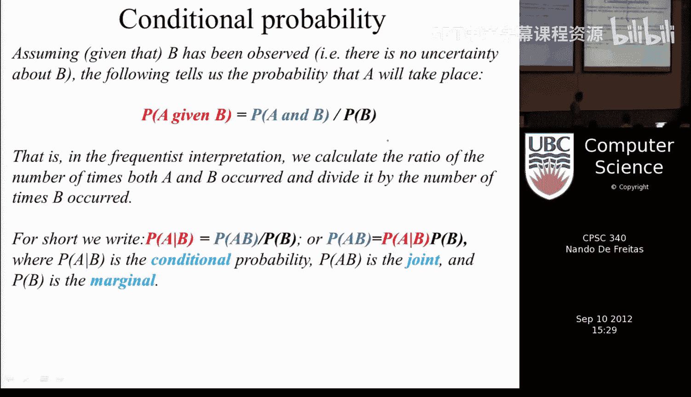

And instead of writing things like this， which is very long and tedious。

 I'm going to use this very short notation a bar is going to mean given for the rest of this course。

 so when I write the of A given B， I mean that B has been observed。诶。

And it's going to be replaced just by。Nothing or sometimes a column。So folks often use a comma。

 sometimes they don't use a comma。And if I multiply both sides by PFB。

 then just I can rewrite it like this。好。This quantity here is called the joint distribution。

The black quantity is called the marginal distribution and the red quantity is called the conditional distribution。

We also have。Something called a chain rule that if you have more variables。

 you can keep doing the same thing， for example， the probability of A BC is just probability of A。

 you can be at C and then probability of B given C and then probability。So。

No matter how many variables you have， you can apply this position。

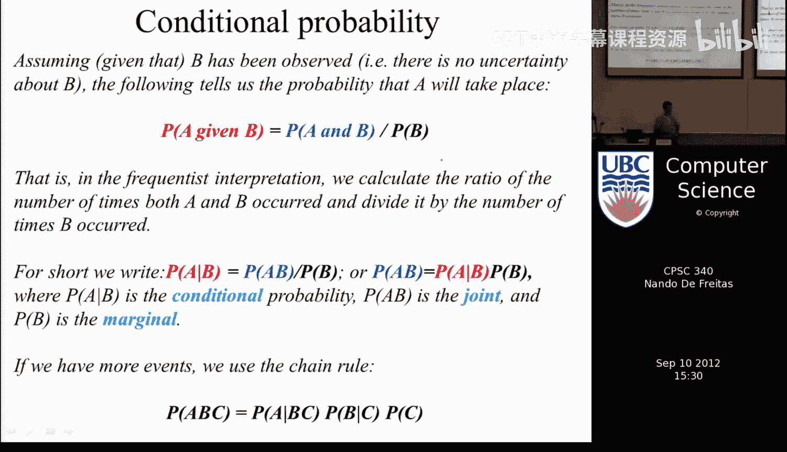

那。Question for you guys， can we write P of A and B in more than one way？我了。Two ways。ま在ま。

In other words， a。So one way is P of A given P。没有。可。Even诶。没有。Well， our systems with our definition。

 and there will be the beginning for something very cool called base rule that we'll talk about in the next class。

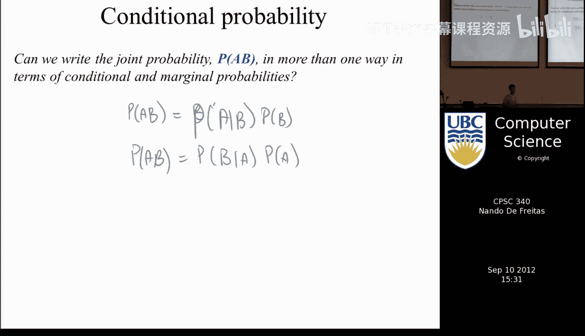

Now。我我。what happens when A does not depend on B？For example， I might ask。

 what's the probability that you will find？啊原告的。The soul mate of your life。

 given that it's raining in Shanghai。Yeah。好的。Yet independent depends and what does that translate to in terms of the above inspiration？

p费人俾电。face in b。You can drop the be。Because knowing B is not going to help you answer A。

So we just thought。And。If you have four variables。也如这三对。The change room。But because。

One variable does not depend on the others。フ。Independence just means that the probability of many things could just be rigorous as individual probabilities。

 so it's a very nice problem。We will learn later in the course a more general property。At this。

 and we'll see that that's sort of the key to build a lot of AI systems to do by on car diagnosis。

The reason why I put the cocktailus words so nicely these days。Everybody used to watch 2。

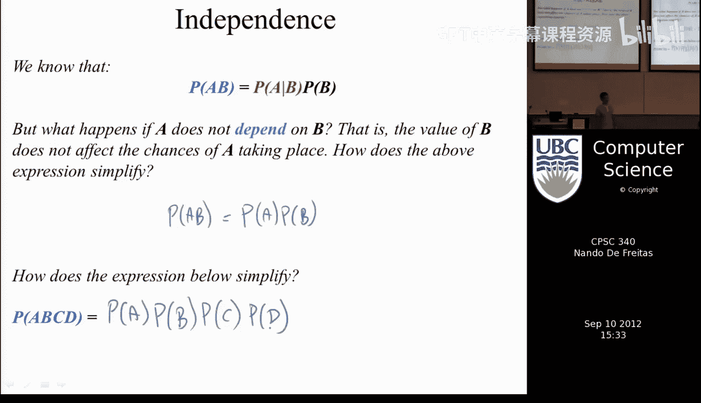

被收。Let's now look at another example。Suppose that I have a box that is sort of like a magic box dark box。

And that there's three red balls inside and there's a blue ball and you can't really。

 all you do is you put your hand through a hole and you pick a ball and then you check its scalp。

Now let's assume that you do this once you observe the color of a ball， put it aside and then。

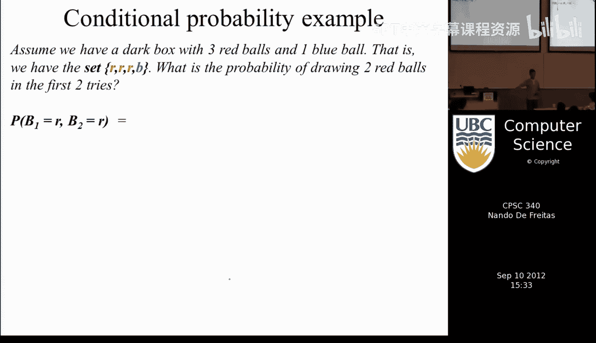

S and take another ball and observe its skull。 What's the probability that the two balls that you observe will both be read？

How would we answer that question？问题度。法庭。找个是你他。Okay。

 one way is to do all the calculation our head and say what the number is。

 What would be a systematic way do we realize that the two wins are。Independent。

And it's without replacement。 So we take out one ball。Then we take out another ball。

 It doesn't really affect what the first ball was。试啊。You have a choose up the three from the four。

真司啊。Right， those are the numbers that's correct， those are the calculations。

 but what were we fundamentally doing， the samples big changes？

We're going through other possibilities。So that's great probability。Your condition。

That's what he was doing here， please。开。In other words。This is the calculation。对对。啊。

But right now you can do these calculations with numbers in your hands。

 but these models will get bigger， they will have 20 or a million variables and once they get to that scale。

 they're not going to be able to do these numbers in your head。

 so what's important is that you remember if you asking a question A and B。

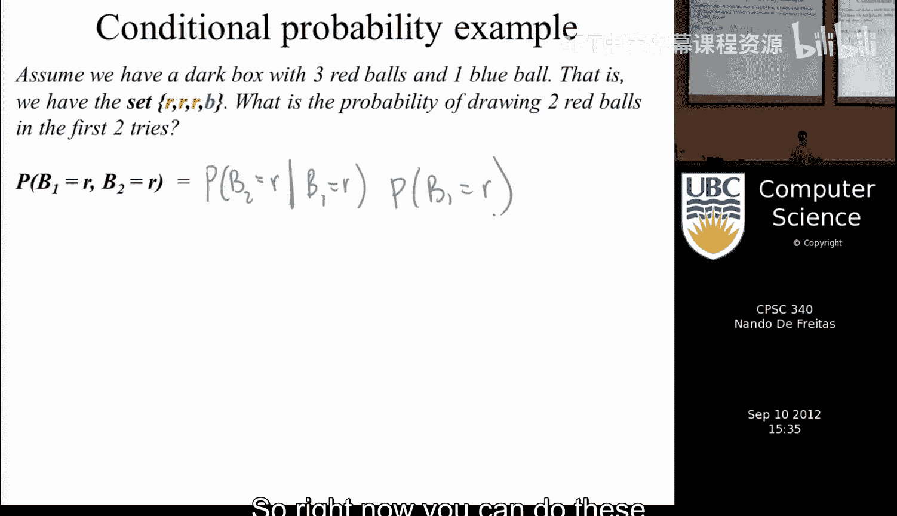

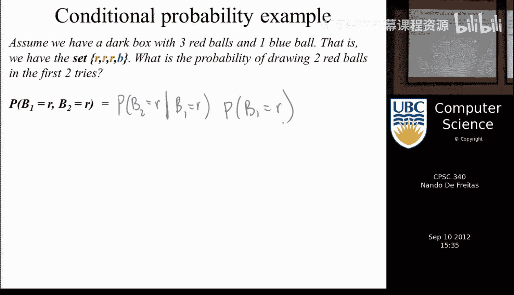

Then you use the rules of probability， and given opinion them。

And here I'm assuming I'm using this index to say the first ball and this is the second ball。

 so the notation here is the probability that the first ball is red and the second ball is red。

 so we use the comma to the knot and。I could have just put a space there。

 but the comb is nice because it sort of looks a bit more clear。

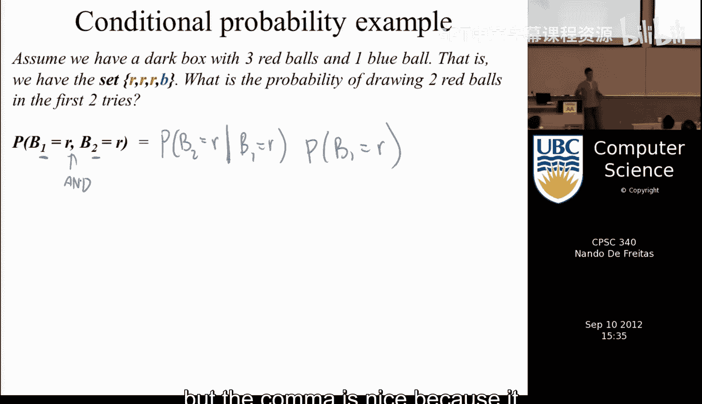

あの対。The bar always means skip。Of course。The chances of the first guy being read。port us。

And then once the red is gone。The chances that I will be read again is just two out of three。

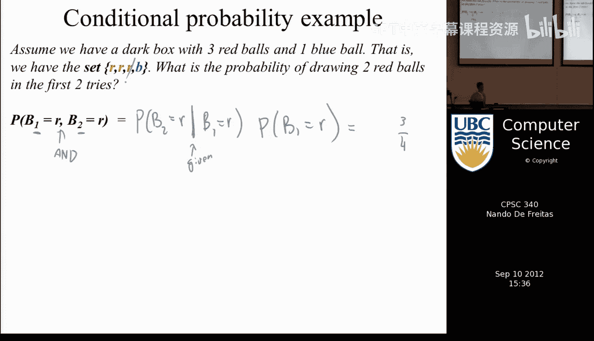

And so， we have a。Whenever you need to make。Answer something about many variables at the same time。

 you apply the chain rule。That's the。Apply the chain rule to go wrong。

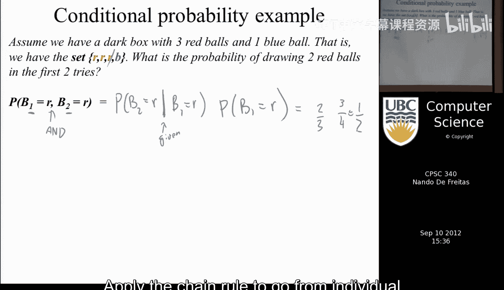

And it visual probabilities to a joint probability。

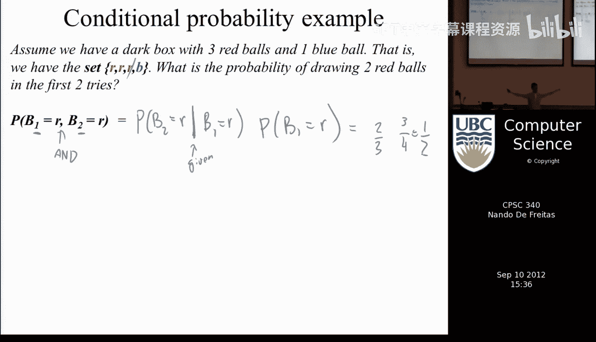

So in order to grow， we use the chain rule now we'll just have to learn how to go back the era。

 given the joint how we got to impact an individual robot once we know those two fundamental operations we'll be able to do pretty much everything。

They will have qua top of AI。Until the age。Okay， here's the shrinking operation。

 the shrinking operation of school marginalization。The marginalization allows you to go from。诶人 b。

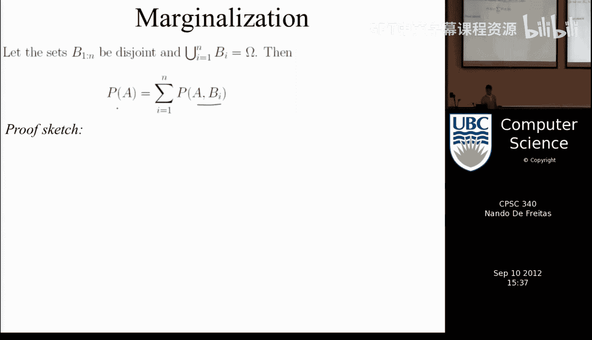

To just a。So。In particular， I'm using here yet more notation。By B1 to end， I mean， B1， the2。

我都会 up to be。We will often in the course use this notation so that we don't have to write everything。

I'm just lazy。 I don't like to write long expression full the time。 So come up with short notations。

And the union of let's assume that the union of all these sets， which I this joined。

 they don't intersect， is the full sample space。Then it follows that if you sum over all of these guys。

And this， of course， is just a sum attention。系。Bs。哎。Let's not at the next example。

Unless this person get us。Sort of a approved sketch。Let's assume that we have this set P1。緊中。3。Whi。

Once you put them all together， they form the whole space。The space dark。With certainty。

And let's now bring in another set。诶。より。And the picture sort of says at all。The probability of a。

It's just a probability。哎。Intersecting。可。Proability of by intersecting with。

A inter psychoomega is just a。But a intersect omega。It's just a year。放。诶。Interssect。Be one。喂。哎。

Interssect the too。And we are a。Interssect。And the probability of the union by the second axiom is just a sum of probabilities。

 an intersection is just an an operation， so this is just P of A and VR。呢个诶。系。

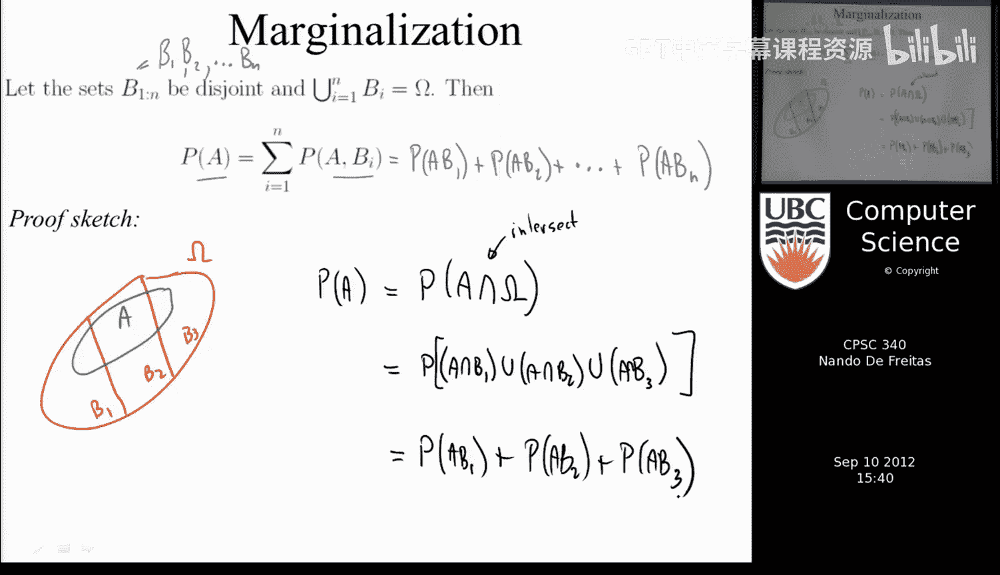

Bottom line， you have two variables。I want to get rid of one？

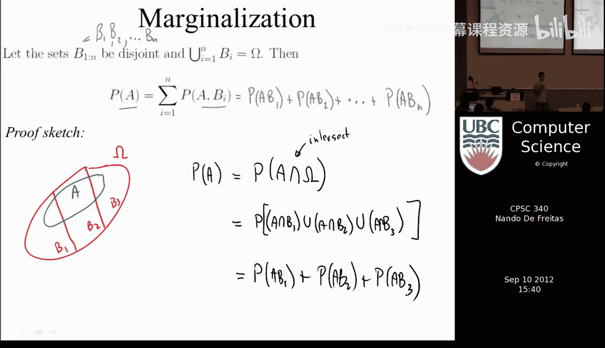

You have to sum over all the possible values that are available to。

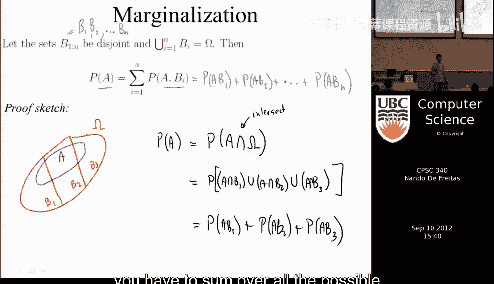

What is the probability that the second bolt in this ur will be read？

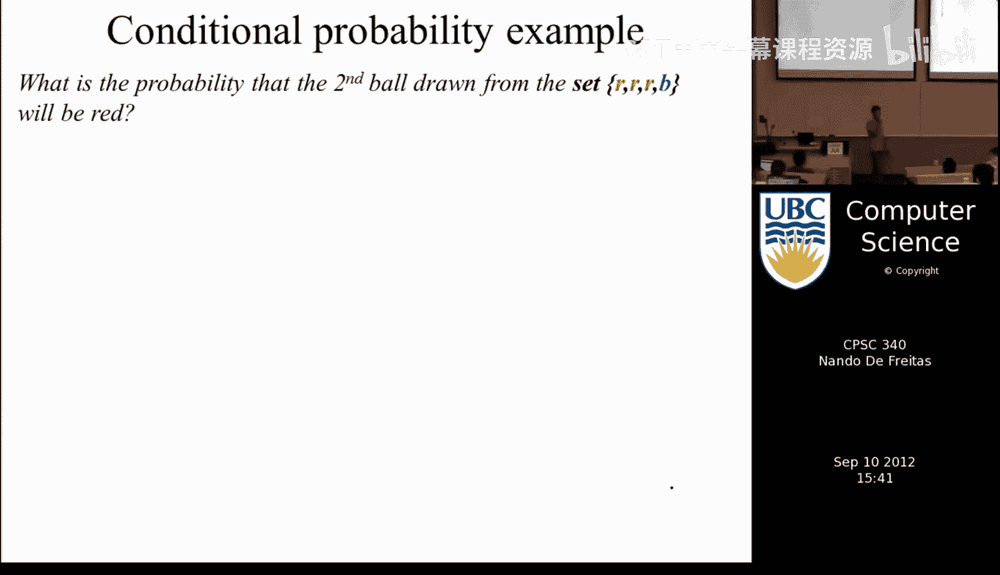

How do we answer the question。

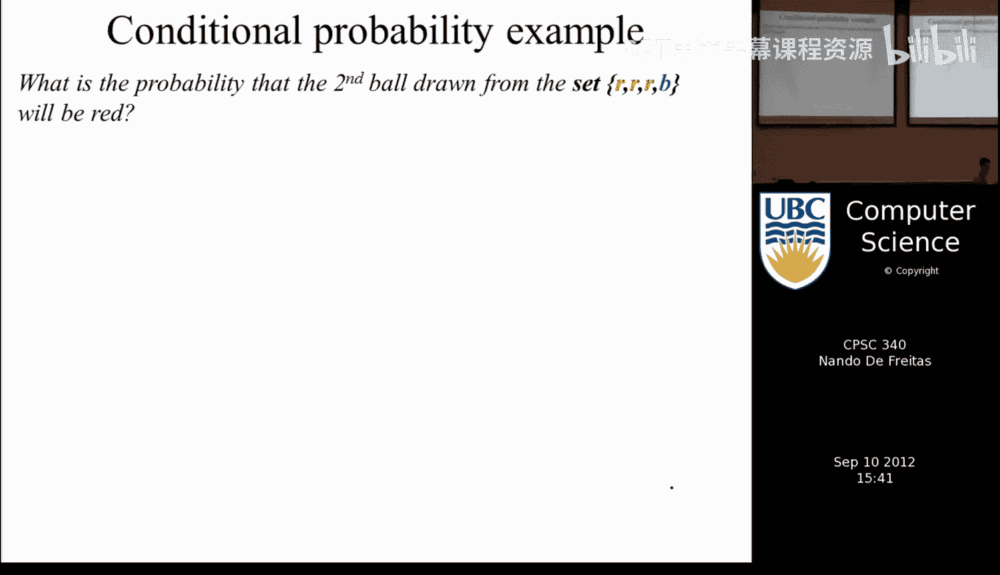

is correctrrect， The details are wrong。Because you're probably the given。

 but you're absolutely right。It's a probability that the second one will be read。And correct。

 now you're 100% correct and the first one。R plus the probability。But the second one。It's right。And。

The first one was blue。Right。Because you don't know what happened to the first ball。

 I just care about the second ball and if you don't know what happened to the first ball。

 you can still talk about what happened to the second ball。

 but you need to sum over all the possible values for the first ball。

Now this is extremely important because typically when we have probabilistic models。

 we'll have thousands of variables。And you will want to make a query about just two there。

And you don't care about the other 998 variant。So to get rid of them。

 you just have to sum for all the possible values that those variables could change。

This is assuming that you actually know。没有。And in real life， later in the course。

 we will address your comment。We will deal with the。啊。

To begin with and to set up the notation and the concept， I'm just doing it very。決月つの。The notation。

 however， the concepts are fundamental。This is the key to the course。And theyね。To make things bigger。

 marginalization to make things small。Leice variables， more variables。

Those are the two key operations。We'll be able to do this with continuous variables with realistic situations。

 but the operations will always be the same， and the rules for manipulating variables will always be the same probability。

Relation parts to one section。诶。And so we already know that this one is a half。诶。

Did anyone calculate this， I think it's zero。Oh no。は。但。sorry等讲。that's correct。W。

Its a quarter plus a half， that's three quarter。That是意思。If you just follow the rules。

 all these calculations are easy， if you don't follow the rules， these calculations are horrendous。

Just doctoring this in your head will take a long time。好。讲温杰伦。Instead of calling these things。

Red or blue。Instead of calling this set A or B， we typically call the set x and enter the variable x or。

Friendly， variable eggs。And instead of saying red or blue or colors。

 let's just call them zero or what， because we work with computers we like their ones。

And for short notation。I'm going to write it like this。

If something takes two values I just brackets to make it said， it only takes two values。

I'm just saying the text。I's either zero or1 x is one to two elements of that。到。

As we did for the red ball， let's assume that there was a probability of three quarters of being red。

 one part of it。5要4。Theabilityty of it。可以。Given that the first one was read was one third。

K us recall that the bird is red， red。And then。The probability that you'll get a red sortium blue。

 given that the first ball was a blue is zero once you take the blue up。

All flews to take out to the second month。Its here。

It's impossible for you to get up another blue ball once you've got the。So question for you guys。

 what's the probability of zero given0 that x2 will be0， given that x one0？2 over。

Thing are starting to get started。而家出正讲紧啦。X1 is0。X1 is0。One next one is zero。

Two things can happen to x2， so x1 is0。 think of x1 is0 as you're in China， x11， you're in Canada。

And then given that you're in China， you flip a coin， that coin is going to be heads of1。

And when you're in Canada， that coin is also going to be heads of tails。So given that your x1 is0。

 that you're in a particular point。The sum of of。X 2 has to be1。So， this must to。

Very important thing。What's the probability now， all。Let's do the other one。

What's the probability that it would be zero， given that the first one was a one？喂去到西米。Now。

This is when you're in Canada。And if the probability of being head to zero。

 then the probability of beingtail has to be one。然后。We can also write。

There all these operations much more quickly using linear algebra。So in particular。

 what I'm going to do。Is I'm going to create。A vector。I think it's just the array of elements。

 it's just the data structure for grouping elements。And I'm going to put the probability of x1。

Either zero or1 inside the vector。And I'm going to multiply that vector by a matrix。This is for X1。

This will be x 2 being0。啊。Before to explore。And the zero zero element will be2 thirds。そよ。The。

0ero1 element only one third。The zero going to a one sorry one going to a zero。Go to be a war。

Now if I multiply that factor。By。The matrixtri。系嘅。What's the first entry？你。さて。The first one is。

3 quarters in one。So I have a perspective within this is， sorry guys I apologize。

 let me just quickly ca something here。So I have0 going to1，0 to 0，1 to1， so I need one going to0。

 so this is x2 to x1。X2对接 this了。I was about to break the loss approach。やほだ。他。If modifyly it now。

 it will make sense， you've better harm and you've better harm。

This is just the probability of what x2 big0 or1。In other words。What I've basically done。

Is the following multiplication。Someing words。That essential your marginalization and condition。

When you do marginalization and conditioning。You're just basically doing a image of taking a vector。

 which is a probability vector multiplying by a matrix。This is element wise matrix multiplication。

 this is what you use。not。So。What we're essentially doing is just might elect。他没。

In the following class， I'm going to go over base rule。

 which is a direct consequence of marginalization and conditioning。

I will also show that this interpretation in terms of a vector and a matrix。

 is the sort of key thing you need in order to understand how Google brandss were pages。

 which is what you have to， the sort of exercise youre going a practice。

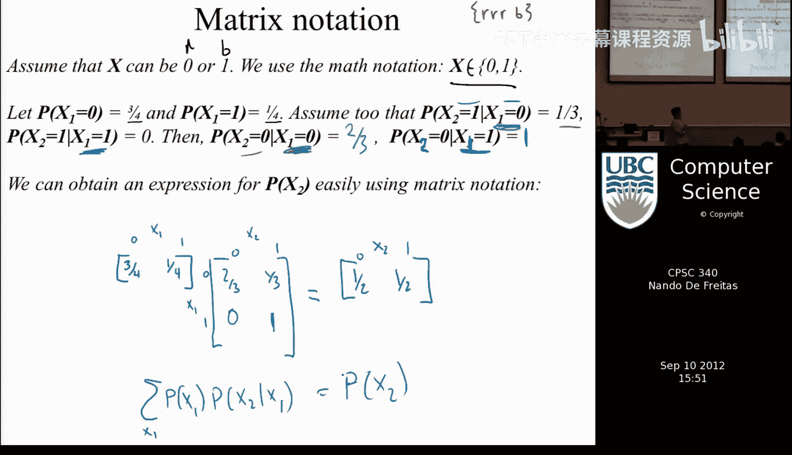

マイクソする会社。

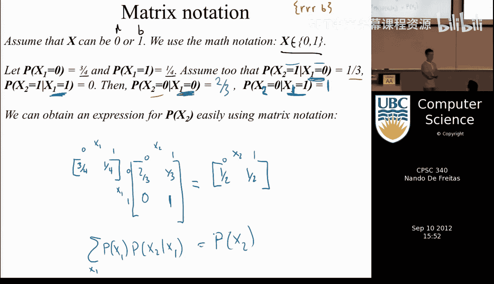

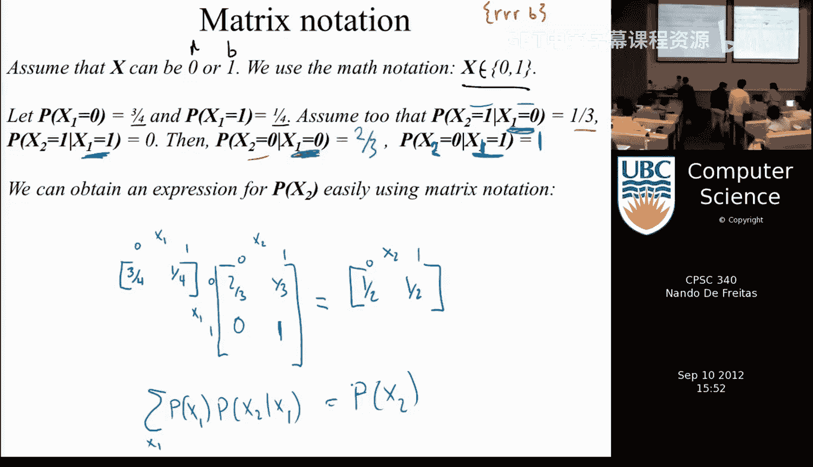

Yeah。て。What。It。Yeah。Today。签年的这。等下い。Yes， dear。 I mistake。What are you going to。你个好。1，01。I。No。

My friend。I。なこ。Yeah。你愿意话我。系さ。

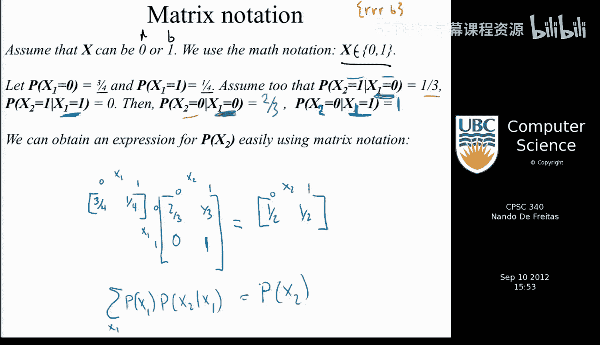

下午。