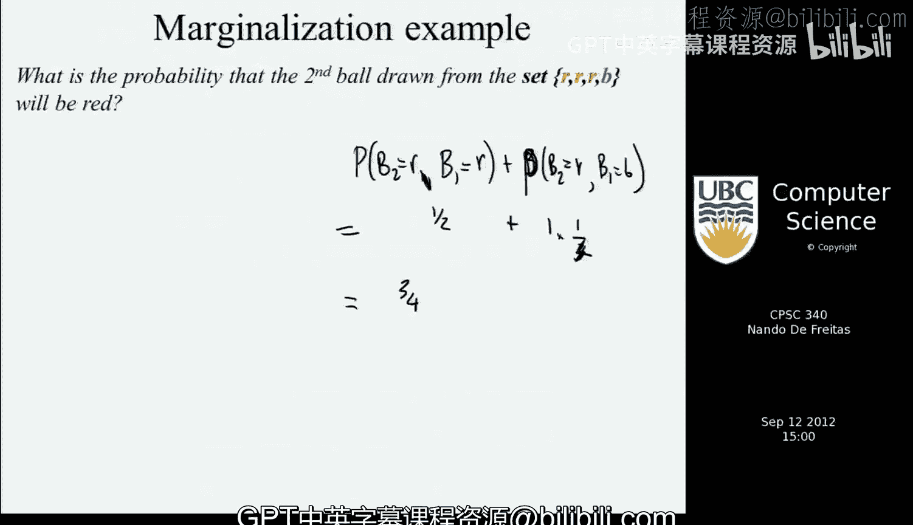
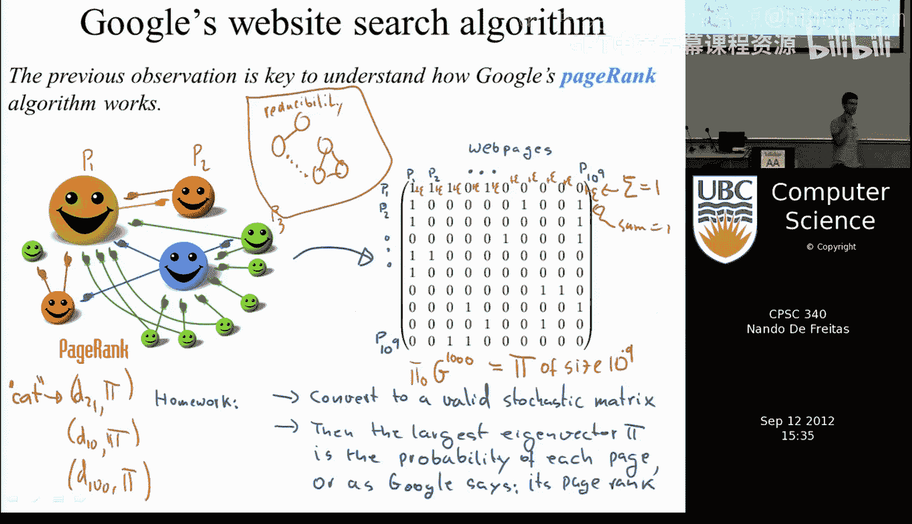
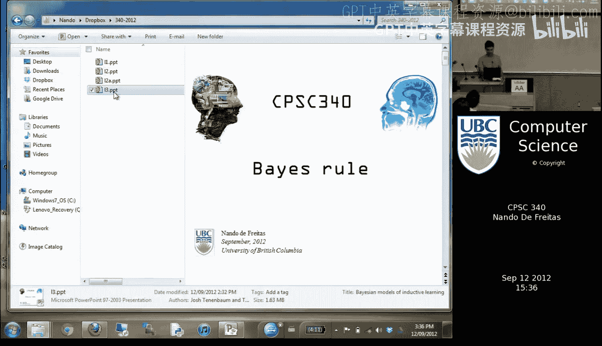
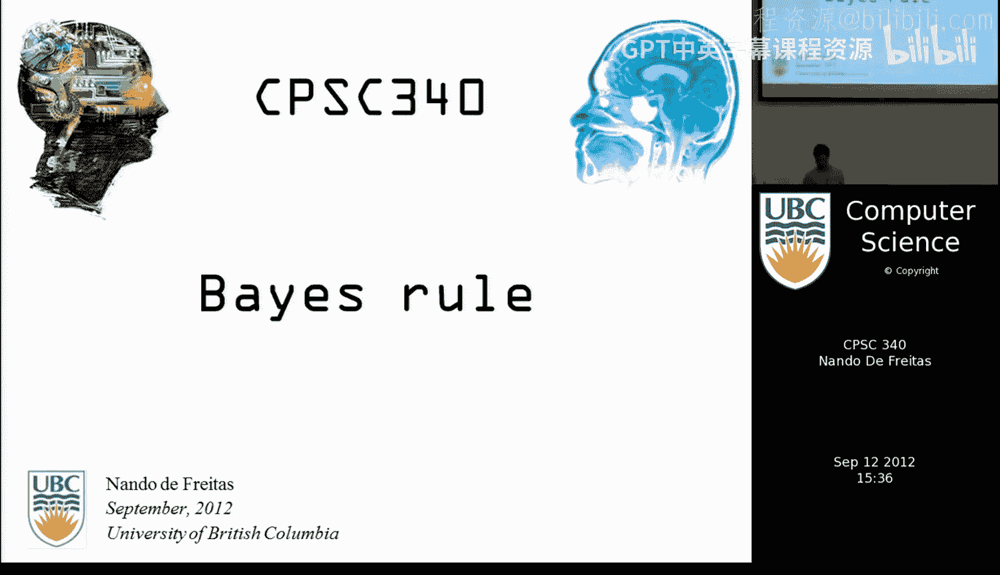
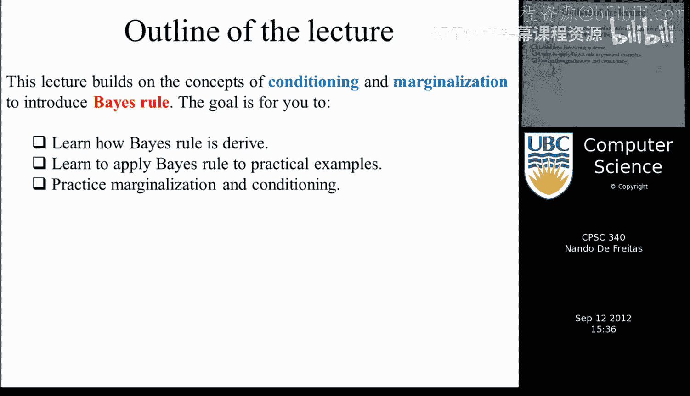
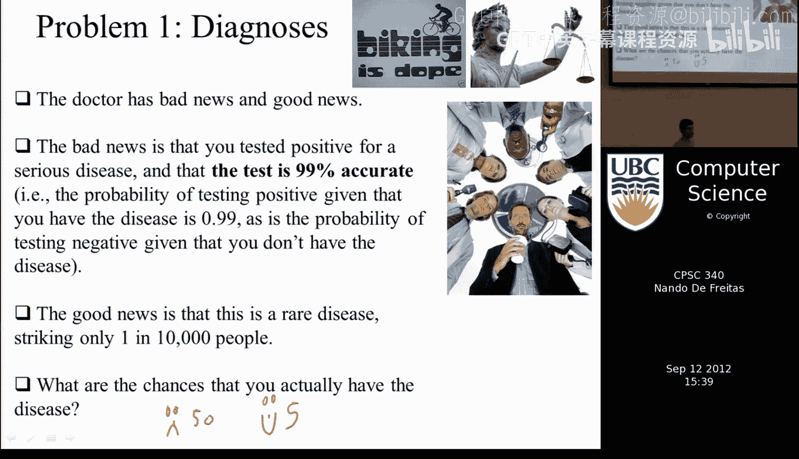
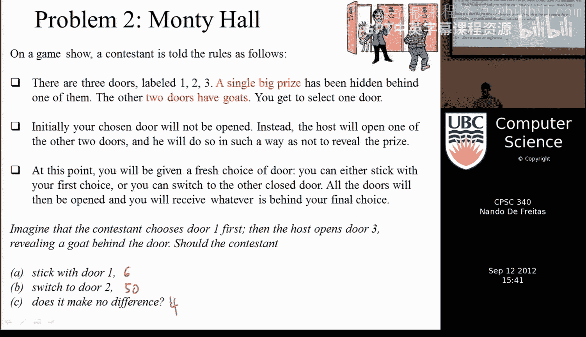
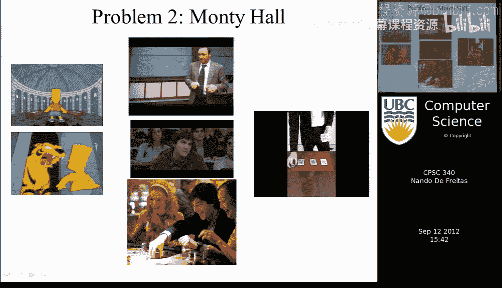
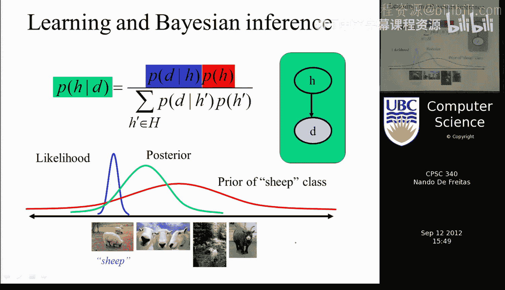
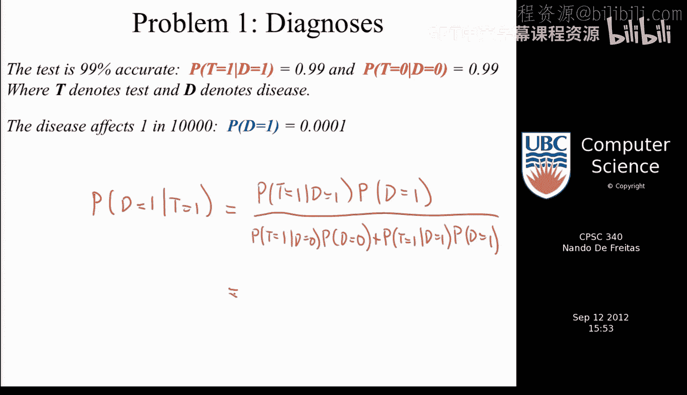

# UBC《机器学习和数据挖掘｜CPSC 340 Machine Learning and Data Mining 2012》中英字幕 p04 -04-undergraduate machine learning 4_ Introduction to probability, linear algebr -BV1pJ2ABFEFg_p4-

On sharp on time， so I'm going to try to keep the lectures on time。

So let's see last week we learned two tricks。We learned a trick of。Conditioning。

 that is if you have the probability of one thing happening and you want to know the probability of two things happening。

 you just multiply probabilities marginal stamps conditionals gives you the joint and that's the role of going from the probability of a small thing to a probability of many things。

Okay， so the probability that the first ball will be read to the probability of the first two balls being read。

So that was conditioning。 The other thing that we learned about was marginalization。That is。

 how do you go from knowing two things， the probability that bolt1 and B2？

Take certain values to just knowing one thing， the probability that just Paul2 takes a particular value。

 So from many to one。I then began。嗯。The following exercise。And in this exercise。

 what I was doing was trying to write everything using。嗯。Marices。So in particular， let zero。

As I've written here， let0 denote the red ball。 Let one denote blue ball。And now the variable is x。

 And so x can take values 0 or 1。 So it's a variable that indicates whether you pick a red ball or a blue ball。

And recall there were three red balls and one blue ball， so our ur was of the form red， red， red。

 blue。Okay， so three out of four times you will get a red ball and。

One quarter of the time you get a blue ball， which is essentially what this is saying three out of four times you get a blue ball。

 One quarter。 you get the second ball。 And that's the first try。 That's what your first ball will be。

 In other words， what x1 will be。So。What you might want to know is what's the probability that the second ball will be read。

In other words， that it will be。Three quarters or that it will be blue， that it will be one quarter。

And we had already calculated in the previous slide that the probability of the second ball being。

Red was three/4。So we're getting the right。Probbil is just by doing the matrix multiplication。

The only thing we need to remember doing this。 So this just gives us a very quick data structure to do the problems very quickly。

 So if you know matrices， instead of doing each of these guys， one by one。

 you can just form the matrices。Multiply them， but you have to be careful how you multiply them。

 I'm doing a left multiply here instead of a right multiply。

 and then we get the probability of the next variable。Sure， let's go back a little bit。

This is extremely important。 So I really want to make sure everyone's on the same page。

We had three red balls， and a blue ball。And we had the first question I ask is what's the probability that you pick a ball of what's the probability that the ball you pick will be red？

So most people agreed it was three over4。 Okay， What's approach you get a blue ball，1 ch。

A more interesting question is， what's the probability that the first ball is red and the second ball is also red。

And I could have also asked， what's the probability that the first ball is red。

 and the second ball is blue。You could have asked any of these questions。

And we learned this rule that its probability of A And B is probability of B given A times probability of A。

 That was the conditioning rule。And so what I'm doing here is just applying that conditioning rule。

 The probability that the whole one is red。And B2 is also red。

Is the probability of pole 2 being read given that pole 1 was red times the probability of pole 1 given red？

Now， the capital B is just a symbol。 It's a variable symbol。

 So I could have rewritten this in the following form。

 The probability of the first ball being read and a second ball being read。

It's equal to the probability that the second ball will be red， given that the first ball is red。

Times the probability that the first ball。Is red。Okay。And so。That whether I call it B or X or A。

 it doesn't matter。 it's a variable。 It's an abstraction of the fact of the event。

 the phenomenon of choosing a ball。Okay。Must often and。

We use the variable x just because of tradition。And sometimes we use say a different variable to indicate what it is。

 I used capital B here because these are balls and the balls are red or blue。

 but I could have used X。We also then asked ourselves the following question， we learned this rule。

 very important rule， the rule of marginalization。That the probability of。Hey。

It's equal to the probability of A and B1 plus the probability of A and B2 plus probability of A and B3。

In other words， the probability。Or let's do it actually in the case of the red ball。

In the case of the red ball， the probability。That B2。Is red。

It's the sum of the probability of P2 being red and B1 being read。Plus。

B2 being red and B1 being blue。So if you don't know a variable， in this case。

 the variable that we don't know is B1。We need to sum over all its values。

So another way in which we're going to write this is probability of P2 being equal to red。It's equal。

To the sum。Over B1。Proability of B2。Equal red。From a B1。That's one way to write it。

Another way to write this。That people out there often like to use is that they would say B1。

Being either red or blue。And then they will write P of P2。Equal red。Comma B1。

Or we could still write this as。Be one。Q be。To equal red。Give and B one。Times the probability。哦。啲。

Alright， so we have many ways of writing the same thing in the first the first time I just put a B1 to indicate that I'm summing of a B1。

 But if I'm summing over a B1， that means I'm summing over all the possible values that B1 is taking。

 That's what the second expression is saying you summing over all the values that B1 can take。

 which other red or blue。And then the last one， I've just simply applied the conditioning rule that the joint。

です。The conditional times the march，And that was essentially how we arrived at this the three quarters answer。

We just computed the probability of B2 being red and B1 being red plus。

 because that's what the sum symbol means you were adding things plus the probability of B2 being red and B1 being blue。

And if we sum those two， we get what we want， The probability of P2 being read。Okay。

 so those are the two rules of probability， conditioning and marginalization。

And the rest of the class today will be about exercising these rules and getting used to these rules。

Another thing we started doing。 and this is where we ended in the last class was in now I'm instead of calling the balls capital B。

 I'm going to use the variable X。And instead of saying red， blue， I'm going to use 0 and1。

This will be more the convention because often I'm not talking about balls。

 but often 01 could be whether the word Vigra appeared or not in my email when I'm building a text classification algorithm due to spam detection。

Or it could be 01 to indicate that a patient will die or not die if I give the patient this treatment。

 and so it's best to just use a single variable x and just use 01 to indicate false or positive。Okay。

 so。Having said that， our setup was that was three quarters of probability。

The ball is red or zero from now on I'm going to use zeros and one or that it's one with probability a quarter。

And I also have these conditional probabilities。 If I initially have zero ball。

If the ball is of color0。The chance is that the next one will be of color one is one third。Okay。

 so recall， for example， that if you。If you take away one of the red balls。If the first ball was red。

 you're left with two reds and a blue， so the probability of getting the blue now is one third and the probability of getting the red is two thirds。

So that's what happens when you。When you choose a red。Okay。Oh。That there is nothing I can do about。

 Let's just use this project and hope that if this one fails， I will panic。Okay。So。

So the thing we did next was how do we put this in matrix notation and now matrices are just data structures that allow us to program more efficiently。

 and they also allow us to talk about things in a more efficient way。All right， so。

I essentially entered the numbers， three quarters and one quarter for the probability of x1。

Over a single row， note that it adds up to1，3 quarters plus a quarter gives you one。

I also added the probability that of going from x 1 being 0 to x 2 being 0， which is this。Event here。

Z to zero to third。Zero to one。Which would be in this case。0 to1 over here， it's  one third。

And then  one to 0 is 1， and then  one to 1 is 0。 And I'm just filling in that matrix。 Now。

 when I multiply vector times a matrix， I get a vector。 That vector is the probability of x 2。

So what I've been using is the fact that matrix vector when you have something of this form。You know。

 what you're doing is just matrix vector multiplication。I'll expand on this point， late。Okay。

 so recall how we do matrix vector multiplication。We take a vector like one and2。

 I multiply one times1 and two times3。And that gives me7。Okay。

 that's how we do matrix spectrum multiplication。Now。Let's introduce some notation。I'm gonna to call。

That made that vector that we had here。I'm going to call this vector pi 1。

I'm going to call this matrix。G， and I'm going to call this vector。パイチ。Right， just giving it names。

So then I can write， I can summarize that whole equation in this very simple form。

And that's what I'm gaining by introducing matrix notation that instead of writing all these horrendous probabilities。

 I'm gonna just condense this very nicely into three symbols pi 1 g and pi 2。Okay。

 it just gives me a way of abstract。Pi 1 is of size 1 by 2。G is of size 2 by 2。

 and pi 2 is size 1 by 2。Now， if I have matrix， a matrix notation。The J。

 this means this symbol means equivalent。In my notation。

And all we're saying is that the first component of pi1 gets multiplied times the first the entry I J of matrix G to produce the entry J of。

Pi 2。Okay， so that's matrix vector notation。 That's how we were introduced matrix vector notation in linear algebra。

 You essentially take the first component of pi and you multiply it times the first component of G。

And then you take the next component of pi， which is2， and you multiply by the next component of G。

And that gives you。Tie2。Which is seven。And then you do it again。 Okay， so matrix vector notation。

 Well you probably saw it in this form that if you have a matrix a times a vector x。That's the same。

If you have this。Then yj is equal to the sum over I。Of AI J times X， I。Alright。

 so just two different ways of doing matrix vector multiplication。Now。

The rest is just matching symbols， because essentially。What we're doing is GIJ is just。

Corresponds to this matrix here。And P of x1 is just a vector that corresponds to this vector here。

And then that gives us the other effect。Which is pi2。Now， what we're saying here is nothing new。

 We're still doing marginalization and conditioning。

 The only thing is I'm rewriting this as matrices。 And the reason I rewrite this as matrices is because were now going to be able to do。

Thinkhs that if I didn't have matrices。Oh my God， you would spend days and days doing these calculations。

If we have matrix， I can quickly answer the question。

 what's the probabilityity of that the third ball will be read or the probability that the fourth ball will be read and so on。

 So in particular。I will be able to keep on multiplying so I can take pi 1 multiply times G to produce pi 2。

I can then take pi2 the answer and multiply it times G to produce pi 3。

 I can take the answer of pi 3 multiply times G to get me pi 4。And so on until say。K。

 word K is a very large number。Now， what does this look like？

Based on stuff we did in the tutorials on Monday and this morning。你 다。It's the Google algorithm。

Google algorithmrith is just doing that， getting red balls and blue balls。

 except instead of getting red balls and blue balls， as getting web pages。

 and instead of just being red or blue， the web pages could be 20 billion different values。

Probably a billion different values。 There's a lot of duplicates out there。啊。Now。

 let's assume that after many directions， pi stops changing。 In other words。

 that pi k -1 is equal to pi k， which is equal to pi k plus 1 and so on。

 We saw that in the tutorials。 If we take an arbitrary vector， we multiply by stochastic matrix。

 And we keep multiplying that。 the answer pi is the same stochastic matrix。 It always converges。

 And let's say that it converges to a vector pi。That means that if we take that pi and we multiply it by g one more time。

 we still get that pi， right， because if it's not changing anymore。

 Eventually the answer stops changing。 You get three quarters and one quarter。

 if you multiply times g again， you still get three quarters in one quarter。Okay。

 to those who attended tutorials， I proved this by threatening you with betting $10 this morning and no one took my bet。

 so I will take it that everyone believes that this will converge。

And whoever doesn't wants to challenge me， that 10 bucks still say it does。Okay， so。We can also。

Recall from school， this all the question。A x equal lambda x。Now the rest is just pattern matching。

 x is pi， a is the matrix G， and lambda is equal to1。

So what Google's algorithm actually does is it computes the largest eigenvector of a matrix。现在。Any。

The。St。Is it one， are they special in you？Yes， they are。 I'll say something about it。

 Let me finish the Google example， and I'll come to that question。 So what does Google do。

 The idea of page rank is that。If if he is very important， many people point to him。

 many web pages will point to his web page， that is。

And so his rank should be higher than anyone else。Because everyone points to him。

But let's say that now， he also points to me。Then even though he's the only one that points to me because he has high rank。

 I get high rank。Okay， imagine that no one points to me。

 but CNN dot com has a link to me in their front web page。

 My web page all of a sudden becomes important because a lot of people who are clicking links at random on web pages are likely to eventually click my link because a lot of them go to CNN and once they're in CNN。

 there is。If they click on all links in CNN with equal probability。

 then with very high chance they will end up at my web page here at GBBC。

 and that's the idea of page rank。Brank propagates。 If important people point to you。

 you become important。 and then rank diminishes。 And so it's like that cartoon there where everyone points to yellow guy。

 yellow guy is sort of big and famous and happy。 Yellow guy points to red guy。

 and then red guy gets fame more than。A lot of the other guys， say the green guy， for example。

 that doesn't have an important person pointing。To him or her。Okay so that's the idea of Pay rank。

 How does Google implement this So what Google does is for each web page。

 So each of these guys are web pages， P1， P2， B3。And so on。For each web page。

 you check if that page points to the other page。 If it does， you put a 10， if it doesn't。

 you put a zero。So this matrix will have a few ones and by far will have zeros。

 The matrix is of size a billion by a billion，10 to the 9 by 10 to the 9。 It's the vast matrix。

 The Google， of course， does not create this matrix。' is too large。

 So just keep it as a sparse representation。Of the matrix， just basically the locations of the ones。

Now， for the Google algorithm to work。This matrix has to have the following properties， first。

It does not like。Pages that look like this。Okay。And。This is called reducibility。

We don't want two webs because that means that if a surfer is surfing the three nodes。

 that surf will never jump to the other part of the web because there's no link。

The two website there are separate。Okay， so it's important always to have。Connections。

 the graph has been fully connected。 If you can reduce the graph to two subgraphs。

 then you're in trouble。 then it doesn't work。So how does Google handle this。

 So what Google does is Google adds a small number epsilon to each entry。After doing this step。

Google goes and normalized， so that。Each rose。Some。Is equal to what。So each row will sum to one。

 So in other words， they create a stochastic matrix。 they create a conditional probability。

 the probability of going to a web page， given that you are in another web page。

 so this huge matrix is a conditional probability。So eilon is added for all the values。So。

 I don't hear。added to all the entries， all the entries。Maybe I store this for you。Ma par。

 then they actually store this huge matrix Yeah they do it in a smart way because you， you have。

 you know how many entries there are。 You know how many ones you have， how many zeros。

 So you could come， you could do this normalization in a very smart way without forming the matrix。

 right， because you know， the size of the matrix。And if you know the number of ones。

 you know the number of zeros， so you know how many times epsilon gets out。

So you can do this in a smart way。Same value， correct？All the epsilons are the same value and I know。

 pick a value 10 to the -20。10 to the -9。It will affect the convergence of the algorithm。

We get to the second eigenvalue question there， but let's leave it for now。Okay。

 so we add Epsilon to make sure that the web gets fully connected。

And then we just do it also has another nice effect which it gets rid of possible cycles。

 which is something that I mentioned in the homework， and in the homework by the way。

 you get to implement this， you actually get to go through step by step implement this and that's how you learn Python by doing this exercise in doing so you will also learn how to implement a search engine。

And this is the core technology of a search engine。 I have built search engines。

 I have sold search engines for shedloads of money。 And that's how you build it。 Trust me。Now。

 once you have your page rank。D， once you have this matrix。

 what you do is you take an initial vector， which is arbitrary， as I've shown you in the tutorials。

 and that vector is of size 1 by1 billion say。And it's arbitrary just all the entriess have to sum to one。

Doesn't matter what this。 You could just pick one over a billion for each entry。

You then multiply that vector times the matrix。 And now it's very hard to multiply a matrix。

Times a vector of that size， that's still huge even in spase4。So。Whos heard here of map Red？

This is why mapre was invented。To deal not only with work counts。

 but to deal with this matrix vector multiplication。

 So the whole big system stuff that is kind of leading the world of computer science。

Cloud computing So was developed to address this problem initially。You multiply a matrix。Minine。

 it was invented for other things， but it was popularized by Google。

 You take this matrix times a vector and you keep doing it many times。

 and then you converge to a vector。That vector that you converge to in the end。

 that pi is the probability of each page。Or as Google says， the rank of each page。

The higher the probability， the higher will be in your results。

So then Google creates what's called a reverse index。So， for each。For each word。

 let's say the word cat。There is a key， which is the word， so the word acts as a key。

And then you will have a list。Of the documents。And the rank of those documents。

And the rank is just pi。So Google extracts the words， so for any word。

You know where that in which document that word occurs and you know， the rank of that document。

And so those results， as you see when you search like the top 10， top 20， those are ranked by pi。

And and the way it's indexed quickly is because for any key。

 so this is just basically what imp Python implement as a dictionary。

 sort of conceptually or it's hash， you have a key which is the words and then once you have the words you can quickly say which are the documents and what's the order and the results are retrieved to you in seconds。

Let's say your're surgeon for the word cat and it gives you this。That's based on how。

Time is to wear a cat。あの one。I there link to。No， so let me repeat that。

 So what we do is we first compute the vector pi。And。Maybe my notation here is not clear。

 let me just redo this notation a bit。So we're going to start with a pi not。

We're going to multiply times the matrix G lots of times， say。1000 times。

 and that eventually will converge to a vector pi。 that vector pi has。10 to the9 entries。Okay。

 let's say that it has 10 to the nine entries。Now， each entry gives you the importance of each document。

So the vector pi tells the importance of each document。

So now I look for all documents where the wordcat appears。Okay， so it's just a filtering operation。

 the documents that。Only the documents that contain the word cat。And I ordered those by pie。

So it's independent of the query。 you only need to compute a page rank once。

the base ramp of a webage is a function of the number of ind in the aircraft graph。

That's correct I'm searching。And a certain page has a lot of ind。But it's not so。

 So should it still have tough， Google will give you that page。啊。我这是慢点。There is no semantics here。

This is how Google works。是不是。Now。This is Google version 0。Alpha ver。Alpha version。

 I believe to tell is that the Google guys approached Yahoo and Yahoo said， no。

When they were selling it for cheap。嗯。And then this is still the court。To build a search engine。

 you need to build a good crawl， good crawling software。 usually these days can be done。

 But that's the expensive part， really。 And then the next thing is you need to implement this。

 This is the core thing。 If you just implement this， it actually works pretty well。 And it's very。

 very likely that a word。The page that many people point to that has CA is actually a good page for cat。

That's。What the algorithm has shown us。 But then you do other things。

Then you start adding other sort of fudge factors to this index。 And the fudge factors could be。

 maybe if it's a Wikipedia page， increase the weight。Okay。

 you probably notice that every time you search Wikipedia somehow up there。

And you could add many such factors。 You could add， well。

 people now are interested in social media and Facebook。 So let's move those up。

And and then you realize that， oh， you could also like， if someone gives us money。

 we could increase their rank， but let's create this extra separate list of results and let's create a bidding system for them to bid and put their results there。

 andvoila the Google becomes a bunch of billionaires working on computers。

Essentially it's a big advertise， that's what Google is， Google is an advertising company。

It is a computing company， but where it makes its money is in advertising。

 most of the web's about advertising and consumerism， that's what we're about。

So you create that list。Next you start adding a lot of fudge factors that make the results much better。

 So recently there was a scandal with Microsoft got in trouble because they were actually what they were doing is when people were doing a search in Microsoft。

 They would make it a search in Google， they would get the results。

 and then they basically were training their system to learn all the fudge factors that Google has and Google caught them。

And I was quite scandalous。But this is it。 This is all you need to build a search engine when you do your homework by the end of it。

You will have both are changing。 Make sure that you understand the concepts of reducibility。

 Make sure that you understand why periodicity is a problem。

And make sure that you understand this algorithm， because it will be exable in midterm1。

 I'll go further to say that it will actually be in the midterm。

Because everyone in this class ought to know how Google works。We use it a lot。

 So if we something that we use so much that affects our lives so much。

 it would be reckless not to know what that thing is。Oh I had to ask answer another question。

 but go ahead。ニス？Working if people aren't going room talk。Today， all of us。

We give them feedback all the time。 And when we personalize， we give them even more feedback。

If we Google+ more feedback。We're helping them a lot。

Okay so I haven't gone into that in personalization to understand Google Pla and so on。

 we need to learn a few more things in this course。Another 10 lectures or so。

Now， the thing that I want to do next， though， is go into phase rule。

I haven't answered your question， and I will be very brief without trying to get it distracted。

 The second eenvalue will give you the rate of convergence of the algorithm。

 I will post something about it in the news group。Okay。Base rule。

What I intend with this lecture is that you learn base rule and that you learn to apply base rule and base rule is nothing but a consequence of marginalization and conditioning。

 so this gives you a chance to also practice marginalization and condition。

We look at Bayroll with three examples， example one。Your doctor has good news and bad news。

The bad news is that you've tested positive for， I don't know， HIV。The tests are 99% accurate。Okay。

So this is quite serious。You like osteo doctors， so what's the chance that it's wrong， 0。01？

But then the doctor tells her the good news。But only one in 10，000 people have this disease。Now。

 my question to you is， should you be worried or not， How many people would be really worried。

Half of the class， how many people would be， that's okay。About 5，5 people。And so。

I would say then that we'll do， let's record this so that we remember。

 so the unhappy one is about 50 people and the one that would be happy， it's about five people。Okay。

They might be worried they're just good sports。Now， this problem arises in courts of law。Okay。

 because someone is found guilty。You know， some tests， some test was conducted in court。

There is a probabilityity of that test， the DNA test， indicating that the person is guilty。

 that is their DNA。Or that some sort of evidence correlates to them。

What's the probability that they're guilty。Here's a good example of this， which is。Cycling。

And drug taking， what's the probability to a cyclists。

 the cyclist does the test which is 99% accurate， that cyclists is found to have taken Godnel's heroin to go up the mountains faster。

What's the probability that the cyclists did and need take heroin？

I think it's all the drugs they take but。Okay， here's a second example。This one's fun。有。

There's a competition and behind two doors。 There's goats behind one door。 There's an amazing prize。

 You know， a brand new。😊，I don't know， Ferrari。Unless you really like goats。

 you probably would rather want to have the Ferrari。Or if you don't like Ferraris。

 imagine that it is， I don't know， like the latest， the iPhone 5。😀Yeah。😊，To go。Now。

 you choose one door。 Let's say you choose door like this guy's choosing door 3。

 The guy opens door  one and says。Would you like to change the door too？The question then is。

 should you change？Okay， so let's。Actually， my drawing doesn't match my number。 Sorry about that。

 So let's say you open door 1。 I open door 3， and there's only a goat there。

 and then I give you the choice to switch to stick with door  one。

 How many people would stick with door  one。😊，1。2，3。Door one， four。Five， six， anymore， door one。

 door one。N one gone for sex。Switch the door too。Let's see about 50 people。It really doesn't matter。

Whether you stick with door one or switch the door two， how many people would endorse that view？One。

 two， three， four。Okay。This time， you're right。You were wrong the previous time。

And we'll see why so this problem does affect us in real life， this problem affected Park Simpson。

 who in this case had to find in this case instead of a war。

 it rewards there were threats and sadly he found a threat behind the door。So in real life。

 this matters。Or in a recent movie， this problem was all pose to the student class。

 the students attentively listen how to solve this problem and use their knowledge of probability to go to Vegas and make lots of money。

If you do not go to Vegas， you can just go and sit down on Robson and you can use three cards and you can try the same trick and you'll make quite a bit of money out of tourists。

Okay， problem number three。Can， if you type， if I type a word in my computer。

 do you think that computer， supposed I type the word cat。

 Do you think the computer is capable of saying cat。Okay。

 how many people think it is capable of saying the word cap。

Okay really participate in the class then put hands。

How many people think their computer is incapable of saying CA？It second in English， right？Butter。

😀いい。😊，Yeah， yeah。 then let's do。 Most computers， it would say it with funny ax on cut or whatever。

 But it would say， or you will have like a robot voice cat or the sexy voice that they usually get。

 But it would say cat。 So I， I would like to think that100% of the class believes that a computer。

 when you type words in it can generate a sound。 So computers are capable of doing that。

 Every computer， every computer you have can do that。 just download it。😊，But now， can computers。

Do the opposite。 the reverse thing。Given a sound， they will always tell you which words it is。さきません。

Yeah。How many people think， yeah？alwaysway。99。9%， not always， but 99。9%。

You guys have great faith in Siri。Its probably 98% or whatever。 but they're capable。

 but they don't get it quite there。 Ser is the example。

So if if you have an iPhone and you play with Surri， you'll find out it's very frustrating。

I just bought this one today two tweet ago， and I realized the fiveest has come out。So frustrating。

 I picked the wrong door。All right。I will say three people。Why。

If it's so easy to go from words to sounds， why is it so hard to go from sounds to words？

Theres many ways of making sounds that point to one word。That's correct。

 The problem is not one is not one to one。Okay， enter base rule。

Base rule will allow us to solve all of these problems。Base rule is the rule of thinking。

It's the rule to invert。To reverse statements about probabilities。

If you know the probability of sub B， given A， if you know the probability of a sound given a word。

You're able to compute the probability of awards given a out。And the same applies to vision。

 the same applies to anything。It follows from the following principles。

 P of A And B is equal to P of。哎。Sorry let's do P of P given a times P of a。

But we also in the last class said that this is the same as P of A given B times P of B。Right。

 and so because these two guys are equal， then P of。B， given A。Times be。

Of a is equal to P of a given B。Times P of B。And so the statement followss。Okay。

 so it's very easy to derive page rule。Often， this is also written as P of B。Given a times P of a。

And then you have a normalization here。And then we write P of。B， given a。Times P of a。

Note that the two are equivalent， because P of B given A times P of A just P of A and B by the law of conditioning。

 And then by the law of marginalization， if you sum B， you get back， sorry if you sum A。

 you get back B。The other thing to notice is that what's inside the sum is nothing but just the denominator of it's just the sum of the numerator of what's on top。

 So you's just basically normalizing so it adds up to1 over B。Okay， because we know that the sum。

Over B。Of the probability of B。Given A must be equal to what。Okay， because a is given。

There's no uncertainty of array。 And if you sum a probability， probabilities must sum to one。Okay。

 and you're summing over bit。So before we learned it like this。If you sum of all the values of P。

 you get1， the same is true when you condition， if A means Africa or Asia。

Does the law probability still applies。Okay， where it's going to be useful is that typically the way it gets applied in cognitive science and in the study of mind is that we assume that individuals have hypothesises in their heads。

 Like here， let's say that a child has the hypothesis of what is a sheep。Okay。

 the higher that red curve， more likely that something is a sheep。Then， the child。Observes。A sheep。

 And then the parents tell the the child that is a sheep。Okay， no， Jamie， that's not a dog。

 That's a sheep。And so。The child gets another probability that's called a likelihood。

Prior likelihood。Then the child multiplies those two。And then normalizes。

So that that new thing sums to what？And that's called a posterior。This is space and inference。

 You start with some knowledge about the world， you make new observations。

 and you use base rule to revise your knowledge。Later， we will use graphs to describe this。

 We will use graphs to describe this process。 Now， let me quickly do this one。

 and then I'll let you guys go if the probability。

The you were the of the testing being accurate is 0。99。That is the probability of T1， given D1 is 。

99 and PT T 0， given D 0 is also 0。99。 and assuming that the probability that disease is  one in 10000。

In order to know whether you have the disease， the calculation you need to do is do base rule。

P of D equal1， given T equal1， given that the test was positive。

 what's the probability that you have the disease。And that's equal to P of T equal1， given D equal1。

Times p of d equal 1。I'm just doing base rule。And then I need to sum over p of t equal 1。

Given D equals0。B of d equals 0。And then p of plus p of t equal1。Given D equal1。Times p。

Of g equal one。 Okay， so I'm just doing this sum one term at a time。Okay， for Friday。

 I want the answer to this calculation。Okay， that's your homework assignment。

Just plug in the probabilities so that you can all see how round you wear。In having。

 there was no need to be worried， as you'll find out。Okay。と。Yeah。一申。没异议。他没有在上门他那烦。Yes。还没上。We factory。

Oh my。さ。熄灯。I。We our down inquiry。直接快点好，我家那会法关系提高我混了一年混不下去。😊，いな。Yeah。まご。唔。谢。然后再去再9度 what problem。I。

Can for。With either day， the since we providing for。Buts interesting intuitive 7% have。

그。