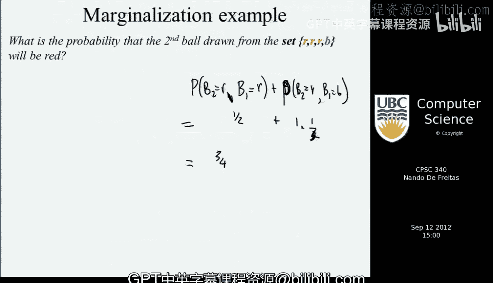
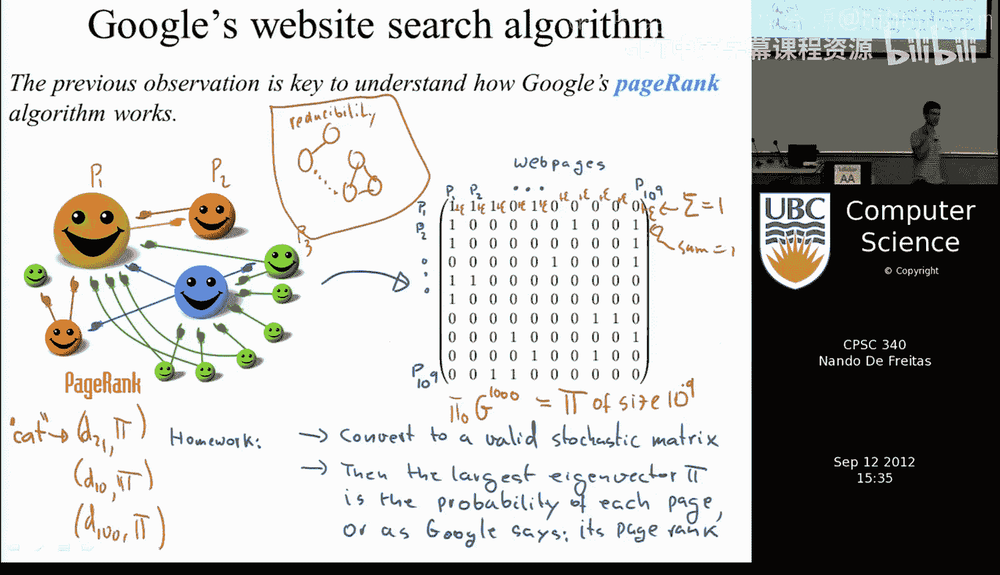
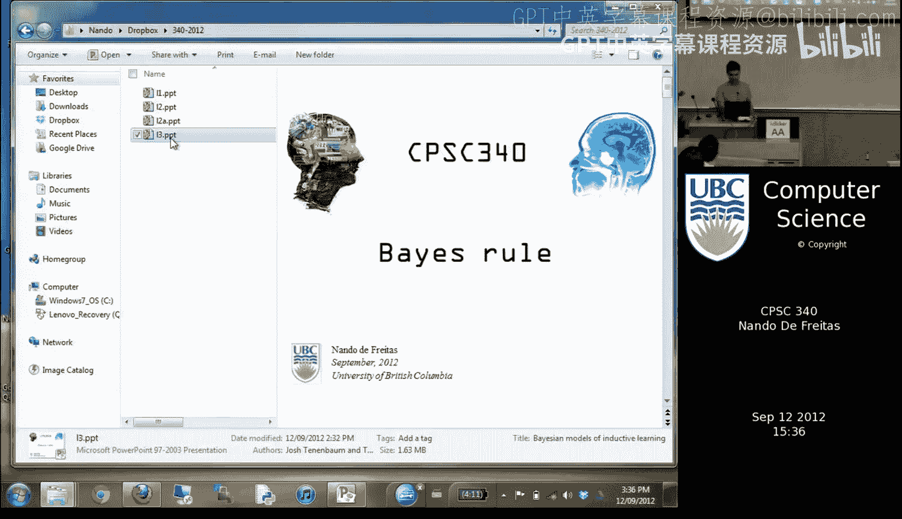
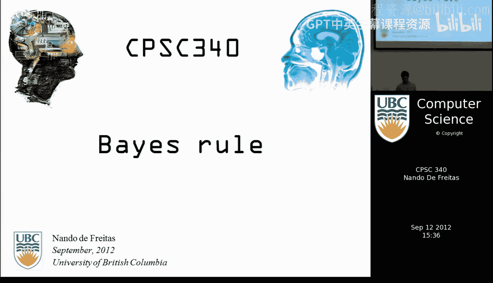
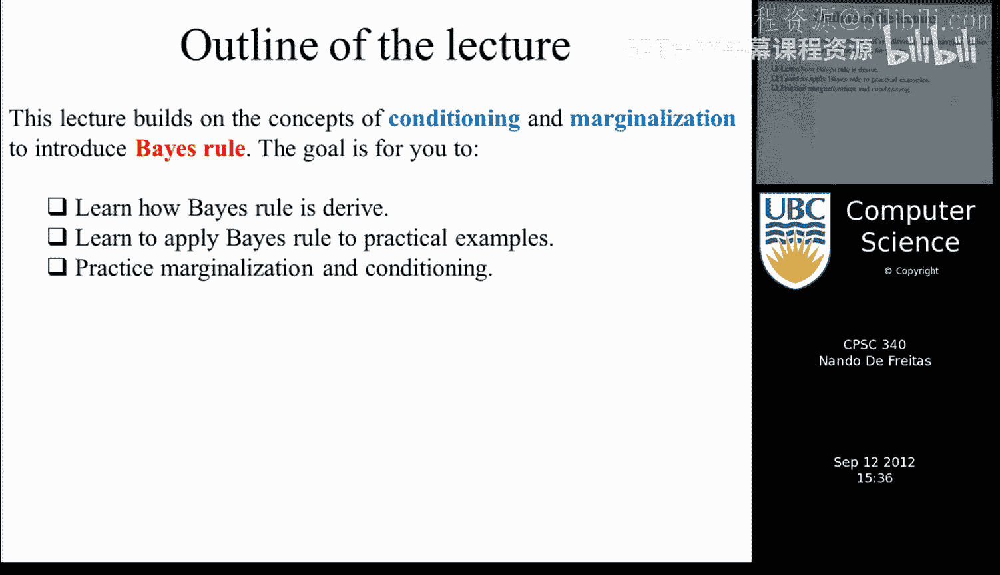
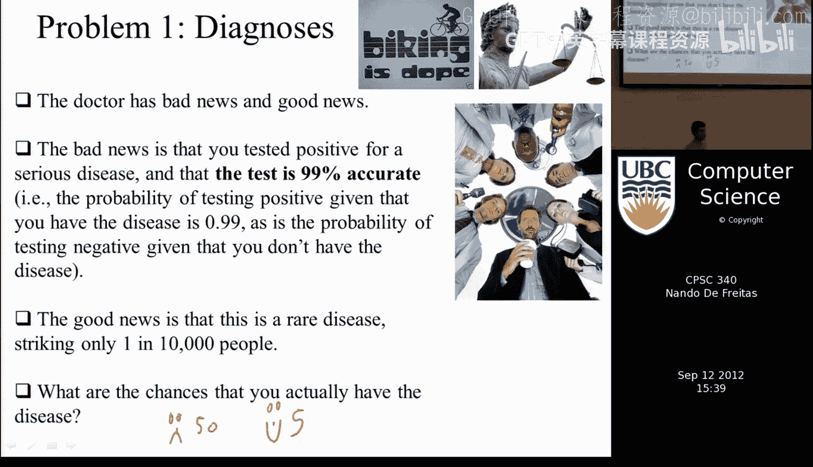
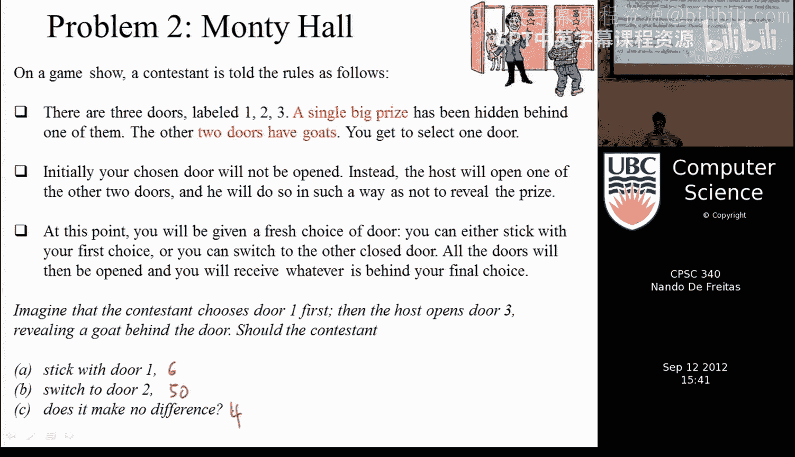
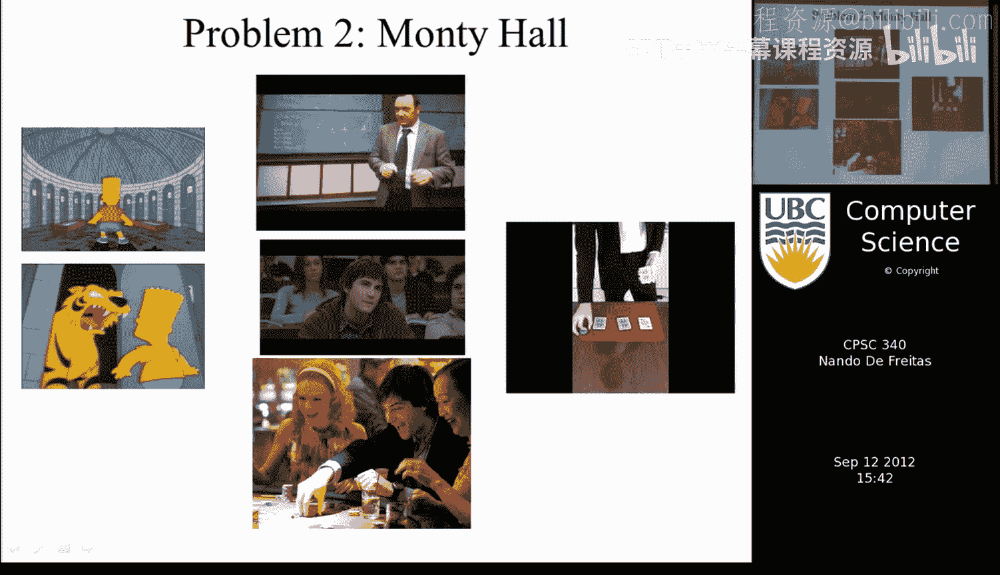
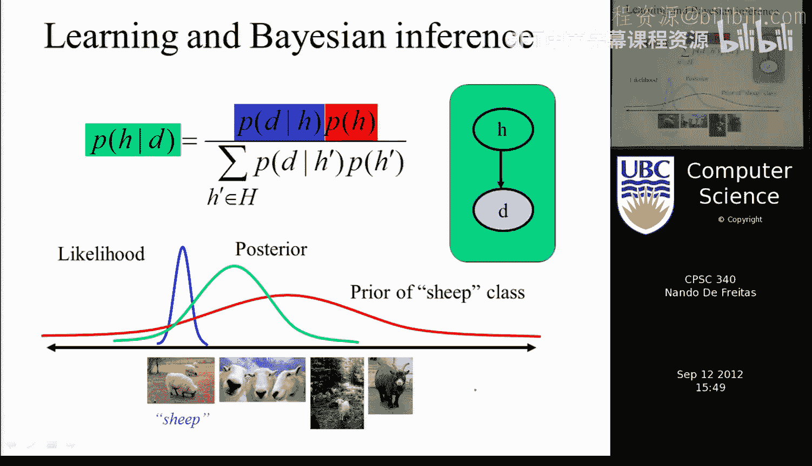
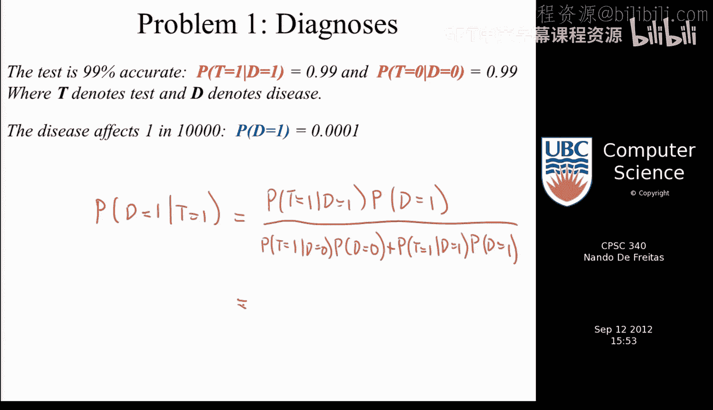

# 概率与线性代数入门：04：条件概率、边缘化与贝叶斯规则 🎲



在本节课中，我们将学习概率论的两个核心规则——条件概率和边缘化，并了解如何将它们应用于实际问题，例如理解谷歌的PageRank算法。我们还将学习贝叶斯规则，这是一个强大的工具，用于在获得新证据后更新我们的信念。

## 回顾：条件概率与边缘化

上一节我们介绍了概率的基本概念。本节中，我们来看看两个关键规则：条件概率和边缘化。

**条件概率** 允许我们从已知单个事件的概率，计算多个事件同时发生的概率。其公式为：
```
P(A and B) = P(B | A) * P(A)
```
例如，从装有3个红球和1个蓝球的袋子中，第一次抽到红球且第二次也抽到红球的概率，等于第二次抽到红球（在第一次是红球的条件下）的概率乘以第一次抽到红球的概率。

**边缘化** 则相反，它允许我们从联合概率（多个事件）中推导出单个事件的概率。其方法是求和：
```
P(B) = Σ P(A and B) 对所有可能的A求和
```
例如，想知道第二次抽到红球的概率，我们需要考虑第一次抽球的所有可能情况（红或蓝），并将每种情况下“第一次抽到某颜色且第二次抽到红球”的概率相加。

为了更高效地处理这类问题，我们引入了矩阵表示法。用变量 `x` 表示抽球结果（例如，0代表红球，1代表蓝球），初始概率可以表示为一个向量 `π1`，条件概率可以表示为一个矩阵 `G`。那么，第二次抽球的概率分布 `π2` 可以通过矩阵乘法得到：
```
π2 = π1 * G
```
这种表示法简洁有力，便于进行连续多次的概率计算。

## 从概率到谷歌PageRank算法 🕸️

理解了条件概率和矩阵表示后，我们来看看一个著名的应用：谷歌的网页排名（PageRank）算法。

PageRank的核心思想是：一个网页的重要性取决于链接到它的其他网页的数量和重要性。这很像我们之前讨论的概率传播过程。

以下是PageRank算法的简化步骤：

1.  **构建链接矩阵**：将整个互联网视为一个巨大的图，网页是节点，超链接是边。创建一个矩阵 `G`，其中元素 `G[i][j]` 表示从网页 `j` 跳转到网页 `i` 的概率（通常假设用户随机点击页面上的一个链接）。
2.  **处理特殊问题**：
    *   **可约简性**：确保网络是充分连接的，没有完全独立的子图。谷歌通过给矩阵所有元素加上一个极小的值 `ε` 来解决。
    *   **周期性**：避免陷入循环。添加 `ε` 也有助于打破严格的循环。
3.  **计算稳定状态**：从一个任意的初始概率分布向量 `π0`（例如，所有网页等概率）开始，反复乘以矩阵 `G`：
    ```
    π1 = π0 * G
    π2 = π1 * G
    ...
    πk = π(k-1) * G
    ```
    经过多次迭代后，向量 `π` 会收敛到一个稳定状态，即 `π * G = π`。这个稳定的 `π` 向量中的每个值就代表了对应网页的PageRank分数（重要性）。
4.  **排序与检索**：当用户搜索一个关键词（如“cat”）时，系统会找出所有包含该词的网页，然后按照这些网页的PageRank分数从高到低进行排序，返回结果。

本质上，PageRank算法就是计算一个巨大随机矩阵的主特征向量（对应特征值为1）。谷歌利用MapReduce等分布式计算框架来处理这个海量矩阵乘法。

## 贝叶斯规则：反转概率 🔄

现在，我们转向另一个核心概念——贝叶斯规则。它源于我们已学的条件概率规则。

我们知道：
```
P(A and B) = P(B | A) * P(A) = P(A | B) * P(B)
```
由等式第二部分可以推导出贝叶斯规则：
```
P(B | A) = [P(A | B) * P(B)] / P(A)
```
其中 `P(A)` 可以通过边缘化计算：`P(A) = Σ P(A | B_i) * P(B_i)`，对所有可能的 `B_i` 求和。



贝叶斯规则的意义在于“反转”条件概率。如果我们知道在某个假设 `B` 下观察到数据 `A` 的概率（似然度），以及假设 `B` 本身的先验概率，那么当观察到数据 `A` 后，我们就可以计算假设 `B` 成立的后验概率。







## 贝叶斯规则应用实例 🧩



以下是贝叶斯规则可以解决的几类经典问题：





*   **医学测试**：已知某种疾病的患病率（先验概率）和检测准确率（似然度）。当一个人检测结果为阳性时，他真正患病的概率（后验概率）是多少？结果往往出人意料。
*   **蒙提霍尔问题**：在三扇门后分别有两只山羊和一辆汽车。你选择一扇门后，知道答案的主持人打开另一扇有山羊的门。此时，更换选择是否会增加赢得汽车的概率？贝叶斯规则给出了明确答案。
*   **语音识别**：计算机可以轻松地将单词转换为声音（文本转语音）。但反过来，从声音推断出单词（语音识别）则困难得多。因为多个单词可能产生相似的声音，这正是一个典型的贝叶斯推理问题：在听到声音（数据）后，计算最可能是哪个单词（假设）产生了它。

以医学测试为例，假设疾病患病率 `P(D)=1/10000`，检测准确率 `P(T+|D+)=0.99`，`P(T-|D-)=0.99`。当一个人检测为阳性时，他真正患病的后验概率为：
```
P(D+ | T+) = P(T+ | D+) * P(D+) / [ P(T+ | D+) * P(D+) + P(T+ | D-) * P(D-) ]
```
代入计算后会发现，这个概率远低于直觉的99%。这凸显了结合先验知识（患病率）进行推理的重要性。

## 总结 📝

本节课中我们一起学习了：
1.  **概率论两大基石**：条件概率（`P(A and B) = P(B|A)P(A)`）和边缘化（`P(B) = Σ P(A and B)`）。
2.  **矩阵表示法**：用向量和矩阵表示概率分布与转移，使计算更高效，并自然引出了特征向量的概念。
3.  **谷歌PageRank算法**：一个将概率论和图论结合的实际应用，通过计算随机矩阵的主特征向量来评估网页重要性。
4.  **贝叶斯规则**：一个由条件概率推导出的强大公式（`P(B|A) = P(A|B)P(B)/P(A)`），用于在获得新证据后更新对假设的信念。我们看到了它在医学诊断、游戏策略和人工智能（如语音识别）中的关键作用。





掌握这些概念，你就拥有了理解许多现代机器学习与数据挖掘算法的基础工具。