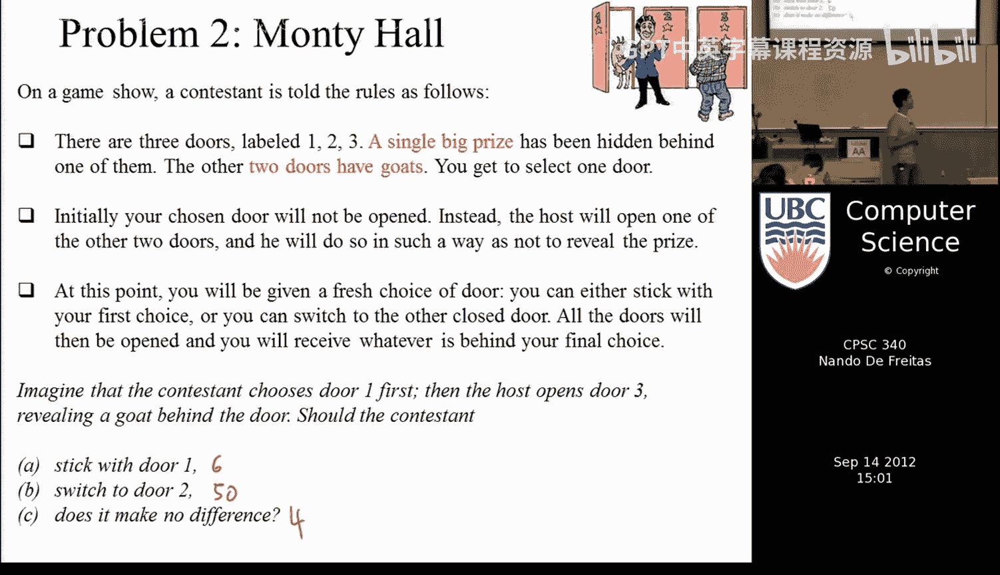
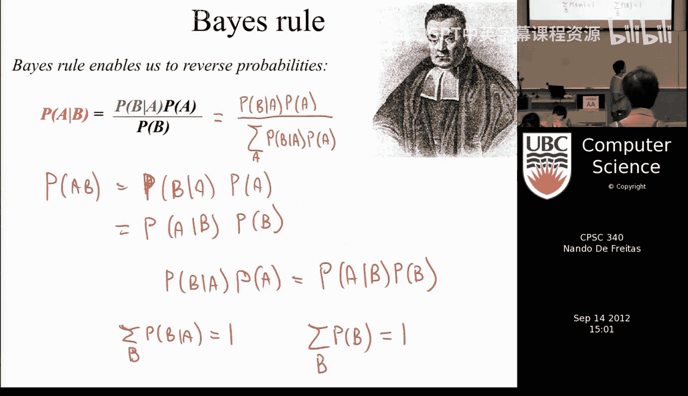
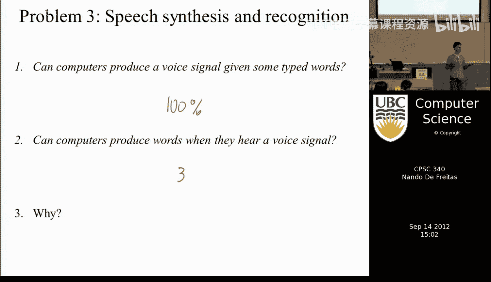
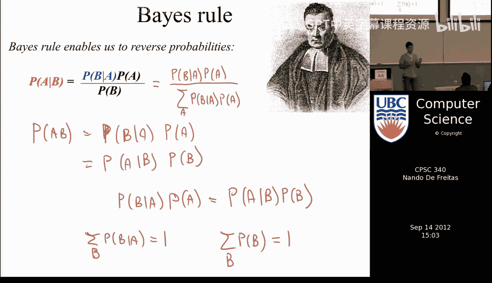
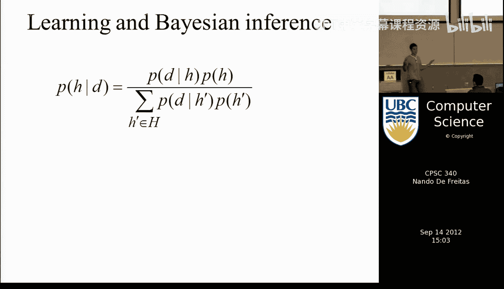
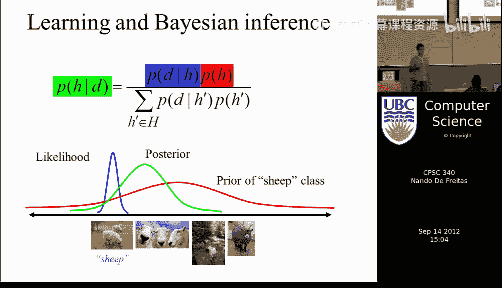
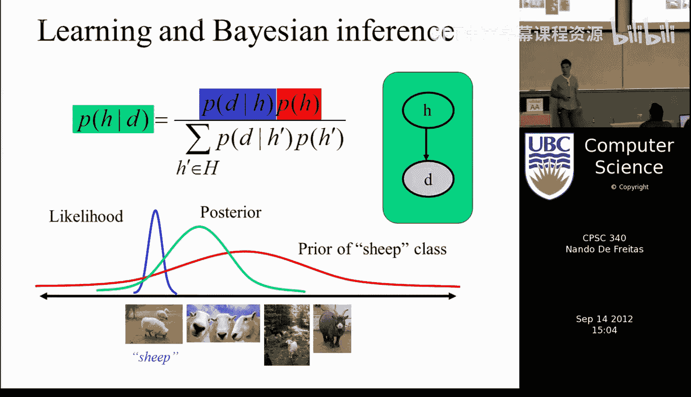
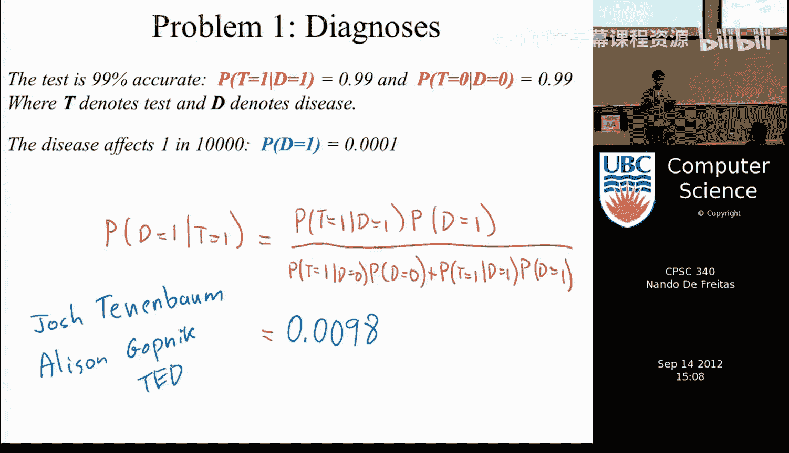
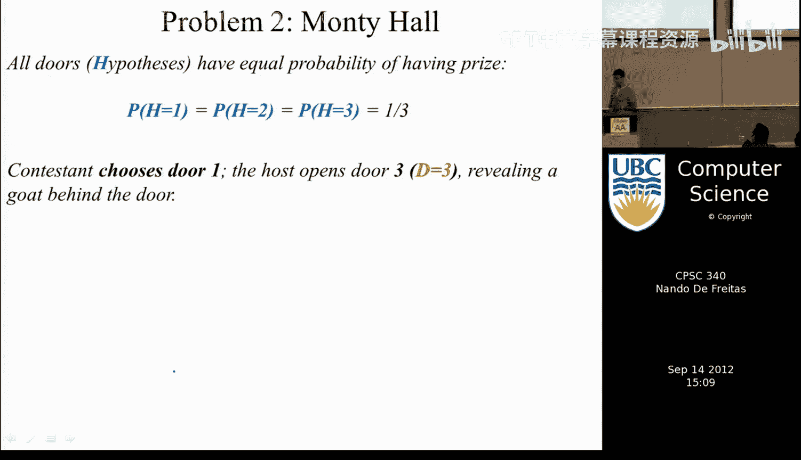

# UBC《机器学习和数据挖掘｜CPSC 340 Machine Learning and Data Mining 2012》中英字幕 p05 -05-undergraduate machine learning 5_ Introduction to Bayes.zh_en -BV1pJ2ABFEFg_p5-

We went through three problems， problem one was you were told that a test that is 99% accurate reveals that you have a disease。

 should you be worried？Even though the disease is very rare in the population and most of you were worried and today we will do a calculation or hopefully manufacture it as calculation at home。

Of this class， problem two was this sort of game setting where。There are three doors。

 two of the doors have goats behind it and one door has a big prize and you pick door one。

 the contestant opens door three， there's a goat and then the contestant asks you do you want to switch yes or not and most of you would switch as opposed to stick into your original choice today we will see how base rule predicts that that's the right thing to do？

In probabilityb。

And we saw some cute examples of it， and then the other thing that we looked at was this problem of speech recognition where even though it seems that it's easy to produce words。

Sorry to produce sounds， given a set of words。 It turns out to be very hard to do the opposite。

To go from。Sounds the words。Well likewise， computer graphics has advanced to the point that with several rules。

 people can render very nice textures and so on and if you go to the movies you'll see that animation has progressed enormously。

But the inverse process that is going from the image to knowing what the image is about turns out to be actually incredibly hard。

Right， so we introduce base rule and base rule whenever you deal with quantities。

 where there is uncertainty。Like。There's uncertainty mainly due to the fact that we don't see everything。

So you haven't seen tomorrow yet， so there will be uncertainty about what the weather is tomorrow。

You have no clue what's going on right now in Brisbane。

 so if I ask you what's the weather in Brisbane， there would be uncertainty as to whether in Brisbane is。

 you probably would think it's hot but。I've got no， it's winter done there。

And so to deal with this lockups ofservability that brings uncertainty to the world。

 we use probability and in particular， base rule， which is a direct consequence of the rule of conditioning。

 will allow us to go from the probability of B given A to the probability of A given B。

So we'll be able to go， if we know how to generate sounds given words。

 we'll be able to get words given sounds。

We also very quickly saw that base rule gives us a model for cognition， where in our heads。

 we'll have many hypothesisses。

We have hypothesis of say what an object might look like， like in this case， sheep， you get a label。

And then that label brings in information in the form of this distribution。

 which we call the likelihood。So the terminology is you have a prior of a hypothesis。

 the likelihood tells you what data goes with a hypothesis。So in this case。

 the data is the label sheet， that goes with。And then based on that。

 youre recomped by multiplying and normalizing。And the resulting distribution is called the posterior distribution。

And in the next class， we'll see that there it's possible to represent all this with graphs。

And in fact， we'll be able to do very large graphs with thousands of variables。

Not just two， but many variables。Okay， so that was last class。

 so today we will finish these exercises and we'll introduce the concept of utility and a maximum expected utility。

Now。Who did the homework？What's the answer？But么之。Less than 1% in particular。

The exact answer is  zero point。你的这个吗？0，0。9 edge。With that， I agree with my notes， yes。So。

I'll ask again， should you be worried？No。Unless you're like。Very。

 it's 1% probability still that you might have very severe disease。

 which for some of us that one in a country theres still。Bad odds。But nonetheless。

 it doesn't look as bad。Now。This might seem like a sort of。Not natural situation。

 it's not often that you're in a position where you're given a test and so on。

 but it turns out that in our daily living， we apply these rules all the time。So whether it's like。

系啦系系。One partner asking the other one， do I look fat and the other person saying no。

 then there is a certain probability of that person telling the truth， given that you're fat。

 but then you've got to look at the prior to be able to reach the right posterior。

 as still whether you believe you're really fat or not。And in fact。

 George Tenembaum and I'm going to write his name here because。He is definitely worse。Ggling。

So he's one of my colleagues who works at MIT and he does a lot of work in machine learning。

 but he's a psychologist too， and so he's very interested in。

Relating using Bayesian and probabilistic models to model cognition， and in fact。

 if you go to Google News anytime or whatever， and you Google Josh Tenembaum。

 you'll see that he's actually very hot in the news all the time。嗯。

Another good sort of popular person that's made it to popular science is Aliison Gpnk。

She has a very nice TEed talk。And so I also recommend here Ted talk for those of you interested in how babies rule relates to IH daily lives and in fact shows how babies in fact。

 are doing probabilistic reasoning。And in fact， things a bit more advanced than what。

Than just probabilistic reason， but also doing。Experimentation and causality assessments。So。

The situation is not artificial。Bsroom。So logic tense dictates。

 at least in the cognitive psychology perspective， the way we humans behave。

Or the way we perceive and so on。 So it's a very good model of cognition。

Okay， so let's go to problem number two， the Montyhal problem。And a Monhold problem。First of all。

 I have three doors。Okay， one has a price to half golds。Which door is the one that has the price？

At first， all doors are the same， so the probability that the price is behind any of the three doors is the same in particular1 third。

So think of H here as your hypothesis about the world， and the hypothesis is where the price is。

Either the price is behind door one， door two or door3， and they all have equal probability。However。

The contestant。That is， well us， we choose door one， and then the host opens door three。

 so we get an observation。We see the door three。that's our data。

And this is the first time data sort of entering this course。

And the datum that we get is that it's a goat behind Do  three。And so now the host asks。

 do you want to switch to door2？Sure。

Now。Let's think about it。