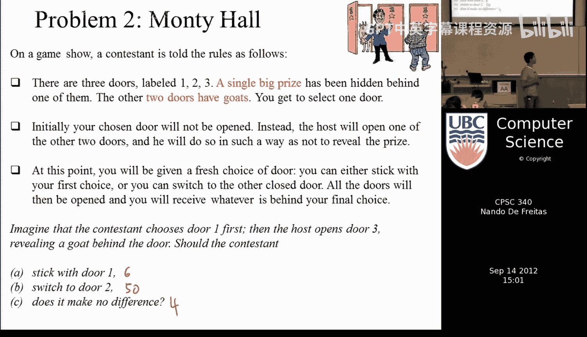
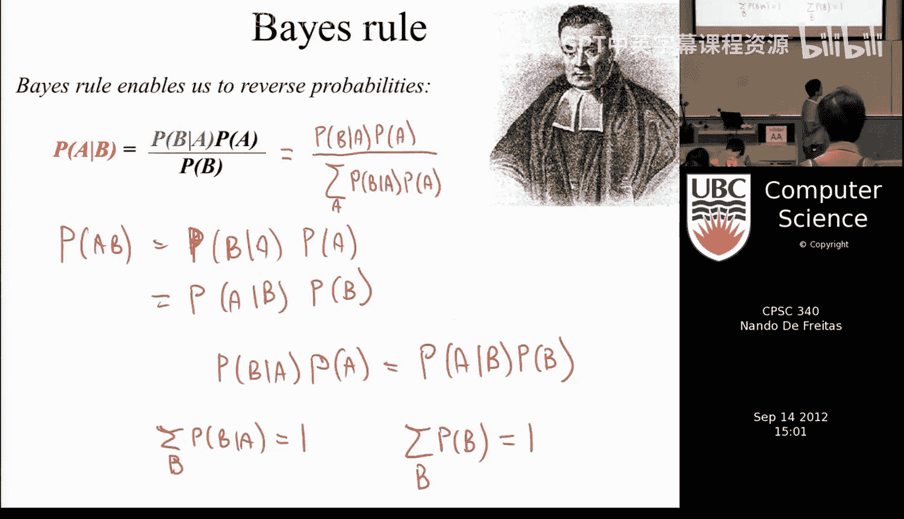
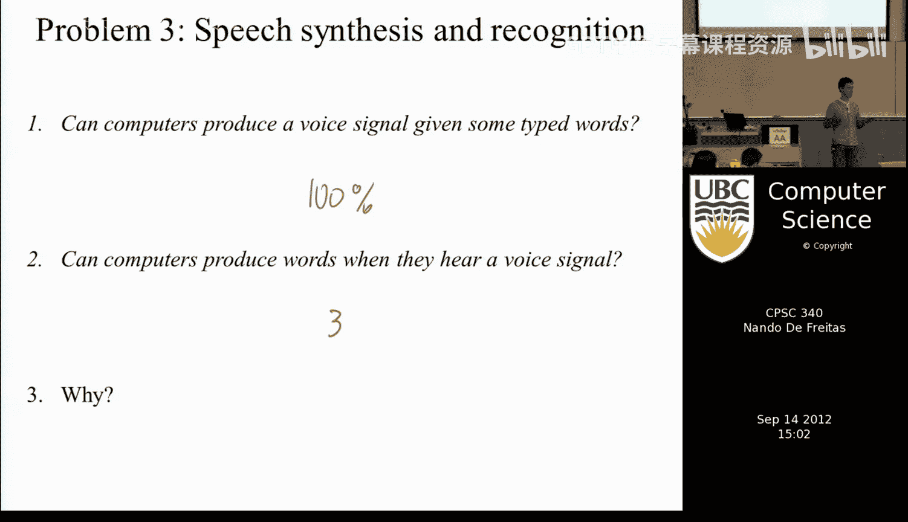
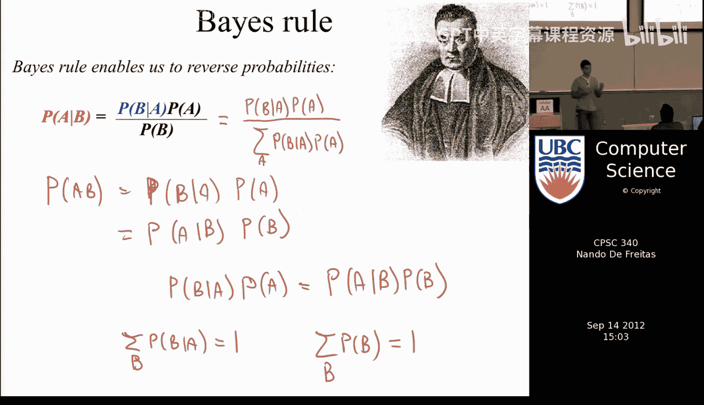
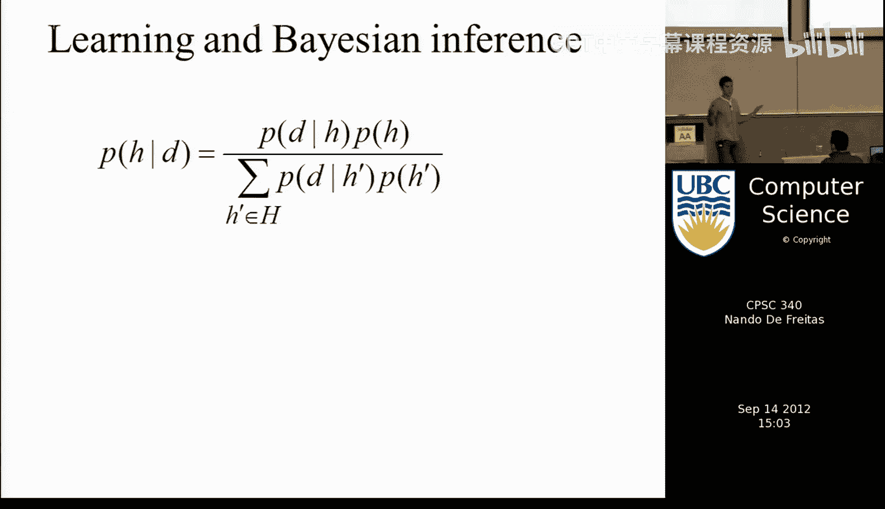
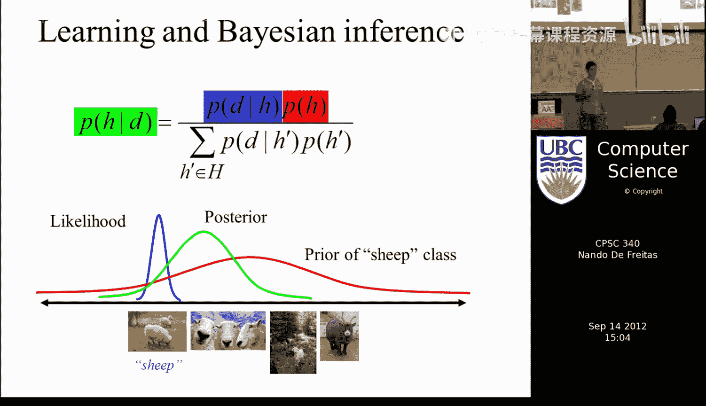
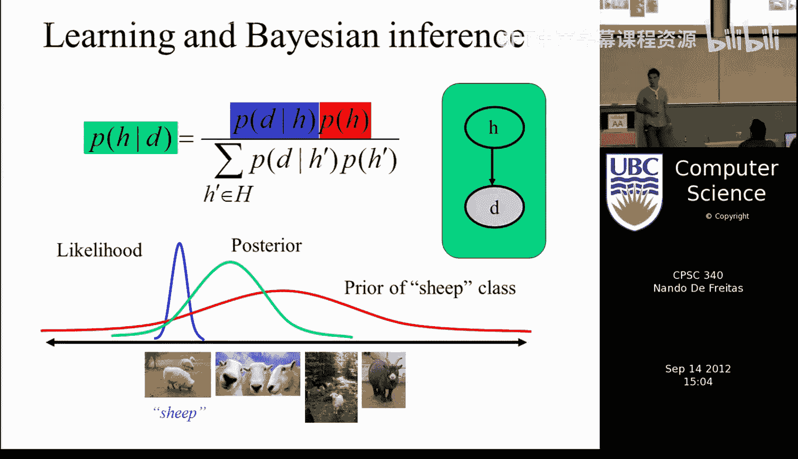
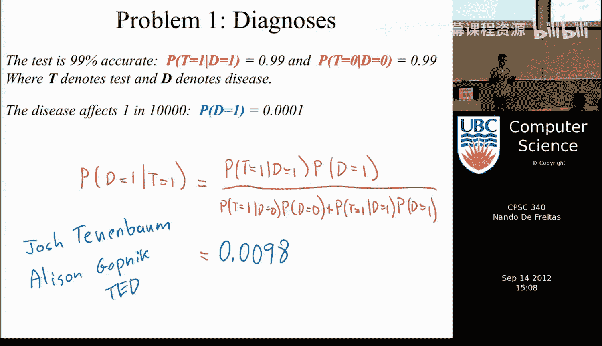
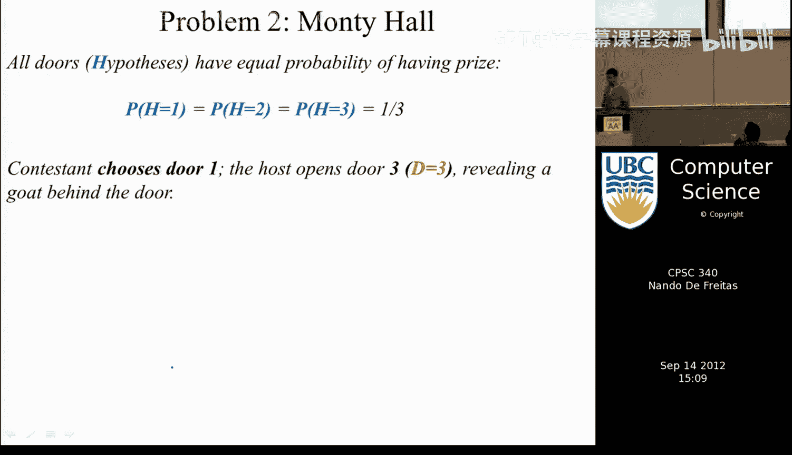

# 机器学习与数据挖掘：05：贝叶斯入门 🧠

在本节课中，我们将学习贝叶斯规则，并通过几个经典问题来理解其应用。我们将看到，即使面对看似违反直觉的情况，贝叶斯推理也能提供清晰的答案。

---





上一节我们介绍了贝叶斯规则的基本概念，本节中我们来看看如何用它解决实际问题。

## 问题一：疾病检测的担忧 😟



你被告知一项准确率为99%的检测显示你患有某种疾病。你应该担心吗？尽管这种疾病在人群中非常罕见，但大多数人最初都会感到担忧。今天我们将通过计算来解答这个问题。

以下是计算过程：
1.  **定义事件**：
    *   `D`：患有疾病。
    *   `T`：检测结果为阳性。
2.  **已知概率**：
    *   疾病在人群中的先验概率：`P(D) = 0.001`（即0.1%）。
    *   检测准确率：`P(T|D) = 0.99`（患病时检测为阳性的概率）。
    *   误报率：`P(T|¬D) = 0.01`（未患病时检测为阳性的概率）。
3.  **应用贝叶斯公式**：
    我们想知道检测为阳性后真正患病的概率，即 `P(D|T)`。
    根据贝叶斯公式：
    ```
    P(D|T) = [P(T|D) * P(D)] / P(T)
    ```
    其中，`P(T) = P(T|D)*P(D) + P(T|¬D)*P(¬D) = 0.99*0.001 + 0.01*0.999 ≈ 0.01098`
    因此：
    ```
    P(D|T) ≈ (0.99 * 0.001) / 0.01098 ≈ 0.0902
    ```
    计算结果显示，即使检测为阳性，你真正患病的概率也仅为**约9%**，远低于直觉判断。

**结论**：基于先验知识（疾病罕见），即使检测准确率高，阳性结果也不意味着大概率患病。因此，无需过度担忧。



---



解决了疾病检测问题后，我们来看一个更著名的概率谜题。

## 问题二：蒙提霍尔问题 🚪





在一个游戏场景中，有三扇门。两扇门后是山羊，一扇门后是大奖。你选择了1号门。随后，知道门后情况的主持人打开了3号门，后面是一只山羊。主持人问：你是否要换到2号门？

大多数人直觉上会选择换门。今天我们将看到贝叶斯规则如何预测这是正确的做法。

以下是推理过程：
1.  **定义假设与数据**：
    *   假设 `H`：大奖所在的门（`H1`, `H2`, `H3` 分别对应门1、2、3）。
    *   数据 `D`：主持人打开了3号门，且后面是山羊。
2.  **先验概率**：
    最初，大奖在任一扇门后的概率相等：
    ```
    P(H1) = P(H2) = P(H3) = 1/3
    ```
3.  **似然度**：
    在每种假设下，主持人打开3号门（且是山羊）的概率：
    *   如果大奖在1号门后（`H1`），主持人可以随机打开2号或3号门（都是山羊）。所以 `P(D|H1) = 1/2`。
    *   如果大奖在2号门后（`H2`），主持人**必须**打开3号门（因为不能打开有奖的2号门）。所以 `P(D|H2) = 1`。
    *   如果大奖在3号门后（`H3`），主持人**不能**打开3号门（因为后面是大奖）。所以 `P(D|H3) = 0`。
4.  **应用贝叶斯规则计算后验概率**：
    根据贝叶斯公式 `P(H|D) ∝ P(D|H) * P(H)`，并归一化：
    *   `P(H1|D) ∝ (1/2) * (1/3) = 1/6`
    *   `P(H2|D) ∝ 1 * (1/3) = 1/3`
    *   `P(H3|D) ∝ 0 * (1/3) = 0`
    归一化后（总和为1/2）：
    ```
    P(H1|D) = (1/6) / (1/2) = 1/3
    P(H2|D) = (1/3) / (1/2) = 2/3
    P(H3|D) = 0
    ```

**结论**：在主持人打开3号门显示山羊后，大奖在2号门后的概率是**2/3**，而在你最初选择的1号门后的概率仅为**1/3**。因此，**换门**能将获胜概率从1/3提高到2/3。

---

## 贝叶斯规则：从不确定性到推理 🔄

我们之前看到，贝叶斯规则为我们提供了一种认知模型。在我们的大脑中，存在许多关于世界的假设（例如，一个物体可能是什么）。当我们接收到数据（例如，一个标签或感官输入）时，我们会根据似然度来评估这些数据与每个假设的匹配程度。通过将先验概率与似然度相乘并归一化，我们得到后验概率分布，它代表了我们在新证据下更新后的信念。

在下一节课中，我们将看到如何用图模型来表示这些关系，并且能够处理包含成千上万个变量的大型网络，而不仅仅是两个变量。



---

## 总结 📝

本节课中我们一起学习了：
1.  **贝叶斯规则的应用**：通过疾病检测和蒙提霍尔问题，我们实践了如何利用先验信息和新的观测数据来更新对事件的概率判断。
2.  **核心概念**：我们明确了**先验概率**、**似然度**和**后验概率**在贝叶斯推理中的作用。
3.  **认知模型**：贝叶斯规则不仅是一个数学工具，也是理解人类如何进行不确定环境下推理的有效模型。
4.  **决策启示**：正确的决策不仅取决于测试或证据的“准确性”，还强烈依赖于事件的**基础发生率（先验概率）**。



贝叶斯思维鼓励我们持续整合新证据来修正原有的看法，这是一种强大的学习和决策框架。