# UBC《机器学习和数据挖掘｜CPSC 340 Machine Learning and Data Mining 2012》中英字幕 p06 -06-undergraduate machine learning 6_ Bayes rule and Bayesian networks.zh_en -BV1pJ2ABFEFg_p6-

So last week， Friday， we went over what's regarded as a simple example。

If we go with traditional ways this example already gets hired， you know。

 it was the example of there's a price or two gos， we have three doors。

 April I you don't know what the price is， so all doors have equal probability。You choose one door。

 doesn't matter what the number is， the numbers here are relevant， you choose door A。Or two or three。

 this example。The label was one。 You choose door one。And by view， I mean， the contestant。

 the contestant chooses door one， the host opens another door。Before the House opens another door。

 the contestant can already reason that。The后。We'll play averararal。If the price is behind door one。

 the host can either open doors two or three。If the price is behind door3。

 the host will open door two and if the prize is behind door two， the host will open door3。So。

 we can。You have to purpose model。Con of the prior。And the likelihood。

Then hang the post goes and opens the door。Do you believe the prize is behind door too？Fort door。哇。

And we answered those questions by doing base and inference。

And I did this on the board because my ten failed， and so I've included this on the slides and the slides are now aligned with this exact material。

 so if you didn't take notes。You have notes now。And so we basically compute now。

 what's the probability that the prize might be behind or want， even that you observed。

Someone opening door the host， opening door three。And we do that for the hypothesis。

 we believe that it might be behind North3。And we didt for the belief that it might be behind your。

As well， but obviously you already know that there was a God behind or three， there's no price there。

 but nonetheless I did the exercise that you would see you would get a zero。For me。Atuation。

And then we compute them all， and I mentioned in the last step。关。咗细号。

The P of the equal3 is whatever normalizes this is sum to one。It must be。そで。I。my饭。

I' added the slide where are you。Would I discuss？First all。

 I introduced a definition that of marginalization。There is some of this conditional distribution。

All possible values is to say you get one but the is of probability。前段是。an alternative way。

Which I didn't do， but you could do it。It's another way to think about， it's a bit board。

But if you're a bit shady， we're still learning the concept。It's probably best to play it safe。

And as you just write an expression from P of P for three。So P of equal3。

 it's the marginal of P of H and v equal3。Because we don't know what H is。

 so we need to sum over all the possible values on HPT。That's marginalization。

 we thent do conditioning， we write it in this form as P of equal 3 given H times P of H divide。

Now we have P of H equal I and we have P of P3 given H from the definition of the problem。

 so this is P of H equal1， 2 and3， and we have the probabilities of P of D equal 3 given H1 h givenH。

So we have俾 good定。Just plug in numbers。And here I've expanded this to just make it very clear。

 your plug numbers in once you get is exactly what we had in the previous way of working。1，6 plus1。

3 plus0。Which is what they got。Thanks for that up。Okay， so there's two ways to do this。

I suggest you go to the slides。

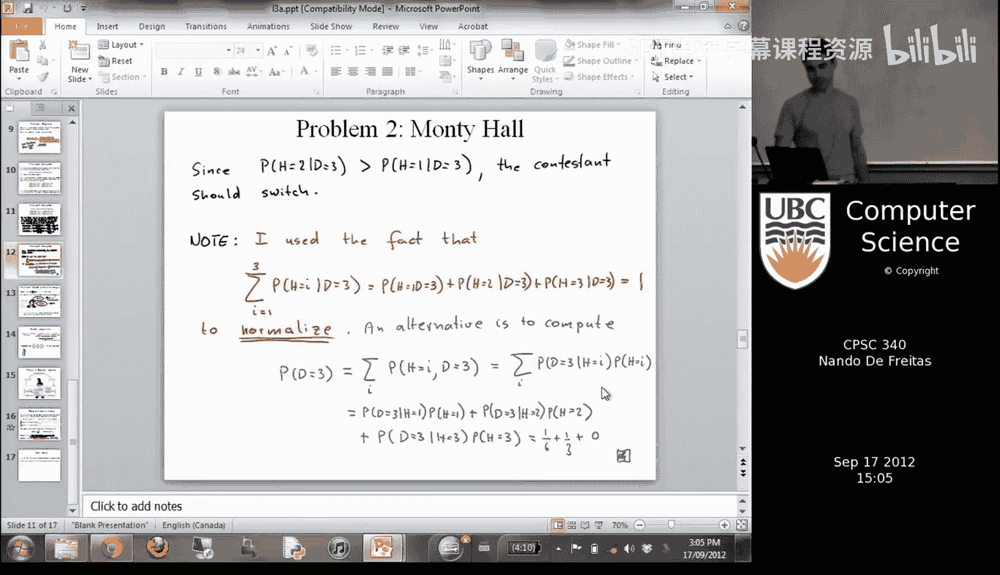

Carefully go over them。

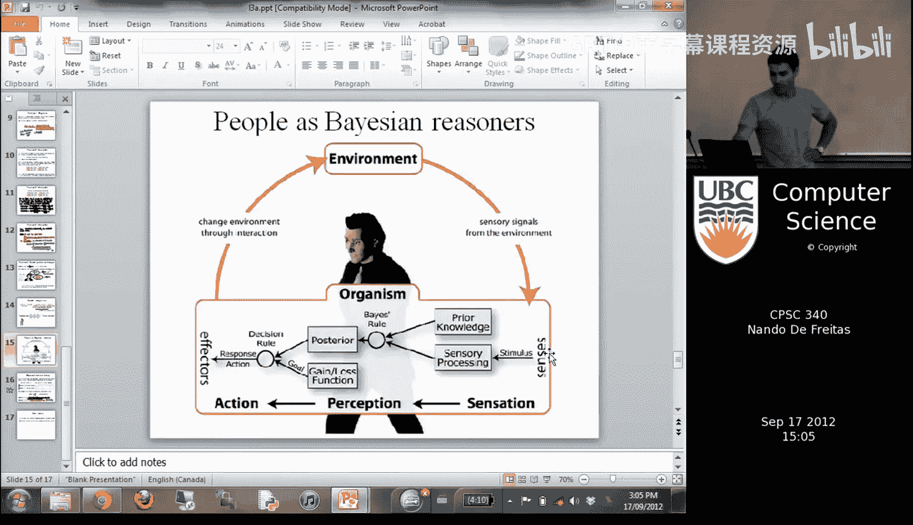

Finally， I left you with an exercise。And the exercise was to compute the expected utility。

I have not defined what expectation is， I assume if you have the prerequisites for the course you know what an expectation is。

 I will describe what expectation is next week。In more details， I will define it。

 but it's essentially sort of a weighted average。You sum the utilities or the rewards for something weighted by their probaities。

Are you some of the losses weighted the fight approval？So。Asking someone。I don't know。

Guys in the audience， going and asking Uma Thurman。

 sending an email to Uma Turman today or the Facebook or whichever way you want to pre on Uma Thurman for a date。

Its something that has very high utility， maybe for a lot of us， but not my wife's not watching this。

It has high utility。You know， the probability is very unlikely。Okay。

 so if you await the utility by the probabilities， you probably would not bother to ask whommate term for a date。

Allright， so。That's essentially the principle。 And we looked at that example。

 and I asked you to plug in some numbers and do the computation。 Now， someone said， oh， but。

This is not how we make decisions。啊。It turns out that this explains a lot of the decisions we make。

And people， one of the things that was mentioned at the endF class class is like it's not all about the money。

 there's lives involved， and so on。And no， everything has been factored into that。Revo承包。

The fact that it's about lives and so on。It's captured by those numbers。

You might not agree with those numbers， but if a hospital has to make decisions。

It's pray where you will have to come up with。And that's our decision。啊。

M expected utility is also known as best response and game theory。

How many of you have seen game theory before？So。For those of you。

What each agent must do in order to maximize their own。

utility is to do maximum expected of do best in cost。気十 that。IfEach agent does that。

 you reach an equilibrium。And that's called the Nash public。If we're all according this。

The criticisms are things that we can grtle with。The problems we're going to produce so far， but。

To sort of give you a taste of it。There is a sum involved here。

 you need to sum over all the possible things that really happens。As we will see。

 that becomes quickly intractable， it becomes exponential。Something that's called a curseci。

And that's going to be the topic of today's class， how things get badly。

Really badly and how we try to get around the sort of explanation。嗯。Any questions about last class？

Before we start with。So the last few classes last week。

 they were all about giving you the background， how to do conditioning， how to do marginalization。

 what you need in order to be able to manipulate。Once you have facial rule conditioning marginalization。

 the rest。Really easy and it's fun and it's basically applications of this。

And that's what this week is going to be about， I'm going to define something very hopeful based the networks。

Also known as probabilistic graphical models。And。We'll see how to use them for inference on Wednesday and finally on Friday we'll look at。

We'll start， I mean， over the next few lectures next week， Friday。

 we'll start looking at the problem of learning these automatically。As before。开始。

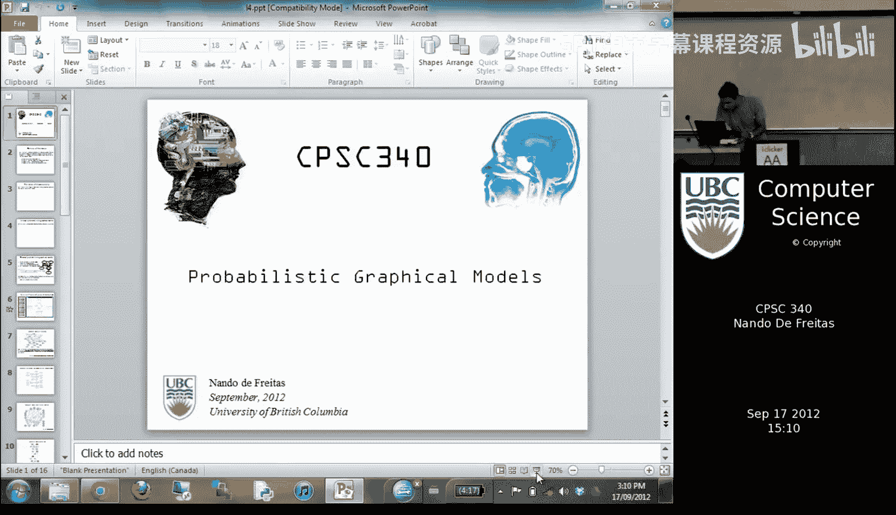

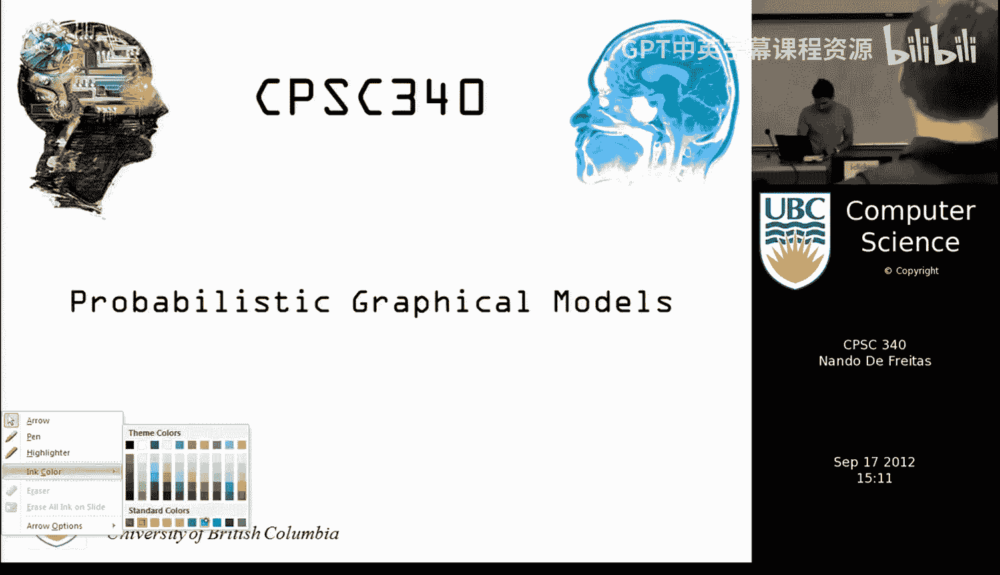

So in this lecture。I hope that to illustrate the concept of the curse of dimensionality and probilistic inference。

It's going to taste for how hard things get quickly and a bit science。

We'll define what a probabilistic graphic model is。

Also known as a basin network and known as a basin network。

 mainly because you often use baseRo to do the manipulations。不ら你。他。

We're going to talk about a new concept， conditional independence so far we've talked about independence。

It turns out that independence is actually it's okay， that coin flips are independent and so on。

 but if you want to talk about very interesting variables in the world。

 conditional independence turns out。How much。我怕儿童。And finally。

 we're going to cover a bunch of publications from。Environmental statistics to fashion。

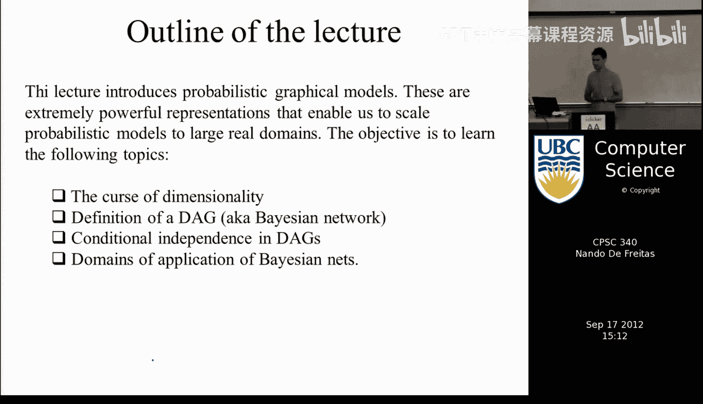

收。What's this curse of dimension nationalality？And I know what for some reason。It's on the time。

I try this stretch， I'm going to switch it off at the beginning of the class and switch it on。

It's没 that。合てやぱ。But anyway。So let's assume that we have the binary pair。And for now。

 I will use binary variables。It's not a restrictive assumption。

 I'm only using binary because it makes it clear to explain。

 but everything actually applies to variables that contain take more than two values。

If we have variables， let's assume that we want to。And let's start with an example。Let's take the。

then our three variables are the ABCA。So you have three variables， A B and C。

 each of these variables can take advantage zero。If that's the case。

 in order to represent the probability of a being equal to zero。对。And c equals0。喺呢个南。

ItJust essentially a probability of that event happened。But I will also have the band 001。And 01，0。

 and 011。And1，0， zero， and so on。And that will allow me to represent all the other pro， at least。

 for example， P of pay equal zero。おゼ。c别播放。In this case， how many rows do I need。

 how many numbers do I need to fully characterize the provoive？系。Actually， can I optimize that。

 do I need it？对。Right， because。Make a minor refinement here。And。呃。快单等。And the minor refinement。翻啊。在。

Proability sums to one。 So you always know what the last value is。

 The last value has to be whatever it is that when added to the previous seven values will。冇话。

Let's go back to our f example with the three balls。

And I'm going to use that example to introduce notation。So typically。

I'm going to use- I'm going to talk about the probabilitybibil of the first ball。

What is is something called a probability tape？In that probability table。

 I will indicate what the random variable is。Which values it can take？

And the values that it can take。 So in this case， there are three red balls。

If there are three red ball， the probability of getting a red is three quarters。

Any problem we is a quarter as we've seen already before。

We can also talk about the probability of the second ball， given the first ball。播。

But now we're just doing it。The presentation。So the first ball can be red or blue。

And the second ball can be red or blue。If the first bowl was red。

What's the probability of the second ball being read？あたですけど。If the first poll was blue。

 the promoive it being read is one。If there was blow。

 it cannot be blow again because there's only one blue flow。Okay。

 so that gives you the conditional probability and we also。Already did。So joint。Which， by the way。

I haven't said this， but I think you probably have。对。The the order doesn't matter。

P of A and B is the same as P of P and。We again are going to have for the joint B1 and T2。

Things can be red or blue。Now， what's the probability of the first two balls being read for the first two balls being read？

It must be that the first one was read。And the second one was then red。

So we have three quarters times two third， which gives us a half。Now， if the first ball was glue。

The probability that the second bulb will be blue。ゼ？So blue to blue is zero。

And if the first ball is red and the next one is blue。So we have this case red。Hello。

We going to blue， so we'll have three quarters times one third， which is。One quarter。

 And then you can check that the nice one is also one。Now， what's interesting about these tables。

 when you add a table， just by looking at it， you should know whether it's a joint probe quality or a conditional probe。

The conditional probability。Note that rose some to one。For the joint probabilities。

 all the numbers sum to one。Qu plus a quarter plus half5 year one。Allright so these are basically。

All the distributions that we need to talk about。There's the marginal system。The joints。

And it's useful to talk about them in terms of tables as opposed to individual values。

 and that's because if we have tables， we can code them as matrices and we can do all sorts of fast manipulation in the computer。

We will not introduce a graphic notation。Ptation。The two variables will be nodes。

And there's going to be an age indicating the influence of one variable point。

If your first bowl is blue， it affects what the next bowl will be， right。

 because it can no longer be。ちょっとこ。So the value of the ball blew up influences the value of the ball blue too。

And we describe this with the graph。The nice thing about describing with the graph is that there are very nice tools out there that allow you to actually draw graphical models。

 you just draw the graph， and then you say what each variable is。

 like what's the probabilityative each variable in a nice query。

And then these packages do all the computations for you。

 basically what you're going to learn to do in this course。

 you will be able to do with some very nice software。

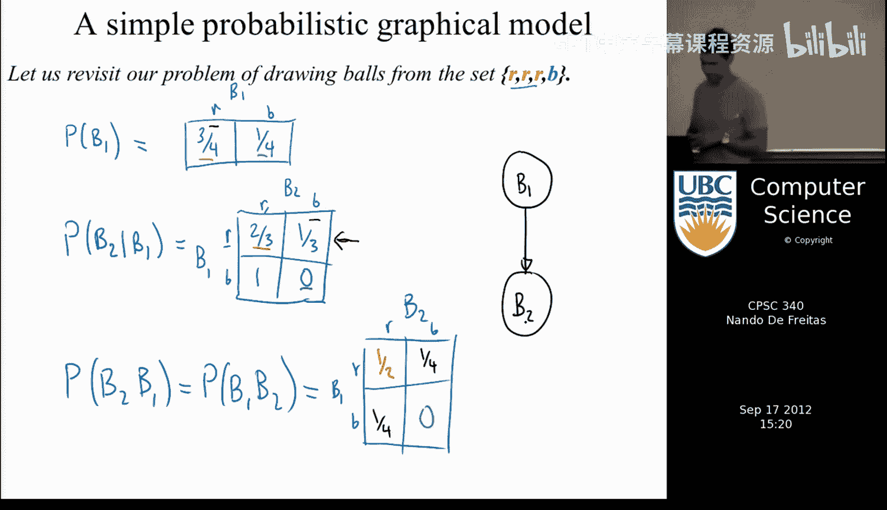

Let's be a bit。The concept of a basin effort for a director。然后。

And now we're getting it to bigger models， in particular this model that I'm introducing here has five there。

I will first define what it is。And then I will argue why this is very busy。Okay。

 so all the variables， which are things。In the world。

 like earthquakes and burglaries and radios and alarms and poles。

These are all assumed to be binary fair。So， theering is。

If youre going to think of this in terms of influence， you can think of， and this was， by the way。

 Julia Pearl。嗯。Exception individuals who got the tuuring award this year lives in LA。

 he teaches of the University of California in LA。And he came up with this example。

 these are sort of the variables that matter if you live in LA。

There are earthquake quas and there vertical。If you get an alarm being one， you need to know。

 was that an earthquake or park？And that depends on whether the radio is saying。

 whether there was an earthquake or not。Okay， so we'll get into this example and we'll see how。

AndDo there use。什么。Juah Perl， by the way， will be here in。

Thinking a month or giving a talk and this very actually not in this room。

But he's part of the UPC Distinguished lecturecture series。Just turn。Okay， so。

In directed a graphical model for a base is a directed cyclic graph。

By acyclic means that there's no side because you don't get say variable one pointing to two。

 two to three， and then three back to two。And it's directed because it's going to be agentss with powers that indicate what influences life。

DH is the node influence， DH is， basically the node depends。They don't。

This is statistical dependence， this does not mean causation。There's an important difference here。

If you observe that。Two things always occur。That doesn't necessarily mean that one causes the other。

this common mistake， especially when you read news articles that you know this is a really bad neighborhood。

 there is a lot of， I don't know， Portuguese people in this neighborhood。

 therefore it must be that Portuguese people are gang。Yeah。

 so and this is actually quite common in this type of image。😊。

And a lot of racism and so on actually stems from this in Vancouver I hear this all the time engines are terrible drivers because every time there's an accident。

 there's an Asian person there。I've contested this on parties and that wouldn be。

Particular power us because of this。We've got to be very careful with not compounding correlation with process。

七番八十分。Opo。先取一は。为什么？I'm going to give you an example which hopefully will allow you to always remember this。

嗯。P served this many times。嗯。Imagine that the human race vanished。For whatever reason。

What that of progress。不带款。And in 200 years or so， an alien species comes to Earth。

And they encounter this device。And with the arm。And they organize an expedition in descend send a bunch of aliens to follow this arrow and come back and tell them what they find when they follow this arrow。

 so this group of aliens go a few months later they're back with Apollo bear。而但。

Because these are smart aliens。So， theyd go like。Let's send another team， don't trust this team。

There sent another team。Weks go by， discuss no know how to navigate a bit better。

 they come back with a polar bear。And you know， very tough alien boss says。

 I don't believe this until you do it 10 times， so they do this 10 times and every time they come there's a polar bear。

嗯。One scientist propose this device here points to polar bears。

 is a polar bear pointer that statistical possession。 Okay。

 every time you observe the out of this wave， you followed it and there is a bear。

 So what happens to。How can we refute this theory， as smart alien saysWs。

How about you put a polarlo bear in front of you and one behind you？😔。

That this is called an intervention or an experiment。Oh， it points to that bear。

 but not to that bear。And then the other I they'll go and say， oh you silly scientist， of course。

 that one's got a small pole。哎哎。Okay。You do another experiment， you swap the bears。

 and it's so pointing to that。So then they conclude it's not a polar bear point。

the moral of the story is， if you want to get causation， you need to do more work。

We're not going to address that in this course， that in itself is a very interesting topic。

 and I think Judy probably be talking about。Does it matter in real life， yes。

 a lot in the consumer world that we live in， one of the biggest applications of computer science is checking whether someone's going to consume your ad or not。

 and you always ask this question。What if we had shown this other app， would they have to place？

They can do experiments with people to see what they are likely to buy。All right， so with that。

 let's get back to the syntactics of these graph。So we have node of variables。

 edges indicate influence， you can sort of think of them as soft possession。

 but of course do not think of them as true possession。呃。嗯。The rule here is available。

 is independent of all its successcestors， given the parents。Even my parents。

 I no longer dependent on my grandparents。Given the genetic material of my mom and my dad。

I don't need to know about the genetic material of my grandparents to know my genetic material。

Everything went through my dad and my mom。It were measured because' not propagated in the air by genes。

So。What we do is essentially what's in this picture。If we have a joint distribution。U five variables。

And what I'm doing here， I'm using a B to indicate burglary， E is for earthquake， A is for alarm。

Our is for radio and see us for call。So if you use the rules of probability， the chain rule。

 because just write the full chain rule and that's basically what you would have in the second line。

 you would have probability of B， E given B， and so on。

 and of course as you know there's more than one way to write the chain rule， the order is arbitrary。

What is， however， clear is that。一。Using our definition， it has no parents。So you have to draw。可以。

R only has one parent， which is E。So you have to draw。These guys。And likewise， C only has one parent。

 which is a， so you drop the other parent。So then the model simplifies to something that's much small。

That is essentially what we use these sub。We get smaller ones。In the rest of the class。

 I will give you other intuitions as to why we care about this。So。

And let's sort of go a bit more abstract now， let's assume that we have n variables。

Would end could be a very large town。The joint distribution of first and variables。And。

I will use the notation X one to end to indicate。Allold the variables。It's just a product。

From one to 10。Of the probability of each variable。F minutes parents。

That is the factorization we use。A full probability is described in terms of。The product。

 the variables given to parents， that's the definition。Mine， could you also support this。

You could just。对对对。And that's correct。When I condition an evidence， it doesn't mark about the order。

These aret good questions。I'm being loose with my manipulation of probability if all these statements would require me to be very rigorous。

And in fact， it could be so rigorous that I could teach a whole course to on left。

But we're not going to go into that detail。Order doesnt matter。这单是。Very， very important。

 so this one I'm for a start here。Barren would his parents。Now， is it a good model。

 is it good to assume to drop all these edges？That will depend on how well that model predicts real life if this always tells Julia pearl that there is a burglary and every time he goes home。

 everything is fine and there was only a minor earthquake。Then eventually Ju starts thinking。

 you know what， this model is lost， I'm going to replace it by another model。

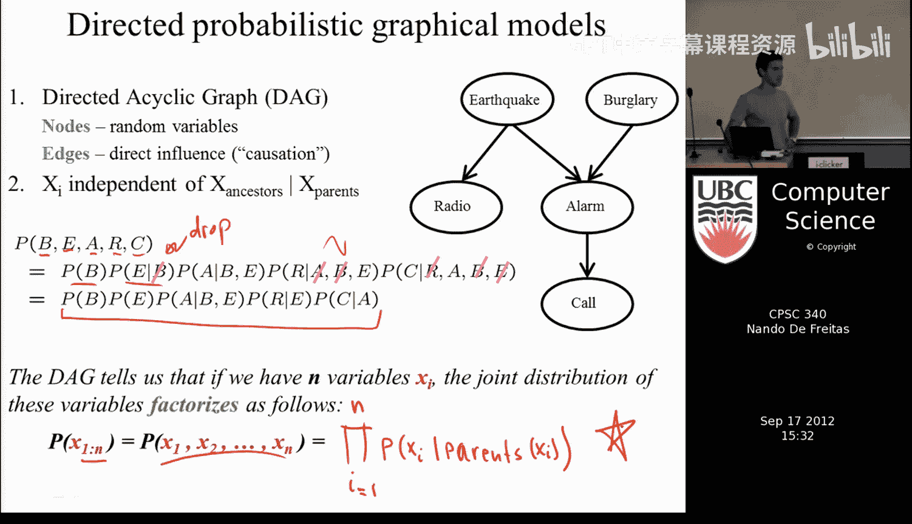

Now here is the advantage of this， the joint distribution。If we have say four variables。

 as we've seen before， requires 15 numbers to represent。However。

 if you have some information about the problem。In particular。

 let's assume that my prayer was now the some sort of event in the world， whether things are cloudy。

 whether it drains， cloudy also often gets just sprinklely annoying。我就。

And the grass gets wet when this ice spring goes on or when's straight。Now。

 in order to discuss to the probability of cloudy， and again。

 I emphasize that I'm monitoring binary variables for that of simplicity。Now the probability of ping。

 I don't know， you just come up with two numbers。That is's private。

For now I'm just coming up with these numbers soon the topic of one lecture will be where do these numbers come from。

 but for now let's assume someone's given us these numbers。And we talk about what's the probability？

Of the sprinkle of being being off or on， depending on whether it's cloudy or not。

 so that's a conditional probability。呃差步。Just like World two didn one。Now。

 how many parameters do I need in total to describe that model？5。5So here it's clear that I need 15。

ステマの。And over here。To represent this model， I need a table which is P of C。I need a table。

 which is P of W given R。And yes， I need a tableple， which is P of R。And I need a table。

 which is P of has even C。再啲啲。Porake is to describe the problem because the joint factorizes precisely。

In those four tape。So if the probability variable given its parents， we have see C has no parents。

Sprinkr has one parent， so we have sprinklelet they can see。Wite brass has two parents。

 so certainly we observe。FFW， given us anar。我先搞。Why isn't it probably？

Is it only the direct parents or？Are you asking where I'm not find the best。In the last slide。

Last term。I think it didn't have just the direct parents it had。All the other barrels upstream。

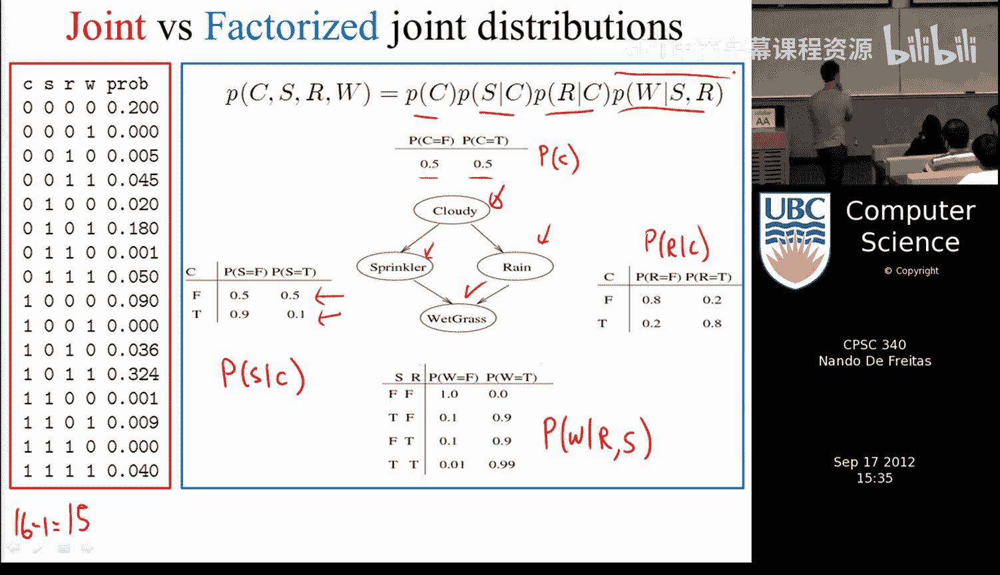

condition。Here。Probably thank you。Not quite to a available or even its parents。

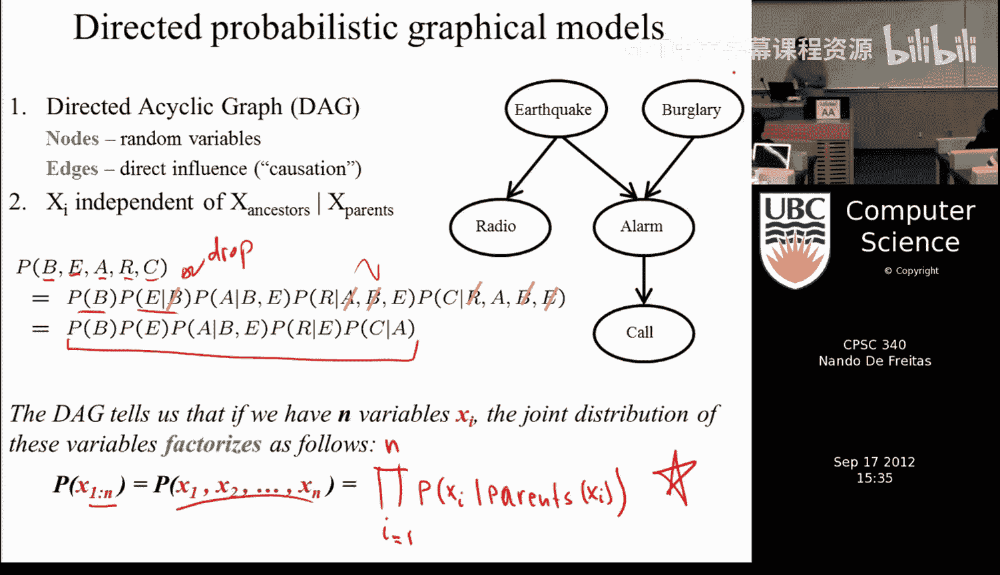

A human parents， that's the definition。Whether that's a good model or not。

 that's something we will answer later， but for now， let's just learn the syn。

 So let's assume we're just happy with this。It's a product。Fairably given them parents。

And let's assume that this drawing is something that you come up with， so you want to say，hu。

 what do you place is my mark is my girlfriend here。My mom actually studied。快啲。

They're studying and there is all these binary variables and then this is my mark and they'll point to it and then you're trying。

 let's assume that someone an expert drew this graph。

Later we will learn how to automatically infer such graphs from data。But for now。

 let's assume an expert Thanksgiving given。So then the question is how many parameters do I need on the right hand side？

To fully describe that more。对。Because I basically need the following parameters。反正。

I don't need the other number， because。I know that this must sum to one。

If this distribution sums to1， it must be that the other one is 0。5。I need these two numbers。

 I not need the other two because the other two just ensure that the conditional probability is sum to one。

I need these two numbers and I need these four。SoWe have four plus two。Last time。辣湾。9不。送。

The big whole message is that it's a most succinct presentation， it requires less numbers。Now。

 if you have 100 variables， we said it's due to the D minus1， it's due to the power of 100。Okay。

Who's got a calculator。Computer， just try two to the 100。

Problems with thousand variables are not outside our reach。

 you would think if we can't do 1 thousand variables， then there's all theory point。

But due do the thoughts of world kills？Does anyone want to compete to2000 in your machines？

100 is about10 300。Yeah。So that's a lot of flops。It's many times a lot of stories。You know。

 I'm going to solve this problem by buying better computer so buy。

Using all the cloud storage in this cloud。You're not going to solve it by coming up with good models。

And by beginning， we to come up with ways of learning these models from there。

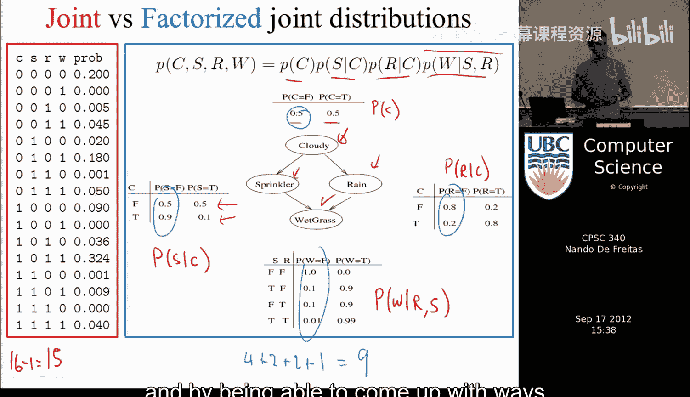

Now here so are both of these models。One example is this vehicle insurance where some expert drew this graph and they put in probabilities and then when you have an accident happens。

You know， you might want to try to confirm how good is the drive or if you're an insurance company。

 you might want to protect。You know， how safe。I is your investment on this new drive？

What should be the premium for this drive the？Another example。

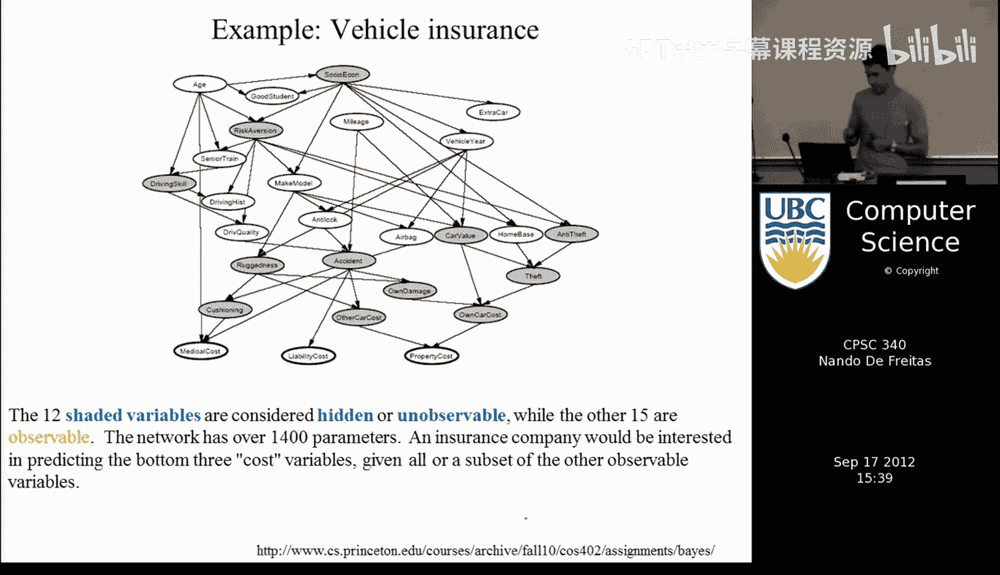

いです。Diagnosis and printers。In this case， Microsoft Pri。Serx does there two in the procooff machines。

 often something goes wrong with the printer and the printer tells you what to do to fix。

We all hate that experience。

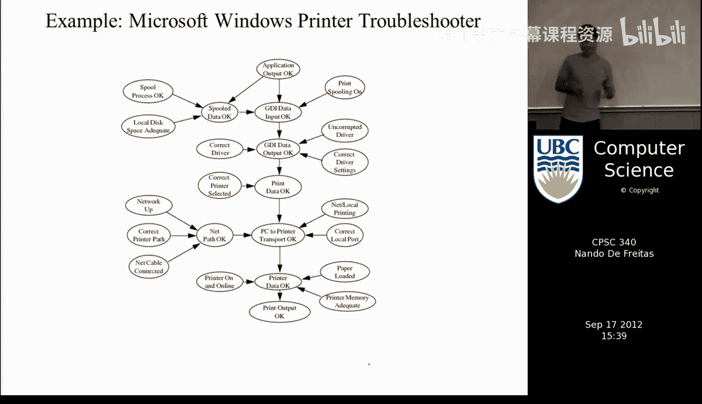

I'mB this basin network what't go out to。Heres another sort of problem that shows how you could have many aircraft flying and theres different radar events and you're trying to defer something about the plane traffic。

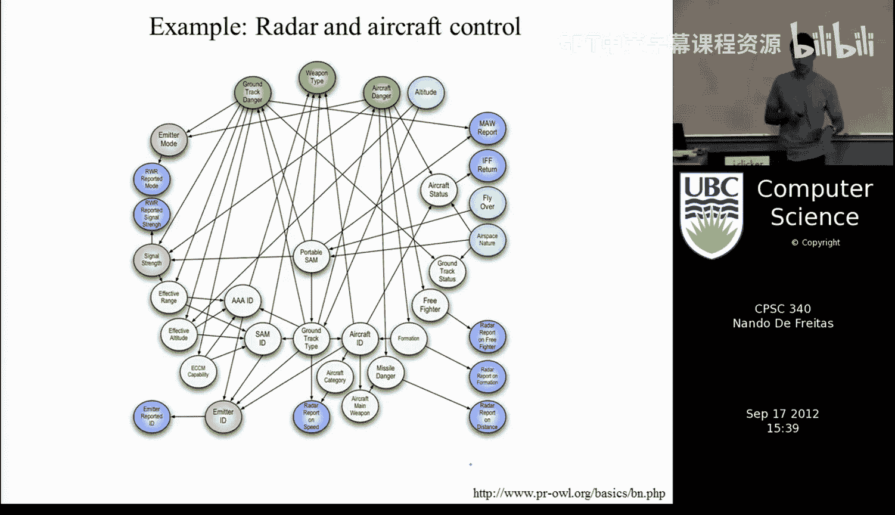

You might have a bunch of genes that' are all interconnected to each other。These graphs。

 you typically learn them directly from data。And what you might want to answer is a question like if these two genes are active。

What's the probability that this eye chain will also be out？

 the sort of questions are very useful for the design of drives。Being able to detect。

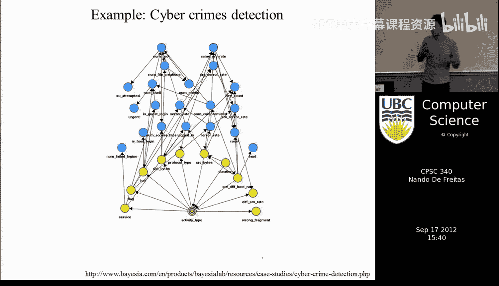

Cyber crimes and protection and so on， as' examples out there what people do。

People use this to not only these sight see applications。

 but also say when they get together people from with different interests like farmers and people interested in environmental monitoring and people interested in sustainability and they each care about a set of variables。

 or these variables，If and one on the other， there's a lot of uncertainty out there because we don't get enough to serve everything。

People like steel water， you don't get to observe that and you still have to make inferences as to what should be the level of the dam because。

So you have to marginal lines of someone stealing water so that you ensure that there's a smooth flow and so that there's no。

Say sudden changes in the water level。So in BC see， if you can have some changes in the water level。

 what happens if the pools get formed on the edge of the dams and then of the lakes？

And then if the salmon goes。You know the baby Simon go to the shore and then the water drops suddenly and then the Liverpools dry and all the baby fish died as a result。

 so if you want to actually do a lot of fisheries and so on in BC you need to actually care about building these huge models to know exactly what's going on。

Enviment。And also， if you want to change a policy， you want to change the value of one node and see how it affects all the other node。

And you want to be able to communicate that to a large number of people in a nice。Clear from。

The fish thing actually is something that I worked on and as a consulting job。

 it's a problem that arises。

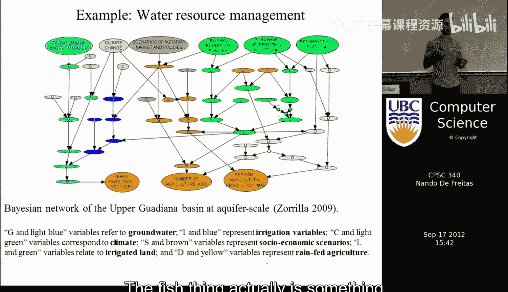

said question。The parents off the variable。That's slide there。ThePrevious slide。

You had a fixed number of。What if that situation was not the case？See your writing。

An algorithm began。four variables and then over time it's five and six。ad。翻佢。

We do address those issues of like when you more generally。

 if you do sometimes you don't know what a variable is。

 but you might also not know how many variables are there in the problem。

And we actually do have tools for doing。That the tools filled on what we do in the court。

 but I will not get into it。

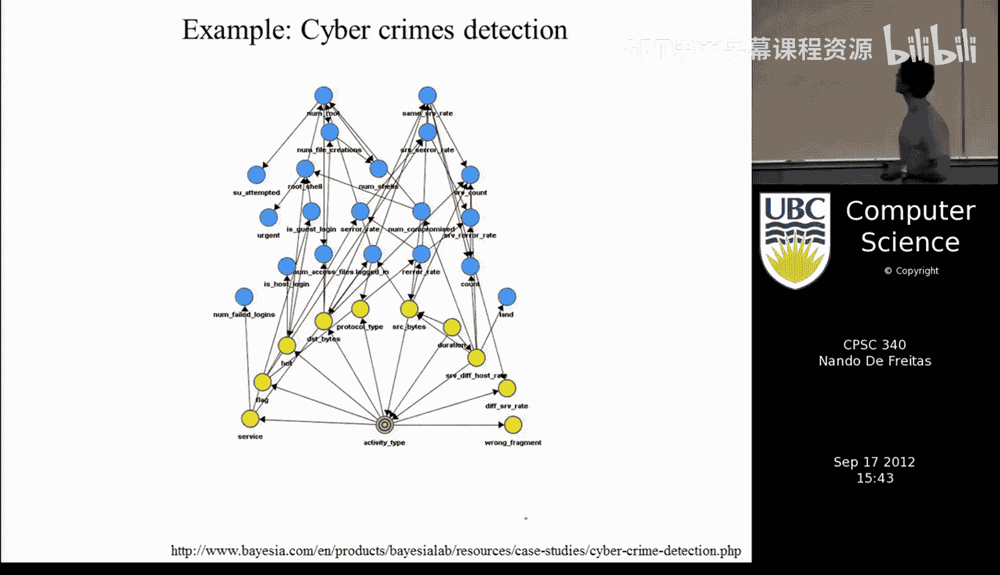

Maybe not because of being hard conceptually， but the computation is hard。So we need to back Albert。

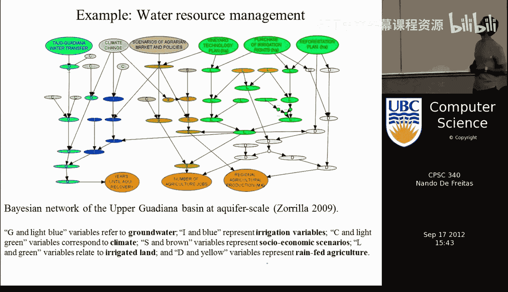

80。So in particular， this website in France。Basia。com， they've got a bunch of publications。

 one of them is marketing of perfume。And they built this huge graph， you go to this website。

 you can see the whole report as to how they use these graph。sion and this， by the way。

I really mean it by the main application of most of the staff that we're going to cover in this course is really market。

And marketing is very big。え？Fush。So companies like even here in Vancouver。

 companies like Little Lemon do invest a lot of money into being able to actually have effective marketing。

I think most small companies are still not very smart if you have to do it， properly。

 they don't have the machine learning tools。You guys will be graduating in a year or so。

 you'll be in a really good position to actually make changes。And definitely the market is huge。

 just look at interests。we also seen there's no cycles。That's true， not science。

It's not going have some gossip but I will uncover them。We're only going into these class of graph。

 which is generally not that。Would allow us to do a lot of post stuff。Like， for example。

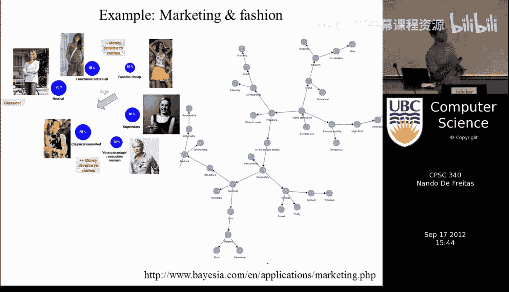

Okay， so。So lets have some examples of where you can apply this。

So one benefit of the probabilistic graphic model so far is that they allow us to。

Talk about many variables。But without having to start too many parameterss。

So we get sparse presentations。The other thing that they're good for is that。

A node is independent of the rest of the node， given a subset of the note。

It will turn out that the note will be independent of everything else， just giving it to children。电子。

I guess。Partners and the note can have more than one partner and the parents so given the parents the children and your partners。

 you're independent of the rest and that actually is very important for artificial intelligence and it's one of the reasons why Julia pros Go just the tuuring award because you can arrive at the conclusion about something happened。

Without having to think about everything else。And that sort of local computationmplication is essential in order to be able to actually do this。

啊，对。To understand that it helps to do three small examples。And the three small examples are as false。

And I'd like to illustrate these first with some toy examples。Let's assume that。

We have the variables clouding。Clity influences right。And Ray influences。Don you get wet。

So the probability for this model would be EO C。Thats P of r given C。Times P W given。2。Now。

 let's assume that you observe that it's rain。收到咗四。When it's cloudy， it rains and you're outside。

 you get wet。Let's assume that you're outside and you know it's rain。

Do you need to know if it's cloudy？To know that you're wet。No， not great。And so we say that。

Normallyally， W is independent。我ll see given。2。这是什么？In the bed。This sample here is probably usual。

诶但是。The second role。So do you mean that W is independent of C given that R is true given is is independent or given that R is false。

 just given R so assume that you're outside and it's not brain。

Do you need to know if it's qualityy to know whether or？let's look at another case， but it's easy。

If it rains。And it's awesome that it hasn't rain in a long time。T to get wet。It's sad。 I。

So the model for this would be P of R。R。P has。Sorry what was the question。你咁经。Oh sorry。

 this isn't we yeah。到。可以。Okay， so in this case， if it's raining。

Do you need to know if you're wet in order to know that you're sad？Actually a synthetic example。

 let's flip with it around。Basically， this is a no。 if it's rain you get sad and if it's rain。

 you also get quiet。If you're wet， you don't need to know if it's raining for you to be sub。

 you know rain causes you to be sub， whether you're outside or indoor。Likewise。If you're sad。

 so if it's raining， you know you'll be wet， if it's raining and you're outside this is probably a better way to see if you're outside and it's raining。

 you can figure out that you're wet， you don't need to consult your brain and am I sad？No they we。

 because。So。W is independent of S given R， and I'm going to shame that r to indicate that it's been observed。

Okay， so I sha a note to indicate that the norm has been observed。That。It外ですか。买啲喂自有台。快啲我。啊Q。

So what I'm doing is three examples， and then I will argue that these three examples are all examples that will arise ever in practice。

So perfectly one more example， and then I will illustrate。That those are all examples。

So we have multiple children， a chain， and then the other thing that we're missing is incoming links。

 so when you have two parents。So of going ahead， we're going to have this situation。

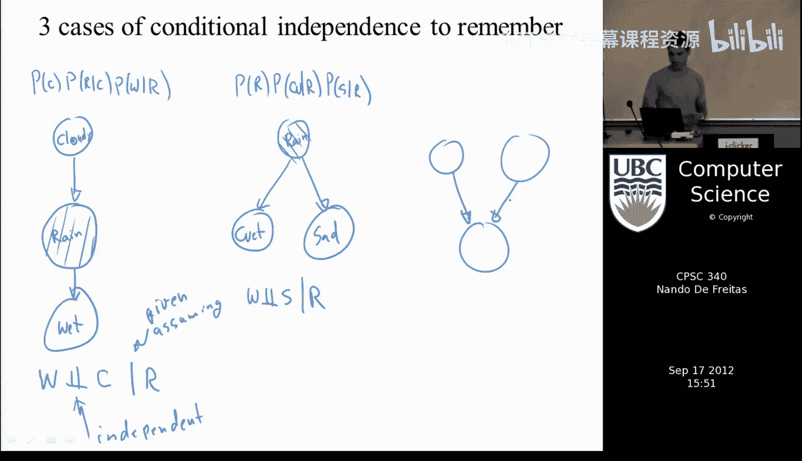

Where a guy X will depend on its parents， its children and its children parents， okay。

 so those aren't the cases。We address those three cases。

 we address all the possible connectivity that I know could happen。

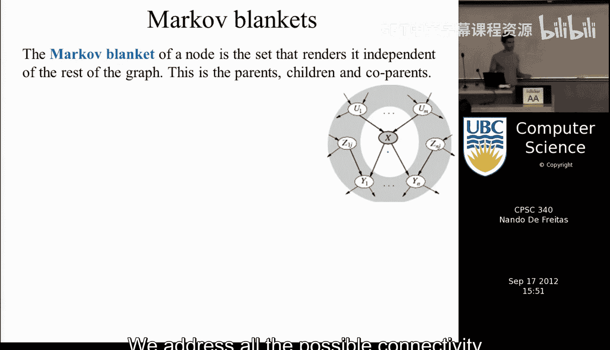

We very quickly to finish today。Let's assume that。Right。Or shower。Both it to be wet。Now。

 let's assume you're wet。😡，In order to know whether it's raining or not。

Is it helpful to know whether you're in the shower？Yes。Yes。

You're wet and you're in the shower then it might or might not be rain。

But if you're not in the shower and you're wet， then it's probably because you're outside。So。好尔。

Is not。Independent of S given done。Good wait to remember this。Once you have children。

 you'll never be independent of your other party。All right。

 those are the three rules next in the next class I will finish the example in the next slide and Im to go straight that you only need to know your parents。

要分？In order to know everything about。

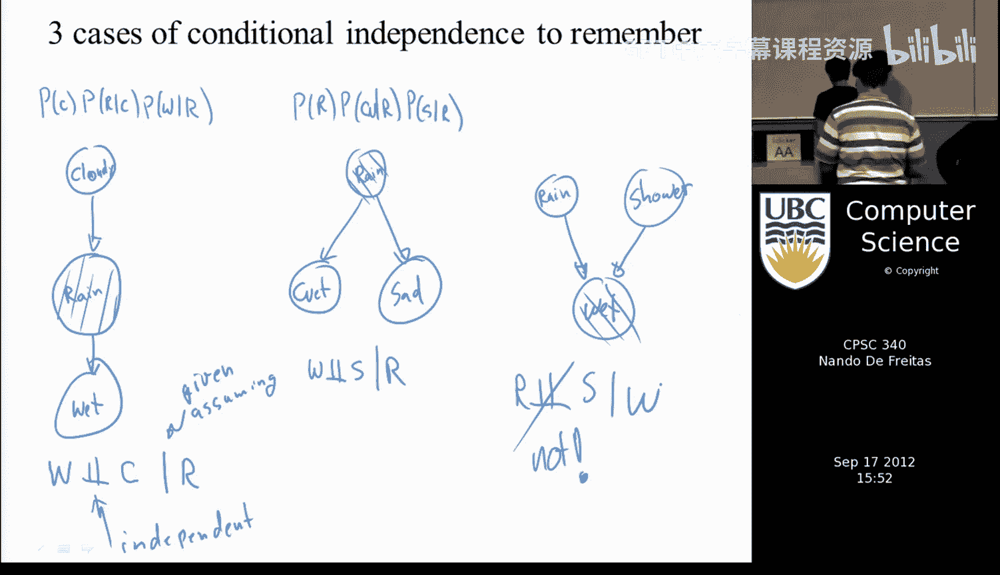