# 机器学习与数据挖掘：第6讲：贝叶斯规则与贝叶斯网络 📊

在本节课中，我们将学习贝叶斯规则的应用，并引入一个强大的工具——贝叶斯网络（也称为概率图模型）。我们将探讨如何用它来简洁地表示多变量联合概率分布，并理解变量间的条件独立性。最后，我们会看到维度灾难如何使概率推断变得困难，以及贝叶斯网络如何帮助我们应对这一挑战。

---

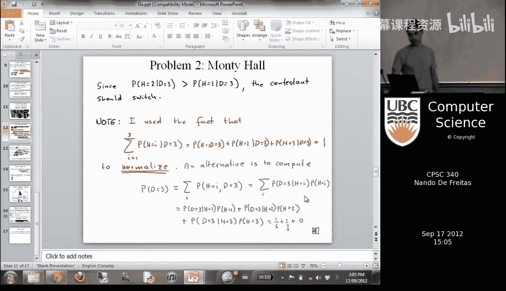

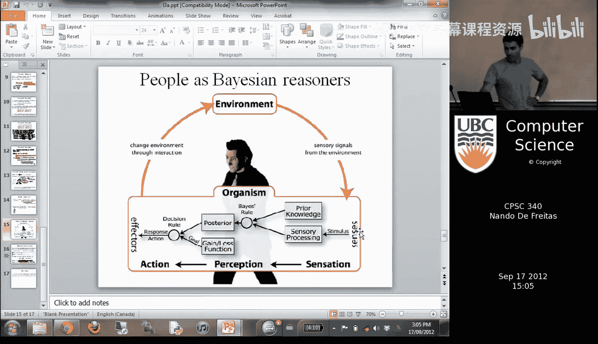

## 回顾：蒙提霍尔问题与贝叶斯推断

上一节我们介绍了如何使用贝叶斯规则进行概率推断。我们通过一个经典例子——蒙提霍尔问题——进行了实践。

在这个问题中，有三扇门，一扇后面有奖品。参赛者选择一扇门（例如1号门）后，知道奖品位置的主持人会打开另一扇没有奖品的门。然后，参赛者需要决定是否更换选择。

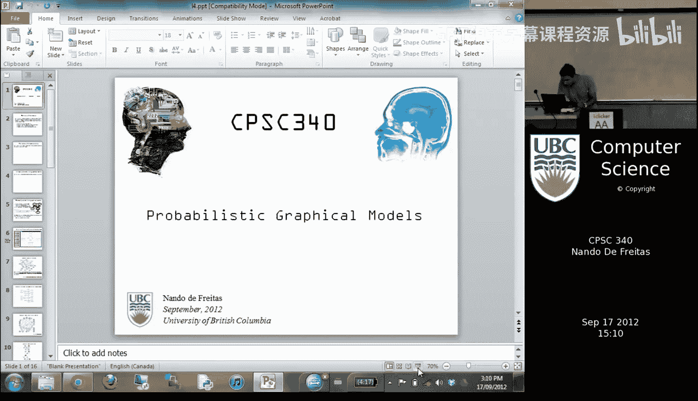

我们通过定义先验概率和似然度，计算了在观察到主持人打开特定门（例如3号门）后，奖品在各扇门后的后验概率。

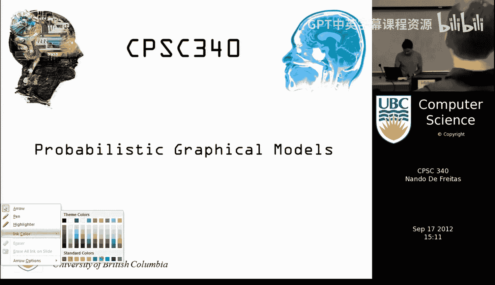

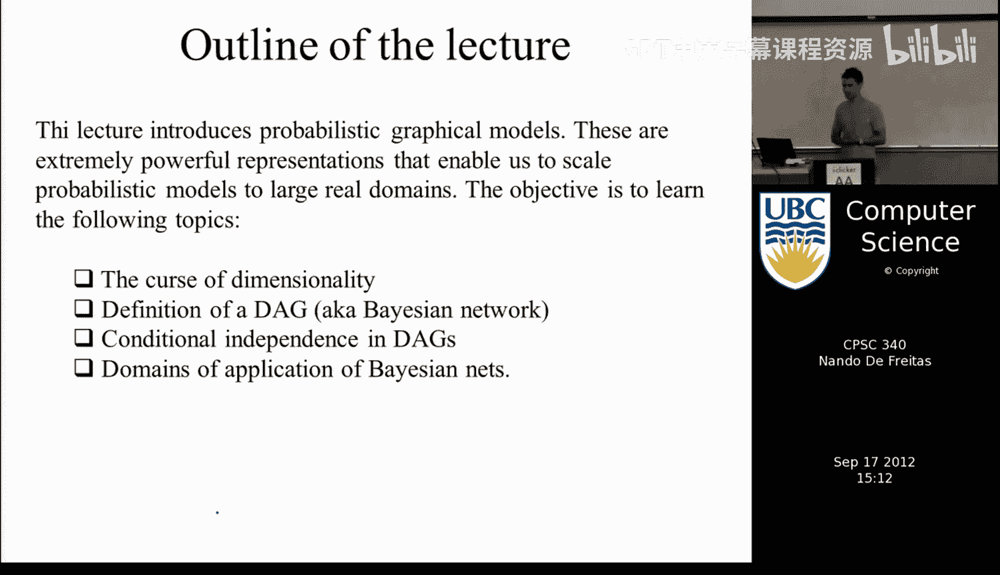

以下是计算后验概率的核心步骤，涉及边缘化和条件概率：

1.  **边缘化**：为了计算证据的概率 `P(D=3)`，我们对所有可能的假设（奖品位置）求和：
    `P(D=3) = Σ_{h=1,2,3} P(D=3|H=h) * P(H=h)`
2.  **贝叶斯规则**：然后计算每个假设的后验概率：
    `P(H=h|D=3) = [P(D=3|H=h) * P(H=h)] / P(D=3)`

通过代入数值，我们得出在主持人打开3号门后，奖品在2号门后的概率是2/3，因此更换选择是更优策略。

---

## 维度灾难与概率表示 🧩

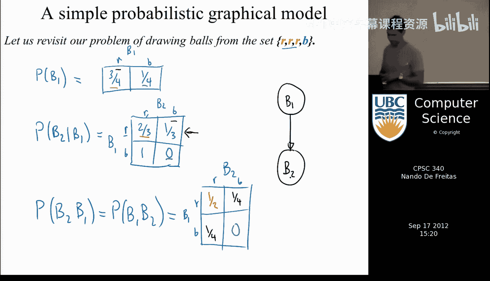

当我们处理多个随机变量时，直接表示其联合概率分布会变得非常困难。这就是所谓的“维度灾难”。

假设我们有三个二值变量 A, B, C。要完整描述它们的联合分布 `P(A, B, C)`，我们需要一个有 `2^3 = 8` 行的概率表（由于概率和为1，实际需要7个独立参数）。对于 `n` 个二值变量，参数数量约为 `2^n - 1`，这是一个指数级增长的数字。对于成百上千的变量，这在计算上是不可行的。

---

## 贝叶斯网络：一种简洁的表示法

为了应对维度灾难，我们引入**贝叶斯网络**。它是一个**有向无环图**，其中：
*   **节点**代表随机变量。
*   **有向边**表示变量之间的直接依赖关系（注意：是相关性，不一定是因果关系）。

贝叶斯网络的核心思想是**因子分解**。它假设一个变量在给定其父节点的条件下，独立于它的所有非后代节点。因此，联合概率分布可以分解为一系列条件概率的乘积：

`P(X1, X2, ..., Xn) = Π_{i=1 to n} P(Xi | Parents(Xi))`

**举例说明：**
考虑一个简单的网络：Cloudy -> Sprinkler, Cloudy -> Rain, Sprinkler & Rain -> WetGrass。
*   `P(C, S, R, W) = P(C) * P(S|C) * P(R|C) * P(W|S, R)`
*   我们只需要存储几个较小的概率表（例如 `P(C)`, `P(S|C)` 等），而不是一个巨大的 `2^4=16` 行的联合表。这极大地减少了所需参数的数量。

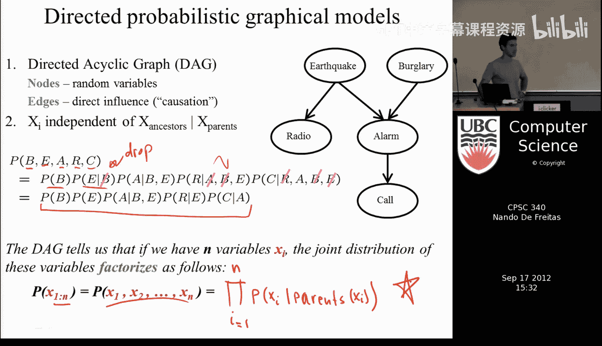

---

## 条件独立性的三种基本结构

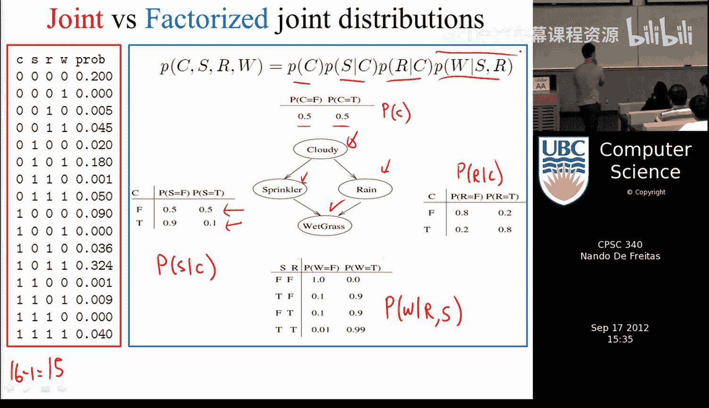

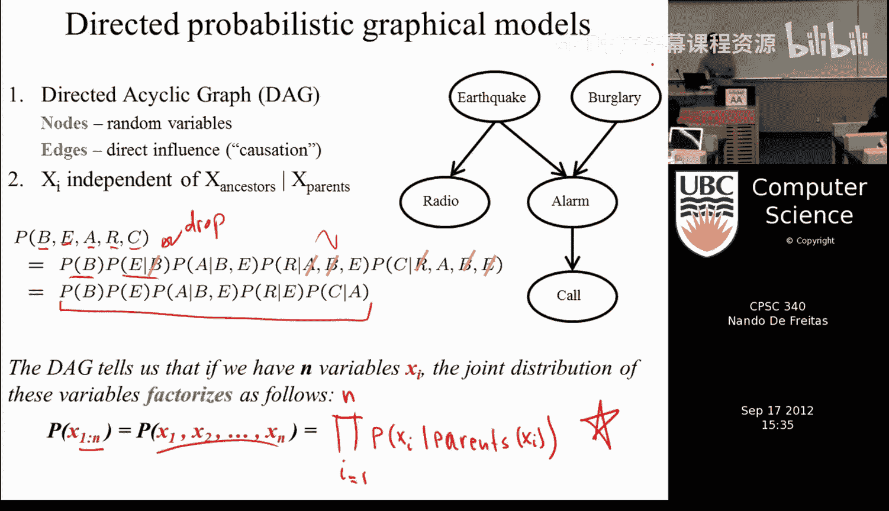

贝叶斯网络的图结构直观地揭示了变量间的条件独立性。以下是三种基本结构：

1.  **顺连结构 (Causal Chain)**
    *   示例：Cloudy -> Rain -> WetGrass。
    *   规则：如果已知中间变量 Rain 的状态，那么 WetGrass 与 Cloudy 条件独立。
    *   公式：`W ⊥ C | R`

2.  **分连结构 (Common Cause)**
    *   示例：Rain <- Cloudy -> Sprinkler。
    *   规则：如果已知共同原因 Cloudy 的状态，那么它的两个结果 Rain 和 Sprinkler 条件独立。
    *   公式：`R ⊥ S | C`

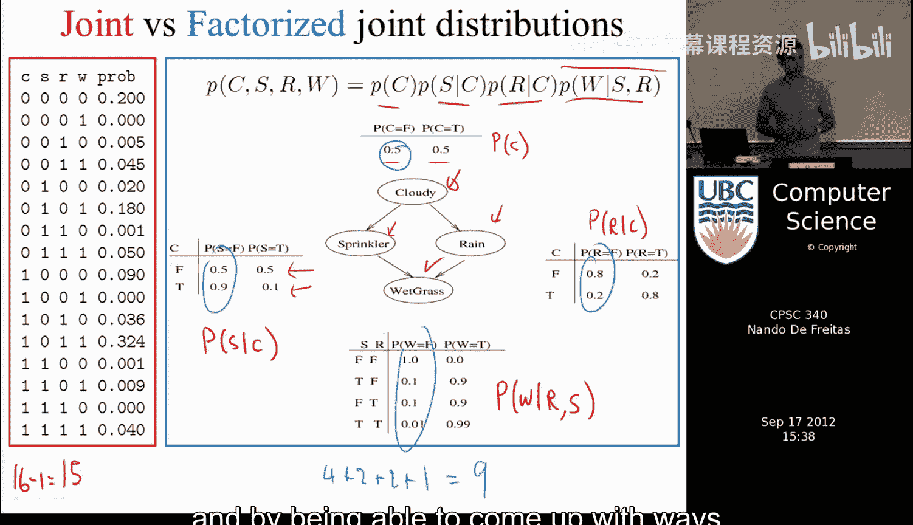

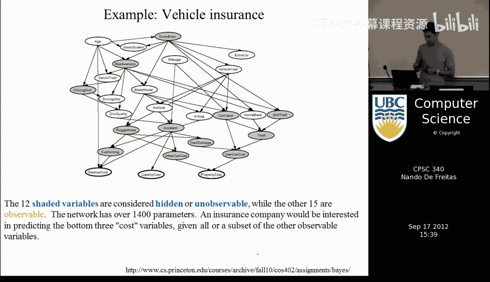

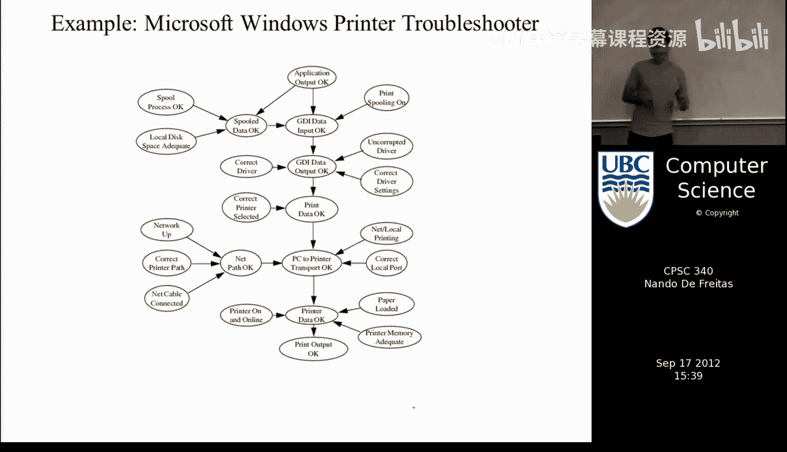

3.  **汇连结构 (Common Effect)**
    *   示例：Rain -> WetGrass <- Sprinkler。
    *   规则：**当共同结果 WetGrass 未知时**，它的两个原因 Rain 和 Sprinkler 是独立的。但是，**一旦 WetGrass 被观测到**，Rain 和 Sprinkler 就不再独立（因为一个原因的信息会影响对另一个原因的推断），这称为“解释 away”效应。
    *   公式：当 W 未观测时，`R ⊥ S`；当 W 被观测后，`R NOT ⊥ S | W`

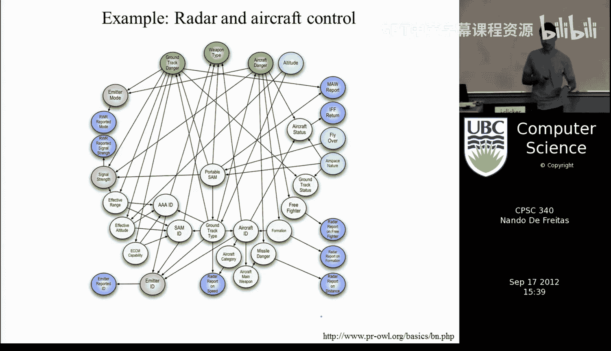

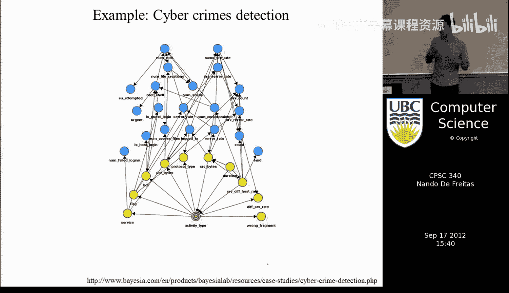

理解这些结构是进行高效概率推断的基础。

---

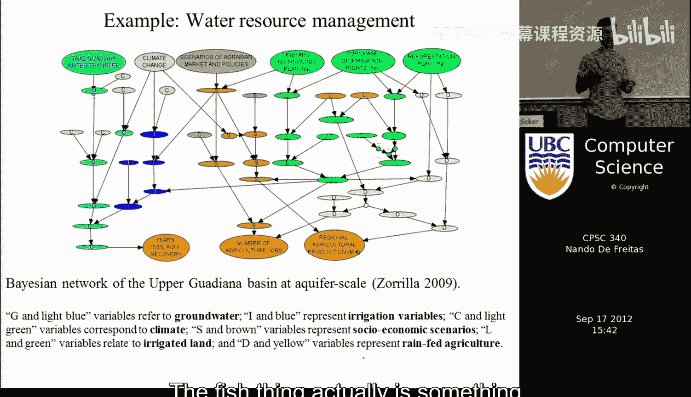

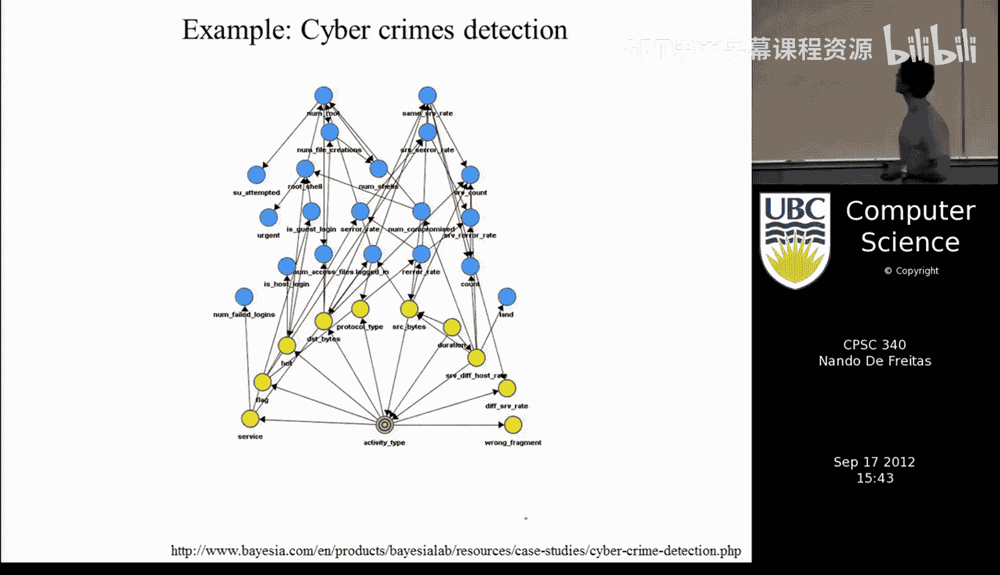

## 贝叶斯网络的应用实例 🌍

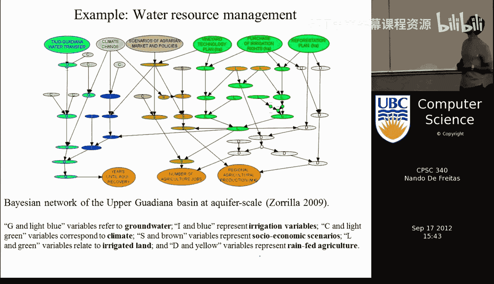

贝叶斯网络因其强大的表示和推理能力，被广泛应用于各个领域：

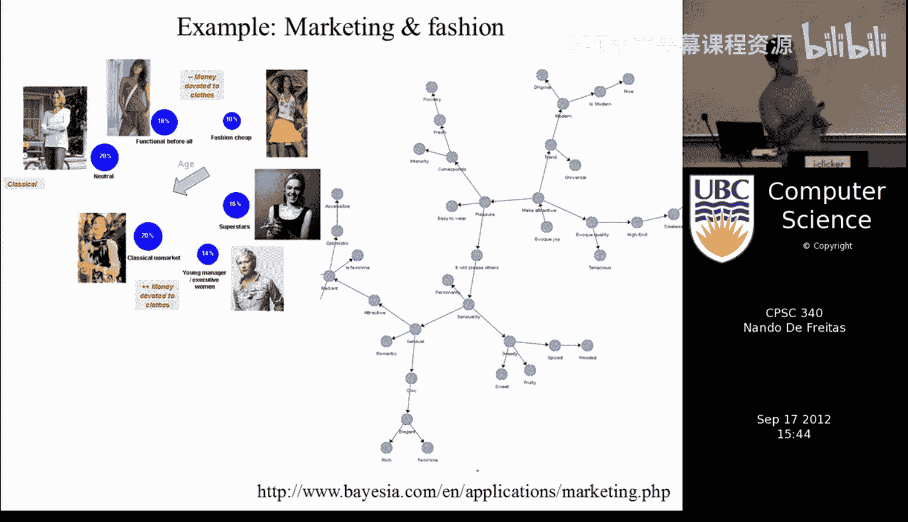

*   **医疗诊断**：根据症状推断疾病概率。
*   **故障诊断**（如打印机、复杂机械）：根据观测到的错误信息定位根本原因。
*   **基因调控网络**：分析基因之间的相互作用关系。
*   **环境建模与决策**：模拟生态系统中多变量（如水位、降雨、偷水行为）的相互影响，辅助政策制定。
*   **金融风控与市场营销**：评估客户信用风险，或预测用户对香水等产品的偏好，实现精准营销。
*   **人工智能**：作为不确定性推理的基石，允许系统进行局部计算，高效得出结论。

---

## 总结

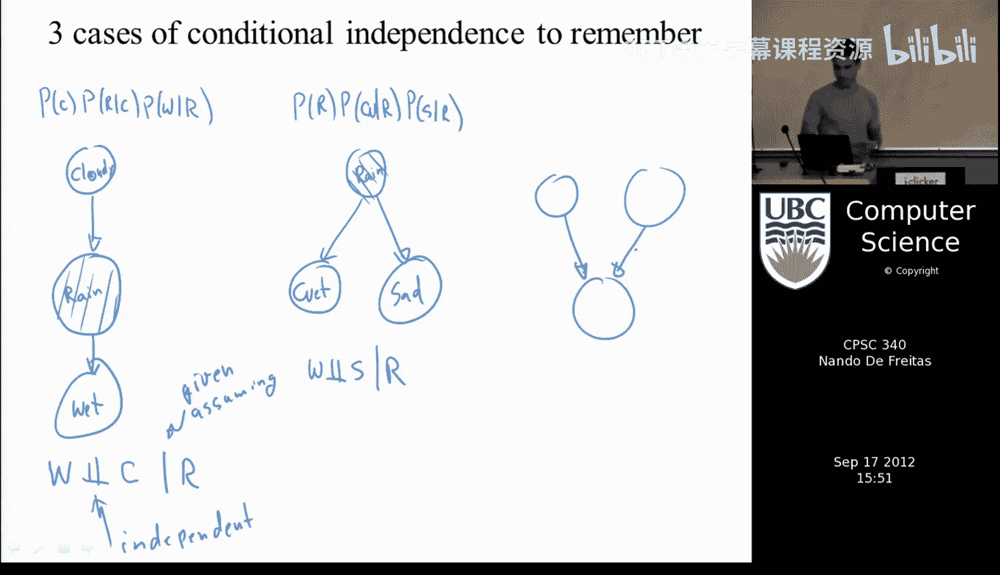

本节课我们一起学习了：
1.  **贝叶斯推断的实践**：通过蒙提霍尔问题巩固了先验、似然、后验的计算。
2.  **维度灾难**：认识到直接表示多变量联合分布的困难性。
3.  **贝叶斯网络**：引入了用有向无环图来简洁表示联合分布的方法，其核心是因子分解公式：`P(X1,...,Xn) = Π P(Xi|Parents(Xi))`。
4.  **条件独立性**：学习了顺连、分连、汇连三种基本图结构所蕴含的条件独立关系，这是理解变量间依赖和进行高效推理的关键。
5.  **广泛应用**：看到了贝叶斯网络从医疗、工程到商业、生态等多个领域的强大实用性。

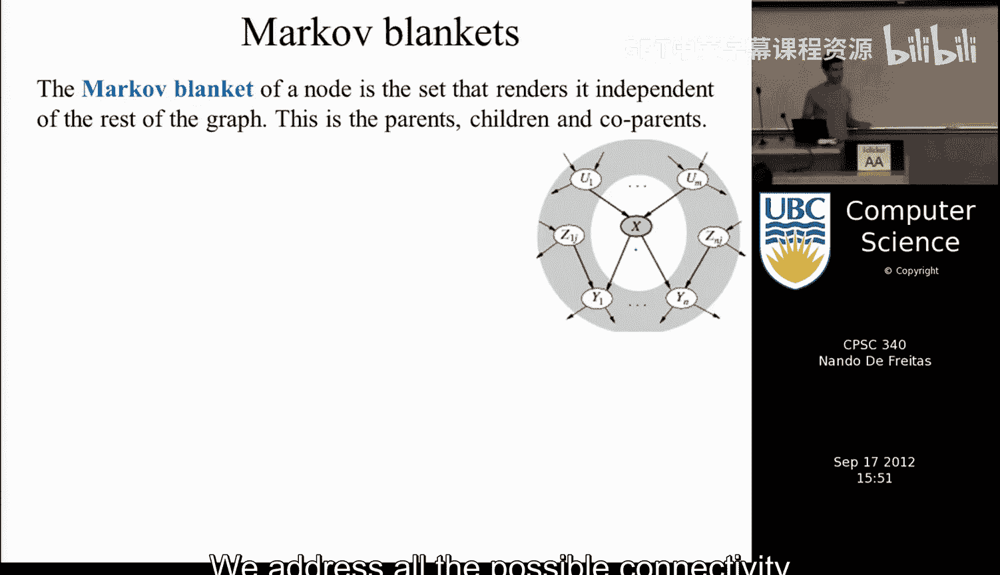

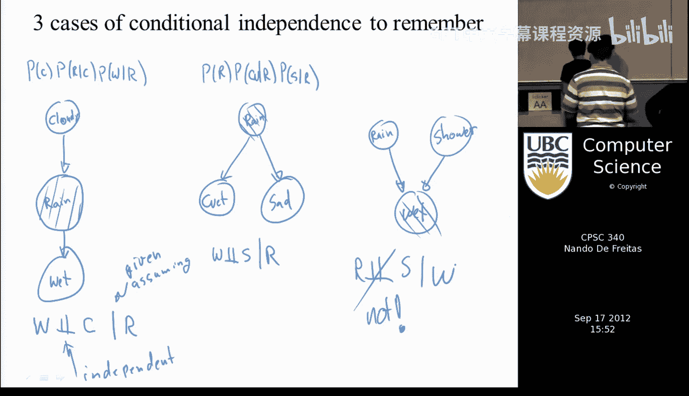

贝叶斯网络为我们提供了一套系统的方法，以可管理的方式对复杂世界中的不确定性进行建模和推理。在接下来的课程中，我们将学习如何在这些网络上进行概率推断，以及如何从数据中自动学习网络结构和参数。