# UBC《机器学习和数据挖掘｜CPSC 340 Machine Learning and Data Mining 2012》中英字幕 p07 -07-undergraduate machine learning 8_ Inference in Bayesian networks and dynamic -BV1pJ2ABFEFg_p7-

SomeHe talk。And first， if you Google Banets Uplet。 So a lot of the things we're doing here。

 we will do them manually。But there is a lot of software out there that allows you to not do things manually。

 especially when you go to large graphs， you're not going be doing this by hand， however。

 I do require you to learn to do the small ones by hand because that's my only way of knowing that you actually would understand。

What the big the software and the large graph is doing and so if you Google Ba nets and I should upload this to the Google group。

 you'll get， for example， there's an AI space for those of you doing 322 Applet I quite like this one from CMU。

 it's an old one that。

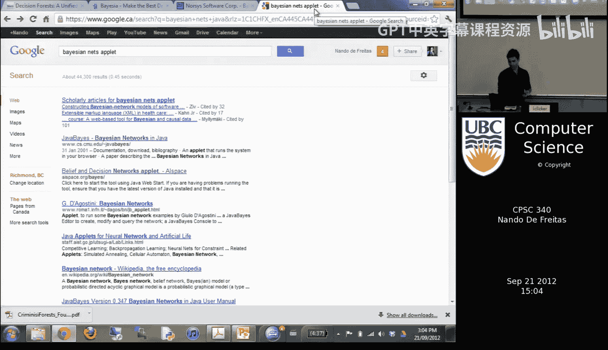

If you click in Java B， it takes you to。An applet that you can run online。

And the applet pretty much looks like。

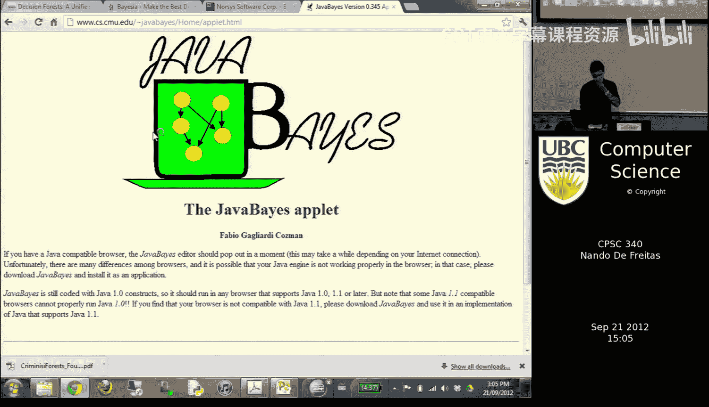

It's a very nice interface， or it's a graphic interface it allows you to。

Draw nodes so you can go create。And you can add a variable here and another variable and another variable and another variable。

And you can then just by clicking， you can draw a graph。So。Today。

 we will spend the whole lecture using a graph that looks like this。And。

And then you can basically enter evidence， so you click oh it， edit a variable。

And then you can go and enter evidence。So you can call the variable， I don't know， sprinkler。然。

And then， you can。What else can you do， you can edit a function so you can actually go and edit the node and you can say the prior probability should 0。

1 and 09。f。And then close and you do that for each node。

 it also allows you there to enter the conditional probability， 7。5。5 their tables。

 the only thing is the tables here his tables are upside down so they should add up to one like this。

And then you close。And anyway， youve build a graph and then if youre un observeserver node。

 you just click on it。And you make it observed。Okay， and then you can then query， you can go。

 given that that's observed， let's query this node。

 and then it gives you the probability of that node。

So you could very easily code the graph that we do in class in a GuUI and you can basically edit it and play with it。

 So with a fournote graph， you'll be able to do all this by hand。And this is a way， by the way。

 to check the answers。To the homework question question one of the homework I basically ask you to do this so you can actually double check the answer that you're getting the right answer just by using this。

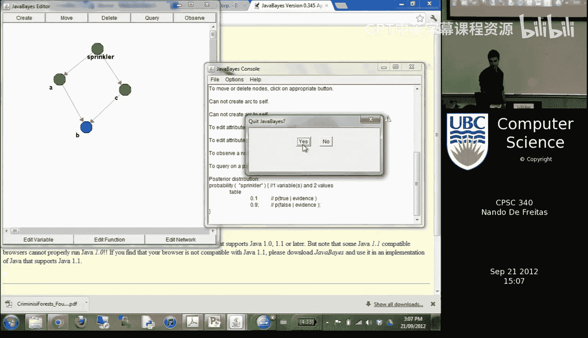

Just by running the Java base。 So Java base easy to find。

There's better software out there， there's like in Vancouver， there's Noris， iss a company。

 local company that actually just specializes on software。

 and they of course focus on mining and so on。

A lot of the slides that I used as the examples come from。This company called。Bsier。

And they have staff on industry health， strategy， risk managing， marketing。

The sort of the fashion application that I had comes from here so you can go。To marketing。

 And then you can see all the applications， and you can read all about how they do marketing and。

Fashion and the whole thing。With bay and nets。So just by knowing the small graphs。

 you'll know what happens with， especially after today's lecture， what happens with the big graphs。

And you can very easily， have， you know there's companies built on this technology。

 so is practical of things to know。嗯。There are also things that are not directly graphical models。

 but for which you do need probability， like an example is。

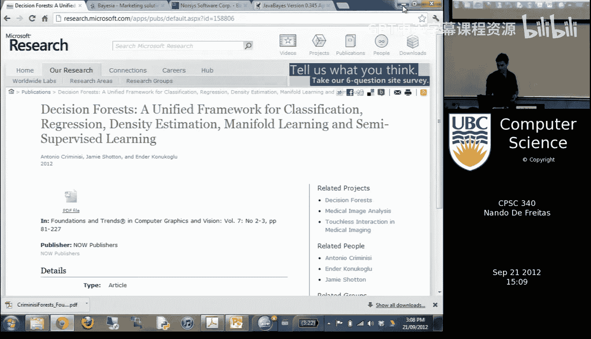

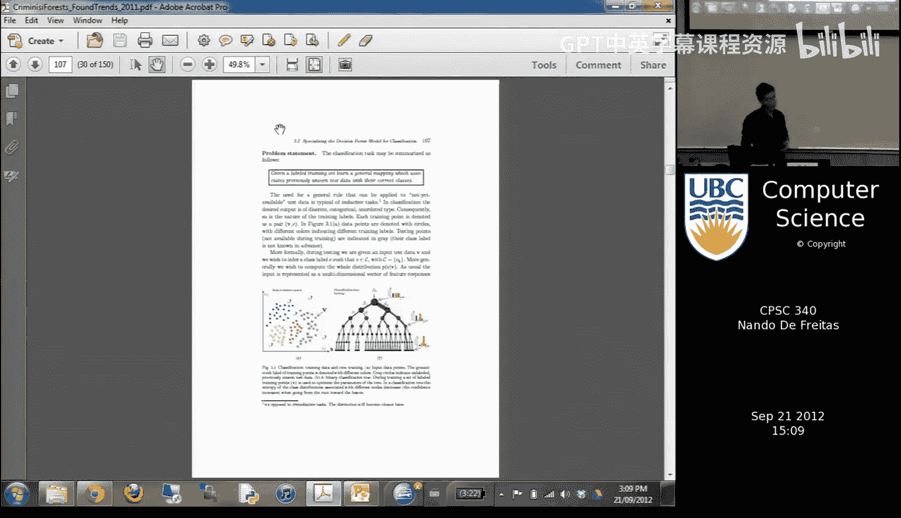

Let me show you here。Toward the end of the course， we will be able to have models that given a set of points like those colored points on the left。

 they will be able to tell us what's the probability that a point that is in a particular part of the space will be red and not green。

So we will be able to compute these。 We will have these sophisticated models。The message here is。

They use probabilities， so we need to learn to manipulate probabilities in order to be able to understand these models。

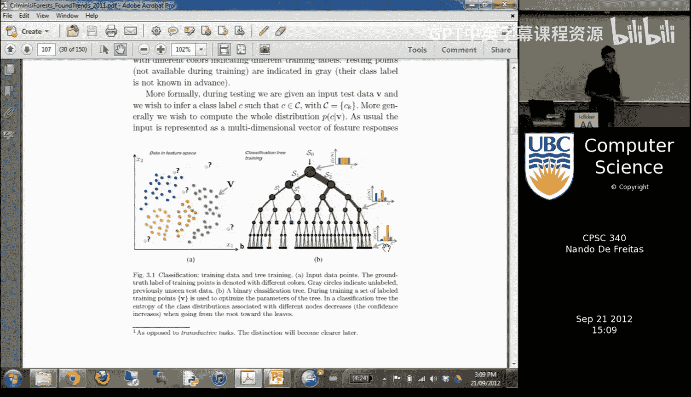

And you need to understand these models to be able to understand。Things that。You know， lot you know。

 to do cool stuff， as you can see， and to understand stuff that we kind of use almost on a daily basis。

 like in this case the connect。

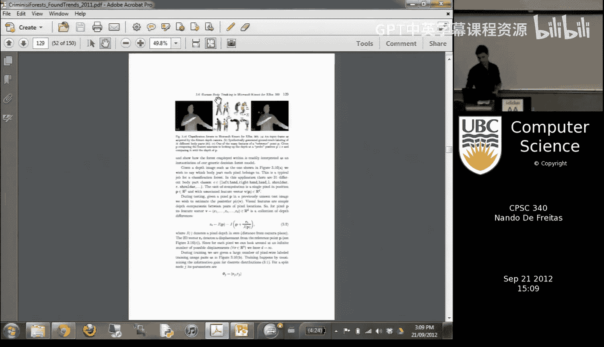

Okay， so the connect requires that you learn， did you understand like some basics of probability in order to know how it works。

And it's very simple concepts， we're actually going to cover the algorithm of the Kect。

 the machine learning algorithm of the Connect at the end of the course。

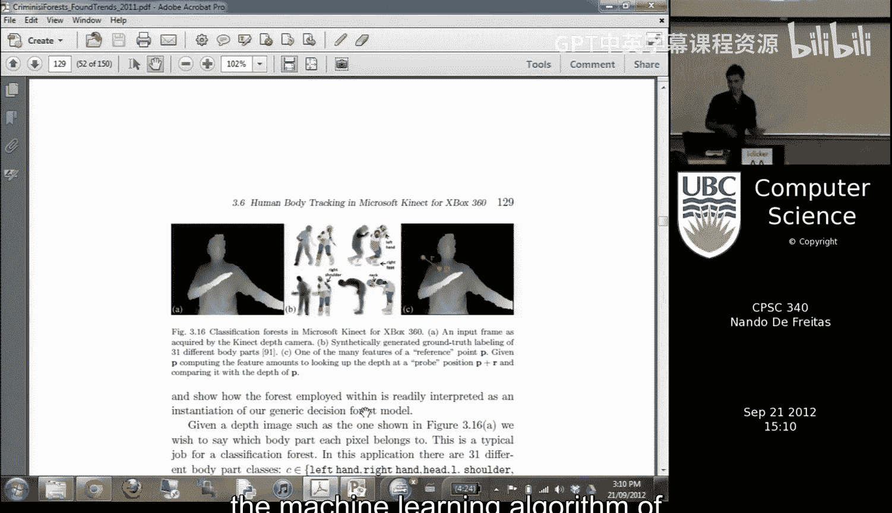

That's where we're going to。 and you can use it to connect automatically recognizes what's a shoulder。

 what's an arm and so on。 And that's how it predicts where you are。嗯。Connect， by the way。

Who's played with a connect。most of you， for those of you who haven't played with Connect。

 it's this thing that you put like the thing that look like this。

 you put it on top of your TV and then you can start playing games and you don't need to hold wires or anything because it has a sensor that it's a 3D sensor just actually puts a grid on it's an active sensor。

 it puts a red grid on you then for a red sensor， it works at night as well because of that。

And then it uses machine learning to predict the exact positions of your body， of your shoulders。

 like in this cartoon， where is your shoulder with your head and so on？And if you can predict。

 I mean， this is sort of for fun and entertainment。

 but you can also use this in medicine because you might want to predict where your kidney。

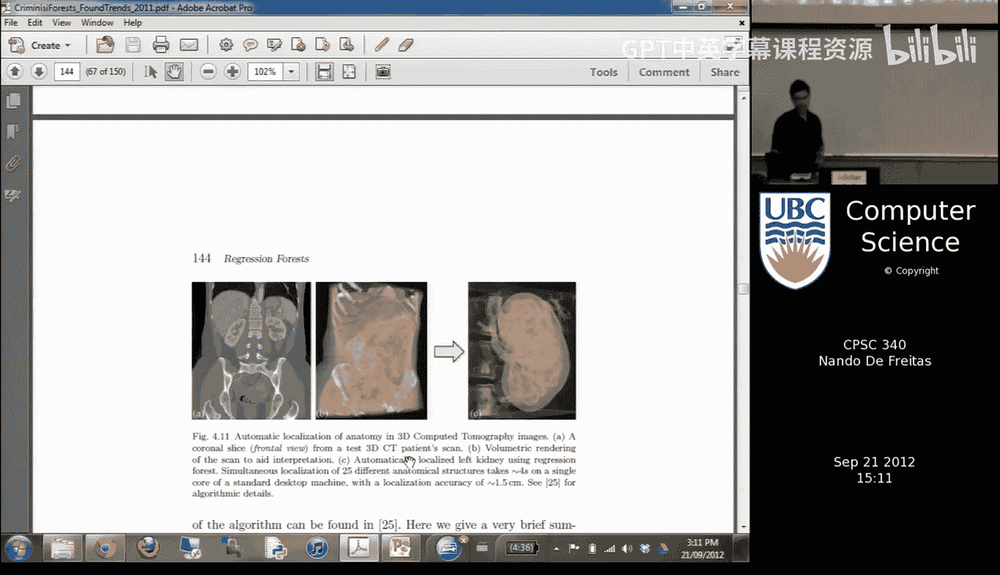

嗯。An important part of surgery is be able to predict what specific organs are its own to help doctors。

You know， find problems or to be able to detect tumors。You know， irregularities。嗯。

Our healthcare system cannot handle the number of patients that come。

 And that's why you probably hear on the news there's long waits， not enough nurses and so on。

 So being able to automate health to a large extent will。

Help us with dealing with the challenges that we're facing。

And the challenges are huge because most of us are getting old and we're not having enough children。

You know， it's growing exponentially。 There's gonna be a problem。And so， it's very important to get。

To use us much of。technologyAs much as we can use technology to improve healthcare。

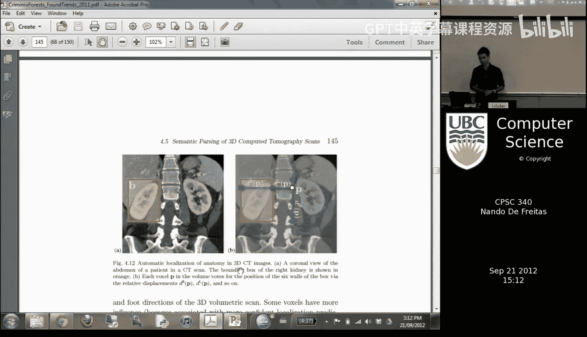

嗯。The point here though it' sort of this is the end goal。

 this is where we're going toward the end of the course I will have these algorithms。

 but to get there we need to learn the basic probability。

 not just because that probability is immediately applicable。

 but because other applications build on this。So this is sort of essential to get there。

Having said that， let's begin with what we were looking at。And so today we will do inference。

 So again， here's a graphical model that consists of all variables。

 It's called the sprinkler network。And for whatever reasons so。

Clouds influence rain and influence that they wet。Grass gets wet。

 but then your the probability of you switching your sprinkle on or not depends on whether it's cloudy or not。

 So that's basically this graph indicates all these influences。We can draw。

So when you look at this graph。You should think of。This over here is the probability of C。P of C。

 and so this I often also write P of c equal as a table。And I would just write 0。5， 0。5。

 this is the probability of it being false， the probability of it being true。So1 is true。

 zero is false， and I usually put a C here to indicate that it's over sea。So in other words。

 the probability of c equals 0。Is 0。5。We also can draw this with a diagram。Where we have C。

And here we have P ofc on the vertical axis， and then we have zero， we have one。

 and this would be just two bars， a two bar histogram。With height。0。5。And both of them 0。

5 because probabilities are up to one。Likewise， this table here is to be interpreted as a conditional probability of the sprinkler given cloudy。

And if you look at that。Let's do this example， with a different color。

Then you can tell that the probability of the sprinkler。Given that cloudy is true。Or one。Is。0。9。0。1。

 this is a distribution over S。Being either false or true。So reading a condition with your condition。

 your condition on the fact that。It was cloudy。And when it was cloudy。

 you only have a distribution of R。 So it's important to note this。 When I write this。

 this is not an object of。Two variables， but it's a distribution over S。So if I sum。Over S。

P of S given C equal1。I get one， and that should be obvious from that picture if 0。9 plus 0。1 is 1。

We can also draw that。I can use a graph。And in this case， I would use a big bar that's 0。9。

And now would use a small bar that's at。0。1。 And this would be P of S， given C equal 1。

And this is a distribution over S。Finally， and then the same would apply for probability of rain given cloudy and probability of wet given。

Both Sply right。Now， wet。Now has two parents， so there's eight values to describe it。

 eight numbers I used to describe it。Of which you only need four because it's a conditional table。

One last thing I wanted to add here is that if you want the probability。好。C。And let's say S。

The joint。And that's going to be a table。01，01， this will be S here， this will be C here。

But then the numbers are the probability， so the entry here。

 the first entry in the first cell 00 is the probability of c being  zero。And S being 0。

 so it's the probability of both being 0， both being false， and that's just 0。5 times 0。

5 okay because we have a 0。5 here。Times a 0。5 here because here this guy is0 and here the guy is 0 to 0。

 so that will be 0。25。Des one is 0。25。Let's do another color here。P童。This one is 0。9 times。0。5。

 so it's 0。45。And then the last one。Will be 0。05。NotNow that all the numbers add up to what。

It's a joint table， So it's a probability of S and C。 it's a 2D distribution。啊系会冇费。好不问。And like that。

 don't they have to？are you sorry。看了。Sprinkle is not independent of cloudy。

It's not so the rule that I'm using when I'm multiplying thanks for the question the rule that I'm using is like for example。

 if I want a probability that this sprinkle is not on，And。And it's not cloudy。

 that's equal to using conditional probability。Sprinkr being 0 and C being0。Times P of c equals 0。

 That's how I filled in the table。There's no independence。Independence would be， if I said S。

Just P of S times P of c。So the way I'm filling in the tables is by multiplying probabilities is just using conditioning。

 the rules of probability。Okay， so that's how this entry comes to be and then all the other entries I was using the same rule。

 the joint is the marginal times the condition， just like we did before for the patient example where you had a test and you needed to know whether you should be worried or not。

When we plot these。So we can draw a graph of this as well， but now it's a joint distribution。

So P of C。😔，And this。It's now in 2D。Of both C and S。

And then drawing it requires a little bit more effort， so let's be purple to draw it。So。

Let's see how well I can draw this。So we have two boxes that have height 0。25。Right。

I have a box that has high points。I have a box。 that has high。0。45， so that's a taller box。

And then I have a smaller， tiny box up down here。P。So sort of four blocks。

 two blocks of the same size， a tall block。 and then a very。啊。shorthor block。Okay。

 so that's basically it， so。That's all the syntax about what's in the graph。

One other thing of syntax that I mentioned before， but it's probably worth mentioning。

You should read this as PFW given。SNR together。So。The given operator has precede。So when I say given。

 I'm basically slicing a table。And the same is true for all tables say。For this guy here。P of W。

 given S equals 0。And are equal one。I will get a table。Of a0 and one， it's a distribution of a W。好了。

Again， it sums to what？Okay， now I'm going to put this to you guys。

 what's the number in the first entry of the table？Is a point to？Are you sure it's not 0。99。

How many people think it's 0。9 hands up？99。Point1。0。All right。I wanted to get in groups of two。

And I want the person because half of you know the answer and half of you either are too shy put your head up。

 but if you are shy， I have no way of knowing whether you know the answer。

So we're going to take five minutes off。Because I cannot continue the course until we are okay on this。

And so we're going to take five minutes off and you're going to explain to your friend why it is 0。1。

 Let me first make sure that it's 0。1。S is equal to 0。So it's， it's false。 So it's 0 and1。

 So we're in this case。0 and1 you want water to be。这个。You're often agreed。Yeah。So。It。Yeah我。そ。Yeah。

Yes。Yeah。Okay。我时间。All right， Im stop you， I'm going to stop you now。

And I'm going to ask how many people believe it's  point。1。

If you don't have your hand up now and you don't have anything to do the next hour。

 I strongly suggest you come to my office hour。Because you are lost in this course。

And so you should be coming to my office hours so I can go over this example with you again。

 but given the majorityities following me， we are indeed just sing the table。

And so this is all the syntax。 This is all you need to know about Graphmal。 If you know all this。

 then you know， everything that you know to be able to understand the object that we manipulateulating。

 the probabilities and the probabilities， you can think of them as you can write them as tables。

 you can write them as。You can write them as in numbers in vectors。

 you can draw diagrams and they're all equivalent， they're just different ways of communicating the same thing that you have an object that can be true or false and you don't know whether it's true or false and we're using probability to measure this certainty about it being either true or false。

 so probably just a way of measuring uncertainty。probably tell you give。

Com R so I mean it's probably a W given。S equals 0， and R equals 1。Yeah， get them take。Yes。Yeah。

Precisely the bracket here。开始。Okay， so conditioning has precede。定さ。か。Sprink her， you see if it reged。

 wouldn't it for sure be we？Fen。嗯。Looking at the third row， so it did rain。Brings true。Yeah。

 it rains， so the probability that the grass is wet when it rains is 0。9。

NoYou're questioning the number， so that's a different story。

 questioning the numbers to this could be grass that's in the shade or know there's a tree to until the grass might not get wet。

Maybe it's only when there's a thresholdial。We will learn how to learn these numbers automatically from data。

 you record data every day， you measure the amount， whether the grass was wet， whether it rained。

 and so on， and from that you will learn these numbers automatically。

That's going to be the learning part。 But before we do learning， because learning requires inference。

 we will first learn to do inference。Okay， so the race is manipulation。

 So the first kind of question I might ask is a marginal probability。

 And this is one it's important to get。 What's the probability that S equal1。

Any suggestions on how we can。Compute this。now we begin to do what we call inferences。

 computations from weve specified the graph。 And once you specify the model。

 you use a goi to specify the model， you enter your numbers by hand or you learn the numbers from data。

 But once you have that model， you need to answer questions。

 given that a node takes a value without the other nodes。 or what's just the marginal probability of。

嗯。In this case， what's the probability of the sprinkle lever beyond？嗯。The model is here。Okay。

 so let's start asking。Folks。Condition。You like some over all the possible。Thank you。

 That's the right answer。When you don't know what the other variables are。You need to some of them。

To be able to know what's the probability of S equal 1。I need to sum。Over C。R and W。

And they each go from zero to one， they can only take two values。And then it's the probability。of c。

And R and W and S equal to what。So CRW variables， S is fixed， we know that S is1。

I just want to know the probability as being one。So that's marginalization。

 it doesn't matter how many variables you don't know， you just sum them all。Okay。

 what's the cost of the computation here， How many operations do I need to do。可。E， eight sums。

Because they're nest at sums。Now I can rewrite this as some of a C， some of a R， some of a W。

And instead of writing from C equals 0 to 1 W equals 0 to 1， I'm going to be lazy。

 and I will just write C and R and W。And this is often the practice in papers， when you read papers。

 people are lazy they don。Put in all the numbers so you see this。If it's the sum of a C。

 you have to assume that it's summing over all the possible values that the variable C could take。

 which in this case is just binary 0 and1。Now， the first simplification we need to do。

 we can exploit is the graph。Now what's the probability of this graph？

It's a probability of each node， given its parents。And it's a product of so we have P of C。P。

S equal 1， given C。P of R given C。And then， P of。W。Given S being equal to1。And R。Okay。

So that's just by reading it off the graph， it's a probability of a variable given its parents。

And C does not have parents。 So it's just a ver。Now。

 the reason why I've written it in this way is because I have all these guys， this is P of C。

This is P。S， given C。This guy here is P of R given C。And then this guy finally is BFW given R and C。

So if I've written my answer in terms of those four guys， I now have all the numbers。See where。嗯。Oh。

 that should be yes， sorry。Thank you。So now given that I have。Given that I have those four tables。

 I have all the numbers， it's just a question of plugging numbers。RightSo how could I do this。

 let's do it the naive way。And so。I'm going to just rewrite this quickly here。

Make sure I get the right expression。So I have a sum of a CRW。AP of W， given。

S equal1 and R times P of S equal 1 given C。Ts P of R。Given C， and finally， Pl C。

So I've just rewritten it。And so I need to sum over all these values of these variables that can take 01。

 and so this would be equal， and let me start with a00 case。P of w equals 0 given。

That S equals 1 and r equals 0。Times P of S equals 1， given C equals 0。Times P of R。Equals 0。

 given c equals 0 times P of。C equals0。so I've just substituted 0，0，0。

4 because each of these guys goes from zero to one。Plus。And now let's do the 0，01 case。

Which would be。P of w equals 1， given S equal 1 and R equals0。Times p of S equal1， given c equals 0。

P of r equals 0， given C equals 0。Times p of c equals 0。Okay。Plus。Let's do one more case， 0，1，0。

So the 010 case would be P of so the second variable is R。 so this would be P of w equals 0。

 given S equal1。And now artists set to one。Times p of S equals 1， given c equals 0。

Times p of r equal 1， given c equals 0。T， p of c equals 0。Plus， and now I would do the K0。1，1。

But I'm getting really sick of this， so I'm going to just put three dots and I'm going to put three dots here。

Plus1，1，1。 Okay， so there are two to the three terms in this。

Okay so you would write two to the three terms， and then every time you write two to the three terms。

 you need to do one。Two， three multiplications。So that there are two to the three times three multiplications or floating point operations for your computer。

 so even the small exercise。Its。Taking quite a lot of time。 It's been quite cheap。

 And once you have these。嗯。Once you have this， though。You can just read off the numbers。

 so probability of s 0， that's just 0。5。R0 given c equals 0 would be r0 given c equals 0， which is 0。

8。And then S equal1。So given that C is equal to 00。5。And w being equal to 0， given that S。

S is equal to1， and so1。And this guy is0。Is  zero point。It's kind of tiny there into 0。4。0。1。

So you would plug in all these numbers， you would multiply it and you would get your answer。Now。

 I will ask an exercise like this in the midterm。Don't do it this way。

 because this will be you spending a whole hour doing it。So if you do it。

 what I call the brute force way or the dumbway。It will take you forever。The cost is exponential。

 This problem is exponential， it very high。I will probably give you five variables to make it more interesting。

 because then you will have to do 2 to the 32。Of these terms。

 so exponentials are things that grow exponential are really bad， they involve a lot of pain。

 a lot of work， there are a lot of work for us already with three variables。

 and they are also at a lot of work， even for our fastest cloud computing devices。So instead。

 we're going to do this。Oh， one more thing。 when you do the brute force away in code。

How would you code it？把这个。Lots of。Lots of nested loops， exactly， so you can create a variable。

 let's call this variable pro。And then you would go for r equal1 in steps of 1 sorry0 in steps of1 to1。

 and then you would have4 C equal0 in steps of1 to1 and then4。W equals zero steps of 1 to1。

You would write something like broad， equal broad。P， and then you would write that whole expression。

 which。It's P of C times P of。R given C。P of S， given and C。So it was S equal1。Times P of W。

 given S equal one comm R。Okay， that would be the。Poor choice。Of doing this into the brute force way。

 That's what we were doing， nested four loops。Okay， nested for loops。 we know they're bad。

 especially if you have 100 variables you would have。

 And you saw like that fashion network or the networks of genes。 you know。

 they have dozens or hundreds of nodes。 And so even your powerful computer would be， you know。

 would be thrown to the ground if you， if you code like this。Now。Here's a very。

What would be a smart way of doing this？Like if you wanted to just do this。

What do you think would be a quicker way of doing it。Like， if you are doing this sum by hand。

Let's not think of code now。YesB depends on the。See。It depends on the。Look。PFCC， you don't have。

 you can take it outside those two first sums of R And W because it's constant over R And W except。

 So note I'm doing the following。 I'm multiplying this guy times this guy。

 and then I' multiply it to again and。There's a lot of redundancy here。And so， in particular。If。

This is what it all boils down to。 It really is very simple。 If you have to multiply a times B。

 and then you have to add to it a times C。That's two flops。A better way to do it。Is to just do this。

Sorry。1 fop。And that's。That is all the intuition， this is what we're doing。

 we're going to take terms out so that we minimize the number of multiplications that we do。Okay。

 so we're going to be smart about。 We're going to basically take。Like this guy， PLC。

 can walk out of this sum。 In fact， it can go up to here。We're going to take factors out。So。

In particular， let's write that expression again。 We want P of S equal 1。

 and that's just the sum of a C and R。And W。哦。P有。W given S equal one and。好儿。B of R given C， P of C。

 B of S equal  one given C。Now I'm going to do this trick， which is。I'm going to distribute。

 I will first take everything that doesn't involve a W outside a cell。So I will write this as C。R。

 and then I take all the terms that don't depend on W out。Out of that sum。And I'm going to call。

You're going to give this guy a name。This whole sum， I'm going to call it。

What was the term I used phi？What's Phi equal to？Okay， cause we have a probe。Art。

 I haven't said what art is， but art is given。We don't know what its value is。

 but it's given this is a probability of a doubt。It has two numbers that add up to what。

 because it's a distribution of a do that's the syntax that we're using。So。

This is just equal to the sum of a C。And going so this whole thing goes to one。

Some of us see and then I'm going to take C out。And P of S equal 1， given C。

And then the sum of our R of P of R。Givenive and C。And I'm going to also give it a name。

And I'm going to call this guy。Si。And psi is equal2。Yeah， so easy once you know how to do it。

and here we kind of no longer know what to do， so we're done。

 so this is just P of S equal1 given c equals 0 times p of c equals 0。Plus。

 so we only need to loop over sea。P over S equal1， given C equal 1 times P of C equal 1。

I'll let you plug in the numbers and I will just give you the answer and I'll leave it to you to verify at home that that's the answer。

 it's a good exercise to practice。did ahead of time that。Then it only depends on the seat。No。

 very good question。 No， so in this case。Everything sort of simplified nicely to01。In general。

 it does for some graphs， you will have a term that will still be effect。But then what you do is use。

 and this is how the problem is going to work， you store that vector and you pass it to the next loop。

And so now I'm going to be precise of exactly what I mean by that。So。In code。

 you would create three vectors psi。F you would initialize them to zero。S as feet。

Just one side remark。There's another very bad codinging thing I did here。

I'm multiplying P of C times P of argument C times P of S equal equal and C bh， blah， blah times P。

 I'm multiplying a bunch of small numbers。 What happens when you multiply small numbers in a computer。

They quickly become 0。And we have a minimum。Number that we have， 10 to the minus 32。

 whatever it is that we have in our calculators or。Whatever the aroppye is。

 sort of trivialvia that I don't like to believe， don't like to remember， but anyway。

 there's a minimum number that the computer can represent and when you take products of very tiny numbers very quickly it gets below that number and so you get yourself in trouble。

So instead， typically， this is done in log space。 Okay， so you do all the logs and in log space。

 you just add。And so you don't have this and then you at take the experimenton。

 and so you don't have the issues of things vanishing to zero。

That will be useful for not your next four homework3， you will need to keep that in mind。Okay。

 back to this。So the way I would implement this， I would say four。W equals0 in steps of one to one。

I would say phi。Is equal to phi plus P of W given。S equal1 and R。Pt。And then， I would say，4。

R equals0 in steps of 1。 So I'm doing the inner loop， I'm doing the loop of R。

 and I'm storing the answer as phi。And then here， I would have。Ppssi is equal to psi。Plus， P of。R。

 given C。Times5hi。The answer of the inner loop。In our case， phi is one， so it's kind of redundant。

 but if had finite been one。 you would have kept track of it。And。Finally。

 for c equals zero steps of1 to one。Theta is equal to theta， plus P of。

S equal1 given C times p of c times psi。And。Okay，Just thing here。It's beautiful。

Because instead of having nested loops， you have a sequence of loops。

 so you've gone from exponential time to polynomial time。It's not every that you can get that。

That's right。And then thetaus， you find advance。You can code it like this。In the first。

The value of R。Oh， excellent question。R is going to be both zero and1。Okay。

 so this is actually going to be two values。So often we can put this index likewise C can be  zero or1。

 so this is actually going to be a vector。Very good question。There is a table。 So what have we done。

We've traded off。We got rid of exponential computation。

 but we got rid of exponential computation at the expense of increasing storage。 Now。

 you need to store the P table at the。And these other tables。You know， feet and sigh。

So that's essentially， that's what dynamic。Who's seen dynamic programming before 320 Okay， so in 320。

 you use it for like graph algorithms and so on， it's introduced there in more detail。

 but this is the essence you do one look first， you store the result。And that's the inner loop。

Which is precisely what we did here。We stored the result in blue everything that's in blue。

 It's the result。 And that's we call it Phi in this case。

It just turned out to be really nice because it's sum to one。 In some examples。

 it will not sum to one。And I should try to give you one of those examples for homework three。

And then you just keep but if it didn't sum to one， then you would just propagate that value。

 would and then you would multiply， but you wouldn't be you would still the computation would be not be exponential。

 but it would be polynom。This doesn't depend on any of the variables that going see。Oh office hours。

As does depend on other variables。SS is a variableable。A variable in the graph depends on。Parents。

 children and， co parentsent independent。C has not been given。both levels of CNN but some of。

So nothing has been given。 All that's given is S is equal to one values of C。

let's talk after the lecture。Okay so that concludes this。

 Let me just finalize now this lecture so that you can do the homework。In general。

 doing this automatically， this dynamic scheduling this， in other words。

 structuring the graph so that you can do this automatically requires some data structures because you need an order over the node。

 such a data structure is called a junction tree， that's what the software typically does it does for you。

If your graph is a tree， you can always use this algorithm， no matter how large the graph is。

 if the graph is very large and densely connected， this is an exact algorithm。

 So even the small tables will become a bit too large， so you'll have。

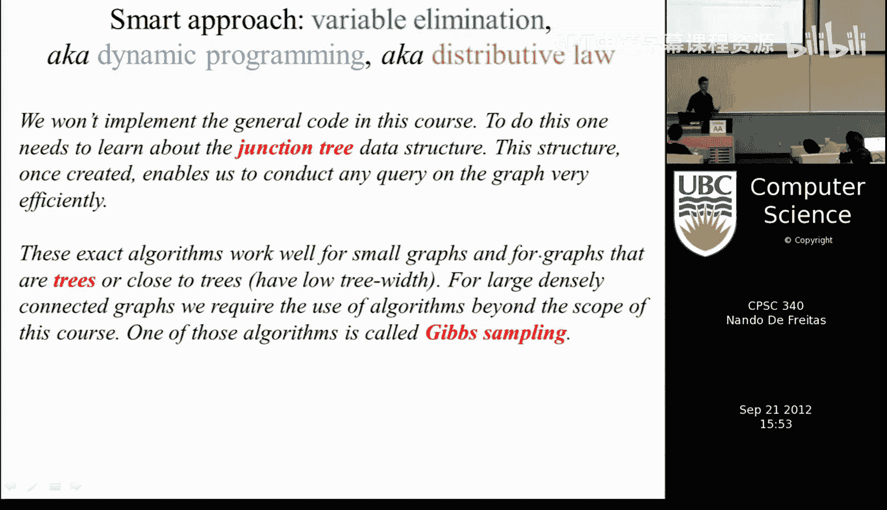