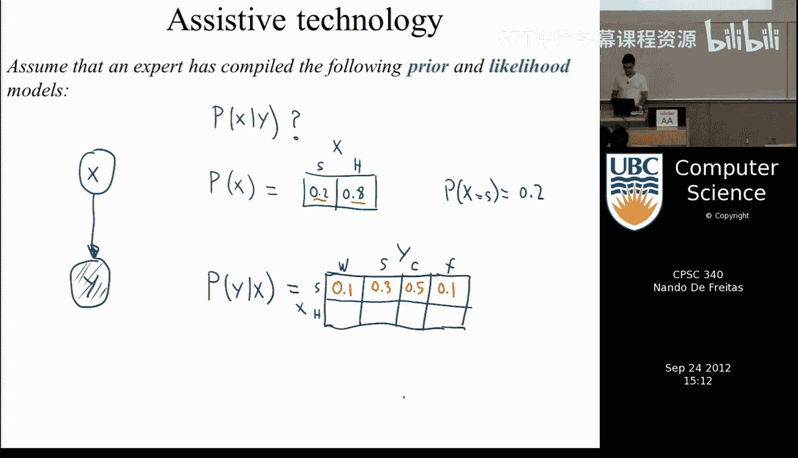
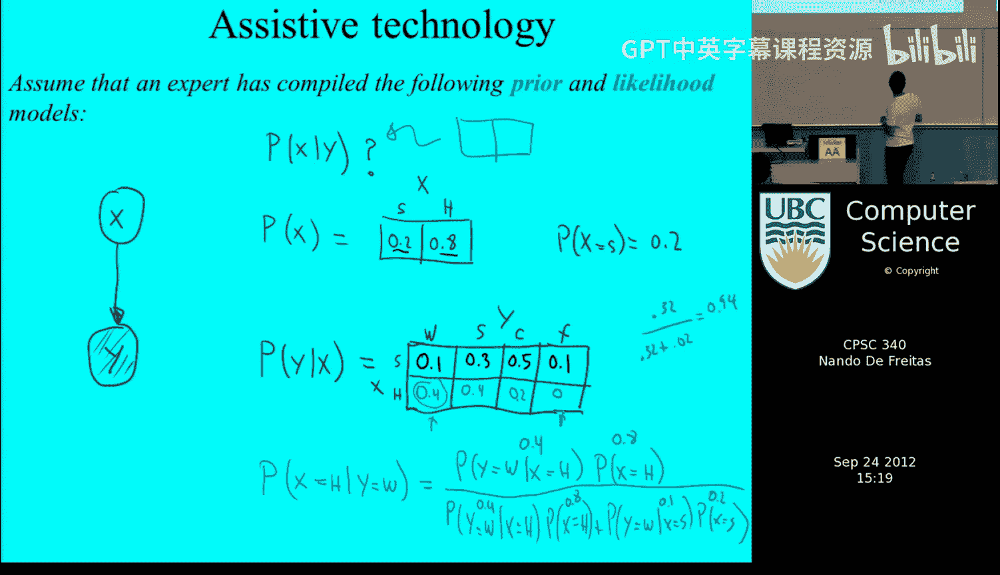
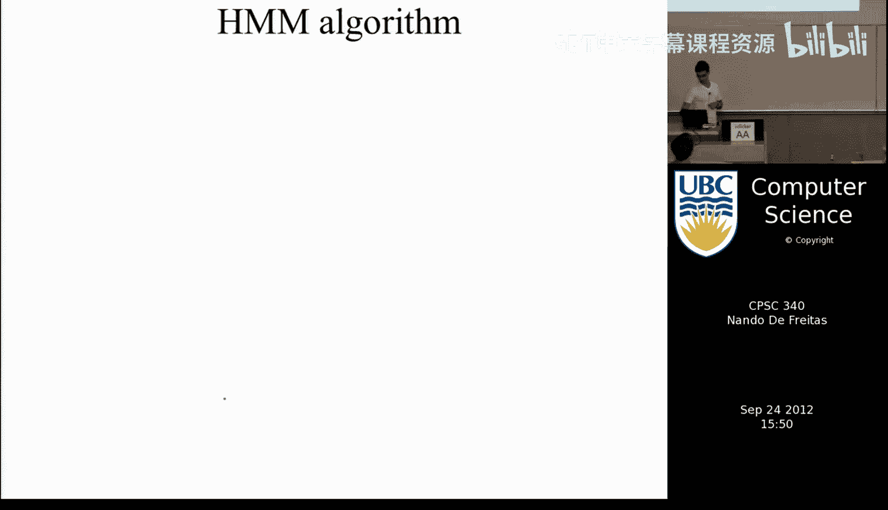
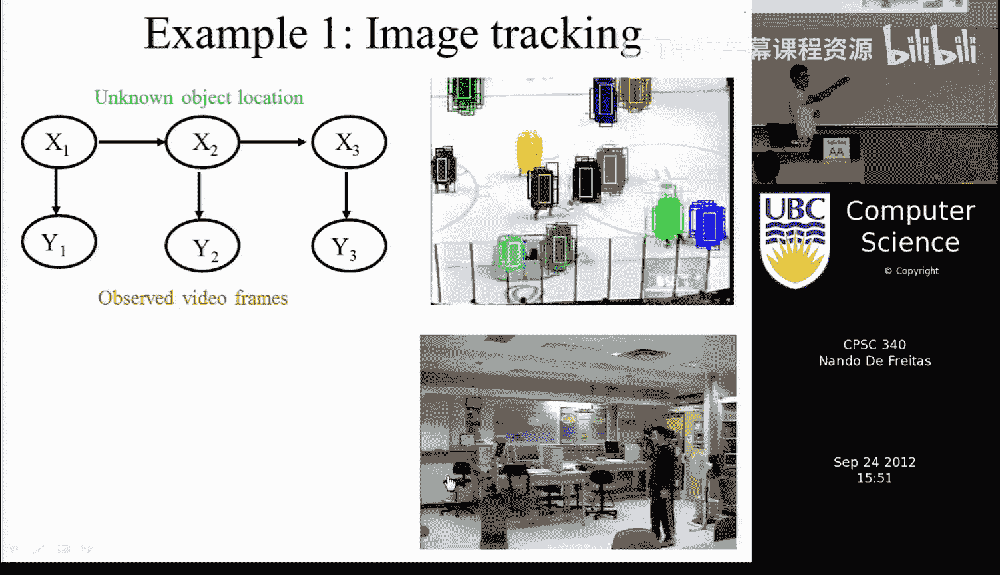
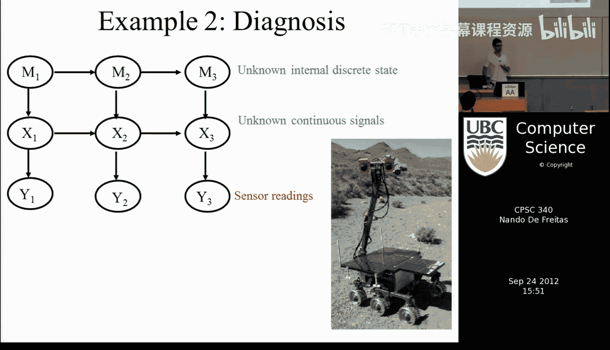
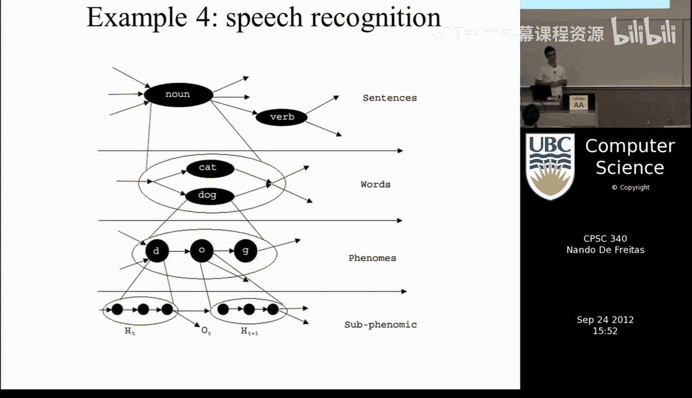
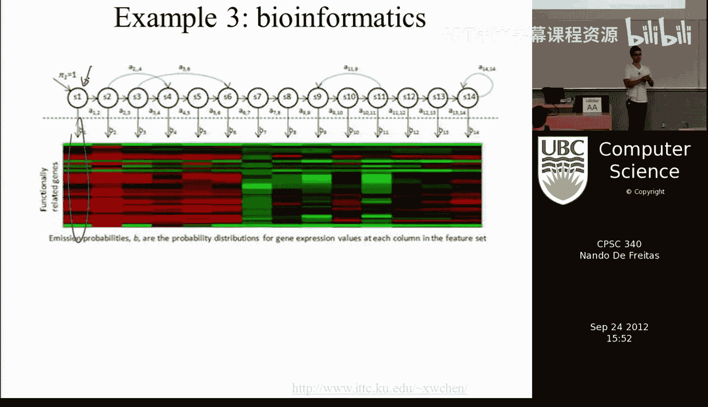
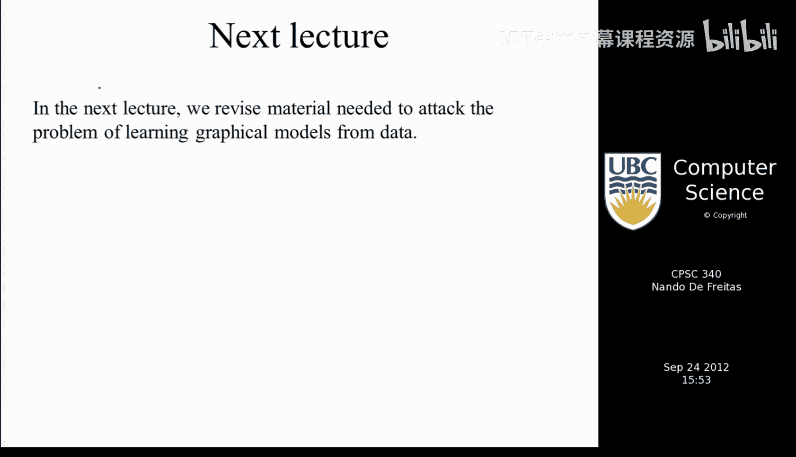

# UBC《机器学习和数据挖掘｜CPSC 340 Machine Learning and Data Mining 2012》中英字幕 p08 -08-undergraduate machine learning 9_ Hidden Markov models - HMM.zh_en -BV1pJ2ABFEFg_p8-

Today the topic of today is to study hidden markov models and like some people already mentioned before。

 these were the models that played a huge role in the human genomeome project。

 they're sort of the key model that's used in sequence alignment。

 and they're also the models that are use for speech recognition so whenever you use a speech recognitionr。

 you're using one of these models and as we will see the going biographical models。

What we've been playing with now so far in person on gives us a very natural way of dealing of being able to understand how these models work。

And how they actually figure out what words you're saying， given the waveform that they receive。

All right， so。So today's lecture will cover these models I will show that yet again it's the basics of probabilitybil conditioning and marginalization that I'm using over and over again。

 I'm not introducing anything new it's always the same two constants if I want a marginal probabilitybil P of x I sum over the other variables not x and if I want to reverse statements I use base rule。

 which is essentially a consequence of conditioning。I will describe PHMM model with a simple example。

And then I will describe the model in greater generality。You need to learn what the model is。

And then you need to learn the two things we can do with these models， which are prediction。

And filtering。 And I will define both of these tasks。

 There is one other task called smoothing and that task I will leave it for the homework for homework。

So。I will introduce HMS with a simple example。 So imagine you have a toy robot like that little guy there。

 And your task is， or shall we say the task of the the。Oh I don't know what I per。Our eye dog。

eye dog has to figure out whether you're happy or sad， okay。

 because you basically don't want eye dog to bother you when you're sad。

 you might want eye dog to come and play with you when you're happy or whatever is a scenario。

And let's say that eye dog checks whether you're watching Game of Thrones， sleepingy。

 crying or doing Facebook。So it can make one of those four binary observations。Okay， so you。

You're right。I， I should say just the。It's trying to figure out whether you're happy or sad。

 It doesn't get to observe whether you're happy or sad。

 Like imagine all it see it sees you watching TV or Facebooking or one of the two other activities。

 So in this case， the observation is actually not binary。

 but the observation is four possible things。Okay， so the variable will take four possible values。

So let's give these names， so the unknown variable is often known as the state。

So I'm trying to estimate a state inside of your head， whether you're happy or sad。嗯。

All I get is some observations from you。And in this case， my observations are W for watching。

S for sleeping， C for crying and F for Facebook。And I will get one of these observations。

 and so the task then will be for me to estimate probabilities like what's the probability that you're happy。

 given that you're watching Facebook？Or what's the probability that you're sad。

 given that you're crying and so on。Okay， so。So that's the game。

 the robot is trying to determine whether you're sad or happy。There's always。

in the world of probability， it's not like you're absolutely happier sad。

 but I only have a probabilistic estimate， like for example。

 if I am the robot and I'm trying to estimate whether he is happy or sad right now。

 I get some observations and in my case I get to see his face I might see his facial expression it's got a red t-shirt and so on I observe a bunch of signals and then I need to know whether he is happy or sad of course I will never in my wildest dreams be able to put myself inside his head and know whether he's happy or sad right now because he might just be a very good actor and he's actually crying inside right now。

Gpher broke up with him a few hours ago， but I wouldn't be able to know that。

 So I can only make a probabilistic assessment。 And that's why I need to use probability， because。

You can always observe。 you can never know everything for certainty。

 There's no way I can know for certainty， whether he's happy or sad right now。

All I can have is an estimate of how probable it is that is up。Of course。

 in order to be able to teach this， I've simplified this to a much simpler example。

 but the same model， once I introduce continuous variables and so on。

 the same model can be used to actually attack the real problem。

The problem of assistive technology where we' trying to build robots that're trying to help people perform tasks more efficiently if you have grandparents who happen to be in old age home。

 they might be struggling to do simple tasks like brush their teeth。

And so one of the things that hospitals are very busy trying to develop is what they call assist assistive technology。

 which is sort of robot technology， whatever that will guide you through the process of brushing your teeth。

And this might sound really stupid， but it actually is。 people will like grab the toothbrush。Brash。

 put it down and then put toothpaste in it and then put it back。

And this really suck when you watch the videos。We're all gonna be there one day。

So if we can improve the technology to help us brush our teeth or do other things that are essential。

To to live just a bit break。 but let's start。With small steps。

 let's attack this very simple example first。Okay， so that's a setup。

And so we already have seen enough to be able to model this。 So we probably would have a node。X。

And then we would say。And that there is a variable y， which is the observations。

We shade this node to indicate that it's observed。And so we know that in order to be able to compute P of。

X， given y。Which is the unknown。We would need a prior， and the prior would just be P of x。

Which will be a table。With two entries， which might be， I don't know， 0。2， 0。8。

 and this would be sad， this would be happy。so this is a distribution of R x。

And then we might also have a distribution of a Y given x。 So we might have。P of y， in other words。

 let me just make that clear， P of x equals s。Equ equal to 0。2。

And we might have a distribution of P of Y given x。Which might be。We have two x's。

And we have four wire？So we need a table with。More possible Y values。And for x， we have two values。

So X can be sad or happy。And X can be what was it watching Game of Thrones。W， sleeping。

 crying or face。Sleeping。Crying。Or Facebook。Now， let's assume for now。That these numbers are given。

 An expert told you that humans are 80% of the time happy and 20% of the time sad。For now。

 we're always assuming that these numbers are given to us。Later。

 especially toward the end of this week and next week。

 we're going to learn these numbers from just data， just from observation。

 but for now we need to first assume that we have these numbers。

Because once we can solve the inference problem， the learning problem will be easy and then the two will actually be intertwined。

 but first let's learn to do inference and then we will attack the more general problem。

So given that these the numbers I give， and maybe we have now an expert。

And let's pick an expert from the audience guy up here in front。

 What's the probability that you watch Game of Thrones when you're sad？Point1。Next person。

What's the probability that。What was us， what's probability that you sleep when you're sad？3。

What's the prosi that you cry when you're sad？Oh， I can't have a point eight。I can't have a point8。快。

05。Okay， what's the last number got to be。Po1， okay， because probabilityities have to sum to one。

 This is a distribution of a y。 Y is the variable。 X is given。It's a distribution over our y。

 the four values， given any possible instantiation of x。The distribution of a y sums to one。Okay。

 and let's pick some， okay， I'm going to do now my own numbers。

Make it clue。When I'm happy， I definitely watch Game of Thrones。0。 oh。

 but I really like to sleep too， so let's make it 0。4， 0。4。0。2 because I would rather a cry。Okay。

All right， so we have our model。This is not an intended anti Facebook ad。All right。

 and then I can do stuff because now I can say， what's the probability that x equal， and by the way。

 this probability。That has two values。就。Because it's a distribution over x。

You're either happy or you're sad。It's P of x given that you've seen a Y。

But it's really a table with two values that add up to one。So I might， for instance， ask。

 what's the probability that I'm happy given that I？Watching Game of Thrones。

So given that y is equal to W。And so that's equal to p of y equal w given x equal h。

Times the P of x equal h。Normalized。By peel。Y equal W given x equal H。Time p of x equal H。Plus。

Q of y equal。W given x equal si times P of x equals s。Okay， that is based rule。All right。

 so the normalization constant is the thing that makes。some of the two possible things that。

Nummerator could be so that you get a distribution that sums to one。

And what you can do next and I'll leave that as an exercise for you。

 all that's left is to read the numbers in the table and plug them in and you're able to compute the probability that you're happy。

 given that you're watching Game of Thrronones， actually given that this is。

Sometimes having some numbers helps， let's do the calculation quickly。So， this would be。嗯。

W you given an x equal h。It's this guy here， 0。4。Probability of x equal h is 0。8， so this would be 0。

4 times。0。8。And then w given x equal S is 0。1。And x equal S is 0。2。

OkayAnd does anyone want to calculate that？You you have a calculator， so that's 0。32。Roughly 032。

Divided by 032 plus。0。02。0。9。Okay， so the conclusion is that if I'm watching Game of Thrones。

 I'm really happy。Which is absolutely true。干是两个是。TheyThey're all great。Okay， so。That's。

IfIf you're a different kind of person like him。That' line game of Thrones， he would probably put a。

 I don't know， 0。2 over here， and maybe he would put 0。8 there or whatever。😊。

And so a different conclusion would say you would personalize these numbers to each person and once the robot knows these numbers。

 the robot will be able to always know what's the probability that you're happy or set。

So in this case， the robot realizes that a priority it believed with 80% probability that you're happy。

 but once it sees a little eye dog sees a， Naanddo is happy most of the time。Oh。

 but he's watching Game of Thrones， wow， he must be really happy， so let me go and play with him。

And Naander gets annoyed because he gets distractstructed。The show。啊。It's good at C matters。Okay。

 but here we assume that we have this general pride， which is kind of artificial。

 I kind of like the observation model sort of makes sense。

 You can very easily build an observation model that says what happens， how sad or happy you are。

 given all these different scenarios。But the p of。Being happy or sad， that's a bit artificial。

 Go ahead。 let's I just if。Sleeping has nothing to do with being happier or sad。Would it be 0。

2 and 08？Or would it be like would the probability of。Yeah， or would it be 0。5 and 。

5 like would mean are you talking about the numbers inside the table？Or yeah， I'm saying。

 what does it mean if there's no。If given。Its the same as that。

Given' there's no effect of it being given， there's no relation they're independent。Then。You。

 you could still the whole ability being。Let me take the question of why。You could still。

You could this is the I'm giving you the general case。

 You can now come up with small cases where you know some like some of these centers might be zero or so on that will give in natural inencies。

 but let's。And tackleack that after class。 So those would be special cases， but it would still apply。

 So to convince yourself， you can just。Create your own numbers， plug in their zeros and so on。

 and derive right base rule consequences of it， and then you'll see what it actually means。嗯。

We lost all the red frame your slides， can you see a moving to the neck。

哦。咩。Okay， thank you。Let's see if I can。Okay， that's better。Okay， so however。

 sometimes what you don't， someone doesn't tell you whether you're happy or sad。But someone might。

What's a probability that you're happier sad， But what might be more natural to say is that。嗯。

Perhaps when you're。Happy。You remain happy。And when you're sad， you remain sad。

So imagine that this robot。 So you don't want this robot to be doing the same calculation。 every。

 you know， this robot will be doing the same calculation every。嗯。

Let's come up with a unit of time every hour。Every hour it does robot to trying to figure out whether you're happy or sad and doing the calculation from scratch。

But now， if the robot knows that you were happy for the last five hours。

 most likely you're still happy， people don't just are all like emo， happy， sad， happy， sad。

 unless they have a dysfunction。Ass you're not bipolar， you probably。嗯。When you're happy。

You remain happy。So 90% of the time。And say 10% of the time you go from being happy to sad。

So now I'm introducing time。And I'm going to use x2 to indicate a time after。

An x1 to indicate the time before， just like with did with the when drawing balls from the arm。Okay。

 let's say when you're sad。You tend to stay sad。So this is basically saying the state that youre sad。

 given that you were sad the previous hour。Is 0。99 people who are sad tend to stay sad。

 People are happy tend to be happy。 So this prior now encode how we over time。

Feel or how my emotional state evolves over time。I might also have an initial prior。

And that initial prior。Basically， it's more like。What we had before。

 which is how often you're sad and how often you're happy。At the beginning。

But now let's assume we're in this dynamical situation where every hour the robot gets an observation。

And so what we really want the robot to do is assume that you were given a sequence of observations like you were watching Game of Thrronones and you went to Facebook and you started crying。

Okay。I should ask you how many of you think that this person is happy at this stage。

And so what we really want to estimate is given the sequence of observations。At any point in time。

 and in this case， the point in time is three。What is the probability that you're happy？

But you know whether you're happy， it helps to basically keep track of all the observations you've had。

Okay because we're assuming that people unchanged emotional status that oh。And clearly。

 if you know the sequence， it helps。Because if over the last three hours。

 you cried and cried and cried， chances are that you're sad。😔。

But if you were watching Game of Thrones and then you had a little cry and you went back to watch Game of Thrones。

 then maybe you were just watching I don't know， like a really emotional part of Game of Thrones in which it's cry。

 not necessarily because you're sad， but because you。We were just so happy to see those dragons。哦。

Okay， so the sequence helps。All right。Let's now， instead of saying just for time three。

 let's be a bit more general。 So now I'm going to introduce a time index and that time index is going to be T。

So T is going to den no time。And so our model now will consist of an initial model。

Which is a table with two values。It will consist of a table。That tells you how you evolve in time。

And that's going to have four values。That's what we just on the previous slide。How often you？

And of course， it also has the observation model that we came up with。Which。

Had two rows and four call。So those are the four sorry the three objects that we have introduced so far。

 you have an initial state and then we can also draw this with this is where graphical models come in and really help us a lot because we can just draw a nice graph that illustrates these objects。

So essentially you have an initial state， x， it's an unknown variable。

From xn via the transition model。You transition to x1。And then。A fo transition。

You make an observation。Which we shape to indicate that it's observed。

Then you transition to another state。And you make an observation。White。And so on。

So this graph will be increasing over time。Okay。And so if we just text say the first for two time steps。

嗯。We have that the probability。Of x naught。X1， x2。Why wine。And why2。I see equal to p of x0。

Times P of。Y1 given x1。Times P of y2 given x2。Ts p of x1 given x0。Times P of。

Which one am I missing x2 given x y？So if you expand， if you use the rules。

 which is of a graphical model is described by the provo of each variable given its parents。

X not has no parent， so you just put x n。Each y only has one parent。

 which is the x corresponding to it。And each x has only one parent as well， which is the preceding X。

So the idea is you're in an emotional state， you evolve to another emotional state。

 and then you exhibit certain traits。And the point of writing this。Is to show that。

The only things that appear in these expressions are P of x n， which we have。

All of these guys are just observation models， which we have。

 and we will assume that the observation model is the same for all time steps。

So you have something that adds up to one here。Okay， so something like that。

And each of those guys is the same。P有。This is for all tea。P。

 so it is true for t equal1 and for t equal2， we use the same numbers for each P of Y T given xt。So。

So by using that， then the only numbers I need to represent this whole graph over time are those numbers that I have there on the screen。

Okay， so we only need6，8。9ine around。This is an HM。Questions。你得 name咩。Yeah I didn't hear you my。

Why hidden？Oh because there are things， so the idea is there are things you can observe and things that you can't observe。

 so from the things you observe， you try to infer the things you can't observe。

Just like the example I had before， I can observe things about him。

 but I cannot observe if he is happy， so I just try to infer in my head。This is an important thing。

 Newborns， there's a very nice TEed talk， which shows like newborns， for example。

 are or like three year olds are incapable of knowing that other people can have beliefs in their heads and so they can actually not。

Do the sort of reasoning that we do because。They don't know that there is a state out there。

I was just asking why the bottom。How billion has speed。Sounds like deepp。Oh， okay。

 that is because this is X can be happy。Let me make sure that I match it to what I had before。

Can be sad or happy。And then why， because this is the distribution of a why， why can be watching TV？

Sleeping， crying。Facebook。And this is for sad， happy， going to sad， happy。And it a sad happen。

 And what we're saying here is that the numbers for P of y1 given x1 are the same as the numbers for P of y2 given x2。

O。That's what I mean by this symbol， which means for all T。Okay for any T。

 you always have the same model， you only have one model。

 which is how you go from x to y and how you go from1 x to the next x。好。

On the left hand side of the equation， I'm not sure I understand what the significance of that term is。

 like what does it mean the poly of X， not anex。what are you trying what does that tell us？

This probability here this probability is not going to this is just the probability of the full graph。

 the full joint is not going to be very you actually make a very good observation this is not going to be very useful to us what we really we don't care about is a probability what you really just care about is what's the probability of x given the sequence of observations what you really care about is this quantity here。

Any X in time given observations， and in fact， this is the thing that we will focus on。

But this is just to make sure everyone understands what the model is saying。

 The model is just a graphical model。We have a graphical model that essentially has this。

 it's a sequence。And then instead of writing each note A， B， C， D， E F。

 which I will run out of letters soon， I prefer to just use x1， x2。

 x3 and x4 to indicate Dx's as they both over time。

A current observation effects only our current state。Oh， that's correct。That's what this propheing。

That's like a big assumption for when we are modeling the problems。It is。

 but I will show you soon that that assumption is not even with that assumption we can do a lot of very cool things。

 also once you learn to do this one， it's very easy for me to explain to you how to relax the assumption and do more interesting things。

 which I'll get to at the end as well。Okay， let's move on。

So my goal is to compute x given a sequence of observations。Now。

 instead of writing a particular sequence like price leave， watch Game up Thronees。

 I'm just going to be lazy and I'm going to introduce this notation over here。Why1 to T that means。

T observations you've made up to time T。Okay， so before， for example， if we had observed cry， cry。

 cry。We would have y1 equal p y2 equal p y3 equal p， in that case， t would be3。When I write y1 to T。

 what I mean by that is y1， y2 all the way up to Yt。Okay， so I always use this notation that x1 to T。

Means。X1。X2 all the way to xt。So it's just Python notation because it's a lot easier to write the left hand side and the right hand side。

 a shorter notation。And it's very standard notation。

 So if you read a paper on speech recognition and so on， this is the sort of notation you need to do。

In finance， all of econometrics uses this notta。Okay。

 so your goal then is to compute P of X D even y1 to T。But you want to do this for all tea。

So the idea。We make an observation。So you start with P of x not。You make an observation。

 you compute P of x1 given y1。You transition， you make another observation， you compute P of x2。

 given y1 and y2。And so on。So in essence， you start with P of x n。An observation comes in。

And you use that to compute P of。X1。Given。Why1？Another observation will come in。

And you compute P of x2， given y1 and y2。Which is equal to using my short notation。1，1，2，2。

Then y3 comes in。And you compute P of x3， given y1，2，3。And so on。

We're going to break this a little bit more into two steps called prediction and ba in up plate。

 but essentially this is what we're doing every time we get a new observation。

 we recompute our posterior probability。Each of these guys。This is very important to keep in mind。

 each of these guys is a table like this。Right because it's always a distribution。The why is given。

X is the random variable。 So each of these guys that you're computing has a table。

 and the table tells you how sad。Or how happy you are。And you might start with 0。2 and 0。8。

 then you become really happy。And then。Hel breaks loose， and then you start recovering。

So it describes over time whether you're happy or sad。And。There was one hand up。

 go ahead I'm just wondering like you have on Y3， you have Y1 to Y3， all of them there。

But why would that be necessary， Because can't you just derive that from Y2 because Y2 depends on whywa。

 And so why do you have to go up。Why1 does not depend on y2。So let's go back to an example。

Game of Thrones。The observations。So this is y1， y2， y3。So if you're crying。

And then there's Game of Thrones。 And then you're crying。The wises don't depend on each other。

I'm not making that assumption。I'm making the assumption that your emotional state does depend on your previous emotional step。

 but what you're doing does not depend on what you were doing before。对。

You might want to have a model where you do want to include that dependency。

 but let's leave that as an advanced topic which it's not really advanced。

 but let's deal with this case first， so my model is only saying that your emotional state depends on the previous emotional state。

And my model says that what you do is a function of your emotional state。ディスかッションですよ。

It is dependent on your previous emotional state， but that previous emotional state is dependent。

Observation。Yes， so we get into this nested recurrence and what we're about to do is how to compute that nested recurrence。

Because indeed， this is what it's going to do。As we will find out， you know so。

So given all the observations you've had up to now。

 you're going to compute just what's your current x。So you don't need to look at y2 and Y1 again。

Well， you have them in memory， so assume that you have the effect is being passed to you。

The important thing is that this guy here， what the value of this guy will depend both on what you were in the previous step。

 and it also will depend on the current observation。That's the key thing。

Whether I'm happy or sad now， it depends on whether I was happy before。

 and it depends on whether I'm watching Game of Thrronones or。or whether I'm crying。

 so essentially my current state of mind depends on two things， what I'm doing。

 and what my previous state of mind was， and what this will do is it will allow us to combine both。

So is it possible that。这没意思。Would cause us to revise our estimates for previous definitely the case。

 and that's a problem called smoothing and that will be in the homework。Okay。

 but let's go one step at a time。 So the first thing is we're going to derive a recursion。

 which basically， so this is what I'm going to assume。I'm going to assume that I know this。

And I will show you how I can compute this guy， given that I know。The previous guy。Okay。

 because if I can compute。1， given the previous one， then I can compute the next one。

 given my current state and the next one， given。And so on。 So I can keep a recur。

 So I started theex node。Then I get P of x1 given y1。

 given that I know this when I get P of x2 given y1 and2。

 and given that I know this when I get P of x3 given y1 and3。

 So if I know the previous one and I know how to compute a new one。

I basically can compute all of them。And we'll just simply assume that。 I have。

So essentially we doing induction， we're going to assume that we have a reasonably good guess of this guy。

It will turn out that even if you have a bad guess of that guy， this will still work。

Because you might start badly with a bad estimate， but over time that estimate will improve。

So even if you start with， I guess， that's not。然后。The best possible guess。

 you will still be able to eventually do well。Okay， so we now need to do a little bit of。

Allgebra to derive this。 So let's assume that we're at the part of the model where we have xt minus-1。

Yt minus1。t。怀痴。In order to compute P of X D。Given y1 to t minus1。

What I'm going to do is I'm going to sum over all possible values that xt minus1 could take。

Which are either。Happy or sad。P of X T。And x t minus1， given y1，2， t。I'm just。I've just done a trick。

Of marginalization， I've added x2 -1， and I sum over it to get rid of it。But this trick， however。

 will allow me to do the following。It will allow me to rewrite this as the sum。Over x t minus1。

Of P of X T。Give an xt minus-1。And why1 to t minus1？Times P X T-1， given while 1，2。千万ナ one。

I've used two rules so far， one rule that I used was that P of A given C is equal to the sum of a B。

Of P A and B， given C。So this is marginalization， but given a particular fact。

And I've used the rule that P of。A and B， given C。Its equal to here of a。Given B and C。

Times P of B given。Okay， those are the two rules that are gifts。

So it's basically marginalization and conditioning。

 but when you have something that's been given to you， so the rule still applies in that case。Now。

Now comes the really interesting part in the derivation。X T， so this one I have， right。

 because this I'm assuming that I have the previous guy。

 so I have this little table of two values from the previous iteration。But there's not a probability。

And they do get scared with all these indices， but they're really just small tables that you'll see in your homework easy to implement in。

 That one is tricky because it has this dependency of y1 to t 1。But， here is the trick。Xt。

Give an x T -1。Does it depend on y t minus1， no， exactly， because given your parents。

You become independent。 It's outside a Markov plan。So we can drop this。And we can rewrite this。

As a probability of an x T -1。Of P of X T。Give an x T minus1。Times p of x T。inus1， given y1，2。

 t minus1。All right， so we're done， we have a way that if we start with a small table and given that we have this other table。

 we can compute this state。The rest is just plugging in numbers for any perfects。

 but we now have a way of going from。Xt -1， given y1 to t -1 to xt， given y1 to t -1。

So we're able to predict the next X。Predicick what X will be tomorrow。

So you observe a bunch of foreign exchange rates， y1， y2， y2， the foreign exchange rate at each date。

 and you might just be predicting the volatility of the market and which is x and the volatility。

And you're predicting what the volatility will be tomorrow， given the prices you observe today。

And this is done routinely in the stock market。We use the same models。Okay， the other step。

Is we need to compute。P of xt。嗯。Okay， I'm just going to write given but short of time。

 I'm just going to write a rule P of A， given B。And see。Is equal to P of B given A and C。

Times phi of a given C。Divided by P of。B given C。So this is a generalization of base rule when you're given a context C。

 so basically it's exactly a base rule you swap A with B。

 and at the end of each expression you just put a C。

And the exact revision of this is in the Google group。Okay， someone posted a photograph of that。

 so I'm going to skip the derivation and instead I'm going to let the TAs go over this in their tutorials today and Wednesday。

And I'm going to use that over here。P of XT。Given y1。主题。Its equal to P of xt。

Given yt and y12 t minus1。So I'm just flirting whiteT。Next， I apply base rule。Basically using A， B。

 and this guyS C， and I can write it as P of Yt， give an Xt。Pma y1 to t minus1。Times P of x T。

 given y1。To t minus1。All of this over the sum of X T。Of P of the normalizing fact。

Which is just sum over Xt of everything that appears on top。

The next step and final step is to make the following observation。When x is given， when xt is given。

 does Yt depend on the past。No， because given your parents， you're independent of the past。

 given your Markov blanket is just your children， your partners and。Your parents。So because of that。

We can finally write this just as P of Y T， given X T。Times still。X T given y1 to t -1。

And then we just again， normalize by Xt。And。The important things here is that we compute this in the prediction step。

 this we have because that's observation model， so given that we have an observation model and that we've been able to predict the state。

 we can compute this guy。And we're done。有不 in。In the previous slide。は。Theres。So in the prediction。

For the prediction I need this guy， I have this guy so I can compute a prediction。

So I can compute this。 What information do we need to have that table where。The one by two。

This table here。Yeah， well you start with P of x n， which is just two numbers。

 so you get the next one and you get the next one and then you get the next one and the next one and the next one。

 so you start with X1。So we do precisely what wasn't the sequence， we get this guy。

 then we get this guy， then we get this guy and then we get this guy。

 but each of these steps is broken into two sub stepss， which is prediction and update。

 prediction update， prediction update， and that's the HMM algorithm。

 that's the HMM filtering algorithm， and that's how you do it with speech。

So just quickly now before you guys go away。

So。If x could be an object location like。So x could be an object location。

 say observations that you're making an image and then x is the location of the object。

 and this is what we use so that a robot can see where you are， the robot just gets an image。

 a video and the robot tries to infer a latent variable which is your X Y coordinates and a scale and so on。

You have models that might have more variables， like for example， marsh rovers use this。

 they want to estimate internal whether the wheels are broken。They need to self repair。

 So in order to solve because it takes too long to send a signal to Mars， you can't remote control。

 which take half an hour， and it can only be done in a window of two hours to send you a signal there。

 So the robot has to give in some observations， figure out whether it's real is stuck or whether something is broken。

In speech recognition， you start with sound waves and then there' is the sort of hierarchical HMM where you start getting the phonemes and then you get words and then you can even get some syntax features will be like you have no phrases or word phrases。

And then also in bioinformatics， you might have。 So in this case， each each of these guys。呃。

Could be a vector that indicates how much each gene gets expressed。

 and then given how much its gene is expressed， you're trying to determine some trait of the patient。

 how the patient is reacting to a tree。For example。 So these models are very widely used。

 but they essentially just involve those two very simple steps， prediction and update。

 And then you just interlace them。

That's it today。Yeah。Okay。Oh。Yeah。Yeah。

Okay。