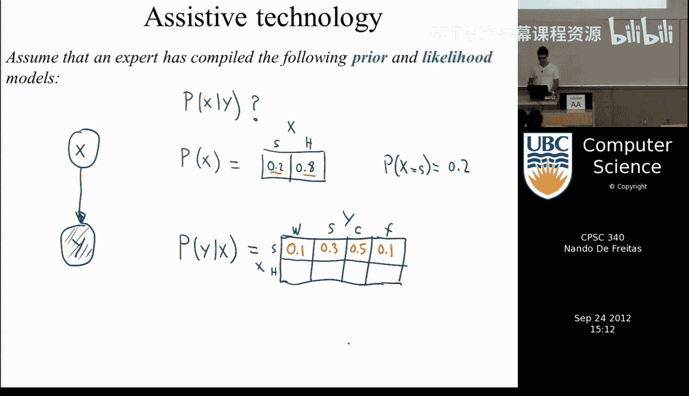
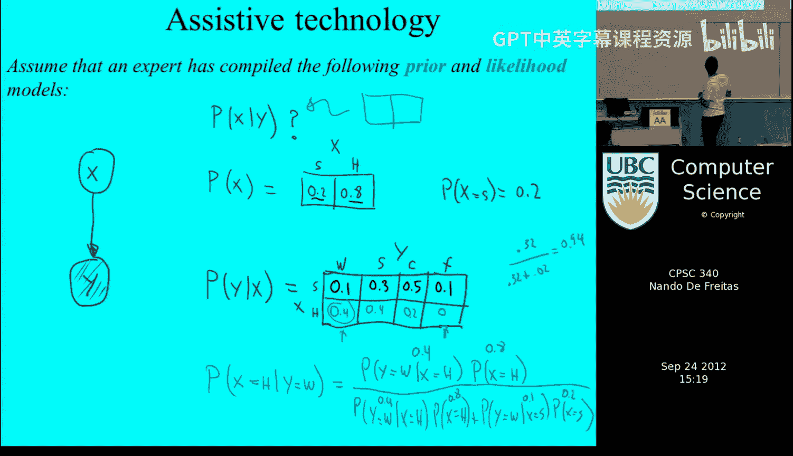
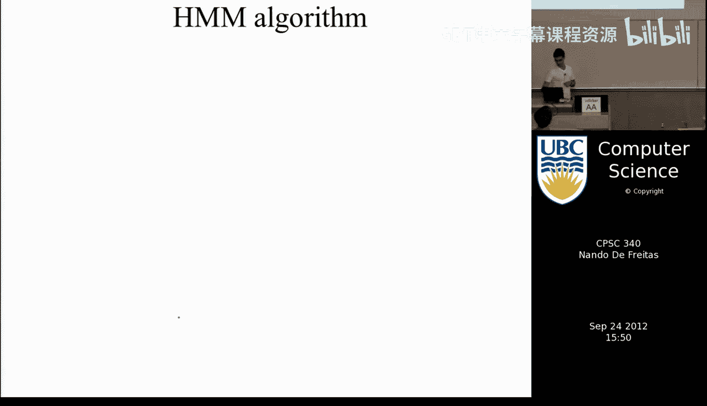
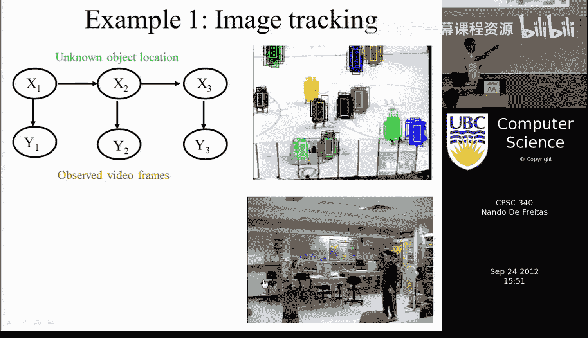
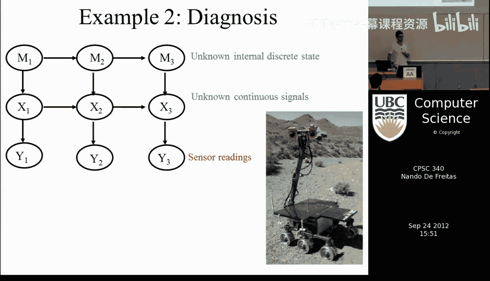
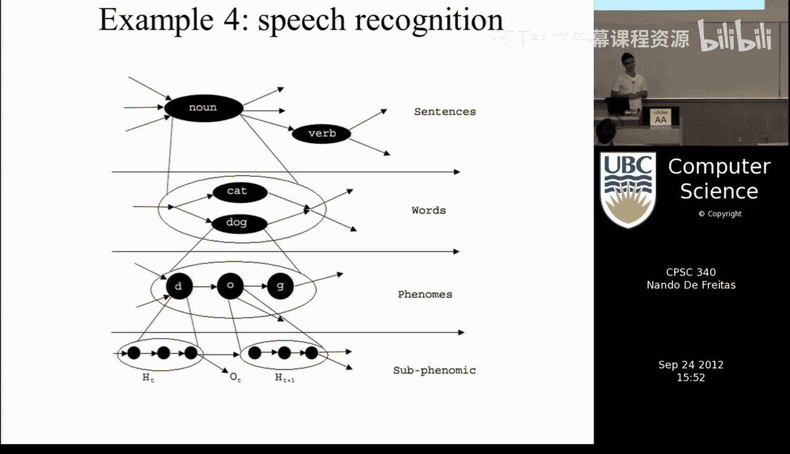
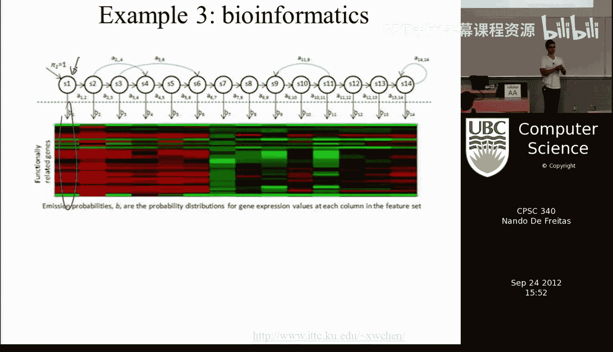
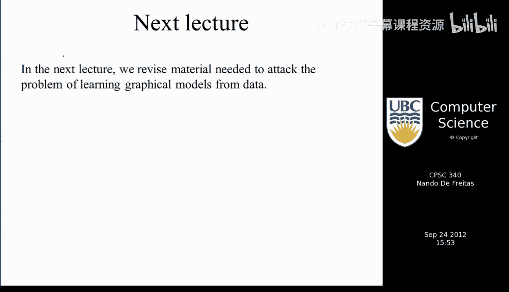

# 机器学习与数据挖掘：08：隐马尔可夫模型 (HMM) 🧠

在本节课中，我们将要学习隐马尔可夫模型。这是一种在序列数据分析中至关重要的模型，广泛应用于语音识别、基因组测序和金融预测等领域。我们将从一个简单的例子入手，理解其核心概念，然后学习如何使用该模型进行预测和滤波。

## 模型简介与简单示例 🤖

想象你有一个玩具机器人，它的任务是判断你的情绪是快乐还是悲伤。机器人无法直接观察你的情绪，但可以观察到你的行为：看电视、睡觉、哭泣或刷社交媒体。我们称你的情绪为**状态**（用 `X` 表示），机器人的观察为**观测**（用 `Y` 表示）。状态是隐藏的，观测是可见的，因此这是一个“隐”马尔可夫模型。

为了进行概率推断，我们需要三个组成部分：
1.  **初始状态概率** `P(X0)`：表示在初始时刻，你是快乐或悲伤的先验概率。
2.  **状态转移概率** `P(Xt | Xt-1)`：表示在给定前一时刻情绪状态下，当前时刻情绪状态的概率。例如，快乐的人下一时刻很可能保持快乐。
3.  **观测概率** `P(Yt | Xt)`：表示在给定当前情绪状态下，做出某种特定行为的概率。例如，悲伤时更可能哭泣。

这些概率通常以表格形式给出。例如：
*   `P(X0 = 快乐) = 0.8`, `P(X0 = 悲伤) = 0.2`
*   `P(Y = 看电视 | X = 快乐) = 0.4`, `P(Y = 哭泣 | X = 快乐) = 0.1` 等。

有了这些，我们就可以使用贝叶斯规则计算后验概率，例如 `P(快乐 | 观测到看电视)`。

## 引入时间序列与图模型 ⏳

然而，人的情绪具有持续性。如果机器人知道过去几个小时你都很开心，那么你现在开心的可能性就更高。因此，我们需要引入时间维度，将状态和观测序列化：`X0, X1, X2, ...` 和 `Y1, Y2, Y3, ...`。

这可以用一个图模型清晰地表示：
*   每个状态 `Xt` 只依赖于前一个状态 `Xt-1`（马尔可夫性）。
*   每个观测 `Yt` 只依赖于当前的状态 `Xt`。

整个序列的联合概率可以分解为：
`P(X0, X1, ..., XT, Y1, ..., YT) = P(X0) * ∏_{t=1}^T [P(Xt | Xt-1) * P(Yt | Xt)]`

我们的核心目标，是计算在给定截止到当前时刻的所有观测序列 `Y1:T` 后，当前状态 `Xt` 的概率分布，即 `P(Xt | Y1:T)`。这个过程称为**滤波**。

## 滤波算法：预测与更新 🔄

滤波可以通过一个递归过程高效实现，该过程交替进行两个步骤：**预测**和**更新**。假设我们已经计算出了上一时刻的后验概率 `P(Xt-1 | Y1:t-1)`。

**1. 预测步骤**
预测步骤的目标是，在纳入**新的观测 `Yt` 之前**，估计当前状态 `Xt` 的概率。这通过将上一时刻的后验概率与状态转移模型结合来实现：

`P(Xt | Y1:t-1) = Σ_{Xt-1} [ P(Xt | Xt-1) * P(Xt-1 | Y1:t-1) ]`

这个公式的含义是：对 `Xt-1` 所有可能的状态（快乐/悲伤）进行求和。对于每一种可能，用“从该状态转移到 `Xt` 的概率”乘以“我们之前认为处于该状态的概率”。这本质上是对 `Xt-1` 的**边缘化**。

**2. 更新步骤**
更新步骤的目标是，当**新的观测 `Yt` 到来时**，用这个新信息来修正我们的预测。这通过应用贝叶斯规则来实现：

`P(Xt | Y1:t) = ( P(Yt | Xt) * P(Xt | Y1:t-1) ) / ( Σ_{Xt} [ P(Yt | Xt) * P(Xt | Y1:t-1) ] )`

这个公式的含义是：分子是“在当前状态下得到该观测的可能性”乘以“我们之前对该状态的预测概率”。分母是一个归一化常数，确保所有状态的概率之和为1。这里的关键在于，给定当前状态 `Xt` 时，新的观测 `Yt` 与过去的观测 `Y1:t-1` 是独立的。

通过交替执行预测和更新步骤，我们可以从初始概率 `P(X0)` 开始，随着每一个新观测的到来，持续地估计当前最可能的状态。

## 模型的应用与扩展 🌐

隐马尔可夫模型是许多强大应用的基础：
*   **目标跟踪**：`X` 代表物体的位置，`Y` 代表视频帧中的图像特征。
*   **设备诊断**：`X` 代表机器内部组件（如火星车车轮）的健康状态，`Y` 代表传感器读数。
*   **语音识别**：`X` 代表音素或单词，`Y` 代表声音信号的声学特征。更复杂的层次化HMM可以建模从声音到单词再到句法的整个过程。
*   **生物信息学**：`X` 代表DNA序列的功能区域（如编码区），`Y` 代表测序得到的碱基序列。

这些复杂应用的核心，仍然是基于概率论中**边缘化**和**条件概率**（贝叶斯规则）这两个基本概念所构建的预测与更新递归。

## 总结 📝

本节课我们一起学习了隐马尔可夫模型。我们从判断情绪状态的简单示例开始，引入了隐藏状态、观测、初始概率、转移概率和观测概率等核心概念。通过图模型，我们理解了状态与观测之间的依赖关系。最重要的是，我们推导并理解了滤波算法的两个核心步骤：**预测**（利用状态转移模型向前推算）和**更新**（利用新观测通过贝叶斯规则进行修正）。这个递归算法使得HMM能够高效地处理时间序列数据，并广泛应用于从机器人技术到生物学的众多领域。