# UBC《机器学习和数据挖掘｜CPSC 340 Machine Learning and Data Mining 2012》中英字幕 p09 -09-undergraduate machine learning 10_ Expectation, probability and Bernoulli mo -BV1pJ2ABFEFg_p9-

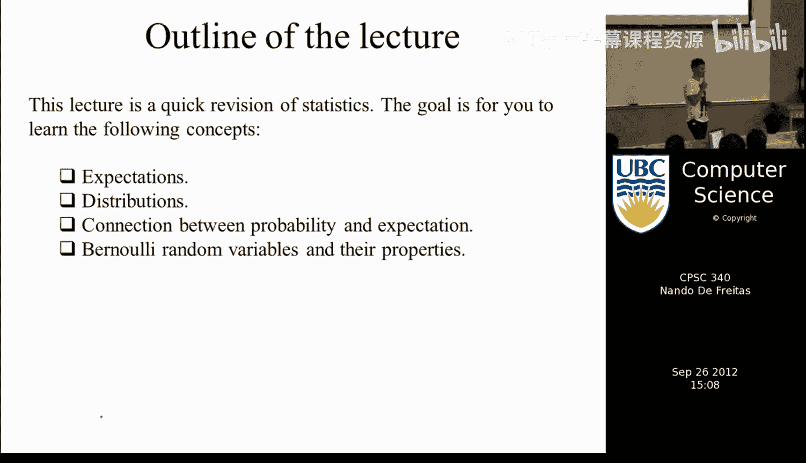

By coming。给不。Given all the information you have in your head right now。

 what do you think is the expectation that I will rank tomorrow。 Okay， the guy over there。

 give me a number between 0 and 1。For a， the probability that it will rain tomorrow， B。

 the expectation that it will rain tomorrow%。Both 40%， so he's saying they're just saying。

They are because it's a  zero1 variable。So it's zero times of probability plus one times the probability。

 and so you're just going to one councils and you get in that particular case for Bernovia variable is the same。

He summarized today's lecture。He didn't get that。

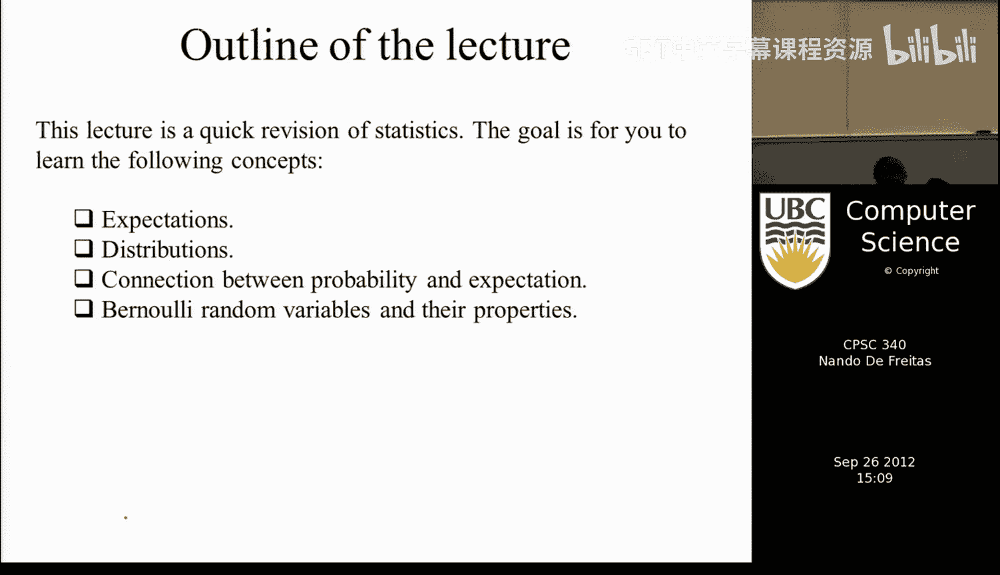

I will go over it in detail。Okay。First。Let me introduce。The concept of a random variable。

 so in particular we're going to focus first on binary random variables。

 I will then relax those to continuous variables and multivalued variables。

 but it's very useful to learn first binary variables because every concept about binary variables extend naturally to other type of variables。

And binary variables are sort of easy to think about。Okay， so。

So a binary random variable is just a mapping from。Wed defined it loosely before， from all。

From the sample space to a set of events that you care about， we did an example before， where。

 for example， for a die， we have the sample space， we defined it to be all the values that the die could take。

1，2，3，4， five， or six。

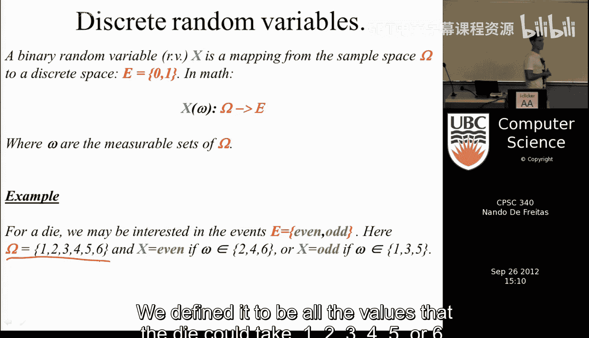

But you might not be interested in talking about one，2， three， four， five， or six。

 you might just be interested to talk about even or odd。

In which case your events are just even and odd。And so you have a variable x。

And this variable will be even when you're。Event is 2，4 or 6 is in the set，2，4，6。

 and the variable will be odd when the variable is in。When you're one of the events，  one，3，5 occur。

So， there's。There's notion that。A die can take many values。

 but you might just care about sort of an aggregate of some values。

 so you might just consider want to know about some sets， even an odd。

 and so you now define a random variable to be this mapping from omega to just even or odd。

 if omega is 2 x is1 if omega is 3 x is0 and so on。

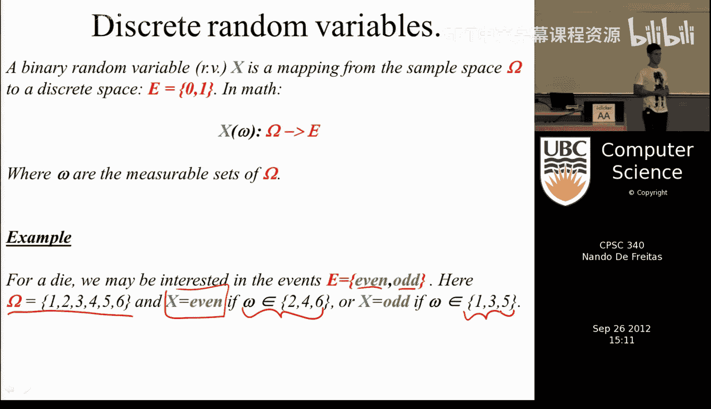

We use plots to describe random variables and one plot that we use is the probability distribution。

 and that one is easy， we've already used them in the course。And。For our example， where we have。Even。

And odd。We have。This distribution for x。H， the variable X。

And I'm going to plot the probability of the variable。And that's just going to be two bars。

That indicate。The height。What's the probability of even， what's the probability of it。

 so we talk about these two probabilities as the distribution， they add up to one。

And here the main point of this slide is really to introduce notation。

 Sometimes we use a small P with the value that the random variable can take。

And sometimes we just use a big B and we say that big x is the random variable and small x is the value that the random variable could take。

So this guy。This height here is a probability of x。Equal odd。

And this height here is the probability of x equal even。

And it must be that the probability of x equal odd。Plus。The probability is that it is even。

Adds up to one， or equivalently， I will use small P， and I will just write p odd plus P even。你个 one。

Okay。So there's just two notations， either I just talk about the distribution directly in terms of its value with a small P or I use a big P and I use a random variable。

This is common on the right hand side， but I will use this one just because it's more shorter。

 it's easier to write。But essentially， the distribution gives us the the odds of the coin being head and the coin being。

Tles， and it gives us a nice straw。

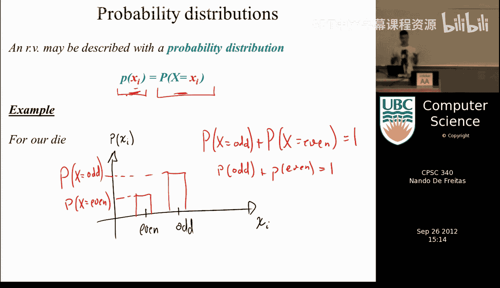

Often you've seen this concept that we can talk about the cumulative。

And I'm going to plot a cumulative， actually。Like this。

So the cumulative is just what happens if you move from the left。And you add up。Probabilities。

 so if this was 0。8 and this was 0。2。And this was the point at which the variable  zero。

 this is the point at which the variable is1， the cumulative。It's just as you move from the left。

Oops。So goes to one。So this height here is 0。8。The cumulative will turn out to be very useful when we want to draw random variables when we want to simulate from the distribution。

So at this stage I'm just introducing the notation and most of this lecture is kind of a bit dry。

 so I'm sorry for that， but I just need to introduce the concepts to make sure everyone has the concepts。

Okay， so that's the definition of the cumulative。Cumulatives play an important role。

 especially like in finance， where people talk a lot about cops and so on。

Some of those couples are things that went wrong during the trading and helped banks collapse。

In addition to greed。So to understand the arguments about copullus。

 you kind of need to understand the arguments of this lecture。Okay， so expectation。

As someone pointed out at the beginning of the lecture。

 expectation is just a sum of all the values that a random variable could take weighted by their probability。

Let's do an example， I'm going to introduce random variable that turns out to be very， very useful。

 This random variable is called the indicator variable。And it's defined as follows。

 It's a variable that is equal to one。ItIt indicates whether W belongs to a set a。

And it is equal precisely to one if w is an element of the set。And if W is not an element of the set。

 A。Then the indicator variable is equal to0。So the indicator， as the name says。

 just indicates whether W belongs to a or not。Okay， so as an example， the indicator of the set。Even。

哦。Let's say w equal 5。Is equal to 0。And the indicator of the set。Even分。Of w equal 4 is equal to1。

For a die。So if you're an element of the set， you get it as an output to one。

 if you're not an element of the set， you get as an output a zero。And the purpose of this。

 as we'll see later is this variable will allow us to write everything in a much more condensed notation。

So。Here's a question， what's the expectation that W belongs to A？啊。Anyone。Why should it be 0。5？整。玩。好。

What if a is all the numbers， but all the digits between the ins between1 and 5 and1 minus a is6？Oh。

 can you repeat the question。What is the expectation of the indicator。I want you to think abstractly。

 don't give me numbers because there's no numbers here。P例。One over the size of the setting。Yes。

 both equivalent。Who agrees with PA？Who disagrees？Right， so this is what we're going to do。

 because we have time today。 We have a formula up there for how to compute expectation。

 So let's get a。Psil and paper。 And let's try to plug in this variable， X。Into that formula。

And let's。Computers expectation。And we're going to take two minutes to do that。

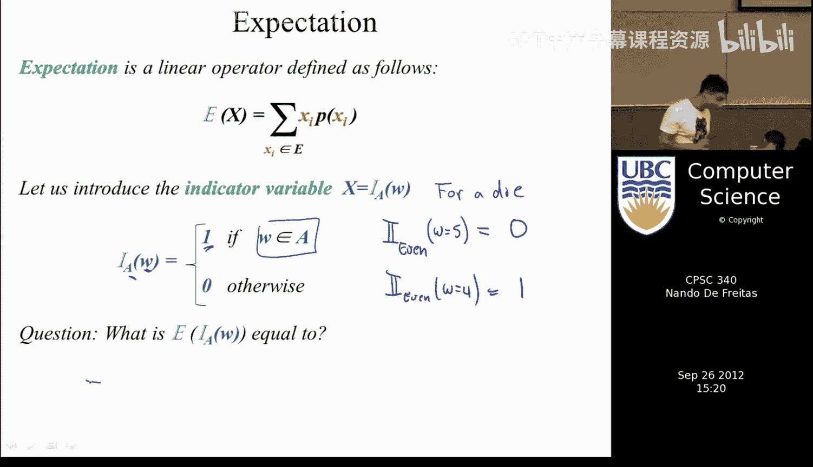

Paper。So。And forget about die。 The die is this example。Now， independent of whether it's a die。

 I can talk about this variable。The expectation。Of this random variable I。Oh， oh my god。

And to help you， I will write the definition here。W can be。In a or not。哎。And hint。

 the question that I asked at the beginning of the class was the same question。That I'm asking now。

I'm using abstract symbols， but this is really about whether it rains the more。

And then I'm going to plug here， IA mega。And then， P。真的。Yes's put it like this。Actually。

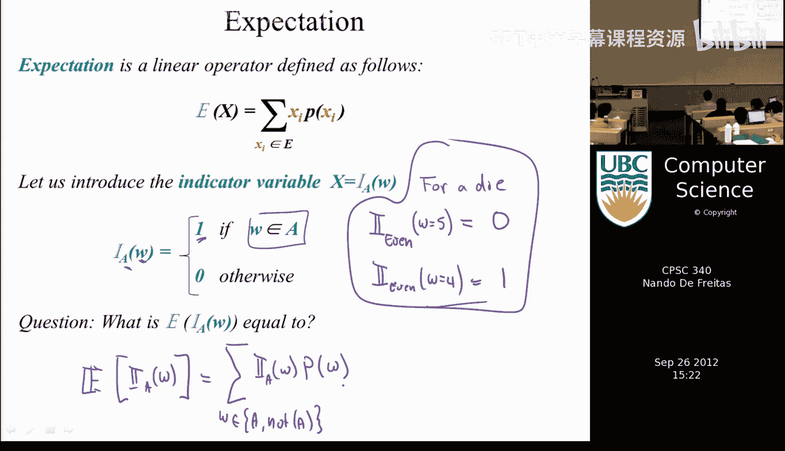

Good question。So what is X here the formula that。Sorry what is in the formula the written。Oh。

 Xi is just an indicator。hy。Why doesn it be。So now I'm using the variable x to be this。

A is the indicate。So。Think of this as x。X is1， if w is an a， x is 0。If that is not an egg。

What's the right right。问答。打应啲那个。検討利容名が。What is the big sign。Xi happens to be。有面。Yes。

Xi will map to the value that this can take。That。Inside。It should be Yeah。

 I I a this notation here a little bit。 I will expand it， soon。Okay。

 now how many people believe that it's P of A。Okay， half of the classes。Geting to me。So actually。

 let's do an exercise。 the half that knows that it's B of A explain to the person next to you why it is B of A。

don't know。Why that's fantastic。买坚。Yeah。た。で。And， those course。

It's sort of like we're just partitioning example。I sorry。の。I。Yeah。What。So。

Is there you have anything。right。我。Great。就な了。ま。嗯。All right， let me do it now。Hopefully by now。

 you're starting to get an idea of what isnt the K。But the indicator， I of a will be equal to one。

When。Al make a。Is an A？Will be one weighted by the probability of X。And a。Big excitingh。Plus。

 it will be zero。When W is not in a。Weighted by the probability。Of Xi， not in a。

Because the indicator is1 or0。The indicator is one when w is an a and it's 0， when w is not an a。

And so you basically multiply one times the probability that it's an A。

Plus 0 times the probability that it's not in a。Because imagine if E。Is zero and one。

Then this is equal to 0。Times the probability of X I。I'm sorry。是て。

This is1 times the probability of X equal 1 plus0 times the probability of X equals0。

Which is just equal。It problem to backside。one。And so what we're doing here is precisely the same thing。

 This is just the probability that X I。Oop， sorry， I used X size instead of omegas。Let me。

Correct that。So in wordss， the expectation that W is in a is one times the probability that it's in a plus0 times the probability that it's not in a。

That's because the indicator takes precisely the value of 1 when w is in a and exactly the value of 0 when it's not in a。

So then the rest is you just multiply one times the probability that w is in a plus zero times the probability that it's not in a。

 and that just gives you the probability that w is in a。And the probability that W is an a。

 the probability that you'll get an element of a， that is that you'll get two， four or6。

 it's just the probability of even， it's just the probability of a。So， the expectation。

Of an event happening。Of in this case，'s。Let's say that A is rain。

The expectation of rain is the probability of rain。ItsWe use these words in English quite often。

 expectation， probability， we throw them， but we often don't take our time to think how they relate。

 Expations and probabilities are actually connected precisely via this They're actually for。

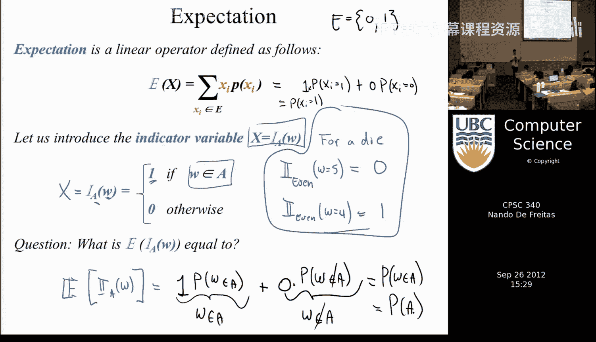

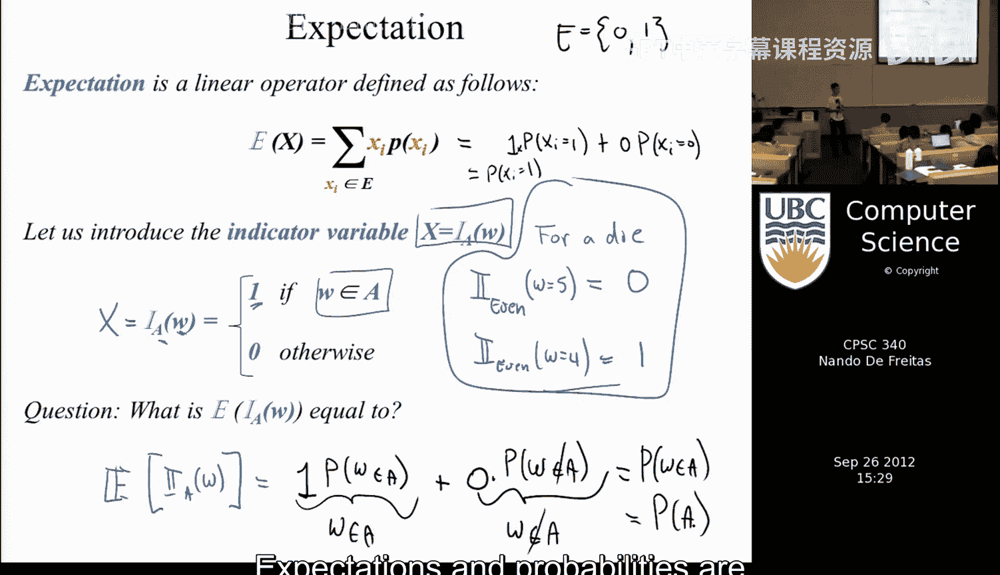

The expectation of an event is the probability of the event。

And we could have defined all of probability in terms of expectations right from the beginning of the course。

 and in fact there are books that do such three ties that they actually define probability straight from expectations as opposed to from the axioms that we introduced at the beginning。

Did I answer your？The notation is funny。 Yeah， you'll get used to it。Just think of。

So I'm trying to map what is Xi and what what is written in the bottom， the expansion。

Xi is the indicator variable。Anxii will take the values A or not a。In this case。憲お。Or in this case。

 actually one and0。So x is precisely the variable indicator error。And it takes values1 or zero。

If omega is in a， it takes the value of 1， if omega is not in a， it takes the value of0。

Notation sometimes is very confusing。You will introduce more abstract notation and concepts that don't look as intuitive。

 but it will turn out that this notation will make our lives a lot easier later on。

 so it's worth bothering to do this。

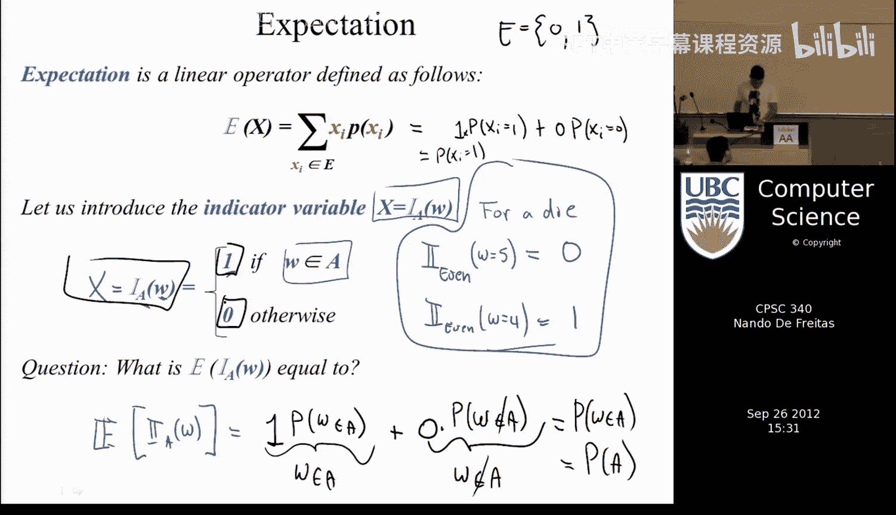

Right， once we have that。We can now move on to talk about， I'm going to introduce one more。

wayay of talking about probabilities。And this time I'm going to introduce a parameter for a coin。

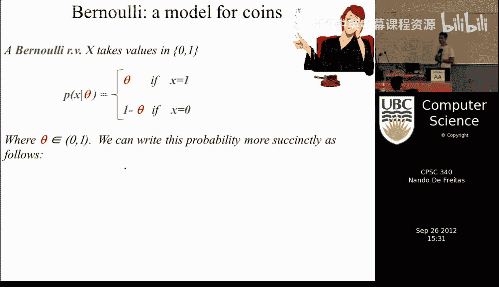

And the reason why I'm introducing this parameter is because not all points have probability half of being head or tail。

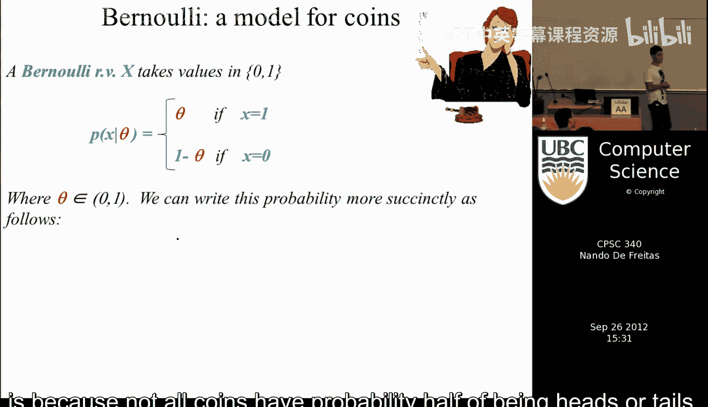

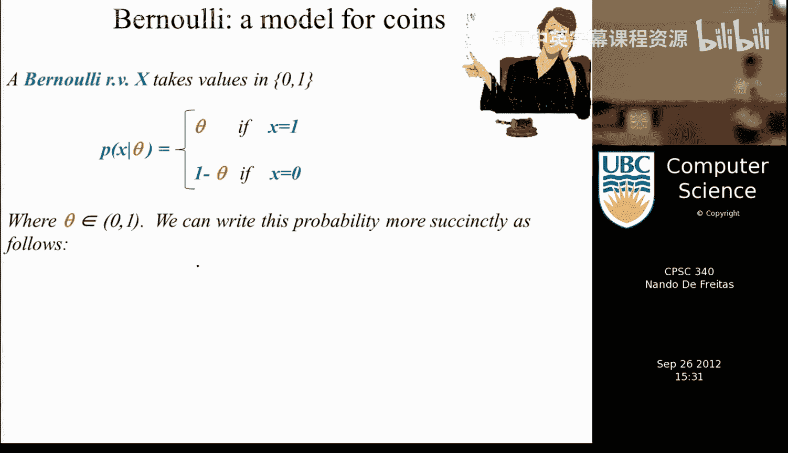

You can put a bit of lead on one side and you can get more heads than tail。 So you can buy us a coin。

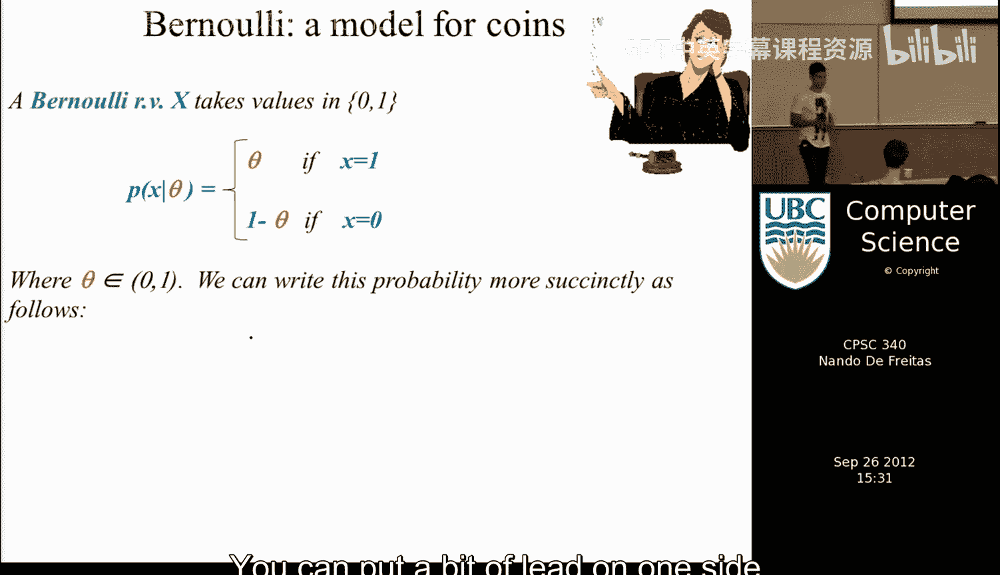

So we're going to assume that we have a coin that has a bias。

 We're going to define the bias with a variable theta， and that theta typically will be unknown。

The objective of learning is we're going to see a bunch of ones in zeros。

 and from that we're going to figure out feet。 If I start flipping a coin here in class。

And nine out of 10 times， it's a one。It's heads。 I doubt you will believe that that's a fair coin。

 You will probably compute a bias as's 9% or something。90% or so。Okay。

 and so we now talk about a distribution， P of x given theta。

What x is a variable that takes the value of 001， heads or tails， hot or cold。

And it's going to be precisely theta if x equals 1， in other words。

 the probability of x equal 1 is equal to theta。The probability of x equals0。

I'm going to rewrite it as one minus the。Now， using the indicator variable。

We can write this as the probability of eggs given theta。

Its equal to actually before we do the indicator variable， I'm going to do something even simpler。

 I'm going to write this as theta to the x。1 minus theta。

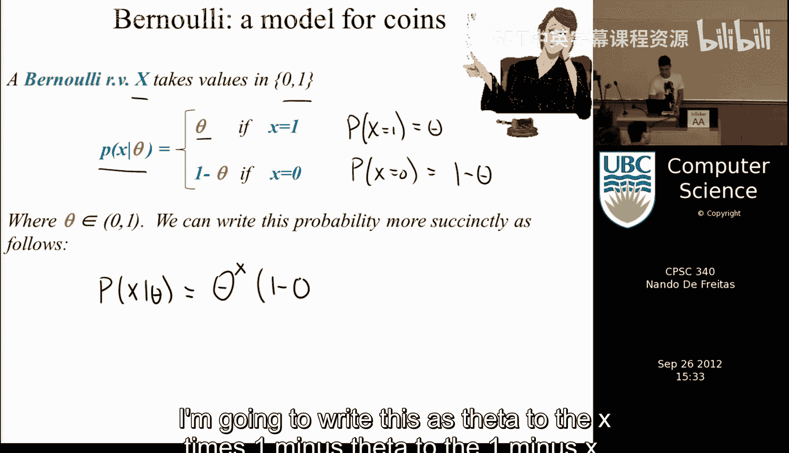

Should a 1 minus x。Okay。Because。If x equals1。This exponent here will go to zero， right？

Because1 minus1 is0。And so you get one minus theta to the power0， which is just one。就。

We just get feet。And if x happens to be zero， on the other hand。

 the first term disappears because you have theta to the zero0 times 1 minus theta。For the one。

And that's just equal to one minus theta。So now we have a very nice。

 succinct way of writing a probability distribution that I prefer to this way。

 because this way I have to always draw a bracket。And I don't like drawing these brackets。

It's all right。Can only be0。That's correct。For this class and the next class and the next classes。

 our variable is something it can only be。True or false。And then we will generalize this。But。

We need to learn how to do triple false first。

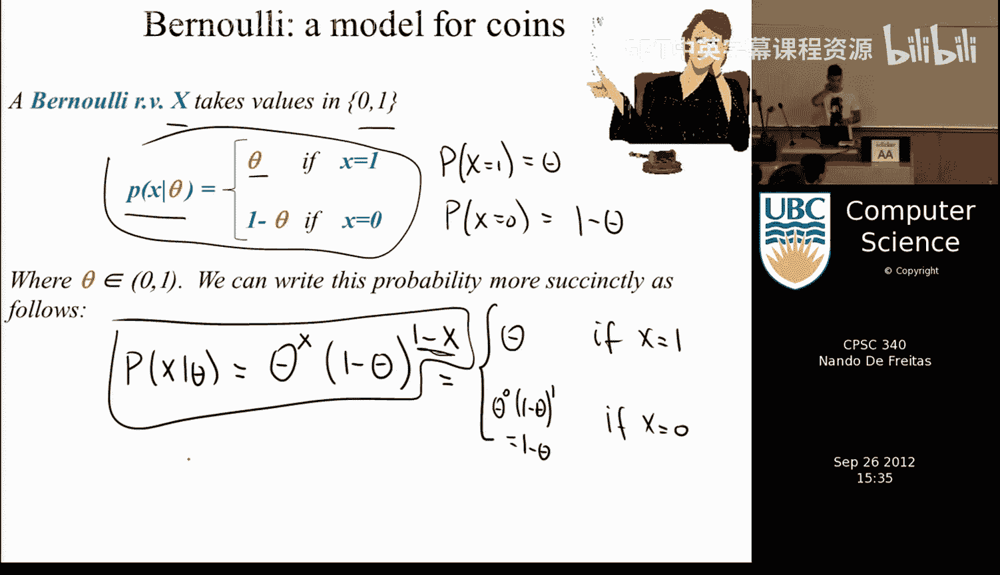

I will also write this as P of X given theta。As theater。Indicator。Of the set one of x。

Times1 minus theta。Indicator of the set0。Of x。If x is1， that's equal to theta， if x is0。

 that's equal to1 minus theta。Because if x equal 1 indicator one indicator will be 1。

 the indicator of 0 will be 0。We only get the first term， and then symmetrically。

 we only get the other term。The most common way of writing a Bernoulli distribution will be this form。

This notation is more cumbersome than the middle notation。But later， when we have more variables。

 and it will actually turn out to be more useful。 It will be easier to manipulate。

So they're just different ways of writing the same thing。It's the probability that describes a coin。

The coin that has probability the of being he and probability one minus the of being test。

And we can also draw that with。A diagram。So we basically s this as teacher。

And then this is one minus state。And the reason why use theta and one minus theus because when you add the two。

 you get one， so the probabilitybolate sums to one。And then this is of x。 and then this is。P of x。

 given the。The only thing is I've now introduced a parameter。Theer。

And I'm writing the distribution in terms of theta， which for learning will be our unknown。

So essentially learning will be about we see a bunch of coin flips。

 we try to figure out what's the probability of it being tails。

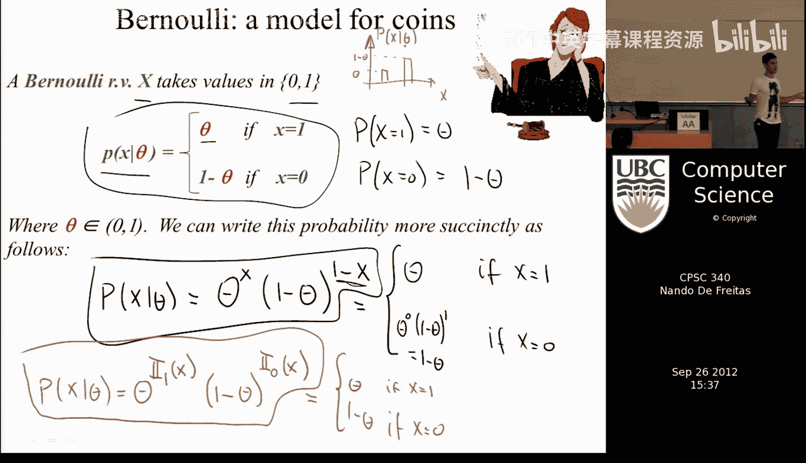

And if we can solve that simple problem， we will be able to solve。

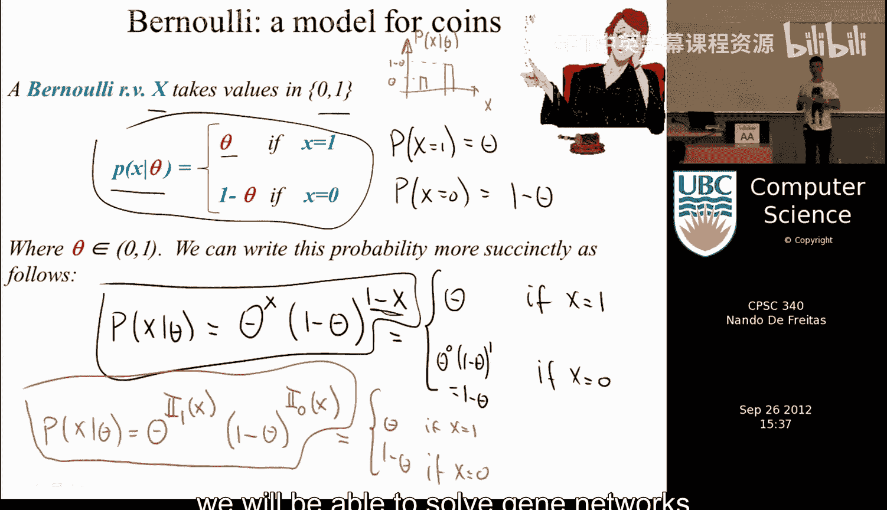

Gene networks and fashion networks and so on。With a few more tricks。We will be able to do it all。

Okay， so。That's a notation that we will be using。

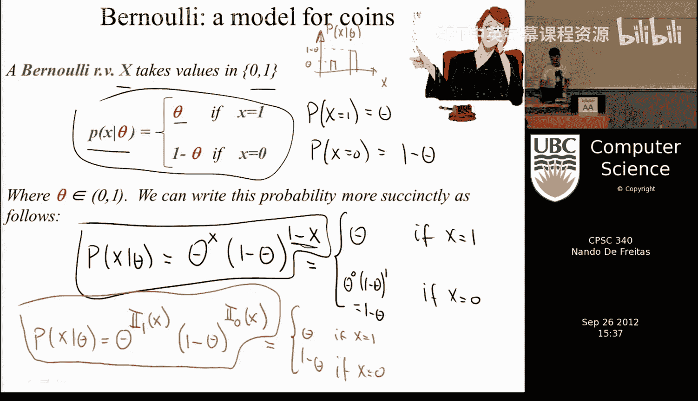

The expectation of Bnoli variables。 So now just to practice。 So we have that P of。X。Even。C。

Is equal to theta to the x。Times 1 minus theta to1 minus x。So， the expectation。Of a random variable。

It's just equal to。Well， when the variable。it's the sum of our x。Being either zero or1。X times pill。

X。And let's emphasize now that there is a parameter theta。And so that's equal to1。

Times the probability that x is theta。That x equal1， given theta。She lets you that in one more step。

So， that's。是。Equal to1 times the probability of x equal 1 given theta。Plus zero。

Times the probability of x equals0 given theta。And that is just equal to1 times the probability of x equal one given theta。

And that's just equal to。对。F。Because when x is equal to1。Well。

 if you substitute x equal to one in that expression， you get feet。Alright。

 so the mean of a random variable， of a binary random variable is just the probability of it being one。

 but probably being one。So the expectation of it being one is just the probability of it being one。

Expectation probably is the same。Don't we say that the expectation of x。

 given theta is equal to this rather than just expectation of x。Yes。

 you could be precise and you could introduce there's other ways in which this is written。

 so that's a good point Some people often write this as the expectation of X given theta to emphasize that theres a parameter。

And often， it's also written like that。So these are two common notations that you'll find in different books。

The other thing that we talk about， so the expectation typically just tells us what in this you know like for Gaussian variables。

 like when you have continuous variables， it tells you sort of the thing that happens the mode of the distribution for a Bernoulli variable for a coin。

 the expectation of heads is just a probability of heads。

We also need to know the spread and the spread will be very useful for the next class。

Because in the spread of a variable， in other words， how much is I estimate theta。

So like someone does three coin tos， I estimate theta to be a half。

Then they do 10 more course to estimate theta to be 0。9。

 they repeat experiment I estimate theta to be 0。1 and then 0。9 and then 0。

1 and so unlike all over the place so in that case I'm saying that theta has very high variance。

My estimate keeps changing， so you kind of not only care about being able to estimate the right thing。

 but you also kind of want to estimate it。

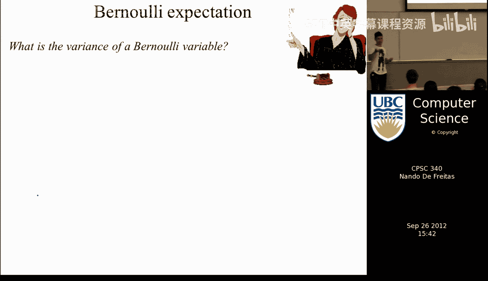

Quickly， so various states gives us the uncertainty in the estimate。It is defined as。

The expectation of x minus the mean of x。Let's use the not that was suggested。

So it's x minus the mean of x， which is just the expectation of x minus theta。Square。Tea is given。

 so。I can just state that it's given。And so that， again， will be one minus theta。

Squared times the probability of x equal theta。SoSo pro of x equal 1， given theta。

And then when x is0， I will have0 minus theta squared times to the probability。

That x is not equal to1， in other words， a zero given feature。And that's one minus theta。

Square times theta。Plus theta squared， and the rest is really just。Tedious algebra。

And this turns out to be this h at minus-1 minus8。This will be useful。

It will be very useful in the next class。When we we actually tried to plot this function。Actually。

 let me try here on the flight to plot this。So supposed we wanted to plot this。

And this actually is what I'm going to call the variance。So what happens when theta is equal to 0？

What happens when theta is equal to1？Okay。Now， let's。Someone's already realized that this is just。

Theta minus theta squared。So indeed， it's just a parabola if we take the derivative。

And now we introduce a bit of calculus。The derivative。Of theta minus theta squared。With respect to。

It's just equal to one minus theta。The derivative is0， the derivative is the slope of a function。

 and it's zero at the maximum。Oh，1-2 theta， correct。这是。Sureff。And if I saw for theta。I find a place。

Where where the derivative is equal to 0。Which is a how。

So I know that at the half the derivative is zero。If I plug a half here。The various。

Of x given theta is equal to a2。Will be good。2 a half。Mine knows a half squared， which is a quarter。

And that's two quarters， minus a quarter， that's a quarter。Okay， so we have this product。Now。

 what does this mean intuitively？What it means is if my coin is unbiased。

There is a lot of uncertainty as to what it's going to be。 If I have an unbiased coin。

 and I tell you the probabilities are half of it being tails or heads， and I flip it。

It could be hedge or tails。Okay， so 。5 provolt。But if I tell you， I have a very biased coin。

 I've put a lot of lead on the head's side。So the probability of tails now is 0。9。

 then if I flip the coin， what would you expect？If I tell you that the probability of tails is 90%。

What would you expect to happen。AndThat will be tails。

 I'm telling you the coin is biased and 90% of the time it tests tails。

 so you expect that it will be tails。And if that's。呃。The case， there is less uncertainty， right？

 So this is essentially what we're doing here is betting。 You need to bet on something that could be。

Half half or you need to bet on something that's 90%， 10%。So the variance captures that。

 The variance is saying then if the coin， remember。

 this parameter is telling is the bias of the coin。If theta is a half， your variance is the largest。

 your uncertainty is the largest when theta becomes zero or1。You're very insistor， at least。

If I tell you， I've put enough lead on one side of the coin that it's impossible for it to be tails。

 then there's no uncertainty whatsoever， then you know that it's going to be heads。And of course。

 the other thing I plotted this whole thing， but I should clarify that theta。

Theta can only beat between 0 and1。So this is not allowed。Because theta has to be a probability。

 Theta is the probability of x equal1。Okay， so the variance essentially quantifies uncertainty。

Next class we introduce a concept called entropy that essentially is equal。

 turns it's actually the same thing as the variance。And it， it also。

Will be the basis for learning for introducing learning。 One last thing， if you have at two coins。

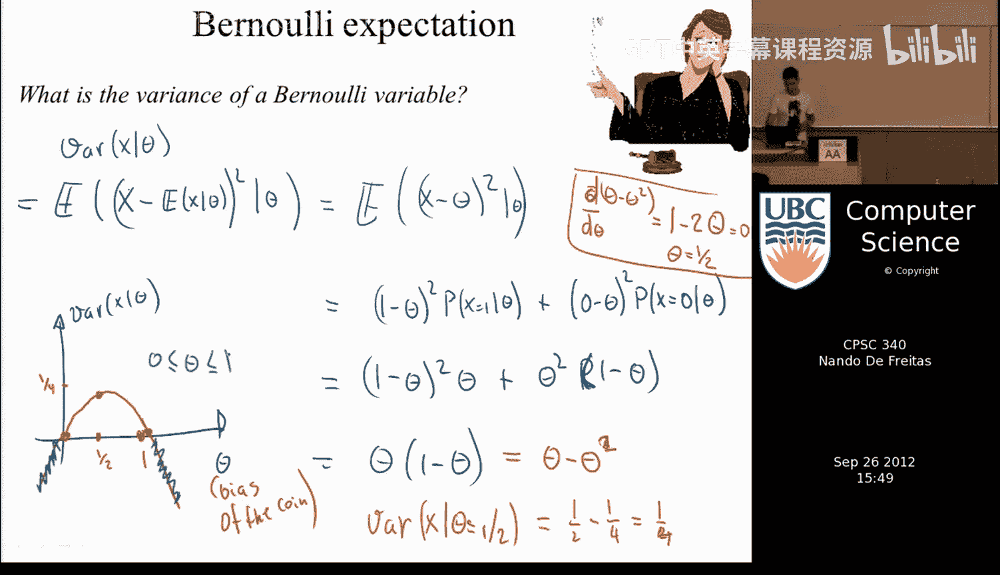

With the same， if you take the same coin and you toss it two times and the tosses are independent。

How does this probabilitybil simplify？swear。Yeah。You multiply them。Independence。

If you have two random variables and they're independent。X2 does not depend on x1。

 so you can drop the x1。 And so you just multiply When I take the product。Of x1 to n。

Even the。Which is equal to the。Probability of x1 and x2 all the way to Xn。기 수 있 있죠。

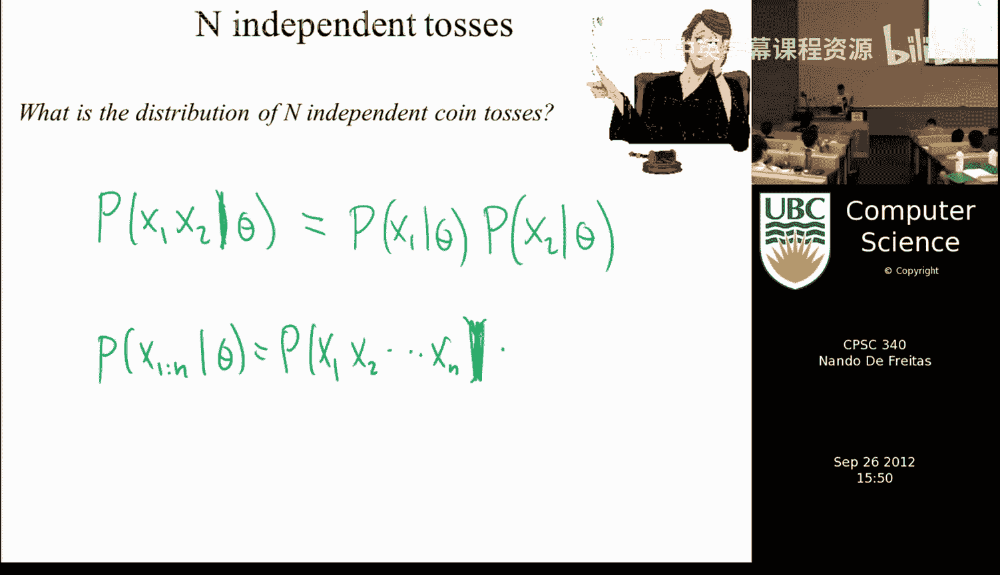

This will be equal to the product。The pi just means the product from one to n of the probability of each X given seat。

We're going to use this notation a lot on Wednesday。

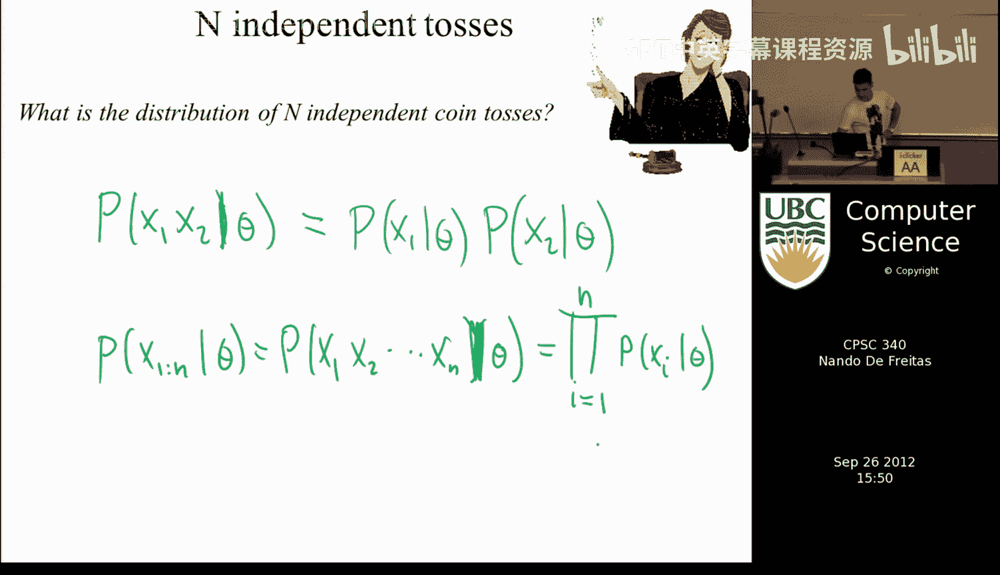

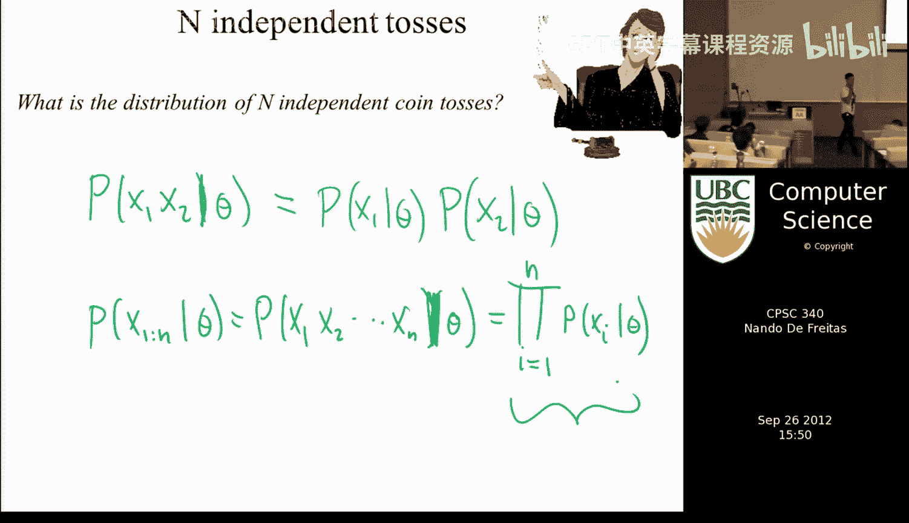

So that's all the notation。 On Wednesday， we start doing more interesting stuff that is not as dry。

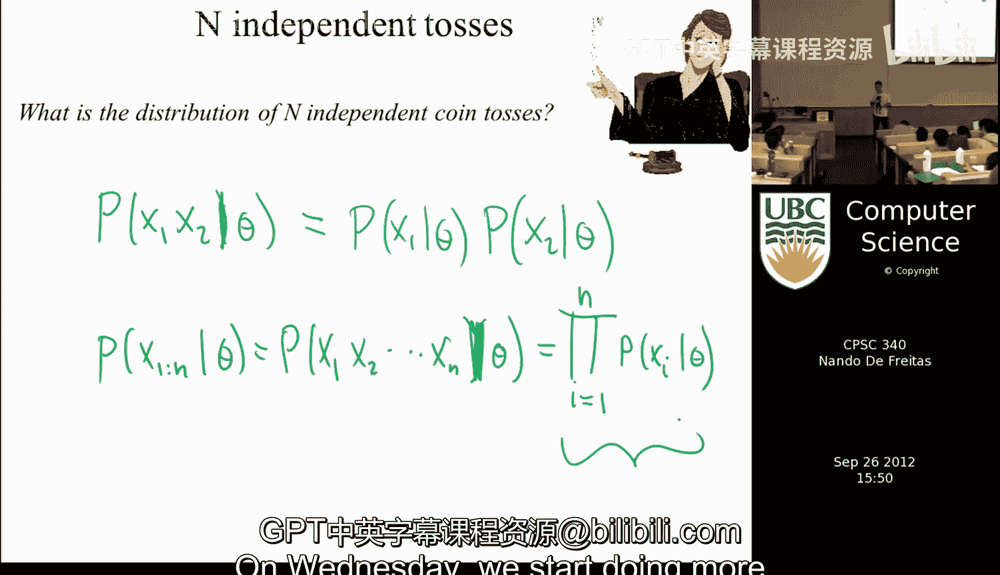

Okay。

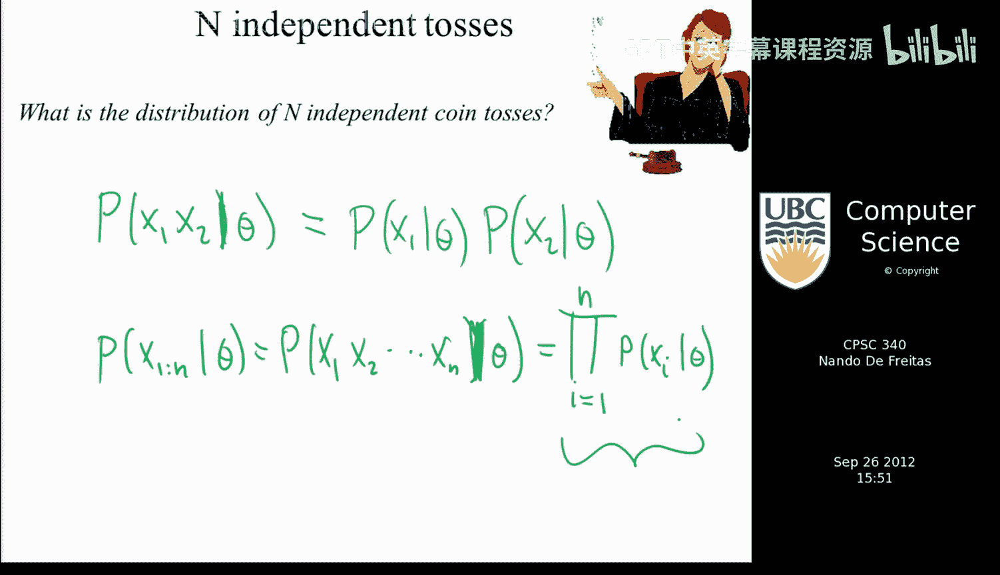

Yeah。