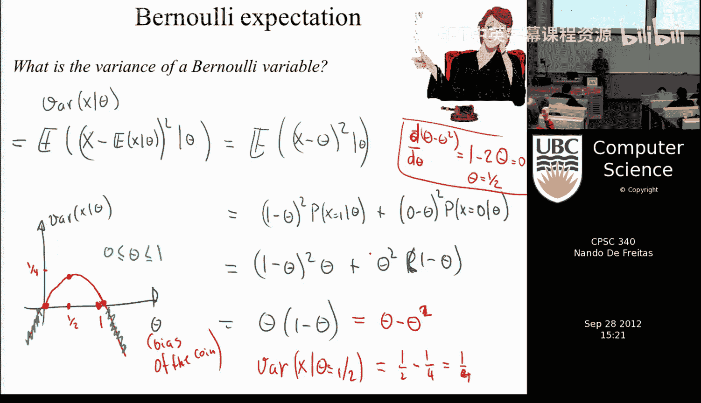
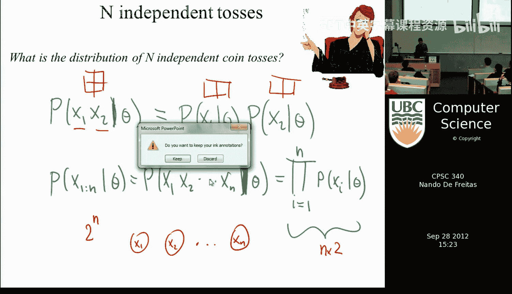
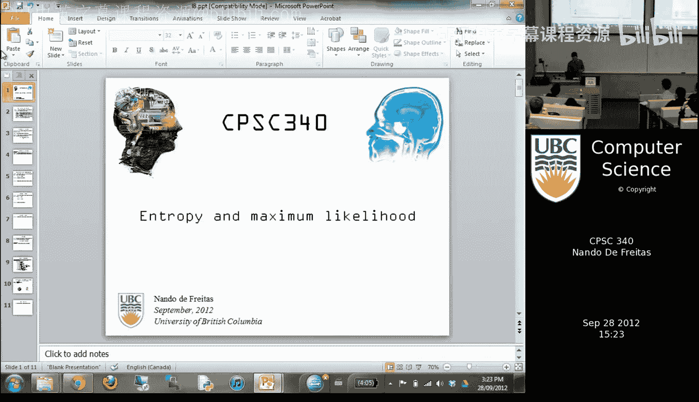
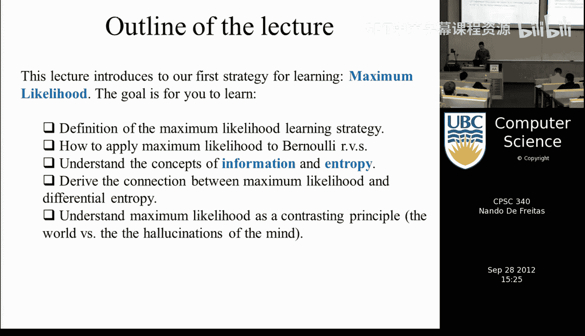
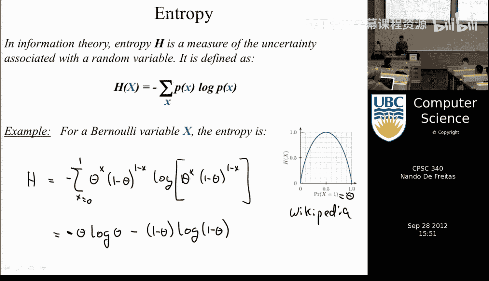
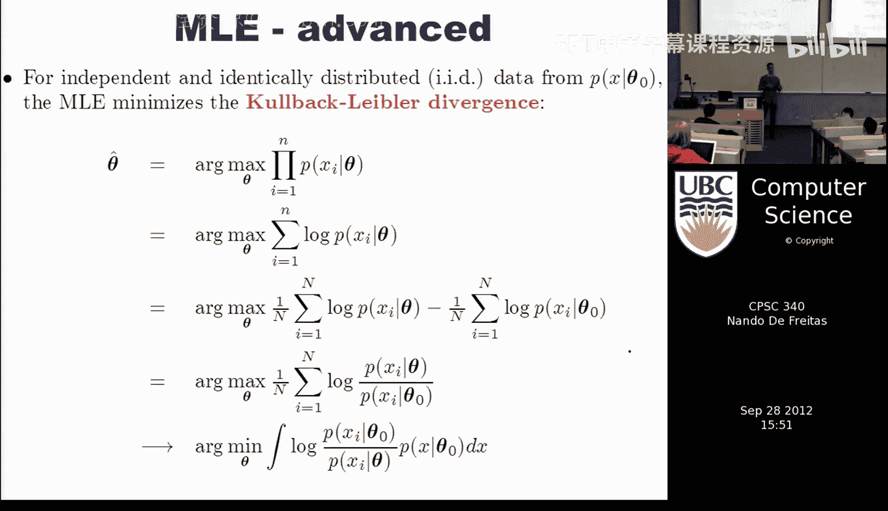
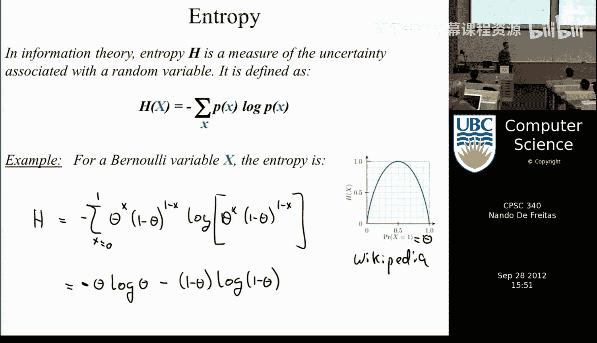
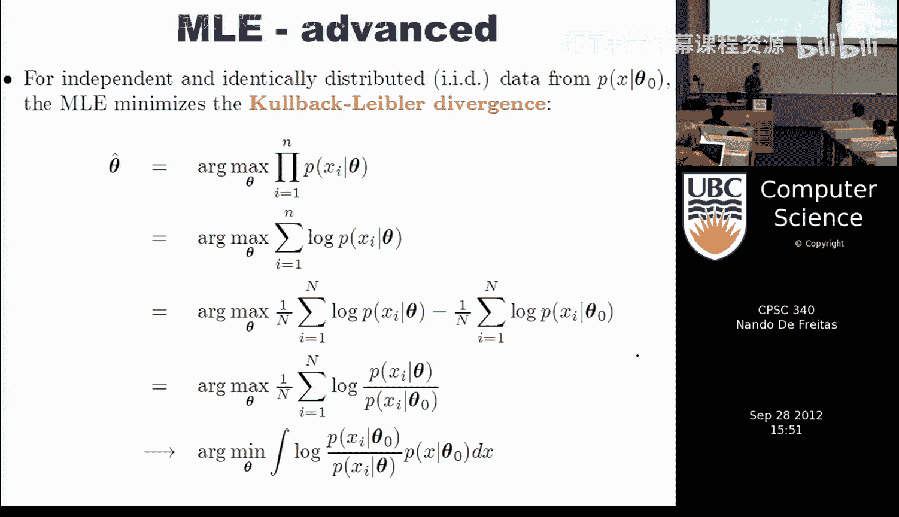

# UBC《机器学习和数据挖掘｜CPSC 340 Machine Learning and Data Mining 2012》中英字幕 p10 -10-undergraduate machine learning 11_ Maximum likelihood.zh_en -BV1pJ2ABFEFg_p10-

Probability theta it's 1 with probability 1 minus theta， it's 0。Okay。

 so with probability theta x equal 1 with probability1 minus theta x equals 0。

So the expectation is the mean of the distribution， and we show that it's equal to theta。

 So the expectation is the probability of x being equal to1。If the variable x is rain。

 the expectation of rain is the same as the probability of rain。Okay， we also used the same。

Sort of workings with expectations and we computed the expectation of the squared of the variable minus the mean。

 which we define as the variance。And then we even plotted a variance。

 so the variance is theta times 1 minus theta， and if you plot it。

 you essentially see that you have this parabola that appears there in red and that the maximum happens at the half。

 so when theta is a half your variance as largest， so think of variance as a measure of uncertainty。

If you have a coin whose probability of heads is a half。Then。

You're very uncertain if I ask you what's it going to be next， zero or1。You're very uncertain。

 but if I have a coin that you know that the probability of1 is 0。

99 and I ask you what's it going to be next， you quite likely will say it's a one because you're very certain so in this case so the closer thetaus to one or to zero。

 the least the uncertainty and that's essentially what that red curve tells us。

We'll see that variance is not the only way to describe uncertainty。

But there's going to be something else called entropy。Now， learning is about。Minimizing uncertainty。

You enter this world and there's a lot of stuff you don't know。

And then what you try to do is always minimize the things that you don't know。

Minimizing uncertainty or very equivalentvally。Maximizing information。That's what learning is about。

Right now you are doing that， you're trying to minimize your uncertainty in this field or as to what you think are cool areas of computer science。

 et cetera， gaining information means minimizing uncertainty。

We will use that as the principle for learning today。One last technicality。

 we also learned that if we have if the coins， if I toss a coin。And then say he tosses a coin。

 we can pretty much assume that the two coin tosses are independent of each other。You know。

 it's very unlikely that there's some physical mechanism that would connect at two coins and so if the two events are independent。

 the product of A and B， the probability of A and B is just the product of the probability of A times the probability of B。

And so if the two coin flips are independent， coin flip1 and coin flip2。

 we can write the joint distribution， which is this two by two table as just the product of the individual。

Ts。The nice thing is that when you have n variables， you would have a2 to theN table here。

And here you have n times  two n tables of size2。Okay so independence。

 just like conditional independence， is like an extreme form of the condition independence。

 So in fact， what we're saying is that our graphical model is of this form。X1。X 2。

All the way up to Xn， so we have n variables and there's no connections， there's no edges。

They're completely independent So the graph factorizes the probability of the variable given its parent。

Since variables have no parents， it's just the probability of the variables。

And the random variables here again， is the x， not the theus。That's very important。

 so the theta is sort of a parameter。Okay。

With that， let's get started with something that starts。This is our first slide on learning。

We're finally starting the topic of learning after doing some revision。

So today I'm going to introduce the first type of principle for doing learning。

 and that's the principle of maximum likelihood。We will see how we can apply maximum likelihood to learning a coin。

In other words， you see a bunch of tosses， and then you try to estimate the probability of heads of the coin。

 you try to estimate the bias of the coin。We then will connect this with something called entropy。

 how many of you have heard the concept of entropy about the concept of entropy before？

It's about half of the class。And the formal definition of information。But 3，4。

We're going to cover those， and we're going to relate。Thatt。To learning。 And in particular。

 to contrasting this idea that we learn when the world is not what we imagine。

Because if the world is like what we imagine， there's no reason to change our brain， so we got it。

But if the world is different than what we imagine our heads， we need to update our knowledge。

And as we saw with the computer vision examples at the beginning of the course。

Where you thought you were seeing the whole scene， but you really weren't。

 you were just filling it in。That kind of emphasizes that most of the things that we think。

Where C are actually being invented by your brain。So being able to。enWe do it subconsciously。

 being able to generate data is a very important part of cognition。

Okay， so。This principle of maximum likelihood is based on frequencies of events。

 Okay so we go back to this view of probability based on frequencies。

And this form of learning assumes that there is a truth。There is one。Ctly or whatever truth。

From which the data has been generated。Okay， we call that truth。

We refer to that truth with this parameter theta not。Okay。We then try to approximate the truth。

 given some observations with an estimate theta heart。We don't know what the truth is。

 so there is a tool by you you basically observe me flipping a coin。

And you don't know what the true bias， how much lead I put on one side of the coin。

So you instead you guess it and when you guess it， the gas will be with a hat。Okay。

This is what maximum likelihood does。 maximum likelihood， given a data set。

 and we're going to assume that we have， say， N coin torsus x1 to xn。It tries to find a theta。

That makes those x12 n most probable。There's a lot padded in this expression。

 and typically in a machine learning paper， this is one of the first questions in the front page。

It's a very common equation， let's parse it。First， if we have it。First。

Let's say that we have some function that looks like this。Theer。And this is。

 I'm going to now interpret the distribution。As a function of theta。Okay。

Let's for now assume that we can think of this as an object that depends on theta。

 so a computer program that has x1 to n already inside。

 you pass at the value of theta and it returns p of x1 to n given theta。The point of the max。

 this is the max。The location of the max。Is what we call the A。Max。Which is in this case。

 it's equal to theta hat。So arc max means the argument that maximizes。And as the picture shows。

 theta hat is just that theta for which the curve P of x given theta is at its maximum。

So it's the location of the maximum。Okay， let's look at it with an example。

Suppose you have observed the coin。And that coin was 1，1，1，1，1。 This coin could be 0，1。

 but you only observe a sequence of six ones。Now， if I ask you。

And let's say that the distribution of that coin is P of Xi。Given theta equal to theta to the X。

Times 1 minus theta to the1 minus X， so a Bernoulli distribution。Where X， I。Is either zero or one。

Or in other words， just to remind you， this would be theta when X i is equal to1。

And1 minus theta when X equal to 0。Now， if we have a distribution that models the probability of heads and the probability of tails。

And let's come up with two guesses。So I'm going to use。Theto1。It's going to be 0。99。Theta 2。

It's going to be equal to 0。5。So let's put this to a vote， how many people would go with Theta1？Co。

Qud of few。 Hard to cook。Theta 2。Get a hard believer。😀Yeah。😊。

I'm going to offline find out why you were like Theta too。嗯。So most people prefer Theta1。

And that's because if you have a coin with probability 099。Offer being a one。In other words。

 p of x equal 1。Given theta1。It should be about， well， it's precisely。0。99。

Whereas p of x equal1 given theta 2。Is equal to 0。5。 So 0。99 is much closer to one。

 So if you've seen five ones， you probably think。That it should be 0。99。 That makes more sense。Now。

 how many of you have heard of black swans？And the famous black Swwaan paradox。Okay。

 so folks believed that there was。Black swans didn't exist。Okay。

 they I don't recall how the story goes， but let me just tell the tale this way。They were in England。

 I think， where there were only white swaanns。 correct me I'm wrong。And of course。

 the Europeans lived in Europe for many years， they fought their wars， et cetera， et cetera。

 they grew。They love their swans， and eventually they learned to sail and they went to Australia with a bunch of prisoners。

And。After saying millions of。White swans， in other words， they saw one， one， one， one， one。

Their theta by this time is 0。999999。 So it's like， theres no way there could be black swans。

 But they get to Australia andvoilah。 There's a black swan。So the statistic of model fails。

We'll see how to deal with that one late。But this is essentially saying it。

 If you've just seen one thing， the black swan， the one。 sorry， the white swan， the one。

 then it's much more likely than one model describes it。 Now， so now we sort of have。

Most of you with except for one exception， which we'll find out soon。What the problem is。

I'm sure you have a good reason you studied philosophy， so he。😊，嗯。You know。

 sort of basic inition tells us that the 0。99 is better。

Let's come up now with a procedure that will allow us to verify that。

 And that procedure is maximum likelihood。Now I'm going to apply this procedure to a coin。

But this procedure actually applies to every model out there。

So we can get a very complex model to describe， I don't know all the interactions between customers and advertisers in Yahoo or to advertise exactly how your medical records。

Are used to be able to diagnose someone in a different province and so on。

 So you can get very sophisticated models。 but at the end of the day。

 the machinery that we use the procedure is the same。 It's the same steps。

 So if you learn to do these steps for one model， it's just like minor adjustment to do it for another model。

Okay， there step one。Of maximum likelihood。You're given the data。

 so you've observed the sequence of events x1 to xn and events。The first thing is。

You make some assumptions about the data， and for example， in this case。

 we could assume that the data is independent。If we assume that the date is independent。

 we can write this as the product from one to n of P of X I given theta。

 as we saw at the beginning of the class。嗯。The next step that we're going to do is we're going to define this thing called the log likelihood。

Hell of theatre。And that's going to be the log。Of P of。X1，2， and given theta。

And so that's going to just be the sum over i equal 1 to n。Of the log。Of P of X， I given feet。

Here I have used the standard log formula and。The log of a times B is equal to the log of a plus the log。

扑别。The reason why we transform to logs is because the next step which is differentiatedequ to0 L of theta is much easier to do in log space than in the original space。

 so the log space is just a trick to make the part next step easier。

So we start with a likelihood for all the data to joint。 We factorize it。

 If we didn't assume it was independent， then it would factorize as a graphical model。 That's the。

 We will study that next week。But if the data is independent， it just factorizes all as independent。

 you take the log， you differentiate andequ to0。Most of the things we do in machine learning follow this formula。

 except for Bayesian learning， which will be very different。But we always follow this formula。

 We always follow this recipe。 This is by far one of the most popular recipes out there。

 There's other recipes， but this one。I would say， about 70。

Percent of old papers out there use this form。Use this procedure。

Let's see an example of this in practice。Let's look at our benoli distribution。First of all。

 we know that fors。In this case， P of X given theta would be theta to the X times1 minus theta。

To the XI。So if we have a product。If we have many coints and coints。

We would write this as P of X I given theta。Which would just be equal to the product from i1 to n。

Of theta X I。Times 1 minus theta。There should be one minus。1 minus X。Okay。

And now we can actually simplify it as a little bit because。Let me introduce some notation first。

The notation that I will introduce， let M be equal to the number。off。Wons。And let N。

Be equal to the number of coin flips。Now， if I multiply。Let's look at this， guy。

That's theta to a variable Xi， and that variable X is out of 0 or what。So if I had two coin tosses。

 if I had x1 to2 being equal to， say1。And then，0。For this term only I would have had theta to the1 and then at time step two。

 I would have had theta to the zero， so basically I end up with theta to the one。

Which is theta to the number of ones in the sequence。So using the same argument。

I will say that dissimplifies to theta to the M。Thank you。It one mile later。公司。He stopま。

Now I'm talking only about this term。 So I'm only simply trying to， let me， sorry to confuse you。

 Let me take it back。 Let me use a different symbol。Suppose I have a sequence x。Which is equal to 1。

1， and then 0。so x1 is 1， x2 is 1， and x3 is 1， and let's assume that I have something that is of the form a to the X I。

Product over eye。so then that will be equal to a to the1 times a to the1 times a to the0。

And that's just equal to 8 to the 2。 so I'm just saying that if you multiply a symbol to a power that side a  zero and1。

 you just get that symbol to the number of ones。Okay。Likewise。

 if I have a product over I of B to 1 minus X i。I would have had B to the zero times b to the zero times b to the1。

Okay， because when X is1，1 minus X0。And so， this would be equal to B。To3-2。

So n in this case is three。And then three minus the number of ones。So n is equal to3。

 M is equal to 2。And so that's what I've used to get the red line。 so theta to the number of ones。

And then。And minus M。Is equal to the number of zeros。

And so this just allows us to write this in a much shorter notation。

The next step is to do the log like， does that make sense now？

The next step is to do the log likelihood， so the log likelihood is a function of theta。It's the log。

Of P of x1 to n。Given theatre。And that's just going to be M log。Teacher。pl。N minus M。Log。

1 minus seat。Okay。then the next step will be differentiate with respect to theta and salt of theta。

Before we do that， if you to us a coin n times。And you observe M1s。

 What do you think is the probability of it being one。If m times it's1 out of n times。

 what's the probability of1 M over n Okay， so that's the basic intuition。

The probability of one is the number of times you observe a one divided by the number of coin tosps。

Hopefully， when we do all this math， we'll get that answer。Okay， so the derivative of the log。

Of feature。Is equal to the derivative with respect to theta。哦。I need to look up。And。Log。Ter。Plus。

And minus M。Log。What minus theta？Okay， and the rest is just calculus。 So you just get M of a theta。

And then you get plus n minus m。The derivative of this， which is minus1。Times1 over1 minus theta。

Which is equal to。1 minus theta times m。嗯。Plus。M minus n。Times theater。

And we're going to divide it by。Theta times1 minus theta。Okay， so I've just regrouped the terms。

And then。Finally， we equate to zero to solve a theta。And if we do that， we have that one。

 we have that M。Minus theta M。Plus theta M。Minus theta n is equal to0 from where we can conclude since this cancels with this。

That theta is equal to m over n。Yeah， wow。No surprises here。

The maximumim likelihood gives you the right thing。

And as we move on and we do many different kind of models。

 you'll see that maximum likelihood gives you that the sort of thing your intuition will tell you is what you should do。

So one way to remember likelihood is to remember this procedure。 You're right down the distribution。

You take the log， differentiate equation to0， you get this。So。If you have a complex graphical model。

As we'll see later， we'll do the same thing， we'll write a distribution of that graphical model。

 and now we know how to write it down probability of the node given its parent。Now。

 assume that the tables are unknown。 all those values that I've been assuming knowing。

 assume we have no expert to tell us that。 but all we have is data。

And so we need to learn from the data straight what those numbers are。

 we're just going to follow the same tedious procedureid， I mean。

 this preid you have to do it because you have to learn it。

 but this is the sort of thing a machine does。 There's nothing here that is requires thinking。

 You just follow the recipe。 You write down what the model is。That's the part that is inventive。

 is coming up with a model。That's not easy。Coming up with good models。

 designing good models is the hard bit。 And that's why I encourage you to go to the Jeb applets and start toying with your own models。

Once you have a model。The procedure is very mechanical， you write down the probability。

 you differentiate it， you equ to zero， and voila， that's your answer。

The last step is we are differentiating。With respect to theine equating to zero。

 because we are assuming that the graph is the distribution is something like this。Yeah。

 we're assuming that exactly。And for distribution is something else。

 this would fail This distribution as a function of theta has a single maximum。

 whether therere over to0。 Later， we will learn other distributions that look like this。

So those will be tricky， we're not there yet。这工。all of them are once。

So data would come out to be one。Exact。That is。In the next class， we addressed that question。Okay。

 let me finish with this one。 And then we're gonna to deal with that in the next class。

 That's going to be the topic of basic learning。Okay， so now。

 in order to understand why maximum likelihood。Guys， we can take this in the next class。

 I will definitely show to you how to do this the right way。Now。

 it's important to know why maximum likelihood works。

And how maximum likelihood relates because up now， it just looks mechanical。

 is you write a probability， you take a log， you maximize it，s just like math。It's like。

 what does that mean。And so to understand it， it's a good idea to first introduce a concept， entropy。

Now， entropy。Very dryly is defined as P log P to sum of a P log B over the valuess of x。

And it actually is a measure of also uncertainty， just like various。To see that， let's do an example。

 Let's assume that we have the variable x。Then the entropy that happens to be Bernoulli。

 so we have coin flips again。So the entropy is going to be equal。To the sum over our x minus。

And now we've replaced。P of x by the distribution， which is theta to the x。

ItComes1 minus theta to the1 minus x。Times the log。Of。Theta to d x times 1 minus theta。

To the1 minus x。And that turns out to be。So x goes from 0 to one。 So it takes two values。 So we get。

Theer。Log。디each차。Minus1 minus theta。logg。Of one minus seat。

Now I could do the same thing that I did with the variance。

 which is differentiated equal to0 to show you that there is a unique maximum and so on。

 but I'm going to instead just use。A plot that I took from Wikipedia。

Which shows you the curve of h of x as a function of P of x equal1。

 which is what we are defining as theta。So as a function of theta， again。

 entropy for a coin is maximum when there is maximum uncertainty。

 when the coin has equal probability of being 1 or0 at 0。5， and then as becomes informative。

 the entropy goes down。So entropy is a measure of uncertainty。It's a negative of information。

Information in information theory。Or basically the。

 the concept that underpinneds how these guys came to be。

Thanks to Shannon is actually defined in terms of this quantity H of x， it's the opposite of H of x。

 the negative。So by increasing uncertainty， you decrease information。When you increase information。

 you just decrease the insert。So。So， they're just a reciprocal one over the other。

And that's how Shannon actually。With it 60 years ago， roughly started at information theory。

 which is where the word bit was introduced。

Bit is the unit that is used to describe H。

Okay， the next I'm going to leave you for you to guys to go and do at home and then come and talk to me during office bus hours very quick。

