# UBC《机器学习和数据挖掘｜CPSC 340 Machine Learning and Data Mining 2012》中英字幕 p11 -11-undergraduate machine learning 12_ Bayesian learning.zh_en -BV1pJ2ABFEFg_p11-

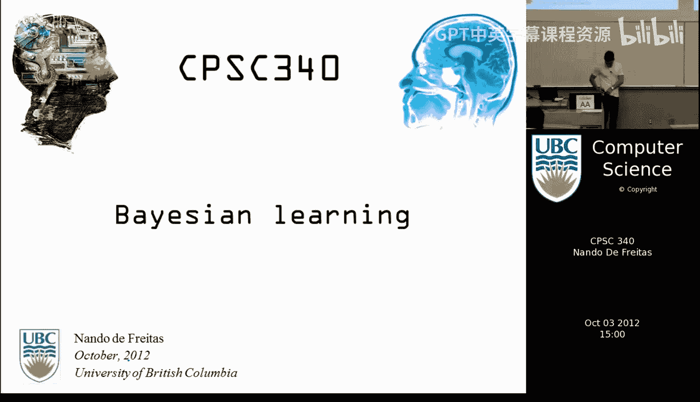

Okay， let's get started because we're all past the starting time。

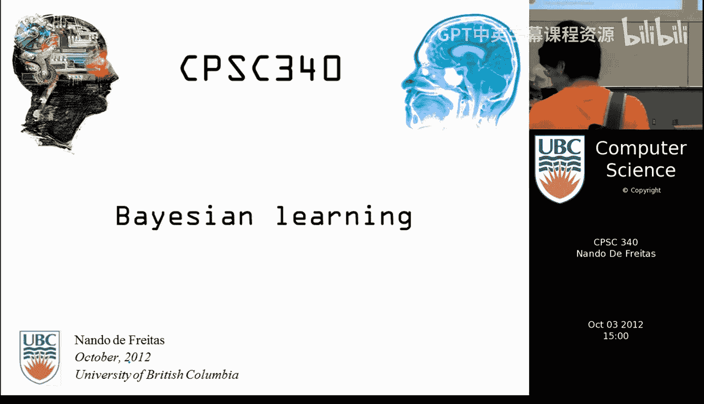

So。Maximum likelihood。 Okay，'s getting started。 very important principle for learning。嗯。

Very quickly to revise what we said about maximum likelihood。

 we said that what the principal tries to do is to。You try to find。Theta， by maximizing。

The probability of the data。Given theater。Okay， so that's a basic principle。How do we do this。

 We first need to write down an expression for P of data given theta。So， for example。Or a coin。

P of data。Given theater。It's just equal to theta to the number of ones times1 minus theta to the number of zeros。

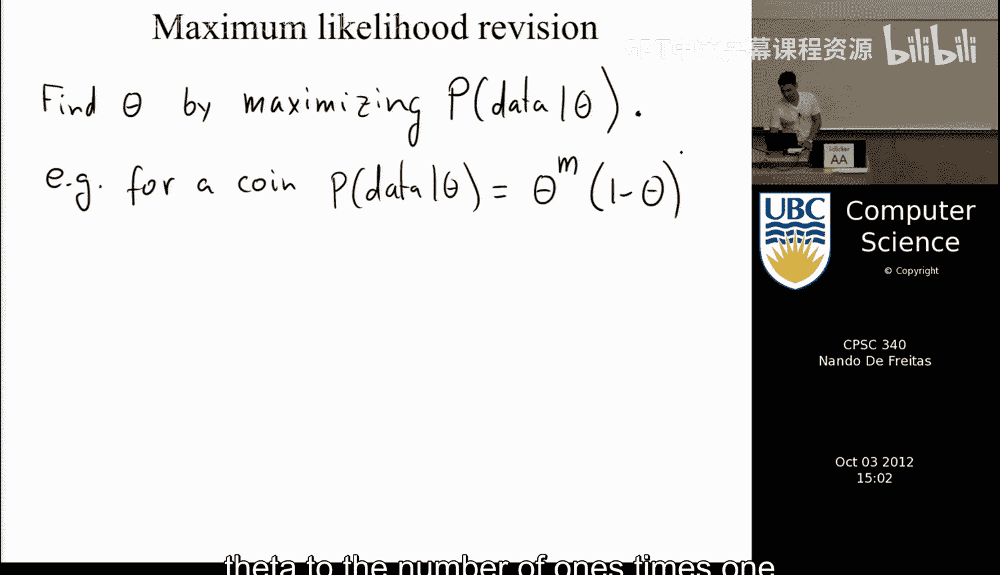

So M was the number of ones。And n equal called the number of ones。0s。So you can think of the data。

 in fact， at all the coin tosses x。1，2， end。Okay， so that's essentially what we do to do maximumim likelihood。

 And so there's two things we need to do。 We need to write down an expression of probability of data given theta with a coin。

 it's a berardity。Later with more complex data， P of data given theta is going to be something like an entire neural network or the deep network that Google uses。

 that's going to be the model。 That's going to be the expression for the mechanism that generates data given theta。

If you have theta， you can generate data with it。嗯。And we do this by。

By simply the second component is we do this by taking the derivative of P of data given theta。

We apply logs first just to make that calculation easier。

 but essentially we take the derivative and the way the derivative is0。 That's where the maximum is。

So。For now， our lives will all be like this。 There will be unimod。So when we fl。Against theta。

 the free variable。P of x give the me state。Fear of data。Even theta。

The point where the maximum occurs。That's what we're going to call theta heart。

 so hit the heart is the location of the maximum。Okay， which is the point of the highest likelihood。

 And we take derivatives inequ to 0 because。At the point of maximum， the derivative is0。Okay。

 derivative is the same as slope。And so that's the basic principle。

 We differentiate an equ to 0 to find a point of max。Later， we will not be able to do this。

 So instead， what we will do is we will follow the derivative with the hope of finding a good maximum。

 becauses not really visible something。

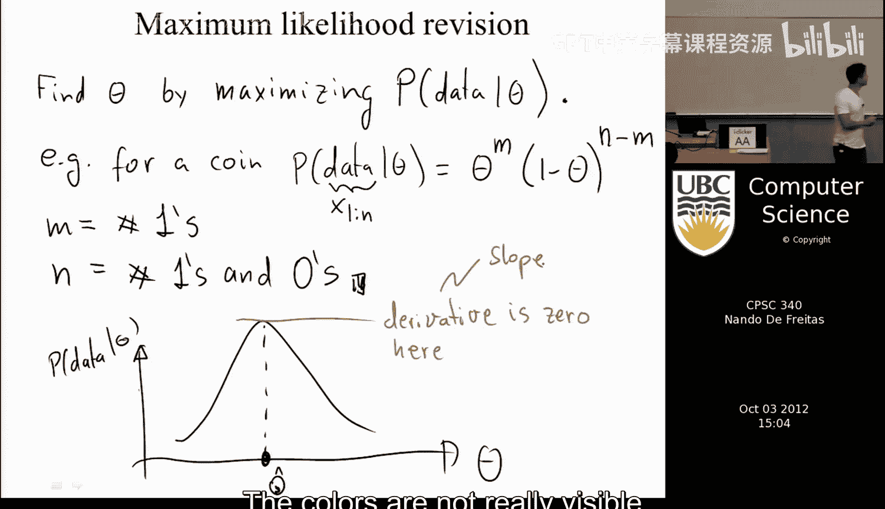

P， the colors are not being invisible because。Okay， let me switch off the light。Thank you。

This should be a bit better。The colors are not important。 In fact。

 I wrote most of that in black only。For this light colors don't matter。

Okay， the other thing we know about maximum likelihood。 and this， by the way。

 is the operational mechanism。 That's what we do in practice。

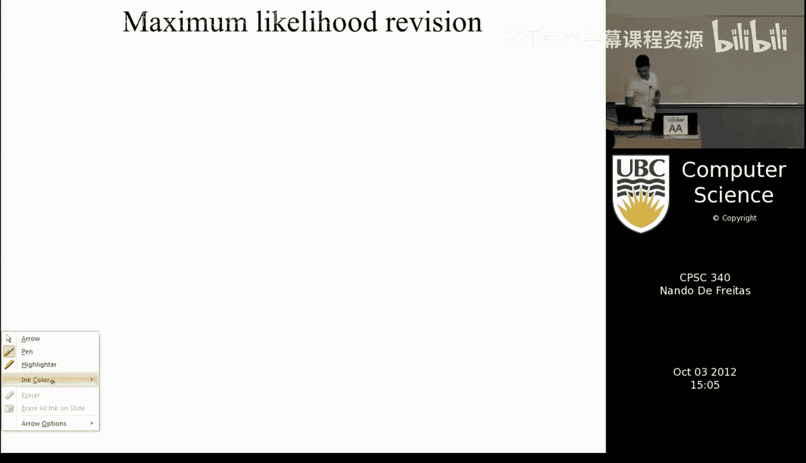

Okay， so in practice， we always take the derivative， we pay to0。

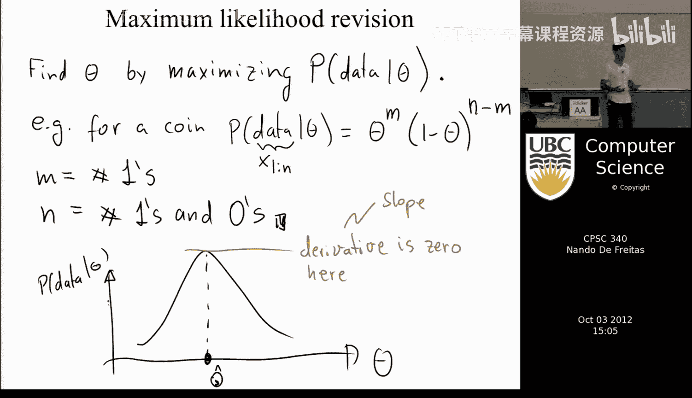

The other thing I explained at with the last class is that maximum likelihood。It turns out。

 and I went and I expanded carefully over the slides and I put those slides online。

 so I recommend you look at those slides。You can also think as maximum likelihood。Or theta ML。Is the。

Theater。That。Minimizes。The following error。It minimizes the difference of information。

Between the data produced by the true model。And anythe。

So you search for all thes and the theta that's going to minimize this difference happens to be theta hat。

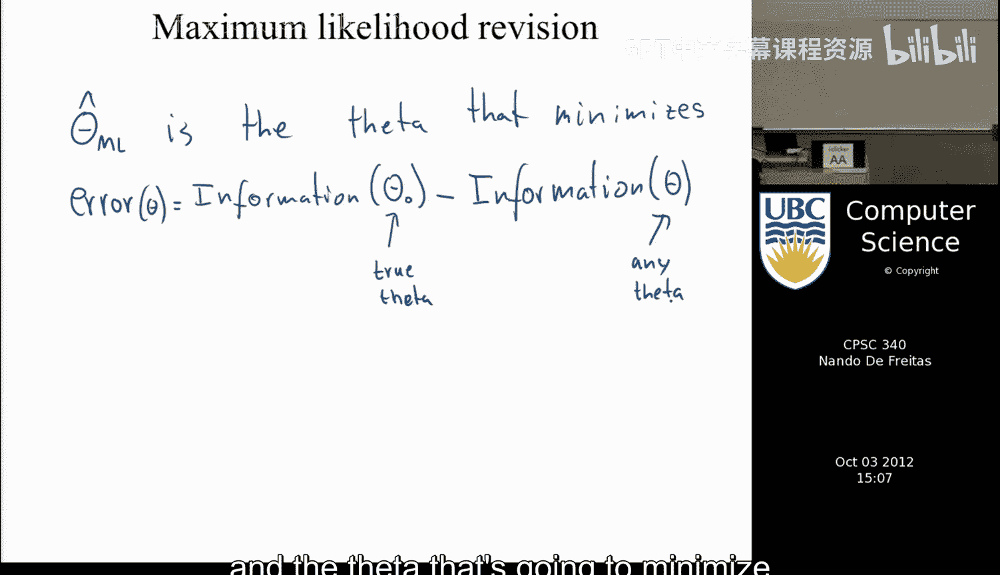

Without going into the definition of information， you can think of it as just as going to minimize the difference between the average log probabilities。

So。It does， whether we think of in terms of log probilsis of information。

 what's clear is the theta maximum likelihood minimizes the difference between the data produced by our model。

And the data produced by。That we've actually observed in the real world。So， think of it as。

There is one true。Theta not。And from this truth thether node， you observe a data set。

 which is something like， I don't know， something like this。And then our task is from this guy。

From this sequence。We tried to guess。Something that might look at and like this。We try to guess。

An estimate of theta。So you never observe theta not。Theta node produces the data。

From theta node your can data。 So think of it as there's a being that's hidden behind a door and that being has a parameter theta node and it will produce ones and zeros depending on what that theta node is。

 Okay so it has a coin that is biased with biased theta not it keeps flipping it and it gives you ones and zeros。

 and all you ever see is that ones and zeros。 And from ones and zeros， you're going to have to。嗯。

Gueass， feetta not。Your guess of theta knot is what we call theta hat。

And a particular good guess is the theta maximum likelihood。With this theta hat。

 you can produce data， too。And let's call this data， the sample data or ext， your hallucinations。

 the model， the data generated by the model。A good theta hat is one that's close to theta n。

But because we don't know it or not， we will never be able to know whether we。

Where do we have the right the？So instead， what you do is you choose。Theta heart。To minimize。

Some difference between arbitrary some function of x minus some function of x tilt。

For maximum likelihood， that F happens to be the sum of the log probabilities。

 That's the statistic that maximum likelihood uses。

 which has interpretation also being the negative entropy。There's many other ways you could do it。

 You could， I'll get your questions。 and you could also just basically say F could be just the number of ones。

Okay， so F could be the number of ones of x versus the number of ones of x tlta if the two agree。

Then you have learned。That's the basic idea you can never observe theta not， but you observe theta。

And if you observe theta and if youre sorry you observe the data x， and if you have the data X。

 you can guess a theta， let's call it theta hat。From that theta hat。

 that theta hat basically is a model。 From that model， you can sample data。

 and then you compare the data that you sample against the data that you observe。

 If the two are the same。You're in good shape。Now， in comparing data。

 we're just not gonna to compare the whole world to the whole world。 But instead。

 we're going to try to come up with a summary of the world。 That summary is F。

So F has different names， summary， Statistic pattern。

 And so what we're trying to make sure is that the patterns。

Of the world are the same as the patterns that our model is capable of replicating。

 when we looked at the experiment that I showed you before of the cat where scientists found that the cat had the neurons here in V1 that were responsive to different edges。

 that's because that cat has learned to essentially should replicate the patterns that happen a lot in the world。

Ages happen a lot in the world， so it would be important to have edges in our break。

And as you can see in the Google network and many experiments in neuroscience before。

 some neurons are even good at detecting faces or detecting particular faces like the famous hollowlaberry neuro。

 so there's a world， the structure of your brain matches that visual world。

 and that's how the brain does recognition。Now， for now， we're not going to use this。

 We're not going to use this procedure for learning。In neuroscience， we do use such procedure。

 actually。 so it's important to actually understand this procedure because we will use it later。

We will instead use maximum likelihood， which is very operational， differentiate equ to0。

 so we will not have to deal with doing this comparison。However。

 the important thing to know is that even though we're not doing this comparison explicitly。

 implicitly we are doing it。We're just not writing it down。

 but you could think of maximum likelihood as behind the scenes。

As actually comparing the entropy of the data and the entropy of the model。Of。

 of the hallucinations of the mob。I'll take the question so when we are trying to come a bit at any important。

 we are basically trying to minimize this level。 So does maximum likelihood give you the basis。Okay。

So advanced remarks of maximum likelihood， maximum likelihood has some nice properties。

 so these are sort of the Al in fourthier statistics。

 or if you take the a grad class in machine learning， maximum likelihood is consistent。

 what that means is that the theta hat as the number of data grows to infinity always approaches theta not。

If you have infinite data， you will get it。In practice， we do not have infinite data。

 so that's problematic。In fact， the swan problem， the fact that if you observe six white swans。

 you conclude that there's no black swan， that's a problem that would go away if you were able to observe all the birds in this planet or observe at infinum。

 the planet and so then maximum likelihood would work well。

 but because of the finite number of steps that we have to do in practice。

 you're get into problems like the black swan。Maximum likely has another property that comes from the central limit theorem。

 it not only converges。To the right answer， to or not。

But out of all estimators converging to theta0 is the one that's the most efficient。And by efficient。

 it means that it's the one that has less variance。The following is just a caricature of it。

 but think of。This is N。Think of this as the or not。And so estimators can sort of converge。

But they can take many， many steps to converge so that they can have some variances。

And out of all estimators， a nice result in statistics that can be proved easily is that maximum likelihood actually is the one that has the lowest variance。

So you write a central limit theorem for the difference of theta hat and theta knot。

Theta hat been the green curve here。 If you right， if you look at the difference。Of those two。

They follow the central limit theorem， which means that the distribution of the difference is a Gaussian。

And then the Gaussian that has zero mean because they conversege to be the same。

And the difference of those two guys is the variance and maximum likelihood can provably be shown to have the lowest variance。

 which is called the crale lower balance statistics。So asymptotically。

 it has a lot of nice properties。In the non asymptotic regime， it has problems。

We can get into traps if you just have a few data， it's very maximum likelihood can actually get you into the wrong conclusions。

 like you would conclude that there's no black swa， for example。are learning algorithm。

Do you see that this is the fastest？Use tax likelihood or do we use something less？嗯。

A lot of people argued that we use what I'm about to teach now。

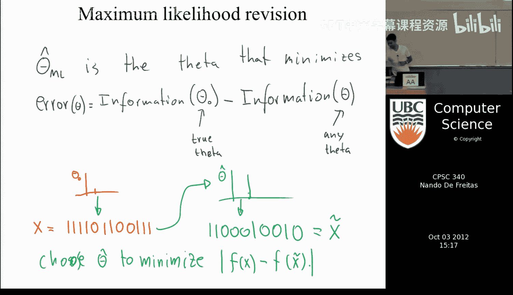

Base。Okay， how does base work？嗯。In Bay learning， we have some data。Okay。

We're going to go back to calling the data samples X， x is the data。

 and let's assume we have n data records， capital n sorry small n data records。

And so the first thing we can do is we have to specify a model。 For now， our model was just be。

The theta M。

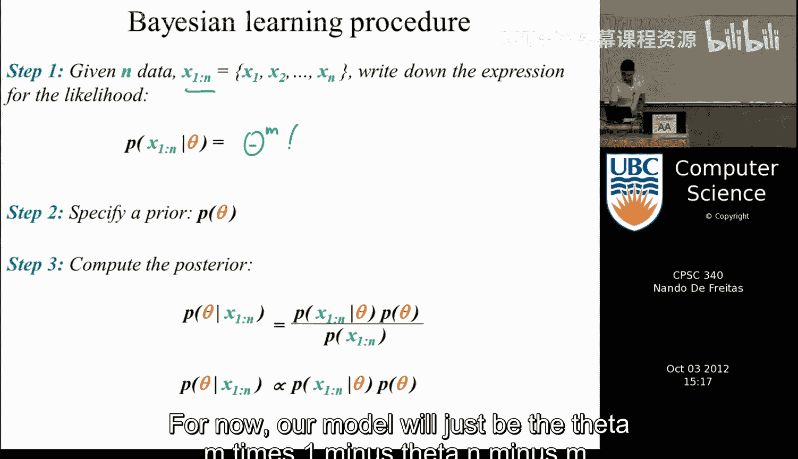

Times 1 minus theta n minus M。Say for a coin。so Bernnoli distribution is enough the model of coin。

To model more interesting things in life， we will have to introduce more distributions。

 but the principles of maximum likelihood Bay learning will still apply。

SoSo you should think of there the principles that govern everything maximum likelihood based in learning is on at the lower level。

There will be different models。And then。Even lower than that， there will be different algorithms。

But we can think of cognition in terms of what are the fundamental principles for reasoning and then further down what are the models in the situation and what are the algorithms。

Unlike like with maximum likelihood， by specifying the probability of x given theta we're done。

In terms of specification， the only next step is differentiating equation to zero。

Basin will specify one more thing， the prior。And that prior captures our prior beliefs。

It captures domain knowledge and so on so going back to that question I ask you what's the probability that the Lionsgate Bridge will collapse before the end of the term and so to conclude you wouldn't just look at the number of times the bridge has collapsed but instead you would use some domain knowledge that you have about bridges to make that judgment。

Okay， so base rule。And today， we will learn how to specify a prior for coins。

It turns out that that p is extremely powerful。If it's just no Bernoles and。The prior for coins。

 which is the beta distribution that we'll introduce soon。

 you can actually do a lot of text processing on the web。

You can this very sophisticated natural language process。

Because each coin is whether a word occurs or not， and just knowing whether words occur or not。

 you can build very good spam classifiers， you can build very good advertising engines for products like Facebook。

Now， let's assume that we have。We have this prior。 then the computation that base does is to compute a posterior。

Caeria is likelihood times prior， normalized。So instead of maximizing。

Basian reasoning is very different， it requires multiplying a likelihood and a p。

And then it requires that we normalize。Now， important notation。

Instead of writing the whole expression， P of X1， given。P， F， X 1 to N。

 given theta times B of theta divided by P F X 1 to N。 I will often write it just in this way。

And where。This symbol here。Means proportional。Okay。

 so basically what we're saying is we're saying that P of theta， given the data。

It's equal to one over a constant。Times P of。X1 to n given theta times p of theta。

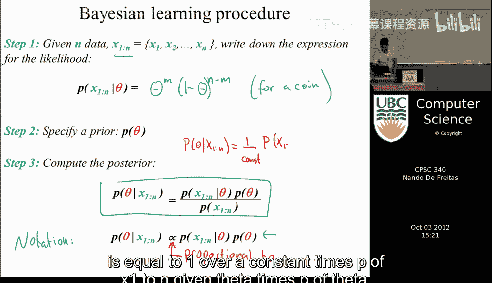

P of x1 to n does not depend on theta。 It's just a function of the data， X1 to n。

 So from the perspective of theta， we could interpret just as a constant。

Recalld that this is a distribution of a feat。There is a fundamental difference between the thinking of。

 of。Someone who does maximum likelihood， who also known as a frequentist。

 someone who believes in frequency of events in order to derive conclusions and a Bayessia。

 And the key difference is that for a frequentist， there is no uncertainty on。Fta。

 the uncertainty is that X。You only specify P of X given theta。 So the distribution is on the data。

Theta is not a random variable。AF believes there is a true theta called theta not。

 We don't know what it is， but we should guess it， but there can only be one true theta not。

 That's the frequency way of thinking。 Theta is not a random variable。 The only randomness。

Is in the date。A basin takes a very different perspective。 A basin says， no。

 thet is a random variable， and that's why we're going to specify a distribution on this random variable。

 we're going to call it the prior。And then as we observe data。

 we update this prior and it becomes a posterior P of theta given x1 to n。

 If we observe one more data point。P of theta given x1 to n becomes the prior。

 and then the posterior becomes P of theta given x1 to n plus1。

 So the Bayesian view is one that is sort more useful to a roboticist because you could imagine that you have a robot。

 It has a prior of what the world is。 It explores the world。 It gathers new information。

 and it updates its prior， creates a posterior。 That posterior becomes the prior for the next step。

 It gathers more data。 It updates the posterior。 So this robot goes around the world and it knowledge gets updated。

 And at any point that robot has knowledge， internal knowledge， which is this。These prior beliefs。

 and it also sees the data， and the conclusion that the robot will ever reach will depend on two things。

 it will depend on what it sees and it will depend on his prior beliefs。

Sometimes you see things that you're not quite sure whether you're seeing one thing or the other。

 but if you use reasoning。You know your beliefs and your history and so on。

 you can conclude that one event is much more likely than the other。

 so one explanation takes precedence。

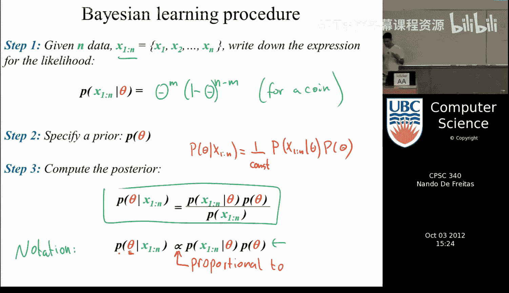

And that's essentially the basin view。No。So as I said， we're going to write it like this。

 Another way that this is often written as。Is as P of x 1。To end。Given theta times speed of theta。

Divided， as this is a distribution of our theta， given the data。

 so the data is assumed to have been observed。You saw the data。 now you're trying to get data。

Data is given the randomness， the uncertainties of a fe。

So then to make the distribution sum to one over theta。So in particular， in this case。

 theta is continuous， so we need an integral。And if we integrate it， we should get a one。Okay。

 so because it's a probability of our theta。And so this must be the normalizing constant。

 which is just the integral of P of。X 1 to n， given the。Time Sp of theta the。And today。

 I will introduce the first continuous feat。So essentially we're replacing sums by integral。

Before we had that P of A。Is equal to the sum over B of P。Of A and B。

Now we're going to have that P of。A is just equal to the integral。Of P of A and B。

So that's just marginalization， and integral is just a limit of sum， so it's just essentially sums。

 and so all the properties that we had for sums apply natural to integral。

 so we can do the chain rule， we can do marginalization， we can do the sort dynamic programming。

 successive conditioning and so on。This quantity here。At the bottom， that's the marginal likelihood。

So it's the same as before， we get P of x1 to an n theta by multiply using conditioning。And then。

 by integrating out。Theta， we removed the variable theta， and we just left with x1 to n。

Which is what we had in the previous slide as well。

So the only thing that changes with continuous variables is that we replace the sum by an integral。

It will turn out that the integrals that are arise in practice are actually not hard to do。

 and someone already did them， so we're not going to be doing much integration。

 but we'll use some results of integration that other folks have already produced for us。

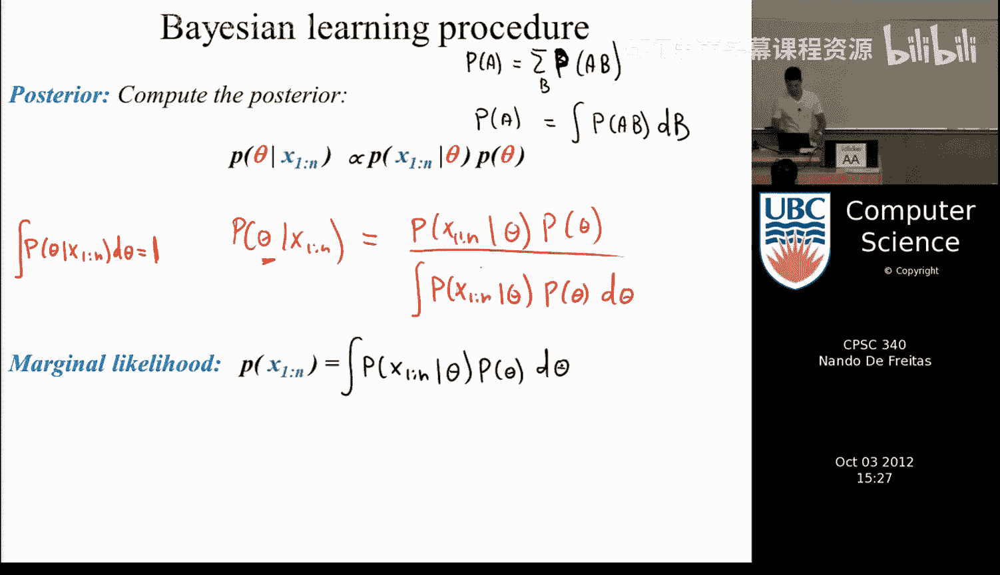

All right， so let's do an example， the coin model。For the coin model。

 we know that the probability of a data point is just theta to the Xi。

Times 1 minus theta to 1 minusxi。And if you have many points， we would were。X I is either does 0 or1。

We have many data points， we just write it， we just multiply。The probabilities。

 assuming that they're independent。And identically distributed， which is by the way。

 summarized by this， when you read IID statisticsisticians just mean that the variables are independent。

 the coin flips are independent and they're identically distributed。And again。

 M is equal to the number of ones in the sequence。Okay， so the first step is we write。The likelihood。

 and we know how to do that from the previous two lectures。 The next step is a bit is new。

 We need to write a prior for theta。

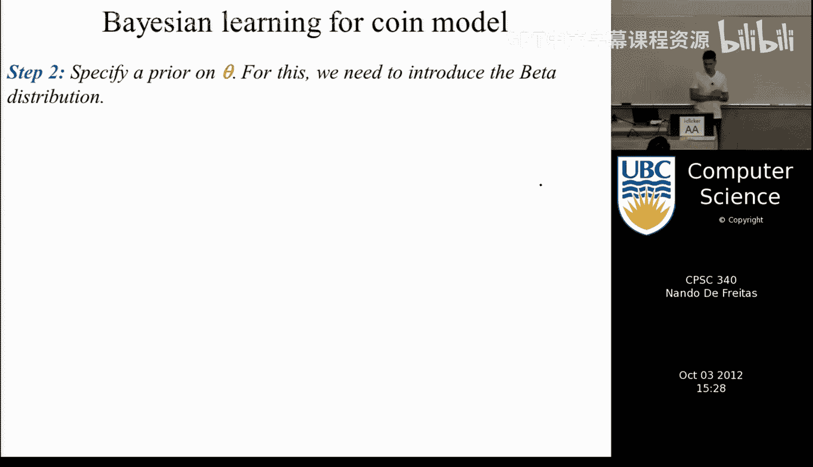

Now。Theta is a continuous variable。So we know。Theatta is container。And。

We also know that theta has to be between zero and1。OkayWhy is that？放个。好的。わかず。Yeah。

To followss straight from the definition， theta is equal to the probability of Xi equal1 for anyi。

Ford all high。So for NAI， theta was defined as the probabilityvo the conal P heads。

 the probabilityative of one。 That's how we defined it。 And so probabilities are between0 and 1。

 so theta cannot be。So now we need to come up with a distribution that describes theta。

Can we use a beernoulli distribution to describe theta？The answer is not。

 because aernoli only talks about things that are  zero or1。And theta is not just0 and1 Theta。

0 and 05 and 0。314 and any number between 0 and1。Can we use a Gaussian。我没给。just to describe theta。

 so the question is。What， how do we describe P of theta， No。

 How do we write it down because it has 0 points。Exactly， August Gaussian says that a variable you。

 it extends over the whole real line。 So it would say variables could be any number between minus infinity and infinity。

So counseling would be the wrong model。What are the distributions that you might have seen before I tell you which one I'm going to use uniform。

 uniform is a beautiful choice， because the uniform is between zero and one。And it's continuous。

 and so we could just use that prior and we would be done。

There is a distribution that subsumes the uniform that's used a lot in natural language processing and in text mining on the web。

 also used a lot in bioinformatics， that turns out to be actually quite useful and that's called the beta distribution and the beta is a subcase of a distribution that we'll introduce later called the Theishla。

And if you' ever done any text mining， you probably have come across something called the latent the location。

 it's used a lot in bioinformatics and it's one of the most used tools for text mining。Okay。

 so the beta distribution。If you go to Wikipedia。嗯。Has the following expression。A gamma function。

Out of curiosity， how many of you have encountered gamma functions？Okay， about 6，7。

There used to be a time this used to be taught in undergroundd。

But they get to be taught actually in undergrad。 They to be taught in this course。

 So a gamma function is。I never remember what it is。

 I spent my life doing deriving properties from gamma functions when I was an undergrad。

All of it's been forgotten。Which would make you think it's not very useful， but it actually is。

 So I'm going to write it up。I never remember this。 I just took this off Wikipedia。

 if you type gamma function， Wiiki。You will get to the Wikipedia page。

 which tells you more than you'll ever want to know about gamma functions。It。

The way to think about this is think of logs。What's the log。When you introduce two logs and calculus。

 how already you introduced logs。And so there is a mapping between exponentials and logs， yes。好。

The power which the basis to is。第吧。That's true。 It's exponential。

So they're very related to exponentials。

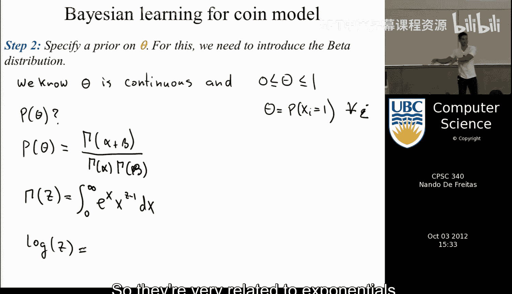

Okay， so because the log the x of x is just x。 So there is that nice reciprocal property in addition。

Where did logs come from？我。Yes， it's a sum series。And if that series becomes infinite， in fact。

 it's an integral。So log is actually defined。As an integral as well。啊。So we use it。

 but we actually honestly have forgotten where it came from。

 So I'm going to ask you to do the same thing。 Use the gamma function and forget where it came from because it's not useful。

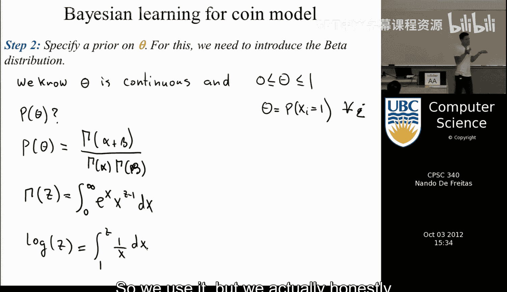

And so。We're just gonna write the gamma there。 And gamma is just a thing that in a computer， you say。

 give me gamma of two， and it returns about。The same as log， you write log of two。

 and it returns eye。So that's as much as I need you to know what the gamma function is。

 if you want to know more， go to Wikipedia。Now， the distribution continues by having a theta to a parameter called alpha。

And then one minus theta to the power of a parameter called beta minus1。Now。

Alpha and beta are known as hyperparameters。The parameters on parameters。

 so itta is a parameter alpha beta parameters。 it's possible to put parameters on alpha。

 put priors on alpha beta and have a hyper hypert， but we're going to stop at hyper。Okay。

 so the p will have these parameters for this course that this will be interesting enough。

And useful enough。Now。I'm going to ask the following question。The integral of theta to the alpha -1。

Thats1 minus theta。The beta minus1。The the。It's equal to。Oh。

 and when I write an integral just like this without the limits。

 I mean it's over the whole space where features value。So between zero and1。

So it indefinite integral。

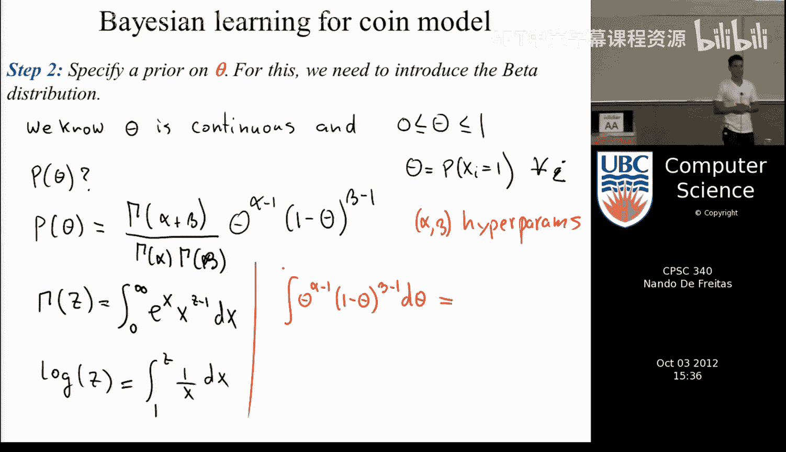

Okay， who's got the answer？你别子。Of minus1 plus beta minus1。

If you map alpha of minus1 of beta minus and an M， then。

And you would expect that if it was supposed to normalize， it was supposed to be。Okay。

 I'm going to cut you there。Not quite。At least as way I understood it。

Think of the properties of P of theta。Gamma times gamma beat。Over gama alpha。Indeed， sir。

 and that's a very smart dancing。Because， I know。That the integral of P of theta。

The theta is equal to1。Which is the integral。Of gamma， alpha plus beta。Divided by gamma alpha。

Times gamma beat all of the other stuff。So if I just move terms to the other side。

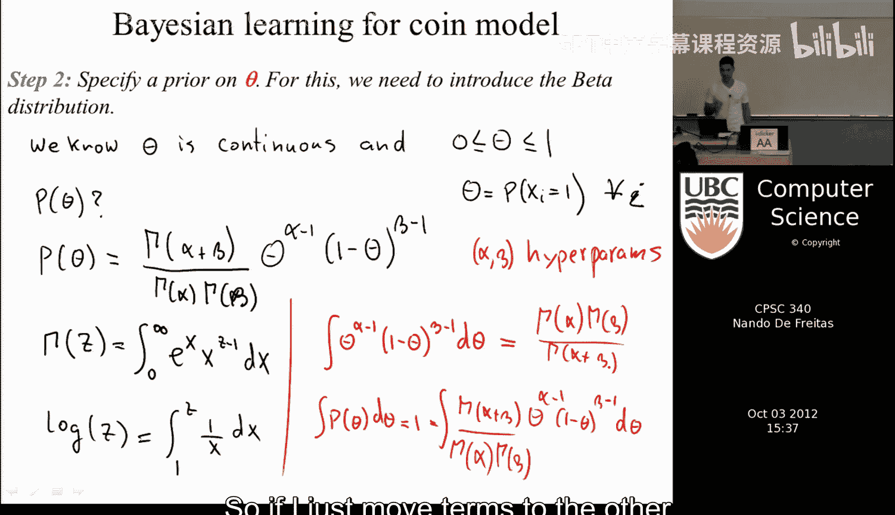

That turns to be very important， even though you don't know what a gamma function is。

And even though you don't know how to do that integral。

Just by knowing the shape of a theish layer and just by knowing that the gammas don't depend on thes。

 Theta is not。It's just the gammas are just functions of these hyperpermeters often beta。

 they're not functions of beta， so you know that they are the normalizing constant。

So we never need to know P of x。 We don't need to know the normalizing constant because someone already worked that out for us and called it a gamma function。

 So this turns out to be a lot easier。

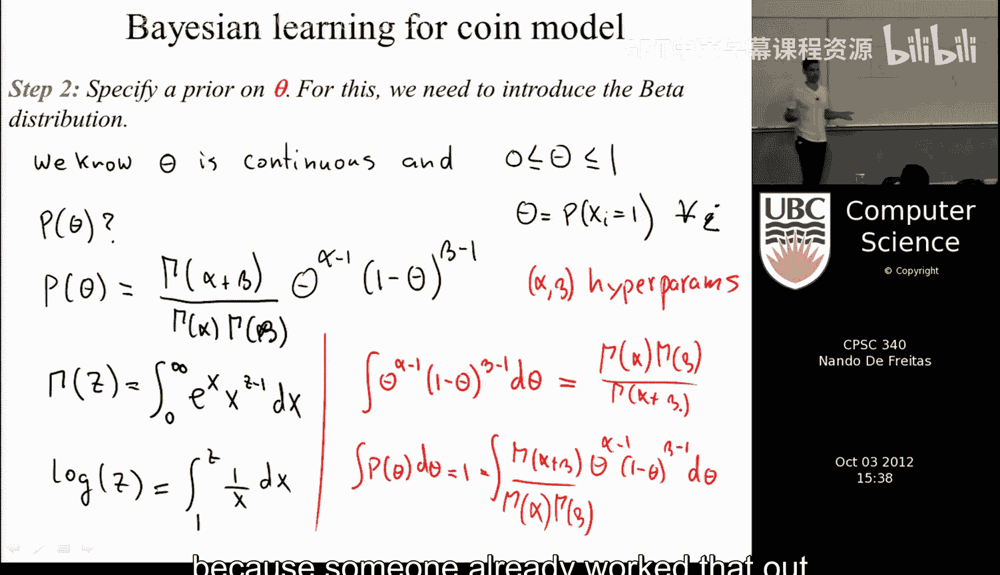

Then it at first appears to be mainly because you don't need to do the integral。

 someone already did the integral for you， and you just need to exploit the property that probabilities sum to one。

And that's what we're going to use to compute a posterior。Now， what does this beast look like。

 it clearly will have different shapes depending what alpha and beta are。

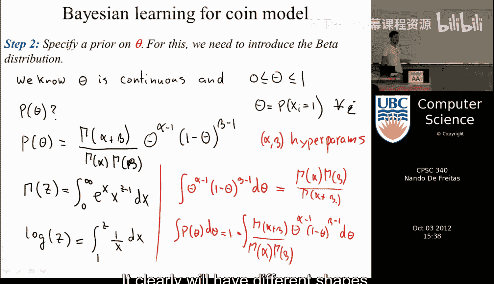

Here is a bunch of them for different values of alpha and B。In particular， let's think of the choice。

Alpha equal。1 and beta equal to1。We know that P of theta is proportional。

And now I'm not going to write these gammas because they're very tedious to write。

 and I know what they are， so I'm just going to write proportional。

To theta to the alpha -1 times 1 minus theta。To the beta minus1。Which。

When alpha is equal 1 and b equal to1 it shows theta to the zero。Times 1 minus theta。To the zero。

Which is just equal to one in other words。怀疑。Pio theta is proportional。2 one。Now。

 which distribution do you know has a high constant？1。The uniform。So we get a uniform distribution。

That's this guy in red。The uniform distribution is a prior。What does the uniform say？Now。

 keep in mind that these are prior beliefs。 You would like to be flexible。 You would like to say。

 I believe that theta is more like one than like zero。Or I believe that any fe is equally likely。

The uniform is saying， I believe any theta has equal probability。So T equals 0。

2 is has the same probability as T equal 1 or T equals 0。5 or T equals 0。7。

They all have probability 1， and any the outside the interval 01 has0 probability。

So theaters have apro。But you might believe， like if I start flipping coins。

 you might believe that I'm a cheetah。And so you believe that my coin is biased。

 So you shouldn't believe that。Your prior shouldn't be uniform because if you believe the coin is biased。

Toward one， then you should use one of these shapes。Like for example， this guy here。

 which says that Theta is much more likely。To be 0。8。

 in which case the probabilityative of the coin being 1 is much higher。So this is just a way the。

 the P distribution is just a way of producing many curves to describe your prior beliefs。

So any general， so you can add up。Strongly believe。As in this case。的。Theta should be 0。5。

Because you're saying any other explanation， any other theta is very unlikely and much more likely theta should be 0。

5。From a recursion perspective， this is also interesting because thet is a probability。

And P of theta is a probability on probabilities。So we're getting into this recursive thing and this is what's great for language because language has recursion。

😊，And so these prize will turn out to be very useful because they can handle that sort of recursion and be able to specify probabilities and probabilities and probabilities and so on。

Okay。The other thing that we know。And I， I've made your homework available， but I tried to keep it。

Short because I didn't want you to work through Thanksgiving。 And in fact。

 instead of making it tune next week， I'm giving you one more weekend for the next Monday。

But none which is basically you have to implement the H map。And then you have to do some drills。

 which is straight out of the slide。嗯。But for your following homework。

 I might ask you to prove the following。AProperty that the mean。

Of theta for a beta distribution is equal to alpha over alpha plus beta。Okay， so for now。

 just accept this as a fact。The mean of the beta distribution is alpha over alpha plus B。

And then in your exercises， you'll be able to prove this。

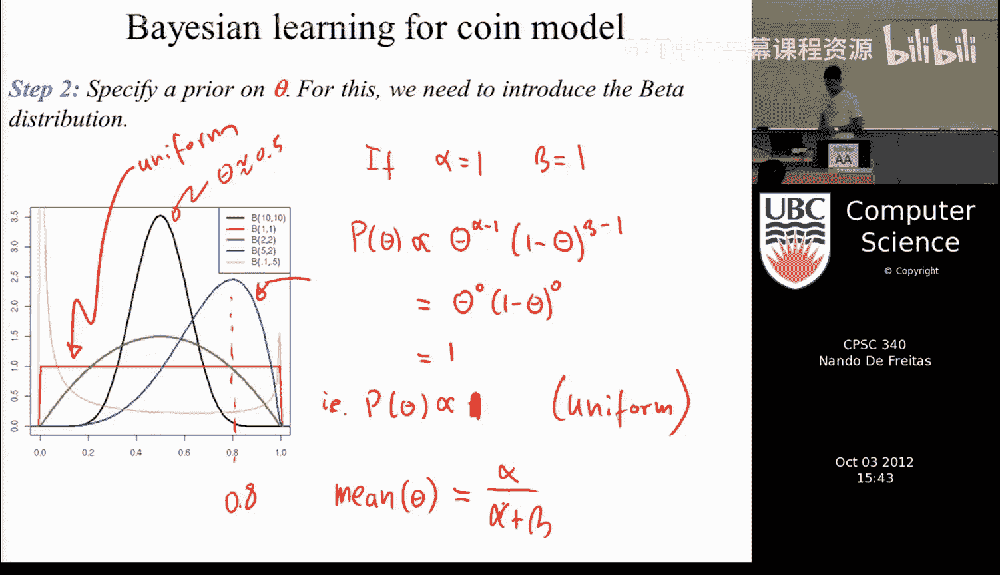

Now， let's look at an example。

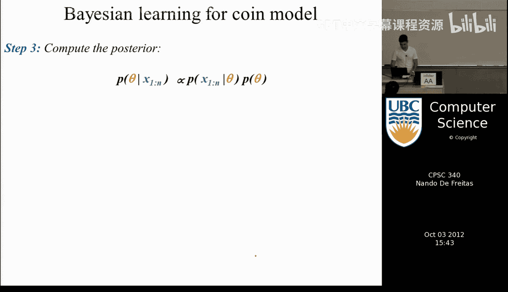

啊个。Why could't we just use a Gaussian and then define。8 points at0 and one。而啦。And they just goes。

So you could do that， but then you would need to figure out what the normalization constant is so that it still sums to one。

And you could， because we know the tail probabilities of a Gaussian， we have a lot of tables。

 so you could figure it out， but then the Gaussian is not as flexible because the Gaussian is always this bell shape。

Which seems to say that 0。5 is much more likely。 And what you really want is a mechanism so that by changing alpha beta。

You essentially you set alpha beaten when you're adjust alpha beta。

 you can generate any prior that sort of matches your prior release。distribution be。

Like is when they're equal。No， you could try to approximate it。

You could probably come up because if you look at the shape， roughly the beta22。

Start getting that shape。 So you could probably approximate it。

 I don't know what the error approximation would be。 I imagine you would come close in that interval。

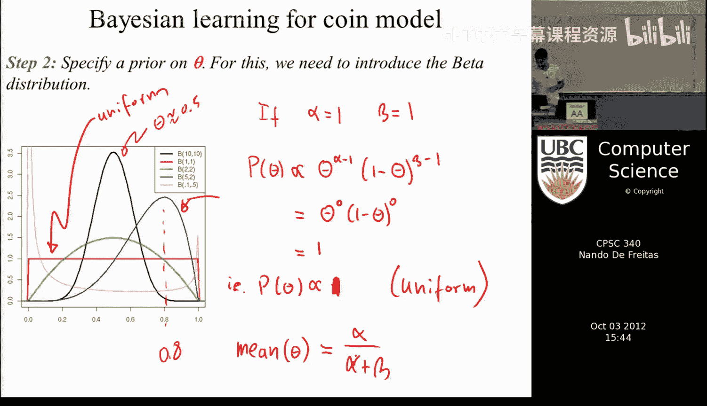

How do we put all this in practice， so suppose we have the coin model and we want to compute the posterior distribution。

And then。We know， and we only need to compute it up to proportionality。

Because we're going to use the same trick that we used just before。

We're going to just compute it up to proportionality， and in the end。

 we're just going to plug in a bunch of gammas， which make everything sum to one。And we're done。

So if we continue with this， this expression here is equal to。Theer。To the M。Times1 minus theta。

To the n minus M。Times the prior and the prior theta。To the alpha minus-1 times 1 minus theta。

To the beta -1， you can compute posterior without knowing what the values of alpha beta are。

Because all the terms group very nicely。If you have x to the power of two times x to the power 3。

 that's just x to the power of 2 plus 3。 So that's the rule that I'm using here。And。Now。

The thing to notice is that I could rewrite this as theta to the alpha prime minus1。

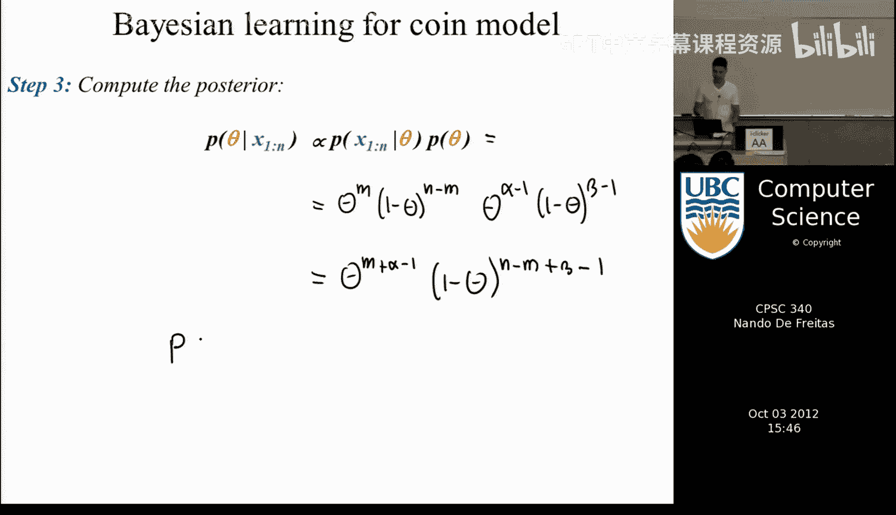

Times1 minus theta。To the beta prime minus-1。

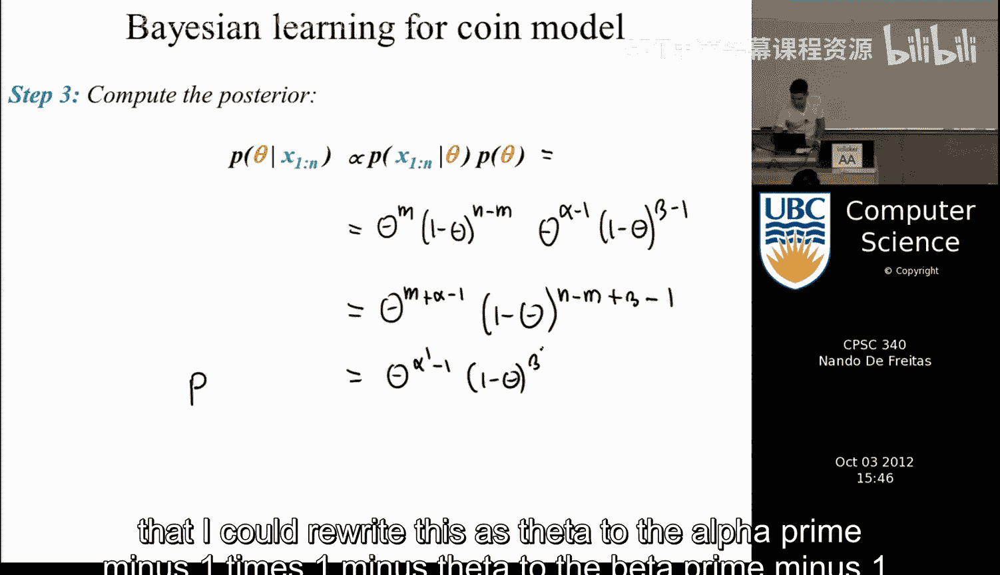

Where alpha prime is just equal to n plus alpha and beta prime is equal to n minus m。Plus B。Okay。

 so we don't know the constant。So we still don't know the constant。 We do know that P of theta。

Given x1 to n。

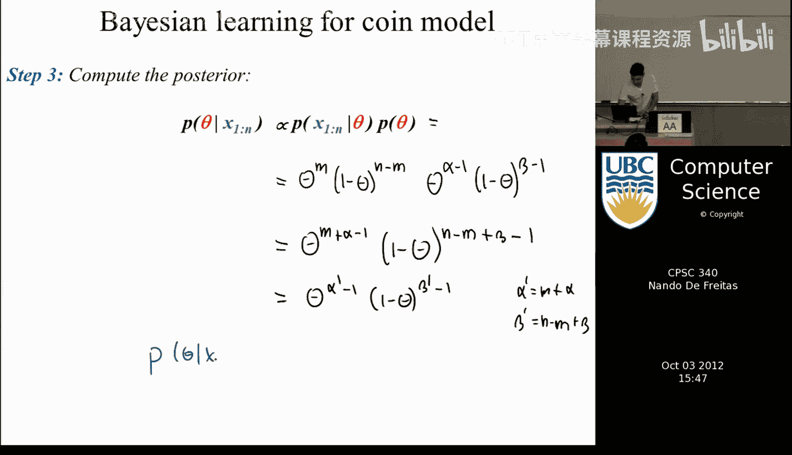

Is equal to one over a constant。Times， theater。To the alpha prime minus1 times 1 minus theta。

To the beta prime minus-1。

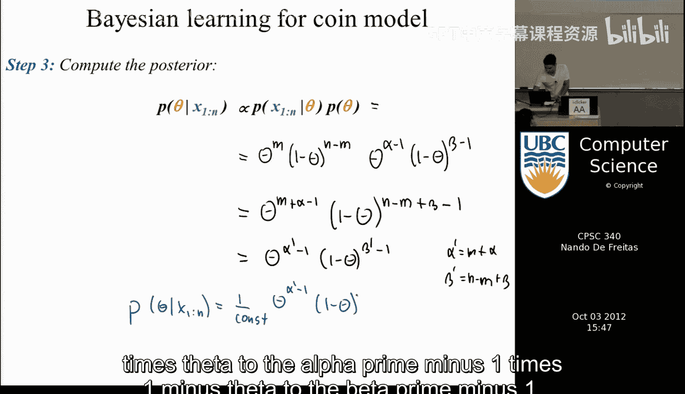

The question is， what's that constant？What would make it sum to one？It's the cameraless again。

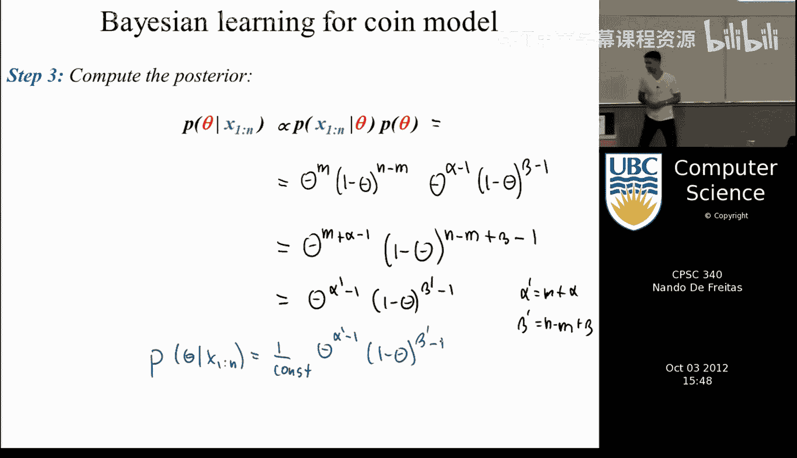

So。We know。It's essentially this guy here。Because this is what makes the integral sum to one。

Because we know this property。That a probability must sum to one， so if you put those gammas there。

 you know you get a one， someone has proved that for us。

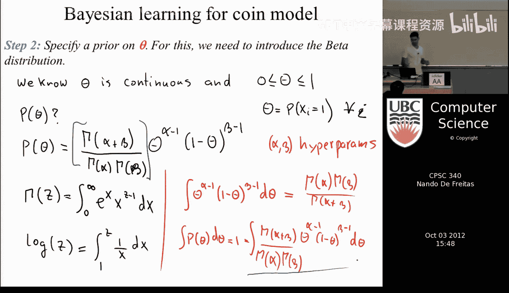

So I can just write this。

Just by doing template matching。Ass gamma， alpha prime plus beta prime。Of gamma， alpha prime。

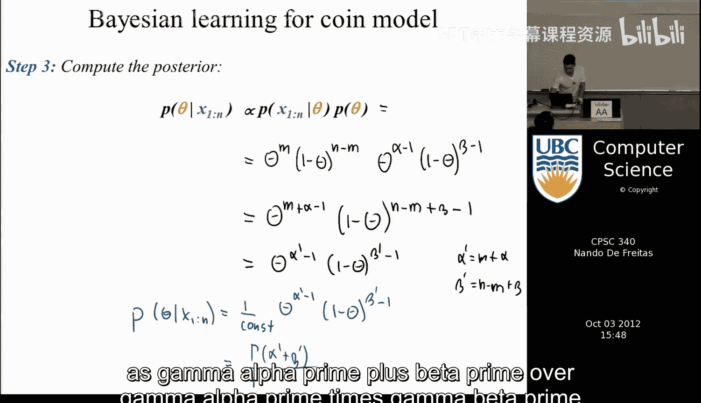

Times gamma， beta prime。Theta to alpha prime minus1，1 minus theta。

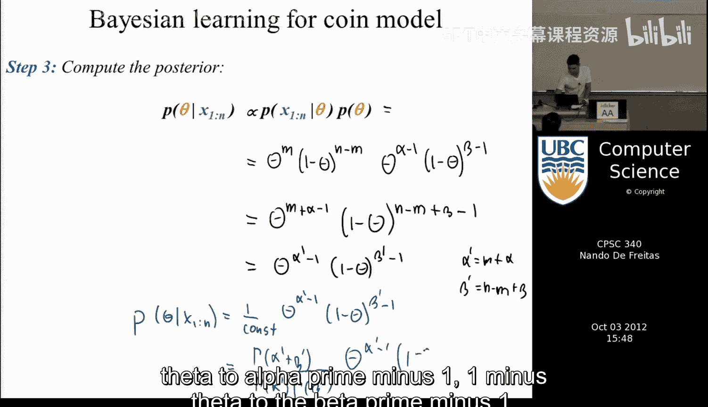

To the Peter Prime。-1。So we were able to do the derivation。Without doing any integral。

Had you chosen to do the integrals， It would also have worked， Obviously。

 would but it would have been a lot of work because you would have had to do all that algebra。

け我 that characters。But just by assuming that someone there is。

 sorry that beta distribution sums to one and by just accepting its definition as a valid distribution。

We are able to compute a posterior without having to do any calculations。

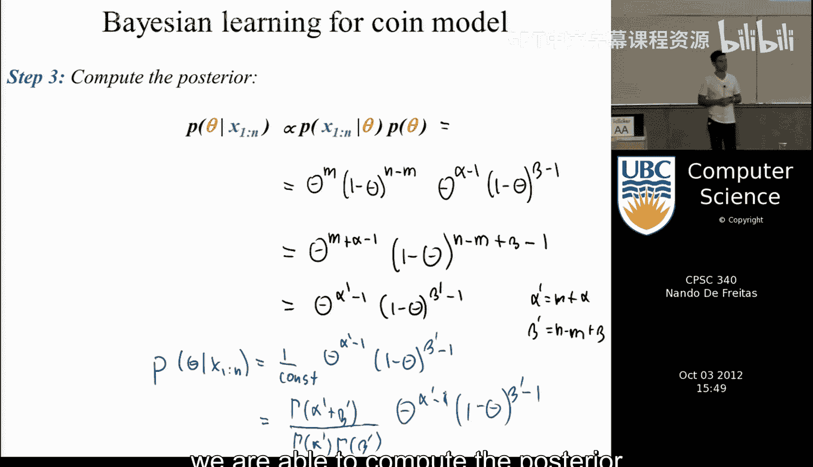

， so we just essentially need to add exponents。

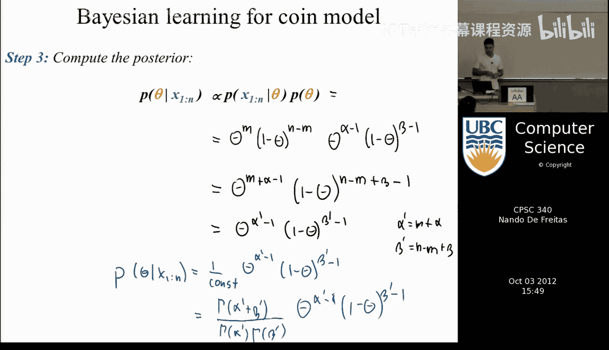

Now that we have the posterior， what does this mean。Let's look at an example with numbers。

Suppose you observe now a sequence of six onens。 Okay， so you see six white swans。

The answer of theta maximum likelihood。Is one。 okay。

 you've observed six onens divided by six coin flips。 That's just a one。

 So it would say that all swans are white， there's no black swans。

The basin estimate would say that P of theta。Given these of six observations。I's proportional to。

Feature。To the number of ones。Which is six。Plus， alpha minus-1。

Times1 minus theta to the number of zeros， which is 0。Plus beta minus1。The mean， the expectation。

Of theta given x1，2，6。Is equal to alpha prime divided by alpha prime plus beta。

Which is just6 plus alpha divided by 6 plus alpha plus B。That's what it predicts。Now。

 you could have different prior beliefs if you believe that both alphas。

 if you believed that the coin was likely to be。The probability was likely to be 0。

5 if that was your prior。Then。Let's call this just theta Hadbe for short。Then， feedta heart。

B would be equal to 8。Divided by 10。Which is 0。8。But if you do believe in this other prior。

 you would have had。6 plus one， which is seven。Divided by 7 plus 0。01， which would be close to one。

 which would be close to the frequentest estimate。Okay。

The key difference in thinking is a Bay says you specify a prior。If you believe。

A priority that there could be white for black swans。If you believe that the probilities。

If you allow for everything to be possible。In fact。If you use a beer。11。

 which is the uniform distribution， you would get theta。Base to be equal to 6 plus 1，7 over 7 plus1。

Which is whatever seven over eight。So if you believe the prior， all theaters were equally likely。

The probability of a white swan would be high。 It would be close to one， but it wouldn't be one。

 and there would still be some probability that there could be black swans。

Simply because six observations is not enough。If， however， the number of observations keeps growing。

 So imagine that you now had a sequence where you had。嗯。1 million。Ones。Then。

Theabase with the Tucoma2 would always be very close to one。Okay， so no matter what the prior is。

 you would always conclude that it's one。 So with few observations。You don't jump the gun。

 You don't just quickly say there's no black swans。

 But eventually as the observations keep growing and growing， well。

 you have to stop believing in your prior beliefs and you have to， I should believe in the data。

 So Bay this way trades very nicely。The information that you get from the data and the internal information that you have。

Yeah， I think in this problem。I lost the sense of what is the meaning。

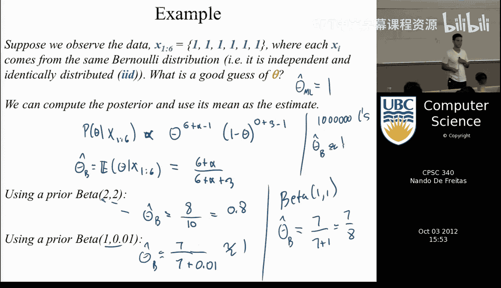

The beta distribution。你知。