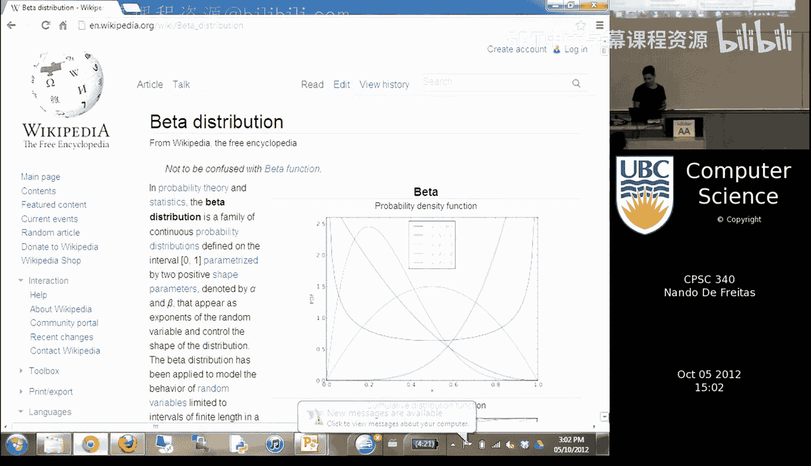
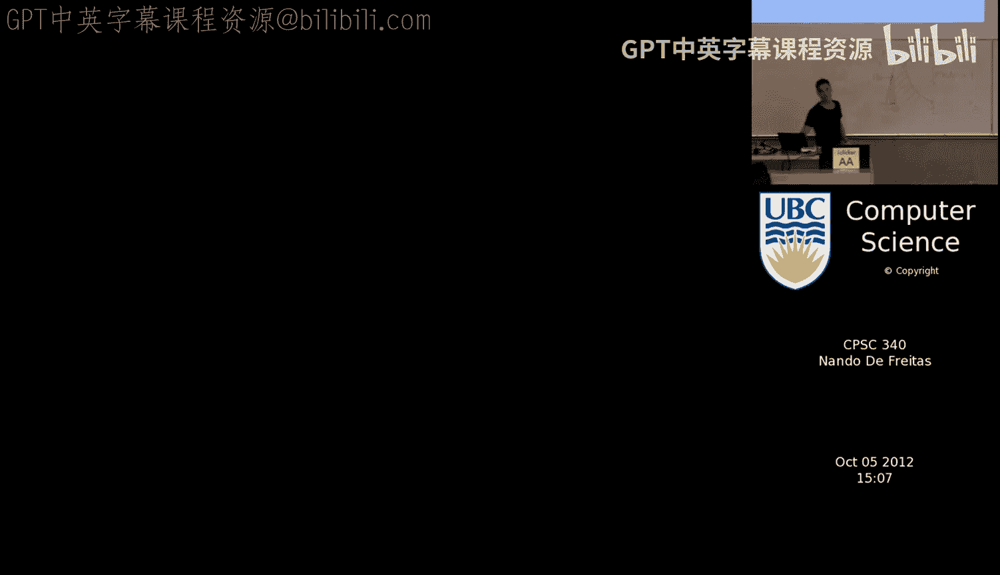
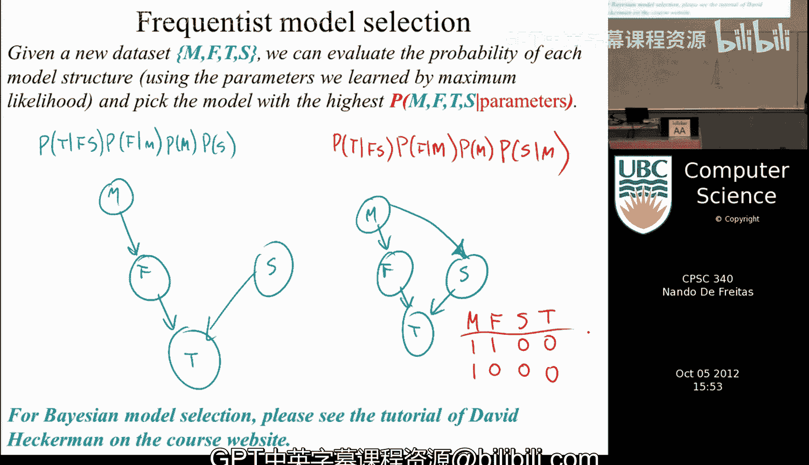

# UBC《机器学习和数据挖掘｜CPSC 340 Machine Learning and Data Mining 2012》中英字幕 p12 -12-undergraduate machine learning 13_ Learning Bayesian networks.zh_en -BV1pJ2ABFEFg_p12-

All right， so let's get started。So。Like get it done to。

 This is the only thing between us and the long weekend right now。Last class， we covered Pa learning。

We said that for Ba learning， there are two things that we need to specify。

 we need to specify the data model。Or what we often call the likelihood。

 And we need to specify a prior。 So there are two models that you need to come up with for the coin。

 it's very easy for the coin it's just a pernooleli and a beta distribution。Later。

 we will come up with more interesting data models like neural networks and random forests。

 things that are sort of very popular out there and that can actually be used to do a lot of vertical cool stuff。

Now with the Bernoulli we know the Bernoulli by now， we've seen it many times。

 it's just the probability of a coin flip if we have many coin flips， the coin flips are independent。

 so we just multiply all the individual Brnoulli distributions。We introduced this。

Beta prior and the beta prior distribution。And in fact， instead of showing you this。

I will show you one of the best resources for learning about the Beta Priia， Wikipedia。Where。

So the beta p essentially is a distribution over theta。

And the is the probability of x equalql 1。 So in this graph， Wikipedia is using x。

X is the variable here， but in my slides， theta is the variable on which we bring the beta p。

The main thing is we have。Theer。The variable。That。Equal to the probability of x equal1。

 the probability that the coin will be one。And that's true for any coin， so any for the eighth coin。

And then what we're doing is we're putting a pia on theta。P a distribution on theater。

Which means that we're putting a distribution on a distribution that the coin will be equal to one。

And that's because if I ask you， what's the probability that。嗯。The bridge will collapse。

 Many of you have different estimates without probability。

 so probabilities themselves are subjective。And so we put priors on that。Now， a probability。

It is between zero and1。So theta， because it's a probability， it must be between0 and1。

So when I specify a probability， it must be that that probability only takes value。

where theta is between0 and1 and so the beta distribution， as you can see it starts at zero。

 it ends at one。 it's a curve， it's a bump when I use a particular setting of the hyperparameter。

 I get the uniform distribution。But by manipulating those hyperparameter often be。

 I can change this shape。And I changed the shape to indicate what are might prior beliefs。

Someone at the end of the class was worried that this curve is higher than one。

 sometimes that's okay。So。The important thing is that when we do probability。

You may have a curve that goes。Of0 and1。 so you might have something say that has height2。

 and this is still a valid distribution because this is what we call the density。

And that's what we are plotting there。The probability density。The area under the curve。

Is one because the integral of P of theta。第四张。Between zero and one。这些歌就我。

Probability is the area under the curve。Of density in continuousuous。马。Okay。

And just like we did for discrete variables， you can also get the cumulative and so on。

 And the reason why we do this is because we can only assign。Probabilities to intervals。

 so if you take a little interval。You want to know what's a probability that theaters in this interval。

 you just evaluate this area， and I will give you the probability of being in this。Okay。

 so we can say pick the height of this。And we're going to call it P of theta。

This interval is a deelta theta。And so typically what we say is that the probability。哦。

The random variable theta being in the interval。Delta theta。Is equal to the height。Times。都问。

Sort of loosely speaking， because obviously， you have to take limits here。But it's essentially。

App proability is a density times。Something that you can measure at length or an area。

And this is mainly because the probability of hitting a continuous point。嗯。Is0。

And my projector has just turned off for five minutes。Just fight a fact。Oh， fortunately not。

Okay， so that's basically a probability in density。

 so you can have the density going above two the important thing of probability is the area under the curve of the density。

Oh， one more thing。 If you look at the beta distribution here。

 it will tell you everything you need to know about the beta distribution。

 It tells you what the mean is so you can read the mean。You can read the media。 the mode is the peak。

Where is the highest point？The variance is how wide that distribution is。

 so we're going to look at all of these now with an example， Important。

 the mean is just alpha over alpha plus B。So as I just pointed out。It's one possible list。Now。

 for a frequent， use what people call point estimates。They believe in a single truth。

One value of theta， so it's the number of ones divided by the number of coin flips， that's theta。

It's a single number。Baess don't think like frequencies。

 Bayess instead try to return a whole probability。 The answer is a probability voltage。

 not just a single value。Okay， so a basically say the answer is this posterior distribution。

And if you need to summarize it， you can use different ways of summarizing it， you can use the mean。

 you can use the mode， which is the location of the peak。Or you can use its varies。 Now。

 why is that useful， That is useful because， you know， suppose I tell him， you know。

The probability that you have。Cancer is 0。9。Plas or minus-1。对。That。You may or may not have cancer。

But if I tell him the probability that you have cancer is 0。9 plus or minus 0。001。He has a problem。

 right？So knowing the confidence of your prediction of your parameters is actually very important is not just whether theta is 0。

9， but it's how confident you are that that's the right value and that in fact。

 knowing how confident you are is actually the most important thing in a lot of applications。

 like certainly when you deal with talks and you need to estimate。

Like the variance in the market is way more important than just knowing saying what an exchange rate is。

Because once you know the variance， you know how much risk and you know how to gamble in the market。

Okay， and so how do we compute it， We use the trick that we know the integral。

Of a distribution the big trick that we're going to use is that the integral of the posterior with respect to theta is one。

The posterior or distribution of， for sum of a theta， we get one。

And then using the definition of beta distribution that immediately tells us what the constant of proportionality is。

 what if the normalization constant makes this probability sum to one？

And so if we know that when we do the derivation， we don't need to worry about constants。

So we simply write the likelihood。Time's the prior。I dropped all the constants。

And I just use the proportional symbol。The moment I use proportional。

 I can drop all the constants and replace the equality by proportional。Proportality。

I complete squares。I just basically use the rule that x to the a times x。

To the B is equal to x a plus B。And now I just look at the shape。

 the shape of this distribution is like a beta。And I accept that now there's a new alpha。

Which I call alpha prime， which is m plus alpha， and there's a new beta， which I call beta prime。

 which is n minus m plus beta。So the new alphas and the new beaches， the prime ones。

 they also depend on how many counts you had of zeros and what。

But because the shape looks like a beta distribution。

 I do know what its constant of proportionality is。

 so I can go back here and I can just replace the constant pi。The thing that makes this sum to one。

 that makes this area under the curve be one。so you don't need to know how to do that integral in order to be able to complete the posterior because you just use this known result。

So like in the midterm， I would give you this， I would tell you this is the normalizing constant。

 so you wouldn't need to solve the integral because you would know what the integral is equal to。O。

And in particular， what I'm saying here is that the integral of theta to the alpha prime minus1。

Times1 minus theta to the beta prime minus1 between0。And one。Be theater。Is equal to。Gamma。

 alpha prime。啱吗。Vo crime divided by gamble of the sun。So if given that known result。

We know what constant to put there to make sure that it sum to us。So once we have the posterior。

We're done。So here is an example of what you can do。Suppose that you start by believing。

That your prior is a beta distribution。One，1， in other words， alpha is equal to one。

And be is equal to one。If we plot that distribution。We have a uniform distribution between。

Zero and one。So that's your P of seat。But now， let's assume that as time goes by， you observe。

The first coin flip， one。Now， your posterior。Given the new coin flip。Is equal to a be。

And then alpha prime just gets out at one。So two， comma1。

His essentially alpha prime is just the number of ones plus alpha。And nothing has happened with Beta。

 Oh， sorry， Beta also changed because we've added。嗯。Sorry it has changed。

 but it hasn't because you've added a one， but then you subtract a one， so you're just adding a zero。

So Peter stayd the way it was。And now， the mean。Which is the expectation of theta given x1。

It's two over two plus one， and we can plot this again， so the mean is2 third。And if we plot this。

As a function of theta。We'll have a curve now that kind of looks something like this。

So now you believe that it's more likely， it's more probable that the probability of this coin being a one is one。

T and before。 Now， let's assume that you observe。X 2 equal。1。Then。

Then the new distribution will become a bit。3， comma 1。And let's call this the mean theaterta bar。

With theta bar is now equal to3 over4。So the mean is moved to the right。

 and if you keep observing once， the mean keeps moving to the right。So now。If we were to plot。Beer。

And P pizza， given。X 1，2，3。We probably would have something that's much more peak。On why。気をつけるは。好的。

As， the dinner should be be bar with teens right here。Oh， that's correct。 So beers and。

Minus m plus beta。But n is the number of。Let's say after the first one n is equal to one。

And M is equal to1 plus beta。 So that's just equal to beta。 So Bta is not changing。

N minus M is always0， because M is one。And even at three steps， n is equal to3。

 m is equal to three so they count。But la， now let's say that x4。And x5。And xec are all equal to 0。

So then we would have a be。Distribution。With。4， comma 4。

And you can just check it's just adding comments。3ction。

All we're doing is incrementally adding counts either to zeros or to one。

And the forcom of four distribution。Now， will have mean that is。Four divided by8。

 which is equal to a2。And it looks something like this。Okay， so with a peak at the hall。

And does that make sense。 Yes， it makes sense because its basically saying。

 if you've seen3 zeros and three ones， it's most likely that this is an unbiased coin at the probability of。

One is actually 0。5。Which makes perfect sense if you observe a million zeros and a million ones。

Then this is basically going to peak at the half。So it's basically telling you the coin is fair。

If you observe a million ones， it's going to pick at one， which tells you the coin is biased。是吧。

Is theres there any other way to get the uniform distribution other than 11。

Parddon is any other way to generate the universe。Dtribution。

AndWith the beta parameters other than when alpha theta。Those are the settings。

It's uniform because you have like almost no information just。Right。

 so as soon as you do anything after that， you can never get back to uniform。That is correct。

You would have to change your model if you actually believe that you should be able to get back to unor。

It's possible， but you would have to change the model when it wouldn't use a be it might use say a mixture of beta distributions or actually a mixture or a beat with this current model。

 this current model has that deficiency， if you will。That once you move away from the uniform。

 it's very hard to get back to it。It as you're good。Because essentially as you get knowledge you。

You shouldn't be able。I mean， and does model。And this model is impossible to describe what you want to describe。

そ the model。Describe the order that you're giving。That's correct。

 and this model order also doesn't matter。Because it just counts if I had seen three zeros before I sold the three ones。

After six steps， I would have had the same distribution， so order doesn't matter。But again。

 don't take that as a。That ends up not being a very harsh criticism on this。

So because you can always change the world。So that if you believe that the posterior should indeed be able to be uniform again。

 you would use a different model。Well， in this case。

 it doesn't make sense really because the coin is it。We're saying or if we make the assumption。

 it has a parameter。That。And uniform distribution is。

Any parameter is just as good as any other parameter， and as you flip。Back to the uniform。

 it means that you learn things。And you get closer to something， which is fine。 But having said that。

 so this is fine。 I agree。 But having said that it's important to this model does have this deficiency。

 though that once you've been learning。You might not want to。

You might have a problem for which you do want to go back to the uniform distribution。And for that。

 we will learn other distributions， but we're not there yet。So that's based in learning。Now。

 I'm showing you the mean， but some people also report the mode， which is the location of the peak。

So the the theta mode。Is equal to alpha -1 over。For plus beta， I believe it's minus2。

 don't put me on this， even though Ive put it on the slides。

 this is what I usually do when I'm not sure。There you go。 Where is the location of the mode。

 the mode， Yes， alpha minus-1 over alpha plus beta minus1。I got that one， right。

These are different estimates， and you also have an expression for the variance。

 which you can just read it off the Wikipedia page and the variance tells you how certain you are in that value of the。

But ultimately the answer is a full distribution， and then you just give summaries of the distribution to the end user。

Okay， now let's see how do we apply to this to something a bit more interesting than coins？F。

So as I told you earlier， going to graphical models， no matter how big this graphical models is。

 if you're dealing with binary variables， you just need to do to flip coins。

Do you just need a coin model in order to be able to learn the parameters？

And I'm going to illustrate that with an example today， I'm going to do it two ways。

 I'm going to do it by a maximum likelihood first， and then we're going to do the Bayesian way。

And so since this's Friday， I just cooked this example an hour ago。嗯。Okay， so。嗯嗯。

The variables here is whether you go and drink martiis and end up at Fritz downtown who's been to Francetz。

only three people went to prison。It's that dodgy place on Day Street that sells free。

A fries dripping an oil， is's very good。嗯。And then another variable is whether you stay home studying。

 which I guess is what most of you are doing， so good is to you。And then。

 and then the last variable is whether you get thin as the result。 So I'm gonna。

 I'm going to assume that we， instead of drawing a model。And telling them what the tables are。

 what's the probability of fris， given drawn conditionsness， et cetera。

 What I'm going to do is I'm going to write down。Variables， M。Yeah。S and T。

And so what we're going to do is we're going to conduct a little study。

 I basically monitor each of you over three weekends， and then I write down the data。

So I might say monitor him and he did go and drink a martini。 He went to France。

 He didn't stay home and study。And he did not get very thin as a result。Okay。

So who else wants to give me a data point？What would you do tonight and what someone？Marttini， yes。

 what about Fri， no fritz？Studying。Yes。😊，は。😀Yeah。😊，Yeah。Someone else， someone else。

 a few more data points。Yeah。Yeah， and I have too much drinks on my throat。One more。I'll do all four。

 Martintini Fritz study well drunk and still good thing。😊，All right， so that's our data。

And actually just for good measure because I have four by four， I kind of want I have five by four。

 one more。All zeros。I didn't do anything， I'd studied in Minnesota that。没有。just around Oh。

 you studied。So you didn't study， yeah。And you still got fat， okay。

So I'm going to put that on the board here。Because we're going to need this。So， MF。S。知。

And we're going to go with。1。1，0，0。关记。1，1。我。0，1。也就说。0ero， and find only1，1，0。Okay。

 these are your observations with N。Eal five observations。Now I'm going to draw a graph。

Describing all these variables。And。This time I'm going to pick the graph structure toward the end of the lecture。

 I will tell you how you would go about picking out the graph structures and choosing what is the best graph structure。

But my graph structure will be as follows。Martini often influences whether you go to France。

Which often influences whether you get thin or not。

And studying also influences whether you get thin or not。

 That's the graph that I'm going to use for the rest of。To the class， you could draw other graphs。

And you can study definitely。😊，So you could consider putting a arrow here。

 but what we're going to do is we're going to try this graph and then you can try the other graph in your own time and for both graphs you can compute the probability of the data given the graph。

And then you can pick which graph works best。So we will be able to choose a graph。

 but for now we're just going to pick this graph。Okay， so we're going to。Of course， this graph。

You know that there is a table here of two values， which is the probability of F given M。M is binary。

 so these are the probabilities。There's a P of S。Here ofM。B F。Given。嗯。And then finally， here we have。

A table。With eight entries。Which is the probability。How being thin， given studying and fs。

So that's our model， What we don't know is what should go inside those tables。

 we don't know the numbers inside those tables。But using the maximum likelihood or basin learning。

 we will be able to fill in the tables and once we fill in the tables。

 we can answer questions like what's the probability that you're thin。

 given that you had a martini or what's the probability that you had a martini given that you are studying right now。

And we will be able to answer all those queries， and the answers that you get will be as good as the date。

At the end of today。Okay， so these are our models and another way to write this is to basically say Pfmartini。

How many graphs？Draw down。An exponential number of graphs。So this is very hard。

 Mo selection is very hard。 I'll come to it at the end。Given the data。

 do we also perform learning about this sort。arddon yes， so that's again， the same question。

 I'll come to it at the end。Before we learn the structure。

 we need to know how to learn the parameters。Because learning the parameters is subroutine in learning the structure。

 So for now， let's assume that this is the structure has been given and the task is to learn the parameters。

 and let's first learn to do this properly。So I can model this。

As a Bernoulli variable with parameter theta。Let me actually bring it。Give myself some room。

And I could say this a theta to the number of times。Actually。

 let me use the following notation that might be a bit more clear。The number of times。M is equal to1。

Times 1 minus theta。The number of times。M is equal to 0。 So it's just a benoulli。Okay。

 so the entry here is theta。 The entry here is1 minus theta。And there's a0， one。

And there's is the variable there。So for each of these variables。

 we will use a bennoulli distribution to model them because all the variables are finite。Likewise。

 I'm going to put， say alpha1 minus alpha。And I'm going to write as。嗯。Alpha to the number of。

 I'm just going to put a T for times。Number of times S equal1。Times 1 minus alpha。

The number of times。S equals 0。Okay。And。Now we get to the interesting ones like this guy here。

 so I'm going to use a parameter， let's say， beta。1 minus beta。Because this is a distribution of a T。

 And then basically。We have the 0，0，0，1，1，0。11 case。Or S and F。And so。In particular。

 the probability of T given S equals0 and F equals 0。Its equal。就。Beature。

 let's put an index here because there are going to be four of these guys。

Beta 1 times the number of times。T was equal to one when。S was equal to F equal to 0。

Times 1 minus vta 1。Times a number of times。NowT was equal to1。Sorry，0。F was 0， and S was 0。

So basically what we're doing is we're just specifying a Bernoulli and just essentially saying how many coins the how many times was the coin one value。

 how many times was the coin another value， so I'm interpreting each variable as a coin flip。

But some of these coin flips are conditional。 It's only when， say two variables out of one value。

 the T and the T distribution comes up。 Go ahead for your。For your parameter theta for the martini。

 you shouldn't theta be the probability that's one because you have a zero above theta does isn' zero。

You're absolutely right。Put a one and a zero here。I mean， you could define it analogously converly。

记不清。Yeah， the order doesn't matter。 I could I could flip it， but to to be consistent， let's， let's。

Let's use one and01。Because essentially theta is equal to the probability that m equals1。

And likewise， beta 1 is equal to the probability of t equal。one。Given F。Equals 0。干嘛。S equal 0。this。

 I can keep at 0，11。Likewise， I'm going to introduce a variable here at gamma，1 minus gamma。1。

And then I'm going to say that gamma。1 is going to be equal to the probability of F equal 1。

 given m equals 0。And then gamma2。At the bottom。It's going to be equal to the probability of F equal 1 when m is equal to1。

And I'm writing them as theta and 1 minus theta alpha 1 minus alpha beta 1 minus theta because probability sum to1 in the row。

 that's the definition of the condition of probability so if you're sum of a row， you should get one。

And。And likewise， I would call this beta 2， beta 3， beta 4， and because everything must sum to1。

 this must be 1 minus beta 1。1 minus theta。哦。1 minus beta4。So just using Bernoulli distributions。

 I can specify all the Bernoulli distributions in the graph。So now how do we learn them。

 let's look at one case。So let's start with the first one， P of M given Theta。

Is theta to the power of the number of times M was 1。 How many times is M equal to 1。4。

And then one minus theta， the number of times M was 0， which is one。 That's it。

 That's our distribution for M。Now we do the next one， which is S。

P of s and the parameter we call alpha alpha is just the name。And so we have alpha，1 minus alpha。

How many times is S equal to1？2。3。嗯。Let's now look at the next one， which is P of F given M。

And so first， we need to learn P of F given m equals0 commma gamma。Gammma one。Is the parameter？

And that's just equal to gamma1。Times 1 minus gamma1。And this one is now where it gets interesting。

 because I'm looking at how many times is F equal to0。When。M is also equal to 0。

And the answer is one time。Now， how many times is f equal to1 when m is 0？Zero times。

So what's the probability of F being 1 when m is0？Is zero because you never observed it。

 So in a frequent setting， this makes sense。 If you've never observed F equals 0 when m was 0。

 that means it will never be 0。Okay， so。Basically saying that don'， if you don't drink a martini。

 you'll never end up at Fri。And then the probability of F given M。Equal1， coma gamma 2。

Is equal gamma 2？Times 1 minus gamma 2。And now we do the same calculation。

 we count when m is equal to1， how many times is F equal to1？re。And then it's zero1 time。

And then you can do probability of。嗯。What was the other variable？T， given F equals 0。

 comma S equals 0。And then I think the parameter we chose was beta one。So we do the same thing。

 it's beta 1 times 1 minus beta 1。And then how many times let's look at when F and S are both0。

So that's this case here。And so we get it zero once。And it's never one。

And then you can do the other of three cases。So we can specify all the distributions。

 and now we have the probability of data given the model because we know according to this graph here。

That the distribution。啤有。T and M。And S and F is equal to according to this graph。

 the probability for the children， given the parents， so it's probability。Of T， given F。AndS。

Ss prove of F。Given M that P of M。Tump P of S。And for simplicity。

 I dropped the parameters because otherwise the expression would be very long if I wrote all those alphas and bees。

But the graph factorizes。I now have expressions for all the individual probabilities。

 so now I have the joint the probability of all the data。Given those parameters。Now。

 how do we learn the parameters？We use maximum likelihood。

 so theta maximum likelihood is just a number of ones。Divided by the number of tries。

Or the number of measurements。And so in this case， it's just four divided by5。

Alpha maximum likelihood。Same calculation， so it's a number of times it was one divided by the number of trials。

 so it's two divided by5。Gamma 1 is zero because it's zero divided by one。Beta 1 is also zero。

And so if we do this， we can get all the parameters。And once you know the parameters。

 you can just fill in all those tables and now you know where those numbers came from。

And typically that's where the numbers come from， you first have data， you observe data。

 and then you just use maximum likelihood of base to fill in those tables。

 and once you have filled in the tables， then you do what we did before we do inference。

 we compute things like what's the probability of martini， given fs and so on。

 so we use conditional independence and all of those things that we did before。嗯。What a basin does。

Let's say， for example， we picked a distribution of alpha。And let's say studying， you know。

 I really believe you guys are good students based on how you put your hands up。

 and so I have a prior。On S or on alpha。 and my prior on alpha will be equal to a bit。10 comma 1。

 so Peter 10 comma 1 basically says it with very high probability。You， will be studied。So。

Is proportional to alpha to the 10 minus1。Sorry。哦也。

Alpha to the time minus1 times 1 minus alpha to the1 minus1。And that's just equal to alpha。

To the9 times 1 minus alpha to the zero。 and of course， if I plot that。

That kind of looks like something like this。Okay，So it's saying。

 I really believe with high probability that you will be studying tonight。

And then if I want given the data。P of alpha。Given the data that I've observed。

 which in this case is just of S。One，2 five。It's equal to the probability of S1，2，5。

Given alpha and p of alpha。And if we look at。P of S， and by the way。

 this should have been S1 to5 because it's all the observations。

 but I dropped the index just to keep the notation a bit more simple。

And so that's just alpha to the2 times1 minus alpha to the3。And then I plug in the prior， which is。

 and I'm going to do this up to proportionality。If I plug in the prior alpha to the nine。

1 minus alpha。To the 0。And so this is going to give me something that offered to the 11。

Times 1 minus alpha3 to three。So that means that the the mean。The summary， for example， alpha bar。

 if I wanted to fill in those tables with the means， I would use whoa， that was cool。だす。Winows 1。

It's the expectation of alpha given the observations of S。And in this case。

 it's just 11 divided by 11 plus3。Which is equal to 11 divided by 14。Which is what's that roughly？

170。All right，7。And that's how a Bayesian would go about it。 and I've done it for alpha。

 but you would do the same thing for Theta and for gamma 1 and for Vita 1 and beta2。

This is just a very tedious exercise。In the next homework I will ask you to do this for one graph。

 if you want to practice already， start doing these， the rest， I've done a few。

 I'm going to ask you to do the rest。And this is sort of good stuff for the tutorials。B。

Over there can go over to do this one by one。Once。Once you have this。

You can answer questions like this， Okay， because you have all the tables。

 you fill in the parameters， and then you can answer questions like this。

 Here is a good exercise for you。That I strongly recommend you do because then you will have practiced everything about graphical models。

 Comp that answer。And the first person that completes that answer。

 the first person that publishes the right answer on the Google group to this question。

And by the answer， I just want the number what that probability is gets five extra marks for the midterm。

So got the correct answer I'm just stopping you from going to France tonight to specify parameters by maximum likelihood。

Because I want you slide。What does the move the other。啊。So your midterm becomes out of 105。

 basically， instead of 100 for the rest。And let's do five extra four。That actually is worse。

 If our is out of 5 is less。 whatever。 once I calculate your mark at the end。

 I'm going to give you another5 out of out of 100。😊，ませ。I will put the slides on now。Thank you yeah。

 I need to do that to make it fair。But the lectures will be available immediately after you can watch the video。

 The videos are automatic as soon as I stop。6 o'clock the video is online。

In case you want to beat the competition because I have office hours。

 so it's going to be a delay of an hour。At least before I。So。

We could have also used a model that was like this that said Martintini， Fritz。嗯。What was it thin S？

So someone suggested， why not use this other model？Now。

 the factorization for this model is P of T given F and S。Times P of F given M。Times P of M。

Ts P of S。On the other hand， the factorization for the other model。I。P of T。Given F and S。

Thanks beer。F given M。POM。Does P of S given M。So there are two different models， so what you do。

 you learn both。In this particular example， learning T given F and S will be the same F given M will be the same and M will be learning P of M will be the same so learning those first three tables is going to be basically the same work so the work that you do for the model on the left you're going to reuse for the model on the right the only difference is in the model on the right there's going to be an extra two by two table instead of being two by one table because you're going to have P of S given f。

You will learn those parameters by maximum likelihood on base。Now， given a new data set。

 so I can now give you a new data set that basically says。MF。S这。诶。And it basically says。

 I don't know， a martini， not f， not studying and nothing， so I can now give you my data set。

And after you compute all the parameters， you evaluate both models on that data set of two observations。

 which model gives you higher probability， higher joint probability， that's the best model。

 that's the model you pick。

