# UBC《机器学习和数据挖掘｜CPSC 340 Machine Learning and Data Mining 2012》中英字幕 p13 -13-undergraduate machine learning 14_ Linear algebra revision for machine learn -BV1pJ2ABFEFg_p13-

I got a bit of material to cover today so I'd like to get started with it so today's lecture is about linear algebra and it's linear algebra revision if you're comfortable with the linear algebra you will be wasting an hour of your time by staying behind but I do need to bring everyone up to speed with linear algebra and at least be able to let you know what are the concepts of linear algebra that are sort of very important as we go forward so。

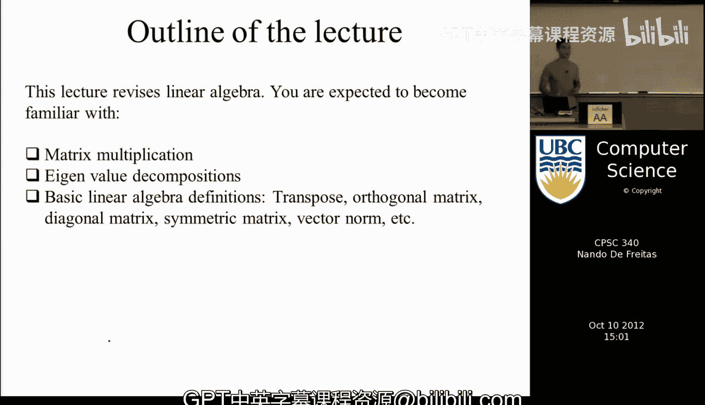

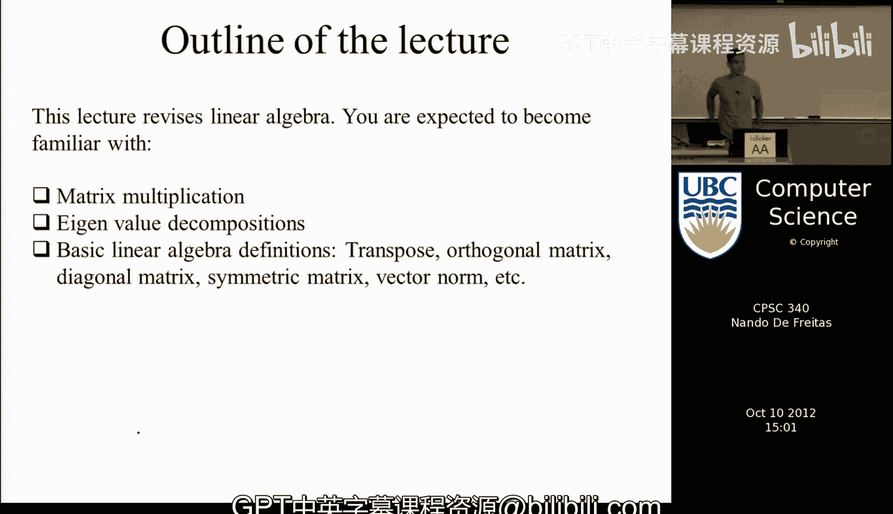

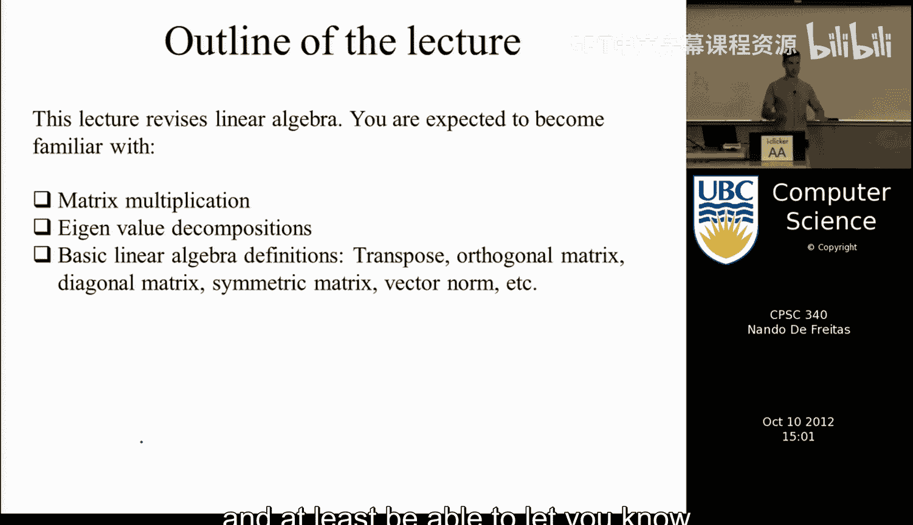

This means a transition in the course too up to now we've only been doing these discrete variables。

 binary and particular， to be able to manage continuous variables and do probability with continued variables we need to manipulate matrices because most of the you know we're not going to deal with just one variable that's real valued variables。

 we're going to deal with many variables and the moment we start dealing with many variables。

 matriceses are good data structures to handle many variables。

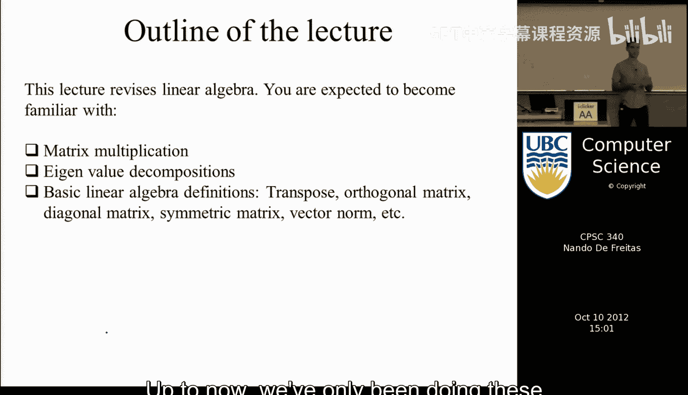

And they're easy to code。 They're easy to understand what's going on。So because of that。

 we need to revise linear algebra。I'm going to。Do the very obvious stuff。

 Start with matrix multiplication。

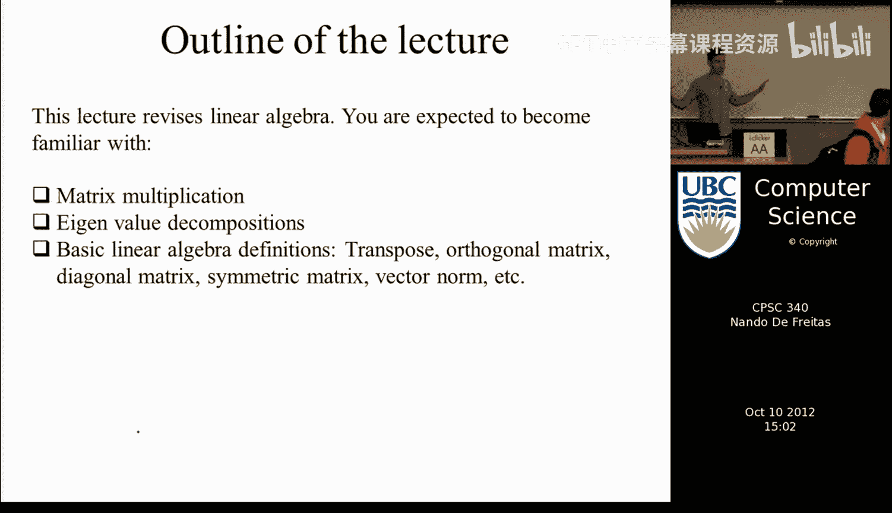

Go on to eigenvalue decompositions under a restricted domain proof convergence of the Patreon algorithm which you used in homeworkmark onean。

 and then we'll introduce a bunch of definitions called。

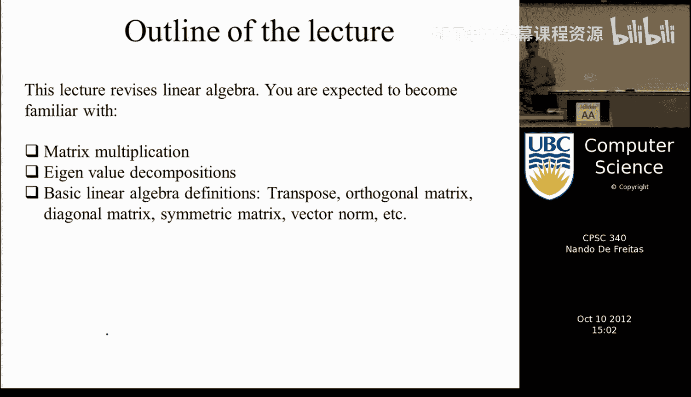

That are very useful for the rest of the course。 They They will basically be super important when we're trying to design like neural network predictors and so because。

 all of those models will essentially。

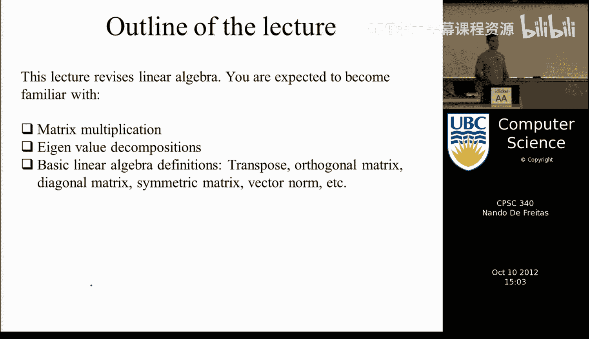

Our code is in linear algebra。

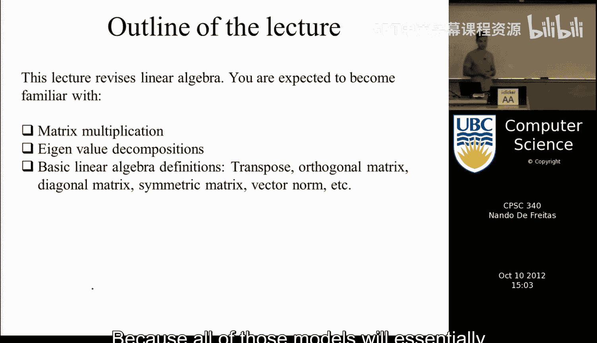

Okay， so that's the intent of today's lecture。

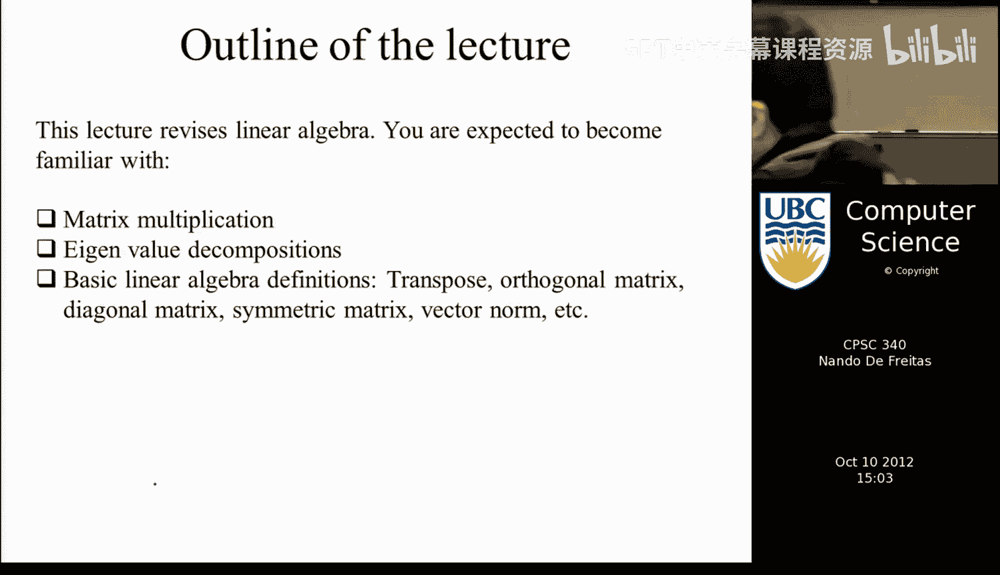

And I'm going to do this all school since it's just a linear algebra vision。

So， matrix multiplication。I。We have a vector。 So essentially what we're going to do is we're going to have a matrix。

 A matrix will have entries， So a1，1， a1，2。A。2，1， a22。

So it's just a data structure where the guys inside it are numbers。And。

The matrix vector multiplication。Will be defined。 I'm just going to say it's going to give me as an output of vector。

Where。Each entry of the vector， say y1 is equal to a1，1 times x1 plus a1，2 times x2。Okay。Basic stuff。

嗯。Let's say that the matrix A times the vector。1 x gives me the vector Y。 for simplicity。

 I'm using a underdacor with one bar to indicate a vector and a underda scoring with two bars to indicate a matrix。

Okay。Then。In the notes， especially in the homework， typically vectors are bald。嗯。

Lower case and matrices are sort of bold uppercase。Okay， so that's major vectoror multiplication。

 It's also clear that Y 2 is equal to a2，1。Times x1 plus a22 times x2。

That's a definition of matrix multiplication。 So， in effect， what we're saying is that Y I。Is equal。

To a。系。AI。1 times x1。Plus AI2 times x2。And then you can just plug I one or two。

So we can actually write this most succinctly as the sum of a J。Of AI J times。

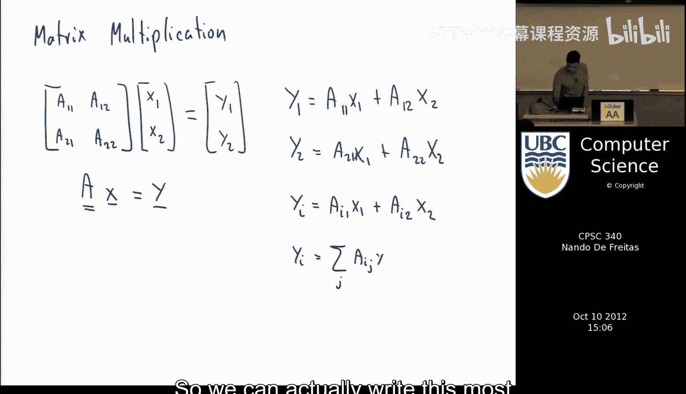

X。谁。Okay， so that's another way to write matrixpect and multiplication。

 So we're left with three ways that are essentially the same thing。We can either use。This form here。

We can use。The mates， or we can for short， just use the。

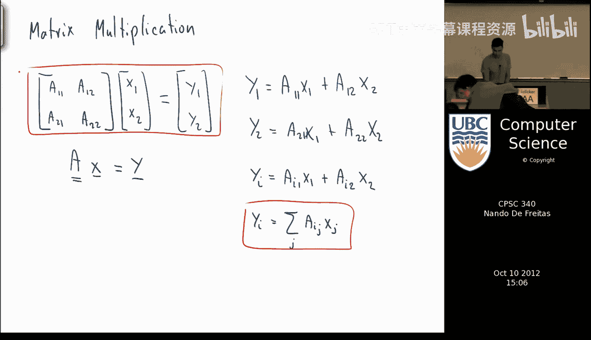

The symbols that are not matrices and vectors。

There's one more that turns out to be useful， and it's the following one。

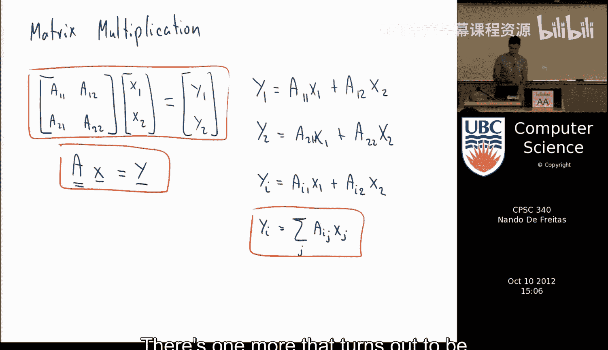

Sometimes a matrix can be written。As just two column vectors。And these column vectors will be。

As in the expression above。What this lets me do is， it allows me to express。Well。

It allows me to e you to screen my show。It allows me to express the matrix A。As。X1， a1。Plus， x2。えチュー？

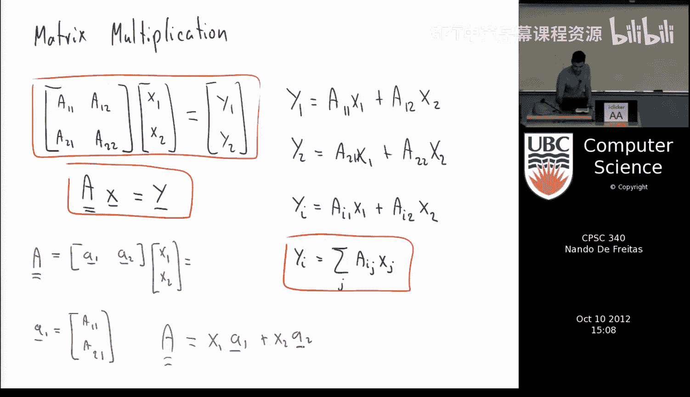

Okay and this is the fourth form in which。

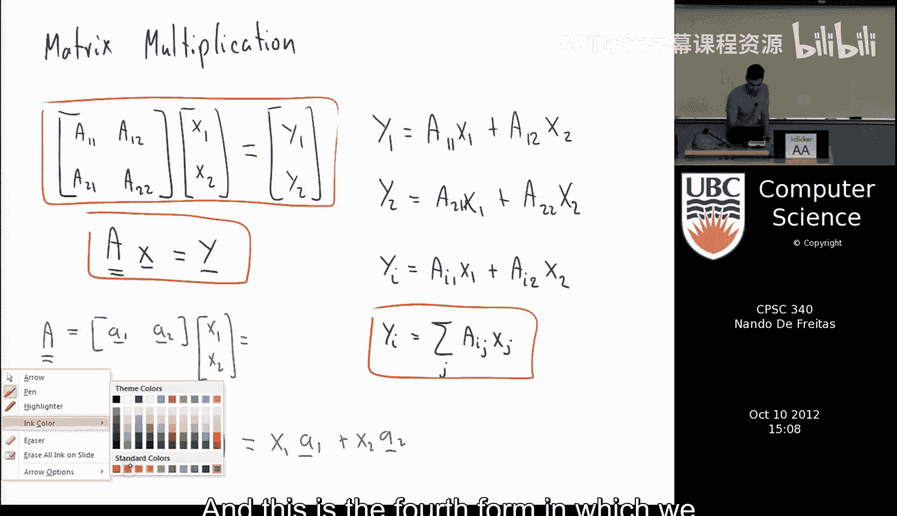

We can write the matrix vector problem。This one is saying。

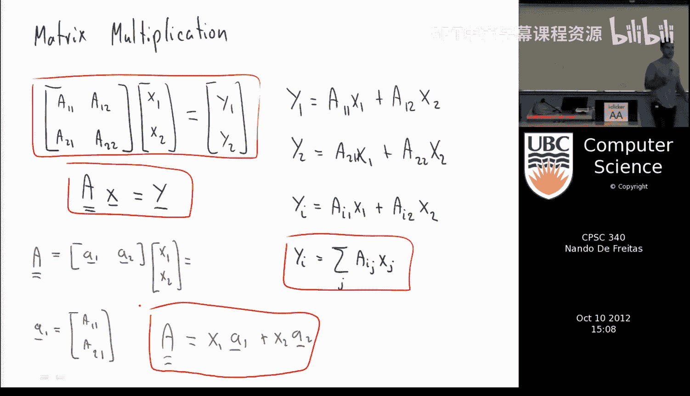

That。A matrix spectrum of application is just saying that。

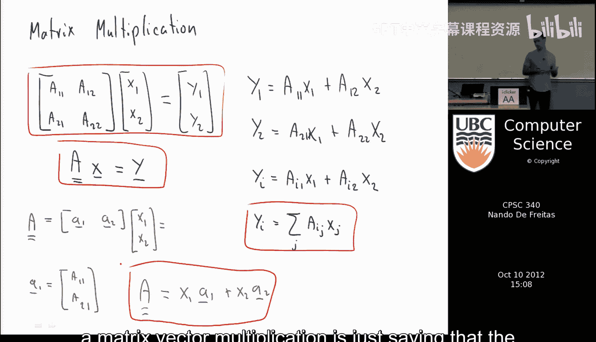

The answer is a linear combination of the columns of a。

It's just taking a linear combination of columns of A where the coefficients are the xs x1 and x2。

So it turns out that being able to see it in all these four forms is very useful。

And when we're manipulating expressions， I will interchangeably move from one form to the other form。

 So this， even though。Obvious are actually very important。

It's very important to be able to change between one and the other。

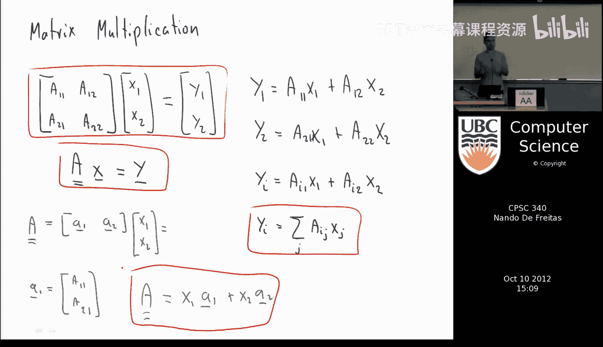

Okay， so I'm going to do a little example slide。

Partard of last box。Did you mean to write？喂。Oh， sorry， you're right。Thank you。At a type of it。

Im interested like this。Which is obviously equal to。The vector why。Thank you。

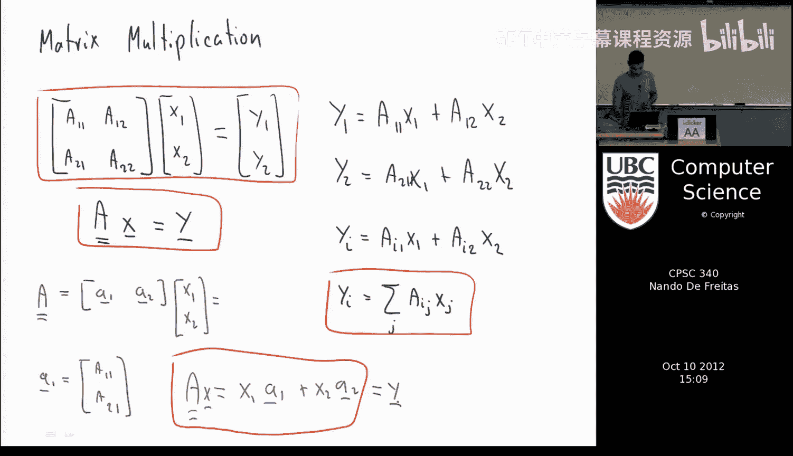

All right， so。Let's look at an example that is quite interesting。

 and let's assume that we have a vector that's of the form。Of。1 minus alpha。

And we multiply it times a matrix that's up the form theta1 minus theta。嗯。Pter times 1 minus beta。

To give us a vector。Why。So。And it's。And then I'm going to write it like this to indicate。

That it's going to be y1， y2。Okay so I'm putting a transpose， so I should defined that。

 So if I have y equal y1， y2。Why transpose is just。Changing the order。The transpose of a vector。嗯。

为异议。I will now make the following claim if my matrix is such that it roseoms to one。

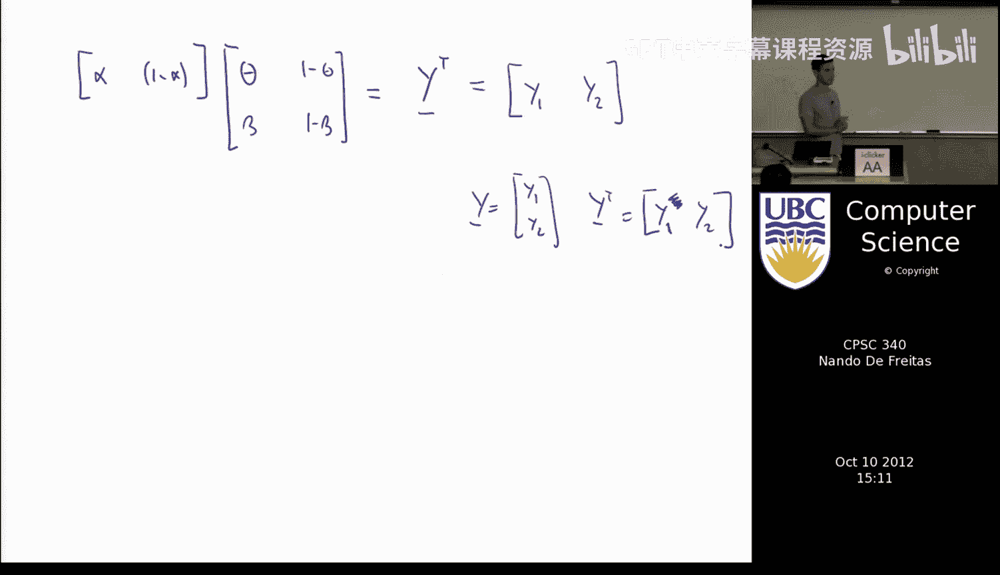

And if the vector that I left multiplly that matrix has entered the sum to one。

 the claim is that the entrance of y sum to1。

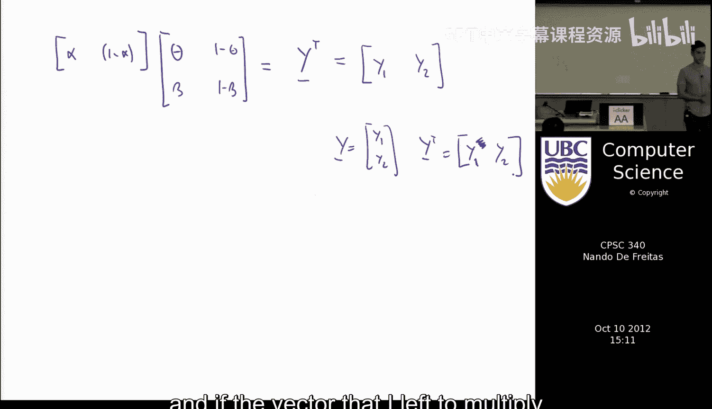

Okay， so if I have in general。X。France both times G。Equal y trans。So， if。And。The sum overall。

 the entries of Xi is equal to1。And。There some。The sum over the Js of the entries。

Of GIJ is equal to one。For all。哎。Then。The sum of the yjs is equal to。哇。So that's my play。

This will be very useful to understand how why Google converge。So let's call this alemma。

Think of alema as a simple rule。That you get to prove。So how do we go about proving this。

 So we know that Y J。Is equal to the sum。Of a I of X。Time。GIJ。From matrix vector multiplication。And。

If we now sum both sides。Over J。We have the the sum of a j of yj。Is equal to the sum。Of I of X。GI J。

S of a J。And if I swap sums。I will have some of our eye。X， I。Some of a J。Of G I J。

Which is equal to the sum of a of X， which is equal to one。

So if the entries is of the vector that I'm left multiplying the matrix g sum to 1。

The entries of the vector after a multiply will sum to one。 so remember in your homework one。

 you took an arbitrary vector to sent sum to1 and you kept multiplying at times this Google matrix that vector。

 the answer is always something that sums to one。so if you start with a probability vector。

And you have a conditional probability matrix。You will end up with after doing multiplication。

 you still end up with a probability vector， so you remain in the space of probabilities。

 and that's a very useful property。

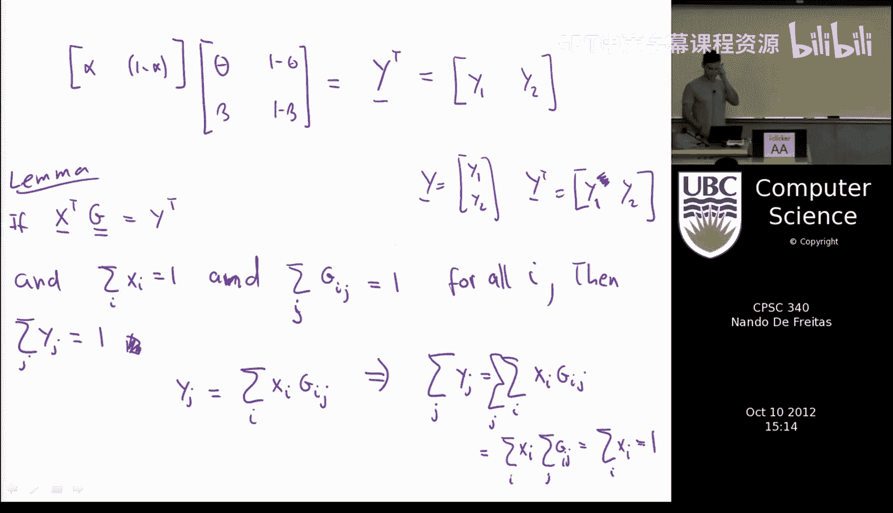

Okay， so。So that's it for that small property that we will use assume。

To discuss convergence of Google。 But before we go there， I first need to introduce。

Higen botans and eigen pictures。

So let's start with an example。 Suppose you have a matrix。呃。That's of the form。One minus alpha。

 alpha， and then theta1 minus beat。Okay。嗯。I'm gonna want to come up with。

An expression at the composition of this matrix of the following form。

The matrix times the effect is going to be equal to to a scalar times the。

Sometimes I will also want to use。An equivalent slight expression， which is of the following form。

Now。WhatWhat is the question saying， this is saying a matrix is a lot of numbers if you take。

A lot of numbers you multiply thes a vector。 That's the same thing that if you just take this one single number。

 lambda and multiply the vector。So on the left hand side， you have lots of numbers。

 On the right hand side， you have one number。And when you multiply the vector。

 they're the same thing， so that's actually going to be very profound for learning because learning to large extents about compression。

 there's a big world out there， we manage to compress a lot of what the world's about into a very tiny amount of space。

 so whenever we see a mathematical expression where you have a lot of numbers in one side and just at on the other side。

 these things are of interest。Because they give us an opportunity to do data compression。

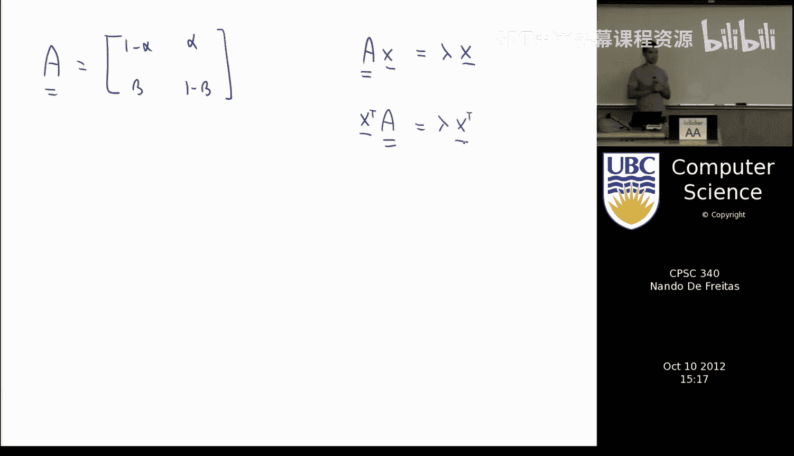

And so。As we will see in the next lecture you can actually compress images。

 you can compress all sorts of data over the next few lectures we'll see how to compress document databases and so on。

 just using eigenvalues。

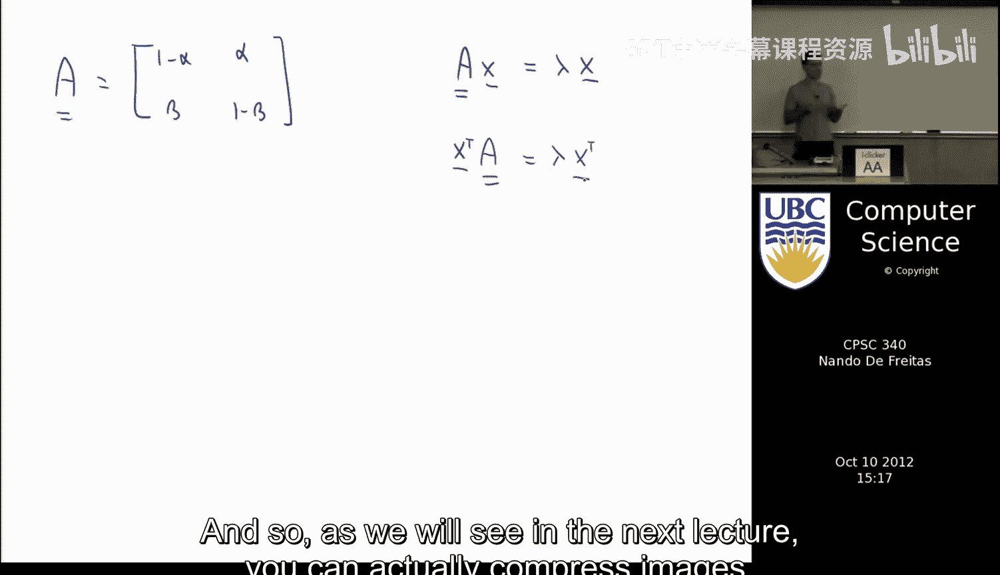

Okay， so I'm going to call Im sort of getting ahead， but I know most of you have seen this。

I'll be going quickly。 So these guys will be called eigenvalues。These guys。

 I will call left eigenvectors。Their physical meaning and so will become much more clear as we move on with the lectures。

嗯。Okay， so。And if they're on the right， they're called right。I get back。Or eigenvectors for sure。

Lambda is a number。 Yeah， lambda is a number。 So what I mean is。Left of a or right of a。

Lambda is a scalrs， its's ordered can swap。So by right， I mean right。哦，诶。Okay。

 so how do we solve this？So let's assume that we have。诶。X equal lambda x。

So it must be that ax minus lambda x is equal to0， Okay so just move it to the other side。

Now I'm going to introduce a matrix that's called the identity matrix， so it has ones。嗯。

It kind of looks like this， okay so it's a matrix that has ones in diagonal zeros elsewhere。

Of the identity。That's the identity matrix of size 3。

 the identity matrix of size 2 by definition is just。Something that onlyling has two ones。

 so it's two by two。Proper if the identity that you can easily check if you multiply any vector times the identity you get the vector so we can then go back to this expression。

 and we can just plug in the identity there because the identity times the vector is still the fact。

And so we can then summarize this as a minus lambda I。Times x is equal to 0。Okay。

 so I can group the terms， the reason why I need to introduce the identity is because if I don't。

 then the dimensions of a and lambda I wouldn't match。Because lambda is scalar A is a matrix。

Another the dimensions match。What I essentially have here is a linear system that is saying that A。

Which is。1 minus alpha。Mus lambda。Alpha。And then， pizza。1 minus。beta minus lambda。Times x1 and x2。

 which are the components of x。It's giving me。Senturly0。A vector of zeros。No。For this to be zero。

ISo let's assume that I want the x to be independent to form a basis， so in other words。

 x1 is not a constant times x2。If x1 is not a constant times x2。

 then the only way this can be 0 is if。How many of you have seen determinants。

 I'm wondering to what extent I need to revise all this stuff determinant of a matrix。 Okay。

 Well people are with that， if not。

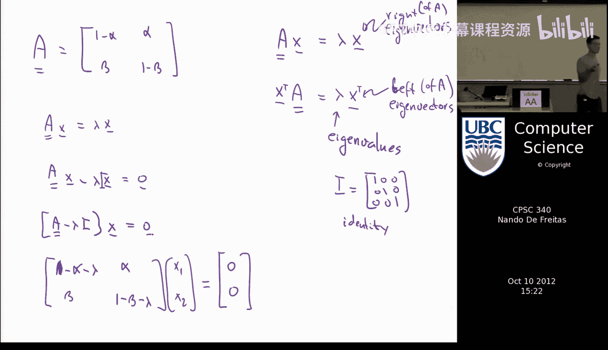

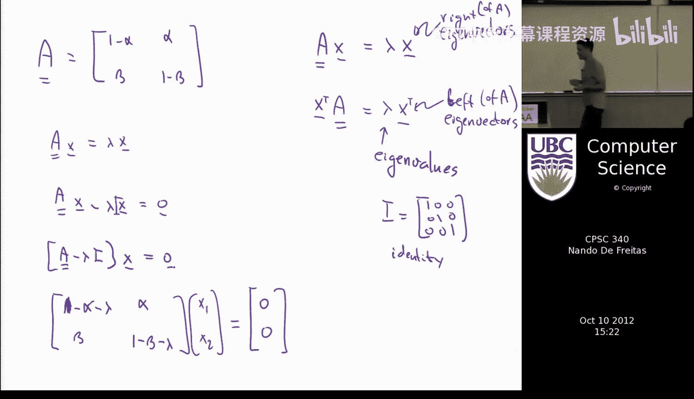

Ill just go quickly。 for this to be serum， I'm just going to。

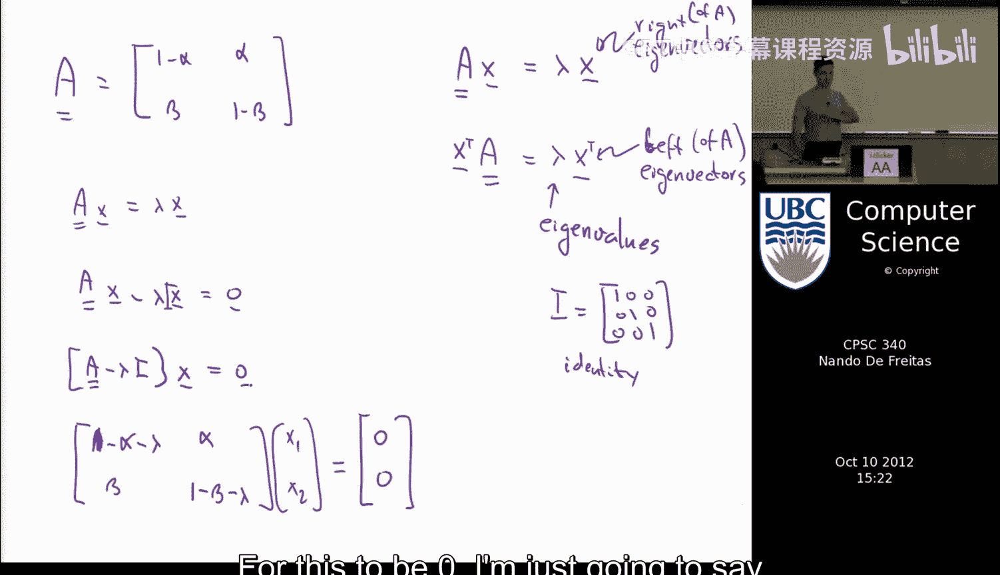

Say that the determinant has to be zero。And I will define the determinant。

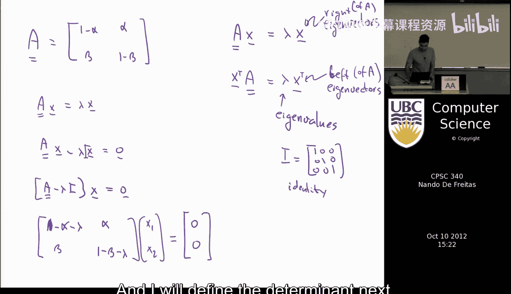

Next， because most of you are with me。1 minus alpha minus lambda。Of。Be1 minus。

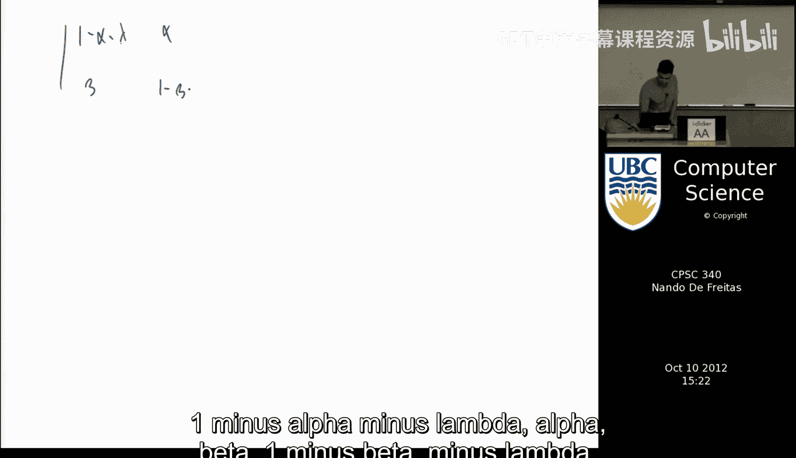

The determinant for a  two by two matrix is just equal to the product。Of the diagonals。Minus。なんだ。

Thank you。那你没觉。Party didn't make same matrix as well。 Oh， I Ill put a alarm to that。 I should be a。

 Okay， there we go。Okay， so the determin has to be0。And to find the lambmbdas。

 you just need to find the lambdas that make。嗯。

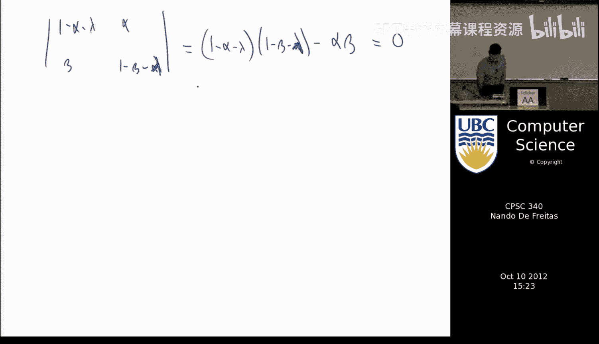

And this I don know if you remember this from your linear algebra revision。

 if x1 is not a constant times x2， then the only way you can get zero is if the columns of a actually are a times。

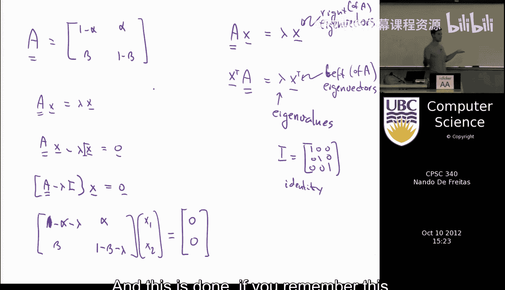

A is a constant times another column， one column of a is a constant times another column of a。

 and that only happens when the determinant is0。

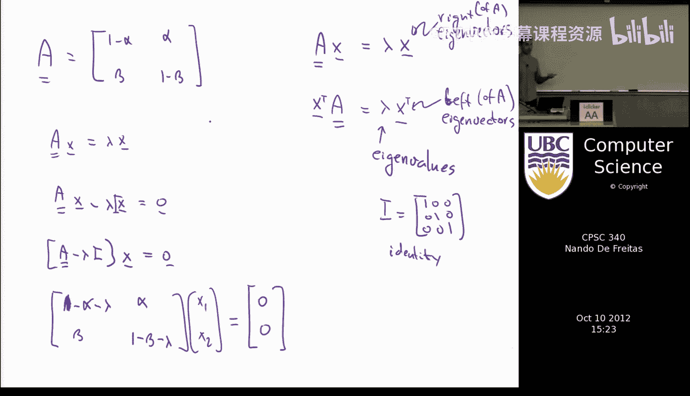

Okay， when you。P in the determinant， we get the characteristic。

 something that's called a characteristic equation， we solve for lambda。

 and we only typically did this for two by two and three by three matrices in first and second year。

 you can't do this for more than five， not only because it's hard。

 but because of a theorem that actually says you can't。And so you actually。

 typically we only compute eigenvalues and eigenvectors using computers because it's impossible to get them exact。

All right， so the next thing is to solve for lambmbda。

 And I'm just going to do this quickly by inspection。 I know that if I choose lambmbda。

Lambda equal to1。II will get。Alpha。Times beta minus alpha times beta， so they cancel。 so I get 0。

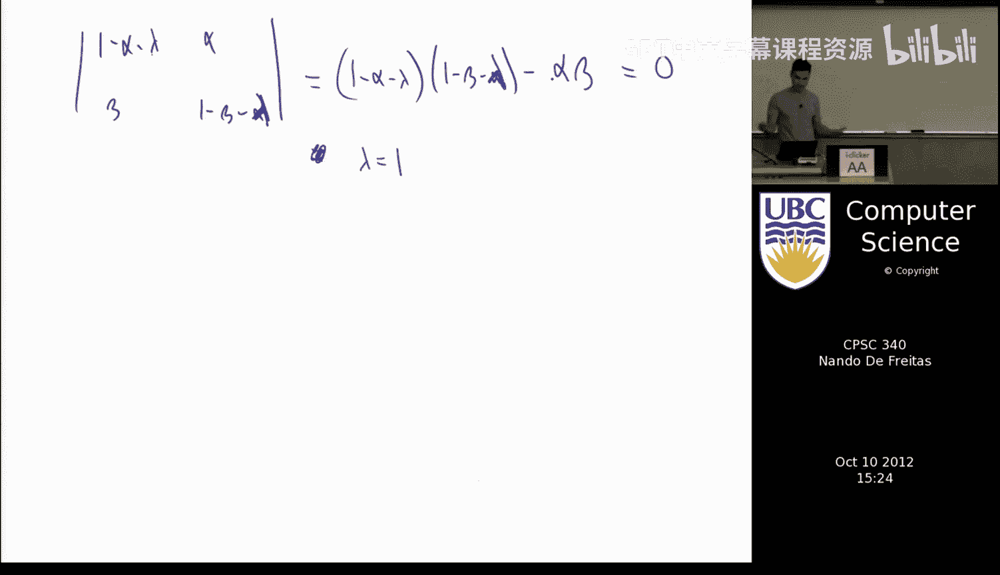

The other way I can get 0。This if I choose lambda 1 minus alpha。

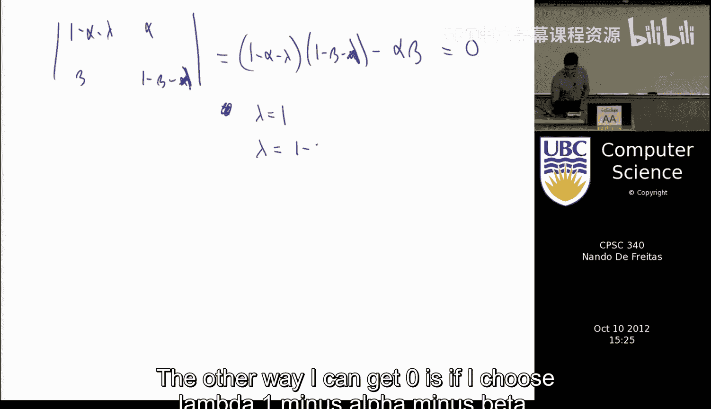

Minus beat Okay， so that solution also allows me to get。

if you just plug in one minus alpha a minus beta for lambda。

 you'll see that you'll get it all adding up to0。Okay。

And this example for a  two by two arbitrary stochastic matrix。

 there is a matrix who's for each row the columnus sum up to one， shows that the eigenvalue。

 regardless of what alpha beta are， the largest eigenvalue is always。one。

This is actually true for any size matrix that is stochastic matrix for any conditional probability type。

I'm not proving the internal case， but for a2 by2 matrix， here we are， that's what we have。Now。

 if we look at the eigenvector of this matrix。It is also true that for an arbitrary matrix that is provided as a stochastic matrix。

 its largest eigenvalue is1。And if there's always a eigenvalue that's one precisely one。

 that is correct， there way it exists？Here it's pretty elegant the way that you could find。

Ivalue in terms No， it's not an easy theorem to prove。

The theorem that process is called the Parranprobinus theorem， I would need three classes too。

Prove it to you。嗯。Like I see how you have to。Vals in terms of the entries of the matrix。

 so for instance， if we ever， if I ever see a two by two matrix。

 I just can write away right down the eigenvalues immediately by just rearranging it into。

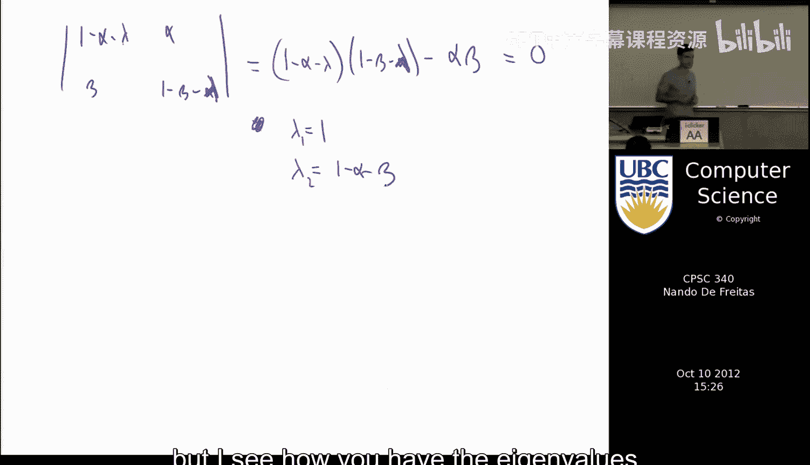

That form is there like way of coming up with like the three eigenvalue 4。

 three by three matrix or you know for a three by3， it's still easy to do。 So I could still do it。

 It just would be more work one two one。 Yeah， you could do it totally for a three by three。

 No problem。Good idea for a homework exercise， okay。The next thing we do is。

You've all done eigenvector exercises。 you can also show that if you。

If I look at the eigenvector now。Suppose I have8x equal1 x。Whis just one bar。So in other words。

If I have。嗯。A， minus。One， I。Times X。Equals 0。I wouldn't just write this as。

1 minus alpha minus1 minus alpha， alpha beta。Mus pizza。

That tells me that one possible solution for this to be the case is to choose x to be equal to say11。

So the vector of ones， which I open the note。By。Just a one with a bar under that's a vector of。

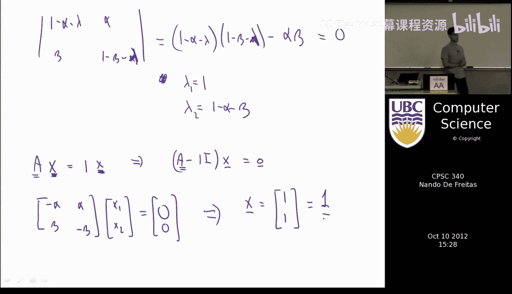

And it has to be because x11 minus alpha plus1 times alpha gives you a0 and beta minus beta also gives you a0。

 so one is the eigen the vectorctor of1 is an eigenvector for this matrix。

More interesting is the left eigenvector。The left hiigenveor would be x1， x2。Times the matrix A。

 which is a minus lambda。Ithich is minus alpha alpha。Beer。And minus beta。

That also gives me a vector of zeros。In other words， x1。Minus alpha x1。Plus beta x2 is equal to 0。

Ofpha。X1 minus beta x2 is equal to 0。And I can choose。X。To be equal to。嗯。Pter over alpha plus Pita。

And then alpha over alpha plus beta。If I choose x to be this vector。

 that vector satisfies those equations。The nice thing as well about this vector。Is that the sum？

Of the entries。I itこ。So in other words， the left eigen factor。

The left eye factor is a probability fact。Okay so that was the other thing we had we noticed with Page rank。

So I've basically been going over the two by two k of Pat。

 so the large eigenvector is1 and the eigenvector the left eigenvector corresponding eigenvalue 1 happens to be something that's a probability distribution。

ok。Now， let me give you。嗯。Some property， basically， I'm going go quickly over。A simple sketch。

 a simple proof of Google's play rank， its and I'm saying simple because it makes I will make strong assumptions to get the proof through。

 but the proof essentially tells you how you can easily manipulate eigenvalues to actually be able to discuss convergence algorithms。

So。So recall that the Google algorithm， what we did is we took an initial vector pi not。

 we multiplied that vector times the Google matrix， and that gave us a vector pi 1。

We then would take pi 1。We would multiply that time to Google Mas to give us P2。

And we kept doing this。For， I don't know， M times。Right， or equivalently。嗯。Equily。

 we simply could state that。P not transpose times g。To the M-1 is equal to pi。诶。Trans。

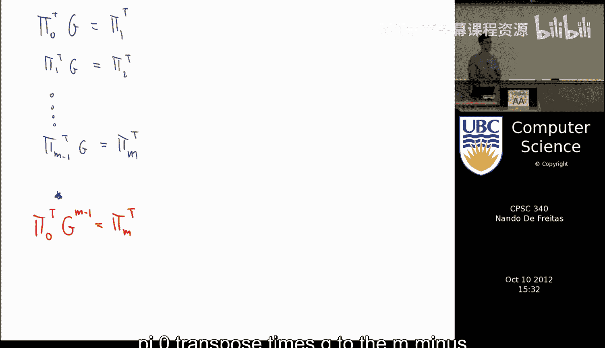

Because we keep multiplying by G。So we have pi0， we multiply it by G that gives us pi1。

 we multiply it by g again， gives us pi2 and so on。Actually， that sort mean M。started。Okay。Create。

My some road here， so that was the algorithm。And so I'm going to make the following assumptions。

I'm gonna to。嗯。Bt。X， I。Transpo G equal lambda I。X， I。

So now I'm going to write eigenvalue the left eigen factor equation for G。And assume。G。嗯。

And by n matrix。Has。And。Distinct。I again。But。That's an assumption we're going to make proving the result in more general is harder。

 but this assumption。嗯。Will allow us already to see something very cool。

 So let's assume that the matrix has n eigenvalues that are different from each other。嗯。And。

And let's also suppose。这。X， i。4。A basis。What that means is that any vector。For example， pi knot。

And here I dropped， I sometimes forget to put the bars。That means that。

The vector pi n can be written as a linear combination。For some coefficients。

 arbitrary coefficient C。Of the eigen factorctors。A basis just means that you can represent。

One vector in terms of the other vectors。 So a typical example。

Is when you have the vectors 01 and the vector 10。And then any vector on this。And in factor。

 around the plane can be represented in terms of those two bases， 0，1 and 10。

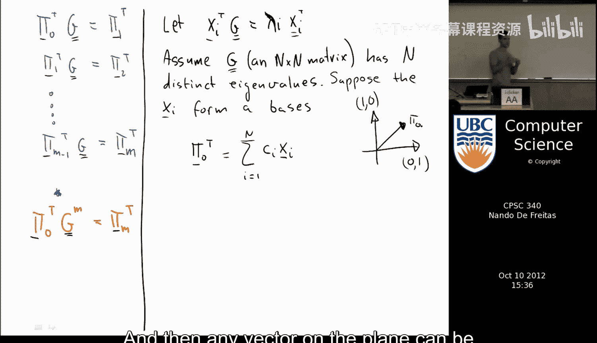

So in general， in our end， we could have。

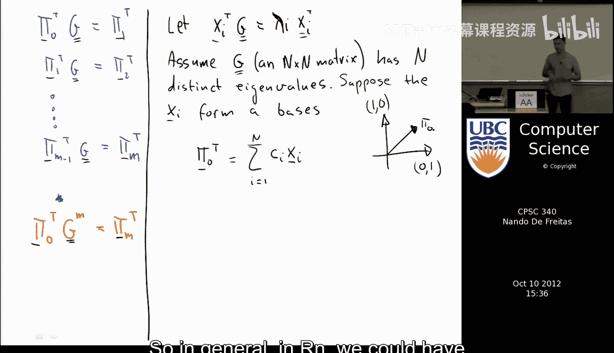

You know， so in 3D， we would have three factors， and as you go up。

 you would just need as many factors as I mentioned to be able to。Specify the location of a vector。

 P not so pi not。Its assumed to be represented as a linear combination of their eigenvectors。Okay。

If this is true。对。Thy not。Transpo G。It's just equal to the sum from my equal 1。To and。CI。X i。Times G。

Which is equal。Now， Xi。Transpo G。You have to make this transpose C X transpose G by definition。

 is just lambda I。X I transpo。If I take now pi。One transpo。G。this is a centuryric pi1。

If I take pi 1 transpose G。This is equal to the sum from I1。To N of C I， Lambda I。X。

 I transpose times g。Because I repeat the same argument。嗯。When I multiply Xi times g。

That is just equal to lambda I， X I。Transpo。 And so I get lambda I squared。

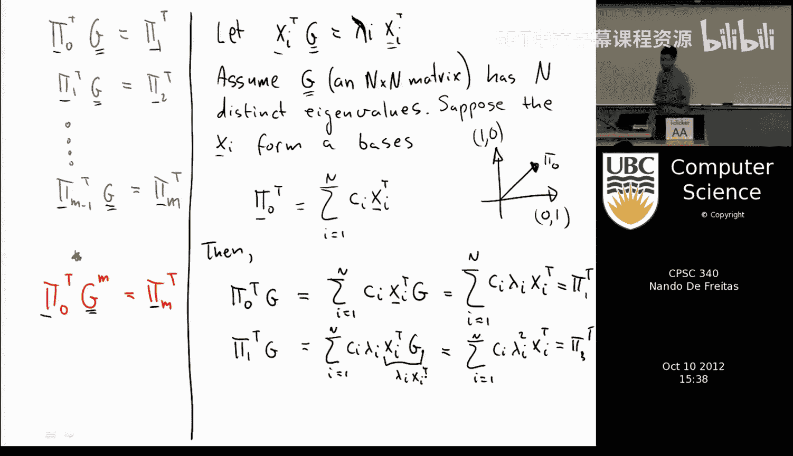

And this is， in particular， this is equal to pi n transpo times g squared。

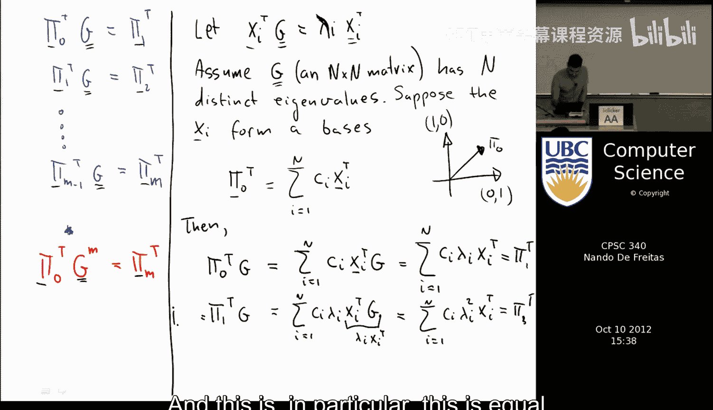

Okay， it's the same thing if I had pi n to multiply by G twice。

And here I'm going to do a leap of faith。 I'm going to ask you to do a leap of faith。

 And this is something you can check at home by not transpose times G to the M。It's going be equal。

The sum from one to n。Oh， C。I mean， you couldn't do this for more steps and you can convince yourself that because we're always replacing the X times G by lambda X。

 all we're doing is we keep increasing the power of lambda。

And so we can just write this a function in this form。So now I have an expression for the last。

Part of the multiplication for the M step of the multiplication。 and that if we break it into terms。

 it's just C1。Lambda1 to the M。Time' x1。Fran post。Plus c2， lambda2 to DM times x2。I suppose。

And so on。The cars。I' got all the far there。Okay， so。Plus。Dot dot dot。

 so basically we're saying that the vector multiplied times the matrix m times。

It's just a sum of C times s lambda times dien factorsctors。

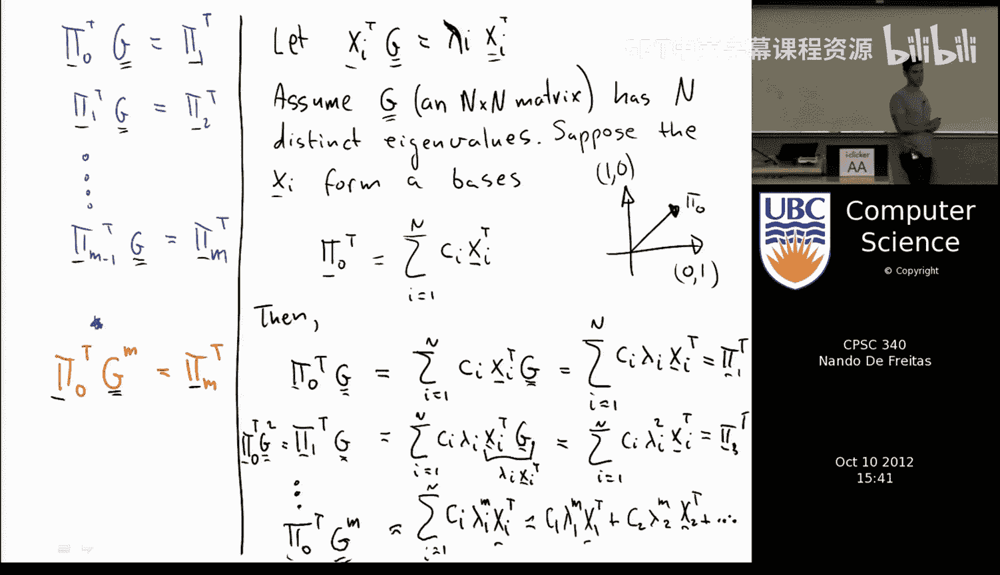

Now。When we compute this， the order of the eigenvalues is arbitrary。

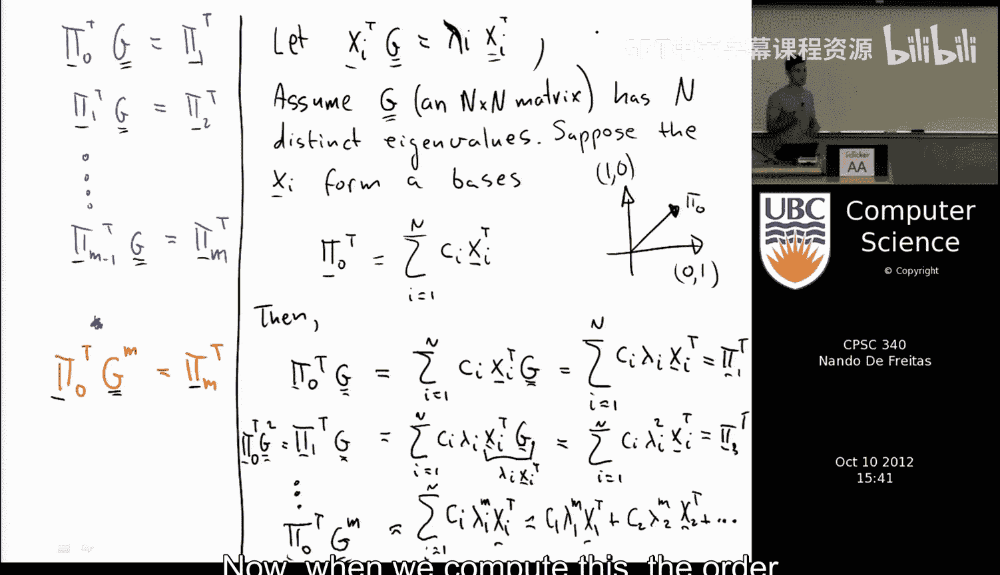

So I can always pick an arbitrary ordering。So I'm just going to label them such that lambda 1 is the largest。

 Lada 2 is the next one， Lambda3 is the next one and so on。So I can just order my eggen bags。

 I'm choosing the labels of them so that they're ordered。

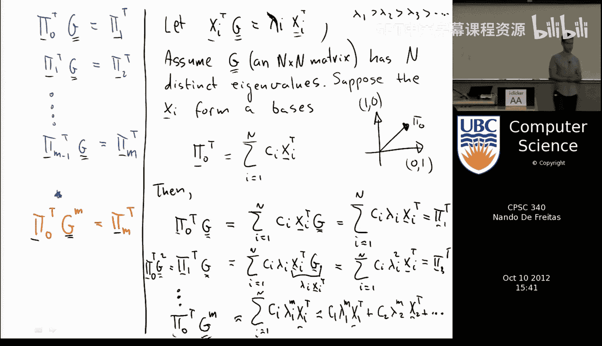

So I can make one is the largest and the one minus alpha a minus B is the second largest。

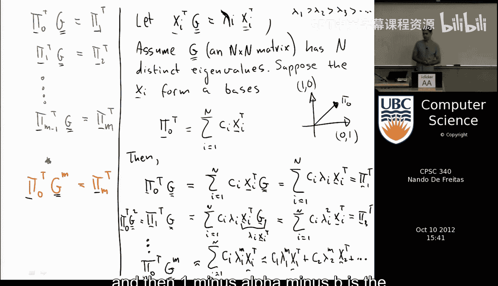

In the previous expression。If this is true， then what happens to that last expression？

It looks a lot scarier， by the way， when you look it up there。And that on my screen。

You have a bunch we're summing a bunch of terms where Lambda 1 is always guaranteed to be bigger than lambda 2。

So if M is very large。Only the first term matters。Right。

 because lambda 1 to the M is going to be so much bigger than lambda 2 to the M or Lada 3 to the M and so on。

 So we basically。

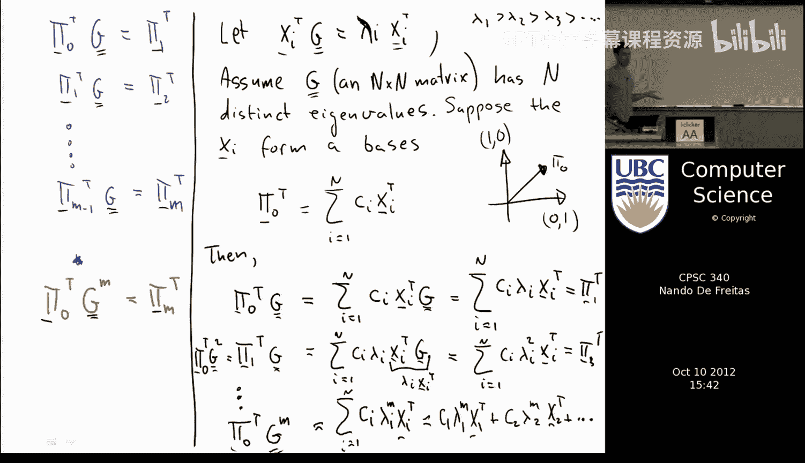

Are saying that， why not。Times G to the M。It's going to be approximately this arbitrary constant C1。

Times。Lambda1 to the M。Times x1。Okay。But， we know。We know that the left hand side。Ss to one。 Okay。

 because that was thelemma that we proved。 We proved because pi note sums to one。

 you multiply by matrix G whos。Each row sums to1， it's going to give us a vector pi1 that who center sum to1。

10% by2 sum to one。They lost the bathroom trick， so I'll raise my point。

So the increase of p2 is still sum to one。And pi 3 and pi4 and so on。

 So it must be that the entries of this vector。Yeah。Let's called this vector pi M。

It must be true that a sum。Of all the entries。That vector are one still。Maybe he grows to。Finally to。

 there will be one that was thelemma that we put。

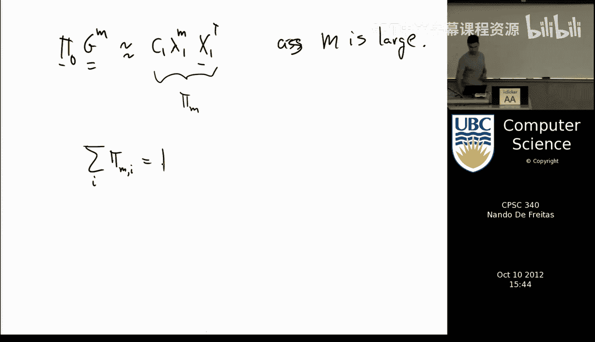

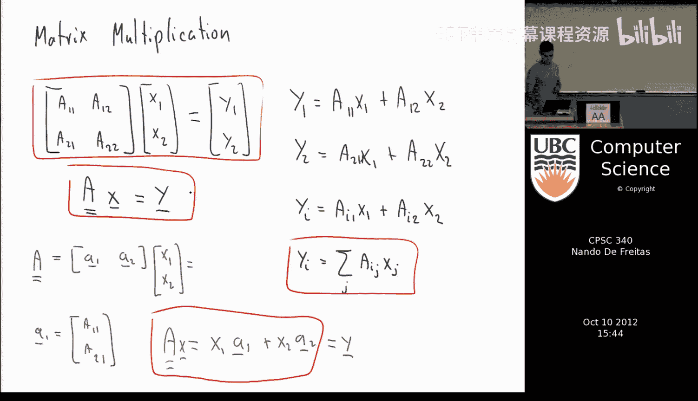

We through this lemon。If you have y equal a times X， and if there's some。

T ofite sum to one and if for each row。哦诶。The column sum to one， then the entries of y sum to one。

 where we blocked a bunch of dos as way。

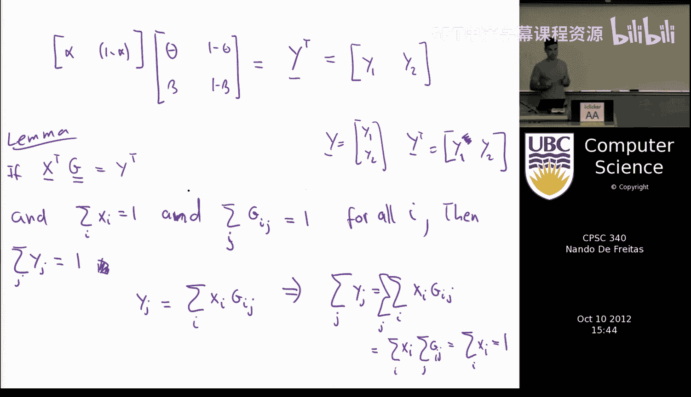

That's right， but now let's say that I take my y who entry sum to one by this Lama and I'm multiplied by a again。

 I will get to vector Z。

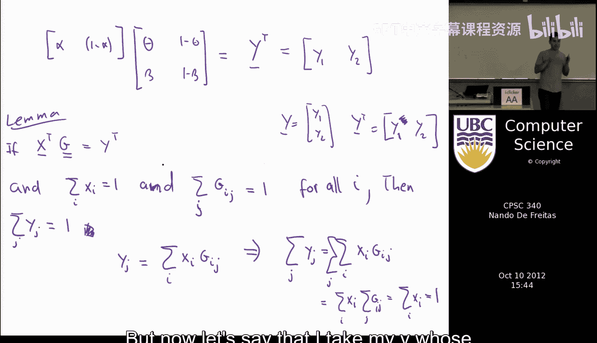

It send sum to one， right？And so if I start with pi all G， gives me pi 1 with enter something1。

So then pi 1 times g gives me pi 2 whose entry is also sum to 1， and for each pi。

 the entry is sum to1。

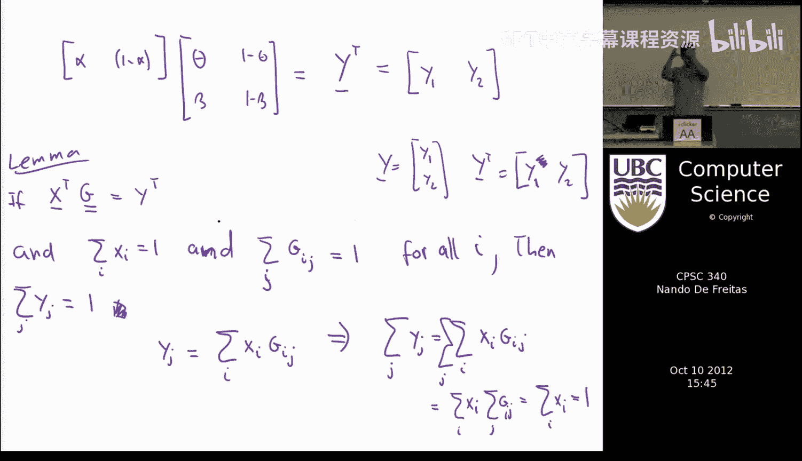

So it must be true that for the last。

The answer some to。In the limit。收。WhatAnd this。你是用方式证据。So。Hi。Yes。呃。Normalize。快见。Fctor。

So the final answer will be a probability vector is entry sum to1。

 and it will be in the direction of x1。So the scale of that vector will be such that it comes to one。

 the direction will be x1。先云。0ero。嗯。0？So provided you。

 is it possible taking a linear combination when you don't take the obvious C involved exam？

But is that obvious to if you have some unknown， like some state。

 you don't know how it decomposes into the eigenspace？

Can you。Like by looking at it， can you say， no， this state is an island。

 it's never going to reach a stationary distribution because it has C10。

Like， if it was just some。Different。 Let's avoid that trivial solution。

 So I'm just going to avoid a trivial solution。 I'm assuming that it is a linear combination。去。

Eeacts， if one was zero， it means that it lives in a lower subspace。

I'm not going to deal with that case。I'm really picking the easy place here of full places。

Provided the matrix。

Which will not be the case with the Google Ma so at having a full basis because。

There's going to be dependencies there， but we。But if you constructed this matrix so that it was all the as were independent。

嗯。ThenBy just applying matrix spectrum multiplication。

 you're guaranteed to find a unique solution and that unique solution is a probability factor。

 and that's essentially under very strong assumptions proof of the paper。

Now， this also gives you a recipe for doing more。And just a second and you can do more because。

If you look at this， what this is saying， if you take an initial vector and you multiply times a matrix many times。

 you can get something that approaches the eigen back。

An eigvector of G and this in fact， is called is one of the methods that your computer uses to produce eigenvectors for you when you call。

Theres some function to compute vector。This is called the power math。

And with a little bit modification， I could give you the general version of the power method。

Whenever you compute eigenvectors from now on， you' either to be using this method。

 or you're going to be using a different method called Las， which we cover in CPSC 402。

But so eigactctors are always completely numerical。For the rest of this course。We will use them。

 but you will use a computer to generate them， we're not going to be solve completely these systems because those are two simple systems they don't。

The real world is thousands by thousand。发表。

And so。这个份。If it's very urgent， because I'm running out of time。I have个十さ。

Okay， so。The last thing I want to cover is。I can write a matrix。系。second factors。The next time。

咁 to one next one。就那在。In other words。By minority， ax1。And I can even write this as x1。2。Underumb one。

So。These are just different ways of writing。A x i。Equal lambda I。And I can just make。

Can I write it in this form。Which I'm saying is you have the eenvalue question for each of the eigen factorsctors。

Or I can just group the termss。In particular。I have that ax1 is equal to lambda 1 x1。

Ax2 is equal to number 2 x2 and so on。The advantage of writing it in this way。

Is that I can then say that A。Times this matrix of eigenvectors x。Its equal to x。但。Does makes。

Which is diagonal with the eigenvalues in the di， which I'm going to call big lung。This leads。

If I multiplied both sides。by x。I get this following直。Make pay。Can be the composed。嗯。

A product of the matrix of eigenvectors and the matrix of eigenvalues。

This composition is going to be extremely important。Sa。

 the matrix site typically for us as we move forward will be an image。

 will be a collection of text and so on on the right hand side what we will do is we will gather the composition of that matrix into all these components。

个俾。我我找到了。two examples。

Finally。If。A is equal to a transpose。第现诶。咩佢。Then A can be written。呃。

