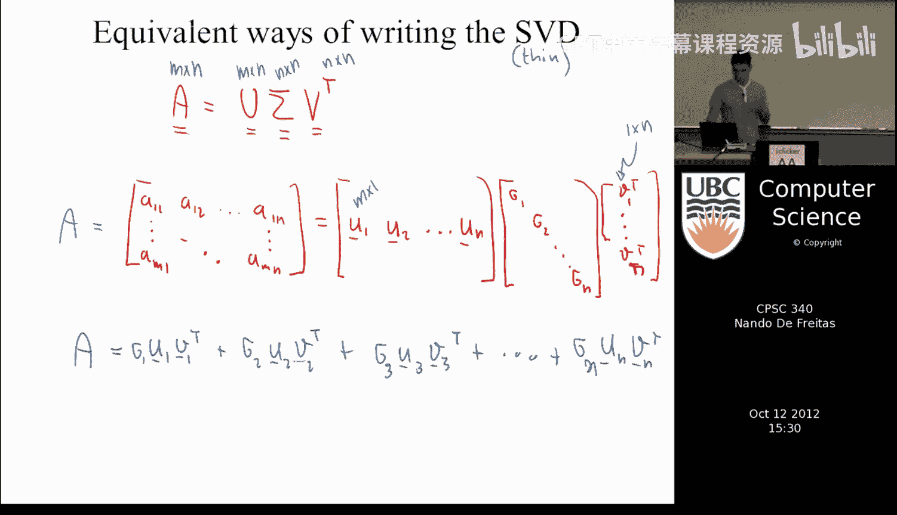
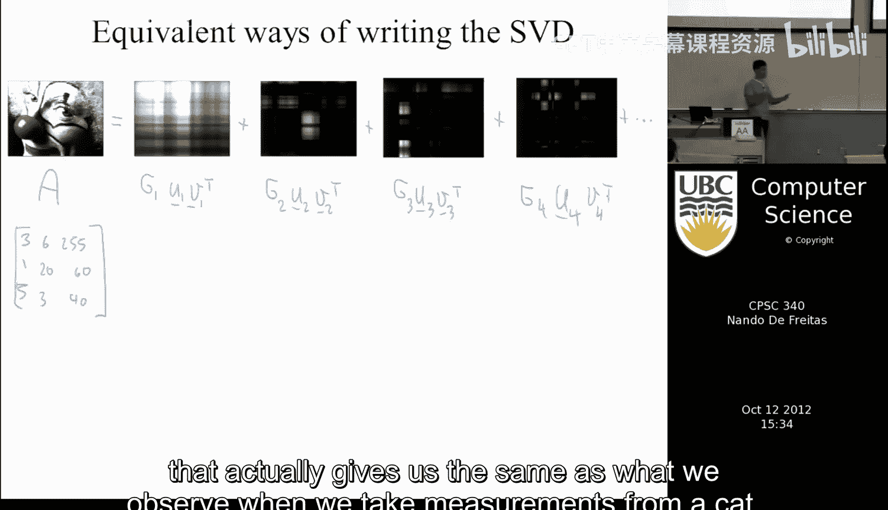
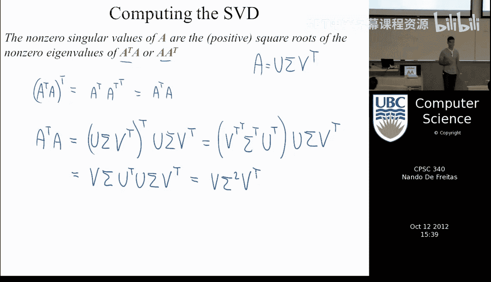
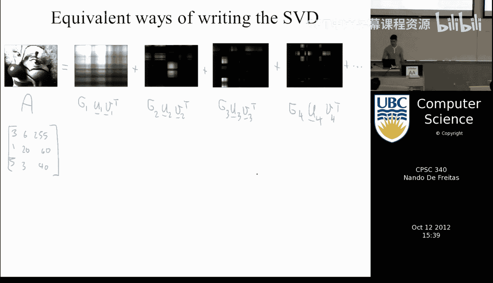
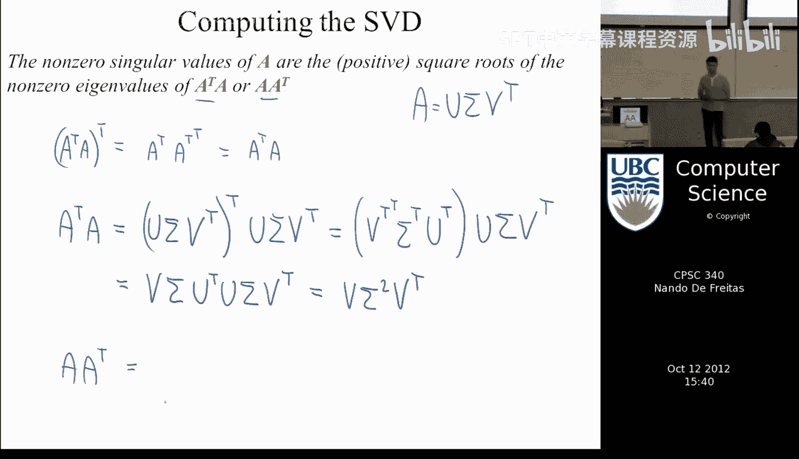
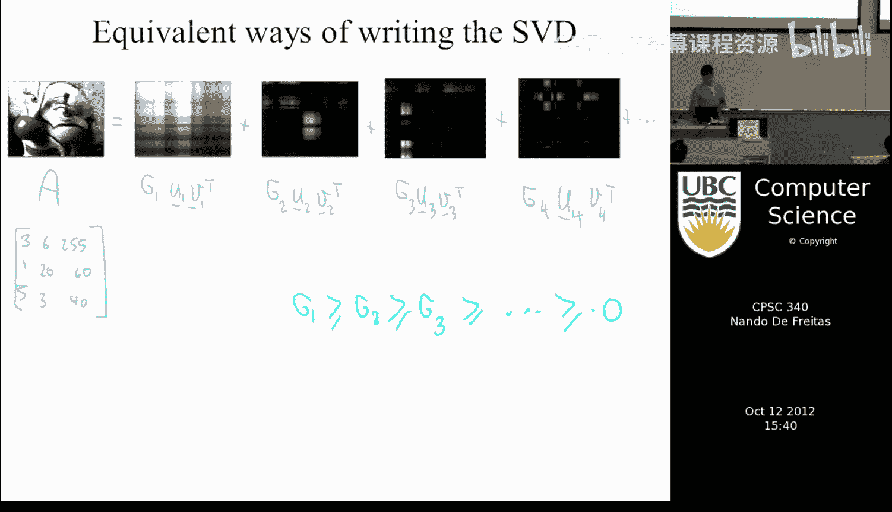
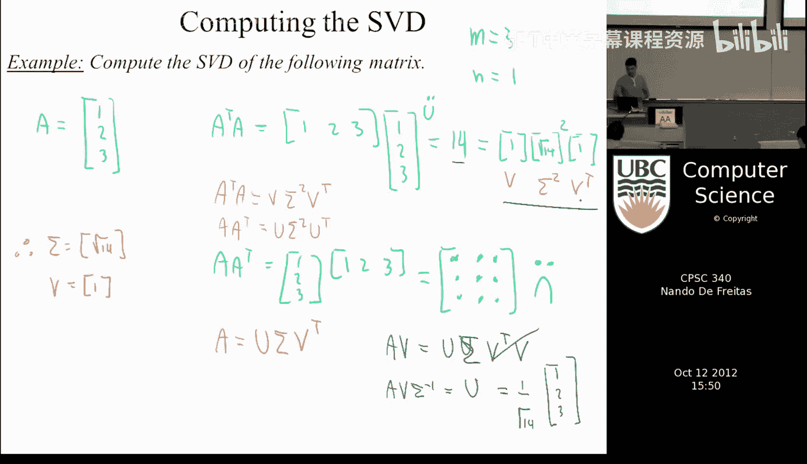
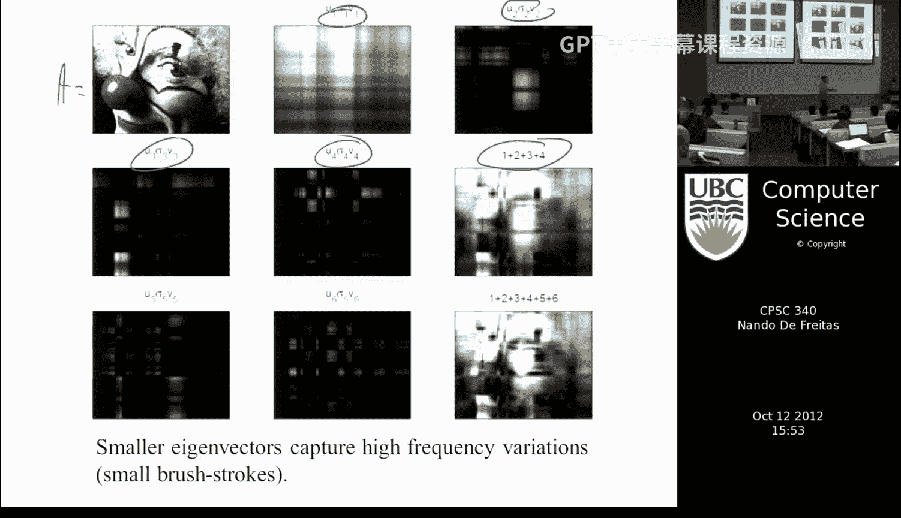

# UBC《机器学习和数据挖掘｜CPSC 340 Machine Learning and Data Mining 2012》中英字幕 p14 -14-undergraduate machine learning 15_ Singular Value Decomposition - SVD.zh_en -BV1pJ2ABFEFg_p14-

So a quick revision of linear algebra， and I introduced a definition of orthogonal matrix。😊，2分钟么操子。

What。啊。I did it in the context of computing the aentfins of a matrix， in particular。

 if a matrix is symmetric。And by symmetric， I mean that the matrix is equal to its breast。

Then that matrix admits a singular value composition。X， lambda x transpo。

Where x is the matrix that contains all the eigenvectors of a。 If a is M by M， a will have M。

Eigend factorsctors and each of these eig factorsctors is of size M。

So if you put all that compact together， you got an environment matrix。

And one theorem that I haven't proven for you， which is true， is that thosesy factors are orthogonal。

And therefore the matrix formed by the second vector， it happens to be an orthogonal matrix。

The significance of that。Will come。And an orthogonal matrix it just means that the transpose is equal toverse。

 so we don't have to do n here。Steps in order to compute it。So it's very easy to compute。

For no matrices。And the other definition that I introduced was orthophanormal。

 so the columns of the matrix big x。A eigenvectors。

 and if you take the dot product of two of those eigenvectors。

 the dot product will be zero and that is the dot unless the eigenvector dotted with itself up。嗯是实。

All right， so we're having projected trouble。 So the next bit I'm going to move on to the board。

A matrix。Can be decomposed into the product of another matrix。

A diagonal matrix of eigenvalueus and another matrix of eigenvectors。And we can rewrite this as。

In terms of the eigenvectors。I'm assuming the matrix is M by M。So the matrix has Menvectors。

This big matrix， lambda。And recall that the two bars means that it's a matrix。

 One bar means that it's a vector。So to make a bit more clear， I'm going to write the sizes。

A is M by M。 So it's quite a matrix。This will also be M by M。M by M。And this guy is， of course。

 M I am。And no one told me about it， but I forgot the trunk。Okay。

 so we can write it in matrix notation。嗯。And this is a quick way of writing essentially all these equations。

 La1， x1。So I can write。The M eigenvalue equations for the matrix A。

 which would be each of these guys。 Or alternatively。

 I can write it in a compact notation just by writing it as a matrix like this。Where。

I'm going to have to put the eigenvalues in a。Diaagonal matrix。

And when I transpose a matrix in terms of its vectors， what I do is I transpose each of the vectors。

Okay， that's essentially the definition of the transpose of a matrix。So。

By using this matrix notation， I'm insert in very little。Writing， just by using three symbols。

 I'm able to say all of this。So that's the intent of introducing this notation。

I can also say that this is equal if I multiply these guys。Lambda 1， x 1， x 1 transpose。Plus。

 lambda 2， x 2， x2。I suppose。Plus 1，2。Dot， dot， dot， lambmbda M， X M。

So this expansion gives me another way of writing a。A is the outer product。

Of an expansion of these eigenvectors。Each scalr， each lambda is one by one。This is1 by M。

And it transposes m by one。Okay， so this guy here is M by one。This guy here。Is 1 by M。Okay。

 because we still。Have an empire major。My one。Oh。Thank you。这当。Yes。So what I'm doing is I'm taking。

In order to do matrix multiplication， a matrix can be written as。

In terms of outer products like this。Something that's M by M。In order to get something that's n by M。

 you need something that's M by1 times something that's 1 by M。Okay。I see a lot of blank faces。

Should we do an example with numbers？嗯。If you suppose that。X is equal to。1，2。X。

Transpose is equal to 1，2。And then x times x transpose。I's equal to。1，2。Times  one， two。

And then when we multiply a column vector times  a vector， we would do1 times 1 which is1。

1 times 2 is2。D timess one， two。2 times to4。Okay， so a matrix can be written in terms of products of vectors that are vertical times vectors that are horizontal。

And that's essentially what I've done here。A matrix can be written as an expansion。

 and are often call this an expansion because it's a combination of terms。When you're adding them。

 and each term you could think of a number lambda one times one of these。Out of products。Okay。

So a matrix can be written as a number times。Other products of these vectors。

And so these are different ways of writing the same thing。

 and it's just useful to know how to write it in these different notations。

Because it helps us with code and it helps us with doing derivation with。Okay think we are in luck。

Projectors will be back in 45 minutes。Okay， so there was one more thing I hadn't explained in the last class。

And I'm just going to do it here。And that's the norm of a vector。If we have a vector X。Okay。

 and I'm going to say that x， I'm going to use this notation。 X is an R M by one。When I write this。

 what I mean is that x。Has。am。Real。Numbers。So it's a column vector with m real numbers。For example。

 x equal。3。215 minus6。Qu。One say。So in this case， I say that x is in R。4our。

Because there are four numbers。The norm of x。Its essentially the length of x and is defined as our usual Euclan distance。

So the normal of x will be x1， the first component squared。Plus， the second component squared。Plus。

 third component squared。And so on。Until you get to the last component。Okay。

 so the norm of a vector is just essentially the length of a vector。Okay。嗯。It can also be written。

Because this is a search of the dot product of a vector。 it can also be written。As x transpose x。

Okay。And now， because it's a column vector， I'm taking something like this times something like this that gives me the norm of a vector。

And a quick example， if you have a vector X。Which is equal to 1，2。X transpo x。It's equal to1。

2 times1，2。And that's equal to。5。The norm of x in this case is just squared root of 5。

Okay it's the length of that fact。Often in the notation。

 one puts a two here because this type of norm has actually got a specific name。

 this is called the O pleaan norm or the two norm。The L2 norm Mo 2 norm。嗯。

Unless I need a different kind of norm， I'm going to assume that all the norms that I'm using for now are L2 norms。

 So I'm not going to bother with putting a two there。I'm going to keep an invitation set。Okay， so。Oh。

 and we have our projector back。Here is a nice。Result that follows from norms。If you。没不。

If we have a matrix Q。And let Q be a orthogonal。 In other words。

 let it be that Q transpose is equal to Q -1。Then let's assume that we multiply an arbitrary vector x times the matrixq。

Okay so we use the definition， we transpose Qx。Times  Q x。Pardon it was。Oh， thank you。

Take it back now。That's better， thanks。So we first transpose that vector。

Now there's a rule of transposes， which is a times B transpose is equal to B transpose a transpose。

Okay， and that allows me to rewrite。That first term。As this guy， so that's Q times X transpose。

But now since Q is Q transpose is equal to Q inverse。Q transpose times Q cancels， right。

 because the inverse of a matrix times itself， is just the identity。And so I just get x transpose x。

Which is just a normal x。So if I take any matrix that happens to be an orthogonal matrix and multiply it at times a vector。

 it doesn't change the norm。 The norm of Q x is the same as the norm of x。For that reason。

 Q is also called a rotation matrix。If you will， when you multiply a vector by Q。

 you just rotate that vector。You never change its length。And the folks that do computer graphics。

 you know， when you go and watch finding Ne or whatever， they use this trick all the time。

 If they want to rotate pixels on the screen， they basically。Multiply by rotation matrices。

 and there's rotation matrices， there's translation matrices， scaling matrices， and so on。

 and graphics is just about manipulating these different matrices。To get。Just sit namemo。OK。

That's all the revision。Of linear algebra we need for this course。嗯。Let's try to move back to do now。

More interesting stuff。All right， so in this class and the next class。

 we're going to cover something called the SVD， and we're going to introduce PCA。

 which is a very widely used technique for data analysis。In this lecture。

 I will define what the SPVDA is。I'll explain how to compute the SVD and I'll illustrate with an example how you can do that。

 I'll talk about low rank approximation， what it means and what implications it has for data compression。

Okay， definition of the SVD。The SPVD is just a matrix factorization。

It's very similar to this matrix factorization。 and in fact， if you know this matrix factorization。

 if you can compute this one， if you can compute eigenvectors。

 you can compute the SVD as we will soon see。嗯。Here is the magic thing about the SVD。

 It applies to matrices that are not square。And by N。And that is super useful。

Because if you look at images， images are essentially， if you look at the grayscale image。

 it's just a matrix because you have m by n pixels and the intensity of the light of each pixel is just a number between 0 and 255。

 so that's essentially we have a matrix。But it's hardly the images that we see on the internet are square matrices。

Most of the time theyre in fact， or know rectangles。

 And so we need tools that allow us to do eigenvalues within non square matrices。

 And the SVD is essentially that。 It's a tool to do eigenvalues when the matrix is non squared。Okay。

 so it has the following。嗯。It will contain。 So suppose we care about this matrix A。Okay。

 and let's say that A is M by N。Then the SVD consists of the product of three matrices。

The first matrix sigma。It's kind of like lambda here。 It will have。

Something that's related to the eigenvalues in a diagramagonal。

Those guys will be called the singular values。It's going to have two kinds of eigenvectors。

 It's going to have the left eigenvectors and the right eigenvectors in the right。

 The reason why it has two is because the sizes are different。

 Some of the vectorctors will be a size M and the ones on the right have to be a size n so that the dimensions match。

Okay。So， the matrix U。Oops。The matrix U will be m by n。What if this matrix here will be n by n。Okay。

 so you can think of N。Left， singular。Ien left again vectors。And I often get that word mixed up。

 So when you go to these mates， instead of calling them eigen， we call them singular。

So an eigenvector becomes a singular vector and eigenvalue becomes a singular vom。

 so the name just changes by changing the word eigen with singular。

The left single of vectors have size M。And the right singular effect is subsize n。Okay。

Now the SVD can be it's unique， not one can prove such a theorem， I'm not proving it here。

 that's usually left for an advanced linear algebra class。

Its sigenvalue are in the diagonal and they will be ordered。嗯。

The order essentially is like when we compute eigenvalues， we can pick an arbitrary order。

You will have orthoormal columns， the implication is that u transpose u will be the identity。

But it is not true that Uu transposes the identity， always saying it has asoma columns。

 We're not saying it's orthoggon。V， on the other hand， will be your thought。

 one of the properties of the SVD is it produces ortho togonal P。

And so it will be V is equal to V trust。Now， depending on the version of code you use to implement your SVD。

You will find that sometimes the matrix U is not M by N， but sometimes it will be M by M。So。And some。

Code。You is。M by am。And what happens there is that。Essentially。We have a， we have the matrix U。

And some software just adds a few extra columns to you。And then it puts the matrix sigma here。

And it puts a bunch of zeroes under so that the dimensions match。And then you have。

Still V transplantse here。So some code will add artificial these extra columns to the matrix U。

 and it does it via a process called Grham Schchmidt。

 some orthogonalization process in order to make UM by M so that U is orthogon。

It doesn't matter whether you code does it that way or whether the code does it the way I'm explaining it。

 for our intents and purposes it just will not matter all the exercises， all the math。

 it's all going to be the same so it won't matter whether there's those extra columns there or not so when Python spits out something that might not look like what I explain。

 don't worry about those extra columns because we will never touch them。

So we do we care if M is bigger than n or n is bigger than m here No we don't in general so because the padding might change depending on that is true so that's a very good point depending on whether M is larger than M the padding may change so Python may or may not do this padding I think nuy latest version does do this padding so if you see the extra padding just ignore that padding。

We don't， as you will soon see， that padding is irrelevant for what we care about。Okay。

 so I'm going to stick with the version where you in there aren't those zeros。

 and that's often also called the thin SVT。Okay， so。In particular。

 I'm going to have a is equal to use sigma V transpose。In other words。A 1，1， a 1，2。

Although went way up to A1 n。I messed that one up。Okay， so A is M by M so。It's gonna be equal。

To a matrix that will have。They're singular factorss。As columns。Times。

The singular value in a diagonal。And there will be n of them。Times。Just single effect。

So just like we did over here， we can write it in terms of matrices。

 or we can write it in terms of the vectors that are components。Of the major。So。

Let me put the dimensions just to be clear， this is M by N。This is M by N。

And so the particular version of the SVD that I will use is called the the SVD。Where u is M by N。

 this is n by N。And this is n by n。And so this guy has to be M by one。There's guy here。Is one by n。

Okay。And just like we did with eigenvalues。I can write A。Is equal to。You1。Sorry。

 sigma 1 times u1 times v1 transpose。Plus， sigma 2， u2。V2 transpose plus。Sigma 3， year 3。

B three transpose。All the way up to the end of the。Just sigma n。U vM。One too many transpaes。

cept I'm just giving you different notations。 I haven't told you how to compute this。

 I haven't told you what are we going to do with this。 we haven't done anything fun yet。

 I'm just giving you the dry definition of it。M is greater than n， we are in essence。

 just throwing away the excess dimensions of the left eigenvectors。

We're just ignoring those dimensions for each。Yeah， that's correct。Okay。Here is。

 so that's our expansion and the thing to be aware of here is that there's these three different ways of writing it。

 you're right in terms of an expansion of its individual components。Or we write it。Oops。

 I forgot one of these guys。Oh we write it in terms of just the matrix notation， which is faster。

Okay， so。

How will this be useful， Suppose we have our matrix a。And this matrix will be an image。

And why is an image a matrix because an image is just an array with numbers， 3，5， 255？1，5。

 I don't know，20，40，60。 something like this。Okay， so that would be an image with three by three pixels。

 and each number is associated the intensity of light of the pixel。255 means white，0 means black。

 and all the numbers in between give you different scales。What we're saying when we do decomposition。

 what we're saying is the matrix can be written as。

An image that is generated by taking the outer product。 So sigma 1。U1， V1 transpose。Plus。

Another image that's formed by the second component。And so on。And here it just starts getting。

To be fine。Because now we're saying an image thatcomposes into many images。

And we know how to compute at the composition。Because once I tell you how to compute SD。

 you will be able to take an image and break that image into。

A decomposition whereby the first image will have the sort of broad brush tracks of light。Sadly。

 projection here is not so awesome。 So let me try one more out。Let's make this really darken。Okay。

 see if that's a bit better， A little bit better。 So the first component。

Sigma one times U1 B1 transpose， it's giving you an image。

That essentially is capturing the sort of the broad regions of light of the image。

 the next component is give you something that has a bit more detail and as you move to the right。

 the subsequent components will focus on tiny details so essentially is if're composing an image into smooth brush strokes and as you move on like finer and finer brush strokes。

And the beautiful thing about this is this sort of is going to be the basis for the compress。

 So recall that when we started in the introductory lectures。

 I told you that one of the things that our brain does， we showed with that experiment with the cats。

Is that we have all these neurons back here。That is 20 million of so neurons。

 that each neuron fires for a different thing about like at different ages and so on in the world。

And what we're saying here is like， imagine that if each neuron tunes a different amount of light。

 but now these neurons are sort of global because they look at the light in the whole image。

Then you would have decomposition of the image in terms of the。

In terms of a distributed representation， that is where you have several images where each neuron fires for different amounts of light。

I'll make that a bit more clear in the next class。But so this will take us to a lot of really fun stuff。

Because from here， it will be very easy to get to。Be able to explain to come up with a model that actually gives us the same as what we observe when we take measurements from a cat。

And that will come into the next class。Before that， we need to do something a bit drier， which is。

 but which is nonetheless instructive， which is。How to compute the SVD。他就是。The questionOkay。

Its scale correctly because it seems like。Yes， I'm sure you you'll get to do this by your homework。

 next homework。I'm going to show you in a bit the code that I used to generate those to。Okay。

 but before that， let's see how we compute the SVD。

 because once we know how to compute SVD for a small matrix and a small example。

 we'll feel a bit more comfortable with it。So I'm going to use the following property。

That the singular values of a are the positive square roots of the non zerogan values of either a transpo A or AA trans。

If I know how to compute eigenvalues， here's the claim。If I know how to compute eigenvalues。

 niigenvectors of AA transpose or a transpose A， I can recover use Sig V。

 or I can estimate you Sig V。I often use the word someone asked this。

 and I often use the word recover for estimating。Soir。All right， so how do we go about proving this？

Okay， so the first thing is to note that these are symmetric matrices。

 and the reason is because if you take8 transpose a。And we transpose。We get a transpose a。

Tpose transpose， which is equal to a transpose a。Okay， because if you and transpose a matrix again。

 you back to the same matrix， right？Have some。Something like this， go like this。

 and then go like this， you're back to where you were people。Okay。

 so these are symmetric matrices by definition， the semester for the other one。

And they have the following property。 If we start， if we write a transpo a。

And we substitute a using the definition of the SVD。 So we'll use the definition。

And we're going to write as use sigma V transpose。And then we're going to transpose and we multiply times a。

Okay， so I'm just substituting instead of A， I'm writing the SVD of a。Which， again。

 is U sigma B trans。And I'm not putting the double bars for now， because they kind of。

These are all matrices now。And I can rewrite this。Using the properties of transpose。As。V？Tranpose。

 transpose。Sigma transpose。You're transposedposedse。You sigma V transpose， okay。

 so when you transpose， you just change the order of the matrices and you transpose them all。

And that is equal to。V？Now sigma is a diagonal matrix it's like this matrix over there。

 so if you transpose a diagonal matrix you don't change the matrix right because it's square and it's diagonal。

 so you swap the of diagonal entries at all zeros， so we still end up with the same matrix。

And then we have u transpose U sigma。V transpose。But U， we said， has， by definition。

 orthoormal columns， and so u transpose U is just the identity。So we get v。

 and then sigma times sigma is v sigma squared。You it's notThat's correct。

Okay， the properties。

Likewise。If I do A a transpose。我不佢。So' the second。Go ahead。If you have like just in the。Sp。Ien。嗯。

Can find the idea。Victorors。Is it true that you can like this the orthoormal？That you can。

Put them in any order。系咩。Mariced to the columns are the eigenvectors。If you find。

But they I suppose would be the inverse。Yeah， the order is arbitrary。

Because when you compute eigenvalues， you're solving roots。

 so you could solve the larger root first or the smaller root first。

The other important thing is that you know that each eigenvalue has to be associated with the right。

Iike in fact。So you could also do everything we're doing and just swap the orders。But。

But we're going to follow the convention and we're just going to pick the order where they're diminishing in size。

Just for convention。No， no other reason。

So I should probably emphasize that that。Just by convention， I'm going to choose this。

And by definition， they're also positive。

Okay。But that's just an arbitrary order， but we pick it because。We need to pick some order。Okay。

 so here we do the same thing， we do u times sigma times v transpose。Times。Sorry。

 V sigma your transpose。I've skipped a few steps quickly。And I will let you go over this。

Steps carefully at home。Okay。Now， I was fast。And I use the property so you transpose。

 you switch the order， you transpose everything， and then V transpose V is the identity。

 and so we get U sigma squared u transpose。Okay， now now that I have that。

 the claim is that that's all I need。Okay，Because if I'm given a matrix A。That is non square。

 That is M by n。 And in this in this case， a could be。And by Anne。

If I'm given a matrix that's n by N， what I do is I form a transpose A or A A transpose。

And then I just compute the eigenvalues and the eigenvectors， right， because these expressions。

These look like what we had before。These look like the expressions that are there on the board。

 which are of this form。Okay， both of them。And that means that if I just create， if I take a matrix。

 I multiply it times itself transpose， and I compute eigenvalues and eigenvectors Pro that I can compute eigenvalues eigenvectors。

 then it's just a question of matching。 Lambda is equal to sigma squared and x is equal to V。

And that allows me to compute sigma and allows me to compute V。

 And then I do the same thing for A A transse。 And that allows me to compute U。

 And that's how actually computers compute S VD。That's one way they do it。

Let's do it with an example。Let's assume that I'm given you that I give you a equal。One，2， three。

So that's my matrix。In this case， M is equal to3。And n is equal to one。And then if I form a trans。

 So now I have two options。I can form。A transpose A first。Which is equal to 1，2，3。Times one， two。

 three。Or I can form a transpose， which is equal to one，2，3。Times one， two， three。

And then computer tagvalue。 Now， which ones do you guys think it's easier。The first one， right。

 because the first one， when you multiply。When I multiply this， it's going to give me。

A three by three matrix， and then I'm going to have to compute the eigenvalues of a three by three matrix。

 and that's going to take a long time。If on the other hand， this is like the happy guy here。

 because this guy is just going to be equal to 14。Now。14 is a matrix。

The matrix with one element is a one by one matrix， so I can write 14 in particular as one。Times。

Square root of 14。Squared。Times1。Okay。Now from the previous page。I know that AA transpose。

Did I get these right？我认。Yes， I know that a transpose a is equal to v sigma squared v transpose。Okay。

 so this should be V。Sigma squared B transpose。Because we actually proved that a trans a is equal to V。

Sigma squared。Be transport。Therefore。Sigma is just equal to the matrix that has square root to 14。嗯。

V is just equal to one， which is a beautiful orthogonal matrix because one times one is1。

Its sigma square is non unique in that first instance， like it doesn't have to be。

Or is it disaster unique？V has to be one。It sort。 therefore， therefore， sigma is unique。

But now comes the question， how do we get we also know。

 we also know that AA transpose is equal to U sigma squared。You transport。Okay。

 we've arrived that before。It was this guy。Alright， so this means that in order to get you。

 we might have to solve the eigenvalues of a 3 by three matrix。And computer I practice。

 So that doesn't sound good。 Is there another way to do it？上す。Mmhm。😊，And。

And then we just have view transfer。Which is the one。You're along the right direction。

It helps that we already know V N Sigma。 Well， we also know that you transpoes the identity matrix。

Is it UU transfers？Yes， you。He got it。We also know that A， by definition。

 is just use sigma v transpose。意。Okay， so what do we do？I'm going do a few steps here。The first step。

And this is now， I'm going to go slowly because this is how we solve for matrices。 The first step。

 I multiply a times V。And use sigma。詹是。V。And then。B transpose is just the identity。

 so I have that AV is equal to your sigma。Next， I multiply V。Times sigma minus1。And I get you。

Which if I put everything together， it's just one of us square root 14。Times the matrix a， which is1。

2，3。And we're done。Okay， so。I'll take you a thing in office as hours。

So I'm not sure why do we write V as。How do we know the first effortine equal to that decomposition。

How is that unique mean？So we did it a composition of three matrices。

We know that this is equal to an expression of this form， and the normal V has to be one。

And V has to be squared， so can the norm of sorry V is an orthogonal matrix。

 so V transpose V has to be the identity。And V has to be squared。

And v transpose v times sigma has to be 14。 Therefore the only possible V I could have is V equal to1。

嗯。

I'm going to finish this lecture on Monday， but let me just give you a taste of what's to come when I take a matrix A。

Which is an image。And this is now giving you the rest of that story。 I can。

 I've plotted there the components， but then I'm also plotting an image now that's one plus 2 plus 3 plus 4。

 That's the sum of the first components。Okay。So this is just basically this one， plus this one。

 plus this one， plus this one。The implication of this is that if I have a matrix， an image。I can。

Rewrite that matrix is。In terms of just a few of the terms in the expansion。

And that still gives me an image that sort of looks like this image。The advantage， though。

 will be that over here， I have N by N pixels。You know， like  a thousand by1 thousand。What is here。

 I only have one。2。Because this is the same transpose。So here I have two times 1000。Numbers。

And so that's going to be sort of the key to it， that the world is going to be huge。

 it's going to be n squared， but my representation is going to be ordered n。And with order N。

 I'm going to be able to describe the world。So I'm going to reduce it by a factor of n。

 I will lose detail。 However， there's a constant there。 If my constant is for。

 the clown sort of looks。Blured and if I add two more sets of brush strokes。

 I get a clam that has more detail。And of course if I added 10。

 I would get something that almost looks like the original clam， as we will see。

 it's possible to come up with an image that looks almost like the original image。

 but with much less storage。And that's sort of the basis for image compression。

 and it's also important to learning because learning is about finding。

Small representation of the world。Still on。系自己。Still。Yes。Except we're going to have to do B。

 this is our first take of trying to get a sparse representation。

 and then we'll have to be even smarter to get a even sparsea representation。Because。X1。没准。Oh。

 but you never store， that's a good question。 You never store a matrix。 You only store a vector。

And when you need to see the image， you multiply the vectors and you display the image。Exactly。

So that's where the gain is。All right， have a good Friday and weekend。Oh， last one announcement。

 if your surname ends in A2 K， that's your homework。

And if it anston。

