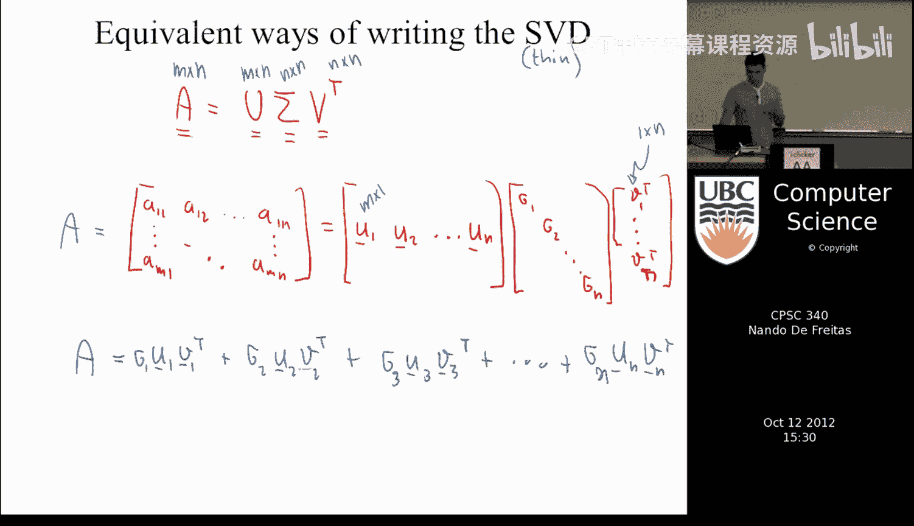
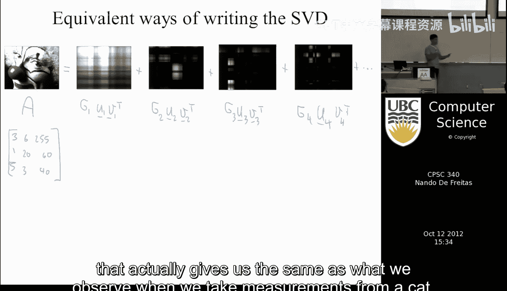
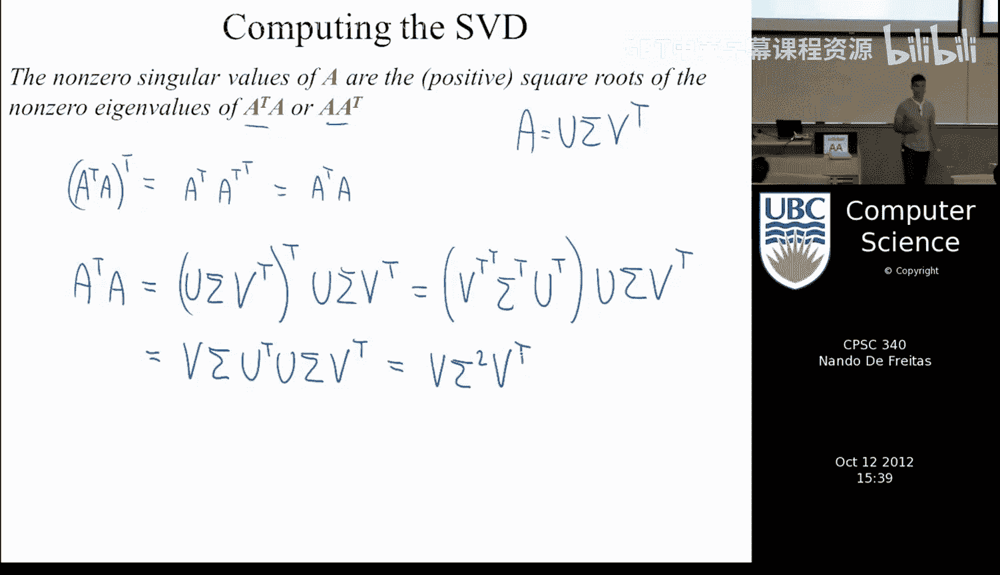
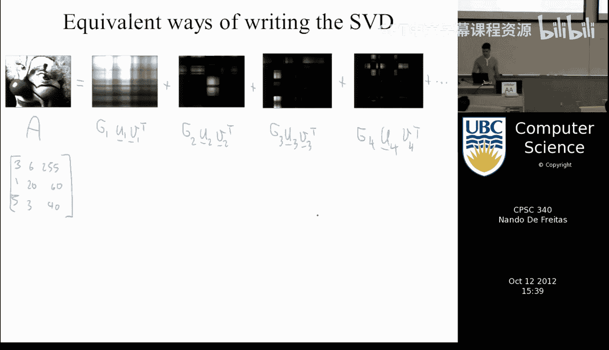
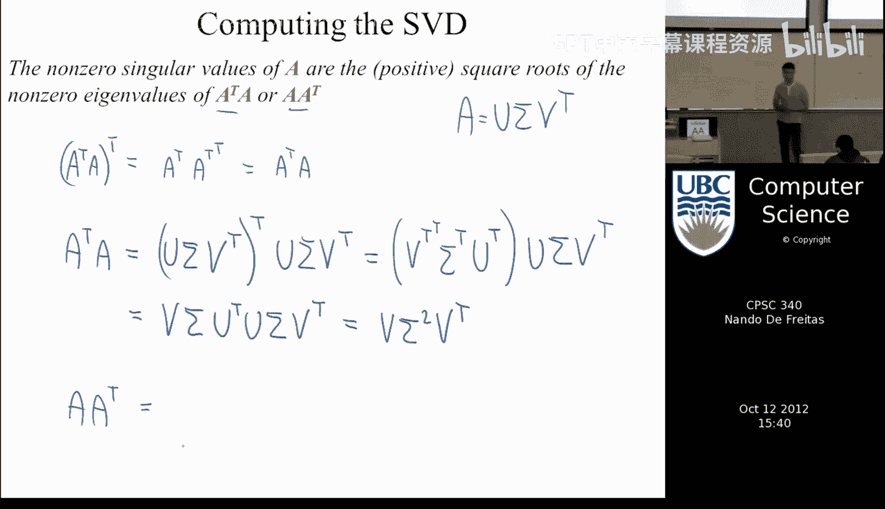
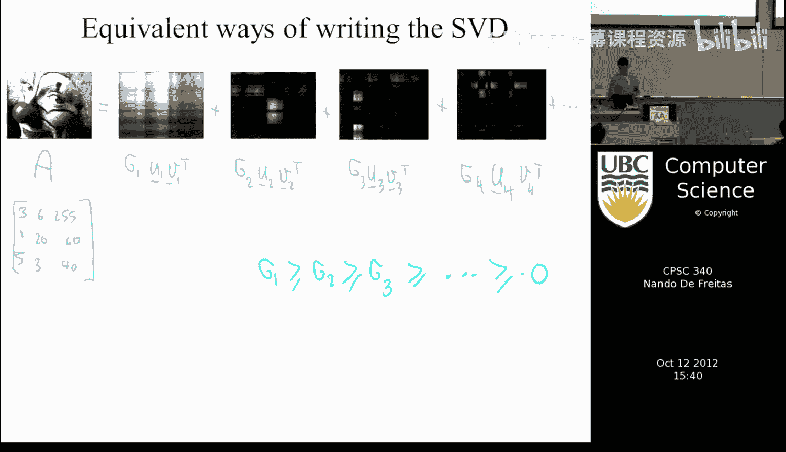
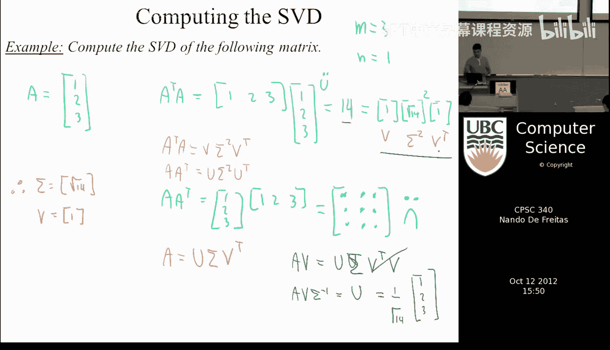
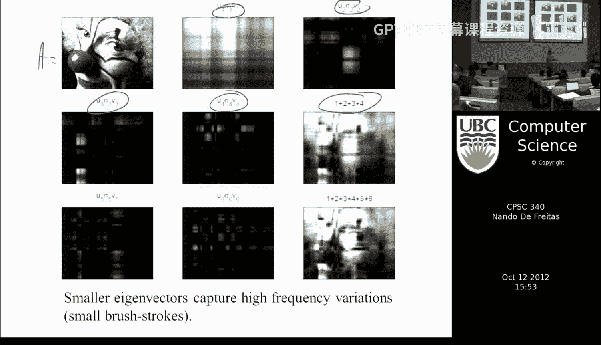
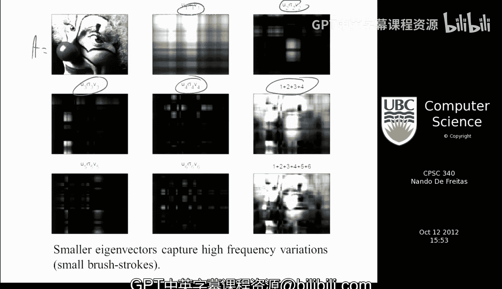

# 机器学习与数据挖掘：14：奇异值分解（SVD）🧩

在本节课中，我们将学习线性代数中的一个核心概念——奇异值分解。这是一种强大的矩阵分解技术，尤其适用于处理非方阵，在图像处理、数据压缩和机器学习等领域有广泛应用。我们将从线性代数基础回顾开始，逐步引出SVD的定义、计算方法和实际意义。

## 线性代数回顾 📐

上一节我们介绍了正交矩阵的定义。本节中，我们来看看它在矩阵分解中的应用。

如果一个矩阵 **A** 是对称的，即满足 **A = Aᵀ**，那么它可以进行特征值分解：
**A = XΛXᵀ**
其中，**X** 是一个包含矩阵 **A** 所有特征向量的矩阵。如果 **A** 是 M×M 的，那么它将有 M 个特征向量，每个特征向量的大小为 M。将这些特征向量组合起来，就构成了矩阵 **X**。

一个重要且正确的定理是，这些特征向量是正交的。因此，由这些特征向量组成的矩阵 **X** 是一个正交矩阵。正交矩阵意味着其转置等于其逆，即 **Xᵀ = X⁻¹**，这使得计算变得非常简便。

我们还引入了“标准正交”的概念。矩阵 **X** 的列是特征向量，任意两个不同特征向量的点积为零，而特征向量与自身的点积为 1。

---

我们可以将矩阵 **A** 分解为另一个矩阵、一个特征值对角矩阵和另一个特征向量矩阵的乘积。我们可以将其重写为：
**A = Σᵢ₌₁ᴹ λᵢ xᵢ xᵢᵀ**
其中，**λᵢ** 是特征值，**xᵢ** 是对应的特征向量。

以下是矩阵分解的几种等价写法：
*   **矩阵形式**：**A = XΛXᵀ**，其中 **A**、**X**、**Λ** 都是 M×M 矩阵。
*   **展开形式**：**A = λ₁ x₁ x₁ᵀ + λ₂ x₂ x₂ᵀ + ... + λ_M x_M x_Mᵀ**。这表示矩阵可以写成一系列标量（特征值）与向量外积的和。

为了理解外积，我们来看一个例子。假设向量 **x = [1, 2]ᵀ**，那么 **x xᵀ** 的结果是一个矩阵：
```
[1] * [1, 2] = [1, 2]
[2]         [2, 4]
```
因此，一个矩阵可以表示为多个列向量与行向量乘积的叠加。掌握这些不同的表示法有助于我们编写代码和进行公式推导。

---

接下来，我们回顾向量的范数。对于一个属于 ℝᴹ 的列向量 **x**，其范数（通常指 L2 范数或欧几里得范数）定义为：
`||x|| = √(x₁² + x₂² + ... + x_M²)`
它也可以写成 **xᵀx** 的平方根。例如，对于 **x = [1, 2]ᵀ**，有 **xᵀx = 5**，所以 `||x|| = √5`。

一个重要的性质是：如果一个矩阵 **Q** 是正交矩阵（即 **Qᵀ = Q⁻¹**），那么对于任意向量 **x**，有 `||Qx|| = ||x||`。这意味着用正交矩阵乘以一个向量不会改变该向量的长度，因此正交矩阵也被称为旋转矩阵。在计算机图形学中，旋转、平移和缩放像素正是通过操作这类矩阵实现的。

以上就是本课程所需的线性代数知识回顾。

---

## 奇异值分解（SVD）的定义 🎯

从本节开始，我们将进入更有趣的内容。本节课和下一节课，我们将介绍奇异值分解以及主成分分析（PCA）。PCA是一种在数据分析中广泛使用的技术。

在本讲中，我将定义什么是SVD，解释如何计算SVD，并通过示例说明其应用。我还会讨论低秩近似的含义及其在数据压缩中的意义。

SVD是一种矩阵分解方法，与特征值分解非常相似。事实上，如果你会计算特征值和特征向量，就能计算SVD。

SVD的神奇之处在于它适用于非方阵。这对于处理像图像这样的数据非常有用，因为图像本质上是一个矩阵（像素值），但通常不是方形的。SVD就是处理非方阵特征值问题的工具。

对于一个 M×N 的矩阵 **A**，其SVD由三个矩阵的乘积构成：
**A = UΣVᵀ**

以下是各个部分的解释：
*   **Σ**：一个 N×N 的对角矩阵，其对角线上的元素称为**奇异值**（类似于特征值），通常按从大到小的顺序排列。
*   **U**：一个 M×N 的矩阵，其列向量称为**左奇异向量**（大小为 M）。
*   **V**：一个 N×N 的矩阵，其列向量称为**右奇异向量**（大小为 N），并且 **V** 是一个正交矩阵（**VᵀV = I**）。

左奇异向量和右奇异向量都是标准正交的，即 **UᵀU = I**（注意，这里 **U** 不一定是方阵，所以 **UUᵀ** 不一定等于 **I**）。

根据使用的软件库不同，有时输出的 **U** 是 M×M 的方阵。这是通过格拉姆-施密特正交化过程添加了一些额外的列，并在 **Σ** 下方补零来实现的，这被称为“完全SVD”。而我们主要关注的是“精简SVD”（**U** 为 M×N）。对于我们的目的，这两种形式在数学和练习上是等价的，多出来的列我们不会用到。

同样，SVD也可以写成展开形式：
**A = σ₁ u₁ v₁ᵀ + σ₂ u₂ v₂ᵀ + ... + σ_N u_N v_Nᵀ**
其中，**σᵢ** 是奇异值，**uᵢ** 和 **vᵢ** 分别是左右奇异向量。

---

## SVD的直观理解与应用示例 🖼️



SVD如何发挥作用呢？假设我们的矩阵 **A** 是一幅图像。一幅灰度图像就是一个矩阵，每个元素代表一个像素的亮度（例如0到255之间的值）。

当我们对图像矩阵进行SVD时，分解式 **A = σ₁ u₁ v₁ᵀ + σ₂ u₂ v₂ᵀ + ...** 具有深刻的含义。这意味着原始图像可以被分解为一系列子图像的加权和。

*   第一项 **σ₁ u₁ v₁ᵀ** 构成了一个图像，它捕获了原始图像中最显著、最粗线条的光影结构。
*   第二项 **σ₂ u₂ v₂ᵀ** 提供了更多一些的细节。
*   后续的项则专注于越来越精细的细节。

这就像用画笔作画：先是用大笔触勾勒出轮廓和主要色块，然后用更细的笔触添加细节。SVD将图像分解为从“平滑笔触”到“精细笔触”的一系列成分。

这种分解是数据压缩的基础。回想一下在导论课中提到的猫的视觉实验，大脑皮层有数百万神经元，每个神经元对视觉世界的不同特征产生反应。SVD提供了一种“分布式表示”，其中每个成分（**uᵢ vᵢᵀ**）可以看作一个基图像，而奇异值 **σᵢ** 表示其权重。这为我们构建模拟生物视觉感知的计算模型提供了思路。



---

## 如何计算SVD 🧮

在进入更激动人心的应用之前，我们需要先了解如何计算SVD。掌握小矩阵的SVD计算能让我们更深入地理解它。

计算SVD依赖于以下性质：矩阵 **A** 的奇异值，是 **AᵀA** 或 **AAᵀ** 的非零特征值的正平方根。

**为什么？**
首先，注意到 **AᵀA** 和 **AAᵀ** 都是对称矩阵。例如，**(AᵀA)ᵀ = Aᵀ (Aᵀ)ᵀ = AᵀA**。

将 **A = UΣVᵀ** 代入 **AᵀA**：
**AᵀA = (UΣVᵀ)ᵀ (UΣVᵀ) = VΣᵀUᵀ U Σ Vᵀ**
由于 **U** 的列是标准正交的，**UᵀU = I**。且 **Σ** 是对角阵，**Σᵀ = Σ**。因此：
**AᵀA = V Σ² Vᵀ**
这正好是矩阵 **V Σ² Vᵀ** 的特征值分解形式（对比 **XΛXᵀ**）。因此，**V** 的列向量就是 **AᵀA** 的特征向量，而 **Σ²** 的对角线元素就是 **AᵀA** 的特征值。





同理，对于 **AAᵀ**：
**AAᵀ = U Σ² Uᵀ**
所以，**U** 的列向量是 **AAᵀ** 的特征向量。



**计算步骤：**
1.  给定矩阵 **A** (M×N)。
2.  计算 **AᵀA** (N×N) 或 **AAᵀ** (M×M)。通常选择维度较小的那个来计算，更高效。
3.  计算所选矩阵的特征值和特征向量。
4.  特征值的正平方根就是奇异值 **σᵢ**，构成对角阵 **Σ**。
5.  如果计算的是 **AᵀA** 的特征向量，那么它们就是右奇异向量 **V**。
6.  要得到左奇异向量 **U**，可以利用公式 **A = UΣVᵀ**。两边同时右乘 **V**，得到 **AV = UΣ**。因为 **Σ** 是对角阵，其逆矩阵很好求，所以 **U = AV Σ⁻¹**。



**示例：**
设 **A = [1, 2, 3]ᵀ**，这是一个 3×1 的矩阵 (M=3, N=1)。
*   我们选择计算 **AᵀA**，因为它更小：**AᵀA = [1, 2, 3] * [1, 2, 3]ᵀ = 14**。
*   这是一个 1×1 的“矩阵”，它的特征值就是 14，特征向量是 [1]。
*   因此，**Σ = √14**， **V = [1]**。
*   现在求 **U**：**U = A V Σ⁻¹ = [1, 2, 3]ᵀ * (1/√14) = [1/√14, 2/√14, 3/√14]ᵀ**。
这样就得到了 **A** 的SVD分解。

---

## 低秩近似与数据压缩 💾

让我们回到图像的例子。当我们对图像矩阵 **A** 进行SVD后，得到 **A = σ₁ u₁ v₁ᵀ + σ₂ u₂ v₂ᵀ + ... + σ_N u_N v_Nᵀ**。

一个关键观察是：奇异值 **σᵢ** 通常衰减得很快。这意味着前几个项包含了矩阵的大部分信息。因此，我们可以用前 **k** 个项来近似原始矩阵：
**A ≈ Aₖ = σ₁ u₁ v₁ᵀ + σ₂ u₂ v₂ᵀ + ... + σ_ₖ u_ₖ v_ₖᵀ**
这被称为**低秩近似**。

**优势在于压缩**：
*   存储原始 M×N 的图像需要 **M * N** 个数字。
*   存储近似图像 **Aₖ** 只需要存储 **k** 个奇异值、**k** 个 M 维向量 **uᵢ** 和 **k** 个 N 维向量 **vᵢ**，总计 **k * (1 + M + N)** 个数字。
*   当 **k** 远小于 **M** 和 **N** 时，存储空间大大减少。

在实际中，我们并不存储近似矩阵 **Aₖ**，而是存储这些向量和奇异值。当需要显示图像时，再实时计算 **σᵢ uᵢ vᵢᵀ** 的和并显示。这就是许多图像和视频压缩技术（如JPEG）背后的核心思想之一。

通过选择不同的 **k**，我们可以在图像质量和压缩率之间进行权衡：**k** 越小，图像越模糊但压缩率越高；**k** 越大，图像越清晰但压缩率越低。学习，在某种程度上，就是寻找世界的简洁表示，SVD为此提供了一个强大的数学工具。

---



## 总结 📝

本节课中，我们一起学习了奇异值分解这一核心内容。

我们首先回顾了必要的线性代数知识，包括对称矩阵的特征值分解、正交矩阵和向量范数。接着，我们正式定义了奇异值分解，它可以将任意 M×N 的矩阵 **A** 分解为 **A = UΣVᵀ** 的形式，其中 **U** 和 **V** 的列向量是标准正交的，**Σ** 是对角阵。

我们探讨了SVD的直观意义，特别是在图像处理中，它可以将图像分解为从主要特征到细微细节的一系列层次。然后，我们学习了如何通过计算 **AᵀA** 或 **AAᵀ** 的特征值和特征向量来求解SVD。





最后，我们介绍了SVD最重要的应用之一——低秩近似。通过仅保留前几个最大的奇异值及其对应的奇异向量，我们可以用远少于原始数据的数据量来近似表示矩阵，从而实现有效的数据压缩，这为理解许多机器学习算法和数据处理技术奠定了基础。