# UBC《机器学习和数据挖掘｜CPSC 340 Machine Learning and Data Mining 2012》中英字幕 p15 -15-undergraduate machine learning 16_ Principal Component Analysis - PCA.zh_en -BV1pJ2ABFEFg_p15-

I have a lot of material to cover today。 So I'd like to try to be on time。 We're5 over。 So the SVD。

That we did in class was a way of decomposing a matrix into a sum of products of vectors， right。

 that's the most important thing to remember， which is you have a matrix。Which is a big。

Set of numbers， M by N， M could be 1000。 and could also be 1000。

 in which case you would have a million numbers。And we're going to represent that as a scalar。

Which is just what number。Times  two vectors。Okay， the vector u1， the vector v1。

 and then we're going to add to it another scalar and two vectors。And so on。Okay。

 so we're breaking down a matrix into products of what we call outer products of vectors。

And the advantage of this， as I got to in the last on Friday。

 is that we we are not going to need all these factors so we can stop early。 so we might just go。

For say 10 terms in this expansion。 and then we can get rid of the other vectors。

 and we achieve compression by doing that。Okay。So in particular。

 we looked at the case of a matrix of this clown。And I say that if you view an image。

 a grayscale image as a matrix， if it's a color image， it's just three mates， RGB。

 and we can do the same thing with a bit more work。

 but for now we're just going to worry ourselves with grayscale images。So with grayscale images。

 we again break the images into a scalar and two vectors。When we multiply these two vectors。

 we also get an image。Okay， because。In matrix multiplication， if you have a vector like this。

And a vector like this。We end up with a matrix。Right， so from vectors， we can two vectors。

 we can generate a matrix。But we only generate a matrix at a time of display。Okay。

 so the trick is we don't store the matrix。 Instead we store the vectors。

 It's cheaper to store the vectors。And if we do that， So， so basically。

 when you multiply this vector here。Times this other vector here。 I get this whole image there。

 That's the matrix that results from multiplying those vectors。

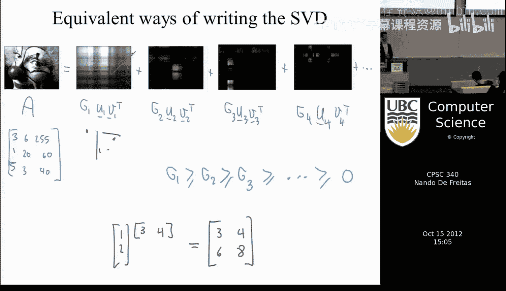

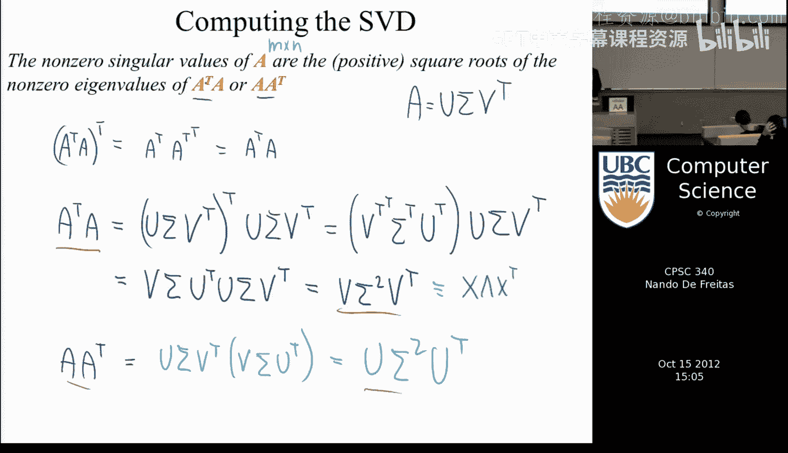

And。And as I showed with this plot， when we take， if I take those。

 if I add up this guy plus this guy。Plus this guy， plus this guy， I get this guy。

If I add the first four terms of the expansion， I get an image that starts resembling the original image。

So the first eigenvalues capture most of the intensity of the image。

 most of the brightness of the image。And the advantage of this is now we have a way of doing compression。

 because this is our compressed image。Okay， so we compute SP D of a， and we only store。

The first four terms， so。We only store this guy， this guy， this guy and this guy。

 the first four eigen pairs， and we throw away everything else。And we have now compressed our image。

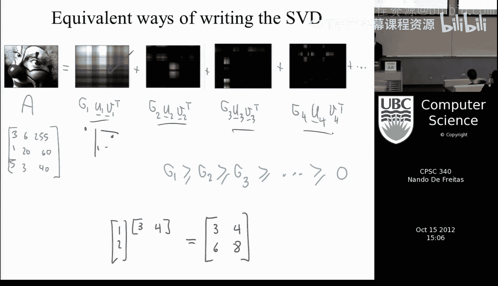

Of course， if I add two more， so if I take this image and now I add to it， guy and this guy。

 I get this new image。Which has a bit more resolution than the previous one。

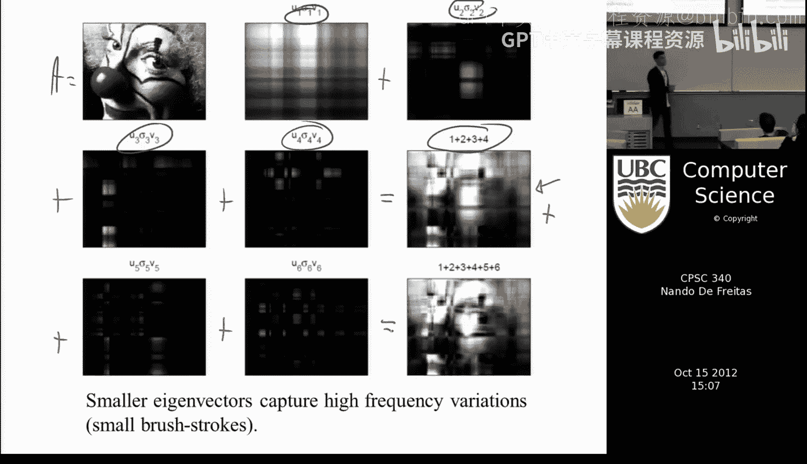

Now。Doing this in Python is very easy。 I'm going to ask you one of your homework questions for you for this homework that I'm going to hand out on Wednesday is that you have to do this with your own photo。

That way， I make sure that you and you have to hand in the results。 So that way。

 I make sure that homeworks are personalized。Each person。So you basically have to retype this code。

Or copy and paste。And change the problem name。嗯。I would change the file lane。So what the code does。

 it basically reads an image， so this is reading an image here。It says that the image is gray scale。

And then， it plots the image。When it plots the image， what this does is it generates this image here。

 which is the original image， so up to now we haven't done anything。

 we just loaded an image and we plotted it。What I do then is I extract I this is just saying that M and N are the。

Number of rows， a number of columns。I compute SVD， not how easy it is。

 It's a lot easier than when we had to compute eigenvalues by hand。In real life。

You just get to type SVD。You'll never again be doing eigenvectors by hand。 However。

 knowing what eigenvectors mean is what's really important and how to use them。And finally。

 this is just some trickery to make sure we get a diagonal matrix with a singular valuess in diagonal。

And then what I do is I trunnccate。 So I only take the top。K components in particular。

 choose K equald 20 in this。Tncation， and I just basically take a dot product of U times sigma times v transpose。

 and I only take the K largest。And if I take the K largest， I get this image。Okay。

 so that's what you get when you compress this image with only 20 eigenvalues，20 singularvalues。

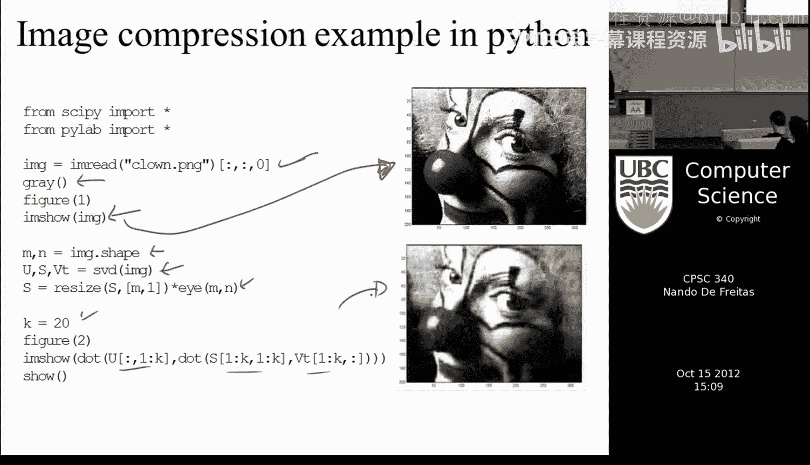

All right， so here this image is actually 200 by 320， so it's the case where M， in fact。

 is smaller than N。The code loads， loads that image。 It displays the image。 It computes the SD。

 It truncates the SVD， and then it displays the image。That's truncated。So， in terms of numbers。

What's the original storage requirement。系唔系啊。对。So 200 times 320。Which is what's 64 with 3 zeros。Okay。

Numbers or bytes， say if you use bytes to represent。嗯。What about a compressed image？

In order to be able to render it， how much do I need to store。Using k equal 20。1 need2，520 times00。

But。20 times 20 plus two times 20。Next。😊，And you choose the first。Plus you also need another。

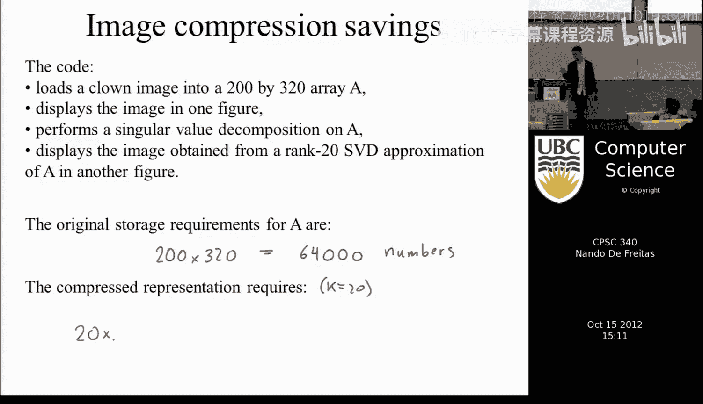

Okay， let's。

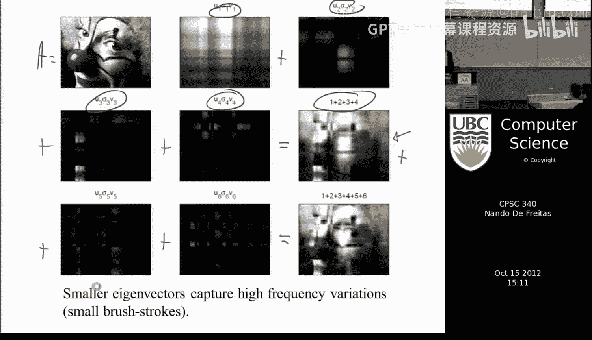

Let's go back。If I have a matrix。诶。And let's assume that the matrix is something like this。Okay。

 so m equal 5。And equal 3， it's 5 by 3 matrix A。 I'm going to get a matrix U。

 so that's going to be a。You。That's going to have。 And here the xs mean just any a number。

 an arbitrary value that I'm plugging in there。 This one is going to have also the same amount of numbers。

That's the matrix U。I then will have a matrix。A diagonal matrix which has the singular values。Sigma。

And finally， I'm going to have a full matrix V transpose。Which is three by three。

And is a orthogonal matrix， in other words， it rotates vectors， it's a rotation matrix。Okay。

 so that's how those are the dimensional when we do the SVD， if I truncate so and in particular。

 a is equal。To。In this case， sigma 1 times u1 times v1 transpose plus sigma 2 times u2 times v2 transpose plus sigma 3。

US 3， V3 transpose。Because essentially this vector here。Is you1。This vector here is u to。

And this vector here is u 3。This corresponding guy is Sigma 1。This row vector here is V1 transpose。

And this row vector here is V。Now， when I truncate I A。

I might decide that I'm going to approximate a。With just the first two components。

That's how I'm doing compression， I'm throwing away some of the vectors。

 and I'm only keeping the vectors that are associated with the largest singular values。

Recall that by convention， Sigma 1 is greater than or equal to Sigma 2。

 greater than equal to sigma 3 because。The singular values are the positive square roots of the eigenvalues of8 times a transpose。

 which is a quadratic。Product。They're all positive。Okay， now if I wanted to see what this matrix is。

This is the matrix。You one to two。I would then get this matrix。

And then this would be which would be the matrix of。嗯。Sigma， I guess one to two。

 let's label it like this。And this would be we transpas  one to2。So truncation。

 it basically means that I' representing the I'm throwing away some of the vectors and I'm using just a compressed version of the matrix what's essentially inside the green boxes。

Okay。So I'm just。Throwing away U3 sigma3， and I'm throwing away V3 transpose。

So I got rid of this guy。Which multiplies this guy， which is sigma 3。And then the other guy is U3。

 So I got rid of by deleting those rows and。And vectors， that's equivalent to just dropping。

Dropping this storm here。That's how I do compression。I compute SVD。

 and then I drop the small iconigenvalue。

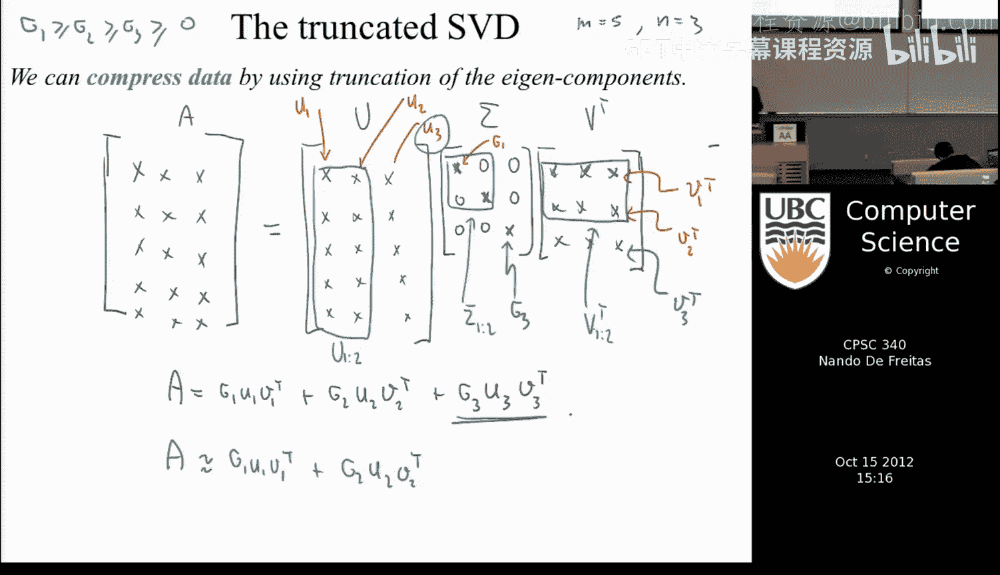

And the justification sort of comes from the fact that when I do this for images， I observe that the。

 the bigger eigenvalues capture most of the light of the image and capture most of the broad details。

 so by getting rid of the small eigenvalues， I'm getting rid of the tiny details。

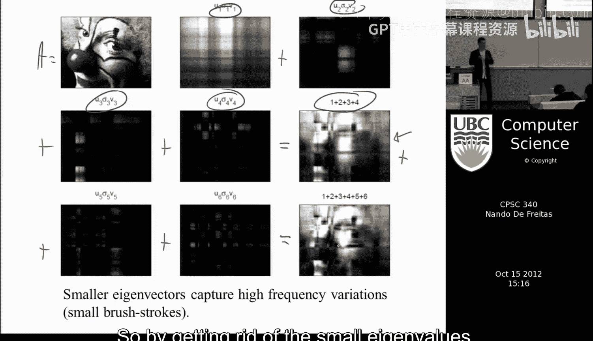

That might not be essential to have a good image。 So and that's essentially what I've done here。

 I computed U sigma and V transpose， and then I'm only going to take the entries1 to K。

 so I'm only going to take the columns 1 to K。 I'm choosing the matrix to be the sigma 1 to 21 to 2。

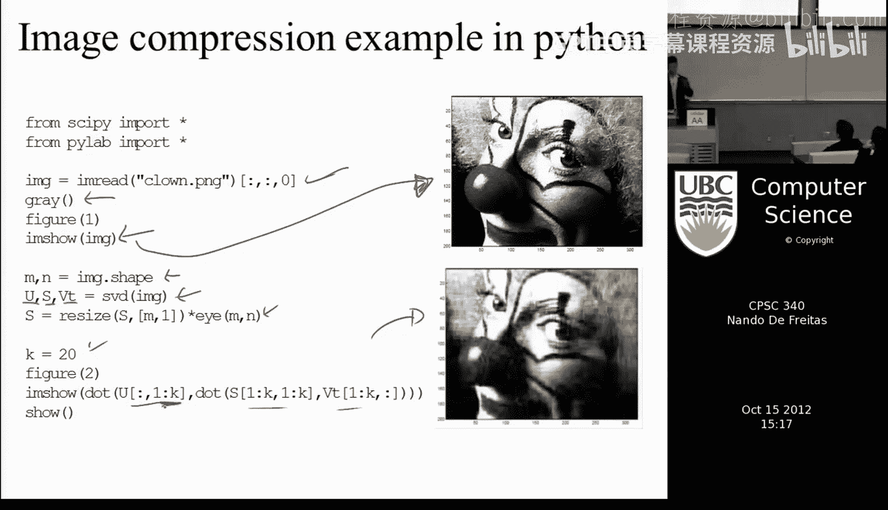

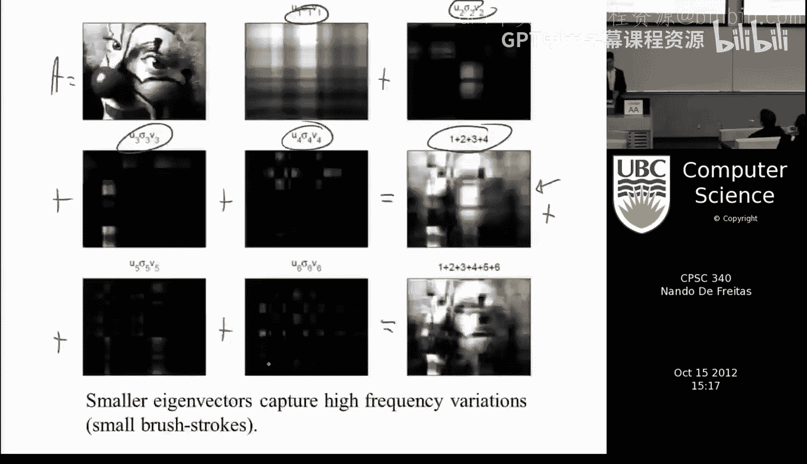

So if I wanted to be with that notation， I would call this sigma one to2 commma1 to2。

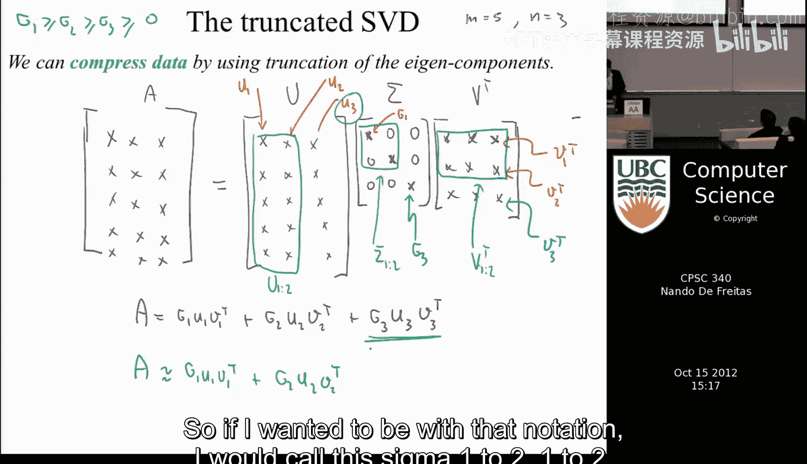

And I'm also only taking the first K rows of B transpose。Okay。

 so I'm doing exactly picking those what's in the green boxes。 And then I'm taking the dot。

 When Im multiply， I I still get the right dimensions。

And as you can see。嗯。If I multiply the green boxes， I still get a matrix that's 5 by 3。Okay。

 the dimension still match you。We're a smaller way just after destroying the vector system we know。

 just the vector time。Yes， that's a refinement。 So you get to answer to this question。 So now。

 what's the size Well have 32 by 23 What's the sigma。Sigma is another one by 20， so 20 by 20 by 32。

え2。This is M， this is n。So， I'm gonna trunnket。So what's the size for the truncated you？

Pass it on to him。 I know you have it。To。20 times that。 So I need 20 times 200。Plus。

In order to store sigma， I only need 20。Okay， and everyone got that。 If I need to store sigma。

 Sigma is a diagonal matrix full of 0。 So I really only need to store the diagonal。

So I don't need to store the whole matrix signal， so I just store the diagonal， which is of size 20。

And how many entries for B。说你在。20 times 320。So for example， here， if I need to store the compression。

 which is。This is the compression。Of a。I need to store only two numbers， sigma1 and sigma 2。

 in this case k equal 2， so I need a diagonal， which is just sigma 1 and sigma 2。

I need a matrix that is size m by2， which is the first green box here， this is M by2。

I stored a diagonal， and then I need a matrix that is 2。By the number of columns of the transpose。

 which in this case is 3。 So I need a matrix 2 by3。For the cloud， I need 200 by 20，20 and 20 by。3，20。

And if we add this all up， what do we get？So，s。20 so1，0，4 to 100。

Does anyone have a calculator and give me a number。1000。420。关关度。Oh， sorry。I hear you， sorry。那 we啥。这里。

Yeah， I'm just cutting the pen。 hang on。 Oh， it was 10000。Yeah。さ。10000 for 20。 Yeah， okay。

So it's a lot less storage than having to store the original image。However。

 that requires computation。So there's this interplay between compression in terms in compression。

 this interplay between。Computation and。Storage。And this is very important because quite often with our current technology。

 our cameras， we take images of the world which are huge。

 we store these huge images but we often display them at different resolution。

 and so it would make more sense that when we acquire the image we already acquire a compressed version and we always store the compressed version and only transmit a compressed version and it's only a display time that we uncompress it。

That's a much more efficient way of dealing with images。

 And a lot of the future of image processing will be like that。

 Our images will exist in compressed form， always。Okay， so that's the SVD。

 and now we're going to go and look at how to use the SVD to do some cool stuff in machine learning。

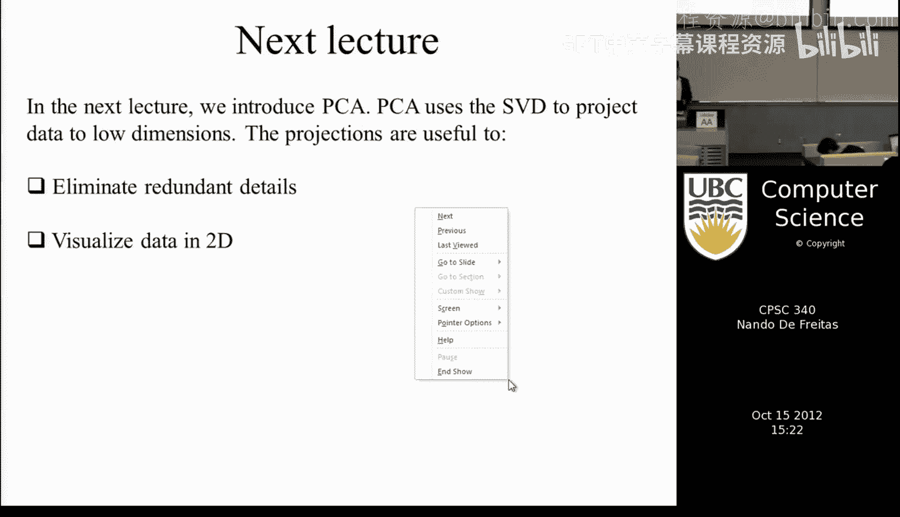

If we actually want to start a whole edge if we go' want compression。

 we actually use quite a bit more stories。Having。Sorry， we don't。

Yes we actually use quite a bit more stories。 Yeah， if you don't throw anything away。

 you're storing the whole thing。 the key is， indeed， to throw away stuff。

So this is lossy compression。 We lose details。But we gain in。We gain a lot in terms of storage。

 but if we more data than that's correct， because you would be storing just U would be the size of a。

But the trick is always to truncate。

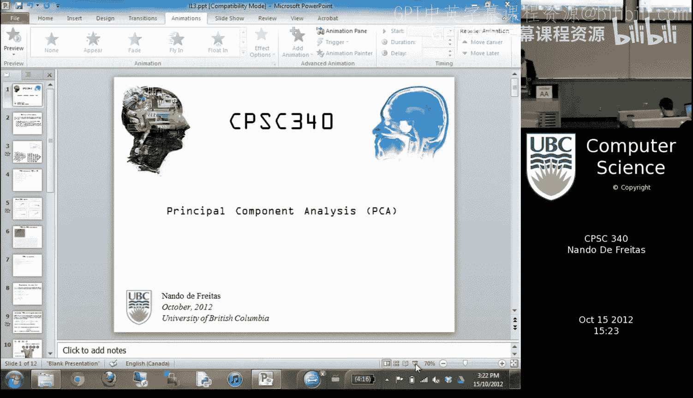

All right， so the SVD leads naturally。 Go ahead。Images iss this technique used often because then you're throwing away stuff that will be helpful in diagnosis with No so this technique is not typically used for medical image。

 Actually， this technique is very， very widely used and in fact。

 for medical applications that's used as well this is the simplest technique that you could use for data compression for velocity data compression as we progress in the course you will learn better stuff but this is the easiest to grasp and easiest to implement you can go home now and within a few minutes you will have compress your photo and know how to compress。

嗯。It's often used as a component in larger systems。But itself alone， you wouldn't not。Very popular。

The mathematics to understand it will turn out to be very useful for other things later on。

And in fact， as you'll see， it already will be useful for doing something called PCA。

 which is widely used in practice。Okay， so and if I have time today。

 I'm going to tell you a modification of this technique that is kind of stated of the a that would do very good image compression。

Even for medical images。Okay， so。嗯。PCA is an application of the SVD， essentially。

 It's one of the first machine learning techniques that we're getting into here for continuous data。

 It's useful for two things。 It's useful for data visualization。

 but it's also very useful to when you have data that is very large dimensional projectors data to a lower dimensional space。

The picture sort of will illustrate this a bit better。 So let's assume that we have data。

And that the original data might be a table。And it might be a table that has countries。

For each country， it tells you what the area is of the country。The income。

The population of the country。That said。So you go to Wikipedia， for example。

 and there's the info boxes， those boxes on the right- hand side of a page。

 you look up each country and you look at its population， its GDP， all of these features。

 and then you basically will enter here， I don't know， let's start with Canada。

 it has an area of I don't know one， the income is 0。2， the population is， I don't know 400， etc。

Whatever units you want to use。And you do this for every country。

And what you would like to do is be able to visualize how similar the countries。

So can we take this data？For countries， which is this where every country has M attributes。And。

Project。2 d equal to。In other words， you would like a list that says Canada。Aqu about Canada。

And then it would have feature one and feature two。Only 2D。 and it will have。

And then it will have another Austriausria。Et cetera， and。Well， it will have one number here。

 one number here。Another number here， so this would be feature one。Feature2。And this is the country。

So why would we want each country to only have two numbers that represent it。

 because then we can do this， we can do a 2D plot。Because if you have two numbers。

 that's the x and y position， and so you can just plot the coordinates。

 so you would have a plot that would have feature2。And then feature one。

And you essentially plot those numbers， which it points。Two numbers。

Points in D and just label it with the name of the country。And that would allow us then， to see。

TheAll the countries represented in 2D， so we can quickly visualize how these countries are related to each other。

If you're looking at not 20 numbers， but if you have an Excel sheet where each country now has 20。

000 numbers， 20000 attributes， it's very hard for you to understand what's going on with this data。

 this happens quite often。Quite often， I'm consulting for startups and companies in Silicon Valley and so where they have this huge mates they don't understand them。

And so it's useful to tell them， you know， project the data to 2D。

 look at us what we call a scatter plot of the data in 2D。

 and then you'll get a better sense of what your data looks like。Here's another example where。

Originally， what I have is an image， an image is represented in this case。

I think it's 28 by 28 numbers。I think this image is are 28 by 28。

 so these images live in a space that's of 728 dimensions。Or whatever that number is 28 by 28。嗯。

And what I do is I'm going to project them to 2D so that I can visualize what they look like。Now。

 projecting down。Has the advantage that once everything is in low dimensions。

If I have the equation of the curve in low dimensions， I can come up with an a curve。

Maybe this curve。And this curve separates two from other numbers。

So if I can write the equation for a curve in low dimensions that separates two from other numbers。

 I have built a two recognizer。So when I get an envelope。And I look at the postal code。

 I look at the number， I know it's a two。And then I could do the same thing for the fives and the threes。

 and I could learn a recognition function。How we come up with this curve。

 That's going to be the subject of the next few lectures。

 We're going to start learning curves that fit the data。嗯。

The advantage of doing this is that in the old days， the way the post office worked was a lot of。

I've seen a picture， it involved a bunch of old ladies sitting down and they would take a letter。

 they would read the number， and then they would put it in the right。They were like boxes。

 like tubes， they were put in the right tube。So you get it and you sort it。

This used to be done manually。嗯。People would spend eight hours doing this every day。

So that job's been replaced。 Nowadays， we use machines。

That recognize the numbers automatically and then。Rer the letters。

 So it's a case where an inhumane job can be made。Much more efficient using machines。Okay， so。

The idea is we project to visualize， but we also project because in the lower dimensional space。

 it might be easier to draw a curve that will separate the one thing from the others。

Here's another example where we project images of sign language。And now。

 if you do that and draw the right boundaries， you would start building an automatic recognition system for sign language。

O。How does it work， So let's look at the derivation。

So the derivation is quite easy once we have the SVD。Okay。

I'm only writing the diagonal here because these are zeros。But basically。

 what we're saying is if we take any point。X I， any vector X。Can be written as the product。Of the。

Vectctor Ui times the sigma times the Vs。Okay， so if you do matrix vector multiplication。

You would basically have sigma1 times sigma 1 here with multipied v1 here。

And then that v1 times u1 would multiply u1。 So the first coordinate of UI is basically Ui1 times sigma1 times the vector v1 transpo。

And the second coordinate of Xi is given by this。What I'm going to do is I'm going to do truncation。

And when I do truncation。嗯。I'm going to throw away the terms that have。

 I'm going to do the same trick that we did for compression。

 I'm going to throw away the small lichenvalue。Now， if I look at this and I try to plot this。

This guy here is one by one because it's a scalar。 This is also a scalar。

And this guy here is1 by  two is a vector in 2D。Oops。And now， if I want to plot this。

 what I'm going to do。I'm going to create an orthogonal basis。And these guys， the Vs are orthogonal。

 which means that there's 90 degrees between them。And I'm going to call them the vector V2 and the vector V1。

The are my two vectors。 Now， if I have two orthogonal vectors。

 that means any point on the plane can be written in terms of these vectors。

In terms of their coordinates。So in particular。If I have a point here。Okay， this point。

We'll have coordinates。With respect to the origin given by UI1 Sigma 1。N height。UI2。Sigma 2。

The vector in the direction of v1。That's。That's the point Xi。So。If this is Xi。Just here is X hat。

So we see that exc is an orthogonal projection just at 90 degrees。Of course。

 we don't do this with only one point where we actually do this with many points。

So that if you have many points。What we're doing is we're replacing those points that live in 2D。

With a projection that lives in 1 D。We're projecting each of these individual points to the line。

So that if I look at the projection and I plot the projection in 1 d。

I would just have a bunch of points in the line。Okay。

 so I've gone from something that exists in 2D on your screen to something that exists along the line。

 2D to 1D。2D to 1 D is not very useful， but any D to 2D is useful for visualization， as we've seen。

But it's easy to understand the orthogonal projection if we just look at this case。

And here it is with actual data， where you have a bunch of points in 2D。They've been colored， green。

 blue and red just to illustrate what the points were to make the plot a bit more clear。

So X is the combination of two vectors， a pointing 2 d。It requires two bases。

The first thing we do with the SVD is we multiply by V transpo。

 so now I'm actually carrying out the SVD V is a rotation matrix。

 so whenever you multiply points by rotation matrix。

 all you do is rotate the points as this demo shows you。And you can actually code this。

 it's very easy。 Just generate points in 2D， apply compute SVD of the matrix X and multiply times v transpose。

 and you'll see that what it does。 It gives you a rotation。And basically in Python。

 you just do x rot is NP dot x sum with trans。Then we set the second coordinate to zero。

 so we do truncation， and essentially what we've done is projected the points down and then we rotate back。

And so when we've gone from a data set， there was a two dimensional data set to a one dimension data set。

But the one dimensional data set still captures the topology of the point in 2D。 In particular。

 green points are still close to each other。 red points are still close to each other。

 and blue points are still close to each other。 So the trick is， let's do a transformation。

 Let's do a reduction of compression。But let's hope that in doing that compression。

 we haven't lost some of the important properties of the data。In this case。

 the points that are nearby in high dimensions should still be nearby in low dimensions。Now。

 applications is where this gets fun because we can generate these 2D layouts of images。

 and this will be the second programming question of your next homework where you get to actually try a bunch of your favorite images and you get to do one of these layouts。

With your images。 So how do we do this。An image。So you might have an image， image I。Image。hi。Which。

Is let's say， 40 by 40。So。That's an image that looks like this。

 and so what I'm going to do is I'm going to take each column of each row， sorry， each row。

 this matrix。And I'm going to append it next， so I'm going to go one，2，3。All the way to 40。

I'm going to generate a vector。So I take each row。I break the matrix and I append them next to each other。

 and I form a single fact。Okay， so now an image is now a vector。Which is of size 1 by 1，6，0，0。うう。

Next。We form a database。诶。And the matrix， the database。We'll have i1 and I2。And so on， up to I am。

Okay， so this is a database of M images。That's sort of the preceding step。 So now I've converted。

 an image is not a matrix， but a collection of images。 is also can also be represented as a matrix。

Once I do that， and in this case I actually did it for 16 by 16 in which I would have 256 numbers。

I form my matrix a。Let's try to be consistent。Of size n， which is n by 256。

And now what we do is we apply the SVD to a， which is that one line in Python。 you call the SVD。

 and it returns U Sigma and V。And then you just keep the first two components。U1 and Sigma1。

Because to plot in 2D， we would need。This guy number and this number。Once we project。

Once we take k equal2， we just have a basically a matrix with two columns。

 And those are the coordinate x， the coordinate Y， and then we just plot them。So you just to plot。

And pass in that vector。Andvoa， you get a 2D plot。But the plot that you will get。

Will not be a plot of。They images， but you will get a plot that will look like this of points。

And then the next thing you need to do is whatever those points are。

 you need to now go and put the actual image where the point is。To create a nice layout。

How to do that， that's something that the TAs will help you via the Google group。

That's most of you that comfortable Python programming could go ahead and do it。

 essentially you just need to create a big canvas。Where these coordinates are。

 and then you're just go and paste an image on the other images。

And that's how these layouts are created。And here is part of the Python code。

 so again computing the SVD is very straightforward， we truncate to k equal 2。Those are。

 that's the truncation， and then in order to generate the plot that looks like a bunch of points in 2D。

That command will do it。But after you do that。You know that each。Each row indexes an image。

 You know which image that is in the database。 So you go and you put in here on top。

The image that should go on top。And that's how you you do the layout。It's not random。

 it's an embedding that is preserved orthogonality。Forserv distances。So you get the PC。

 let's call it the PCL layout out。 You first get the PCL layout。 The next thing is just aesthetics。啊。

有。喂。Those two vectors are to see like what features of the。2。不す。Is that what it's doing。

 it's it picking out a certain。嗯。I don't know， future of where there's dark and where there's light。

You're visualizing it there because when when I look。If we just look at。The vector。

Just this vector and just that vector。Okay， so so I'm going to show you one more visualization and we'll see if that answers your question。

Okay， and the next visualization is I'm going to visualize。The matrix， whoopss not that one。

 I'm going to visualize the matrix speed transpose。Okay， just one thing。

Here is this is a technicality， but it's a very sort of one of those things that's very important to do when you get data。

 if you get a matrix in Excel and you want to be able to。And you want to be able to do comparisons。

 it's always a good idea to go over all your data instances。

 subtract the mean and divide by the standard deviation to make all the data vary in the range 01。

In terms of a Gasian， that is， the reason for doing this is that then things become comparable。

You might have data that might look like this web page number one。Has the word cut？It has the word。翻。

400， maybe cat appears 100 times fun appears four times。Edual。You might have a bunch of web pages。

And we form a matrix。Because text document is also a matrix。 You can take any collection of text。

 And if you got documents by the， the words that appear in the document。So in this case。

 I'm saying that the web page1 has the word CA 100 times。

 and it has the word fun four times in the word educational one time。Or you could do this about cars。

 Car have。Two doors or four doors。 That would be one feature。

 Another feature would be the range of colors that cars come in。

 And then another feature would be the the tire， the tire size or the types of engines。

Now some of these features have ranges that are small， like0 and1。

 whereas some features have big ranges。And so we don't want something like CA to dominate。

 So that's why we take the mean of the column。We subtract the mean。

 and we divide by the standard deviation。 When you apply this transformation。

 you end up with a matrix。The resulting matrix is going to have。Web one， web two。

And it's going to have a number that I don't know， so I'm just going to put some random numbers here。

All the numbers would be comparable， and so when we project them。

 we're likely to have something where all the variables contribute equally to the projection。Okay。

 I'm going to go very quickly over this。This is sort of an advanced topic， I will not examine this。

 but I think this for people who actually want to understand this。

 this is very useful it's certainly for people with serious about machine learning。

It's possible to formulate an objective function that is a reconstruction objective。 In other words。

 reality is X， X hat is what I imagine。And I'm going to assume that the model that I use for imagining is the product of two matrices。

 Z and double。So I'm going to assume I can generate images or text documents or collections of songs by features of songs。

 so any data that I can write as a matrix， any Excel sheet for that matter。

I'm going to assume that I can generate this by multiplying two matrices。 These two mates。

 Z and W are unknown。 So the question that I have to ask myself is。

 what are the best two matrices I could come up with that when I multiply them。

 it will give me the thing that's closest to the data to the database。

If I solve this with three pages of math， I get the following answer。

I get the answer that the optimal matrices are V transpose and use sigma。So the SVD。

 and this is why the SVD worked basically。The SVD essentially is the。

The tool that gives me the optimales matrix encoding for any data matrix。嗯。Very quickly。

 if you have an image。You can think and so we basically am representing this as a vector。

 Z I times of matrix， and of course because I go from one to end。

 I actually have a matrix with all the Z Is。And essentially。

 what we're saying is that any image x can be represented as a number times the vectors。

Times a set of basis vectors， just like we did for the clown。

And this essentially is the basis for neural networks where each of these components is a neuron。

And a neuron has associated with it a weight。

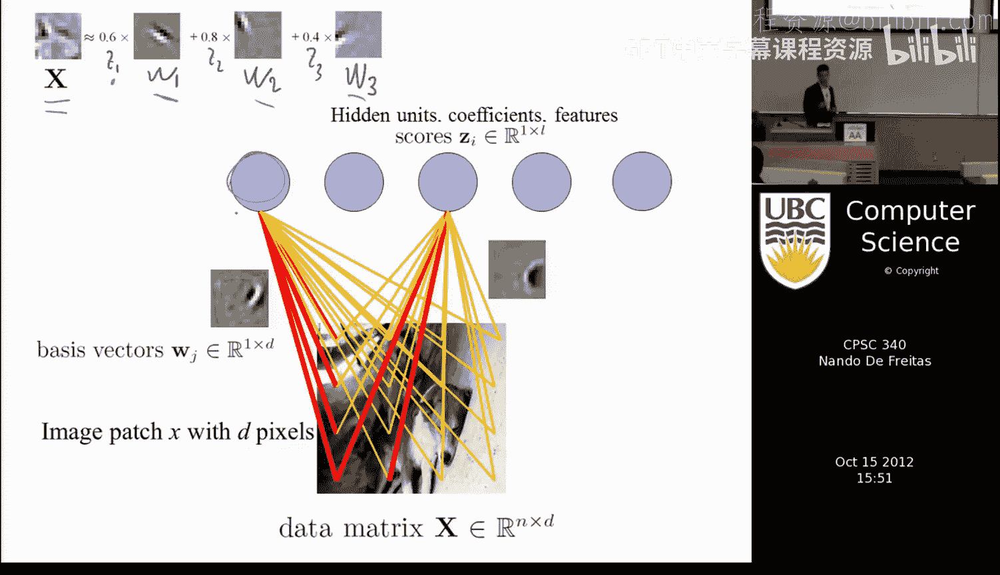

Which we learned that way to speed transport。

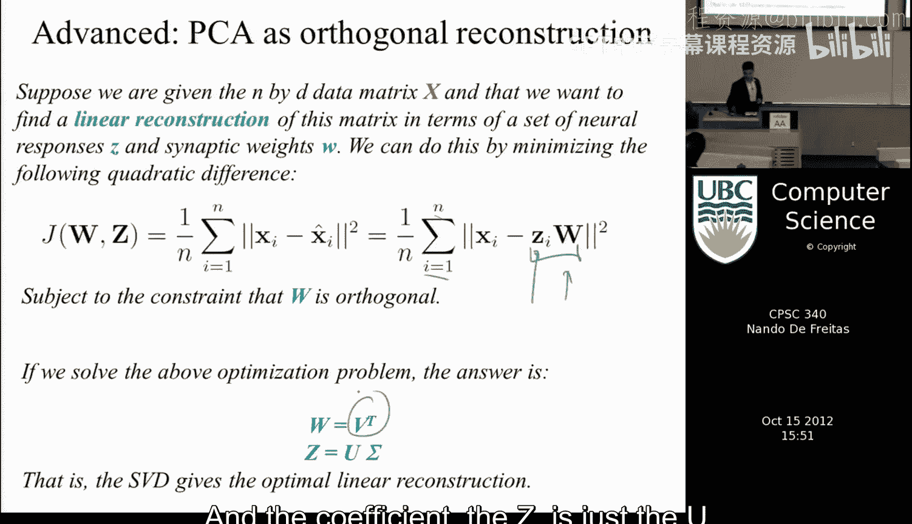

And the coefficient dessert z is just the use sigma。The first component of e sigma， so Sigma 1。

You one。This whole thing here can be visualized as a matrix。

 so that's what we visualize as the V matrix。And so when we look at an image。

 you can think of we're understanding the image in terms of all the components that exist in image。

 Of course， our vs for PCA do not look like these edges， like these edge filters， our Vs for PCA。

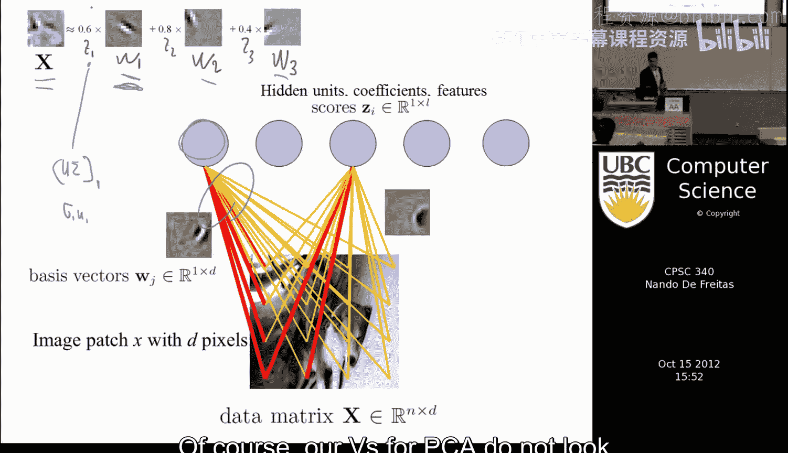

Look like this。There are different frequencies。 And that's why we see that the Sigma 1 captures the big。

Sort of variation in light Sigma2 gives you more detail。 And as you go down the sigmas。

 you get higher and higher resolution in details。 So think of this as sinusoids。

 For those of you who've seen Fourria seriesus， think of this as a fourria series in 2D。

It's possible， and we will learn later in the trick to add a thing called a regularisor that will give us these features。

Just a small trick is going to give us the features that look exactly like the features that remember that experiment were found in the cats。

They just detect all ages at all possible orientations and so on， okay。

 thanks for staying a bit longer。So yeah。Yeah。Yeah。Yeah。

