# 机器学习与数据挖掘：15：主成分分析 - PCA 📊

在本节课中，我们将要学习奇异值分解（SVD）及其在数据压缩和降维中的一个核心应用——主成分分析（PCA）。我们将从图像压缩的例子入手，理解SVD如何将矩阵分解为向量外积的和，并探讨如何通过截断（即丢弃较小的奇异值）来实现数据压缩。接着，我们将看到如何利用同样的数学原理，将高维数据（如国家统计数据或图像）投影到低维空间（如二维平面），以便进行可视化或简化后续的机器学习任务。课程内容将涵盖SVD的计算、压缩原理、存储计算以及PCA的推导和应用。

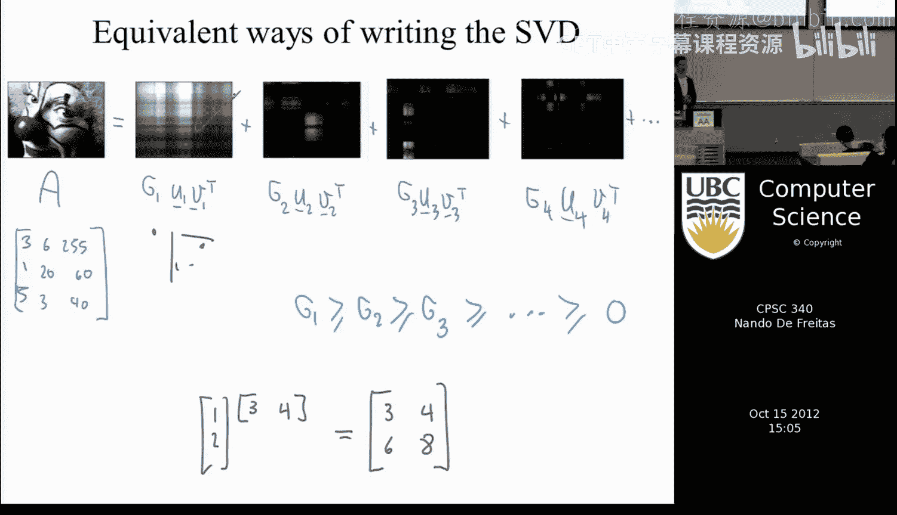

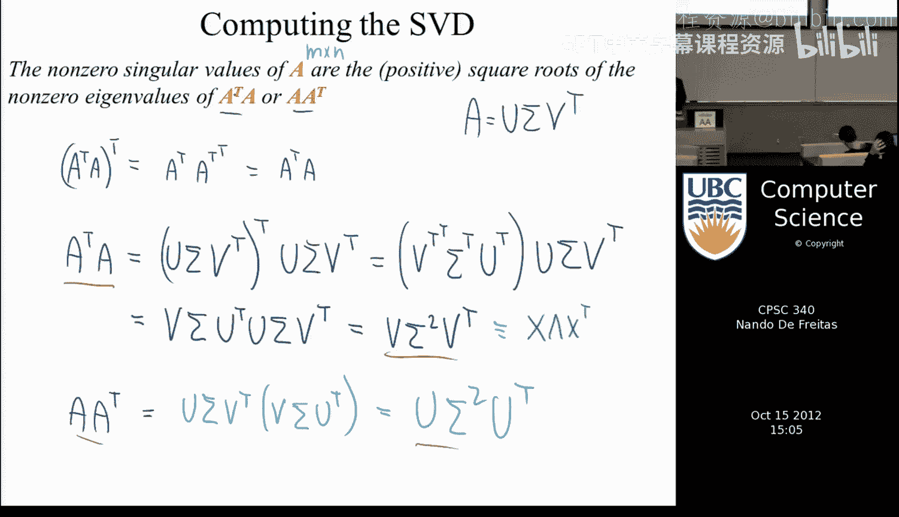

---


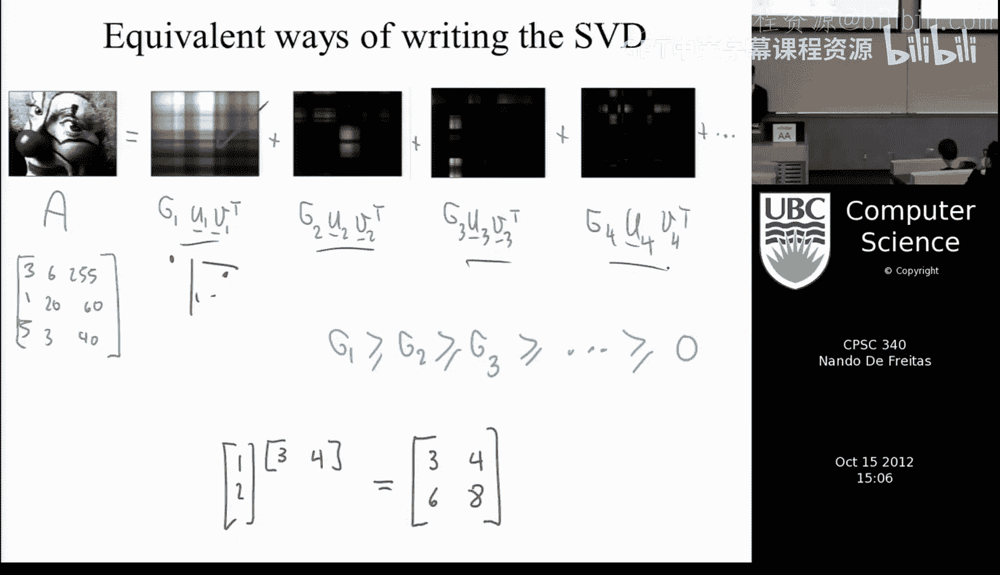

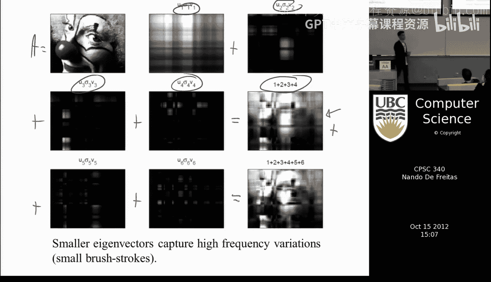

## SVD与图像压缩 🖼️

上一节我们回顾了矩阵分解的基本概念。本节中我们来看看奇异值分解（SVD）的具体形式及其在图像压缩中的应用。

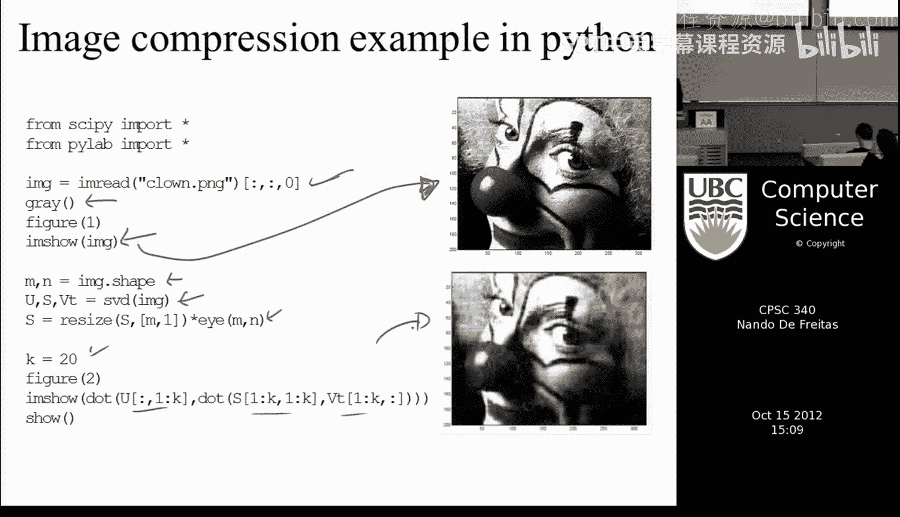

SVD是一种将矩阵分解为一系列向量外积之和的方法。对于一个 \( M \times N \) 的矩阵 \( A \)，其SVD可以表示为：
\[
A = \sigma_1 u_1 v_1^T + \sigma_2 u_2 v_2^T + \dots + \sigma_r u_r v_r^T
\]
其中，\( \sigma_i \) 是奇异值（按从大到小排列），\( u_i \) 和 \( v_i \) 分别是左奇异向量和右奇异向量。

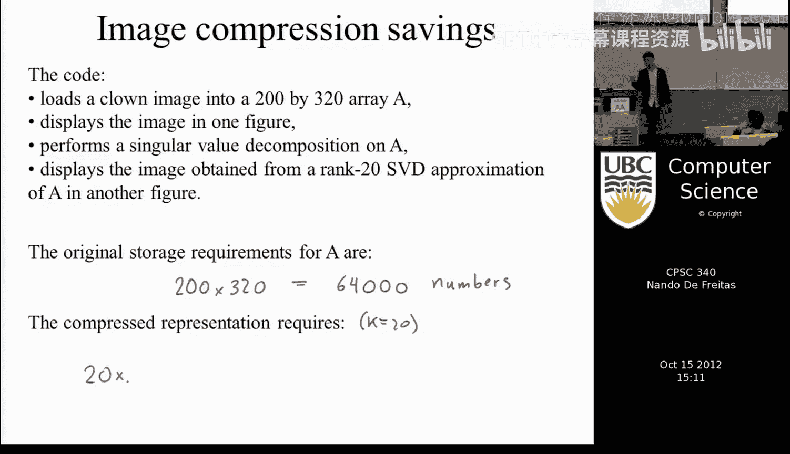

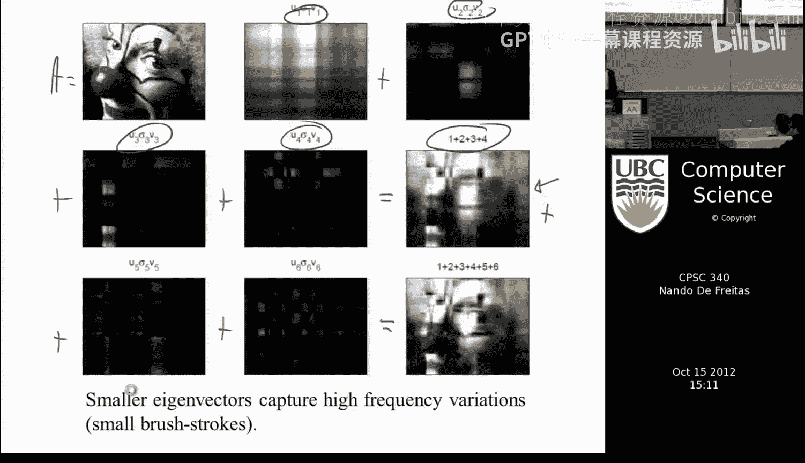

当我们把一张灰度图像视为一个矩阵时，就可以应用上述分解。图像矩阵中的每个数值代表一个像素的亮度。通过SVD，我们将图像分解为多个由标量 \( \sigma_i \) 和两个向量 \( u_i \)、\( v_i \) 构成的“层”。

以下是SVD分解的关键优势：
*   **压缩潜力**：我们不需要保留所有 \( r \) 个分量。通常，前 \( K \) 个（\( K \ll r \)）最大的奇异值及其对应的向量就包含了图像的大部分信息（如整体亮度和主要轮廓）。
*   **存储效率**：存储向量 \( u_i \) 和 \( v_i \) 比存储完整的图像矩阵更节省空间。我们只需存储截断后的 \( U \) 的前 \( K \) 列、\( \Sigma \) 的前 \( K \) 个奇异值以及 \( V^T \) 的前 \( K \) 行。

在Python中，计算SVD和进行截断压缩非常简便。以下是一个示例代码的核心部分：

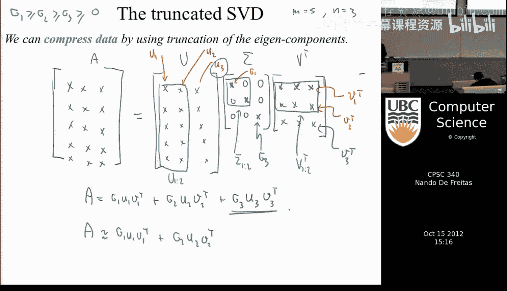

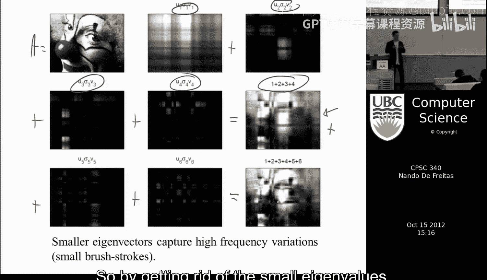

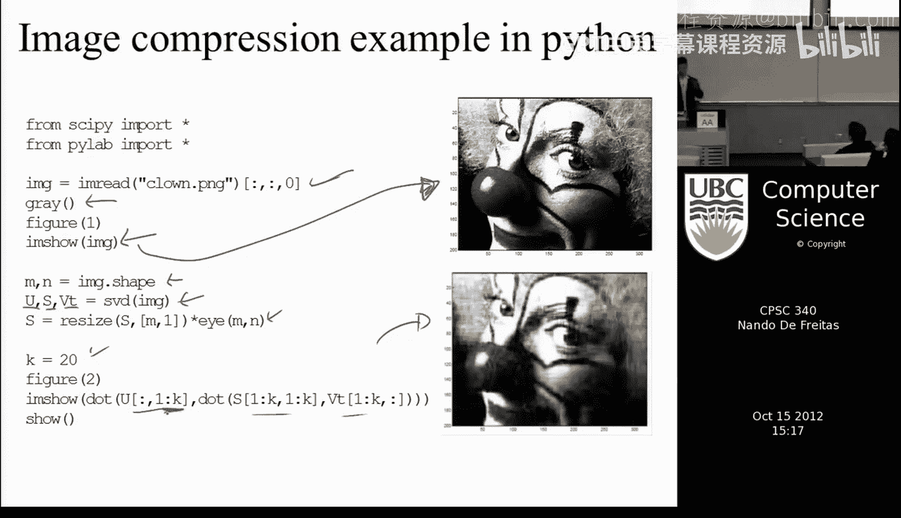

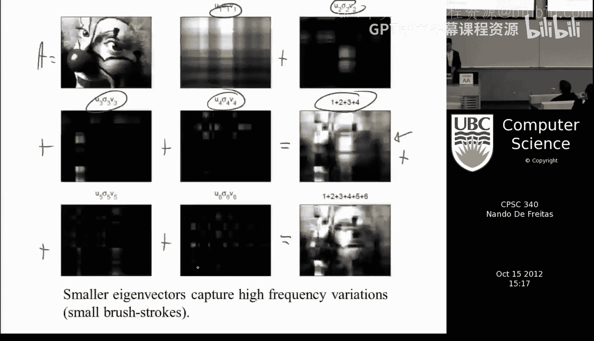

```python
import numpy as np
from scipy import misc
import matplotlib.pyplot as plt

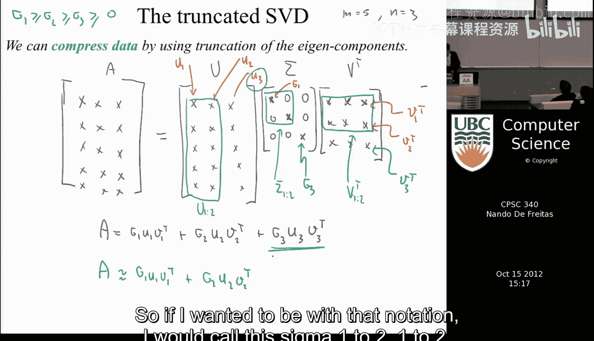


# 1. 读取图像并转换为灰度矩阵
img = misc.imread(‘your_image.jpg‘, mode=‘L‘) # ‘L‘ 表示灰度模式
M, N = img.shape

# 2. 计算SVD
U, S, Vt = np.linalg.svd(img, full_matrices=False)
# S是一个一维数组，包含奇异值
Sigma = np.diag(S) # 转换为对角矩阵

# 3. 选择截断的秩K
K = 20
U_k = U[:, :K]
Sigma_k = Sigma[:K, :K]
Vt_k = Vt[:K, :]

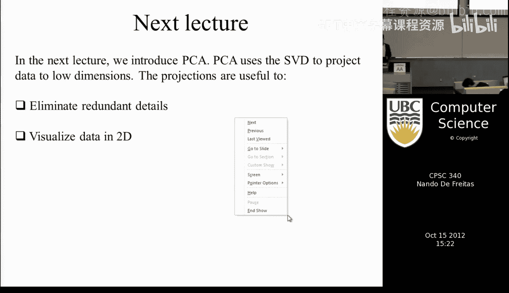

# 4. 重建压缩后的图像
img_compressed = U_k @ Sigma_k @ Vt_k

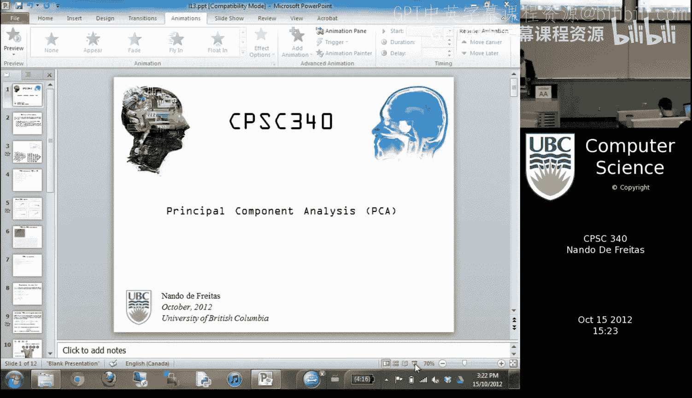

# 5. 显示原图与压缩图
plt.subplot(1,2,1); plt.imshow(img, cmap=‘gray‘); plt.title(‘Original‘)
plt.subplot(1,2,2); plt.imshow(img_compressed, cmap=‘gray‘); plt.title(‘Compressed (K=‘+str(K)+‘)‘)
plt.show()
```

通过调整 \( K \) 值，我们可以在图像质量和压缩率之间进行权衡。\( K \) 越小，压缩率越高，但图像细节丢失越多；\( K \) 越大，图像越接近原图，但压缩效果越弱。

---

## 从压缩到降维：PCA的原理 🔍

上一节我们介绍了如何利用SVD进行图像压缩。本节中我们来看看SVD在机器学习中的一个更广泛的应用——主成分分析（PCA），它主要用于数据降维和可视化。

PCA的目标是将高维数据点投影到一个低维子空间（通常是二维或三维），同时尽可能保留数据中的主要变化模式。这对于理解数据结构或为后续分类等任务做准备非常有用。

其数学推导与SVD紧密相关。假设我们有一个数据矩阵 \( X \)，其每一行是一个数据样本，每一列是一个特征。在进行PCA之前，一个常见的预处理步骤是标准化数据：对每个特征列，减去其均值并除以标准差。这使得所有特征具有可比性。

标准化后的数据矩阵 \( X \) 的SVD为 \( X = U \Sigma V^T \)。那么，将数据投影到前 \( K \) 个主成分所张成的子空间，可以通过以下计算实现：
\[
Z = X V_K = U_K \Sigma_K
\]
其中 \( V_K \) 是 \( V^T \) 的前 \( K \) 行（即前 \( K \) 个右奇异向量，也是主成分方向）。矩阵 \( Z \) 的每一行就是对应数据点在新的 \( K \) 维空间中的坐标。

当 \( K=2 \) 时，\( Z \) 给出了所有数据点的二维坐标，我们可以将其绘制成散点图，从而实现高维数据的可视化。

---

## PCA的应用实例 🌍

理解了PCA的原理后，我们来看几个具体的应用场景。

**1. 国家数据可视化**
假设我们有一个数据集，每一行代表一个国家，每一列是国家的不同属性（如面积、GDP、人口等）。这些属性可能多达数十个，难以直接观察国家间的相似性。通过PCA将其降维至二维，每个国家就变成了二维平面上的一个点。我们可以通过点的聚集情况，直观地看到哪些国家在统计属性上更为相似。

**2. 手写数字图像降维**
MNIST数据集中的手写数字图像通常是28x28像素，即生活在784维空间中的点。通过PCA将其投影到二维，我们可以观察不同数字（如“2”、“3”、“5”）在二维平面上的分布。理想情况下，相同数字的点会聚集在一起，不同数字的点则会分开。这不仅能帮助我们理解数据，其降维后的表示也可能使后续的分类任务（如拟合一条曲线来区分“2”和“其他数字”）变得更容易。

**3. 创建图像布局图**
我们可以将一系列图像（如人脸、物体）各自拉成向量，组成一个数据矩阵 \( X \)。对 \( X \) 进行PCA降维到二维，得到每张图像的二维坐标 \( (x, y) \)。然后，在一个大的画布上，将每张图像绘制在其对应的 \( (x, y) \) 坐标位置。这样生成的“图像地图”能够根据图像内容的相似性（由PCA捕捉）来排列图像，内容相似的图像在布局上会彼此靠近。

以下是实现图像布局的简要步骤：
1.  将每张 \( H \times W \) 的图像重塑（flatten）为一个长度为 \( H \times W \) 的向量。
2.  将所有图像向量堆叠，形成数据矩阵 \( X \)（每行一张图）。
3.  对 \( X \) 进行标准化并计算PCA（即SVD），取前两个主成分得到二维坐标。
4.  根据坐标，在二维平面上绘制每张图像的小缩略图。

---

## 总结 📝

本节课中我们一起学习了奇异值分解（SVD）及其在数据压缩和主成分分析（PCA）中的应用。

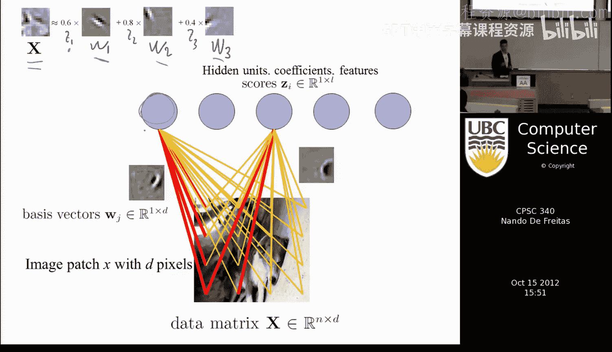

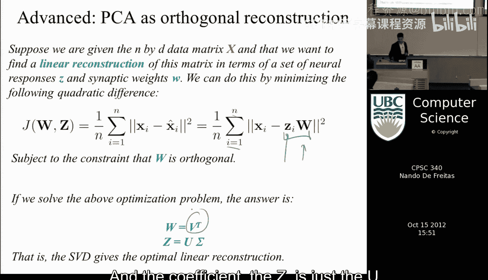

*   我们首先看到，SVD能将矩阵分解为奇异值、左奇异向量和右奇异向量的组合。通过仅保留最大的几个奇异值及其对应向量，可以实现有效的数据压缩，这在图像存储中尤为实用。
*   接着，我们探讨了如何将SVD用于PCA。PCA通过寻找数据中方差最大的方向（主成分），将高维数据投影到低维空间。这既便于数据可视化，帮助我们洞察数据结构，也能作为预处理步骤简化后续的机器学习任务。
*   最后，我们通过国家数据、手写数字和图像布局等实例，具体了解了PCA的强大用途。其核心思想是在降低数据复杂度的同时，尽可能保留数据中最重要的信息。

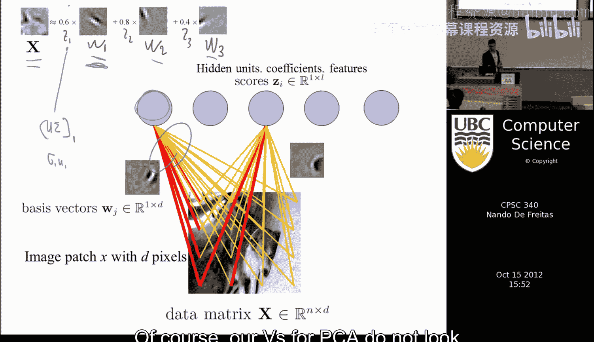

PCA是处理高维数据的基础且强大的工具，其背后的SVD则是线性代数中许多核心应用的基石。理解这些概念将为学习更复杂的机器学习模型奠定坚实的基础。