# UBC《机器学习和数据挖掘｜CPSC 340 Machine Learning and Data Mining 2012》中英字幕 p16 -16-undergraduate machine learning 18_ Least squares and the multivariate Gaussi -BV1pJ2ABFEFg_p16-

The midterms。Okay， so。In the last class we learned we formulated the problem of linear protection。

And the first thing we do is when we have data， we have input data like we see here。

 like wind speed and the number of people inside a building。

 and then we also have labels like what should be the setting of a thermostat。

And so this enables us to write create a matrix x of input data and a vector y of output data。

Once you form these two matrices。Your code。The step that is learning is less than 10 characters。

Unless you use big names for your variables。 So it's really easy to do this sort of thing。

What takes you the most effort is actually to load the data。And put it in matrix form。

 what is written as an array， it's really true。 And to make predictions。

 we just multiply x times speed。Okay， which is the the equation of a plane。A line in high dimensions。

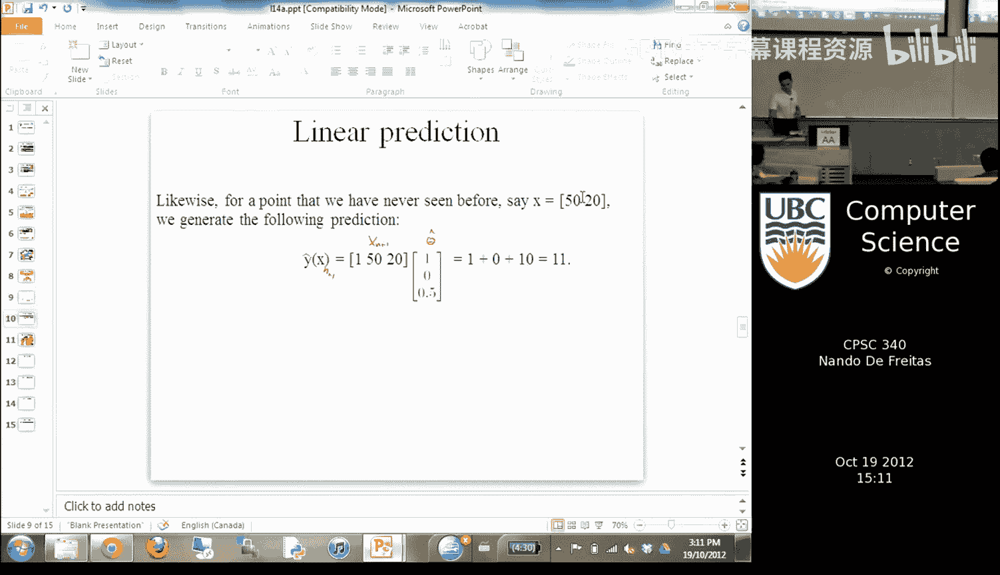

Now what we minimize is the sum of squares。And I went through this t derivation that hopefully youll go over at home。

 which shows that if you take the sum of squares of y minus y hat。

 y1 minus y1 hat plus y2 minus y2 hat。嗯。You can manipulate the sum of squares and you can get a quadratic expression in terms of the matrices that is just y minus x theta transpo times y minus x the。

That's a quadratic function， it looks exactly like that ball， and because it's a quadratic function。

 we will be able to find its minimum。So the solution will be unique。

And that's why you'll only need a line of code for many problems in learning。

We will not have such beautiful quadratic functions， and we're going to have to try other things。

 but those things that we're going to try are still based on。

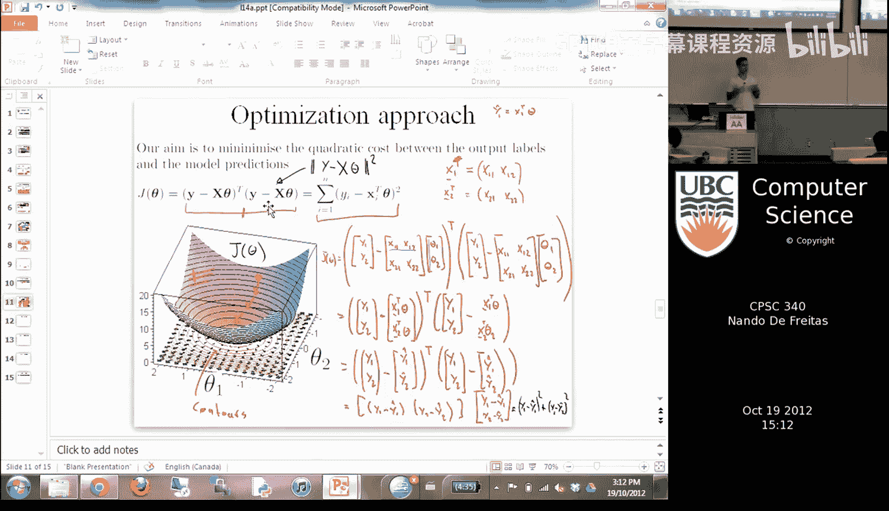

Deerivatives。Okay， how do we solve for theta and what do we get？In order to solve for theta。

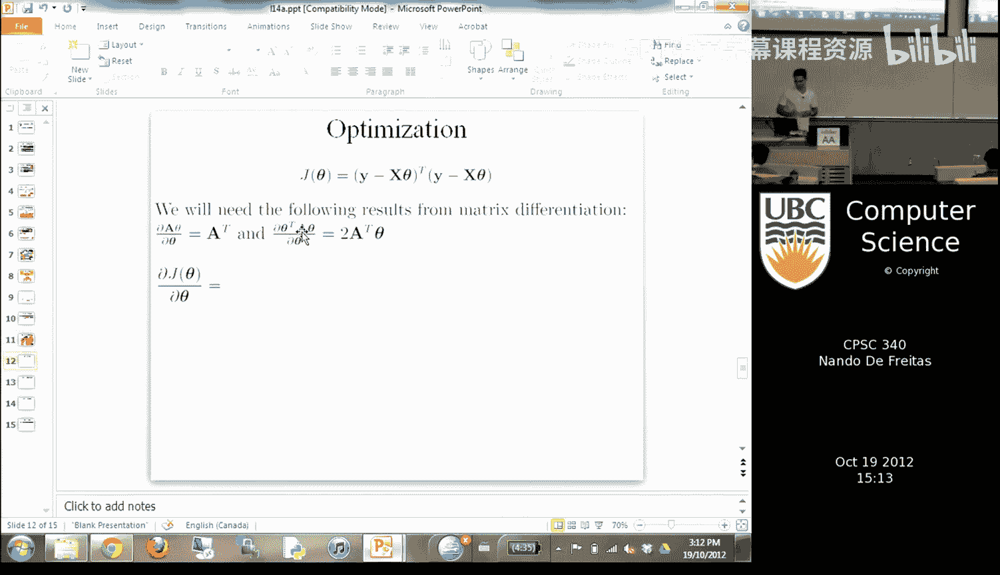

We're going to differentiate the cost function and equ to0。Right， because。

Where the derivative becomes flat， that's the location of the minimum。

But now this cost function is written in matrix form。 I could also。I could also write it like this。

In non matrix form， which would be H Yi。F。Though the sun was gone。Minus X transpose theta the。Square。

The sum of squared terms。嗯。这是谁？figureig out how to put a battery on？そ。All right， how's that Jeff？

Okay， so I could take the derivatives of these guys term by term， but instead of doing that。

I'm going to rather work with matrices because they're easier to manipulate both mathematically and as well as in the code。

 but in doing so we will need to learn some new rules of differentiation。

 differentiation of matrices。Now I don't expect anyone here to have knowledge of matrix differentiation。

 nor will I be examining you anyway and knowing matrix differentiation。

 but I will expect that you can apply a rule that if I show you。

 this is the rule of how you differentiate a matrix times a vector， that you can apply that rule。

So these rules， you can go on Wikipedia search for matrix differentiation， the rules are all there。

 and I will simply give you the rules and ask of you to be able to apply these rules。

How to derive these rules is sort of easy， you basically would deal with the scalar form and you would convince yourself that these are just ways of doing the same thing。

 they're just essentially shortcuts for doing the tedious thing which would be to manipulate all the n terms of this expression here。

Now recall this what the sizes are， so one thing that I strongly recommend you always do when playing with matrices and especially when doing proofs with matrices is always right to size because if the sizees don't match。

 you know you have a problem。So this is very good practice， always right， this is n by one。

 this is n datata by d features， this is d by one， and as you can see the sizes match because nd times d by1 gives you an n by one。

 and so I'm comparing two vectors。And this is a game。And then when I transpose it all。

 I get something that if I just transpose everything， I will get something that's one by n。

And this guy will be n by one， and so J of Theta is actually a scalar， it's one by one。Okay。

 the costs。Which is just a sum of squares here we have one by one。This guy is1 by D。

And this guy's deep by one， so again。J of theta is one by one。Now， how do we apply the rules， Well。

 the first we write， we expand this， so it's a derivative。哦。Y minus x theta。Transpose。

Times y minus x theta。And that's just equal to the derivative of respect theta。

 And now I'm just going to multiply the terms。 So I'm going to multiply y transpose times the first term。

 which is。Just y trans plus y。Minus y transpose x theta。And then。Minus。

Thehiia transpose x transpose y。The second cross term。

 and then' going to multiply x theta times x theta。I will get plus minus times minus plus。

 I need to transpose T x。And then I just write theta。X times speed。So， I've essentially。

I multiply this guy times this guy。I then multiplied this guy times this guy。

And then I did this guy times this guy。 and this guy times this。

And when I have the guys on the left have a transpose。 So that's why I had to transpose。

Because x theta transpose is just equal to theta transpose x transpose。That's why we have this。

That first term transport。Okay， so all we've done now is multiply。

 We haven't taken the derivative into。Now， when we do that。

 we will get zero because it's the derivative of why there's no thetus there。I'm going to do a trick。

嗯。This guy here。I'm going to just write it as -2。W transpo exta。

And why do you guys think I can just put them together？And be It's a one。It's one by one。

 and they're transpoposedse of each other， so it trans the numbers。That's correct。

 So you're multiplying a theta and an x and a y。But it just happens that this is。嗯。onefi。D。

 this is D by one， and this is one。呃 hang个。关闭。Oh， sorry， D by n， and then this guy's N by one。

So this whole thing then is one by one。And the same applies if you do the check here。

 so there actually are scalarrs， and when you have a scalar。

 the transpose of a scalar is just the scalar so I can add them up。And when I take the derivative。

I will then start applying the rules of differentiation， so I will have minus。Minus2， and then a。

 I'm going to apply this rule here。Or purple。And because I essentially have a matrix sum vector。

 and the matrix happens to be y transpose of x。And so what I get then is just y transpose x。Ts close。

And then plus。And now I'm going to apply a different rule。Let's make it angry。

And I'm going to use the green rule。 The green rule says that for a quadratic term。

 theta times a times theta， where in this case， the matrix a is going to be x transpose x。

I should get two。The matrix transpose。Times theater。And so when I put this all together。睇下。

us2 x transpose y。Plus。2。X transpo x。That's the derivative。We also， often。

Note that this guy is a vector。The derivative is not a scalar in this case， but a fact。Right。

 because let's look at the dimensions again。This is。X transpose is D by n。And this guy is n by one。

 so this first term is d by one， and the second term， also， if we've done everything correct。

Should be D by one。Because we have here deep by in。

Times n by D times D by1 also gives us something that's D by1。

And so we have a vector that's d by one。 we call this vector the gradient。

The gradient of J of theatre。So the gradient is just a vector of derivatives。

If you take the derivative respect to a vector to the vector of all parameters。

 that vector that you get is thegrade。What's the significance of the gradient。

The significance of the gradient。Is that。If I have。Let's say that theta is two dimensional。

So we have one feature and another feature。And let's plot J of theta for a two dimensional theta。

For the two dimensional theta， it's going to be。A ball like this。At。And， of course， I can cut this。哎。

Anywhere。And that just gives me the contour plot and the contour plots are the circles that have the same height。

Or ellipses， because in this case， the ball need not be circular， but it could be an elliptical ball。

Now， the gradient has the property that it is a vector。And it's a vector that at any point。

It can be evaluated at any theta because the gradient is such function of theta。And at any theta。

 that gradient is perpendicular to the contour plots。

This picture sort illustrates it a bit better where you have the contour plots at the bottom。

 which are these ellipses。And the gradients are those blue vectors。

 you can evaluate the gradient at any point， and the gradient has this property that at any。

 whatever you evaluate it， it's going to be perpendicular to the contour surface。So in a sense。

The contour surface is telling you like if you walk along the contour surface。

 your height doesn't change， you go around grass mountain at the same height。

The gradient tells you the point that if you were to follow it。

Would give you the biggest change in height。Or the steepest descent。So the way to remember gradients。

 if you like snowboarding。I you're standing there on top of Mount Seymour， you rotate around。

You pick the steepest descent， wherever the cliff goes down the quickest and you follow that direction when you follow that direction。

 you're following the gradient。We're still not using this concept。

 but this concept will be fundamental when we talk about neural networks because the way we learn in neural networks is we're not going to have this beautiful landscape。

 but instead we're going to have curves that arrow functions that will look like this and in order to go down here。

 all we're going to do is follow the gradient。So。Or actually， when you're minimizing。

 go in the opposite direction the gradient points to the maximum cent。

 So you go in the opposite direction。I cant quite follow from the second line。哎呀し。Second line。Okay。

 let's define。 which one is the I there the second or that line grouping。Oh， okay。

 so what I've done is I apply the rules of derivatives。So for the purple， I apply the rule。

I use this rule here， where A。Is equal to。嗯。Why transpose x。so I just did pattern matching。

 I have y transpose x times theta。And then the answer of applying the derivative is。8 transpose。

 And so， in other words。嗯。A transpose is just x transpose y。And then for the second one。

 the pattern matching that I used was to use a equal。X transpose x。Which is also matrix。Okay。

 so I'm just applying those two rules。 And if you do that， then getting the solution is very easy。

 If I did it the other way， which is。This way， this would be several pages。

It's worth learning these tricks。All right， so how do we know the location of the minimum。

 which is here， this is what we're trying to find， we're trying to find the estimate。

 which is this guy that's at the bottom here， the location of this guy。And to find it。

 we just didn need to figure out where the derivative is0。And so we're going to equate it to zero。

So in other words， I'm going to take this equation here， x transpo y。

Plus x transpose x theta and equator to0。

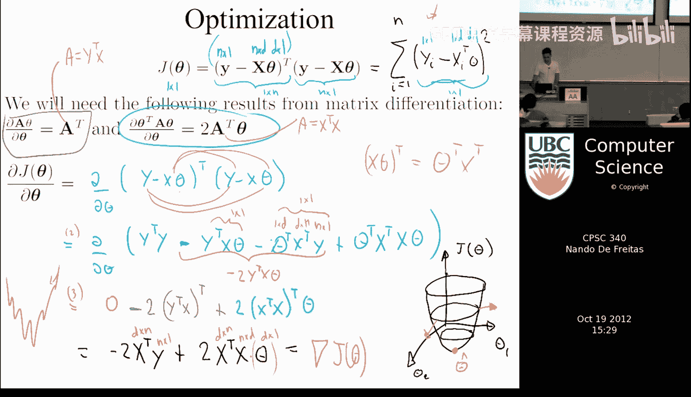

So I have minus x transpose y plus x transpose x theta。

And there was a two there as well equal to zero。Or。X transpose x theta is equal to x transpase y。

Where I get at my maximum likelihood， oh， I haven't said that this is maximum likelihood yet。

I haven't proved it yet。Let's just call the theta least squares。

The theta least square is just equal to x transpose x。Inverse。X transpose y。And we're done。

That's the solution。And if you want to make predictions。For a new X， you just take that new X。

Whatever that new act is。Times theater。え对。So。In the code。

 you just need to form the matrix X and you form the matrix y once you're done。

Learning is just writing that one line， x transpo x inverse times x transpose y and that gives you theta。

 and once you have theta， whenever you get a new X and you need to make a prediction。

 you just multiply the new x by thet and you're done， that's your prediction。

Why didn't you just off extraposed from both sides。Why did I。えです。On both sides。没有啊。

From the second line。Left multiplied by the inverse of x transpose in N。Oh。

 you're wondering how I went from the second line to the third line。

 I not just removing transports from both sides but Trans cancel Oh， that's a good let's。

Let's do some practice of algebra。First question。Does this make any sense？こかにな。' just as a hand。

This is。D by n。Keep always。It's so essential to remember the sizes of these matrices， it's really。

 really important to keep track that it's number of data by number of features。

Get that thought in your head because the sooner it's in your head。

 the easier it will be to manipulate number of data by number of features。 That's what your x is。

The number of unknowns is equal to the number of features。Okay。

 because there's one way for each feature。And then there's n labels。

Can we invert a matrix that is non squared？I don't know。Oh， you don now。The answer is。No。Like never。

Doest exist， not defined， not defined fine。 That's actually partly of the reason why you invent a SVD because the SVD allows us to not Yeah。

 because you wouldn't then have the property of X in first time sex giving you the identity。And how。

 yeah。So we can't do this， bad， bad， bad to invert a matrix。That is non square， that's not allowed。

Can we do something like this？Take a number and divide it by a matrix。有。No。

 we never division by matrix， not a defined operation， even if X is squared。So what did I do here。

 let's analyze this step。How I did this。The way I did this was I had x transpose x times theta equal to x transpose y。

And then I multiplied both sides。By the matrix x transpose x inverse。

And so what I have then is the following。This guy times this guy。

And then I multiply it on the other side。And then I use the rule that this guy here is just the identity。

And the identity times theater is just theater。But we don't divide by matrices。

It's we multiply by we left multiply or right multiply。 When I use the SVD。

 those are the two rules that I always use。Okay， so and then this becomes。I sitた。

Is equal to x transpose x。-1 x transpose y。And then i theta is just theta because the identity times of effect is just a fact。

But get used to never to divide by matrices。 if you want to get rid of the mat on the left hand side。

 you need to multiply by its inverse and for its inverse to be defined， a matrix has to be square。

Every square matrix inver。No， not every square matrix is invertible。

Are we sure then that x transpose acts as inver？T will be answered very soon。慢点。In some cases。

 that matrix might not be in important and will be in trouble。This is for a transpose a。

 like what does it represent， It's a square matrix you know that represents the rectangular matrix right。

 so this matrix。嗯。I mean， this guy here， it will be D by D。So it's like a feature matrix。嗯。

It's sort of。If you do predictions on the training data and you take Y。

 I don't know if this answers your question， but if you take x and then you multiply by thehita hat。

 which is，X transpo x。inus1 x transpose y。If you do this sort of thing。That's just x times theta。

Then what you see is that this matrix here。Folks called us the H matrix。For hot。

Because it puts a heart on the why。So its。That's the name this matrix has。 the hat matrix X is also。

X are the covariance， but it's also often called the design matrix。And in fact。

 this x transpo x inverse is often called the pseudo inverse。As well。 So it does have a name。

 But I mean， the names are。Not of great value to us right now。

I think the important thing to get out of this is that。Linear regression is really easy。

 you form the matrix x， you form the vector y， and then in order to compute solution。

 you just need to multiply x transpose x， invert that， multiply x transpose y， and you're done。

 you have the parameters。It's really easy to actually get the solution and the solution is one and it's unique。

 it's at theV squares。

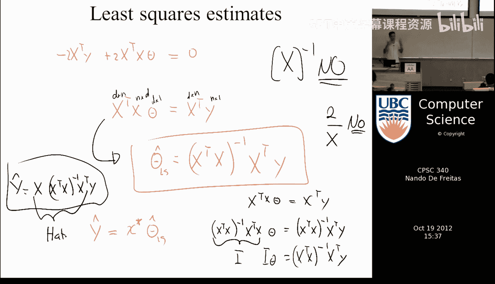

If you have multiple outputs as an aside here。Then we still do the same thing， we form the matrix x。

 which has a column of one。In thepic inning， and then it's x11。All the way up to x1 D。X and D。

And now if we have， say two ys， you would introduce。W。1，1， y，1，2。So basically now。

 imagine that you have。X1 all the way up to Xd signals。These signals go into your box。

And then you have two predictions， y1 and Y2。And in order to make the matrix die match。

 we just need to introduce an extra set of parameters。An extra column of parameter。

And if you do this， everything I've explained so far still applies。

 this will still give you the right dimension so that Jacob will still be defined and so on。

And you can verify that easily。Okay， so。

That's essentially how we do it so what I want to do next is explain the same thing and derive exactly the same answer。

 but I will explain it from a completely different perspective， not from the standardly squares。

 minimizing the sum of squares， but I'm going to try to do things。The probabilistic way。

 which is we're going to write a likelihood function。We're going to take its log。

 we'll differentiate it， and we'll get the same value of the。

The benefit of doing that is that now we have a general procedure， which is maximum likelihood。

 which whether your data is coined or whether your data is linear regression。

 whereas as we will see later if your data is modeled by a neural network。

 the procedure for learning those parameters is always the same， right， the local likelihood。

Write the likelihood， take the log， differentiate it an equ to zero， and get your solution。

Do dimension on。Mach on the right hand side。 Isn't the matrix with Xs。

1 by n that is true because the first one。

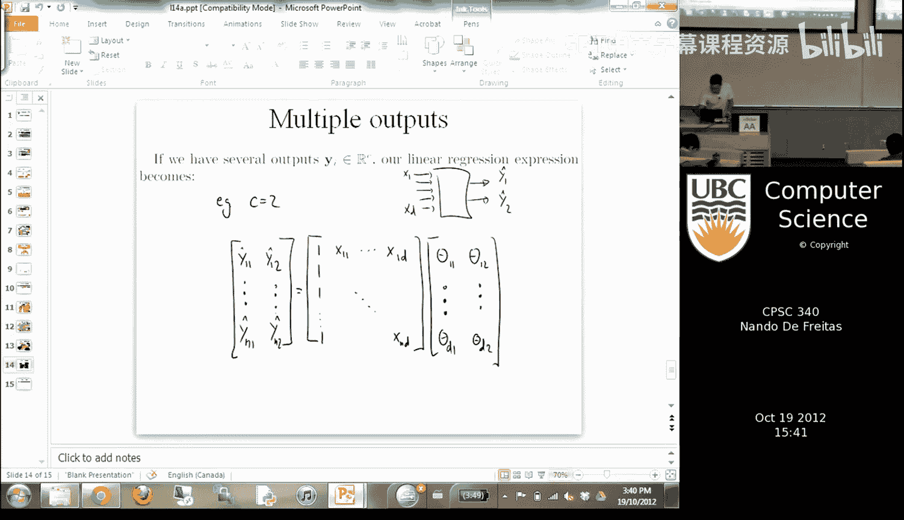

Let me fix that quick。There。That fixes。Okay， so this is still n by D。

 and then the other matrix is d by2， and the first matrix is n by 2。

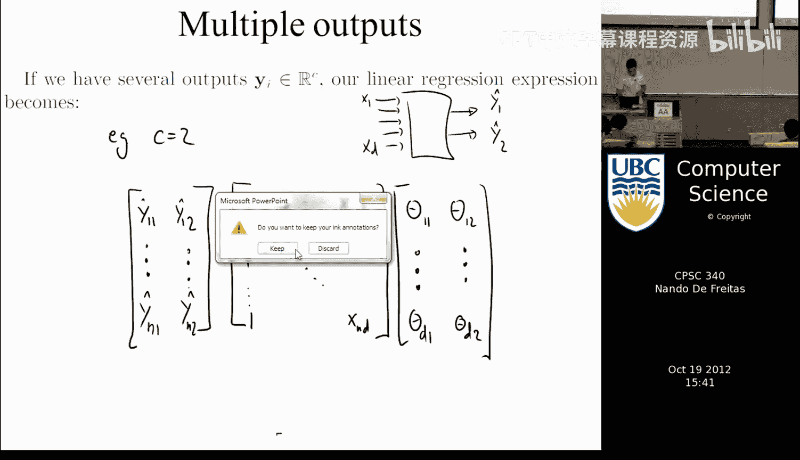

All right。

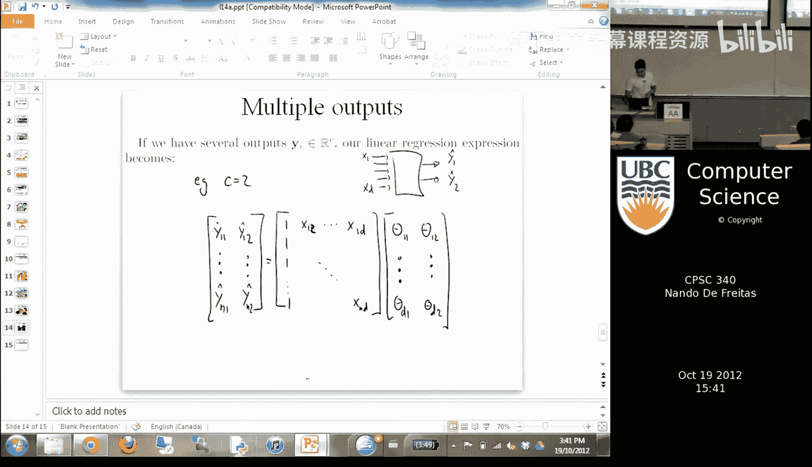

Let's look at the probabilistic way of looking at things。

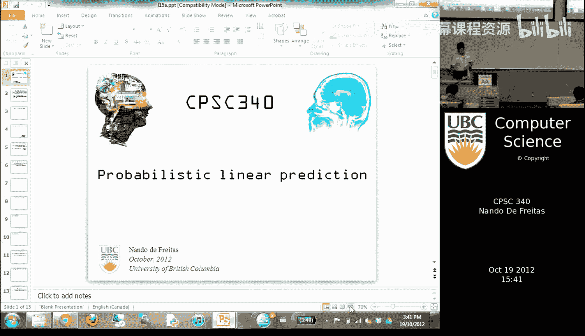

So the advantage of doing it one way is we will have a single way that applies to all sorts of problems。

 and as long as you follow that recipe， you can attack any new problem。

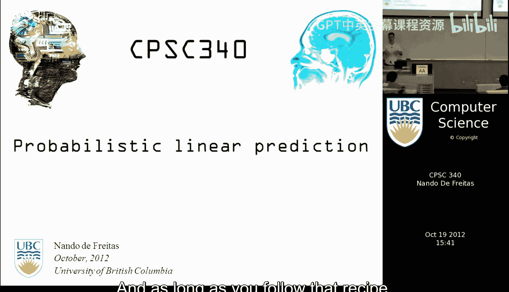

All right。In doing so， we do need to introduce a new probabilistic model and that's the Gauns and distribution。

 Most of you have seen it， most of you are playing with it。

 and so today we're going to look at the multivariate version and then we're going to proceed to。

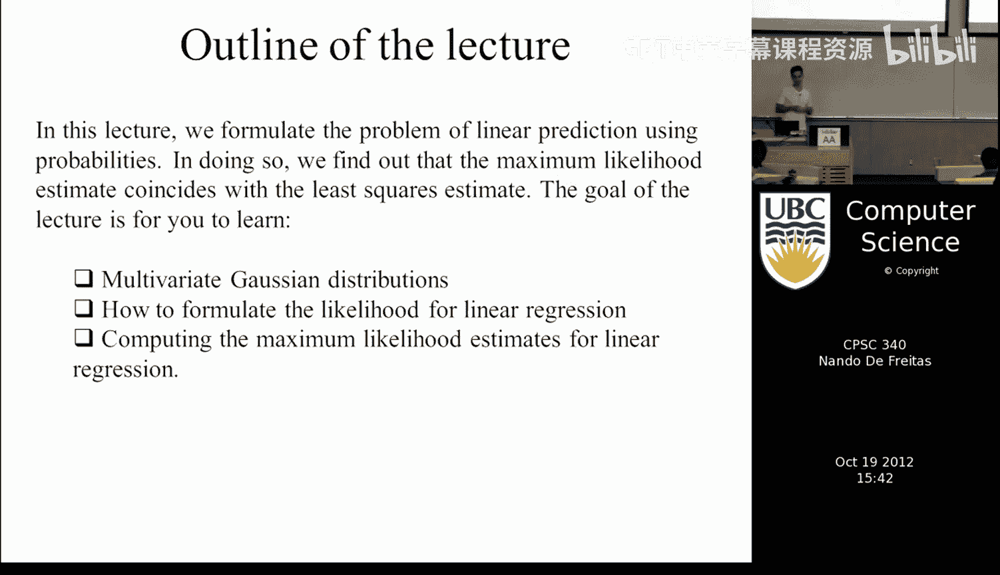

Dive it。Okay， so a univariate Gaussian， how many of you have seen a Gaussian before？I mean， for real。

 how many guys have seen aga before？These prerequisites are not。😊，Okay。

Agam is a probability distribution。It has a particular expression for it。Which is。

If you haven't seen it， you're seeing it now。It's a function of x。嗯。And you can plot it。

It's a 1 d function of x。P of x as a function of x， and if we plot it， it looks like a bell。

The center， the location of the mean。Because it's symmetric。And the location of the mean。

 which is the location of the maximum， is called mu。

And you have seen Augustgasian because that wasn't homework1。 I asked you to plot this stuff。

And then the spread is controlled by something called sigma squared by the variance。Okay。

Now we have a way of writing this for short， which is the following for short， I would say that x。

Any x that you were to sample。 So if I use a random number generator to produce x's。

 I will mostly get xs。They tend to be around。You know。The peak。

So if I call a random number generator and I say produce random numbers according to this。

 it will give me mostly random numbers that look like mu plus or minus some noise。

And so we describe that process with this equation where were saying x is a sample from a Gaussian distribution that has mean mu and variance sigma squared。

 and often we use an n because the Gaussian distribution is also called the NAMda distribution。

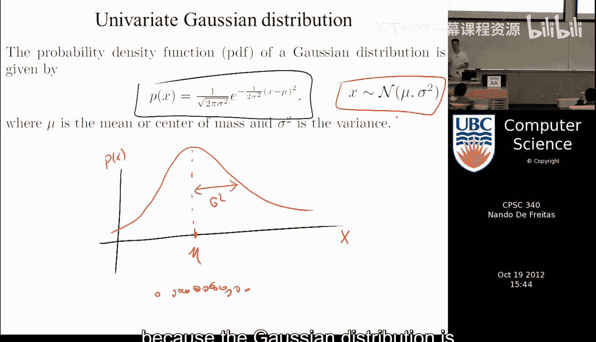

Yeah。It's the normal distribution。

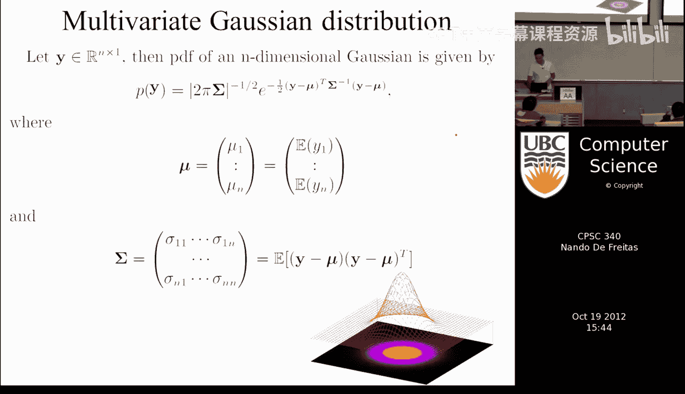

Yeah。All right。So that's one de Gaussian。

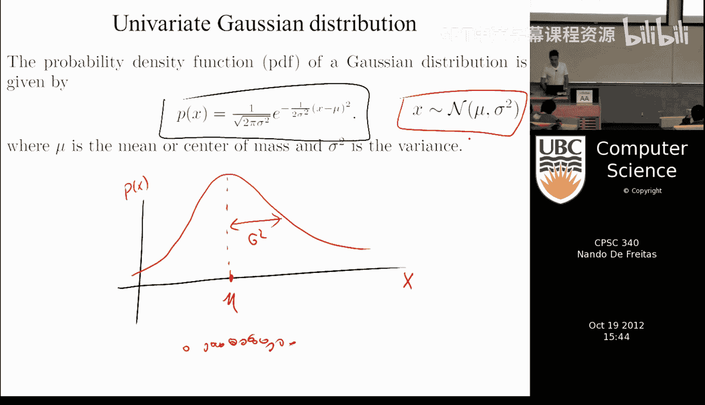

。When we go to high dimensions， because the machine learning， we're going to have many inputs。

 trying to predict several outputs。 So we're going to work in high dimensions。

 We then have to deal with。Multivariate distributions， and multivariate just means many variables。So。

The generalization of the Gaussian is essentially this expression that I'm showing here。

 it's also a function of y， but in this case， y is a vector。

And in particular here the y has n dimension， so it could be a very large factor。

 a very high dimensional object。It still has a location， which is the me。

That's the location of the peak。Like the center here for this Gaussian。

So it would be what I'm highlighting that in white， that's the center of that Gaussian。

And then sigma。The variance now gets replaced by， I guess white doesn't write on white。

The variance gets replaced by a covariance matrix。 Now covariance， you need a matrix because now。

If you only had a 1D curve， you only can make it fat or thin， but if you have a 2D curve。

 now you can change it in many ways， you can make it fat and X。Or you can make it fat and white。

 or you can make it more diagonal， so you have now three degrees of freedom in 2D。So， you can。

Make it fat and next， you can rotate it， you can do all sorts of things with it。

So if we were to look at the contour plots。We could have a perfectly symmetric one。Or。

We could have something that's sort of longer in。In this direction。

And my axises here are sorry y1 and y2， assuming that n is equal to2。

Or you could have something that's sort of like this。For the contour plot， or finally。

You could also have something that looks like this where there is some sw。So， we can。

Along the direction of Y2， we can make it thin or fat， along the direction of y1。

 we make it thin or fat。Thin or fat。 And then we can also rotate it。

So we have three degrees of freedom。So。For the 2D， that matrix sigma would be sigma 11， sigma 1。

 sorry， 22。Sigma 1。Two， and then this matrix is symmetric。And so this is just sigma 12 again。

So sigma 12 is equal to sigma。就晚。Sigma 1 n equal to Sigma and 1。And now。我。

This is essentially the reason I only have three parameters is because I only have three degrees of freedom。

X， Y， and rotation。 those are all the degrees of freedom that I need to get arbitrary gas。

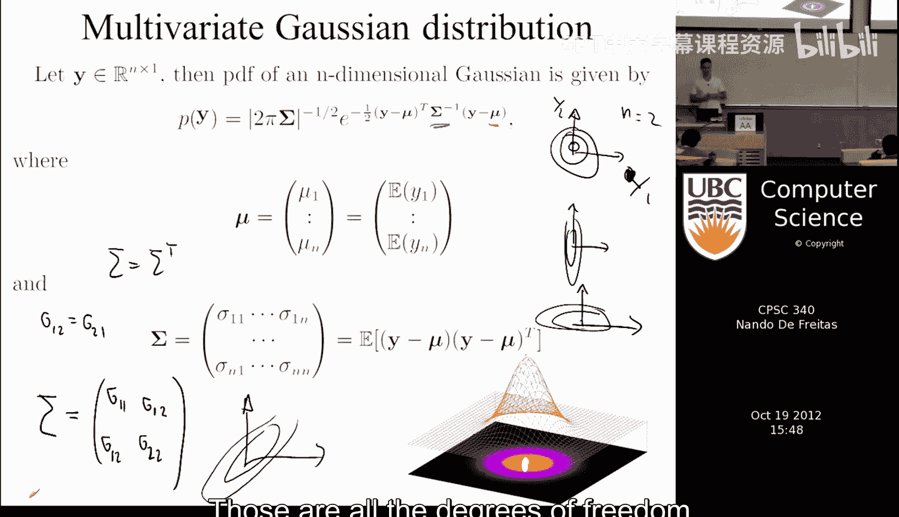

Okay， before you guys go away， let's look at an example to try to。呃。Make this clear。

And the example is the following。I'm going to take。嗯。Two Gaussian distributions around 1D。

So I have dys Gaussian distribution and dys Gaussian distribution。

 and I'm going to write an expression for their joint。So the joint。Assuming that they're independent。

 I should have added that they're independent。Is then equal to p of x1 times p of x2。So。

This here is me 1。And then this is me too。And that is equal to two pi sigma squared。

us a half times2 pi。Sigma squared， minus a0。That's the normalization cost of the pasussian。

Times e to the minus a half。And then I would have x minus mu1 squared。

Times each to the minus1 of two sigma squared x minus me 2。Squarrre。G I multiplied the two Gaussians。

And I can write this as two pi sigma squared。To the minus 2 over 2。E to the minus a half。And now。

 I'm going to。grouproup D exponent。 So if I multiply E to the a times each to the B is' just e to the a plus B。

And if I do so， I would have。X minus me 1。And I'm gonna write this。Sigma squared。In first。

Times x minus me 1。pl。So I'm just rewriting the terms to make it。

More obvious what I'm going to do next。And then this is going to be equal to2 pi。So a square。

To the power of minus2 over  two， which is one， but I'm just purposely writing it that way。

And this is just e to the minus a half。X minus me1。Times x minus me 2。Times the matrix sigma，0。

0 sigma。Squared。Inverse。Times x minus me 1。Mus。Which is just a multivariate ga。With mean。Near one。

 near two。And that you can just。Go home， multiply that matrix times that vector and that vector times the matrix。

 and you'll see that you get the line above。I do this all the time， so I can just。Right thanks， but。

If you multiply this vector。So this is all inside the exponent。

 multiply the two vectors times the matrix， and convince yourself that you get back this light。So。

If two， and this actually gives us an important result。Which is， if two Gaussians are independent。

If two variables are independent。You will get zeros in the off diagonal， in the covarious matrix。

And how they， and essentially， you get a in this case。

 a circular covariance matrix because it's the same fatness in x and the same fatness and y。

 So you get a circular。嗯搞笑。These manipulations are sort of important。

 so try to complete these steps because these are the manipulations that I will use in order to derive the maximum likelihood estimate。

On Monday。All right， have a good weekend。

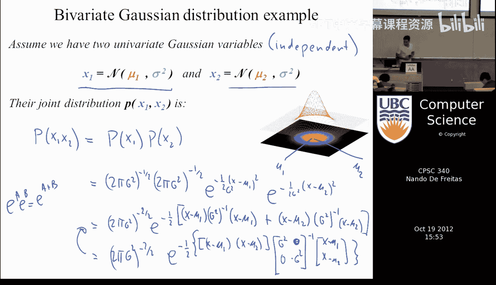

。