# 机器学习与数据挖掘：第16讲：最小二乘法与多元高斯分布 🧮

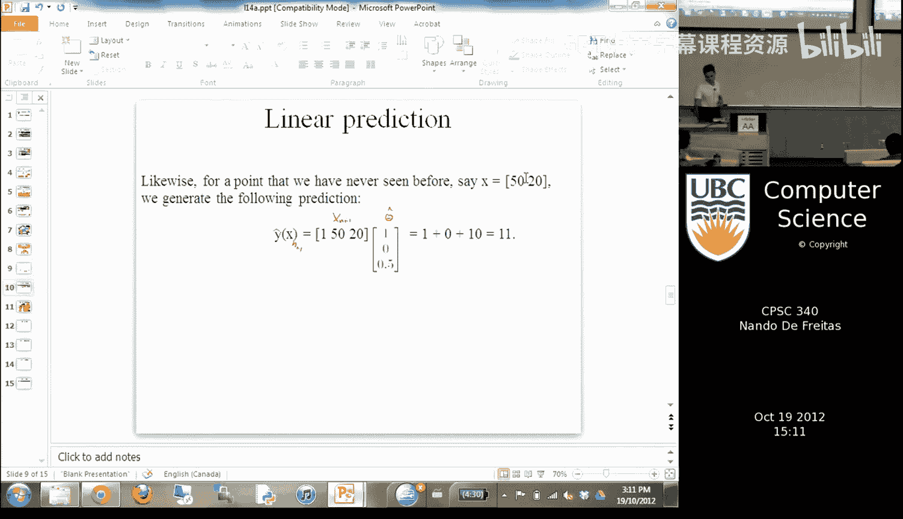

在本节课中，我们将学习线性回归问题的两种求解视角：最小二乘法与概率模型（最大似然估计）。我们将看到，这两种方法最终会导向同一个简洁的数学解。

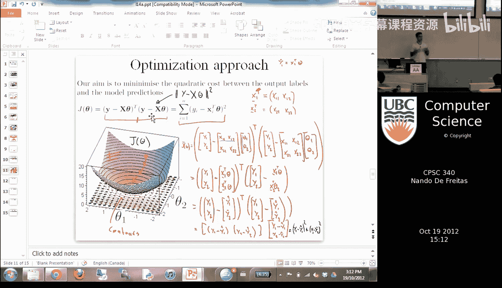

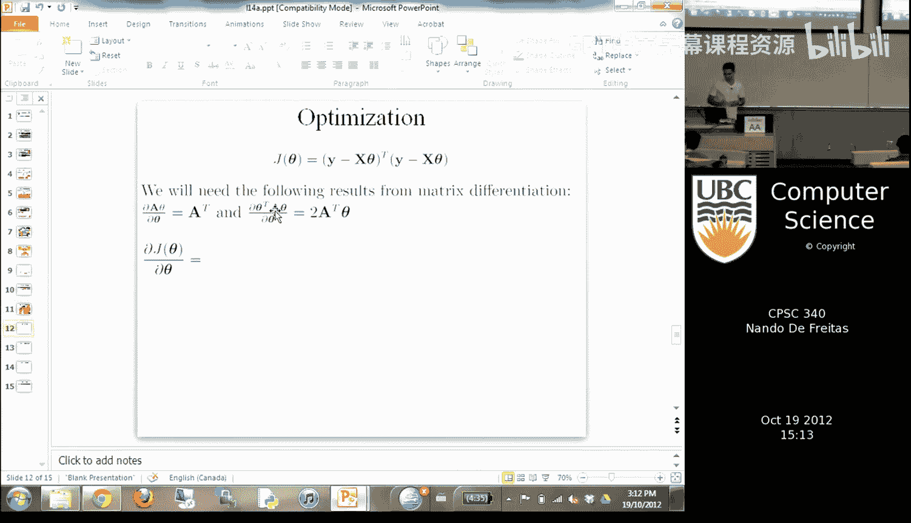

## 线性回归问题回顾

上一节我们介绍了线性回归问题的形式化。当我们拥有数据时，我们有输入数据（例如风速和建筑物内人数）和对应的标签（例如恒温器的设定值）。这使我们能够构建输入数据矩阵 **X** 和输出数据向量 **y**。

一旦构建了这两个矩阵，学习步骤的代码将非常简短。最耗时的部分实际上是加载数据并将其整理成矩阵形式。要进行预测，我们只需计算 **X** 乘以参数向量 **θ**，这在高维空间中代表一个平面或直线。

预测公式为：
\[
\hat{y} = X\theta
\]

## 最小二乘法的目标

我们最小化的目标是残差的平方和。通过推导，我们可以将平方和写成一个关于矩阵的二次表达式。

成本函数 **J(θ)** 定义为：
\[
J(\theta) = (y - X\theta)^T (y - X\theta)
\]

这是一个二次函数，其图像像一个碗。由于它是二次的，我们可以找到其唯一的最小值点，这就是为什么对于许多学习问题，我们只需要一行代码就能求解。

## 求解参数 θ

为了求解 **θ**，我们对成本函数求导并令其为零，因为导数为零的点对应最小值。

成本函数对向量 **θ** 求导，我们得到梯度向量。梯度指向函数值上升最快的方向。在最小化问题中，我们沿负梯度方向移动。

通过矩阵微分规则（具体规则可查阅资料），我们对 **J(θ)** 求导：
\[
\frac{\partial J(\theta)}{\partial \theta} = -2X^Ty + 2X^TX\theta
\]

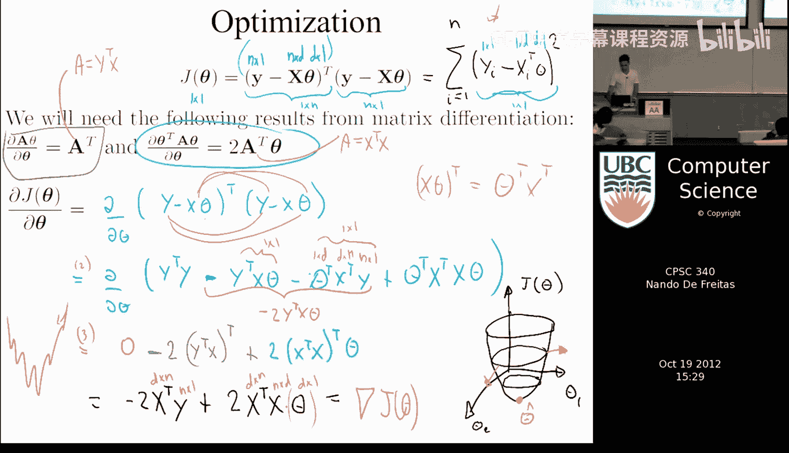

令导数为零，我们得到正规方程：
\[
X^TX\theta = X^Ty
\]

求解 **θ**，我们得到最小二乘解：
\[
\hat{\theta} = (X^TX)^{-1}X^Ty
\]

这就是著名的“最小二乘估计”。在代码中，学习过程就是计算这一行公式。得到 **θ** 后，对于新的输入 **x_new**，预测就是 **x_new * θ**。

**重要提示**：我们从不直接对矩阵进行“除法”。我们通过左乘逆矩阵来求解方程。同时，**X^TX** 必须是一个可逆的方阵。

## 扩展到多输出情况

如果我们的问题有多个输出（例如同时预测温度和湿度），方法依然相同。我们只需扩展参数矩阵 **Θ**（而不再是向量 **θ**），使其列数与输出维度一致。矩阵 **X** 的构造方式不变，所有推导依然成立。

## 概率视角：最大似然估计

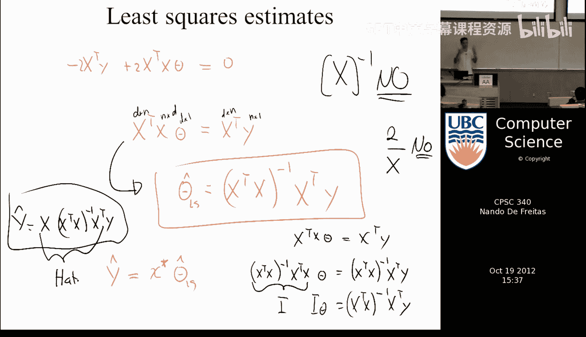

接下来，我们将从完全不同的视角——概率模型，来推导出完全相同的答案。这种方法的优势在于，它提供了一个通用框架（最大似然估计），可应用于分类、回归乃至神经网络等多种问题。

通用步骤是：写出似然函数，取对数，求导并令其为零，然后求解参数。

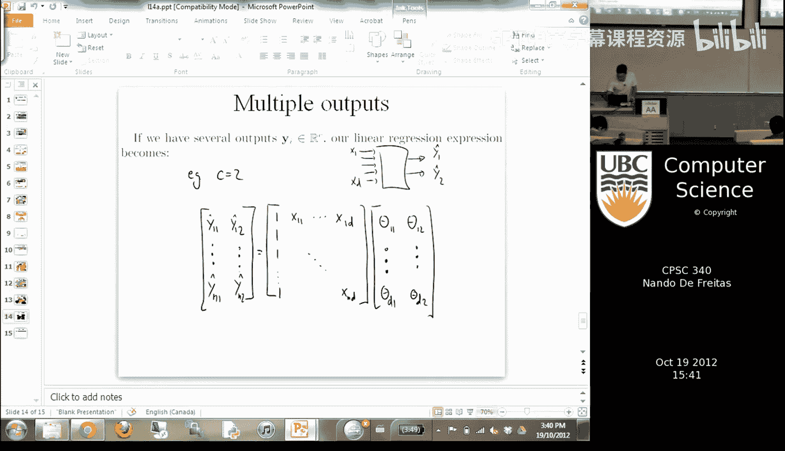

## 引入多元高斯分布

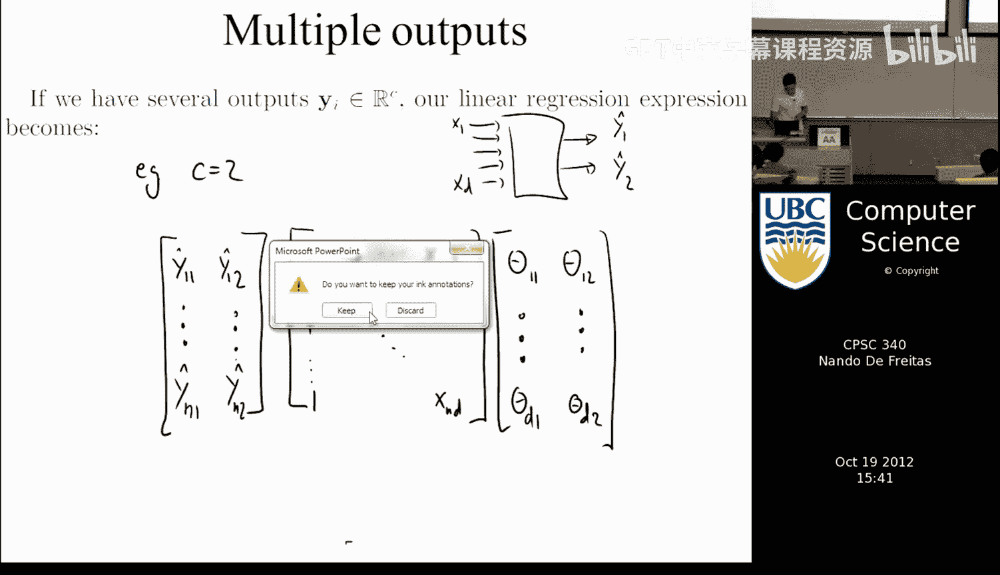

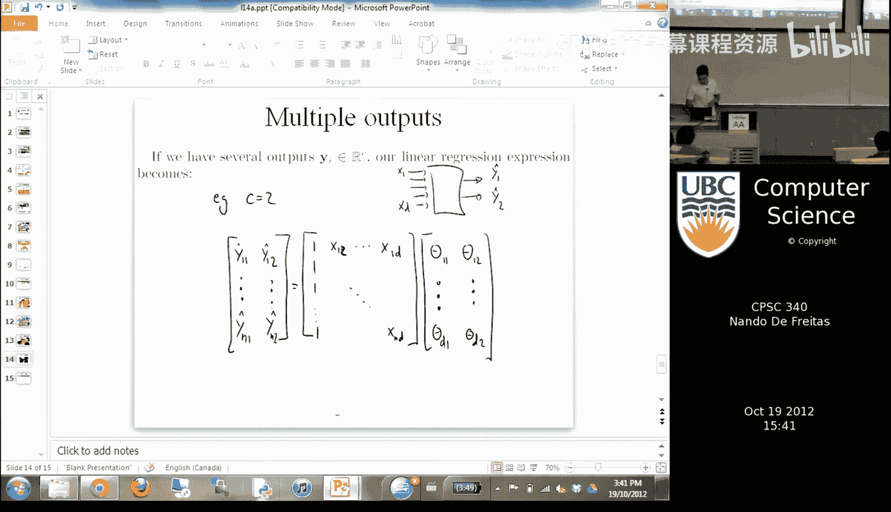

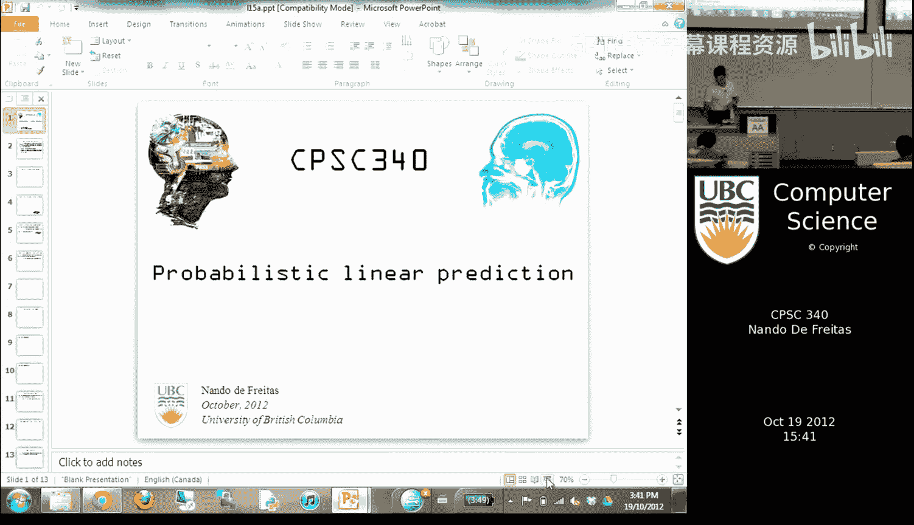

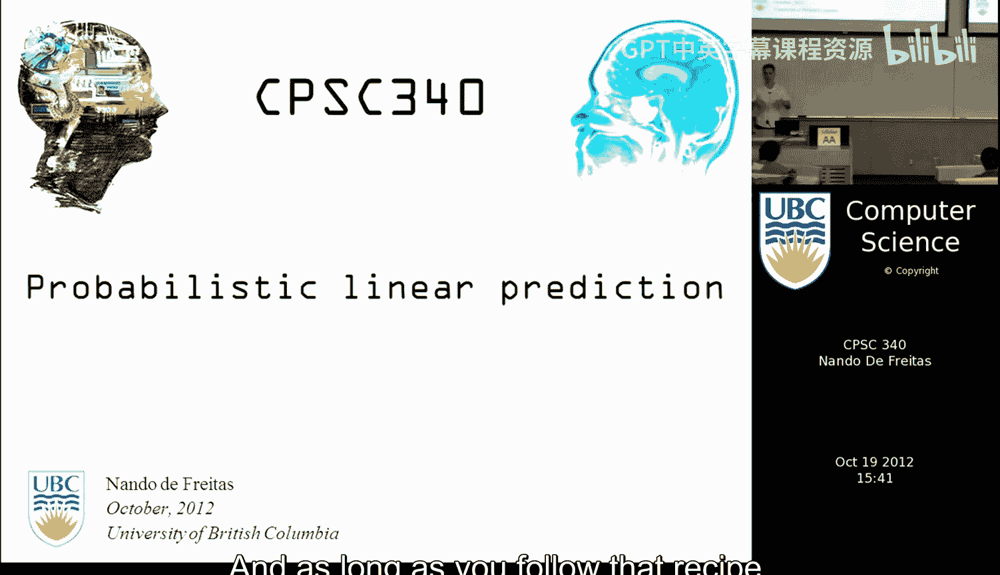

为了进行概率推导，我们需要引入多元高斯分布。大多数人都熟悉一元高斯分布（正态分布），它由均值 **μ** 和方差 **σ²** 控制。

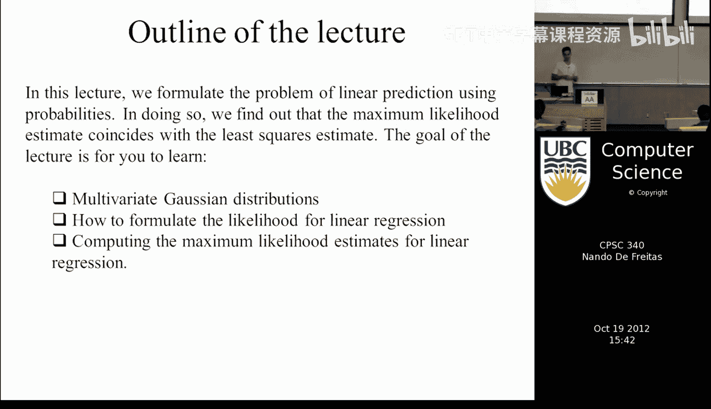

一元高斯分布的概率密度函数为：
\[
p(x) = \frac{1}{\sqrt{2\pi\sigma^2}} \exp\left(-\frac{(x-\mu)^2}{2\sigma^2}\right)
\]
简写为：
\[
x \sim \mathcal{N}(\mu, \sigma^2)
\]

在机器学习中，我们常处理多变量，因此需要其多元推广——多元高斯分布。此时，变量 **y** 是一个向量，均值 **μ** 也是一个向量，而方差则推广为一个协方差矩阵 **Σ**。

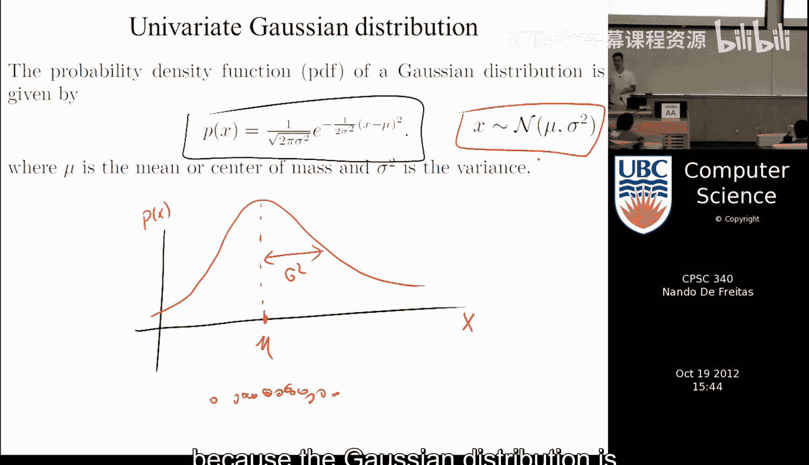

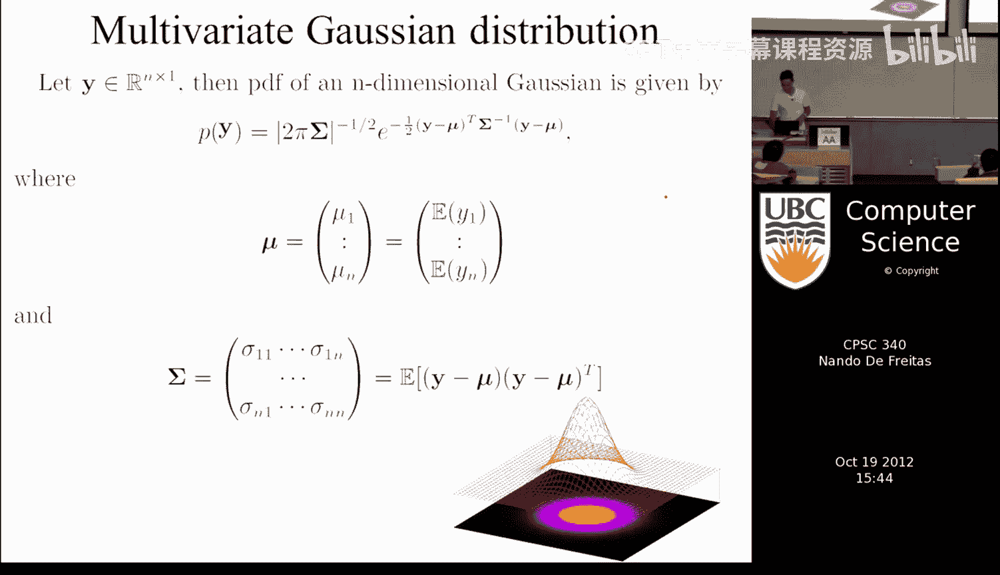

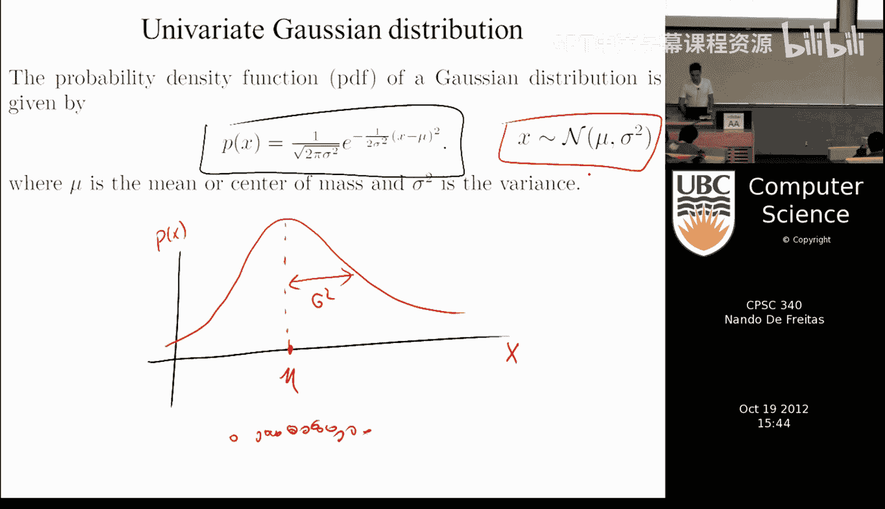

协方差矩阵 **Σ** 控制了分布的形态。在二维情况下，它有三个自由度：分别在两个轴方向上的伸展程度（方差），以及两者之间的相关性（协方差）。这允许分布呈现圆形、椭圆形或倾斜的椭圆形等各种形态。

## 独立高斯分布的联合分布

一个关键结论是：如果多个高斯随机变量是相互独立的，那么它们的联合多元高斯分布的协方差矩阵将是一个对角矩阵（非对角线元素为零）。这意味着各个维度之间没有相关性。

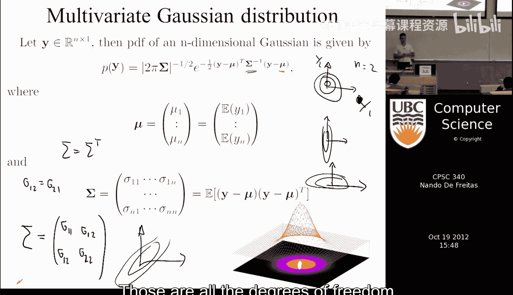

例如，两个独立的一元高斯分布 **x1** 和 **x2**，其联合分布可以写成一个均值为 **[\mu1, \mu2]^T**、协方差矩阵为 **diag(σ², σ²)** 的二元高斯分布。这个推导过程是理解后续最大似然估计的基础。

## 总结

本节课中，我们一起学习了：
1.  **最小二乘法**：通过最小化平方误差，我们得到了线性回归参数的解析解 **\(\hat{\theta} = (X^TX)^{-1}X^Ty\)**。
2.  **梯度概念**：成本函数的梯度指向上升最快的方向，其零点是解所在。
3.  **概率视角**：引入了最大似然估计的通用框架。
4.  **多元高斯分布**：作为概率模型的基础，它描述了多变量数据的分布形态，其协方差矩阵控制了各维度间的相关性。

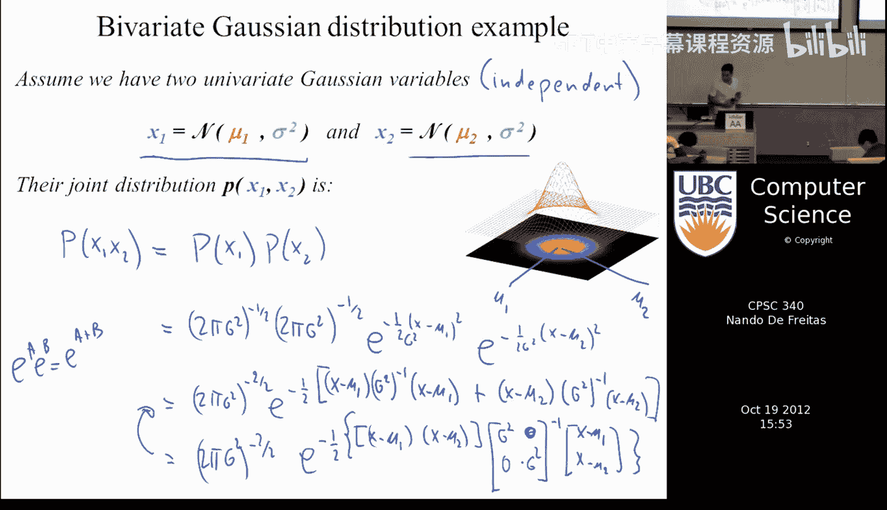

下节课，我们将利用多元高斯分布，从最大似然估计的角度重新推导线性回归，并展示其与最小二乘法的等价性。