# UBC《机器学习和数据挖掘｜CPSC 340 Machine Learning and Data Mining 2012》中英字幕 p17 -17-undergraduate machine learning 7_ Bayesian networks, aka probabilistic graph -BV1pJ2ABFEFg_p17-

Is linear algebra， whatever linear algebra we need is in yourquiite and it's also the linear algebra that I will revise just like I'm revising probability。

 I will revise linear algebra at the same level and when I revise the linear algebra there'll be all sorts of cool application。

I'm going to revise。Linar algebra in the orchestra。

My course is more likely a physics course where I try to relate math to the world。As opposed to。妈瞓掉。

But math in the abstract is so important， it's not the topic of discourse。But for me。

 math is a language that allows me to talk about things in the world。

It allows me to talk about that much more。Because once I have a word that describes many things。

I have this formula that space rule and that formula says a lot of things about the world。

 and so I can communicate what can just try。So。Communicating to the questions makes communication more。

F fish。Of course。Or， sometimes we use a language not skills。To communicate。

 but we love to use a language for the language say， you know。

 like poets love to write poems and there's value in writing poems so there is value in people just doing theory with math。

One day the theory might be useful to those。回盖。This course， however。

 we're going to just basically adopt math to the extent that we need to be able to communicate ideas and communicate ideas sufficient。

Oh， yeah。 one request。I'm coming from the Ts。If you could please。

 if you have questions about the homework， next time about how to hand it in， et cetera。

 please use the Google group。to post such questions？And when you do the Google group again。

 try not to spend too much。The Ts are kind of basic I have to get their PhDs。Four years。

 masters in two years。诶谁下。Thoset stay life theyre in trouble。I keep them busy。

During their machine learning project。So don't email them all the time and go by the laugh and so on because that's cheap。

The Google group is more useful if it's a personal question obviously。工国人。嗯。

So I mentioned in the last class when we looked at graphic models。😊，Two things the first thing。

With that graphical models allow us。

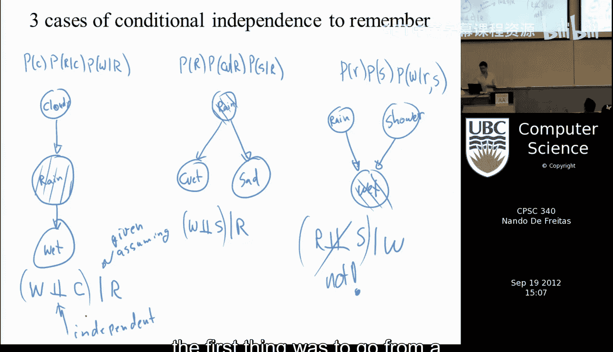

就。Go from a representation that is exponential in size。To a small set of compact representations。

在mission now。So it allows us to keep their representation。To some extent。

 seems to allow us to be the cursive dimension。If provided which table is small。

 provided that the network is not too densely connected。

 we're able to beat the cursive dimensionality。By using the。This so storage stop getting from。

Because storage itself would be prohibitive， do have 1000 variables，2 to1，000。

 it's just not the kind of storage you want to be buying in each shop。

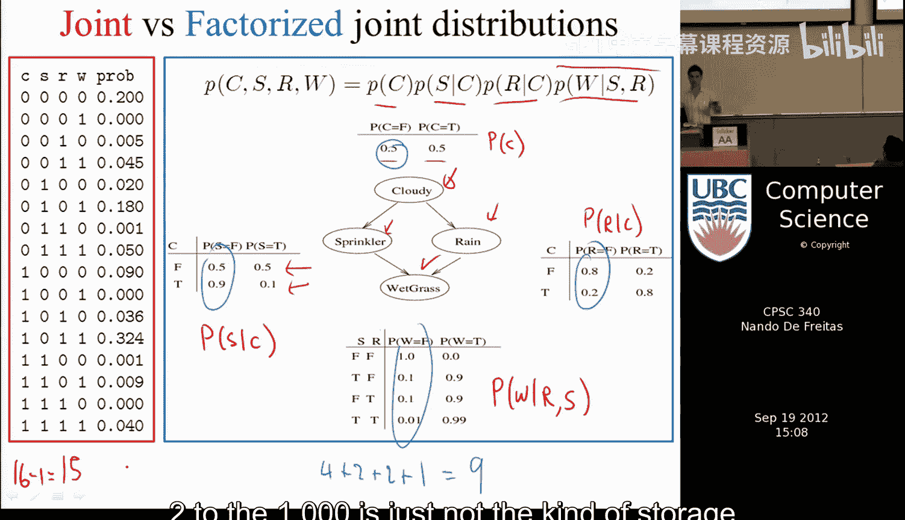

There so many examples， and then the second part was that I wanted to illustrate something that。

It will be obvious to you now， but this took many years of people working very hard on this problem。

嗯。It's a big。What is this， this is going back to maybe 50s，60s。When people in AI。

 people in AI were trying to wonder how if you have these networks and in those days these networks were devoid of probability and they were known as expert systems。

They fail blatantly because the world。Not deterministic， the world is very stochastic。

 theres there's uncertainty in everything we do。And so the lack of probability mandate systems。翻直讲。

A to veteran。But the other question that people had was。How do we do local computation？

And have a globally consistent。That is， if I do computation just in this part of the room。

 make sure that when I do this computation， the global answer is still an effect。

I still will not I will have the right answer。 Can we arrive at the right answer just by doing local computation here and then local computation there and local computation over them。

That would be great because they're basically saying， can we distribute the computation？

And each team is like I send you all out to small teams， you know， like to sort of exercise。

 you each work count the solution to you sub problemble。

 you get back here and we have a solution to the big problem。How to do that。It's not。嗯。

It turns out that these three cases。I didn not to。嗯。To warrant that。三个字。他是我就。In fact。

 local computation and have a system that's closed。Essentially， we're going to use this property。

That we introduced in the last class， but given my parents， given my children， given my。喂。

I am independent of everything else。Every other person on the left， think is sort of the announced。

Okay， does so we saw two examples， sorry three examples that are key。

The one is when you have a chain。When you have and then there's two Bs。

 when you have a parent not two children。When you have two notes with a child。

 then when you have sort of a chain。And so in this case here， we said that。

The child is an dependent of the grandparent with an parent。In the second case。We are at。

Given that your。You're independent of the other children。You know your brand。

And then this is the tricky case。Because this case is saying that。If you。Given your children。

 you become dependent and so the analogy here， if you're anything in terms of genes is given to know my genetic material。

 you just need to know the genetic material of my parents。

You don't need to know the genetic material of migra hair。Right。My parents and her in the summer。

Likewise， to know the genetic material of my sister， you don't need to know my genetic material。

 which just need to know the genetic material of my parents。That's case2。However。

 to know the genetic material of my child。You need to know the genetic material of my wife as well。

So I'm not independent of my life。Now， O world seems to be very small casess， very local。ごかね。啊。

Let's now look at a graph。That is very large， and let's instantsiate a note that I'm going to call it Xi。

And I'm going to assume that the graph contains three points， actually。5 times of。

There will be the no next side。That I care about。And let's assume I want a computer what's a provoive Xile given everyone else。

I will argue that the probability of Xi， oh， I'm going to define x I。To be equal to。

The set of all other。No。That is all the notes that are not the exact。No matter how big this graph is。

 this graph could have billions of nodes。I'm going to summarize that set to say that it consists of the node R。

It consists of all the nodes that are parents of X。I'm gonna call the you。

It consists of all the children of X， which I'm going to call Y。

And it's going to consist of all the nodes set， which are the sort of the partners of node X。

These are all the possible notes that can exist in the graph， something is either your parent。

 your child， you're coherent or something else， which are called remaining are for。All right。

 so the claim is。The probability of the node。Given all the other notes。我面就。will be a probability。

That will only depend。あ。按 the wise。And on the side。So the claim is that art will disappear。你后来个就是。

Are we clear what the climb is？So the R is just anything other。啊。R就 be。そが。

So artists is only acknowledge outside。good reach。So my claim is once you have that shadeded region。

 you don't need to look beyond so if I want to compute the probability of M passing this course。

 sorry to give the damn but I only need to sort of know the immediate。Factors that affect him。

 I don't need to know what hot tall the waves are right now in Kopi。So here is the。Sketch。

What your X。X not pi。いこ？我对。Its I and x I。By by x。Not I。

So in this step Im using a conditional problem。我的这。那他。Oh， so just standing on that note， maybe。Oh。

 by that， I mean。

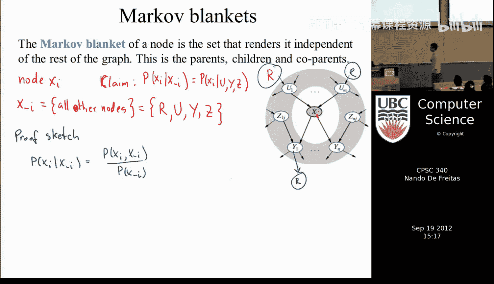

That's a good question。 so by that， I mean， let's do an example。

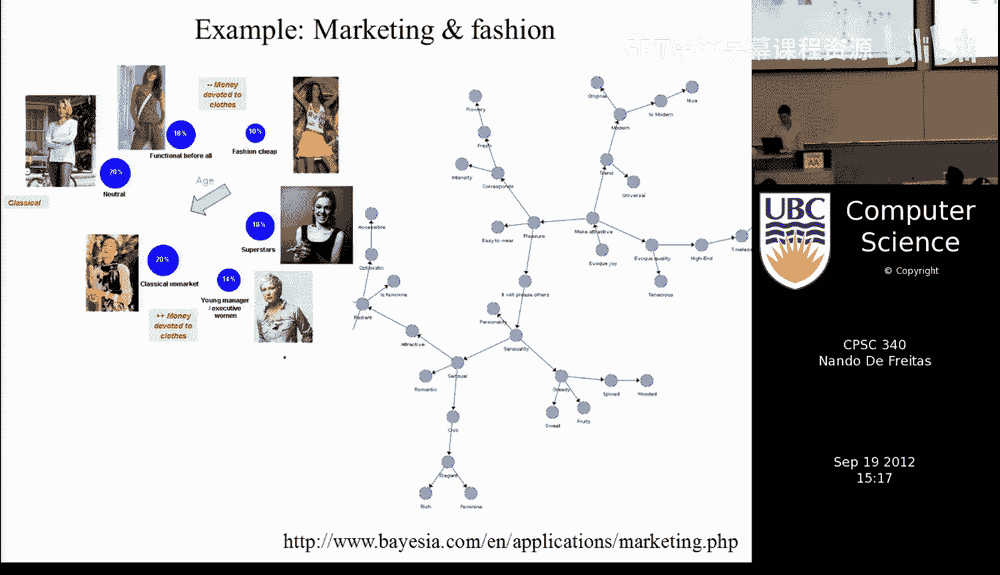

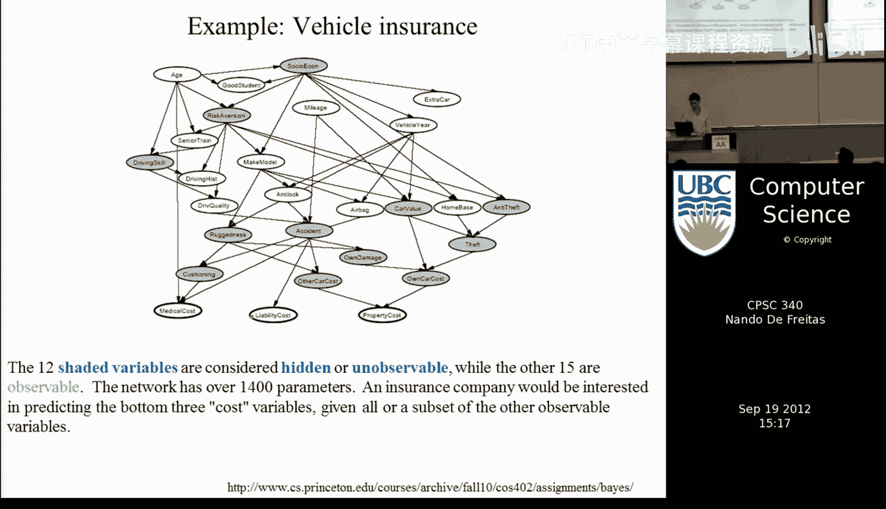

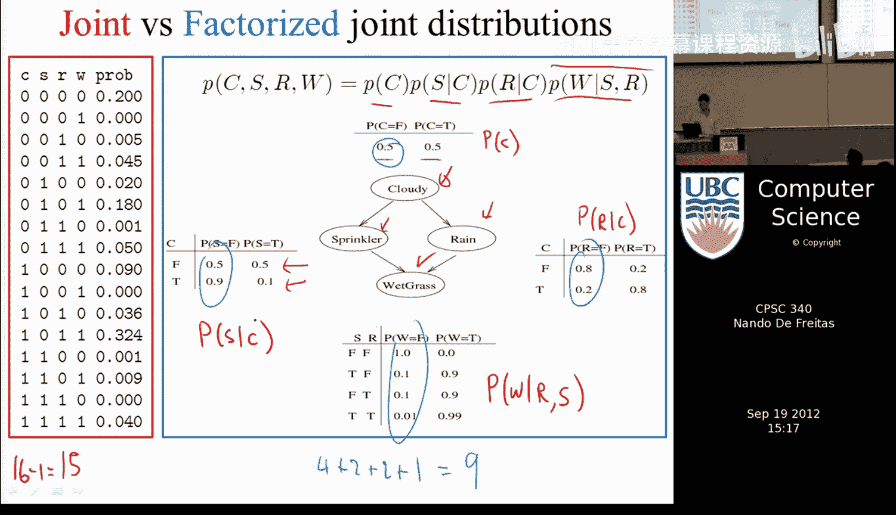

あ一个すま。mean it's the so let's assume so essentially what I'm saying is I have a node。

I'm going to call this variable X sign and youre going Xine the B for instance those temperature。

And let's assume that the temperature side。Ca都是好。And I'm putting use zero at home。

So I'm assuming all the variables are。Either 0 or 1 and then 1。Prob affected by。来週。的业啊这个。Presure。拜。

四啊。好。It01。The heater could be。好。And so each variable has a meaning and each variable site that takes the value0 over one。

 so for simplicity， we assuming that the variables are all binary。They can take more than one value。

 they can be like like I could have a variable that's dies and then sorry die。

 and then the die can take values one to three5。And那's辛苦。So when I say。

I keep it simple when I say P of X。这份。要话。Thank you。I'm basically talking about a distribution。So。

The given operator has precedes， so you should always read this。诶。priorityor of exc。

 given both year1 and U2。When something is given。It basically means that it has taken a value。

 It has been observed。 you might have， for example， zero。And话。So assume that if something is given。

 you know it's fine。Sometimes we're lazy and we don't say what the value is。

 we just say that it has been given。Its value is not。And so given the thing this body is a node。

 this is a probability for Xi。We have X idea here。Defordshire。And you have zero here。

We would have something like this。6。哦。And this is photograph of the ofX。我然。哪的。

I sure to get the photo of the ground。我。Pro of x I think0。播玩。So it's really one way to write it。

So these are only equivalent ways to write， one way to write。To write the 0。40。I是。Or as a vector。

 if you will， and then another way to write it。诶嗰个分。It as a graph。So with two bars。

 this bar tells you the probability it does zero， and in the other bars givess you。こらでま。Okay。

 but this object is。The pro this variable。What's a temperature high and what's a pro temperature？

And then what。Is that if I have this？Let's see， what affects the heat？And heat is affected by。花儿。

And let's say the power。Electricity。So if there's electricity。

 electricity is on the heater will be on and if the electricity is of the heater canop be。However。

 if you know that the heater is off， you don't need to know whether there's electricity to know that the temperature is not going to go up。

And so that's the intuition for you， so this R variable will disappear and you only basically care about the variable product。

To you in order to be able to compute this。What we're going to be doing in inference next is we're going to try to complete this now。

Up to now we haven't done any computation， but as we go forward。

 our task will be someone tells us this variable has this particular value。

 what's the value of this variable？And then knowing these properties that we going over is going to help us do the calculations more efficiently。

Okay， and so now what we're proving is that the probability of Xi， given all the other variables。

It's really only the proative X given its。那。Harrkness， children and parents。

Wwhich together we call the Marco blanket， and the term blanket is basically that once you have that blanket of those three guys。

 you can cover the knot。That's the name think came out。O。So。

If we wanted to know what's the probability that they excise on or off or both， in fact。

Then we would just use first the rule of crenting that PFA even B is just PFA and B divided by PFP。

要错。嗯。Next， we need to。We need to expand。So in particular， this is the probability of X。

 and now I'm going to just basically rewrite what x I is。嗯。And I need to normalize this。

And the way I normal this is by suming。But this has to be a probability of， this is a probability。

In terms of X， so the random variable is X， all the other variables we're assuming are given there to the right of the bar。

Here are our calculations？And so when you sum to make this sum to one， you。It must be true。

And you're stopping your right sign den nuator。You have an expression on top and you just need to sum when X is  zero and when X is1 at the bottom to make sure that you。

It some coupon， so。4 plus 。6。The other way to see it is the probability of x I by marginalization because。

 so x I。As we said here， x I is all these variables。啊。So in order to get it。You need to。

We few excellent on time。the sum of our X。F X high。Its not。

So if you put all the variables together and you integrate up Xi， you get just x I。

 so reusing the rule of marginalization of P of A is equal to the sum of P of P of A。

It's always the same two rules that I'm using。Minalization condition。And then it's just。

 I see a lot of terrifiedified faces out。So this is only true when。Like Xi， all the values of Xi。A。

S word。There's no overlap。there's no overlap， and particularly if you look at the picture。

 you see that Xi is X and the x node I is the other ver。😊。

Maybe notice the important thing is confusing when I say Xon I。

So it's important to realize that x not I。It's just a way to say everything that is not high。

That is not an X。It might be helpful to say this is actually probably that Xi takes the value of one。

 this is what were。Like what we're really collect is the probability that Xi takes the value one give and everything else because really just to say the probability of Xi is not really that meaningful Xi around。

This is the car that random event takes。the value， which in this case is one。That correct。

 so in this case you only need a probability that tag side takes a particular value。

 but if you have more than because the probability effect side being zero is just one minus the probability sideping1。

 but if you had more variables then you would need this。不他这个。It could be。

And so the rules that I'm using throughout are always these rules， U A and B。你是个叫 t k。暂叫 b。

In particular， in this case， I'm using it before P ofA， given B。It equal to here of A and B。

Dived by field。We're just ready the same thing've just。The other the size。And then the other role。

 there are using， so that's conditioning。And then the other role that I'm using throughout as much。

Which says the P a。Look at the sum over ultra。第体。For one。譬用诶。So。If you actually do pattern matching。

 you'll see that， well， in my expression there， x pi happens to be a。诶。When I use this。😔，や非。てこくら。

And then when I talk about， yeah。见啦你。Did you拍 much。With these two substitutions。

 you'll see that what I'm doing is just the basic rules of。Right。

And I'm using x and o tie just to group many variables into a single variable。

 so I don't have to write all the time R and U and Y instead。啊。Next。

I'm going to expand this a bit more。And I'm going to write this now as the probability of a graph。

So this is equal to the probability of X。Given the parents of XI， which are all used。

Times the probability。Overall， the notes J， P of Y J。Different。The parents of Yj， which are X。那你回上。

第二张。Times。Pro。Of all the remaining variables z。2。も当。

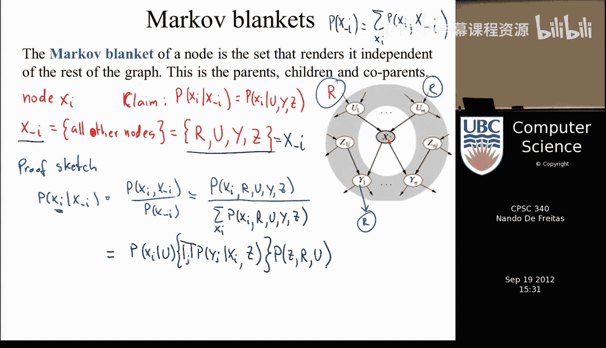

啦。Let's recall the definition of a graphical model。

 so a definition of a graphical model is the probability。

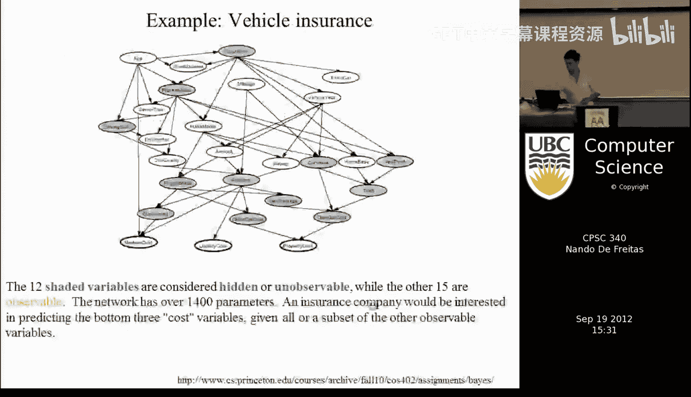

F to rise。Pro问你。Given the parents of that note， right， that was the simplification we made。

We still have not proven to you that。It seems to be good I'm giving all these property。

But I have not shown this to you with David。next。All I'm saying is this is the syntax andary representative the issued by the product of children given care。

So like in this case， we saw an example where it's a probability of coal given alarm。

 probability of alarm given both burglary and earthquake， probability of radio。

 given an earthquake and then you need a probability of。

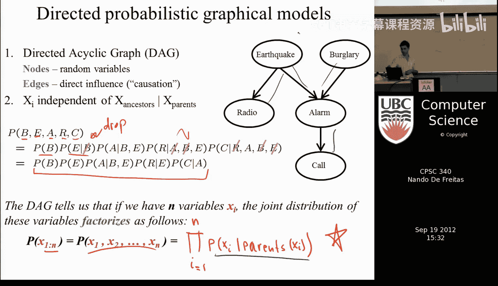

And you need a probability。And so here I'm going to do the same thing and approve。

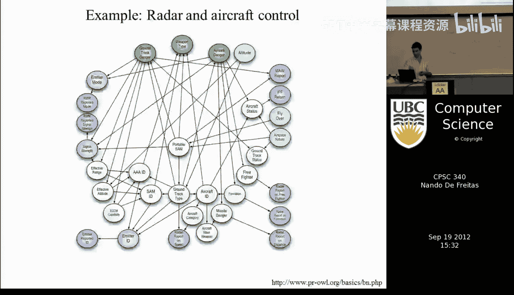

So I have you given the parents of you。These guys， I have why given its parent。

And then I would have R given its parents。Sorry， you given its parents and I wouldn't have said given its parents。

And I would have all the other Rs， but instead of writing them as a graphical model。

 I'm just going to put them all together group。Now the normalization factor for this。Is the sum？

Over Xi， and again， the denominator is just a thing that makes the numerator sum to one。

And because it's a distribution over exide， we need to sum overex things zero。Or one。

And then this was the question of writing the same tious exploration at the box。

And this is as scary as it gets in this course。It sells a nice， relaxing drink。あほれ。

放我 like your music。Okay， so I've just rever a double expression here it comes。

I'm going to answer your questions soon。Here comes to one thing I can do quickly。

What can I counsel in this expression？一些。Okay。처음。If you are probably。

 I can just cancel these guys because they don't depend on X item。And then if I look at this。

This is是。最こ。冇关知。X time。Time the probability。And instead of taking the product off lot。

I may not be lazy。The product of our older the children。Givenive x by。Don care。

Divided by the same stuff。Because the olive here here are。The parents of why。嗯。I think our。え。けそです。

The parenthe see is which one's the market？XI said。为佢嘅。あざいま。Okay， so yeah， good question。

 so I interpret this so the given operator has presence。So it's the probability of Yj。

And both X I and Z。And that's the proof。Quite simple， it took people。There。Thank all message。

If you want to know the probability of a variable being or off or being value 12 three，4。

 five or six。And in fact， as we will see later when I introduce continuous variables。

The probability of gasus and barrel will be being between a certain range。

It's completely independent of all the variables beyond its markov blank。

That means that if we want to。To ask a question， what's the probability of this variable。

 we only need to care about the mark of life。This is essentially the principle that leads to the design of algorithms。

When we have very large graphs， the algorithms that we use exploit just property。あ係対しし。

And that's the end of that charactervation。

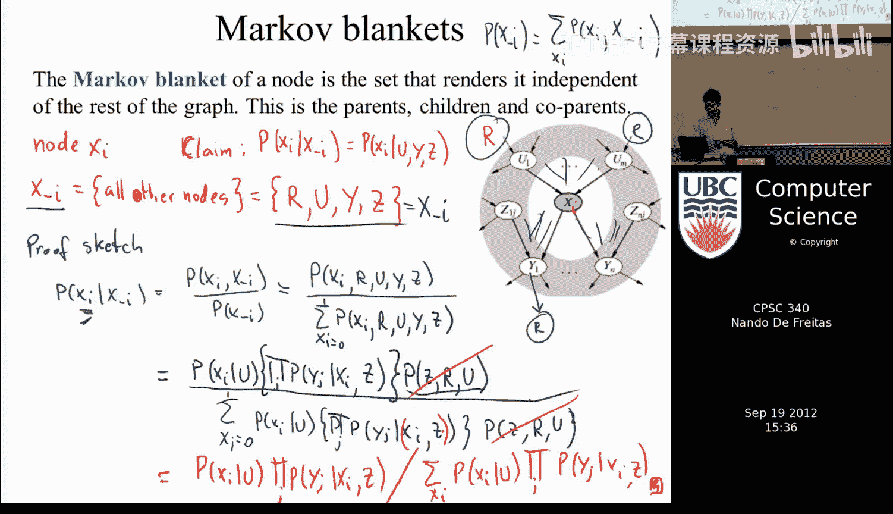

And now let's look at。

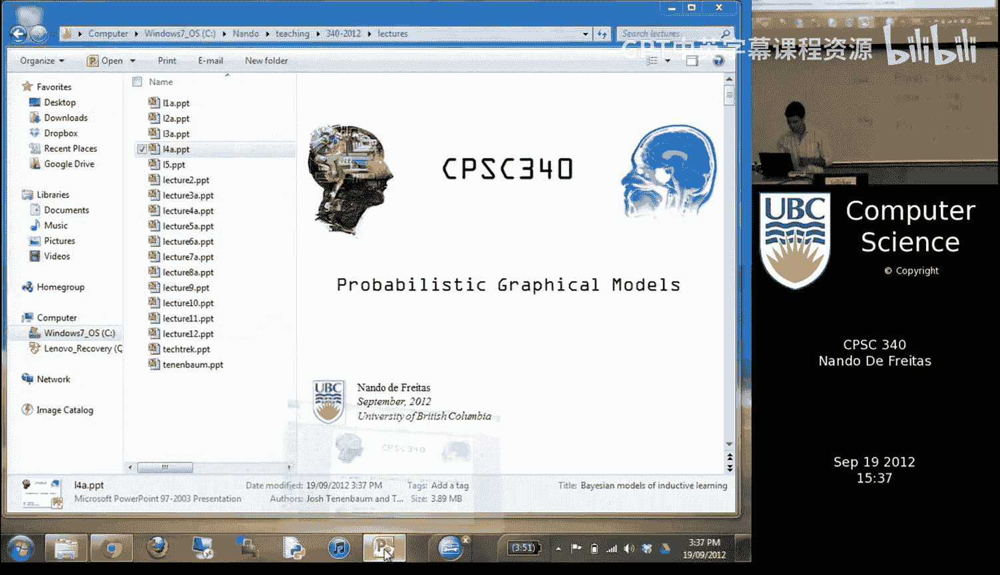

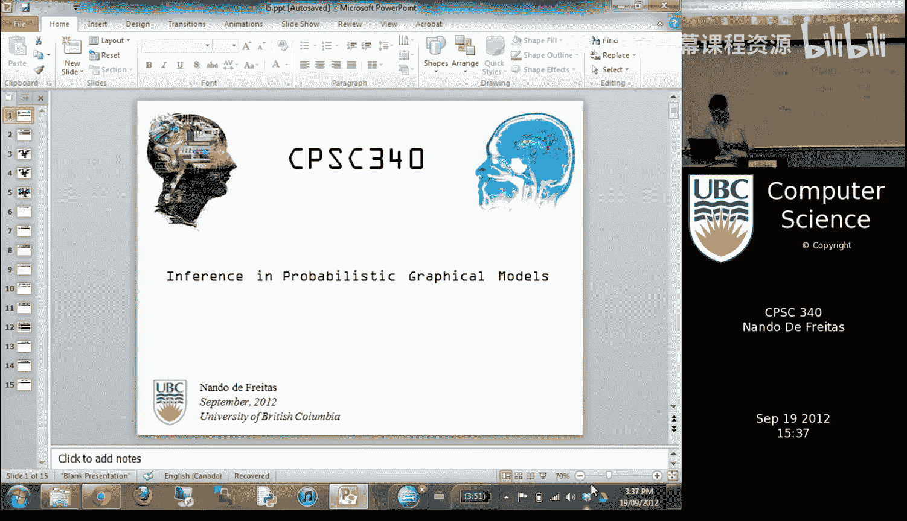

You mentioned that you have to just look at the markov blanket。

 but doesn't that depend on what the degree of variance is between it and the next like the sort of clustering of。

Is't that bearing on that though if you know the values of the variables in your Markov blanket。

 you don't need to know anything beyond。Beve the proof。Al right if you don't believe the truth。

 go home。Dhrrow a graph like this， put it names to friends and girlfriends。I start。

During manipulations。唔思嘅。で。Inscriptly， it's not entirely obvious。Find core result。れ the most好。

Like when you were able to replace it with。So。For undirect graphical models。

 you're worried about the graph not being direct。I feel like this whole proof is just to kind of my。

每次这。responsepon。Oh， but this that was an arbitrary to the extent that it was directed and a cyclic。

Beyond that， it's arbitrary。You could draw any graph， you know you know， I drew it in a way that。

And note one can only have parents， children compare or any other stuff there's no other possible。

Gs you could draw that sat the directed in acycl topic。So those things aren't true。

If it had cycles or yeah， I just imagine that I point to myself。

But you wouldn't want to do that anyway。You're getting to like。

Sly logical bias if we introduce these weird drugss。There is other kinds of graphs though。

 which are not covered in with course， which are the undirected graphs， the random field and so。

For those graphs， we also have semantics， which are slightly different， however they are compatible。

You can actually map one mathematical framework to the other， so it's all consistent。And there wasそ。

Are transit images in these graphs okay are transit images in these graphs okay us？A influences B。

 B influences C and A influences C。 Yeah that's cool that's okay Yeah that doesn't form a site so that's a very good question。

a girl。

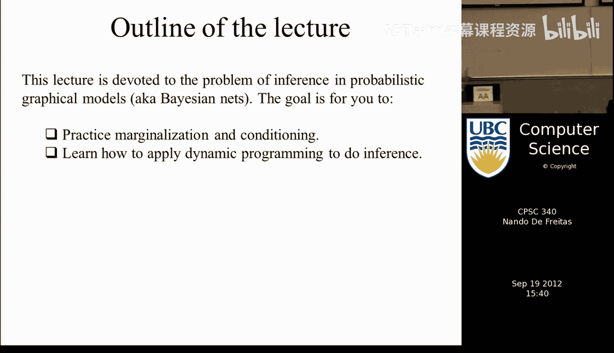

，Let me try to drawing here。What was suggestion was one。Okay。

 we saw a lot of that when we look at the regulatory networks。That was kind of common， actually。

Under graph of the jeans this one。Thats the last lecture had。This type of stretch。

But these directed on thecyclic， they're not very restrictive properties。

 you can model many things as we saw last week。Marketing campaigns to。Military application。

Medicine and so on。They're quite powerful。 Thistract system。

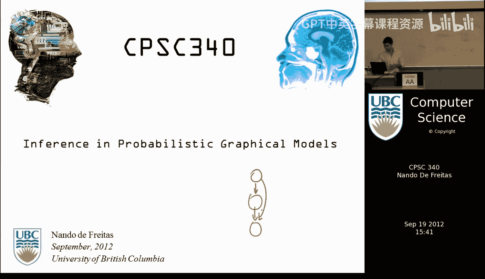

好 right。Newear lecture and I think I've tried to make sure that each calendar entry matches one lecture。

 but I think。I'm going to delay it by one lecture。And we're going to do this today and Friday and I'm going to H of Monday。

Mar， so this lecture is now going to address this other question of how do we compute these probabilities？

He， we're going to start doing some computations， so so far I let me explain to you what is a graphical model？

It's a school tool that seems to be the curse of dimensionality and can。

It has all these independence， nice independence profit。然我。

We're going to learn how to actually use this to do supplement。And next week， on Monday。

 we're going to introduce an application of this called a hiddenden Mark of。Moveel。

 who's heard of in a markov models or HMs？这每。Bio sequence linematics here。F speech recognition。Sri。

To think this。啊。M find chrommatics use， such a very widely used model， and well be able to。

You guys说到的。It's actually not time follows。

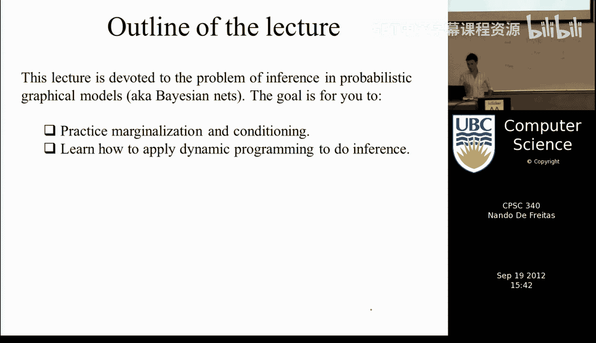

Okay， so what is inference？Inference is the process of answering， it's a way of doing queries。

In knowね。Let's assume that we have this network that consists of five random variables。

 and let's say that we observe a variable。Let's say that you're driving on a highway and you get a call that says that your alert is on。

Okay， so we shade the node to indicate that that note has been observed。

The shaded notes needs an observation。So， you get a call。And now。

Inference is about computing the probability。Of whether there's an earthquake。Borard ofburglary。

Give meant that you receive them。Given that coal is true， so the coal is false。True。

 if you get a call， then it's true。Youre either get a call。 You don't get a call。

 But when you get a call。The chances are that。There was either aburg or that there was a nurse。

And initially， you might use just the tables of the graph the probabilities to compute that。

We're going to learn on Friday how to compute these probabilities。

After to automatically compute probability that it in a burglar。Or than the probability that。

There was。There wast that。Now let's assume that in addition you switch on the radio and say that radio is a variable that is on means that。

It's telling that there is an earthquake and zero means it telling。

It's not telling me that there was an earthquake， but let's assume if you switch on the radio and the radio tells you there was an earthquake today。

Now， the question is。A my current probabilities good？Or should I update it？so I update them。

 so now it's much more probable that there was indeed an article。If this is。truee。And this is false。

And like here to answer， like a question was asked about。

 sometimes you just need to complete the probability of true because the probability of false is one minus the probability of true。

So I only focus on building them。And likewise the probotypical bur though。

So probilistic inference has this property，You have a graph as you're observing these nodes。

You're automatically recalculating the probabilities of all the other nodes， so at any point in time。

You have a good sense of what weather does system is， what values？You know whether it's been Bkeley？

You know what a de lime is on， you know with a different earthquake and so on。

You don't know it exactly， but you only know it in a probabilistic sense。

Because maybe the radio is telling you there was an earthquake。

 but the radio hasn't told you where they earthquake quickly。そこ是多さので。

This phenomenon of being able to。Aquire a new variable that allows you to。

Thecern between two events big happening is called explainplaining away， in other words。

 we didn't know whether there was aburglar or earthquake， but once we get the regular report。

 we are able to explain。呃 what what has他。快啲。Oh yes， you could also have a burglary and an earthquake。

That's why you still have a little bit of probability here。

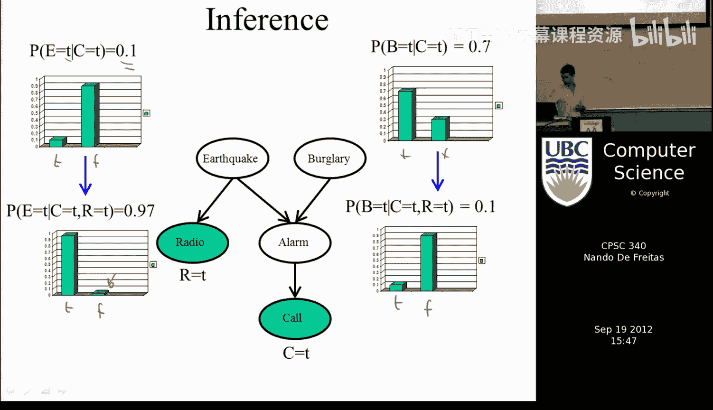

Okay。Now。We also introduced this graph in the last class。

 which was something that I we're going to call the sprinkler network and the rest of this lecture decides in this lecture will make use of the sprinkle network。

We're going to ask all sorts of questions about this spring。😔。

The first question that we're going to ask。And let's assume that all these numbers not being give。

Someone told us that the probability of being cloudy is 0。5。Not Vancouver。Okay。

Someone said that the probability。The probability that a sprinkler is not on or。Otherwise， F。Given的。

It is cloudy。I equal to。point。9， and so on。So that's what key numbers to do。

 these numbers give us all the tables， and now I might want to ask the following question。

What's the probability？诶 it is。What is the probability that the sprinkler is on。

 given that the grass is wet？SoI'm buildinging observations。I would like to answer questions。会。

And there's two ways to do this。There's the dumb wave， which is exponential computation。

 and there is a smart way which will be。Sort of holding on and in fact。

 for H of M will be holding on。And that's what we're going to do in the nice class。

 we're going to do this the two ways。And then you'll see how to actually do inference efficiently。

And that will refer us to the Cha maps。

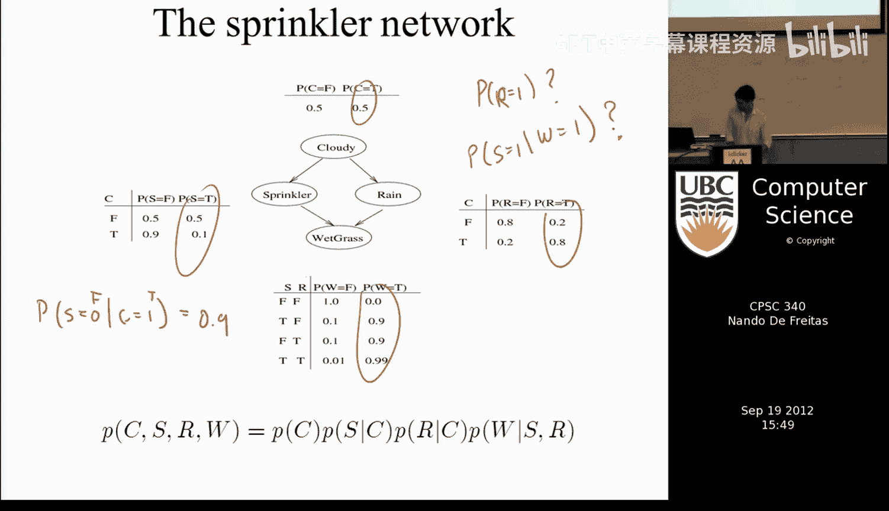

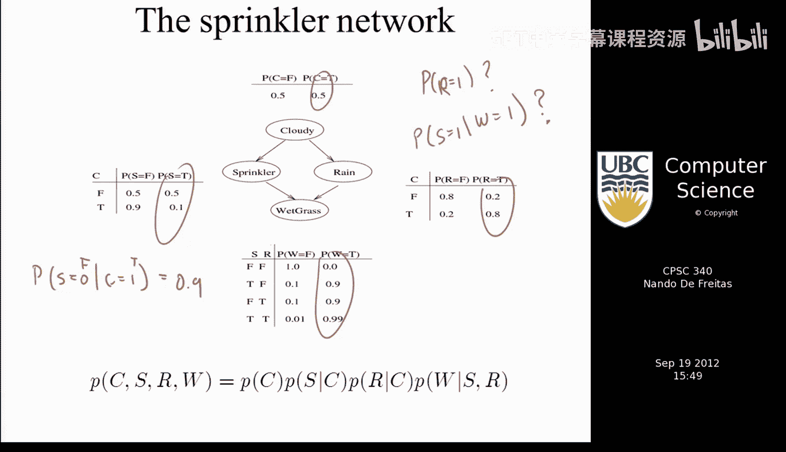